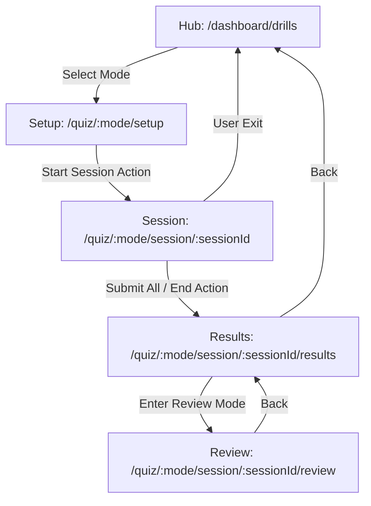

# Drill / Quiz Route Flow Map

**Date:** 2026-04-18
**Status:** In-Progress Audit Map

## 1. Verified Route Map

| Route | Purpose | Type | Entrypoint File |
|-------|---------|------|-----------------|
| `/quiz` | Main entry point | Hub (Redirect) | `src/app/quiz/page.tsx` |
| `/dashboard/drills` | Drills / Testing Hub | Hub | `src/app/dashboard/drills/page.tsx` |
| `/quiz/[mode]/setup` | Session configuration | Setup | `src/app/quiz/[mode]/setup/page.tsx` |
| `/quiz/[mode]/session/[sessionId]` | Active session | Session | `src/app/quiz/[mode]/session/[sessionId]/page.tsx` |
| `/quiz/[mode]/session/[sessionId]/results` | Final session results | Results | `src/app/quiz/[mode]/session/[sessionId]/results/page.tsx` |
| `/quiz/[mode]/session/[sessionId]/review` | Question-by-question review | Review | `src/app/quiz/[mode]/session/[sessionId]/review/page.tsx` |

## 2. Core Flow Transitions

## 3. Persistence & Auth Touchpoints

- **Start Session Action**: `src/lib/actions/quiz-v2/start-session.ts`
  - Auth: `getUser()`, `getViewerEntitlements()`
  - Write: `quiz_sessions` (INSERT)
- **Submit Answer Action**: `src/lib/actions/quiz-v2/submit-answer.ts`
  - Write: `user_interactions` (UPSERT), `user_question_states` (via trigger), `cage_binding_tokens` (if CAGE active)
- **End Session Action**: `src/lib/actions/quiz-v2/end-session.ts`
  - Read: `user_interactions`, `quiz_sessions`
  - Write: `quiz_sessions` (UPDATE status to 'completed'), `user_global_stats` (Readiness Score recompute)
- **Review Data Fetch**: `src/lib/actions/quiz-v2/get-review-data.ts`
  - Read: `quiz_sessions`, `user_interactions`, `questions`, `taxonomy_tree`
