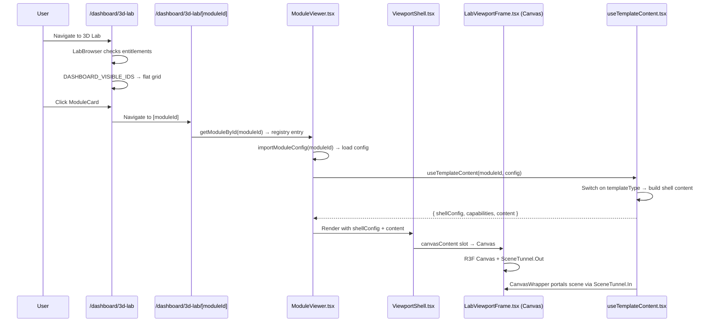

# 03 — Existing 3D Lab Audit

## Summary

The 3D Lab feature is a mature, architecturally sophisticated 3D module system. It uses a template-driven architecture where 7 template types (parametric, exploded, cutaway, floorplan, animated, calculator, wall-configurator) produce different shell layouts and scene content through a shared `ViewportShell` + `LabViewportFrame` + `CanvasWrapper` pipeline. The R3F Canvas is singlet per module page via `SceneTunnel` portals, avoiding multiple WebGL contexts.

## Current 3D Lab User Flow



## Route Architecture

| Route | File | Purpose |
|-------|------|---------|
| `/dashboard/3d-lab` | `src/app/dashboard/3d-lab/page.tsx` | Dashboard — LabBrowser with entitlement gate |
| `/dashboard/3d-lab` (layout) | `src/app/dashboard/3d-lab/layout.tsx` | ExploreLayout wrapper (client component) |
| `/dashboard/3d-lab/[moduleId]` | `src/app/dashboard/3d-lab/[moduleId]/page.tsx` | Module page — ModuleViewer |
| `/dashboard/3d-lab/[moduleId]` (loading) | `src/app/dashboard/3d-lab/[moduleId]/loading.tsx` | Loading state |
| `/dashboard/3d-lab/loading.tsx` | `src/app/dashboard/3d-lab/loading.tsx` | Dashboard loading state |
| `/dashboard/3d-lab/error.tsx` | `src/app/dashboard/3d-lab/error.tsx` | Error boundary |

## Dashboard Architecture

### LabBrowser (`src/features/3d-lab/components/LabBrowser.tsx`)

Two modes based on `DASHBOARD_VISIBLE_IDS`:

1. **Simplified mode** (current active): When `DASHBOARD_VISIBLE_IDS.size > 0`, renders a flat grid of ModuleCards from the allowlist
2. **Category drill-down** (inactive): When set is empty, renders CategoryGrid → ModuleList drill-down

Current dashboard modules: `site-development-controls`, `stairway-configurator`, `calculator-flooring`, `unified-wall-configurator`, `bp344-accessible-route-ramp`

### ModuleCard (`src/features/3d-lab/components/ModuleCard.tsx`)

Displays:
- Template type badge (Parametric, Exploded, Cutaway, etc.) with icon
- Status badge (Available, QA Preview, Coming Soon)
- Title
- Description (2-line clamp)
- Code reference

Uses `TEMPLATE_META` record keyed by `TemplateType` for badge styling.

### CategoryGrid (`src/features/3d-lab/components/CategoryGrid.tsx`)

16 LEA-aligned categories grouped under 7 LEA subject headings. Each category card shows icon, module count, phase badge, and description.

### ModuleList (`src/features/3d-lab/components/ModuleList.tsx`)

Category drill-down view with breadcrumb, search, and filtered module grid.

## Viewport Architecture

### LabViewportFrame (`src/features/3d-lab/components/shell/LabViewportFrame.tsx`)

The single R3F Canvas host for all 3D Lab modules:
- Renders `<Canvas>` from `@react-three/fiber` with `frameloop="demand"`
- Configures DRACO decoder globally
- Adaptive DPR (mobile: 1.25 max, desktop: 2 max)
- `PerformanceMonitor` for automatic DPR adjustment
- WebGL support detection and fallback
- `SceneTunnel.Out` for portal-based scene composition
- DOM overlay layer for 2D projections
- Slow-scene detection (12s timeout)
- 16×16 SVG cursor data-URIs for orbit/pan

### CanvasWrapper (`src/features/3d-lab/components/CanvasWrapper.tsx`)

Per-module scene configuration wrapper:
- `SceneTunnel.In` portals content into the shared Canvas
- `SceneConfig` for camera, controls, lighting, environment
- `CameraSync` for camera state synchronization
- `SceneGround` for GizmoHelper + Grid
- `CanvasLoadingOverlay` for loading states
- `InvalidateRegistrar` for on-demand render invalidation

### ViewportShell (`src/features/3d-lab/components/shell/ViewportShell.tsx`)

THE universal layout container for all modules. CSS Grid:
```
[optional-left-sidebar] [handle] [viewport 1fr] [handle] [optional-right-sidebar]
```
Features:
- Collapsible sidebars with CSS transition
- Dynamic cursor (orbit/pan)
- Shared toolbar overlay (SceneToolbar, LayersPanel, CameraNavigationBar)
- WebGL recovery overlay
- Viewport toasts
- First-time tooltip
- Context menu
- Command palette
- Mobile: flex column + bottom sheet
- Slot-based content injection via `ViewportShellContent`

### useTemplateContent Hook (`src/features/3d-lab/hooks/useTemplateContent.tsx`)

The central orchestration hook. Switches on `templateType` to produce:
- `shellConfig` (sidebar visibility, widths, titles)
- `capabilities` (camera presets, view modes, cross-section, etc.)
- `content` (canvasContent, sidebar content, status bar, toolbar extras)

Each template type produces different slot content:
- **parametric**: GenericControlPanel (left) + ComplianceReportPanel/SourceCompliancePanel (right)
- **exploded**: ExplodedPartsSidebar (right) + ExplodeSliderControl
- **cutaway**: CutawayLayersSidebar (right) + CutDepthSliderControl
- **floorplan**: GenericControlPanel (left) + FloorPlanLegendSidebar (right)
- **animated**: AnimatedStepsSidebar (right)
- **calculator**: CalculatorTemplateSlot (3-panel layout)
- **wall-configurator**: ConfigPanel (left) + BOMPanel (right) or custom panels for v2

### Template Defaults (`TEMPLATE_SHELL_DEFAULTS`)

Each template type has predefined shell + capability defaults:

| Template Type | Left Sidebar | Right Sidebar | Status Bar |
|---------------|-------------|---------------|------------|
| parametric | 320px Controls | 300px Details | Yes |
| exploded | 320px Module | 300px Parts | Yes |
| cutaway | 320px Module | 300px Layers | Yes |
| floorplan | 320px Controls | 300px Legend | Yes |
| animated | 320px Module | 300px Steps | Yes |
| calculator | 340px Inputs | 340px Results | Yes |
| wall-configurator | 340px Configure | 320px Materials | Yes |

### ModuleViewer (`src/features/3d-lab/components/ModuleViewer.tsx`)

Orchestrates module loading and display:
1. `getModuleById(modelId)` — registry lookup
2. `importModuleConfig(modelId)` — dynamic import of module config
3. `useTemplateContent(modelId, config)` — build shell content
4. Render `ViewportShell` with content from hook
5. Handle loading, error, onboarding states

### Legacy Scene Routing (LabViewport)

The `LabViewport` component handles legacy hardcoded scenes and template-driven modules:
- Legacy: FARPlayground, ClassicalOrders (dynamic imports)
- Bespoke: SiteControls (DevControlsModule)
- Template: routes to TemplateModuleWrapper → template-specific components
- Default: Workspace (GLTF model viewer)

## Module Config / Data Model

### Registry Entry (`ModuleRegistryEntry`)

```typescript
interface ModuleRegistryEntry {
  id: string
  title: string
  templateType: TemplateType  // parametric | exploded | floorplan | cutaway | animated | calculator | wall-configurator
  subject: string
  categoryId?: CategoryKey    // 16-category taxonomy key
  launchPhase?: LaunchPhase    // 1 | 2 | 3
  codeRef?: string
  priority?: number
  status: ModuleStatus         // 'built' | 'ready' | 'planned'
  description?: string
  thumbnail?: string
  contextScenario?: string
  leaQuestionCount?: number
  supportedPhases?: Array<'guided' | 'faded' | 'sandbox' | 'challenge'>
  assets?: { models?: string[]; textures?: string[] }
}
```

### Template Configs

Each template type has its own config interface (e.g., `ParametricSceneConfig`, `ExplodedAssemblyConfig`). Configs are dynamic-imported TypeScript modules. Example path: `src/features/3d-lab/config/modules/08-vertical/stairway-configurator.ts`.

### Module Registry

187 entries in `ALL_MODULES` across 16 category files (`cat-01.ts` through `cat-16.ts`). Helper functions: `getModuleById()`, `getModulesByCategory()`, `getModulesByTemplate()`, `getModulesByPhase()`.

## State Management

| Store | File | Purpose | PI-Specific? |
|-------|------|---------|-------------|
| `useLabNavigationStore` | `stores/useLabNavigationStore.ts` | Sequence index, explore mode | Partially |
| `useLabProgressStore` | `stores/useLabProgressStore.ts` | Parametric values, compliance | Yes (parametric) |
| `useLabViewStore` | `stores/useLabViewStore.ts` | Hotspot, panel, quiz state | Partially |
| `useLabStore` | `stores/useLabStore.ts` | Combined re-export of above 3 | Partially |
| `useViewportShellStore` | `stores/useViewportShellStore.ts` | Sidebar collapse, grid/dim/xray, panels | No (generic) |
| `createModuleStore` | `stores/createModuleStore.ts` | Per-module Zustand store factory | No (generic) |
| `legacyLabStore` | `stores/legacyLabStore.ts` | Legacy R3F bridge | Deprecated |
| `nbcpStore` | `stores/nbcpStore.ts` | NBCP-specific state | Yes |
| `useWallLabStore` | `stores/useWallLabStore.ts` | Wall configurator state | Yes |
| `useOverlayStore` | `stores/useOverlayStore.ts` | Overlay position state | No (generic) |

## Styling & Layout

- Tailwind CSS v4 with CSS-based config (no `tailwind.config.*`)
- Design tokens: `--primary`, `--muted-foreground`, `--card`, `--border`, etc.
- Custom classes: `bg-surface-light`, `text-text-secondary`, `border-border-default`
- Font: Plus Jakarta Sans (body), DM Mono (code references)
- Viewport shell uses CSS Grid with transition animations
- Mobile responsive: grid hidden, flex column + bottom sheet

## Asset / Model Loading

- GLB/GLTF via `useGLTF` from `@react-three/drei`
- DRACO mesh compression support (`setDecoderPath('/draco/')`)
- Dynamic imports for all 3D components (`ssr: false`)
- `AssetPreloader` component for loading progress
- `CanvasLoadingOverlay` for initial load states
- Programmatic geometry via `GeometryInstruction` system (box, cylinder, plane, etc.)
- No texture preloading pipeline in MVP

## Existing Tests

15 test files in `src/features/3d-lab/`:
- Module config tests (stairway, bp344, module-paths, registry)
- Utility tests (isometric-camera-fit, nbcpCalculator, camera-presets)
- Store tests (useViewportShellStore, useDevControlsStore)
- Component tests (onboarding state)
- Constants tests (nbcp)

1 E2E test: `e2e/authenticated-demo-3d-lab.spec.ts` — 3 test cases

## Gaps / Unknowns

1. **Module config authoring workflow** — How are new module configs created? Is there a CLI or manual process?
2. **Thumbnail generation** — Are module card thumbnails screenshots or manually created?
3. **Performance benchmarks** — No formal performance regression tests
4. **Full module catalog review** — 187 planned modules, only a few built
5. **Supabase integration depth** — `models_3d` table exists but current modules use static TS configs

## What Appears Reusable for LI

| Component/Pattern | Reusable? | Notes |
|------------------|-----------|-------|
| LabViewportFrame | **Yes** | Single Canvas host; LI content portals through SceneTunnel |
| CanvasWrapper | **Yes** | Per-module scene config; LI uses with simpler camera |
| ViewportShell | **Yes** | Already config-driven; LI uses different config |
| ViewportShellContent interface | **Yes** | LI fills same slots |
| useTemplateContent pattern | **Yes** | LI adds new template case |
| SceneTunnel portal pattern | **Yes** | Already designed for multi-module composition |
| SceneConfig | **Yes** | LI can use simpler config |
| SceneToolbar | **Yes** | Shared toolbar overlay |
| LayersPanel | **Yes** | Already supports module-specific children |
| CameraNavigationBar | **Yes** | Camera presets work for any scene |
| ModuleRegistryEntry | **Yes** | Extend with mode field |
| ModuleCard | **Yes** | Add PI/LI badge |
| LabBrowser | **Yes** | Add mode filter |
| createModuleStore | **Yes** | LI creates store with layer defaults |
| Dynamic imports | **Yes** | LI components use same pattern |
| Test infrastructure | **Yes** | Same Vitest + Playwright |

## What Is PI-Specific (Not Directly Reusable)

| Component/Pattern | Why PI-Specific |
|------------------|-----------------|
| GenericControlPanel | Parameter sliders, dropdowns — not needed for LI |
| ComplianceReportPanel | Violation lists — PI-specific |
| SourceCompliancePanel | Source truth — PI-specific |
| parametricValues state | Slider-driven params — not needed for LI |
| ParameterDef type | Slider/toggle/dropdown definitions — LI uses different control model |
| ParametricSceneRenderer | Dynamic geometry from params — LI uses static/show-hide geometry |
| ViolationRule checks | Compliance logic — PI-specific |
| ExplodeSliderControl | Explosion parameter — PI-specific |
| CutDepthSliderControl | Cutaway depth — PI-specific |
