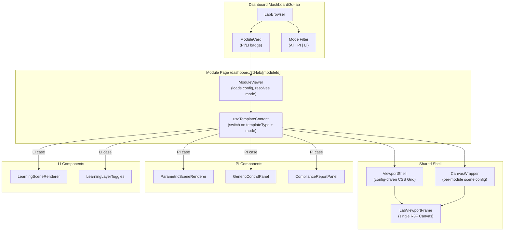
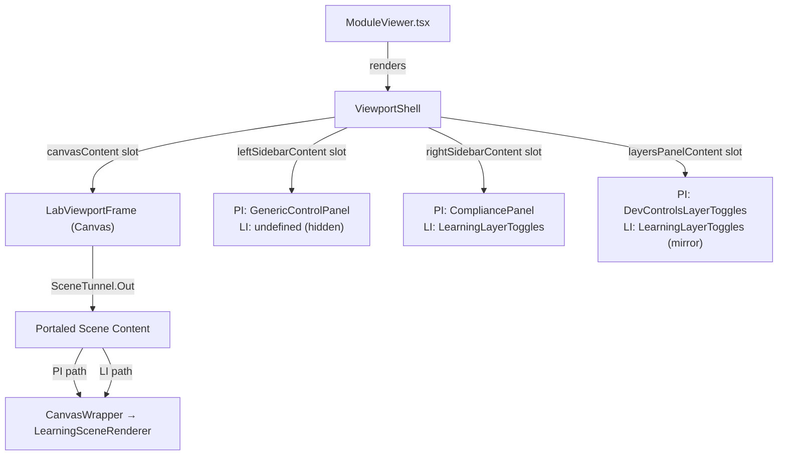
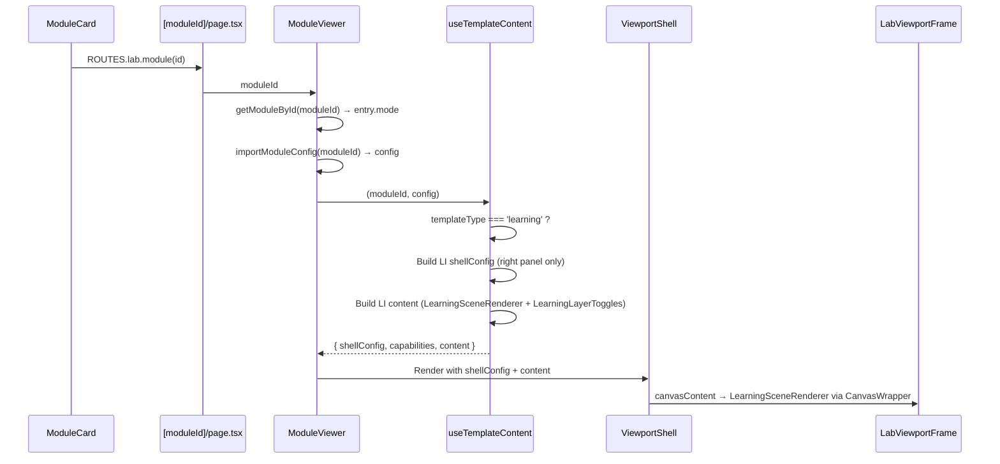

# 07 — Architecture Proposal

## Proposed Architecture for PI + LI



## Key Architecture Decision: Data-Driven Mode Resolution

The mode is determined by the module's registry entry, not by the route. This means:

- Route stays as `/dashboard/3d-lab/[moduleId]`
- `ModuleViewer` calls `getModuleById(moduleId)` → reads `mode` field
- `useTemplateContent` gets the mode and dispatches to PI or LI content builders
- No route-aware code needed anywhere
- Deep links work identically for PI and LI

## Component Composition



## Mode Abstraction Strategy

Rather than creating an abstract "Mode" system (which risks over-engineering), we simply:

1. Add `mode` field to `ModuleRegistryEntry` (optional, defaults to `'PI'`)
2. Add `'learning'` to `TemplateType` union
3. Add LI case to `useTemplateContent` switch
4. Add LI entries to `TEMPLATE_SHELL_DEFAULTS`
5. Add LI entry to `TEMPLATE_META` in `ModuleCard`

This is the thinnest possible abstraction — no new abstraction layer, just new variants in existing switches.

## Data Flow



## Proposed File/Folder Structure for LI Implementation

```
src/features/3d-lab/
├── components/
│   └── learning/                          # NEW: LI-specific components
│       ├── LearningSceneRenderer.tsx       # LI scene renderer
│       ├── LearningLayerToggles.tsx        # Layer toggle UI
│       └── index.ts                        # Barrel export
├── templates/
│   └── LearningScene.tsx                   # Could reuse parametric pattern or be separate
├── config/
│   └── modules/
│       └── [category]/                     # LI modules alongside PI modules
│           └── [li-module-id].ts           # LI module config (same pattern as PI)
├── types/
│   └── templates.ts                        # MODIFIED: add 'learning' to TemplateType
│                                           # MODIFIED: add mode field
│                                           # ADD: LearningLayerDef, LearningSceneConfig
```

## Options Analysis

### Option A: Route-Level Mode Separation

Routes: `/dashboard/3d-lab/pi/[moduleId]` and `/dashboard/3d-lab/li/[moduleId]`

**Pros:**
- Clear URL distinction
- Easy to route-guard by mode
- Could have different layouts per route

**Cons:**
- Breaks all existing PI deep links (redirect needed)
- Two page files to maintain
- Mode is in URL AND data (redundant)
- Harder to change a module's mode later
- More complex routing

**Verdict: ❌ Not recommended — unnecessary URL churn**

### Option B: Data-Driven Mode Selection (RECOMMENDED)

Route: `/dashboard/3d-lab/[moduleId]` (unchanged). Mode resolved from registry.

**Pros:**
- Zero route changes
- No redirects needed
- Single page file serves both modes
- Mode can change without URL changes
- Simple, thin addition

**Cons:**
- URL doesn't indicate mode (not important for MVP)
- Single page must handle both modes (already does via templateType switch)

**Verdict: ✅ RECOMMENDED — simplest, safest, most backward-compatible**

### Option C: Shared Route with Mode Renderer

Route: `/dashboard/3d-lab/[moduleId]`. Separate ModeRenderer component dispatches to PI or LI.

**Pros:**
- Clean separation of PI and LI rendering logic
- Could be extracted later from Option B

**Cons:**
- Adds an unnecessary abstraction layer
- useTemplateContent already dispatches by templateType

**Verdict: ⚠️ Viable but over-engineered for MVP — Option B is thinner**

### Option D: Fully Separate LI Feature

Routes: `/dashboard/3d-lab/` (PI) and `/dashboard/li-lab/` (LI) — separate page, separate components.

**Pros:**
- Complete isolation — zero PI regression risk
- Could evolve independently

**Cons:**
- Duplicates viewport infrastructure (Canvas, shell, toolbar)
- Duplicates dashboard concepts
- Confusing for users (two "lab" features)
- Much more code to write and maintain
- Violates DRY principle

**Verdict: ❌ Not recommended — excessive duplication**

## Recommended: Option B (Data-Driven Mode Resolution)

This is the clear winner. It:
- Adds minimal code (~200-300 lines for MVP)
- Touches only existing extension points
- Carries zero risk of breaking PI routes or deep links
- Follows the exact same pattern as adding any new template type
- The template type system was designed for exactly this kind of extension

## Data + Route + Component Relationship

```
ModuleRegistryEntry
├── id: "my-li-module"
├── mode: "LI"              ← NEW FIELD
├── templateType: "learning" ← NEW TEMPLATE TYPE
├── categoryId: "ACCESSIBILITY"
└── ...existing fields...

         ↓ getModuleById()

ModuleViewer
├── reads mode from entry
├── importModuleConfig(id) → LearningSceneConfig
└── useTemplateContent(id, config)
    └── case 'learning':
        ├── shellConfig: { rightSidebar: { width: 280 }, leftSidebar: false, statusBar: true }
        ├── capabilities: { cameraPresets: true, resetCamera: true, ... }
        └── content:
            ├── canvasContent: CanvasWrapper → LearningSceneRenderer
            └── rightSidebarContent: LearningLayerToggles
```
