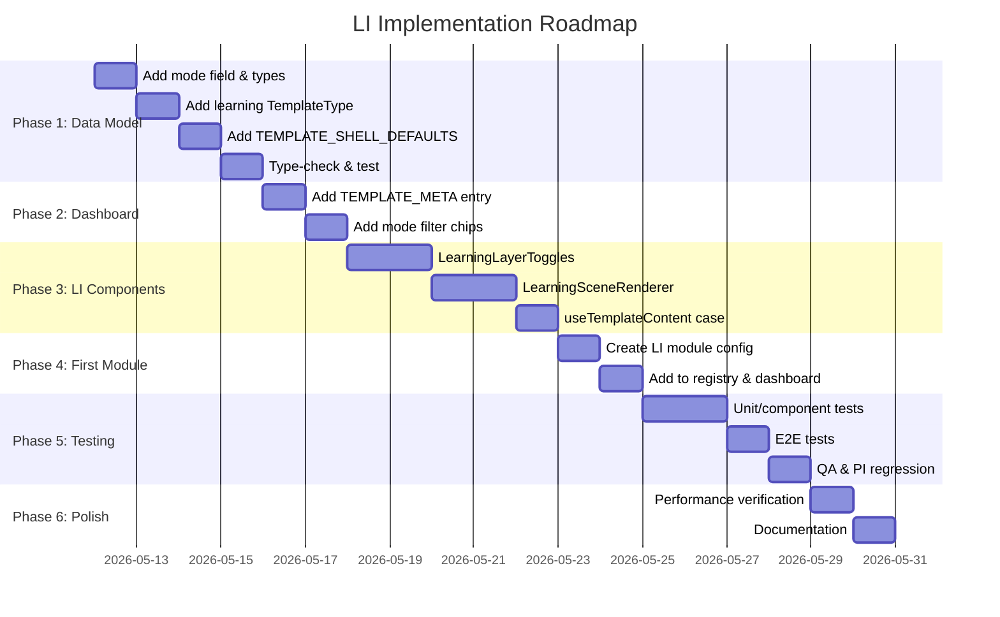

# 17 — Implementation Roadmap

## Phased Plan Overview



## Phase 1: Data Model & Types (No Behavioral Change)

### Goal
Add all necessary types and config defaults. Zero behavioral impact — no LI module renders yet.

### Scope
1. Add `InteractionMode = 'PI' | 'LI'` type
2. Add `'learning'` to `TemplateType` union
3. Add `mode?: InteractionMode` to `ModuleRegistryEntry`
4. Add `LearningLayerDef` and `LearningSceneConfig` types
5. Add `'learning'` to `ModuleConfig` discriminated union
6. Add `'learning'` entry to `TEMPLATE_SHELL_DEFAULTS`
7. Add `'learning'` entry to `TEMPLATE_META` in ModuleCard (no visible effect yet — no LI modules in registry)

### Files Touched
- `src/features/3d-lab/types/templates.ts` — type additions + defaults
- `src/features/3d-lab/components/ModuleCard.tsx` — TEMPLATE_META entry

### Tests
- `bun run type-check` passes
- Existing tests pass unchanged
- New type-level test for LearningSceneConfig

### Risks
- TypeScript exhaustiveness checks force all switches to handle `'learning'`
  - **Mitigation**: Add default cases to all existing switches before adding `'learning'`

### Acceptance Criteria
- TypeScript compiles without errors
- All existing tests pass
- `TEMPLATE_META` has `'learning'` entry
- `TEMPLATE_SHELL_DEFAULTS` has `'learning'` entry

---

## Phase 2: Dashboard Badge & Filter

### Goal
Add PI/LI visual distinction to dashboard cards and mode filter chips.

### Scope
1. Confirm `'learning'` entry in `TEMPLATE_META` displays correctly
2. Add mode filter chips to LabBrowser
3. Add `mode` field resolution in filter logic
4. Feature-flag the filter UI

### Files Touched
- `src/features/3d-lab/components/LabBrowser.tsx` — filter chips + mode filtering
- `src/features/3d-lab/components/ModuleCard.tsx` — badge verification (already added in Phase 1)

### Implementation Notes
- Add state: `const [modeFilter, setModeFilter] = useState<'all' | 'PI' | 'LI'>('all')`
- Filter logic: `dashboardModules.filter(m => modeFilter === 'all' || (m.mode ?? 'PI') === modeFilter)`
- Show filter chips only when LI modules exist AND feature flag is on
- Chips: `[All (5)] [Parametric (4)] [Learning (1)]`

### Tests
- Unit: LabBrowser filter logic
- Component: Filter chips render and filter correctly
- Visual: PI cards show existing badges unchanged

### Risks
- Feature flag not set → filter doesn't appear (intentional, low risk)

### Acceptance Criteria
- Dashboard shows PI/LI badges on cards (when LI modules exist in registry)
- Mode filter chips filter modules correctly
- "All" shows all modules
- "Parametric" shows only PI modules
- "Learning" shows only LI modules
- No visible change when no LI modules exist

---

## Phase 3: LI Scene Renderer & Layer Toggles

### Goal
Create the core LI components that render the 3D scene and layer toggle UI.

### Scope
1. Create `LearningSceneRenderer` component
2. Create `LearningLayerToggles` component
3. Add `case 'learning'` to `useTemplateContent` switch
4. Wire up module store creation for LI

### Files Touched
- **NEW**: `src/features/3d-lab/components/learning/LearningSceneRenderer.tsx`
- **NEW**: `src/features/3d-lab/components/learning/LearningLayerToggles.tsx`
- **NEW**: `src/features/3d-lab/components/learning/index.ts`
- `src/features/3d-lab/hooks/useTemplateContent.tsx` — add `case 'learning'`

### Implementation Notes

**LearningSceneRenderer.tsx**:
```typescript
'use client'
import { GeometryElement } from '@/features/3d-lab/components/templates/GeometryMesh'
import type { LearningSceneConfig } from '@/features/3d-lab/types/templates'
import type { UseBoundStore } from 'zustand'

interface Props {
  config: LearningSceneConfig
  useStore: UseBoundStore<Record<string, boolean>>
}

export function LearningSceneRenderer({ config, useStore }: Props) {
  const layerStates = useStore()

  return (
    <group scale={config.scale ?? 1}>
      {config.layers.map(layer => {
        if (!layerStates[layer.id]) return null
        return (
          <GeometryElement
            key={layer.id}
            instruction={layer.geometry}
          />
        )
      })}
    </group>
  )
}
```

**LearningLayerToggles.tsx**:
- Render scrollable list of checkboxes
- Group by `layer.group` if present
- Show `layer.description` and `layer.codeCitation` below label
- "Show All" / "Hide All" buttons
- Respect accessibility requirements (labels, keyboard)

**useTemplateContent 'learning' case**:
- Follow exact same pattern as existing cases
- Build `canvasContent` with `CanvasWrapper → LearningSceneRenderer`
- Build `rightSidebarContent` with `LearningLayerToggles`
- Set `leftSidebar: false`
- Set capabilities: camera presets, view modes, reset camera

### Tests
- Unit: LearningLayerToggles render + toggle behavior
- Unit: LearningSceneRenderer renders/hides geometry
- Integration: Full LI rendering chain

### Risks
- R3F demand-loop may not invalidate on store change
  - **Mitigation**: Ensure `useStore` subscription triggers `invalidate()` callback in CanvasWrapper

### Acceptance Criteria
- LearningSceneRenderer renders geometry for visible layers
- LearningSceneRenderer hides geometry for invisible layers
- LearningLayerToggles renders correct number of checkboxes
- Toggle click updates store and scene
- Right sidebar shows appropriate content
- Left sidebar is hidden
- Canvas camera controls work

---

## Phase 4: First LI Sample Module

### Goal
Create the first LI module config and add it to the registry and dashboard.

### Scope
1. Create LI module config file
2. Register module in category file
3. Add to DASHBOARD_VISIBLE_IDS (or keep behind feature flag)
4. Verify end-to-end: dashboard → card → module → layer toggles → scene

### Files Touched
- **NEW**: `src/features/3d-lab/config/modules/02-accessibility/bp344-ramp-layers.ts` (example)
- `src/features/3d-lab/config/registry/cat-02.ts` — add LI module entry
- `src/features/3d-lab/config/dashboard-visibility.ts` — add module ID

### Suggested First LI Module: "BP 344 Ramp Components"

Categories: ACCESSIBILITY
Layers example:
1. Ramp Surface (default visible)
2. Handrail (default visible)
3. Edge Curb (default hidden)
4. Landing Platform (default visible)
5. Wall Connection (default visible)
6. Foundation Support (default hidden)

Uses programmatic geometry (box + cylinder primitives).

### Tests
- Unit: LI config validates against LearningSceneConfig type
- E2E: Can navigate to LI module and toggle layers
- Visual: Layer toggling works in browser

### Acceptance Criteria
- LI module card appears on dashboard
- Clicking card navigates to LI module
- 3D scene renders with default visible layers
- Layer toggles show all configured layers
- Toggling layers shows/hides geometry
- Back button returns to dashboard

---

## Phase 5: Testing & QA

### Goal
Comprehensive testing of LI feature and PI regression verification.

### Scope
1. Write unit tests for LI components
2. Write component tests for dashboard integration
3. Write E2E tests for LI module
4. Run full PI regression test suite
5. Manual QA per QA checklist (document 16)

### Files Touched
- **NEW**: `src/features/3d-lab/components/learning/LearningSceneRenderer.test.ts`
- **NEW**: `src/features/3d-lab/components/learning/LearningLayerToggles.test.ts`
- **NEW**: `src/features/3d-lab/config/modules/02-accessibility/bp344-ramp-layers.test.ts`
- Extend `e2e/authenticated-demo-3d-lab.spec.ts`
- Extend `src/features/3d-lab/config/registry/index.test.ts`

### Tests
- See document 16 for complete test checklist

### Acceptance Criteria
- All new unit tests pass
- All existing tests pass unchanged
- E2E tests pass for PI and LI modules
- Manual QA checklist complete with no P0/P1 issues
- Performance within acceptable range (60fps viewport)

---

## Phase 6: Polish & Documentation

### Goal
Performance verification, documentation updates, final polish.

### Scope
1. Run performance benchmarks
2. Update AGENTS.md files
3. Update module catalog
4. Update architecture documentation
5. Accessibility audit

### Files Touched
- `src/features/3d-lab/AGENTS.md`
- `src/app/dashboard/3d-lab/AGENTS.md`
- `src/app/dashboard/3d-lab/3D_LAB_MODULE_CATALOG.md`
- `src/app/dashboard/3d-lab/3D_LAB_ARCHITECTURE.md`

### Acceptance Criteria
- Performance benchmarks show no regression in PI modules
- LI module initial load time acceptable
- Documentation accurately reflects LI feature
- Module catalog includes LI module entry

---

## Milestone Summary

| Phase | Goal | Risk | Rollback |
|-------|------|------|----------|
| 1: Types | Type system ready for LI | Low | Remove LI types from unions |
| 2: Dashboard | PI/LI visual distinction | Low | Remove filter chips, keep badge (harmless) |
| 3: Components | LI rendering works | Medium | Delete LI component files |
| 4: First module | End-to-end LI working | Medium | Remove module from registry + config |
| 5: Testing | Quality verified | Low | Tests are additive |
| 6: Polish | Documentation complete | None | N/A |

## Safe Implementation Order

The phases are intentionally ordered to minimize risk:
1. **Types first** — no behavioral change, just TypeScript widening
2. **Dashboard second** — visual changes, can verify before LI renders
3. **Components third** — behind feature flag, can iterate without affecting PI
4. **Module last** — only when rendering pipeline is proven
5. **Testing throughout** — test each phase before moving to next
6. **Polish final** — documentation always after code is stable

Each phase can be committed and deployed independently, progressively adding LI capability without ever breaking PI.
