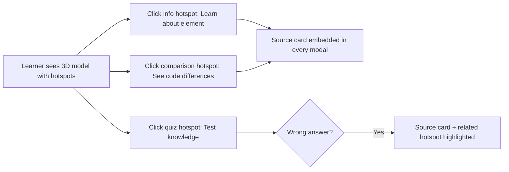

# 03 — LI Mode Learner Job Mapping

> **⚠ SUPERSEDED**: This document describes the original sub-mode tab architecture. The authoritative architecture is now document 20 (`20_li-hotspot-architecture-revised.md`). Learner jobs are fulfilled by hotspot types (info/quiz/comparison) on the 3D model, not by sub-mode tabs. This document is retained for historical context only.

## The 6 Learner Jobs (Now Fulfilled by Hotspot Types)

These are the learner tasks LI must serve. Each is fulfilled by a hotspot type on the 3D model, not by a sub-mode tab.


    G -->|No| I[Move to next topic]
```

## Sub-Mode 1: Focus View

**Learner job**: "I need to understand one specific rule, dimension, object, or route in 3D."

**VizCode equivalent**: Isolation Mode

**LI experience**:
- Full 3D model of a single topic (e.g., accessible ramp, stairway, toilet room)
- Layer toggles to show/hide components
- Camera presets for key viewpoints (plan, section, isometric)
- Dimension labels visible in 3D space
- Hover/click to inspect specific elements
- Source card accessible from any element

**MVP layer toggle model**: Each layer = one building component or code dimension. Focus View is the default sub-mode when a module loads.

**State**: Layer visibility booleans. No parameters, no sliders.

## Sub-Mode 2: Compare View

**Learner job**: "I need to compare two standards, two designs, or compliant vs non-compliant states."

**VizCode equivalent**: Comparative Mode

**LI experience**:
- Side-by-side viewport split, OR
- Toggle between two states in single viewport
- Dimensions highlighted where they differ
- Visual indicator of which state is compliant
- Preset states: Compliant, Non-Compliant (specific violation), BP 220 vs PD 957

**Implementation approaches**:

| Approach | Pros | Cons |
|----------|------|------|
| **Split viewport** | True side-by-side comparison | Two scenes to render; more complex |
| **Toggle states** | Simpler implementation; single scene | Not truly simultaneous |
| **Overlay/difference mode** | Shows exact dimensional differences | Harder to read |

**MVP recommendation**: Toggle states (simpler). Future: split viewport for P0 comparison modules (BP 220 vs PD 957).

**State**: Current comparison state (compliant/non-compliant preset or code family selection).

## Sub-Mode 3: Mistake Hunt

**Learner job**: "I need to practice identifying code violations in a realistic 3D scene."

**VizCode equivalent**: Game Mode (text-based quizzes)

**LI experience**:
- 3D scene is presented with one or more code violations
- Learner must click/tap the violating element
- Correct identification shows source card with the rule
- Incorrect identification shows hint
- Score tracking (optional for MVP)
- Multiple difficulty levels (obvious → subtle violations)

**State**: Active violation list, found violations set, hint count, score.

## Sub-Mode 4: Board Drill

**Learner job**: "I need to practice answering LEA-style questions that reference this topic."

**VizCode equivalent**: Game Mode quiz questions

**LI experience**:
- LEA-style multiple choice question overlaid on 3D scene
- Question references the visible 3D model
- Answer choices; correct answer reveals spatial rationale in 3D
- Wrong answer triggers Repair Path
- Questions sourced from SlateCamp quiz bank linked to this module

**State**: Current question, selected answer, answered questions set, score.

## Sub-Mode 5: Source View

**Learner job**: "I need to see the exact code provision that governs this element."

**VizCode equivalent**: Code Library text pages

**LI experience**:
- Panel showing source card: law, section, table, exact text, amendment date
- Highlighted element in 3D scene corresponds to source card
- Interpretation boundary: "This is the official text" vs "This is SlateCamp's teaching interpretation"
- Link to full Wiki article
- "Report Issue" action for corrections

**State**: Active source card ID, linked elements.

## Sub-Mode 6: Repair Path

**Learner job**: "I got a question wrong. Help me understand and practice until I get it right."

**VizCode equivalent**: (Not explicitly visible; implied by review modes)

**LI experience**:
- Triggered from Quiz wrong answer or Mistake Hunt failure
- Deep links to the exact LI scene and sub-mode
- Shows source card first (understand the rule)
- Shows the 3D scene with violation highlighted (see the problem)
- Mini-drill with 2-3 questions (confirm understanding)
- Return to original quiz question (retry)

**State**: Remediation source (quiz question ID, topic ID), repair step (source → scene → drill → retry), completed steps.

## Sub-Mode Support Matrix by Scene Template

| Scene Template | Focus | Compare | Mistake | Drill | Source | Repair |
|---------------|-------|---------|---------|-------|--------|--------|
| Accessible Route/Ramp | ✅ MVP | ✅ P2 | ✅ P2 | ✅ P2 | ✅ MVP | ✅ P3 |
| Accessible Toilet Room | ✅ MVP | — | ✅ P2 | ✅ P2 | ✅ MVP | ✅ P3 |
| Egress/Stair Scene | ✅ MVP | ✅ P2 | ✅ P2 | ✅ P2 | ✅ MVP | ✅ P3 |
| Accessibility Clearance | ✅ P1 | — | ✅ P2 | ✅ P2 | ✅ P1 | ✅ P3 |
| Site-Lot Comparator | ✅ P1 | ✅ P1 | ✅ P2 | ✅ P2 | ✅ P1 | ✅ P3 |
| Fire Separation | ✅ P1 | ✅ P2 | — | ✅ P2 | ✅ P1 | ✅ P3 |
| Massing/Height | ✅ P1 | ✅ P2 | ✅ P2 | ✅ P2 | ✅ P1 | ✅ P3 |
| Green Roof Thermal | ✅ P2 | ✅ P2 | — | ✅ P2 | ✅ P2 | ✅ P3 |
| Dual-Scene Comparator | — | ✅ P1 | — | ✅ P2 | ✅ P2 | ✅ P3 |
| Assembly Seating/Aisle | ✅ P1 | ✅ P2 | ✅ P2 | ✅ P2 | ✅ P1 | ✅ P3 |

## Sub-Mode Selection UX

### In-Module Sub-Mode Switcher

```
┌─────────────────────────────────────────────┐
│ ViewportHeader (title · code ref · back)     │
├─────────────────────────────────────────────┤
│ [Focus] [Compare] [Mistake] [Drill] [Source]│  ← Sub-mode tabs
├──────────────────┬──────────────────────────┤
│                  │ Right Sidebar            │
│   3D Viewport    │ (changes per sub-mode)   │
│                  │                          │
│                  │ Focus: Layer toggles     │
│                  │ Compare: State selector  │
│                  │ Mistake: Score/target    │
│                  │ Drill: Question panel    │
│                  │ Source: Source card      │
│                  │                          │
├──────────────────┴──────────────────────────┤
│ Status Bar                                   │
└─────────────────────────────────────────────┘
```

Sub-mode tabs are rendered based on `supportedModes` in the module config. Unsupported sub-modes are hidden or disabled.

### Config Declaration

```typescript
export interface LearningSceneConfig {
  // ... existing fields ...
  supportedModes: LearningSubMode[]
  defaultMode?: LearningSubMode  // defaults to 'focus'
  modeConfigs?: {
    compare?: {
      presets: ComparePreset[]  // compliant, non-compliant, bp220, pd957
    }
    mistake?: {
      violations: MistakeViolation[]  // violation definitions
    }
    drill?: {
      questionIds: string[]  // linked quiz question IDs
    }
  }
}
```

## MVP vs Full Sub-Mode Rollout

| Phase | Sub-Modes | Modules | Notes |
|-------|-----------|---------|-------|
| **MVP** | Focus View + Source View | 3-5 modules | Layer toggles + source cards |
| **Phase 2** | + Compare View + Mistake Hunt | 10+ modules | Competitive with VizCode modes |
| **Phase 3** | + Board Drill + Repair Path | 20+ modules | Full ALE workflow integration |
| **Phase 4** | Coverage View + all sub-modes | 50+ modules | Comprehensive coverage |
