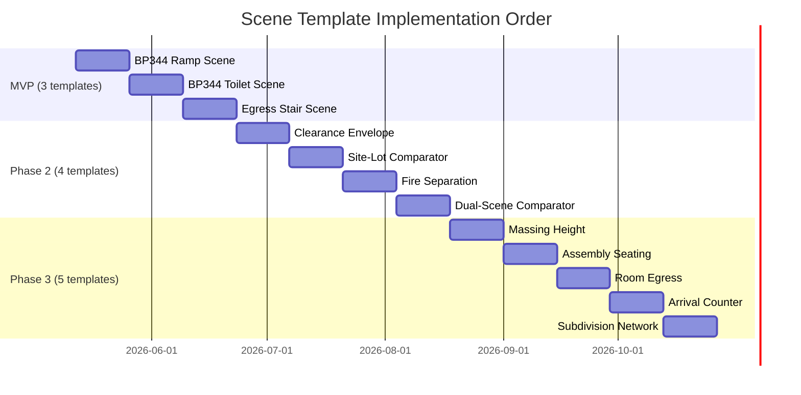

# 04 — Competitive Scene Template Catalog

## Principle

SlateCamp should not build one-off 3D scenes for every topic. The scalable product move is to create **reusable 3D scene templates** that can explain many code topics, each with source cards, sub-mode support, and practice links.

## Template Catalog (20 Templates)

### P0 Templates (Must-Have for Launch Competitiveness)

#### 1. Accessible Route / Ramp Scene
**Clusters**: accessible-route-ramp
**Code families**: BP 344, PD 1096, RA 9514, BP 220/PD 957
**Topics covered**: ~10 topics (ramps, curb ramps, pathways, crossings, handrails, slopes, landings)
**VizCode pages**: 57 BP 344 pages include ramp/route content
**Recommended sub-modes**: Focus, Compare (compliant vs non-compliant), Mistake Hunt, Board Drill
**3D concept**: Small site approach route with sidewalk, curb ramp, landing, entrance threshold, interior corridor. Toggle layers for each component. Parameters: slope, width, landing length, handrail presence, tactile warning presence.
**Board traps**: Confusing ramp slope with curb ramp slope; forgetting landing requirements; route continuity.

#### 2. Accessible Toilet and Bath Room Scene
**Clusters**: accessible-toilet-bath
**Code families**: BP 344
**Topics covered**: ~10 topics (toilets, baths, grab bars, controls, doors, clearances, changing places)
**VizCode pages**: 57 BP 344 pages include toilet/bath content
**Recommended sub-modes**: Focus, Mistake Hunt, Board Drill
**3D concept**: Accessible toilet compartment with fixtures. Toggle layers: water closet, grab bars, sink, door, clear floor space. Show turning radius. Highlight clearance violations.
**Board traps**: Grab bar placement/length; door swing interference; insufficient turning space.

#### 3. Egress / Stair Scene
**Clusters**: egress-load-exit, stair-vertical-circulation
**Code families**: PD 1096, RA 9514, BP 344, BP 220/PD 957
**Topics covered**: ~15 topics (stairs, exits, corridors, travel distance, occupant load, handrails, landings, doors)
**VizCode pages**: 67 PD 1096 + 37 RA 9514 = 104 pages include egress/stair content
**Recommended sub-modes**: Focus, Compare (compliant vs non-compliant), Mistake Hunt, Board Drill
**3D concept**: Multi-story stair core with exits, corridors, doors. Toggle layers: stair geometry, handrails, landings, doors, exit signs. Show travel distance paths. Highlight dimensional violations.
**Board traps**: Riser height variation; tread depth minimums; handrail extension; exit door swing direction.

#### 4. Accessibility Clearance Envelope Scene
**Clusters**: accessibility-clearance
**Code families**: BP 344, RA 9514
**Topics covered**: ~7 topics (wheelchair clearances, turning spaces, reach ranges, headroom, ground surfaces, seating)
**VizCode pages**: 57 BP 344 + 37 RA 9514 = 94 pages
**Recommended sub-modes**: Focus, Mistake Hunt, Board Drill
**3D concept**: Abstract clearance volumes shown around human-scale reference figure. Toggle different clearances: turning circle, forward reach, side reach, knee clearance, toe clearance. Show compliant/non-compliant volumes.
**Board traps**: Confusing forward vs side reach ranges; obstruction protrusion limits.

#### 5. Site-Lot / Setback / Open-Space Comparator
**Clusters**: site-lot-setback-open-space
**Code families**: BP 220/PD 957, PD 1096
**Topics covered**: ~21 topics (setbacks, courts, open spaces, lot dimensions, density, easements, projections)
**VizCode pages**: 54 BP 220/PD 957 + 67 PD 1096 = 121 pages
**Recommended sub-modes**: Compare (BP 220 vs PD 957), Board Drill
**3D concept**: Site plan with lot boundaries, building footprint, setbacks, open spaces, courts. Toggle between BP 220 and PD 957 requirements. Show dimensional overlays. Highlight violations.
**Board traps**: Mixing BP 220 and PD 957 requirements; court dimension minimums; easement widths.

#### 6. Dual-Scene Comparator (Cross-Code)
**Clusters**: cross-code-comparison
**Code families**: Cross-code
**Topics covered**: Occupant load, assembly, fire zones
**Recommended sub-modes**: Compare, Board Drill
**3D concept**: Two scenes side-by-side or toggle. Compare governing standards for the same building element under different codes. Show what changes when the governing code changes.
**Board traps**: Knowing which code applies when; conflicting requirements.

#### 7. Fire Separation / Compartmentation Scene
**Clusters**: fire-separation-resistance
**Code families**: PD 1096, RA 9514, BP 220/PD 957
**Topics covered**: ~12 topics (fire walls, fire ratings, fire zones, compartmentation, openings, dampers)
**VizCode pages**: 67 PD 1096 + 37 RA 9514 = 104 pages
**Recommended sub-modes**: Focus, Compare, Board Drill
**3D concept**: Building section showing fire walls, floor/ceiling assemblies, rated openings. Toggle layers: structural frame, fire-rated walls, unprotected openings, fire dampers, firestopping.
**Board traps**: Fire rating requirements by occupancy/height; opening protectives; through-penetration firestopping.

### P1 Templates (High-Value)

#### 8. Massing + Grade-Plane + Projection Scene
**Clusters**: height-massing-projection
**Code families**: PD 1096, RA 9514, BP 220/PD 957
**Topics covered**: ~10 topics (BHL, grade plane, projections, eaves, canopies, ceiling heights)
**3D concept**: Building mass with grade plane, allowed height envelope. Show projections into setbacks. Toggle allowed vs violating projections.

#### 9. Assembly Seating / Aisle Scene
**Clusters**: assembly-seating-aisle
**Code families**: PD 1096, RA 9514
**Topics covered**: ~5 topics (aisle width, seat spacing, reviewing stands, bleachers)
**3D concept**: Assembly space with rows of seats and aisles. Show minimum aisle widths, maximum seats between aisles. Highlight violations.

#### 10. Room-Egress-Circulation Scene
**Clusters**: egress-load-exit
**Code families**: PD 1096, RA 9514, BP 344
**Topics covered**: ~24 topics (corridors, doors, travel distance, exit count, exit width, occupant load)
**3D concept**: Floor plan with rooms, corridors, exits. Show occupant load computation, travel distance paths, exit arrangement. Toggle compliant/non-compliant layouts.

#### 11. Accessible Arrival / Service Counter Scene
**Clusters**: accessible-arrival-service
**Code families**: BP 344, PD 1096, BP 220/PD 957
**Topics covered**: ~16 topics (entrances, parking, counters, ATMs, drinking fountains, dressing rooms)
**3D concept**: Building entrance approach with parking, walkway, ramp, entrance door, service counter. Toggle elements and show clearances.

#### 12. Subdivision Parcel / Street-Network Scene
**Clusters**: subdivision-road-network
**Code families**: BP 220/PD 957
**Topics covered**: ~13 topics (roads, blocks, lot dimensions, density, open space allocation, utilities)
**3D concept**: Subdivision plan with hierarchy of roads, blocks, lots. Show density calculations, open space allocation, road widths.

### P2 Templates (Specialist / Future)

#### 13. Green Roof Thermal / SRI Scene
**Clusters**: green-roof-thermal
**Code families**: GBC
**Topics covered**: ~3 topics (SRI values, roof insulation R-values, metal roof colors)
**3D concept**: Roof assembly with material layers. Show SRI comparison, insulation placement, thermal performance.

#### 14. Water Cycle / Green Site Compliance Overlay
**Clusters**: green-water-site
**Code families**: GBC, BP 220/PD 957
**Topics covered**: ~7 topics (rainwater harvesting, water fixtures, unpaved surfaces, MRF, smoking areas)
**3D concept**: Site with green infrastructure overlay. Show rainwater collection, permeable surfaces, water efficiency.

#### 15. Equipment Energy Dashboard / Plant-Room Scene
**Clusters**: energy-equipment
**Code families**: GBC, PD 1096
**Topics covered**: ~5 topics (AC efficiency, transformer efficiency, elevator lights, escalator controls)
**3D concept**: Plant room with equipment. Show efficiency ratings, energy consumption comparison.

#### 16. Room-Section / Light-Ventilation Volume Scene
**Clusters**: room-volume-light-ventilation
**Code families**: PD 1096, BP 344
**Topics covered**: ~5 topics (habitable room sizes, openings, glass area, basements, sensory rooms)
**3D concept**: Room section showing light and ventilation openings. Compute percentage of floor area. Show compliant/non-compliant.

#### 17. Special Accessibility Facility Scene Pack
**Clusters**: special-accessibility-facility
**Code families**: BP 344, PD 1096, RA 9514, BP 220/PD 957
**Topics covered**: ~17 topics (areas of refuge, fire alarms, auditoriums, excavations, assembly, protrusions)
**3D concept**: Various special accessibility scenarios. Used for Mistake Hunt and Board Drill.

#### 18. Source-Card Atlas / Topic Map
**Clusters**: source-atlas
**Code families**: All
**Topics covered**: All code families
**3D concept**: Not a 3D scene. A browsable, filterable atlas showing available source cards, linked 3D modules, Wiki articles, and quiz questions. This is the Coverage View.

#### 19. Source-Card Explainer
**Clusters**: source-policy-admin
**Code families**: All
**Topics covered**: Administrative/policy topics that don't need 3D but need source cards
**3D concept**: Minimal — source card display only. Links to relevant 3D modules where applicable.

#### 20. Mode Architecture Shell
**Clusters**: mode-surface
**Code families**: All
**Topics covered**: N/A — infrastructure
**3D concept**: The shared LI shell that hosts all sub-modes. Sub-mode tabs, sidebar adaptation, state management.

## Template Implementation Priority

## Template Count vs VizCode Coverage

| Template Count | VizCode Topics Covered | Cumulative Coverage |
|---------------|----------------------|---------------------|
| 3 (MVP) | ~35 of 233 (15%) | Core P0 exam topics |
| 7 (Phase 2) | ~90 of 233 (39%) | All P0 topics |
| 12 (Phase 3) | ~170 of 233 (73%) | P0 + P1 topics |
| 20 (Phase 4) | ~233 of 233 (100%) | Complete coverage |

## Template Authoring Requirements

Each scene template implementation needs:
1. Source locators (official code section/table references)
2. Dimension register (every numeric value with source and tolerance)
3. Compliance rules (when is a dimension compliant vs non-compliant)
4. Preset definitions (named states for Compare/Focus views)
5. Board trap catalog (common exam mistakes for this topic)
6. Question bank linkage (Quiz question IDs for Board Drill)
7. Static fallback (2D annotated diagram for WebGL failure)
8. Geometry spec (which layers, what primitives, colors)
