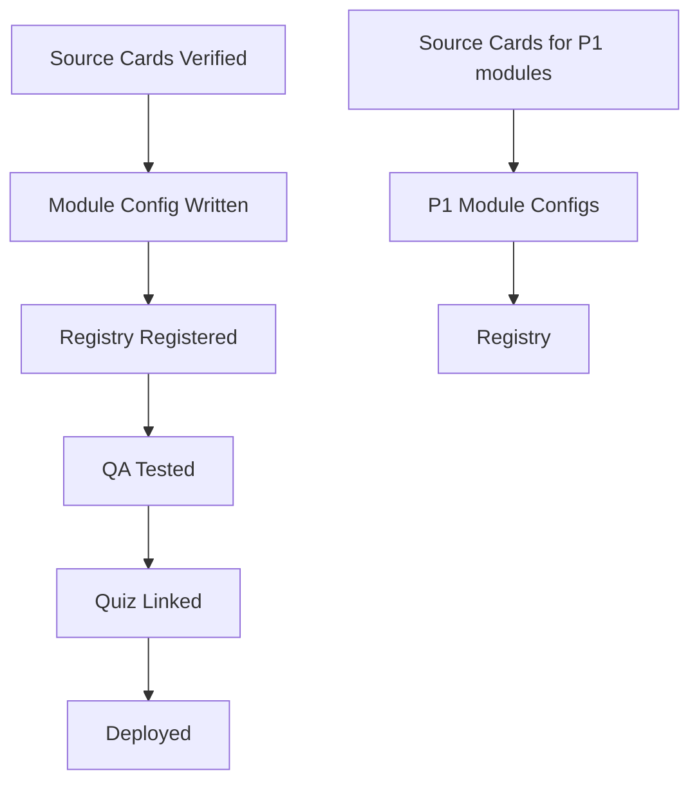

# 05 — Content Coverage Roadmap by Priority

## Evidence Basis

From the VizCode competitive audit topic/3D coverage matrix (`38_slatecamp_topic_3d_coverage_matrix`):
- 233 canonical competitor topic/page surfaces mapped
- 47 family + topic-cluster groups
- P0: 90 topics, P1: 80 topics, P2: 58 topics, P0 spec infra: 5

## P0 Launch Focus (90 Topics)

These must be the first LI modules built. They cover the highest-frequency ALE board exam topics that VizCode also covers.

### P0 by Code Family

| Code Family | P0 Count | Key Clusters |
|-------------|----------|-------------|
| BP 344 / Accessibility | ~25 | accessible-route-ramp, accessible-toilet-bath, accessibility-clearance, egress-load-exit, stair-vertical-circulation |
| PD 1096 / NBCP | ~25 | egress-load-exit, stair-vertical-circulation, accessible-route-ramp, fire-separation-resistance, height-massing-projection |
| RA 9514 / Fire Code | ~20 | stair-vertical-circulation, egress-load-exit, accessibility-clearance, accessible-route-ramp |
| BP 220 / PD 957 | ~15 | accessible-route-ramp, egress-load-exit, stair-vertical-circulation, site-lot-setback-open-space |
| Cross-code | 1 | cross-code-comparison |
| Code Library / Atlas | 4 | source-atlas |

### P0 Scene Template Coverage

| Scene Template | P0 Topics Covered | First Module |
|---------------|------------------|-------------|
| Accessible Route / Ramp | ~15 | `bp344-ramp-layers` |
| Accessible Toilet Room | ~10 | `bp344-toilet-room` |
| Egress / Stair Scene | ~30 | `egress-stair-core` |
| Accessibility Clearance | ~10 | `wheelchair-clearance-envelope` |
| Site-Lot Comparator | ~15 | `bp220-pd957-site-lot` |
| Fire Separation | ~5 | `fire-separation-wall` |
| Dual-Scene Comparator | 1 | `occupant-load-comparator` |

## MVP Content (Phase 1: 3-5 Modules)

### Module 1: BP 344 Accessible Ramp Components
- **ID**: `bp344-ramp-layers`
- **Category**: ACCESSIBILITY (cat-02)
- **Scene template**: Accessible Route / Ramp
- **Sub-modes**: Focus View + Source View (MVP); Compare + Mistake Hunt (P2)
- **Layers**: Ramp Surface, Handrail, Edge Curb, Landing Platform, Wall Connection, Foundation Support, Tactile Warning
- **Source cards**: BP 344 §4 (Ramps), BP 344 IRR provisions
- **Board traps**: Slope confusion (ramp vs curb ramp), landing requirements, handrail extensions

### Module 2: BP 344 Accessible Toilet Room
- **ID**: `bp344-toilet-room`
- **Category**: ACCESSIBILITY (cat-02)
- **Scene template**: Accessible Toilet Room
- **Sub-modes**: Focus View + Source View (MVP); Mistake Hunt + Board Drill (P2)
- **Layers**: Water Closet, Grab Bars, Sink/Lavatory, Door + Clear Floor Space, Turning Circle, Accessories (soap, mirror, etc.)
- **Source cards**: BP 344 §6 (Toilets and Baths)
- **Board traps**: Grab bar placement/length, door swing interference, insufficient turning space

### Module 3: Egress Stair Core
- **ID**: `egress-stair-core`
- **Category**: VERTICAL (cat-08) or BUILDING_CODE (cat-01)
- **Scene template**: Egress / Stair Scene
- **Sub-modes**: Focus View + Source View (MVP); Compare + Mistake Hunt (P2)
- **Layers**: Stair Geometry (risers/treads), Handrails, Landings, Exit Door, Corridor, Exit Signage, Fire Rating
- **Source cards**: PD 1096 §12 (Stairs), RA 9514 §10 (Means of Egress)
- **Board traps**: Riser variation, tread depth, handrail extension, travel distance

### Module 4: Wheelchair Clearance Envelope (Optional MVP)
- **ID**: `wheelchair-clearance-envelope`
- **Category**: ACCESSIBILITY (cat-02)
- **Scene template**: Accessibility Clearance Envelope
- **Sub-modes**: Focus View + Source View
- **Layers**: Turning Circle, Forward Reach, Side Reach, Knee Clearance, Toe Clearance, Human Scale Reference
- **Source cards**: BP 344 §3 (Wheelchair Requirements)
- **Board traps**: Forward vs side reach ranges, obstruction protrusion

### Module 5: BP 220 vs PD 957 Site Lot Comparator (Optional MVP)
- **ID**: `bp220-pd957-site-lot`
- **Category**: PLANNING (cat-13) or SITE_DEV (cat-16)
- **Scene template**: Site-Lot Comparator
- **Sub-modes**: Compare View + Source View
- **States**: BP 220 compliant, PD 957 compliant, BP 220 vs PD 957 comparison
- **Source cards**: BP 220 Rule III, PD 957 Rule III
- **Board traps**: Mixing BP 220 and PD 957 requirements

## Phase 2 Content (Next 7-10 Modules)

Target: Cover all P0 scene templates.

| Module | Template | Category | Priority |
|--------|----------|----------|----------|
| Fire Separation Wall | Fire Separation | BUILDING_CODE | P0 |
| Occupant Load Comparator | Dual-Scene Comparator | BUILDING_CODE | P0 |
| Massing Height Envelope | Massing/Height | BUILDING_CODE | P1 |
| Assembly Seating Aisle | Assembly Seating | BUILDING_CODE | P1 |
| Room Egress Circulation | Room Egress | BUILDING_CODE | P0 |
| Accessible Arrival Counter | Arrival/Counter | ACCESSIBILITY | P1 |
| Subdivision Road Network | Subdivision Network | PLANNING | P1 |

## Phase 3 Content (Remaining P1 + Selected P2)

Target: 20+ modules covering all 20 scene templates, all P0 and P1 topics.

## Phase 4 Content (Complete Coverage)

Target: 50+ modules achieving >95% topic coverage. P2 specialist topics where 3D adds value.

## Coverage Dashboard (Future Admin View)

The Coverage View (`/dashboard/3d-lab?view=coverage`) shows:

```
Code Family: BP 344 / Accessibility
├── accessible-route-ramp [P0] — ✅ 3D Module (bp344-ramp-layers)
│   ├── Focus View ✅  Compare View ⬜  Mistake Hunt ⬜
│   ├── Source Cards: 4/4 verified
│   └── Quiz Links: 12 questions linked
├── accessible-toilet-bath [P0] — ✅ 3D Module (bp344-toilet-room)
│   ├── Focus View ✅  Mistake Hunt ⬜  Board Drill ⬜
│   ├── Source Cards: 6/6 verified
│   └── Quiz Links: 8 questions linked
├── accessibility-clearance [P0] — ✅ 3D Module (wheelchair-clearance-envelope)
│   └── ...
├── accessible-arrival-service [P1] — ⬜ No 3D module yet
│   └── Source Cards: 3/10 verified
└── ...
```

## Content Production Pipeline

For each new LI module:

1. **Source verification** (1-2 days per module): Collect official code locators, extract provisions, verify dimensions
2. **Config authoring** (1 day): Write `LearningSceneConfig` with layers, geometry, camera, presets
3. **Registry registration** (30 min): Add to category file and DASHBOARD_VISIBLE_IDS
4. **QA testing** (1 day): Verify layer toggles, source cards, dimensions, board traps
5. **Quiz linkage** (1 day): Link existing quiz questions or create new ones for Board Drill
6. **Deploy + monitor** (30 min): Feature flag on, verify in staging, deploy to production

Estimated: 4-6 days per module for P0 content. Can parallelize across multiple modules once source cards are ready.

## Content Dependencies



**Critical path**: Source card verification is the primary bottleneck. No LI module should ship without verified source cards.
