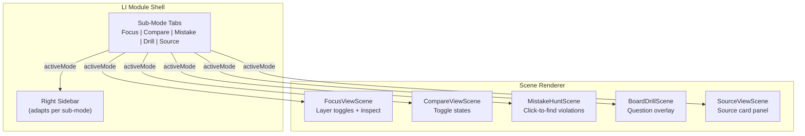

# 06 — LI Mode Sub-Modes Architecture

> **⚠ SUPERSEDED**: This document describes the original sub-mode tab architecture with `FocusViewScene`, `CompareViewScene`, `MistakeHuntScene`, `BoardDrillScene`, `SourceViewScene`. The authoritative architecture is now document 20 (`20_li-hotspot-architecture-revised.md`). LI uses hotspot types (info/quiz/comparison) positioned on the 3D model, not sub-mode tabs with adaptive sidebars. This document is retained for historical context only.

## Architecture Principle (Historical)

**One template type (`'learning'`), many sub-modes.** Sub-modes are not separate template types. They are config-driven state configurations within the LI template. This avoids template type explosion while allowing modules to offer multiple learning experiences.

## Why Not Separate Template Types?

If each sub-mode were a separate template type:
- `'learning-focus'`, `'learning-compare'`, `'learning-mistake'`, `'learning-drill'`, `'learning-source'`, `'learning-repair'`
- 6 new entries in TEMPLATE_META, TEMPLATE_SHELL_DEFAULTS, useTemplateContent switch
- Modules can't offer multiple sub-modes (need separate configs)
- Learner would navigate between module pages to switch modes (bad UX)

With config-driven sub-modes:
- 1 entry in TEMPLATE_META, TEMPLATE_SHELL_DEFAULTS
- 1 case in useTemplateContent switch
- Modules declare supported sub-modes; LI shell renders sub-mode tabs
- Learner switches sub-modes without navigation

## Type Definitions

```typescript
// In src/features/3d-lab/types/templates.ts

export type LearningSubMode = 'focus' | 'compare' | 'mistake' | 'drill' | 'source' | 'repair'

export interface LearningSceneConfig {
  id: string
  title: string
  description: string
  subject: string
  layers: LearningLayerDef[]
  camera?: CameraConfig
  scale?: number
  showHumanScale?: boolean
  contextScenario?: string

  /** Which sub-modes this module supports. Default: ['focus', 'source'] */
  supportedModes?: LearningSubMode[]
  /** Default active sub-mode. Default: 'focus' */
  defaultMode?: LearningSubMode

  /** Sub-mode specific configurations */
  modeConfigs?: {
    focus?: FocusModeConfig
    compare?: CompareModeConfig
    mistake?: MistakeModeConfig
    drill?: DrillModeConfig
    source?: SourceModeConfig
  }
}

export interface FocusModeConfig {
  /** Layers visible by default in Focus View */
  defaultVisibleLayers?: string[]
  /** Camera presets specific to Focus View */
  focusPresets?: CameraPreset[]
}

export interface CompareModeConfig {
  /** Named comparison presets */
  presets: ComparePreset[]
  /** Default preset ID */
  defaultPreset?: string
}

export interface ComparePreset {
  id: string
  label: string
  /** Layers visible in state A */
  stateA: string[]
  /** Layers visible in state B */
  stateB: string[]
  /** Or: toggle between A and B */
  description?: string
}

export interface MistakeModeConfig {
  /** Violation scenarios */
  violations: MistakeViolation[]
}

export interface MistakeViolation {
  id: string
  /** Which layers to show for this violation hunt */
  visibleLayers: string[]
  /** The violating layer ID (what the learner must find) */
  targetLayerId: string
  /** Hint text shown on first wrong click */
  hint: string
  /** Source card shown on correct identification */
  sourceCardId: string
  /** Difficulty: 'obvious' | 'subtle' | 'tricky' */
  difficulty: 'obvious' | 'subtle' | 'tricky'
}

export interface DrillModeConfig {
  /** Quiz question IDs linked to this module */
  questionIds: string[]
}

export interface SourceModeConfig {
  /** Source card IDs for this module */
  sourceCardIds: string[]
}
```

## Component Architecture



### LearningSceneRenderer (Refactored)

The single scene renderer switches behavior based on `activeMode`:

```typescript
// Conceptual pseudocode — NOT implementation
function LearningSceneRenderer({ config, useStore, activeMode, modeState }) {
  switch (activeMode) {
    case 'focus':
      return <FocusViewScene config={config} useStore={useStore} />
    case 'compare':
      return <CompareViewScene config={config} useStore={useStore} compareState={modeState} />
    case 'mistake':
      return <MistakeHuntScene config={config} useStore={useStore} mistakeState={modeState} />
    case 'drill':
      return <BoardDrillScene config={config} useStore={useStore} drillState={modeState} />
    case 'source':
      return <SourceViewScene config={config} useStore={useStore} activeSourceCard={modeState} />
    default:
      return <FocusViewScene config={config} useStore={useStore} />
  }
}
```

### LI Shell Adaptation

The right sidebar content changes per sub-mode:

| Sub-Mode | Right Sidebar Content |
|----------|----------------------|
| Focus | `LearningLayerToggles` (checkbox list) |
| Compare | `ComparePresetSelector` (dropdown/toggle) |
| Mistake | `MistakeHuntPanel` (score, hints, target indicator) |
| Drill | `BoardDrillPanel` (question, options, rationale) |
| Source | `SourceCardPanel` (law, section, text, boundary) |
| Repair | Driven by external navigation state (not tab-selectable) |

## State Management

### Module Store (via createModuleStore)

```typescript
// Defaults include both layer visibility AND sub-mode state
const defaults: Record<string, any> = {
  // Layer visibility
  'layer:ramp-surface': true,
  'layer:handrail': true,
  // ...
  // Sub-mode state
  'mode:active': 'focus',
  'mode:compare:activePreset': null,
  'mode:mistake:currentViolation': null,
  'mode:mistake:foundViolations': [],
  'mode:mistake:score': 0,
  'mode:drill:currentQuestion': null,
  'mode:drill:answeredQuestions': [],
  'mode:drill:score': 0,
  'mode:source:activeCard': null,
}

const useStore = createModuleStore(defaults)
```

### Sub-Mode State Flow

```
User clicks "Compare" tab
  → setState({ 'mode:active': 'compare' })
  → Right sidebar shows ComparePresetSelector
  → Scene renderer switches to CompareViewScene

User selects "Compliant vs Non-Compliant" preset
  → setState({ 'mode:compare:activePreset': 'compliant-vs-steep' })
  → Scene shows compliant design, then learner toggles to non-compliant
```

## Sub-Mode Tab UI

```
┌──────────────────────────────────────────────────────────┐
│ [🔍 Focus] [⚖ Compare] [🔎 Mistake] [📝 Drill] [📋 Source] │
└──────────────────────────────────────────────────────────┘
```

- Tabs use Phosphor icons + short labels
- Only `supportedModes` tabs are rendered
- Active tab is highlighted
- Unsupported modes are hidden (not disabled)
- Tab bar is between header and viewport (compact, ~36px height)
- Mobile: tabs become a horizontal scroll or dropdown

## Repair Path (Special Case)

Repair Path is not a tab-selectable sub-mode. It's triggered by external navigation:

1. Quiz → wrong answer → deep link to LI module with `?repair=true&questionId=XYZ`
2. ModuleViewer detects `repair` query param
3. Sets active mode to appropriate sub-mode (usually Source → Focus → Drill sequence)
4. Shows guided progression: Source Card → 3D Scene → Mini-Drill
5. "Return to Quiz" button after completion

## MVP vs Full Architecture

### MVP (Phase 1)
- Only Focus and Source sub-modes
- No sub-mode tabs (Focus is default, Source accessible via button)
- Simple layer toggle UI
- Source card panel in right sidebar or as overlay

### Phase 2
- Add Compare and Mistake Hunt sub-modes
- Sub-mode tabs in header area
- Right sidebar adapts per sub-mode

### Phase 3
- Add Board Drill and Repair Path
- Full sub-mode switching
- Quiz integration for Board Drill and Repair Path

## File Structure

```
src/features/3d-lab/
├── components/
│   └── learning/
│       ├── LearningSceneRenderer.tsx      # Main scene dispatcher
│       ├── LearningSubModeTabs.tsx         # Tab bar component
│       ├── scenes/
│       │   ├── FocusViewScene.tsx          # Focus sub-mode scene
│       │   ├── CompareViewScene.tsx        # Compare sub-mode scene
│       │   ├── MistakeHuntScene.tsx        # Mistake Hunt scene
│       │   ├── BoardDrillScene.tsx         # Board Drill scene
│       │   └── SourceViewScene.tsx         # Source View scene
│       ├── panels/
│       │   ├── LearningLayerToggles.tsx    # Focus: layer checkboxes
│       │   ├── ComparePresetSelector.tsx   # Compare: preset picker
│       │   ├── MistakeHuntPanel.tsx        # Mistake: score + hints
│       │   ├── BoardDrillPanel.tsx         # Drill: question + answer
│       │   └── SourceCardPanel.tsx         # Source: law text display
│       └── index.ts
```

## Relationship to PI Mode

PI and LI are completely separate in the template system:
- PI: `templateType: 'parametric' | 'exploded' | ...` — uses `useTemplateContent` PI cases
- LI: `templateType: 'learning'` — uses single `case 'learning'` that dispatches to sub-modes

PI does NOT get sub-mode tabs. PI has its own sidebar/panel system. The two modes are visually distinct at the dashboard card level (PI badge vs Learning badge).
