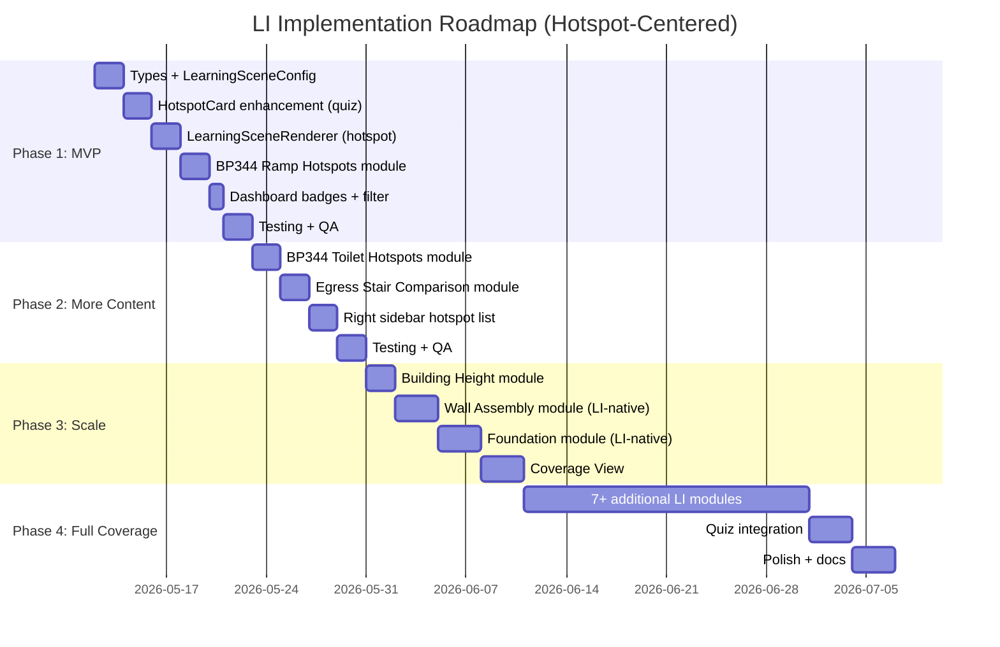

# 11 — Implementation Phasing Roadmap (Revised: Hotspot-Centered)

> **This document replaces the original sub-mode-based roadmap.** The LI architecture is now hotspot-centered (see doc 20). Sub-mode tabs and adaptive sidebars are removed.

## Principle

Build LI incrementally. The MVP is intentionally small (3 modules, hotspot-centered). Each phase adds more hotspots, more quiz questions, more comparison content. No sub-mode system to build.

## Phase Overview



## Phase 1 — MVP: 3 Hotspot Modules

### Goal
Launch LI with 3 hotspot-centered modules. Reuse existing hotspot infrastructure. Dashboard integration.

### What We Build

| Area | Work | New Code? |
|------|------|-----------|
| Types | `LearningHotspot` type, hotspot fields on `LearningSceneConfig` | ~50 lines |
| Renderer | `LearningSceneRenderer` — renders geometry + `HotspotAnnotation` components | ~80 lines |
| Hotspot card | Enhance `HotspotCard` to optionally render `HotspotQuestion` when `type === 'quiz'` | ~30 lines |
| Right sidebar | Simple hotspot list panel (optional — can defer to Phase 2) | ~60 lines |
| Dashboard | "Learning" badge, mode filter chips per existing plan | ~30 lines |
| Module 1 | `bp344-ramp-hotspots.ts` — 8 hotspots, 3 quiz, 1 comparison | Config only |
| Module 2 | `bp344-toilet-hotspots.ts` — 8 hotspots, 1 quiz | Config only |
| Module 3 | `egress-stair-hotspots.ts` — 8 hotspots, 1 quiz, 5 comparison | Config only |

### What We Reuse (Zero New Code)

| Component | How LI Uses It |
|-----------|---------------|
| `HotspotAnnotation` | Position hotspots on 3D model elements |
| `HotspotCard` | Click dot → info modal with title, description, codeRef |
| `HotspotQuestion` | Click quiz dot → MCQ modal → code citation reveal |
| `DOMOverlayLayer` | Projects 3D positions → 2D screen coordinates |
| `useOverlayStore` | Manages hotspot open/close state |
| `useWorldToScreen` | Vector3 → screen coordinate projection |
| `LabViewportFrame` | Single R3F Canvas host |
| `CanvasWrapper` | Per-module scene config |
| `ViewportShell` | Layout shell (config: right sidebar only) |

### What We DON'T Build

- ❌ Sub-mode tabs
- ❌ `LearningSubModeTabs.tsx`
- ❌ `CompareViewScene`, `MistakeHuntScene`, `BoardDrillScene`, `SourceViewScene`
- ❌ `ComparePresetSelector`, `MistakeHuntPanel`, `BoardDrillPanel`
- ❌ Sub-mode state management
- ❌ Adaptive sidebar panels

### Acceptance Criteria
- [ ] 3 LI modules with hotspots visible on dashboard
- [ ] Click info hotspot → modal with title, description, codeRef
- [ ] Click quiz hotspot → MCQ modal → answer revealed with code citation
- [ ] Click comparison hotspot → table comparing code requirements
- [ ] Camera orbit/pan/zoom works
- [ ] All PI modules unchanged
- [ ] All existing tests pass

---

## Phase 2 — Enhanced Hotspots + More Content

### Goal
Add hotspot list in right sidebar for easier navigation. Add 3 more modules. Wire quiz results to analytics.

### What We Build

| Area | Work |
|------|------|
| Right sidebar | Hotspot list: shows all hotspots, marks explored vs unexplored. Click scrolls/navigates to hotspot. |
| Hotspot enhancement | Explored/visited state tracking per hotspot |
| Module 4 | `building-height-hotspots.ts` — BHL definition, grade plane, tolerance, fire zones |
| Module 5 | `wall-assembly-layers.ts` — CHB wall with 8 hotspots + layer toggles |
| Module 6 | `foundation-system.ts` — Foundation with 7 hotspots |

### Acceptance Criteria
- [ ] Right sidebar shows hotspot list with explored/unexplored state
- [ ] Clicking sidebar item focuses corresponding hotspot
- [ ] 6 LI modules total
- [ ] Comparison hotspots work correctly across multiple codes

---

## Phase 3 — Scale Content + Coverage View

### Goal
7+ additional modules. Coverage View for browsing all LI content. Quiz results stored to analytics.

### What We Build

| Area | Work |
|------|------|
| Coverage View | `?view=coverage` — filterable atlas of all LI modules |
| Quiz analytics | Store quiz answers to `user_interactions` table |
| Module 7-13 | Roof assembly, accessible parking, exit doors, corridors, fire zones, etc. |

---

## Phase 4 — Full Coverage + Polish

### Goal
50+ LI modules. Quiz integration with main Quiz system. Performance optimization. Documentation.

---

## Files Created (Per Phase)

### Phase 1 (New Files)
| File | Purpose |
|------|---------|
| `types/templates.ts` (modified) | Add `LearningHotspot`, update `LearningSceneConfig` |
| `components/learning/LearningSceneRenderer.tsx` | Scene renderer with hotspots |
| `components/learning/LearningHotspotList.tsx` | Right sidebar hotspot list |
| `config/modules/02-accessibility/bp344-ramp-hotspots.ts` | BP344 ramp config |
| `config/modules/02-accessibility/bp344-toilet-hotspots.ts` | BP344 toilet config |
| `config/modules/01-building-code/egress-stair-hotspots.ts` | Egress stair config |

### Phase 1 (Modified Files)
| File | Change |
|------|--------|
| `hooks/useTemplateContent.tsx` | Add `case 'learning'` |
| `components/ModuleCard.tsx` | Add `'learning'` to TEMPLATE_META |
| `components/LabBrowser.tsx` | Add mode filter chips |
| `config/registry/cat-02.ts` | Add LI entries |
| `config/registry/cat-01.ts` | Add LI entry |
| `config/dashboard-visibility.ts` | Add LI module IDs |

### Files NOT Touched
- `shell/LabViewportFrame.tsx` — No changes
- `shell/ViewportShell.tsx` — No changes
- `components/CanvasWrapper.tsx` — No changes
- `components/overlays/DOMOverlayLayer.tsx` — No changes
- `components/overlays/HotspotCard.tsx` — Minimal enhancement (optional)
- `components/templates/HotspotAnnotation.tsx` — No changes
- `components/templates/HotspotQuestion.tsx` — No changes
- `stores/useOverlayStore.ts` — No changes
- All PI scene renderers — No changes
- All PI module configs — No changes

---

## Milestone Summary

| Phase | Modules | Hotspot Types | Right Sidebar | Coverage View |
|-------|---------|---------------|---------------|---------------|
| 1: MVP | 3 | Info + Quiz + Comparison | Optional basic list | No |
| 2: Enhanced | 6 | Same + explored state | Hotspot list with state | No |
| 3: Scale | 13 | Same + analytics | Enhanced | Yes |
| 4: Coverage | 50+ | Full | Full | Yes |

## Feature Flags

```typescript
const FEATURES = {
  LI_MODE: true,           // Phase 1
  LI_HOTSPOT_LIST: false,  // Phase 2 (right sidebar hotspot nav)
  LI_QUIZ_ANALYTICS: false, // Phase 3
  LI_COVERAGE_VIEW: false, // Phase 3
}
```
