# 14 — Cross-Reference to Existing Planning

## Relationship Map

This document maps how the competitive LI strategy connects to all existing planning packages.

```mermaid
graph TD
    subgraph "This Package"
        CS["2026-05-11-li-vizcode-competitive-3d-learning-strategy/<br/>Competitive LI Strategy"]
        BRIDGE["Bridge Docs (16-18):<br/>Taxonomy, Source IDs,<br/>Authoring Pipeline"]
    end

    subgraph "Vitruvius Connection"
        VC["vitruvius-connection/<br/>Canonical Knowledge Pipeline<br/>88 concepts, 647 relationships<br/>48 raw law PDFs"]
    end

    subgraph "LI Technical Architecture"
        LTA["2026-05-11-3d-lab-li-learning-interactivity-mode/<br/>LI Tech Architecture"]
    end

    subgraph "VizCode Competitive Research"
        VA[".ai/13_research/vizcodeph-comprehensive-audit-2026-05-07/<br/>VizCode Audit (48 dirs, 780+ files)"]
        SR[".ai/13_research/.../37_comprehensive_competitive_report/<br/>Competitive Report + Action Matrix"]
        TM[".ai/13_research/.../38_slatecamp_topic_3d_coverage_matrix/<br/>Topic/3D Coverage Matrix"]
        PR[".ai/13_research/.../39_slatecamp_planning_readiness_docs/<br/>Planning Readiness Docs"]
        BP[".ai/13_research/.../44_bp344_ramp_production_implementation_readiness_lock/<br/>BP344 Ramp Implementation Lock"]
    end

    subgraph "SlateCamp 3D Lab Codebase"
        CODE["src/features/3d-lab/<br/>530 files"]
        ROUTES["src/app/dashboard/3d-lab/<br/>Route pages"]
    end

    CS -->|"Implements LI types from"| LTA
    CS -->|"Competitive requirements from"| VA
    CS -->|"Mode taxonomy from"| SR
    CS -->|"Content priorities from"| TM
    CS -->|"Implementation readiness from"| PR
    CS -->|"First module specs from"| BP
    CS -->|"Builds on"| CODE
    CS -->|"Uses routes from"| ROUTES
    BRIDGE -->|"Maps concepts from"| VC
    BRIDGE -->|"Resolves source IDs to"| VC
    BRIDGE -->|"Authoring pipeline uses"| VC
```

## Document Cross-Reference Table

### From LI Technical Architecture Package

| LI Tech Doc | Competitive LI Doc | Relationship |
|-------------|-------------------|-------------|
| `00_index.md` | `00_index.md` | LI index → Competitive index: competitive scope explained |
| `01_executive-summary.md` | `01_executive-competitive-strategy.md` | LI summary → Competitive strategy: "how" becomes "why" |
| `02_codebase-tech-stack-audit.md` | *(shared)* | Same tech stack; no need to repeat |
| `03_existing-3d-lab-audit.md` | *(shared)* | Same codebase audit; competitive docs reference it |
| `04_current-pi-mode-analysis.md` | *(shared)* | PI analysis is foundation for PI vs LI vs VizCode comparison |
| `05_li-feature-prd.md` | `03_li-mode-learner-job-mapping.md` | LI PRD → Learner jobs: LI MVP scope expanded to 6 sub-modes |
| `06_pi-li-mode-comparison.md` | `07_competitive-ux-comparison.md` | PI/LI comparison → PI/LI/VizCode three-way comparison |
| `07_architecture-proposal.md` | `06_li-mode-sub-modes-architecture.md` | Architecture proposal → Sub-mode architecture detail |
| `08_shared-viewport-component-strategy.md` | *(shared)* | Viewport sharing strategy applies to competitive LI |
| `09_dashboard-card-categorization-plan.md` | `08_dashboard-and-discovery-strategy.md` | Dashboard cards → Extended with Coverage View |
| `10_routing-navigation-plan.md` | *(shared)* | Same routing strategy (no route changes) |
| `11_data-model-and-type-plan.md` | `06_li-mode-sub-modes-architecture.md` | Types extended with sub-mode configs |
| `12_li-interaction-layer-toggle-plan.md` | `03_li-mode-learner-job-mapping.md` | Layer toggles become Focus View; new sub-modes added |
| `13_ui-ux-layout-plan.md` | `07_competitive-ux-comparison.md` | Layout plan extended with sub-mode tabs |
| `14_performance-optimization-plan.md` | *(shared)* | Same performance concerns |
| `15_blast-radius-risk-analysis.md` | `12_blast-radius-risk-li-plus-vizcode.md` | Risk analysis expanded with competitive scope |
| `16_testing-qa-plan.md` | `10_testing-qa-competitive-validation.md` | Testing expanded with competitive validation |
| `17_implementation-roadmap.md` | `11_implementation-phasing-roadmap.md` | Roadmap expanded to 4 phases with competitive milestones |
| `18_migration-backward-compatibility-plan.md` | *(shared)* | Same migration strategy |
| `19_open-questions-decisions.md` | `13_open-questions-and-decisions.md` | Questions expanded with competitive strategy decisions |
| `20_appendix-file-inventory.md` | *(referenced)* | File inventory updated for LI components |

### From VizCode Competitive Audit

| VizCode Doc | Competitive LI Doc | How Used |
|------------|-------------------|----------|
| `37.../vizcodeph-comprehensive-competitive-report-2026-05-08.md` | `02_vizcode-what-we-must-match-and-beat.md` | Full feature inventory → LI competitive response |
| `37.../slatecamp-vizcode-response-action-matrix-2026-05-08.md` | `01_executive-competitive-strategy.md` | P0/P1/P2 work items → LI implementation phases |
| `38.../slatecamp-topic-3d-coverage-matrix-2026-05-08.md` | `05_content-coverage-roadmap-by-priority.md` | 233 topics → Priority P0/P1/P2 content roadmap |
| `38.../slatecamp-3d-scene-taxonomy-and-mode-fit-2026-05-08.md` | `04_competitive-scene-template-catalog.md` | 20 scene templates → LI template catalog |
| `16.../positioning-synthesis-latest.md` | `01_executive-competitive-strategy.md` | Competitive positioning → LI differentiation strategy |
| `17.../slatecamp-executive-battlecards-latest.md` | `01_executive-competitive-strategy.md`, `09_pricing-entitlement-competitive-positioning.md` | Battlecards → LI pricing/trust/UX strategy |
| `38.../product-opportunity-specs/bp344-accessible-route-ramp-scene-2026-05-08.md` | `04_competitive-scene-template-catalog.md`, `05_content-coverage-roadmap-by-priority.md` | Ramp spec → Scene template #1, Module #1 |
| `39.../01-product-readiness-master-plan-2026-05-08.md` | `11_implementation-phasing-roadmap.md` | Readiness phases → LI phasing |
| `39.../05-3d-lab-coverage-ux-integration-spec-2026-05-08.md` | `08_dashboard-and-discovery-strategy.md` | Coverage UX → LI Coverage View design |
| `39.../10-implementation-epic-backlog-and-roadmap-2026-05-08.md` | `11_implementation-phasing-roadmap.md` | Epic backlog → LI implementation epics |

## How to Use These Two Planning Packages Together

### For Engineering Implementation

1. **Start with LI Technical Architecture** (`2026-05-11-3d-lab-li-learning-interactivity-mode/`)
   - Types, components, routing, data model — the "how to build it"

2. **Reference Competitive Strategy** (`2026-05-11-li-vizcode-competitive-3d-learning-strategy/`)
   - What to build, in what order, to what standard — the "what and why"

3. **Cross-reference when building sub-modes**
   - The technical architecture defines the base LI (layer toggles, Focus + Source)
   - The competitive strategy extends it with Compare, Mistake, Drill, Repair sub-modes
   - Use `06_li-mode-sub-modes-architecture.md` for the sub-mode type design

### For Product / Content Planning

1. **Use Competitive Strategy** for:
   - Which modules to build first (`05_content-coverage-roadmap-by-priority.md`)
   - What sub-modes each module should have (`04_competitive-scene-template-catalog.md`)
   - How LI competes with VizCode (`02_vizcode-what-we-must-match-and-beat.md`)

2. **Use VizCode Audit** for:
   - Detailed topic inventory (233 topics across 5 code families)
   - Source card verification priorities
   - Competitive pricing intelligence

### For QA / Testing

1. **Use Competitive Validation** (`10_testing-qa-competitive-validation.md`) for:
   - Ensuring LI actually beats VizCode on quality
   - Competitive UX comparison test cases

2. **Use LI QA Plan** (from technical package) for:
   - PI regression testing
   - LI component testing
   - Manual QA checklists

## Conflicts Between Packages

None identified. The technical architecture package defines the "how" at a lower level. The competitive strategy package defines the "what" at a higher level. They are complementary, not conflicting.

If a conflict arises:
- **Competitive strategy wins on product scope** (what to build)
- **Technical architecture wins on implementation approach** (how to build it)
- **Codebase reality wins on both** (what's actually feasible)

## What's NOT Covered by Either Package

| Gap | Where It Should Be Addressed |
|-----|------------------------------|
| Source card verification pipeline | `.ai/13_research/.../39_slatecamp_planning_readiness_docs/` |
| Blender MCP → Three.js asset pipeline | `.ai/13_research/.../40_blender_mcp_threejs_parametric_readiness/` |
| Specific module authoring briefs | `.ai/13_research/.../41_blender_mcp_module_preparation_docs/` |
| Source truth registers and formula tests | `.ai/13_research/.../42_accuracy_truthfulness_implementation_readiness/` |
| Privacy/legal compliance | Separate legal review |
| AI chatbot strategy | Separate AI strategy document |
| Community/Discord strategy | Separate community strategy |
