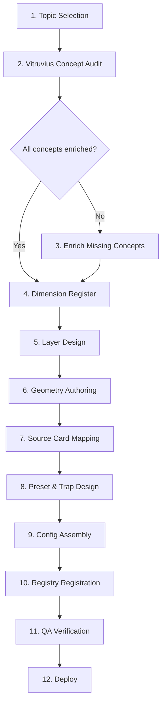

# 18 — Content Authoring Pipeline: Canonical Knowledge → LI Module Config

## Purpose

Define the end-to-end pipeline for creating a source-verified LI module config. From the decision "we need an LI module about X" to the deployed `LearningSceneConfig` in the 3D Lab registry.

## Pipeline Overview



## Step 1: Topic Selection

**Input**: Product decision — which topic needs an LI module?

**Decision criteria** (from document 05):
- Is it P0 priority?
- Does a scene template exist for this topic?
- Are source materials available in vitruvius-connection?
- Does VizCode cover this topic?

**Output**: Topic brief with:
- Module ID (kebab-case, e.g., `bp344-ramp-layers`)
- 3D Lab category (e.g., `ACCESSIBILITY` — cat-02)
- Scene template to use (e.g., "Accessible Route / Ramp Scene")
- Target sub-modes (e.g., Focus View + Source View for MVP)
- List of code families and sections to cover

## Step 2: Vitruvius Concept Audit

**Input**: Topic brief

**Actions**:

1. **Check `shared/concepts/`** for relevant concepts:
   ```bash
   ls vitruvius-connection/003_Canonical-Knowledge-Layer/shared/concepts/ | grep -E "ramp|toilet|stair|egress|..."
   ```

2. **Read concept frontmatter** to assess status:
   - `canonical_status`: enriched / draft / validated
   - `regulatory_basis`: source_id, section_id, evidence_snippet
   - `stringency_vector`: maximize / minimize / qualitative
   - `taxonomy_path`: correct domain classification

3. **Check relationships** in `shared/relationships/`:
   ```bash
   ls vitruvius-connection/003_Canonical-Knowledge-Layer/shared/relationships/ | grep "concept-accessible-ramps"
   ```

**Output**: Concept audit table

| Concept ID | Status | Source | Section | Key Text | Has Dimensions? |
|-----------|--------|--------|---------|----------|-----------------|
| `concept-accessible-ramps` | enriched | BP 344 IRR | section-1 | "shall have...facilities and features" | ❌ Generic only |
| *(ramp slope)* | missing | BP 344 | §4.02 | 1:12 max | ❌ Not yet a concept |

**If concepts are missing or draft**: Go to Step 3. Otherwise, skip to Step 4.

## Step 3: Enrich Missing Concepts

**When**: Relevant concepts are `draft`, missing, or have `canonical_status != 'enriched'`

**Process**:

1. **Locate the raw source PDF**:
   ```
   vitruvius-connection/001_Raw-Source-Layer/001-Laws/BP-344/*.pdf
   ```

2. **Extract the relevant section text** from the PDF (manual or via OCR pipeline)

3. **Create or update the concept file** in `shared/concepts/`:
   ```yaml
   ---
   id: concept-ramp-slope
   title: Ramp Slope
   page_type: concept
   canonical_status: enriched
   concept_status: enriched
   regulatory_basis:
   - source_id: irr-revised-implementing-rules-and-regulations-of-batas-pambansa-blg-344
     section_id: section-4.02
     evidence_snippet: 'Ramps shall have a maximum slope of 1:12. The preferred slope is 1:20.'
   stringency_vector: minimize
   taxonomy_path:
   - taxonomy-accessibility
   - topic-barrier-free-design
   - subtopic-routes
   ---
   # Ramp Slope

   ## Definition
   Ramps shall have a maximum slope of 1:12. The preferred slope is 1:20.

   ## Regulatory Basis
   - **[irr-revised...](irr-revised...)** - Section section-4.02: "Ramps shall have a maximum slope of 1:12..."
   ```

4. **Create relationship records** if needed:
   ```
   shared/relationships/rel-concept-accessible-ramps-requires-concept-ramp-slope.md
   ```

5. **Run canonical validation**: `scripts/pipeline_cli.py build-graph --dataset-manifest ...`

**Important**: Dimension values (1:12, 1.20m, etc.) MUST be extracted from official sources, NOT from VizCode, NOT from memory, NOT from AI generation.

## Step 4: Dimension Register

**Input**: Enriched concepts

**Output**: Table of every numeric dimension in the module, with source traceability:

| Dimension | Value | Unit | Source ID | Section | Evidence Snippet |
|-----------|-------|------|-----------|---------|-----------------|
| Max ramp slope | 1:12 | ratio | `irr-...-bp-344` | section-4.02 | "maximum slope of 1:12" |
| Min clear width | 1.20 | m | `irr-...-bp-344` | section-4.03 | "minimum clear width of 1.20 meters" |
| Max rise per run | 0.75 | m | `irr-...-bp-344` | section-4.04 | "maximum rise of 0.75 meters" |
| Min landing length | 1.50 | m | `irr-...-bp-344` | section-4.05 | "minimum landing length of 1.50 meters" |
| Handrail height | 0.90-1.10 | m | `irr-...-bp-344` | section-5.01 | "0.90m and 1.10m above ramp surface" |

**Every dimension in the 3D scene must appear in this register.**

## Step 5: Layer Design

**Input**: Dimension register + scene template

**Design the layers** — what components of the 3D model can be toggled?

**Principles**:
- 4-8 layers per module (MVP)
- Each layer = one meaningful building component or system
- Layers should be visually distinguishable (different colors, positions)
- Layers should be educationally meaningful (toggling teaches something)

**Example**: BP 344 Ramp Layers

| Layer ID | Label | Group | Educational Value |
|----------|-------|-------|-------------------|
| `ramp-surface` | Ramp Surface | Surface Elements | Shows the ramp itself — width, length, slope |
| `landing-platform` | Landing Platform | Surface Elements | Level area at top and bottom |
| `handrail-left` | Left Handrail | Safety Elements | Handrail required on both sides |
| `handrail-right` | Right Handrail | Safety Elements | Both handrails can be toggled independently |
| `edge-curb` | Edge Curb | Safety Elements | Prevents wheelchair from slipping off |
| `tactile-warning` | Tactile Warning | Safety Elements | Detectable warning at top and bottom |
| `foundation` | Foundation Support | Structural | What supports the ramp |

## Step 6: Geometry Authoring

**Input**: Layer design + dimension register

**For each layer, define GeometryInstruction**:

```typescript
{
  id: 'ramp-surface',
  label: 'Ramp Surface',
  defaultVisible: true,
  group: 'Surface Elements',
  sourceCardId: 'concept-accessible-ramps',
  codeCitation: 'BP 344 §4',
  description: 'The main ramp running surface. Max slope 1:12, min width 1.20m.',
  geometry: {
    id: 'geom-ramp-surface',
    type: 'box',                          // GeometryInstruction type
    position: [0, 0.15, 2.0],             // [x, y, z] — center position
    rotation: [0.08, 0, 0],              // Slight slope (1:12 ≈ 0.083 rad)
    scale: [1.2, 0.05, 4.0],             // [width, thickness, length] — FROM DIMENSION REGISTER
    args: [1, 1, 1],                     // Box base args (scale handles sizing)
    color: '#b0b0b0',                    // Light gray — concrete
  },
}
```

**Geometry types available** (from `GeometryInstruction`):
- `box` — for flat surfaces, walls, landings
- `cylinder` — for handrails, pipes, columns
- `plane` — for ground, thin surfaces
- `extruded-profile` — for complex cross-sections
- `instanced` — for repeated elements (balusters, parking slots)
- `sphere`, `cone`, `ring`, `line`

**Rules**:
- All dimensions (position, scale, args) must come from the dimension register
- Colors should be visually distinguishable between layers
- Position coordinates must place layers in correct spatial relationship
- Use a consistent coordinate system (Y-up, meters as units)

## Step 7: Source Card Mapping

**Input**: Layers with sourceCardId fields

**For each sourceCardId, create or verify the SOURCE_CARD_REGISTRY entry** (see document 17):

```typescript
// In src/features/3d-lab/config/source-cards.ts
export const SOURCE_CARD_REGISTRY: Record<string, SourceCardData> = {
  'concept-accessible-ramps': {
    conceptId: 'concept-accessible-ramps',
    title: 'Accessible Ramps',
    definition: 'Accessible ramps shall have the following facilities...',
    sourceLabel: 'BP 344 IRR: Accessibility Law',
    sectionId: 'section-1',
    sectionText: 'Accessible ramps shall have the following facilities and features...',
    canonicalStatus: 'enriched',
    stringencyVector: 'qualitative',
    interpretationBoundary: 'Source-verified',
  },
  // ... etc
}
```

**For layers with only codeCitation (no concept yet)**:

```typescript
'BP 344 §4.02': {
  conceptId: null,
  title: 'Ramp Slope',
  codeCitation: 'BP 344 §4.02',
  definition: 'Maximum ramp slope of 1:12. Preferred slope of 1:20.',
  sourceLabel: 'BP 344: Accessibility Law',
  sectionId: '§4.02',
  canonicalStatus: 'unverified',
  interpretationBoundary: 'Direct code citation — pending canonical verification',
},
```

## Step 8: Preset & Trap Design

**For Focus View**: Define default visible layers and camera presets.

**For Compare View** (Phase 2+): Define comparison presets:
```typescript
comparePresets: [
  {
    id: 'compliant',
    label: 'Compliant Design',
    layerStates: {
      'ramp-surface': true, 'landing-platform': true,
      'handrail-left': true, 'handrail-right': true,
      'edge-curb': true, 'tactile-warning': true,
    }
  },
  {
    id: 'noncompliant-steep',
    label: 'Non-Compliant: Too Steep (1:8)',
    layerStates: { /* ... */ },
  },
]
```

**For Mistake Hunt** (Phase 2+): Define violations:
```typescript
violations: [
  {
    id: 'missing-handrail',
    targetLayerId: 'handrail-left',
    hint: 'Check the safety requirements for both sides of the ramp.',
    sourceCardId: 'concept-accessible-ramps',
    difficulty: 'obvious',
  },
]
```

**For Board Drill** (Phase 3+): Link quiz question IDs.

## Step 9: Config Assembly

**Assemble the complete LearningSceneConfig**:

```typescript
// src/features/3d-lab/config/modules/02-accessibility/bp344-ramp-layers.ts

import type { LearningSceneConfig } from '@/features/3d-lab/types/templates'

export const bp344RampLayers: LearningSceneConfig = {
  id: 'bp344-ramp-layers',
  title: 'BP 344 Accessible Ramp Components',
  description: 'Explore the required components of an accessible ramp per BP 344. Toggle layers to see each required element.',
  subject: 'Accessibility',
  contextScenario: 'A community center needs a new accessible entrance ramp. Review each required component per BP 344 to ensure compliance.',

  layers: [
    // ... layers from Step 5-6
  ],

  camera: {
    position: [3, 2, 3],
    target: [0, 0.5, 2],
    fov: 45,
    presets: {
      perspective: { position: [3, 2, 3], target: [0, 0.5, 2], fov: 45 },
      top: { position: [0, 6, 0], target: [0, 0, 2], fov: 30 },
      front: { position: [0, 1, 8], target: [0, 1, 2], fov: 45 },
      side: { position: [6, 1, 2], target: [0, 1, 2], fov: 45 },
    },
  },

  scale: 1,
  showHumanScale: true,

  supportedModes: ['focus', 'source'],   // MVP
  defaultMode: 'focus',

  modeConfigs: {
    focus: {
      defaultVisibleLayers: ['ramp-surface', 'landing-platform', 'handrail-left', 'handrail-right', 'edge-curb'],
    },
    // compare, mistake, drill configs added in later phases
  },
}
```

## Step 10: Registry Registration

**1. Add to category registry file**:
```typescript
// src/features/3d-lab/config/registry/cat-02.ts
export const cat02Modules: ModuleRegistryEntry[] = [
  // ... existing modules ...
  {
    id: 'bp344-ramp-layers',
    title: 'BP 344 Accessible Ramp Components',
    templateType: 'learning',
    mode: 'LI',
    subject: 'Accessibility',
    categoryId: 'ACCESSIBILITY',
    launchPhase: 1,
    codeRef: 'BP 344 §4',
    status: 'built',
    description: 'Explore accessible ramp components and requirements in interactive 3D.',
    contextScenario: 'A community center needs a new accessible entrance ramp.',
    leaQuestionCount: 8,
    supportedPhases: ['guided', 'faded'],
  },
]
```

**2. Add to dashboard visibility**:
```typescript
// src/features/3d-lab/config/dashboard-visibility.ts
export const DASHBOARD_VISIBLE_IDS: ReadonlySet<string> = new Set([
  // ... existing ...
  'bp344-ramp-layers',
])
```

## Step 11: QA Verification

**Source Verification Checklist**:
- [ ] Every dimension matches the dimension register
- [ ] Every dimension register entry has a source trail to official PDF
- [ ] Every sourceCardId resolves to a vitruvius concept or code citation
- [ ] No content derived from VizCode or AI output
- [ ] canonical_status displayed correctly (enriched vs draft vs unverified)

**3D Visual Checklist**:
- [ ] All layers render at correct positions and scales
- [ ] Layers are visually distinguishable (colors, positions)
- [ ] Camera presets frame the model correctly
- [ ] Human scale reference (1.7m) is accurate
- [ ] No z-fighting between layers

**Layer Toggle Checklist**:
- [ ] Each layer toggles on/off correctly
- [ ] Default visible layers match config
- [ ] Toggle state persists within session
- [ ] "Show All" / "Hide All" work

**Source Card Checklist**:
- [ ] Source View panel shows correct text for each layer
- [ ] Source label, section ID, and text are accurate
- [ ] Interpretation boundary statement is present
- [ ] Wiki article link works (if applicable)

## Step 12: Deploy

1. Feature flag on in staging
2. QA review in staging environment
3. PI regression test suite passes
4. Deploy to production with feature flag

## Quick Reference: Authoring vs PI vs LI

| Aspect | PI Module Config | LI Module Config |
|--------|-----------------|-----------------|
| **Primary type** | `ParametricSceneConfig` (or Exploded/Cutaway/etc.) | `LearningSceneConfig` |
| **Control model** | `ParameterDef[]` (sliders, dropdowns, toggles) | `LearningLayerDef[]` (checkbox toggles) |
| **Geometry** | `geometry(params)` — generated from parameters | `geometry` — static per layer |
| **Complexity** | High (param math, violation checks, compliance) | Medium (layer design, dimension accuracy) |
| **Source integration** | ViolationRule check → codeCitation | sourceCardId → vitruvius concept |
| **Sub-mode support** | Single parametric exploration mode | Multiple sub-modes (Focus, Compare, etc.) |
| **Content author** | Engineer or advanced content author | Content author with source access |
| **Time to author** | 3-5 days (complex params) | 2-3 days (simpler, but source verification bottleneck) |

## Pipeline Tools (Future Automation)

| Tool | Purpose | Status |
|------|---------|--------|
| `bun run generate:source-cards` | Extract vitruvius concepts → SOURCE_CARD_REGISTRY | Not yet built |
| `bun run validate:li-config` | Validate LI config against dimension register | Not yet built |
| `bun run audit:li-coverage` | Compare LI modules against topic coverage matrix | Not yet built |
| `bun run check:dimensions` | Verify all config dimensions against source register | Not yet built |

## Content Author Role & Skills

**Required to author an LI module**:
1. Access to vitruvius-connection canonical knowledge pipeline
2. Ability to read and extract dimensions from official source PDFs
3. Understanding of the building code topic being modeled
4. Basic 3D spatial reasoning (for layer placement)
5. Familiarity with TypeScript (for config authoring)
6. Understanding of SlateCamp's source verification standards

**Not required**:
- React or R3F knowledge (config is declarative)
- Blender or 3D modeling skills (programmatic geometry)
- Full-stack engineering skills
