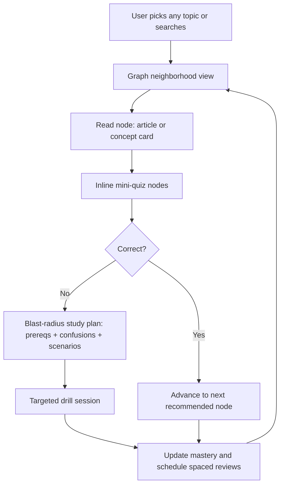
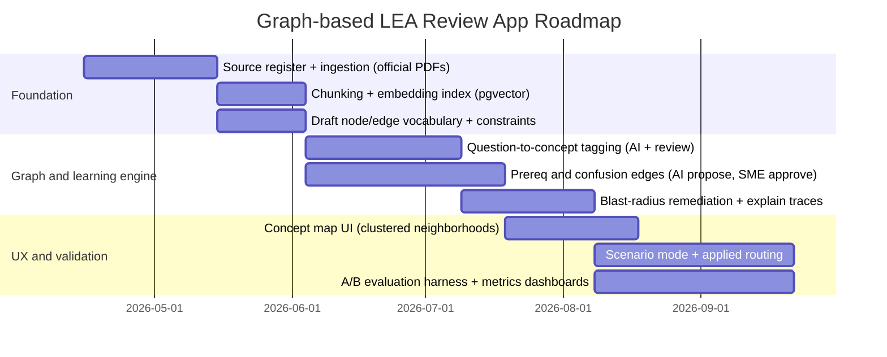

# Graph-Based Learning Architecture for a Philippine Architecture Licensure Exam Review App

## Executive summary

Graph-based models are a strong fit for an architecture licensure exam review app because the exam domain is inherently relational: codes depend on definitions, exceptions override base rules, design decisions cascade into compliance implications, and question “traps” often arise from confusing adjacent concepts. A graph turns those relationships into first-class data objects (nodes, edges, and properties) so you can compute prerequisite-aware learning paths, diagnose root-cause gaps, and generate traceable explanations. This is the same core advantage that code intelligence tools exploit: instead of re-reading everything, they build a persistent graph and compute “blast radius” to focus attention only on what is impacted. citeturn21view0turn20view0

Two open-source inspirations embody this pattern. `code-review-graph` builds a structural dependency graph of code entities (functions, classes, imports) and uses blast-radius analysis plus incremental updates to minimize context and tokens. citeturn21view0 `GitNexus` similarly runs a multi-phase indexing pipeline that parses, resolves relations, detects communities, persists the graph, and exposes tools like impact (blast radius), context, and hybrid search. citeturn20view0 These techniques transfer cleanly to learning if you treat every “knowledge unit” (concept, provision, scenario, misconception, question) as a node and every pedagogically meaningful relation (prerequisite, exception-to, commonly-confused-with, tests, applies-in) as an edge.

A practical recommendation for your constraints (Supabase-backed content, evolving laws): implement a hybrid system with three layers. First, a **versioned source-of-truth corpus** (official laws, IRRs, code PDFs, vetted references) indexed for local RAG. Second, a **maintained knowledge base** that compiles that corpus into stable concept pages, summaries, and relationships (aligned with entity["people","Andrej Karpathy","ai researcher"]’s “LLM Wiki” pattern of persistent, editable knowledge artifacts). citeturn15search3 Third, an **operational learning graph** (either in Postgres edge tables initially, or a graph DB later) that powers navigation, diagnostics, spaced review scheduling, and explanation traces.

For learning effectiveness, the evidence base strongly favors retrieval practice and distributed practice for retention, plus adaptive diagnosis and feedback mechanisms used in intelligent tutoring systems. citeturn3search0turn3search1turn6search3 A graph does not replace those interventions; it makes them more precise, explainable, and maintainable in a codes-heavy domain.

## Assumptions and scope

This report assumes the following, based on your stated context and the problem framing:

Jurisdiction is the Philippines, and the app targets the licensure exam administered under the authority of the architecture regulatory framework and the entity["organization","Professional Regulation Commission","philippines licensing agency"]’s policies and resolutions. citeturn2search1turn9view0turn10view0

Dataset assumptions: approximately 500+ “articles” and approximately 7,000 MCQ-style questions currently stored in entity["company","Supabase","backend as a service"], with fact-checking still required, and a desire to add more articles over time.

Exam blueprint and coverage should be treated as versioned inputs. The PRC has published Tables of Specifications (ToS) via board resolution, which provides a formal structure for subjects and competencies. citeturn10view0turn9view0 The licensure exam schedule is published annually and changes over time, so the app must ingest the “current” blueprint for the active exam season, not assume older ToS remains accurate. citeturn12search1turn11search1

Regulatory corpus for learning and compliance examples is assumed to include official or government-hosted sources such as the National Building Code text hosted by entity["organization","Department of Public Works and Highways","philippines infrastructure agency"], the BP 344 accessibility IRR hosted by DPWH, the Philippine Green Building Code materials hosted by DPWH, and the Fire Code law text. citeturn8search6turn1search5turn8search0turn19search5

The user experience goal is an interactive, non-linear learning system where learners can start anywhere, traverse to connected nodes, encounter embedded assessments between content nodes, and receive explainable routing and remediation based on performance.

Sources to prioritize for ongoing updates in production are: PRC issuances and PDFs, DPWH-hosted codes and IRRs, legislative texts from official repositories, W3C specifications for graph standards, and primary research for learning science and knowledge tracing. citeturn9view0turn8search6turn4search0turn3search2

## Core graph concepts and schema design

A graph data model represents a domain as entities and their relations. In a **property graph**, nodes represent entities, relationships connect nodes, and both nodes and relationships can store key-value properties. citeturn4search3 In an **RDF graph**, knowledge is expressed as subject–predicate–object triples, forming a graph designed for interchange and formal semantics. citeturn4search0 The architecture review domain can be represented in either, but each has different operational strengths.

Property graph is typically the most practical operational model for a learning product because you need fast traversals, rich edge metadata (confidence, difficulty, pedagogical intent), and flexibility as your schema evolves. citeturn4search3 RDF plus OWL becomes attractive when you need formal ontologies, interoperability, and logic-based reasoning about classes and properties. citeturn4search1 If you choose RDF or export to RDF, SHACL is the standard way to validate that your graph conforms to constraints (for example, that every Question tests at least one Knowledge Component, and every Provision belongs to an Instrument and has an effective date). citeturn4search2

For your product, schema design has to support three realities:

Laws and IRRs change, so you must model versions, effective dates, supersession, and “applicability windows” at the data level rather than burying this in prose.

Questions are not merely attached to articles; they test concepts, exceptions, scenarios, and discriminations between similar rules. You must model those linkages explicitly, or your “graph” will become a decorative map rather than an engine.

You need provenance and auditability, because you are building in a regulated domain and your content operations must be defensible.

A robust baseline schema separates “knowledge” from “resources” from “assessment.” The simplest durable structure is:

Knowledge nodes: Concept, Definition, Exception, Procedure, Principle, CodeProvision.

Resource nodes: SourceDocument, SourceSection, Figure, Diagram, CaseStudy.

Assessment nodes: Question, Distractor, Misconception, SkillTag.

Learner layer nodes (optional but powerful): Learner, Attempt, MasteryState.

Edges carry meaning. The edge vocabulary is where most graph learning systems succeed or fail. A minimal, high-leverage set:

PREREQ_OF (Concept → Concept): prerequisite dependency.

TESTS (Question → Concept/Provision): what a question tests.

EVIDENCED_BY (Concept/Provision → SourceSection/Figure): grounding references.

EXCEPTION_TO (Exception → Provision/Rule): override relations.

COMMONLY_CONFUSED_WITH (Concept ↔ Concept): discrimination learning.

APPLIES_IN (Provision → Scenario): application context.

SUPERSEDED_BY (Provision/Instrument → Provision/Instrument): versioning.

The “ontology” layer can be lightweight at first: controlled vocabularies for subject area, topic hierarchy, building system, and cognitive skill (recall vs application vs analysis). You do not need OWL-level formalization in v1, but schema validation is non-negotiable; SHACL-like constraints can be implemented as database constraints plus validation jobs even if you are not using RDF. citeturn4search2

Example node and edge JSON can be standardized early to prevent schema drift:

```json
{
  "node": {
    "id": "concept:egress:means-of-egress-hierarchy",
    "type": "Concept",
    "title": "Means of Egress hierarchy",
    "topic_path": ["Building Laws and Codes", "Fire Safety", "Egress"],
    "jurisdiction": "PH",
    "difficulty": 0.65,
    "version": "2026-04-12",
    "provenance": {
      "source_document_id": "doc:ra9514",
      "source_section_ref": "Rule/Section pointer",
      "review_status": "verified",
      "reviewed_at": "2026-04-10"
    }
  }
}
```

```json
{
  "edge": {
    "id": "edge:prereq:egress-hierarchy<-occupant-load",
    "type": "PREREQ_OF",
    "from": "concept:fire:occupant-load",
    "to": "concept:egress:means-of-egress-hierarchy",
    "properties": {
      "strength": 0.8,
      "confidence": 0.9,
      "created_by": "ai_suggestion",
      "review_status": "pending_human"
    }
  }
}
```

The key is that both nodes and edges carry (a) jurisdiction and version, (b) provenance, and (c) review status. This is what makes the system flexible as laws evolve and as your editorial policies tighten.

## Graph algorithms for learning and how to apply them

Graph algorithms become product functionality when you attach them to concrete learning behaviors. The table below maps “classic” algorithms to learning decisions and shows the trade-offs.

| Algorithm family | Canonical reference | What it computes | How it becomes a learning feature | Key trade-offs |
|---|---|---|---|---|
| Dependency analysis (DAG operations) | Knowledge space approaches formalize prerequisite structure for adaptive assessment. citeturn6search5 | prerequisite closure, valid ordering | “Study route” that never skips prerequisites; root-cause diagnosis after errors | Requires high-quality prerequisite edges; wrong prerequisites misroute learners |
| Blast-radius propagation | `code-review-graph` traces callers/dependents/tests as blast radius. citeturn21view0 | impacted neighborhood of a node | “If you missed this, review these prerequisites and these downstream applications” | Needs calibrated decay, or it becomes noisy |
| Centrality (importance) | PageRank introduced link-based ranking. citeturn7search0 | hub concepts and bridge concepts | “High-leverage topics” dashboard; prioritizes concepts that unlock many questions | Can over-prioritize popular but shallow nodes; must combine with mastery |
| Betweenness centrality | Brandes provides efficient computation. citeturn7search3 | nodes sitting on many shortest paths | Identifies “bridge” concepts that connect clusters (often exam traps) | Sensitive to graph noise; expensive on large graphs if recomputed often |
| Community detection | Louvain method for modularity optimization. citeturn7search5 | clusters of related nodes | Auto-generated modules and map clusters; supports “review by cluster” mode | Communities can shift with schema edits; must version clusters |
| Pathfinding (shortest paths) | Dijkstra shortest path. citeturn7search2 | minimal-cost path between nodes | “Fastest remediation path” given current mastery; “how to reach competency X” | Needs meaningful edge weights (difficulty, time, dependency strength) |
| GraphRAG-style community summaries | GraphRAG: extract KG, build community hierarchy, summarize. citeturn0search2turn15search5 | hierarchical summaries + local grounding | Global “what are the themes” answers; topic overviews that remain traceable | Requires careful prompt and evaluation; can underperform naive RAG on some tasks |

The most direct transfer from your GitHub inspirations is “blast radius.” In code, change impact is computed over dependency edges. In learning, error impact is computed over prerequisite and confusion edges. A wrong answer on a question that tests Concept A triggers a bounded traversal:

Upstream: prerequisites of A (likely missing foundations).

Lateral: concepts commonly confused with A, to force discrimination.

Downstream: scenarios and applications where A matters, to build transfer.

This mirrors how `code-review-graph` computes caller and dependent sets, but you add pedagogical weighting and mastery signals into how far you traverse and which neighbors you prioritize. citeturn21view0turn3search2

A practical “blast radius” implementation for your app should be probabilistic, not binary. You want decay and edge weighting. For example, PRACTICE_NEXT_SCORE can be computed as:

Priority = (1 - MasteryProbability) × EdgeStrength × ExamFrequency × RecencyWeight × CentralityBoost.

MasteryProbability can come from knowledge tracing (BKT baseline) or a more complex model (DKT), and edge strength can be derived from editorial rules plus empirical correlations once you collect data. citeturn3search2turn3search3

Reasoning and inference should be narrowly scoped. OWL supports expressive ontological reasoning, but in a product context you often want simple rule inference plus validation: “If Provision P is superseded by Q after date D, do not surface P in 2026 exam mode.” OWL provides the formal toolset for ontology-level reasoning. citeturn4search1 SHACL validates constraints and can support rule extensions in the SHACL ecosystem, but even if you do not implement SHACL directly, the concept of shaped validation is what prevents garbage graphs. citeturn4search2

## Data sources, ingestion strategy, and rights and OCR constraints

A Philippine architecture licensure exam app is only as credible as its sources. The “official” corpus must be explicit, versioned, and referenced per claim.

Regulatory and official sources to prioritize:

PRC board resolutions and Tables of Specifications: the PRC has published ToS documents for the licensure exam via board resolution. citeturn10view0turn9view0

Exam schedules and announcements: PRC publishes exam schedules annually (for example, the 2026 schedule includes the Architects exam dates). citeturn12search1turn11search1

National Building Code text and DPWH-hosted references: DPWH hosts copies and references for PD 1096 and related materials. citeturn8search6turn1search14

Accessibility law IRR: DPWH hosts the BP 344 IRR documents and related references. citeturn1search5turn1search9

Fire Code law text: the Fire Code law text is available via legislative repositories, and LawPhil provides a consolidated text. citeturn19search5turn2search4

Philippine Green Building Code: DPWH hosts the Green Building Code booklet and related guidance. citeturn8search0turn8search3

Textbooks and standards:

Textbooks, review books, and professional standards are typically copyrighted. The Philippine IP regime provides automatic protection for literary and artistic works including books and writings, and the entity["organization","Intellectual Property Office of the Philippines","philippines ip agency"] explicitly describes that protection as arising from creation, not registration. citeturn16search1turn16search0

Standards like the National Structural Code of the Philippines are commonly treated as proprietary publications (often through professional societies, such as entity["organization","Association of Structural Engineers of the Philippines","professional society philippines"] as publisher). citeturn8search18 Even if you have access personally, your app must obtain licenses to reproduce and distribute those texts inside the product. citeturn16search0turn16search1

Images and diagrams:

Official PDFs often include diagrams and tables that learners need. Many diagrams in standards and textbooks are also copyrighted; treat them as protected “works” under the IP Code framework unless you have licensing or the content is in the public domain. citeturn16search1turn16search0

OCR and retrieval risks:

If source PDFs are scanned, OCR is unavoidable. OCR errors measurably degrade information retrieval accuracy, which can directly degrade RAG grounding and any automated extraction pipeline that depends on clean text. citeturn16search3turn16search14 This is a serious operational issue because OCR noise can cause the model to miss key terms, misread numeric constraints, and hallucinate “absent” text.

A disciplined ingestion plan for law and code sources should include:

A source register: every document stored with title, issuing body, publication date, effective date, edition, URL, checksum, and rights status.

A dual representation: keep the original PDF (for citation and verification), and store extracted text chunks plus structured elements (tables, headings) separately.

OCR quality scoring: store OCR confidence and flags; route low-quality pages to manual correction or higher-quality OCR pipelines. Retrieval research shows OCR noise impacts downstream retrieval, so “best effort OCR” is not enough for production. citeturn16search3turn16search10

A version graph: every provision node must be linked to the exact document version and effective period, with SUPERSEDED_BY edges when revisions occur.

## Content modeling for architecture exam learning

The key practical move is to stop thinking in “articles and attached questions” only, and start thinking in “knowledge units and relations.” The article remains a node, but it becomes one node type among several.

A concrete node taxonomy that fits architecture exam prep:

Article: your MDX or prose learning page.

Concept: atomic idea or skill (for mastery).

Provision: codified requirement or clause with effective date.

Definition: definitional clause or terminology.

Exception: override to a base rule.

ProcessStep: procedural knowledge (permit workflow, compliance review).

Scenario: applied situation (retrofit, occupancy change, egress design).

Question: item with answer key and distractors.

Misconception: common error pattern tied to distractors.

Diagram: image or figure with caption and rights metadata.

The edge taxonomy should be intentionally small at first, but semantically precise. A recommended starting set:

PART_OF (Concept → Topic)

PREREQ_OF (Concept → Concept)

TESTS (Question → Concept/Provision)

EXPLAINS (Article → Concept)

GROUNDED_IN (Provision → SourceSection)

EVIDENCED_BY (Concept → SourceSection/Diagram)

EXCEPTION_TO (Exception → Provision)

APPLIES_IN (Provision → Scenario)

COMMONLY_CONFUSED_WITH (Concept ↔ Concept)

ILLUSTRATED_BY (Concept/Provision → Diagram)

SUPERSEDED_BY (Provision/Instrument → Provision/Instrument)

A practical example grounded in Philippine codes:

A Provision node representing an accessibility requirement should be grounded to the DPWH-hosted BP 344 IRR source and linked to scenarios like “public entrance retrofit” and concepts like “barrier-free circulation” and “ramp design.” citeturn1search5turn1search9

A Provision node representing an NBC-related rule should be grounded to the DPWH-hosted PD 1096 text and linked to concepts like “occupancy classification,” “permit staging,” and “means of egress.” citeturn8search6turn1search14

A sample AI extraction contract should be strict, because you want repeatable structure and auditability, not free-form prose:

```json
{
  "contract": {
    "task": "extract_graph_metadata_from_article",
    "input": {
      "article_id": "uuid",
      "title": "string",
      "body_clean": "string",
      "jurisdiction": "PH",
      "topic_path": ["string"],
      "candidate_sources": [
        {
          "source_document_id": "string",
          "retrieved_passages": [
            {
              "source_section_ref": "string",
              "text": "string"
            }
          ]
        }
      ]
    },
    "output": {
      "summary": "string",
      "concepts": [
        {
          "name": "string",
          "type": "Concept|Definition|Exception|ProcessStep",
          "confidence": 0.0,
          "source_refs": ["source_section_ref"]
        }
      ],
      "edges": [
        {
          "edge_type": "PREREQ_OF|COMMONLY_CONFUSED_WITH|APPLIES_IN|EXCEPTION_TO",
          "from_name_or_id": "string",
          "to_name_or_id": "string",
          "confidence": 0.0,
          "rationale": "string",
          "source_refs": ["source_section_ref"]
        }
      ],
      "quality_flags": [
        {
          "flag": "POTENTIAL_CONFLICT|MISSING_SOURCE|AMBIGUOUS",
          "notes": "string"
        }
      ]
    }
  }
}
```

This contract aligns with the operational philosophy of structured extraction pipelines such as GraphRAG, which treats indexing as a transformation suite that extracts structured data from unstructured text using LLMs. citeturn15search1turn15search5

## Pedagogical mapping and interaction design

The graph is infrastructure; learning outcomes come from how you use it.

Retrieval practice: testing strengthens retention beyond re-reading, and the Roediger and Karpicke work shows that repeated testing improves long-term retention in educationally relevant materials. citeturn3search0turn3search4 A graph improves retrieval practice by ensuring questions are not sampled randomly but are selected to cover prerequisite gaps, confusions, and downstream applications connected to what the learner missed.

Distributed practice (spacing): Cepeda and colleagues’ meta-analysis supports the distributed practice effect across many experiments, with retention benefits from spacing. citeturn3search1turn3search9 A graph improves spacing by letting you schedule review at the concept level rather than repeating the same surface question, which reduces “pattern memorization” and increases transfer.

Effective study methods synthesis: the Dunlosky review ranks practice testing and distributed practice as higher-utility techniques across contexts. citeturn2search3turn2search11 Your product design should therefore be “graph-guided practice testing plus spaced review,” not “graph visualization.”

Diagnostics and knowledge tracing: Bayesian Knowledge Tracing (BKT) provides a transparent baseline for updating mastery probability as learners answer items over time. citeturn3search2 Deep Knowledge Tracing (DKT) shows how sequence models can improve prediction performance and discover structure in student tasks, but it is typically less interpretable. citeturn3search3turn3search7 Graph structure helps both: it constrains the space of plausible next tasks and provides explainable traces even when the mastery estimator is complex.

Transfer and scenario-based reasoning: architecture exam competence is not only recall of provisions; it is application under conditions. A graph supports this by linking provisions and concepts to Scenario nodes so the app can force “apply the rule” in multiple contexts rather than drilling a single phrasing.

EdTech precedents that relate directly:

Concept maps: concept mapping explicitly represents knowledge as concepts plus labeled relations and is intended as a tool to organize and represent knowledge. citeturn6search0turn6search19 The difference in your product is that the concept map is not user-authored only; it is a curated and computed graph that also drives adaptive sequencing.

Knowledge Space Theory and ALEKS: ALEKS describes its basis in Knowledge Space Theory, which models knowledge states and supports adaptive assessment that is more informative than a crude numeric mark. citeturn6search1turn6search5 This is a close conceptual cousin to your “start anywhere, route intelligently” goal, but your domain is multi-source law and practice, not a single math curriculum.

Intelligent Tutoring Systems: institutional evidence reviews exist for adaptive tutoring products, such as the What Works Clearinghouse report on Cognitive Tutor courses. citeturn6search3 Even where effect sizes vary, the key lesson is that personalized feedback and adaptive practice can outperform conventional instruction in many controlled evaluations when implemented rigorously.

Recent educational KG work: learning path recommendation based on educational knowledge graphs is an active research topic, including work explicitly framing educational knowledge graphs as modeling concepts, resources, and their interrelationships to recommend paths. citeturn14search5turn14search0 Use these as design references, but keep your product anchored to provenance and legality because your domain is regulated.

UX and interaction patterns that make the graph usable:

Concept map mode: show a clustered map by community detection so the learner sees modules, not a hairball. Louvain clustering is a pragmatic starting point. citeturn7search5

Path traversal mode: for any target competency, show the minimal prerequisite path and mark what is mastered and what is missing. Dijkstra-style shortest paths become a “fastest remediation route” feature when you define edge weights as time, difficulty, and prerequisite strength. citeturn7search2

Explanation traces: every recommendation must be explainable as a small subgraph. This mirrors how code-review graphs justify why certain nodes are in the blast radius. citeturn21view0turn20view0

Inline assessment nodes: your idea of “mini nodes between nodes” is correct. The reading node links to 10 question nodes, but questions also link to multiple concepts, confusions, and scenarios. This is what enables non-linear traversal without becoming chaos.

Visual mockup suggestions:

A split-pane “Map + Article” layout: left pane shows the local neighborhood graph; right pane shows the selected article or concept card.

A “Why this next” overlay: tapping a recommended node highlights the exact path from the learner’s last wrong answer to the node, with short textual justifications per edge.

A “Cluster review” carousel: one cluster summary card (what this cluster is about), then a mixed mini-quiz pulling from the cluster.

image_group{"layout":"carousel","aspect_ratio":"16:9","query":["knowledge graph learning concept map UI","interactive concept map dashboard education","graph-based learning path UI","explainable recommendation graph UI"],"num_per_query":1}

## Technical stack options, MVP architecture, pipeline, and governance

A hybrid architecture is the most defensible for your use case because it separates concerns: official truth, compiled knowledge, and learning operations.

Local RAG vs maintained knowledge base:

Classic RAG combines parametric models with non-parametric retrieval memory, which is useful for grounding answers in large corpora. citeturn15search0 GraphRAG extends this by extracting a knowledge graph from text, building a community hierarchy, summarizing communities, and using both local and global retrieval for different question types. citeturn0search2turn15search5 In parallel, the “LLM Wiki” pattern argues for building a persistent, editable knowledge base where synthesized pages compound over time rather than retrieving raw chunks repeatedly. citeturn15search3

For your product, the recommended hybrid is:

Local RAG corpus for official sources and citations (truth layer).

Maintained knowledge base (LLM Wiki style) for compiled concept pages, summaries, and cross-links, updated under editorial control. citeturn15search3

Operational learning graph for routing, diagnostics, spacing, and explainability.

Graph DB choices and trade-offs:

| Option | What it is | Strengths for your use case | Weak points | Primary references |
|---|---|---|---|---|
| Postgres in Supabase with edge tables | relational DB with explicit edges | fastest iteration and simplest ops; easy joins with your existing app | multi-hop traversals and graph algorithms are more manual; may need offline compute | Supabase pgvector and AI guidance emphasizes Postgres as vector store. citeturn5search3turn5search7 |
| entity["company","Neo4j","graph database company"] | property graph DB with Cypher | mature traversal, ecosystem, and graph analytics library | operational overhead and licensing considerations depending on edition | property graph concepts and GDS docs. citeturn4search3turn15search12 |
| entity["company","Amazon Web Services","cloud provider"] Neptune | managed graph DB supporting RDF + property graph APIs | supports SPARQL and property graph query languages; managed ops | vendor lock-in; modeling choices affect flexibility | Neptune supports openCypher, Gremlin, and SPARQL. citeturn5search0 |
| Kuzu embedded graph DB | embedded graph store, local-first | strong for local graph analytics and offline pipelines; fits “local indexing” patterns like GitNexus | embedded model means you manage distribution and sync; less conventional in web apps | Kuzu documentation positions it as embedded graph DB for analytical workloads. citeturn5search1 |
| JanusGraph | distributed graph DB with Gremlin | built for extremely large graphs | heavy operational burden; you must manage backends | JanusGraph describes its distributed scale goals. citeturn17search6 |

Vector DB options for local RAG:

A practical default is pgvector in Postgres because you already run Supabase. pgvector is explicitly designed for storing and searching embeddings in Postgres. citeturn5search2turn5search3 Dedicated vector DBs (for example, entity["company","Pinecone","vector database company"], entity["company","Weaviate","vector database company"], entity["company","Qdrant","vector database company"]) add scaling and hybrid search features, but with added operational surface area. citeturn18search0turn18search1turn18search3

MVP architecture recommendation using Next.js + Supabase + local RAG + graph layer:

Begin with Supabase as the system of record and implement the learning graph as normalized tables:

nodes table: id, type, title, jurisdiction, version, review_status, provenance.

edges table: from_id, to_id, type, strength, confidence, review_status, provenance.

documents table: official source register with version metadata.

chunks table: extracted text chunks with embeddings and citations.

questions table: question items, difficulty parameters, concept tags, provenance.

attempts table: learner interactions.

This keeps everything in one transactional store initially, with vector search via pgvector and graph traversal via SQL joins and cached precomputations. citeturn5search3turn5search7

Mermaid diagram for MVP schema:

```mermaid
erDiagram
  NODE {
    string id PK
    string type
    string title
    string jurisdiction
    string version_tag
    string review_status
    json provenance
  }

  EDGE {
    string id PK
    string from_id FK
    string to_id FK
    string type
    float strength
    float confidence
    string review_status
    json provenance
  }

  DOCUMENT {
    string id PK
    string title
    string issuer
    string edition
    date published_at
    date effective_from
    date effective_to
    string rights_status
    string checksum
  }

  CHUNK {
    string id PK
    string document_id FK
    string section_ref
    string text
    vector embedding
    json ocr_meta
  }

  QUESTION {
    string id PK
    string stem
    json choices
    string correct_choice
    string review_status
    json psychometrics
    json provenance
  }

  ATTEMPT {
    string id PK
    string user_id
    string question_id FK
    boolean correct
    float response_time_sec
    date occurred_at
    json context
  }

  NODE ||--o{ EDGE : from
  NODE ||--o{ EDGE : to
  DOCUMENT ||--o{ CHUNK : contains
  QUESTION ||--o{ ATTEMPT : answered_in
```

Mermaid diagram for user flow:



Data ingestion and annotation pipeline:

Python orchestration should follow a staged approach similar in spirit to GraphRAG’s pipeline mindset: transform unstructured text into structured artifacts, validate, then promote. citeturn15search1turn15search8 The pipeline should be deterministic where possible and AI-assisted where necessary.

A production-grade pipeline has these stages:

Acquire: download and register official PDFs (DPWH, PRC, Senate, NPC) with checksums and dates. citeturn8search6turn10view0turn1search8

Extract: parse text directly when possible; OCR scanned pages and store OCR confidence. Retrieval research shows OCR noise damages retrieval performance, so OCR metadata is not optional. citeturn16search3turn16search10

Chunk: chunk by section headings and semantic boundaries; store section refs.

Embed: generate embeddings for chunks and store in pgvector.

Enrich: run AI extraction contracts to propose concepts, provisions, relations, and question tags, writing proposals to staging tables.

Review: route low-confidence or high-impact proposals (prerequisites, exceptions, legal thresholds) to SME review.

Promote: only approved nodes and edges become “production graph” for learners.

Governance, privacy, and licensing:

Privacy compliance is not theoretical. The Philippines’ Data Privacy Act establishes general data privacy principles including transparency, legitimate purpose, and proportionality, and the amended IRR provides implementing detail. citeturn16search2turn1search8 If you track learner behavior for adaptive learning, you must implement data minimization, clear retention windows, role-based access, and breach response procedures aligned with NPC guidance and the statutory framework. citeturn1search8turn16search5 This includes whether you process sensitive personal information, and how you separate analytics from core identity data.

Licensing must be enforced at ingestion time. The IP Code regime protects books and writings, and IPOPHL guidance emphasizes automatic protection. citeturn16search1turn16search0 A compliant product usually needs one of: licensed excerpts, paraphrased teaching content with citations to public sources, or source links without reproducing protected text. This directly affects what can be included in a “local RAG corpus.”

Measurement and evaluation metrics:

Retention: delayed post-tests (7 days, 30 days) following retrieval practice, consistent with test-enhanced learning findings. citeturn3search0turn3search4

Transfer: scenario-based items that require applying rules in novel contexts.

Predictive validity: correlation of mastery estimates with mock exam outcomes. BKT provides a baseline mastery update model; DKT is an option if you accept lower interpretability. citeturn3search2turn3search3

Item calibration: if you use IRT, Baker’s open IRT primer is a solid reference for modeling and calibration basics, including the conceptual framing of item response models used in adaptive testing. citeturn14search3turn14search7

Experimental design: A/B tests can compare graph-guided routing versus baseline spaced practice; RCT-style studies are feasible if you can randomize learners into conditions. ITS evaluation practice provides precedents for intervention reports and controlled studies. citeturn6search3turn6search22

Limitations and failure modes:

Graph quality risk: bad edges create bad routing. This is why validation and review statuses must exist for edges, not just nodes.

Staleness risk: outdated provisions surfaced in “current exam mode” erode trust. This is addressed by versioning, supersession edges, and a source register.

RAG hallucination risk: retrieval systems reduce hallucination but do not eliminate it; RAG is designed to combine parametric and retrieved memory, but output quality still depends on retrieval quality and constraints. citeturn15search0turn16search3

Over-visualization risk: a graph UI that is beautiful but unusable kills adoption. Cluster the map and default to local neighborhoods, not global webs. Louvain-style clustering helps, but your UX must be tuned. citeturn7search5turn6search0

Prioritized roadmap with indicative effort and team roles:

The timeline below assumes no budget constraints but does assume disciplined sequencing, because graph learning products fail when they skip content ops.



Team roles you actually need:

Domain SMEs (codes, practice, planning, structures): approve prerequisites, exceptions, and interpretations.

Content engineers: design chunking, citation fidelity, and source versioning.

ML and data scientists: knowledge tracing, IRT calibrations where appropriate, and experiment design. citeturn3search2turn14search3

Full-stack engineers: Next.js UX, Supabase schema, workflow tools, admin review surfaces.

Legal and compliance: licensing agreements for proprietary references, and privacy governance aligned to the Data Privacy Act principles. citeturn16search2turn16search1