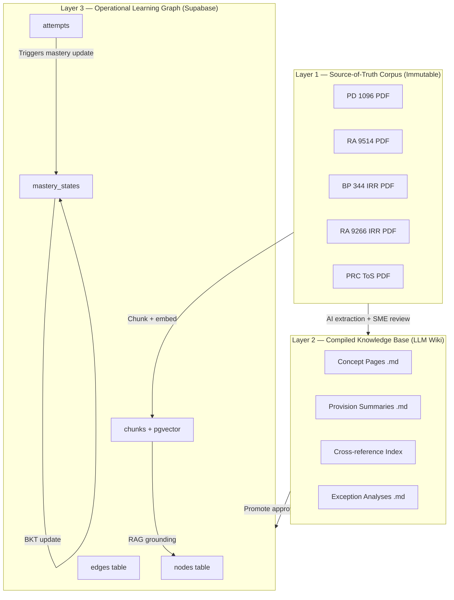
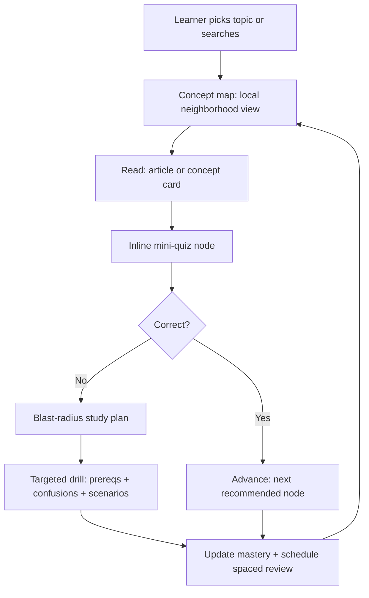
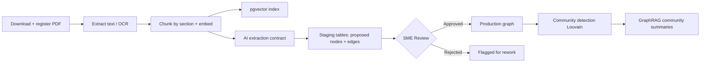

# Graph-Based Learning Architecture for a Philippine Licensure Examination for Architects Review App

## Executive Summary

Graph-based models are a natural fit for a Philippine Licensure Examination for Architects (LEA) review system because the exam domain is inherently relational. Codes depend on definitions; exceptions override base rules; design decisions cascade into compliance consequences; and exam "traps" arise almost exclusively from confusing adjacent concepts. A graph elevates those relationships from prose footnotes to first-class data objects — nodes, edges, and properties — so the system can compute prerequisite-aware learning paths, diagnose root-cause knowledge gaps, and generate traceable explanations that a learner can follow.

This report provides a practitioner-level treatment of every layer: the Philippine regulatory and exam context, graph schema design, learning-science algorithms, GraphRAG versus local-RAG trade-offs, Supabase-backed implementation patterns, governance and privacy compliance, and a phased delivery roadmap. The target audience is a development team already familiar with Next.js and Supabase who wants to understand *why* each design choice is made and *how* to implement it without waiting for a perfect schema.

***

## 1. Philippine Exam Context and Domain Map

### 1.1 Exam Blueprint and Regulatory Basis

The Licensure Examination for Architects (LEA) is administered under Republic Act No. 9266, the Architecture Act of 2004, through the Professional Regulatory Board of Architecture (PRBoA) under the Professional Regulation Commission (PRC). The examination is divided into three major areas with fixed weightings published by the PRC in its official Syllabi document:[^1][^2][^3][^4]

| Area | Topics | Weight |
|------|---------|--------|
| A | History and Theory of Architecture; Principles of Planning; Architectural Practice | 30% |
| B | Structural Design; Building Materials and Construction; Utilities | 30% |
| C | Architectural Design and Site Planning | 40% |

Passing *all* subjects is required to practice as a licensed architect in the Philippines. The PRC publishes examination schedules and Tables of Specifications (ToS) annually, and both are treated as versioned inputs in any learning system — what was tested in one exam season may shift in the next.[^5][^2]

### 1.2 High-Yield Regulatory Corpus

The knowledge graph's source-of-truth layer must index the following official instruments — these are the documents whose provisions form the actual exam questions:

- **PD 1096 — National Building Code of the Philippines (NBC):** Governs design, construction, occupancy, and maintenance of all public and private buildings. The DPWH hosts the official PDF. Key topics tested include occupancy classifications, setback rules, permit stages, egress design, and means of egress hierarchy.[^6][^7]
- **BP 344 — Accessibility Law IRR:** Mandates barrier-free access for persons with disabilities. DPWH hosts the IRR; commonly tested in questions about ramp design, door clearances, and public entrance retrofits.
- **RA 9514 — Fire Code of the Philippines (2008):** Establishes fire safety construction requirements, occupancy-based egress rules (every floor must have at least two exits, stairways must be fire-rated and enclosed), alarm systems, and the Fire Safety Inspection Certificate (FSIC) process. Administered by the Bureau of Fire Protection.[^8][^9]
- **Philippine Green Building Code:** DPWH-hosted materials cover energy efficiency, water conservation, material sustainability, and tropical climate responsiveness.
- **RA 9266 and its IRR:** Governs the practice of architecture itself — scope of services, architect-of-record liability, professional fees computation, and CPD requirements.[^3][^10]

### 1.3 Exam Traps and Why They Are Relational

Architecture exam questions frequently test the *intersection* between codes rather than isolated provisions. A single design scenario may simultaneously implicate occupancy classification (NBC), accessible route requirements (BP 344), egress travel distance (RA 9514), and structural system selection (NSCP). A learner who studies each code in isolation will encounter exam traps precisely at those intersections. This is the core pedagogical justification for graph-based learning: the graph makes those intersections explicit as edges, so the system can deliberately surface cross-code questions rather than siloing review by subject.[^5]

***

## 2. Graph Theory Foundations

### 2.1 Property Graph vs. RDF

Two established models for knowledge graphs are in common use:

- **Property graph:** Nodes represent entities; directed relationships connect nodes; both nodes and relationships carry key-value properties. Cypher (Neo4j) and Gremlin are the primary query languages. This model prioritizes fast traversal, rich edge metadata, and schema flexibility.[^11]
- **RDF / Triple Store:** Knowledge is expressed as subject–predicate–object triples. SPARQL is the query language. This model supports formal ontological reasoning via OWL and constraint validation via SHACL, and it was designed for semantic web interoperability.[^12]

For an operational learning product backed by Supabase (PostgreSQL), the **property graph** is the right default model. It supports the traversal patterns needed for prerequisite chains, blast-radius diagnosis, and community detection, while keeping schema evolution manageable. RDF becomes attractive when formal reasoning is required — for example, inferring that a superseded provision should not surface in "current exam mode" — but even that inference can be implemented via application logic in v1.

### 2.2 GraphRAG vs. Standard RAG

Standard Retrieval-Augmented Generation (RAG) chunks source documents into flat text, embeds them as vectors, and retrieves the most semantically similar chunks at query time. It is fast to set up and works well for single-hop factual retrieval, but it treats every chunk as isolated and lacks multi-hop reasoning capability.[^13][^14]

GraphRAG, introduced formally by Microsoft Research, extends this by first extracting a knowledge graph from source text, building a community hierarchy over the graph (using Louvain or Leiden clustering), generating LLM-summarized community reports at each hierarchy level, and using both local entity search and global community search at query time. Research comparing the two paradigms found that GraphRAG excels at multi-hop reasoning and relationship-aware queries, while standard RAG is faster for single-step semantic lookup. A hybrid approach combining both consistently outperforms either in isolation.[^15][^16][^17]

For the LEA review app, this distinction is practically important:

- A learner asking *"What is the minimum ramp width under BP 344?"* is a single-hop factual query — standard RAG handles it well.
- A learner asking *"What rules apply to a commercial building retrofit that must comply with the NBC, BP 344, and RA 9514 simultaneously?"* is a multi-hop relational query — GraphRAG's community summaries and graph traversal are significantly better.

The KG²RAG framework demonstrates that using knowledge graph fact-level relationships between chunks improves both response quality and retrieval quality compared to standard RAG.[^13]

***

## 3. Graph Schema Design

### 3.1 Node Taxonomy

The schema must separate **knowledge**, **resources**, and **assessment** into distinct node types. A concrete starting taxonomy for the LEA domain:

| Node Type | What it represents | Key Properties |
|-----------|-------------------|----------------|
| `Concept` | Atomic idea or skill (e.g., "occupant load calculation") | title, topic_path, difficulty, jurisdiction, version |
| `Provision` | Codified requirement or clause (e.g., "NBC Section 403") | code_reference, effective_from, effective_to, jurisdiction, issuer |
| `Definition` | Defined term in a statute (e.g., "Means of Egress") | term, statutory_source, scope |
| `Exception` | Override to a base rule (e.g., "single-family dwelling exemption") | exception_to, condition, effective_period |
| `ProcessStep` | Procedural knowledge (e.g., permit workflow stages) | sequence, agency, prerequisite_documents |
| `Scenario` | Applied situation (e.g., "mixed-use retrofit egress design") | context_description, applicable_codes, difficulty |
| `Question` | MCQ item with answer key and distractors | stem, correct_choice, distractors, psychometrics, provenance |
| `Misconception` | Common error pattern tied to specific distractors | error_description, triggered_by, related_concept |
| `Article` | Compiled learning page (MDX/prose) | title, topic_path, word_count, last_reviewed |
| `Diagram` | Figure or illustration | caption, rights_status, source_document |
| `SourceDocument` | Official source (law, IRR, code PDF) | title, issuer, edition, effective_date, checksum, rights_status |
| `SourceSection` | Specific section of a document | section_ref, text_excerpt, page_range |
| `Learner` | Registered user (privacy-scoped) | id, cohort, registration_date |
| `MasteryState` | Snapshot of learner mastery per concept | mastery_probability, last_updated, attempts_count |

### 3.2 Edge Vocabulary

The edge vocabulary is where graph learning systems succeed or fail. Too many edge types create maintenance overhead; too few destroy expressiveness. A recommended minimum viable set:

| Edge Type | Direction | What it encodes |
|-----------|-----------|----------------|
| `PREREQ_OF` | Concept → Concept | Prerequisite dependency |
| `TESTS` | Question → Concept/Provision | What a question assesses |
| `EXPLAINS` | Article → Concept/Provision | Content covers topic |
| `GROUNDED_IN` | Provision/Concept → SourceSection | Authoritative traceability |
| `EXCEPTION_TO` | Exception → Provision | Override relation |
| `APPLIES_IN` | Provision → Scenario | Application context |
| `COMMONLY_CONFUSED_WITH` | Concept ↔ Concept | Discrimination learning (bidirectional) |
| `ILLUSTRATED_BY` | Concept/Provision → Diagram | Visual reference |
| `SUPERSEDED_BY` | Provision/Instrument → Provision/Instrument | Versioning |
| `PART_OF` | Concept → Topic | Hierarchy |
| `DISTRACTOR_FOR` | Misconception → Question | Explains why wrong answers are chosen |

Every edge carries `strength` (0–1), `confidence` (0–1), `created_by` (ai_suggestion or human_verified), and `review_status` (pending/approved/rejected). This is non-negotiable: bad edges create bad routing, and without review status there is no way to quarantine unverified AI-proposed relations.

### 3.3 Sample Node and Edge JSON

```json
{
  "node": {
    "id": "concept:egress:means-of-egress-hierarchy",
    "type": "Concept",
    "title": "Means of Egress hierarchy",
    "topic_path": ["Building Laws and Codes", "Fire Safety", "Egress"],
    "jurisdiction": "PH",
    "difficulty": 0.65,
    "version": "2026-04-12",
    "provenance": {
      "source_document_id": "doc:ra9514",
      "source_section_ref": "Rule 10, Section 10.2.1",
      "review_status": "verified",
      "reviewed_at": "2026-04-10"
    }
  }
}
```

```json
{
  "edge": {
    "id": "edge:prereq:egress-hierarchy<-occupant-load",
    "type": "PREREQ_OF",
    "from": "concept:fire:occupant-load",
    "to": "concept:egress:means-of-egress-hierarchy",
    "properties": {
      "strength": 0.8,
      "confidence": 0.9,
      "created_by": "ai_suggestion",
      "review_status": "pending_human"
    }
  }
}
```

***

## 4. Graph Algorithms and Their Learning Interpretations

### 4.1 Algorithm-to-Feature Map

Each graph algorithm family becomes a concrete product feature when attached to a learning behavior. The table below maps algorithms to functions:

| Algorithm | What it computes | Learning feature | Key trade-off |
|-----------|-----------------|-----------------|---------------|
| DAG topological sort + prerequisite closure | Valid prerequisite orderings | "Study route" that never skips foundations | Requires high-quality PREREQ_OF edges |
| Blast-radius propagation | Impacted neighborhood of a missed concept | Targeted remediation plan after a wrong answer | Needs decay/weighting or it becomes noisy |
| PageRank centrality | Hub and high-influence concepts | "High-leverage topic" dashboard | May over-rank popular but shallow nodes |
| Betweenness centrality | Bridge nodes on many shortest paths | Identifies "trap" concepts connecting clusters | Sensitive to graph noise; expensive on large graphs |
| Louvain community detection | Clusters of densely connected nodes | Auto-generated topic modules; "Review by cluster" | Communities shift with schema edits; must version |
| Dijkstra shortest path | Minimum-cost path between nodes | "Fastest remediation route" given mastery state | Needs meaningful edge weights |
| GraphRAG community summaries | Hierarchical summaries + local grounding | Global "themes" overview; topic summaries | Requires careful prompt design and evaluation |

### 4.2 Blast-Radius Remediation

The most direct transfer from code intelligence tools to learning is the **blast-radius** pattern. In code review graphs, a change in one function propagates impact to callers, dependents, and tests. In learning, a wrong answer on a concept propagates diagnostically to:

1. **Upstream:** Prerequisites of the missed concept — these are likely the missing foundations.
2. **Lateral:** Concepts marked `COMMONLY_CONFUSED_WITH` the missed concept — force discrimination.
3. **Downstream:** Scenarios and applications where the concept is required — build transfer.

This traversal should be **probabilistic and bounded**, not a full-graph flood. A practical priority score for next-item selection:

\[
\text{Priority} = (1 - p_{\text{mastery}}) \times w_{\text{edge}} \times f_{\text{exam}} \times r_{\text{recency}} \times c_{\text{centrality}}
\]

where \( p_{\text{mastery}} \) is the current mastery estimate (from BKT or DKT), \( w_{\text{edge}} \) is the edge strength from the graph, \( f_{\text{exam}} \) is the exam frequency weight from the ToS, \( r_{\text{recency}} \) is a recency decay factor favoring items not recently reviewed, and \( c_{\text{centrality}} \) is a betweenness centrality boost for bridge nodes.

### 4.3 Community Detection for Module Generation

The Louvain method for community detection is a greedy modularity-optimization algorithm that iteratively assigns nodes to communities that maximize the modularity measure \( Q \):[^18][^19]

\[
Q = \frac{1}{2m} \sum_{i,j} \left[ A_{ij} - \frac{k_i k_j}{2m} \right] \delta(c_i, c_j)
\]

where \( A_{ij} \) is the edge weight between nodes \( i \) and \( j \), \( k_i \) is the sum of weights of edges attached to node \( i \), \( m \) is the sum of all edge weights, and \( \delta(c_i, c_j) \) is 1 if nodes \( i \) and \( j \) are in the same community. Modularity scores above 0.4 indicate meaningful groupings worth using for curriculum modules.[^20]

In the LEA context, running Louvain over the concept-and-provision graph automatically discovers topic clusters that correspond roughly to exam subject areas (NBC → egress → fire safety → accessibility) plus cross-cutting clusters that emerge from shared concepts. These clusters become the "module" view in the learner UI and the unit of community summary generation in GraphRAG.

GraphRAG's Microsoft Research implementation (2024) builds a hierarchical community structure, generates LLM summaries of each community at each level, and uses dynamic community selection — embedding the query and scoring community reports for relevance rather than using a fixed hierarchy level. The 2026 core-based hierarchy extension replaces modularity-based clustering with k-core decomposition to produce a more balanced hierarchy.[^16][^21][^12]

***

## 5. Learning Science Foundations

### 5.1 Retrieval Practice

The most robust finding in applied cognitive science for exam preparation is the **testing effect**: repeated retrieval practice substantially improves long-term retention compared to restudying the same material. Roediger and Butler (2011) demonstrate that retrieval practice produces large gains in long-term retention and promotes flexible, transferable knowledge rather than surface recall. Active retrieval has been shown to improve retention by approximately 50% compared to passive review a week later. Critically, the effect is durable across levels of education and subject domains.[^22][^23][^24]

In the graph-based system, retrieval practice is improved by ensuring questions are *not* sampled randomly but are selected based on prerequisite gaps, confusion edges, and downstream applications. The graph makes every practice session contextually targeted rather than stochastically uniform.[^22]

### 5.2 Distributed Practice (Spaced Repetition)

The distributed practice effect is well-supported by meta-analytic evidence: spacing review sessions over time produces substantially better retention than massed practice. The SM-2 algorithm, developed by Piotr Wozniak (1987) and used in Anki, implements this by tracking an ease factor per item and computing the next review interval as:[^25][^26][^27]

\[
I(n) = I(n-1) \times EF \quad \text{for } n > 2
\]

where \( I(n) \) is the inter-repetition interval in days and \( EF \) is the ease factor updated after each review as:

\[
EF' = EF + 0.1 - (5 - q) \times (0.08 + (5 - q) \times 0.02)
\]

where \( q \) is the response quality on a 0–5 scale and \( EF \) has a minimum floor of 1.3. The FSRS (Free Spaced Repetition Scheduler) algorithm used in modern Anki is a more sophisticated improvement on SM-2 that better handles forgetting curves and overdue cards.[^28][^25]

The graph improves spaced repetition by scheduling review at the **concept level** rather than repeating identical surface questions, which reduces pattern memorization and increases transfer. When a learner is due to review "occupant load calculation," the system can serve any question that tests that concept — not the same question seen before.

### 5.3 Knowledge Tracing Models

Knowledge tracing estimates the probability that a learner has mastered a concept given their response history. Two primary models exist:

**Bayesian Knowledge Tracing (BKT):** A two-state hidden Markov model parameterized by four probabilities: initial knowledge \( p(L_0) \), learning rate \( p(T) \), slip probability \( p(S) \) (knowing but answering incorrectly), and guess probability \( p(G) \) (not knowing but answering correctly). BKT is interpretable, requires few parameters per concept, and remains state-of-the-art for explainable mastery modeling. Extended forms integrating individualization and hierarchical inference outperform deep learning approaches in some settings.[^29]

**Deep Knowledge Tracing (DKT):** Uses LSTM-based sequence models that consider all prior interactions across skills simultaneously. DKT tends to outperform BKT on large datasets where temporal ordering and cross-skill dependencies matter, but it is significantly less interpretable. Research comparing the two shows that BKT with relaxed assumptions can match or exceed DKT performance, and that the critical dimension is the ability to model cross-skill interactions rather than the use of deep learning per se.[^30][^31][^32]

**Practical recommendation:** Start with BKT per concept node for interpretability and debuggability. Collect at least 3–5 interaction sequences per learner per concept before trusting mastery estimates. Layer DKT as an optional enhancement once you have sufficient data (hundreds of learners, thousands of interactions per concept).

### 5.4 Item Response Theory

Item Response Theory (IRT) models the probability that a learner of ability \( \theta \) answers an item correctly as a function of the item's difficulty \( b \), discrimination \( a \), and pseudo-guessing \( c \) parameters (3-PL model):[^33][^34]

\[
P(\text{correct} | \theta) = c + (1-c) \cdot \frac{1}{1 + e^{-a(\theta - b)}}
\]

In a Computer Adaptive Testing (CAT) framework, item selection maximizes information at the current estimated ability level, meaning the system presents questions neither too easy nor too hard — the "zone of proximal development" for that learner. Research confirms that CAT with IRT achieves more efficient and precise ability estimation than fixed-form tests.[^34][^35][^33]

IRT calibration requires item parameter estimation from real response data, which means it cannot be implemented with full fidelity in v1 with an uncalibrated item bank. A practical path: use content-expert-assigned difficulty tags as proxy \( b \) estimates in v1, collect response data, and run proper IRT calibration (e.g., with the `irt` Python package or `mirt` in R) once you have sufficient data per item (typically 200+ responses per question for stable estimates).

### 5.5 Knowledge Space Theory and ALEKS Precedent

ALEKS (Assessment and LEarning in Knowledge Spaces) demonstrates large-scale knowledge space theory (KST) in practice: a domain of approximately 350 algebra concepts yields millions of empirically feasible knowledge states, yet a Markovian adaptive assessment can gauge a learner's knowledge state in approximately 25–30 questions. ALEKS employs regularly spaced re-assessments and KST-guided learning mode simultaneously, and has been used by approximately four to five million students per year in mathematics and chemistry.[^36][^37]

The LEA graph system shares the same goal — "start anywhere, route intelligently" — but operates in a multi-source regulatory domain rather than a single curated curriculum. The key lesson from ALEKS is that a well-structured prerequisite graph plus probabilistic state estimation is sufficient to dramatically personalize the learning experience, even without deep learning models.

### 5.6 Learning Path Recommendation Research

Recent research on educational knowledge graph-based path recommendation shows measurable improvements: a KG-based recommendation strategy in computer programming education improved path acceptance rate by 31.7% and knowledge mastery efficiency by 24.3% compared to non-graph baselines. Incorporating both prerequisite *and* similarity relations between knowledge concepts — rather than prerequisite edges alone — improves recommendation performance. The practical implication for the LEA app: both `PREREQ_OF` and `COMMONLY_CONFUSED_WITH` edges should be populated before attempting adaptive routing.[^38][^39]

***

## 6. The Three-Layer Architecture

The recommended system architecture has three functionally distinct layers that correspond to different concerns: **truth**, **knowledge compilation**, and **learning operations**.

### 6.1 Layer 1 — Versioned Source-of-Truth Corpus

This layer holds original official documents in their canonical form. No content is modified here; this is the immutable reference. Every document is registered with:

- Title, issuing body, publication date, effective date, effective-to date
- Document URL or DPWH/PRC/Senate repository path
- SHA-256 checksum (to detect unexpected changes)
- Rights status (public domain, government publication, licensed, proprietary)
- Edition or version tag

Access to this layer is read-only for all downstream processes. Provisions in the learning graph must carry a `GROUNDED_IN` edge back to a specific `SourceSection` in this layer, creating end-to-end auditability for every claim in the system.

### 6.2 Layer 2 — Maintained Knowledge Base (LLM Wiki Pattern)

Andrej Karpathy's "LLM Knowledge Bases" pattern (published April 2026) describes an architecture where an LLM incrementally builds and maintains a persistent wiki of interlinked Markdown files from a raw source directory — rather than re-chunking and re-retrieving at every query. The LLM acts as a research librarian: it reads new sources, extracts key information, updates entity pages, notes contradictions, and keeps the synthesis current. The compiled wiki is *stable* and *human-readable*; the LLM writes it and humans can audit it.[^40][^41]

For the LEA app, this means compiling concept pages, provision summaries, cross-references, and exception analyses as editable Markdown files that live in version control. When RA 9514's IRR is updated, the LLM reads the delta and patches the affected wiki pages — not a cold re-indexing of everything. This dramatically reduces operational cost and improves consistency compared to pure RAG.

The key difference from raw GraphRAG is editorial accountability: every wiki page is reviewable and correctable by domain SMEs before it becomes a learner-facing node. Automated graph extraction proposals go into a staging table; only SME-approved pages are promoted to production.

### 6.3 Layer 3 — Operational Learning Graph

This layer powers the learner-facing functions: navigation, diagnostics, spaced review scheduling, and explanation traces. It consists of:

- The production node and edge tables (Supabase Postgres)
- Mastery state per learner per concept node (BKT/DKT outputs)
- Attempt history (inputs to knowledge tracing)
- Spaced review schedule (SM-2 / FSRS parameters per concept per learner)
- Precomputed centrality scores and community assignments (refreshed periodically)

This is the layer that changes most frequently as learners interact with the system. It is *operationally decoupled* from Layer 1 and Layer 2, meaning a law update does not immediately break the learning graph — it triggers an editorial workflow that eventually propagates approved changes into Layer 3.

***

## 7. Data Sources, Ingestion, and Rights

### 7.1 Official Sources and Indexing Priority

| Source | Issuing Body | Notes |
|--------|-------------|-------|
| PD 1096 and IRR | DPWH | [DPWH PDF](https://www.dpwh.gov.ph/DPWH/files/nbc/PD.pdf) — directly indexable[^7] |
| BP 344 Accessibility IRR | DPWH | Government publication; treat as public domain for educational paraphrase |
| RA 9514 Fire Code | BFP / Congress | Available on LawPhil and Supreme Court e-Library[^42][^8] |
| Philippine Green Building Code | DPWH | Booklet and guidance materials on DPWH portal |
| RA 9266 and IRR | PRC / PRBoA | IRR available at architectureboard.com.ph[^10] |
| PRC ToS by Board Resolution | PRC | PDF on prc.gov.ph — annual updates[^2] |
| PRC Examination Schedule | PRC | Annual; ingest for "exam countdown" feature |

### 7.2 Copyright and Rights Management

The Philippine IP Code provides automatic copyright protection for literary and artistic works (books, writings) from the moment of creation, without registration. This has direct implications:[^3]

- **Review books and textbooks** (e.g., UTsep materials, commercial review books) are protected. Reproducing substantial excerpts without a license is an infringement even for educational apps.
- **Government issuances** (laws, executive orders, official codes published by government agencies) are generally not subject to copyright under the IP Code's treatment of official texts. They can be quoted and paraphrased. However, **private third-party annotations and commentaries on those laws are separately copyrighted.**
- **NSCP (National Structural Code of the Philippines):** Published by the Association of Structural Engineers of the Philippines (ASEP), a professional society — treat as proprietary. Obtain a license or limit to paraphrase and link.
- **Diagrams and figures** in PDFs: Treat as copyrighted unless the issuing body is a government agency publishing in an official capacity.

A compliant content model: store paraphrased concept pages that cite the public source provision, with a `GROUNDED_IN` edge linking to the exact source section. Do not reproduce full statutory text verbatim in learner-facing content beyond short quotations needed for attribution.

### 7.3 OCR Quality and Retrieval Impact

Many Philippine regulatory documents are scanned PDFs. OCR errors measurably degrade downstream information retrieval accuracy, which directly impacts RAG grounding quality and automated extraction pipelines. A production-grade ingestion pipeline must:[^43]

1. Attempt native text extraction first (pdfplumber, pdfminer); fall back to OCR only for image-based pages.
2. Store OCR confidence scores per page and flag pages below threshold (e.g., < 0.85 confidence) for manual review.
3. Preserve section structure (headings, subsections, tables) as structured metadata, not just flat text.
4. Store the original PDF as the canonical source; extracted text is a derived artifact.

### 7.4 Production Ingestion Pipeline

A staged, deterministic pipeline following the GraphRAG mindset of transforming unstructured text into structured artifacts:

```
1. ACQUIRE   → Download and register PDFs with checksums and effective dates
2. EXTRACT   → Parse native text; OCR image pages; store OCR metadata
3. CHUNK     → Split by section headings and semantic boundaries; preserve section refs
4. EMBED     → Generate embeddings (OpenAI text-embedding-3-small or open-source);
               store in pgvector
5. ENRICH    → Run AI extraction contract: propose concepts, provisions, edges
               → Write proposals to staging tables with confidence scores
6. REVIEW    → Route to SME for low-confidence or high-impact proposals
               (prerequisites, exceptions, numeric thresholds)
7. PROMOTE   → Approved nodes/edges become production graph
8. DIFF      → On document update, compute delta; run ENRICH only on changed sections
```

The AI extraction contract should be a strict, structured prompt that outputs JSON matching the schema — not free-form prose. Every proposed edge must include a `rationale` field and `source_refs` array so the reviewing SME can verify the claim directly in the source document.

***

## 8. Supabase and Stack Implementation

### 8.1 MVP Database Schema (Supabase + pgvector)

Supabase provides pgvector as a native extension, turning Postgres into a vector store with HNSW and IVFFlat indexing for efficient similarity search. The Supabase AI toolkit integrates with OpenAI, Hugging Face, and LangChain, enabling embeddings generation and hybrid (vector + keyword) search within the same database that holds relational data.[^44][^45][^46]

**Core tables:**

```sql
-- Enable extensions
CREATE EXTENSION IF NOT EXISTS vector;
CREATE EXTENSION IF NOT EXISTS pgcrypto;

-- Nodes: concepts, provisions, questions, articles, etc.
CREATE TABLE nodes (
  id          TEXT PRIMARY KEY,  -- e.g. "concept:egress:means-of-egress"
  type        TEXT NOT NULL,     -- Concept, Provision, Question, Article, ...
  title       TEXT NOT NULL,
  jurisdiction TEXT DEFAULT 'PH',
  topic_path  TEXT[],
  difficulty  FLOAT,
  version_tag TEXT,
  review_status TEXT DEFAULT 'pending',  -- pending | approved | rejected
  provenance  JSONB,
  embedding   vector(1536),       -- for semantic search
  created_at  TIMESTAMPTZ DEFAULT NOW(),
  updated_at  TIMESTAMPTZ DEFAULT NOW()
);

-- Edges: typed relationships between nodes
CREATE TABLE edges (
  id           TEXT PRIMARY KEY,
  from_id      TEXT REFERENCES nodes(id),
  to_id        TEXT REFERENCES nodes(id),
  type         TEXT NOT NULL,  -- PREREQ_OF, TESTS, EXCEPTION_TO, ...
  strength     FLOAT DEFAULT 0.5,
  confidence   FLOAT DEFAULT 0.5,
  created_by   TEXT,           -- ai_suggestion | human_verified
  review_status TEXT DEFAULT 'pending',
  provenance   JSONB,
  created_at   TIMESTAMPTZ DEFAULT NOW()
);

-- Source documents register
CREATE TABLE documents (
  id           TEXT PRIMARY KEY,
  title        TEXT NOT NULL,
  issuer       TEXT,
  edition      TEXT,
  published_at DATE,
  effective_from DATE,
  effective_to   DATE,
  rights_status  TEXT,  -- public_domain | gov_publication | licensed | proprietary
  checksum       TEXT,
  url            TEXT
);

-- Text chunks with embeddings for RAG
CREATE TABLE chunks (
  id           UUID PRIMARY KEY DEFAULT gen_random_uuid(),
  document_id  TEXT REFERENCES documents(id),
  section_ref  TEXT,
  text         TEXT,
  embedding    vector(1536),
  ocr_confidence FLOAT,
  metadata     JSONB
);

-- Questions (MCQ)
CREATE TABLE questions (
  id            UUID PRIMARY KEY DEFAULT gen_random_uuid(),
  stem          TEXT NOT NULL,
  choices       JSONB,   -- {A: ..., B: ..., C: ..., D: ...}
  correct_choice TEXT,
  explanation   TEXT,
  review_status TEXT DEFAULT 'pending',
  psychometrics JSONB,  -- {difficulty, discrimination, guess_prob}
  provenance    JSONB,
  created_at    TIMESTAMPTZ DEFAULT NOW()
);

-- Learner attempts
CREATE TABLE attempts (
  id             UUID PRIMARY KEY DEFAULT gen_random_uuid(),
  user_id        UUID,   -- references auth.users
  question_id    UUID REFERENCES questions(id),
  selected_choice TEXT,
  is_correct     BOOLEAN,
  response_time_sec FLOAT,
  mastery_before FLOAT,
  mastery_after  FLOAT,
  occurred_at    TIMESTAMPTZ DEFAULT NOW(),
  session_context JSONB
);

-- Mastery state per learner per concept
CREATE TABLE mastery_states (
  user_id     UUID,
  node_id     TEXT REFERENCES nodes(id),
  p_mastery   FLOAT DEFAULT 0.0,  -- BKT posterior
  sm2_interval INT DEFAULT 1,
  sm2_ef      FLOAT DEFAULT 2.5,
  next_review_at TIMESTAMPTZ,
  updated_at  TIMESTAMPTZ DEFAULT NOW(),
  PRIMARY KEY (user_id, node_id)
);

-- HNSW index for semantic search on chunks
CREATE INDEX chunks_embedding_idx ON chunks
  USING hnsw (embedding vector_cosine_ops)
  WITH (m = 16, ef_construction = 64);
```

### 8.2 Graph Traversal in Postgres

Without a dedicated graph database, multi-hop traversals use recursive CTEs. A two-hop prerequisite closure query for a target concept looks like:

```sql
WITH RECURSIVE prereqs AS (
  -- Base: direct prerequisites of target
  SELECT from_id AS concept_id, 1 AS depth
  FROM edges
  WHERE to_id = $target_concept_id
    AND type = 'PREREQ_OF'
    AND review_status = 'approved'
  UNION ALL
  -- Recursive: prerequisites of prerequisites (up to 5 hops)
  SELECT e.from_id, p.depth + 1
  FROM edges e
  JOIN prereqs p ON e.to_id = p.concept_id
  WHERE e.type = 'PREREQ_OF'
    AND e.review_status = 'approved'
    AND p.depth < 5
)
SELECT DISTINCT concept_id, MIN(depth) AS min_depth
FROM prereqs
GROUP BY concept_id
ORDER BY min_depth;
```

For more complex traversals (community detection, centrality), precompute these as batch jobs (daily or weekly) and cache results in a `precomputed_graph_analytics` table. This avoids expensive online computation for every learner request.

### 8.3 When to Migrate to a Dedicated Graph DB

The Postgres-first approach is the right starting point. Migrate when:

- Multi-hop traversals (> 3 hops) become the hot path and Postgres recursive CTEs are the bottleneck.
- Real-time graph analytics are required at scale.
- The graph exceeds ~1 million nodes with complex community structures.

Migration candidates:

| Option | Strengths | Weaknesses |
|--------|-----------|------------|
| **Neo4j** (Community or Enterprise) | Mature Cypher query language; Graph Data Science library for centrality, community detection; strong ecosystem[^11][^47] | Operational overhead; licensing costs for enterprise edition |
| **AWS Neptune** | Managed; supports both openCypher and SPARQL; handles RDF if needed | Vendor lock-in; may require re-modeling |
| **Kuzu** | Embedded, local-first; strong for analytical workloads and offline pipelines; fits local indexing pattern | Not conventional in web apps; requires sync/distribution management |
| **JanusGraph** | Distributed scale | Heavy operational burden; manage storage backends separately |

For most teams building on Supabase, Neo4j (or the free Community Edition) as a sidecar for graph analytics is the simplest upgrade path — keep Supabase as the primary source of record and sync the graph layer to Neo4j for traversal queries.

***

## 9. UX and Interaction Design

### 9.1 Core Interaction Patterns

The graph is infrastructure; learning outcomes come from how learners interact with it. Five interaction patterns map directly to graph features:

**1. Concept Map Mode:** Show the learner's local neighborhood (2–3 hops from current position) as a clustered visual map. Communities from Louvain detection provide the clustering — learners see modules, not a full hairball. Mastery state is encoded as node color (green = mastered, yellow = in progress, red = gap, grey = unvisited). This is the entry point for non-linear exploration.[^18]

**2. Guided Learning Path Mode:** Given a target competency (e.g., "pass Area B"), compute the minimum prerequisite path using Dijkstra-style weighted shortest path. Edge weights encode difficulty + time + prerequisite strength. The path highlights what is mastered (skip) and what is missing (study). This is the "fastest route to exam readiness" feature.

**3. Blast-Radius Study Plan:** After a wrong answer, the system traverses the blast radius (upstream prerequisites, lateral confusions, downstream applications) and presents a targeted 10–15 question drill session. Every node in the drill is linked back to the wrong-answer node with a labeled edge, making the rationale explicit: "You're reviewing *occupant load* because it is a prerequisite of *means of egress hierarchy*, which you missed."

**4. Inline Assessment Nodes:** Concept cards contain embedded mini-questions that unlock follow-up content. Questions are not decoration — they are graph nodes with `TESTS` edges linking them to the concept being read. Answering triggers a mastery update and adjusts the subsequent navigation recommendations in real time.

**5. Cluster Review Carousel:** One community summary card (what this cluster covers and why it matters for the exam) followed by a mixed mini-quiz sampling questions from across the cluster. This implements both the distributed practice effect (questions from different sub-topics) and the testing effect (retrieval practice immediately after reading the summary).[^23][^27]

### 9.2 Explainability Principles

Every recommendation must surface a human-readable explanation as a small subgraph trace. Examples:

- *"We're showing you this question about ramp gradient because you struggled with 'accessible routes under BP 344' (wrong answer on 2026-04-10), and this question tests the same concept from a different angle."*
- *"This topic appears in approximately 8% of questions in Area A based on the PRC ToS, and your mastery estimate is currently 0.32 — below the 0.80 threshold we recommend before exam day."*

Explainability is not just a UX nicety in a regulated exam prep context — it builds learner trust and reduces the perception that the app is "just guessing" at what to show next.

### 9.3 Split-Pane Layout Recommendation

A practical UI layout for the study interface:

- **Left pane:** Local neighborhood graph (3-hop, Louvain-clustered) with mastery color coding. Clickable nodes navigate without full page reload (React Server Components with Supabase real-time subscriptions for mastery updates).
- **Right pane:** Selected concept card or article, with inline mini-quiz nodes embedded between content sections. After a question is answered, the right pane shows an explanation trace and the left pane highlights the blast-radius nodes.
- **Bottom drawer / overlay:** Spaced review queue ("5 concepts due for review today"), exam countdown, and session analytics.

***

## 10. Privacy, Governance, and Compliance

### 10.1 Data Privacy Act of 2012 (RA 10173) Obligations

The Philippines' Data Privacy Act establishes three core processing principles: **transparency** (data subjects must know the nature, purpose, and extent of processing), **legitimate purpose** (processing must be in accordance with a declared purpose), and **proportionality** (processing must not be excessive relative to the declared purpose). The NPC's December 2024 advisory clarifies that the DPA and its IRR apply to AI systems during training, testing, and deployment — not only in production.[^48][^49][^50]

For the LEA app, this means:

- **Registration with NPC:** Personal information controllers processing personal data must register data processing systems with the NPC Registration System (NPCRS). Automated decision-making (adaptive routing based on mastery estimates) must be declared.[^49]
- **Privacy Notice:** Learners must be informed about what behavioral data (attempts, response times, mastery estimates) is collected, how it is used, how long it is retained, and their rights to access, correct, and delete.
- **Data Minimization:** Collect only what is needed for the adaptive function. Session-level aggregates (mastery probability per concept) are sufficient for routing; raw keystroke timing or device fingerprint data should not be collected unless there is a specific, declared purpose.
- **Retention Windows:** Define and enforce retention periods. Raw attempt logs might be retained for 2 years for IRT calibration; mastery state snapshots retained for the duration of account activity plus 90 days.
- **Breach Response:** Implement a breach notification procedure aligned with NPC requirements (notify NPC within 72 hours of becoming aware of a breach affecting sensitive personal information).

### 10.2 AI-Specific Compliance

Following the NPC's December 2024 advisory, AI systems in the app must comply with:[^48]

- **Transparency and explainability:** Learners must understand that routing is driven by AI, and must be able to challenge or override recommendations.
- **Fairness and non-discrimination:** Mastery estimates should not systematically disadvantage learners from particular backgrounds (e.g., non-Manila test prep resources). Regular audits of model predictions across demographic cohorts are recommended.
- **Accuracy:** Mastery estimates and question difficulty parameters must be periodically calibrated against ground truth (exam outcomes where available).

### 10.3 Editorial Governance

Content governance for a regulatory domain is as important as technical architecture. Every node and edge should have a lifecycle:

```
AI_PROPOSED → SME_REVIEW → APPROVED → PUBLISHED
                    ↓
              REJECTED / REVISED
```

A "production graph" for learners should contain *only* nodes and edges with `review_status = approved`. Unapproved AI proposals live in a staging schema. This two-tier system prevents hallucinated or incorrect provisions from reaching learners while still allowing rapid AI-assisted content creation.

An editorial team structure:
- **Domain SMEs** (licensed architects or architecture professors): approve prerequisites, exception edges, provision interpretations, and question answer keys.
- **Content engineers:** enforce chunking standards, citation fidelity, and source versioning.
- **Legal/compliance reviewer:** approves rights status of source materials and privacy notice updates.

***

## 11. Measurement, Evaluation, and Failure Modes

### 11.1 Product Metrics

| Metric | Operationalization | Target |
|--------|-------------------|--------|
| **Retention** | Delayed post-test accuracy (7-day, 30-day) | > 15% lift over control |
| **Transfer** | Scenario-item accuracy on novel contexts | > 0.70 at exam readiness |
| **Predictive validity** | Correlation of mastery estimates with mock exam scores | r > 0.65 |
| **Item calibration** | IRT parameter stability across exam cohorts | SE(b) < 0.2 per item |
| **Graph quality** | % of approved edges vs. AI-proposed; SME review turnaround | > 80% approval rate, < 5 days review lag |
| **Completion rate** | % of learners completing a 30-day study plan | > 40% (ambitious; monitor engagement signals) |

### 11.2 A/B Testing Design

Once a learner cohort of sufficient size is reached, run a simple two-arm experiment:

- **Control:** Standard spaced repetition (SM-2 scheduling) with random question selection within a subject.
- **Treatment:** Graph-guided blast-radius routing with prerequisite-aware scheduling.

Randomize at the learner level to avoid contamination. Primary outcome: 30-day delayed post-test score. Secondary: time-to-mastery per concept cluster. This mirrors evaluation designs used in intelligent tutoring system research.[^22]

### 11.3 Failure Modes and Mitigations

| Failure Mode | Consequence | Mitigation |
|-------------|-------------|------------|
| **Bad prerequisite edges** | Learners routed away from what they need | SME review mandatory for all PREREQ_OF edges before production promotion |
| **Outdated provisions surfaced** | Wrong answers to real exam questions | Versioning + SUPERSEDED_BY edges; "exam mode" filters on effective dates |
| **RAG hallucination** | Incorrect explanations in concept cards | All explanations grounded in Layer 1 sources; GROUNDED_IN edges are mandatory |
| **Over-visualization** | Beautiful graph UI nobody uses | Default to local 2-hop neighborhoods; don't display the full graph; test with users |
| **Privacy breach** | NPC enforcement action; learner trust damage | Data minimization, encryption at rest, row-level security in Supabase, breach response SOP |
| **Copyright infringement** | IP claim from textbook publisher | Rights status on every source document; legal review before ingesting proprietary materials |
| **Community drift** | Louvain clusters shift after schema edits, breaking module UI | Version community assignments alongside graph version; regenerate on schema-level changes only |

***

## 12. Phased Roadmap

The roadmap below sequences work to maximize usability per unit of effort, prioritizing content operations (without which the graph has nothing to traverse) before advanced learning algorithms.

### Phase 1 — Foundation (Weeks 1–8)

- [ ] Register all official source documents (PD 1096, BP 344, RA 9514, Green Building Code, RA 9266 IRR) in the document registry with checksums and rights status.
- [ ] Ingest and chunk documents; generate embeddings; build initial pgvector index.
- [ ] Define and version the node/edge vocabulary; implement staging and production schema.
- [ ] Implement AI extraction contract pipeline (extract → stage → SME review UI → promote).
- [ ] Tag existing 7,000 questions to concept/provision nodes (AI-assisted + SME review).

### Phase 2 — Graph and Learning Engine (Weeks 9–18)

- [ ] Populate approved PREREQ_OF and COMMONLY_CONFUSED_WITH edges for high-frequency concepts.
- [ ] Implement BKT mastery estimation per concept per learner; store in `mastery_states`.
- [ ] Implement SM-2 spaced review scheduling per concept per learner.
- [ ] Build blast-radius traversal (recursive CTE + priority score formula).
- [ ] Implement GraphRAG community summarization over Louvain clusters for topic overview cards.

### Phase 3 — UX and Adaptive Interface (Weeks 19–28)

- [ ] Build concept map UI (local neighborhood, mastery color coding, clickable navigation).
- [ ] Build guided learning path mode (shortest prerequisite path to target competency).
- [ ] Implement "Why this next?" explanation trace overlay.
- [ ] Build cluster review carousel (community summary + mixed mini-quiz).
- [ ] Implement scenario-mode questions and `APPLIES_IN` edge traversal.

### Phase 4 — Validation and Scale (Weeks 29–40)

- [ ] Run A/B experiment: graph-guided routing vs. standard spaced repetition.
- [ ] Run IRT calibration on item bank once sufficient response data is collected.
- [ ] Implement DKT as optional enhancement alongside BKT for learners with > 50 interactions.
- [ ] Evaluate migration from Postgres graph tables to Neo4j if traversal latency becomes a bottleneck.
- [ ] Implement NPC-compliant privacy notice, data deletion workflow, and automated retention enforcement.

***

## 13. Team and Technology Summary

### Recommended Stack

| Layer | Technology | Rationale |
|-------|-----------|-----------|
| Frontend | Next.js (App Router) + React | Server components, API routes, Vercel deployment[^51][^52] |
| Backend/DB | Supabase (Postgres) | pgvector, RLS, auth, Edge Functions, existing stack[^46] |
| Vector search | pgvector (HNSW index) | Co-located with graph tables; hybrid search support[^44][^43] |
| Graph analytics (v1) | Postgres recursive CTEs + batch precompute | No additional infra required |
| Graph analytics (v2) | Neo4j Community Edition (sidecar) | When traversal bottlenecks appear[^11] |
| Embeddings | OpenAI text-embedding-3-small (or `bge-m3` for open-source) | 1536-dim; strong multilingual support for Filipino/English mixed content |
| LLM (extraction + chat) | GPT-4o or Claude 3.5 Sonnet | Structured extraction contracts, community summarization |
| Spaced repetition | FSRS algorithm (open-source) | Modern improvement on SM-2[^28] |
| Knowledge tracing | Custom BKT (Python, per-concept) | Interpretable; debuggable; upgrade to DKT with data |
| IRT calibration | `mirt` (R) or `py-irt` (Python) | Batch calibration; not real-time |

### Team Roles

- **Domain SMEs (licensed architects / architecture faculty):** Approve prerequisites, exception edges, provision interpretations, question answer keys. Non-negotiable for quality.
- **Content engineers:** Design chunking standards, citation fidelity, source versioning workflow.
- **ML/data scientists:** BKT implementation, IRT calibration, experiment design, DKT evaluation.
- **Full-stack engineers:** Next.js UI, Supabase schema, extraction pipeline, admin review surfaces.
- **Legal/compliance reviewer:** Licensing agreements for proprietary references; NPC registration; privacy notice drafting.

***

## Appendix A — Philippine Regulatory Source Registry

| Document | Instrument | Issuer | Public URL | Notes |
|----------|-----------|--------|-----------|-------|
| National Building Code | PD 1096 | DPWH | dpwh.gov.ph/DPWH/files/nbc/PD.pdf | Official DPWH PDF |
| NBC IRR | DPWH/HLURB | DPWH | iibh.org hosted copy | Supplement with DPWH confirmation |
| Accessibility Law IRR | BP 344 IRR | DPWH | DPWH accessibility portal | Annual updates possible |
| Fire Code | RA 9514 | Congress/BFP | lawphil.net and SC e-Library[^42] | 2019 Revised IRR issued by BFP |
| Architecture Act | RA 9266 | Congress/PRC | architectureboard.com.ph[^10] | IRR Board Resolution No. 07, 2004 |
| Philippine Green Building Code | PGBC | DPWH | DPWH Green Building portal | Most recent edition |
| LEA Syllabi | Board Resolution | PRC/PRBoA | prc.gov.ph official Syllabi PDF[^2] | Must re-check each exam season |
| PRC Exam Schedule | Annual issuance | PRC | prc.gov.ph | Ingest as versioned document |

## Appendix B — Mermaid Diagrams

### System Architecture (Three Layers)



### Learner Flow



### Graph Ingestion Pipeline



---

## References

1. [Architecture licensure examination syllabi - Facebook](https://www.facebook.com/groups/587349568877545/posts/1876919023253920/) - Architectural preservation, conservation, and restoration c. Pillars of Philippine Architecture Part...

2. [Promulgation of the Syllabi for the Subjects in ...](https://www.prc.gov.ph/sites/default/files/Board%20of%20Architecture%20-%20Syllabi_0.pdf)

3. [Republic Act No. 9266](https://jur.ph/law/facts/the-architecture-act-of-2004) - 9266: The Architecture Act of 2004 regulates the registration, licensing, and practice of architectu...

4. [Architecture Act: Architect Regulation Law](https://jur.ph/law/summary/the-architecture-act-of-2004) - Republic Act No. 9266: The Architecture Act of 2004 regulates the registration, licensing, and pract...

5. [Understanding the PRBOA Syllabus: A Complete Breakdown](https://arkitekto.review/blog/prboa-syllabus-breakdown) - LEA (Licensure Examination for Architects) Structure · 1. Architectural Design & Site Planning. 7 key ...

6. [PD 1096: The National Building Code of the Philippines](https://philippinelawfirm.com/civil/pd-1096-the-national-building-code-of-the-philippines/) - The National Building Code of the Philippines governs all public and even private buildings and stru...

7. [[PDF] NATIONAL BUILDING CODE OF THE PHILIPPINES - DPWH](https://www.dpwh.gov.ph/DPWH/files/nbc/PD.pdf) - Subject to the provisions of this Code, the Secretary shall promulgate rules and regulations for eac...

8. [R.A. 9514 - LawPhil](https://lawphil.net/statutes/repacts/ra2008/ra_9514_2008.html) - Republic Acts - AN ACT ESTABLISHING A COMPREHENSIVE FIRE CODE OF THE PHILIPPINES, REPEALING PRESIDEN...

9. [Fire Code of the Philippines 2008, Republic Act No. 9514](https://lpr.adb.org/resource/fire-code-philippines-2008-republic-act-no-9514) - The Act established a comprehensive fire code in the Philippines pursuant to the State's policy to e...

10. [Implementing Rules & Regulations (IRR) of RA 9266](https://www.architectureboard.com.ph/wp-content/uploads/2019/09/1.2-04_IRR_RA9266-coded.pdf) - Pursuant to Section 7 (a), Article II and Section 41, Article V of. Republic Act No. 9266, known as ...

11. [Beginner's Guide to Neo4j Graph Databases! Neo4j Graph ...](https://www.youtube.com/watch?v=UF9gD4irBOE) - In this video, I'll take you through the basics of what a neo4j graph database is, how they work, an...

12. [Core-based Hierarchies for Efficient GraphRAG](https://arxiv.org/html/2603.05207v1) - GraphRAG addresses this by organizing documents into a knowledge graph with hierarchical communities...

13. [Knowledge Graphs vs RAG: When to Use Each for AI in 2026](https://atlan.com/know/knowledge-graphs-vs-rag-for-ai/) - The knowledge graph provides structure while RAG adds breadth through unstructured content retrieval...

14. [RAG vs GraphRAG: Shared Goal & Key Differences](https://memgraph.com/blog/rag-vs-graphrag) - Both RAG and GraphRAG exist to make LLMs smarter about the world beyond their training data. RAG giv...

15. [[2502.11371] RAG vs. GraphRAG: A Systematic Evaluation ...](https://arxiv.org/abs/2502.11371) - Retrieval-Augmented Generation (RAG) improves large language models (LLMs) by retrieving relevant in...

16. [GraphRAG: Improving global search via dynamic ...](https://www.microsoft.com/en-us/research/blog/graphrag-improving-global-search-via-dynamic-community-selection/) - In this blog post, we show a new method for conducting “global” queries that efficiently utilizes th...

17. [Welcome - GraphRAG](https://microsoft.github.io/graphrag/) - The GraphRAG process involves extracting a knowledge graph out of raw text, building a community hie...

18. [Louvain method - Wikipedia](https://en.wikipedia.org/wiki/Louvain_method)

19. [Louvain - Graph Analytics & Algorithms](https://www.ultipa.com/docs/graph-analytics-algorithms/louvain)

20. [Louvain Community Detection | GraphAcademy](https://graphacademy.neo4j.com/courses/workshop-gds/2-community-detection-fraud/2-louvain-deep-dive/)

21. [What is GraphRAG? Complete Guide to Graph-Based RAG in 2026](https://www.articsledge.com/post/graphrag-retrieval-augmented-generation) - GraphRAG supercharges AI with knowledge graphs, boosting RAG accuracy by 3.4x for smarter, multi-hop...

22. [Roediger and Karpicke - Retrieval practice and effortful learning](http://donaldclarkplanb.blogspot.com/2021/10/roediger-and-karpicke-retrieval.html) - Henry L. Roediger (Washington University in St. Louis) and Jeffrey D. Karpicke (Purdue University) h...

23. [The critical role of retrieval practice in long-term retention - PubMed](https://pubmed.ncbi.nlm.nih.gov/20951630/) - Learning is usually thought to occur during episodes of studying, whereas retrieval of information o...

24. [The Testing Effect: Why Retrieval Practice Works](https://www.structural-learning.com/post/testing-effect-retrieval-practice) - The testing effect shows retrieval practice boosts long-term retention by 50-80% over re-reading (Ro...

25. [Spaced repetition algorithm from SuperMemo (SM-2) - Stack Overflow](https://stackoverflow.com/questions/49047159/spaced-repetition-algorithm-from-supermemo-sm-2) - In order to make a vocabulary practice app in Android, I want to implement the SuperMemo (SM-2) algo...

26. [How I Implemented the SM-2 Spaced Repetition Algorithm ...](https://dev.to/chelsy/how-i-implemented-the-sm-2-spaced-repetition-algorithm-in-my-flashcard-app-54g9) - What Is Spaced Repetition? Here's the problem with traditional studying: you review...

27. [[PDF] Repeated retrieval during learning is the key to long-term retention](https://learninglab.psych.purdue.edu/downloads/2007/2007_Karpicke_Roediger_JML.pdf)

28. [Spaced Repetition Algorithm: A Three‐Day Journey from Novice to Expert](https://github.com/open-spaced-repetition/fsrs4anki/wiki/spaced-repetition-algorithm:-a-three%E2%80%90day-journey-from-novice-to-expert) - A modern Anki custom scheduling based on Free Spaced Repetition Scheduler algorithm - open-spaced-re...

29. [Bayesian Knowledge Tracing](https://www.emergentmind.com/topics/bayesian-knowledge-tracing) - Bayesian Knowledge Tracing employs probabilistic methods to estimate student mastery in adaptive lea...

30. [Deep Learning vs. Bayesian Knowledge Tracing: Student ...](https://files.eric.ed.gov/fulltext/EJ1195512.pdf)

31. [When is Deep Learning the Best Approach to Knowledge ...](https://theophilegervet.github.io/assets/pdf/gervet2020deep.pdf)

32. [Exploring Differences in Performance between Knowledge ...](https://par.nsf.gov/biblio/10353239-exploring-differences-performance-between-knowledge-tracing-methods-gaming-system-behavior)

33. [Optimizing Educational Assessment: The Practicality of Computer Adaptive Testing (CAT) with an Item Response Theory (IRT) Approach](https://joiv.org/index.php/joiv/article/view/2217) - Optimizing Educational Assessment: The Practicality of Computer Adaptive Testing (CAT) with an Item ...

34. [Terms & Concepts](https://www.ebsco.com/research-starters/social-sciences-and-humanities/item-response-theory) - <p>Item Response Theory (IRT) is a statistical framework used to analyze test performance and improv...

35. [Adaptive item‐based learning environments based on the item response theory: possibilities and challenges](https://onlinelibrary.wiley.com/doi/pdf/10.1111/j.1365-2729.2010.00368.x) - ## Abstract

The popularity of intelligent tutoring systems (ITSs) is increasing rapidly. In order t...

36. [Research Behind ALEKS - Knowledge Space Theory](https://www.aleks.com/about_aleks/knowledge_space_theory)

37. [A practical perspective on knowledge space theory: ALEKS ...](https://www.sciencedirect.com/science/article/abs/pii/S0022249621000134)

38. [[PDF] Research on Learning Path Recommendation Strategy Based on ...](https://article.scirea.org/pdf/520465.pdf) - We construct a domain-specific educational KG integrating learning resources, concepts, skills, and ...

39. [Education-Oriented Graph Retrieval-Augmented Generation ... - arXiv](https://arxiv.org/html/2506.22303v1) - Learning path recommendation seeks to provide learners with a structured sequence of learning items ...

40. [LLM Wiki](https://gist.github.com/karpathy/442a6bf555914893e9891c11519de94f) - A pattern for building personal knowledge bases using LLMs. This is an idea file, it is designed to ...

41. [Karpathy shares 'LLM Knowledge Base' architecture that ...](https://venturebeat.com/data/karpathy-shares-llm-knowledge-base-architecture-that-bypasses-rag-with-an) - Karpathy describes running "health checks" or "linting" passes where the LLM scans the wiki for inco...

42. [REPUBLIC ACT NO. 9514 - Supreme Court E-Library](https://elibrary.judiciary.gov.ph/thebookshelf/showdocs/2/19962)

43. [Blog - Echo Algori Data](https://www.echoalgoridata.no/blog/supabase-vector-embeddings-complete-guide) - meta.siteDescription

44. [Building Applications with Supabase Vector Database - Kreante](https://www.kreante.co/post/build-smart-apps-with-supabase-vector-database-semantic-search-guide) - Supabase uses pgvector to turn Postgres into a vector store. Build semantic search and AI-powered qu...

45. [Generate OpenAI embeddings](https://cookbook.openai.com/examples/vector_databases/supabase/semantic-search) - The purpose of this guide is to demonstrate how to store OpenAI embeddings in Supabase Vector (Postg...

46. [AI & Vectors | Supabase Docs](https://supabase.com/docs/guides/ai) - The best vector database is the database you already have.

47. [Free, Self-Paced, Hands-on Online Training | Free Neo4j ...](https://graphacademy.neo4j.com) - Neo4j Fundamentals. Learn about Graph databases and get started with Neo4j. Duration: 1 hour. View C...

48. [Philippine National Privacy Commission Issues Guidelines ...](https://babl.ai/philippine-national-privacy-commission-issues-guidelines-on-ai-and-data-privacy/) - The Philippine National Privacy Commission has released an official advisory outlining guidelines to...

49. [Data Protection Guide Philippines](https://multilaw.com/Multilaw/Multilaw/Data_Protection_Laws_Guide/DataProtection_Guide_Philippines.aspx)

50. [Compliance with Data Privacy...](https://securiti.ai/philippines-data-privacy-act-application-to-ai-systems-processing-personal-data/) - Discover how the Philippines Data Privacy Act applies to AI systems processing personal data. Learn ...

51. [Modern Full Stack JavaScript Architecture with Next.js ...](https://www.linkedin.com/pulse/case-study-modern-full-stack-javascript-architecture-nextjs-moore-5rsde) - Supabase makes data access straightforward. Adding features like a feedback form required minimal ef...

52. [How to Build a Social Learning Platform Using Next.js, Stream, and ...](https://dev.to/code_2/how-to-build-a-social-learning-platform-using-nextjs-stream-and-supabase-22i6) - Creating a social learning platform can revolutionize online education by enabling real-time...

