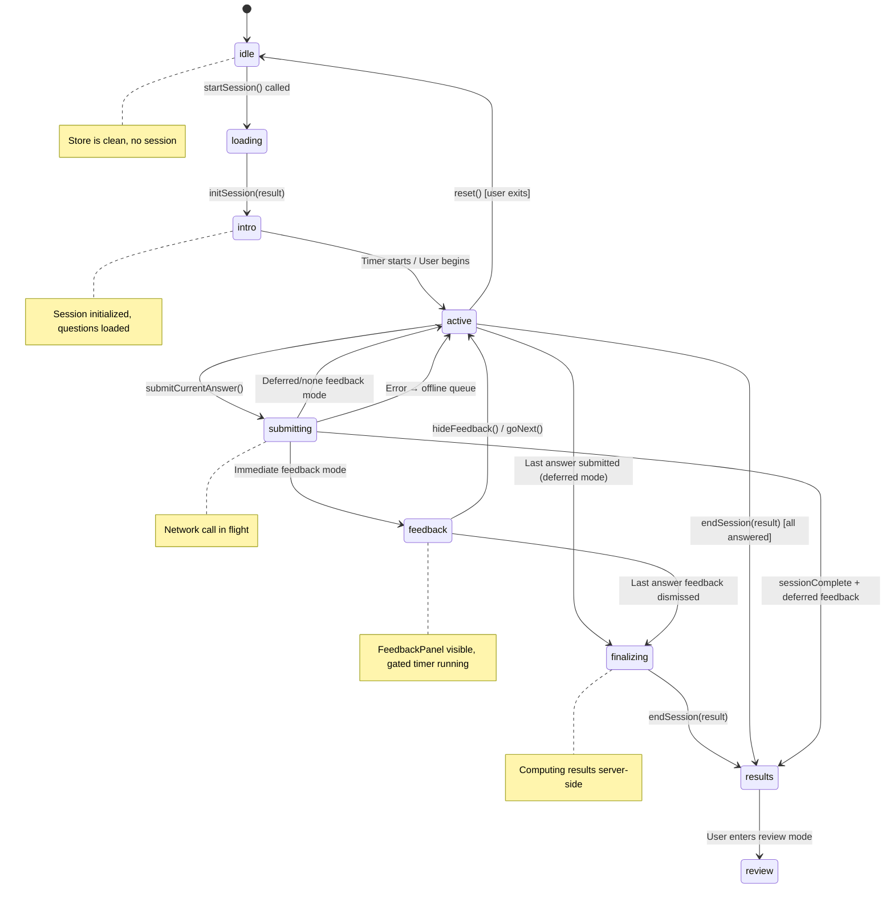
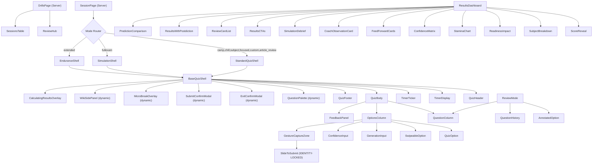
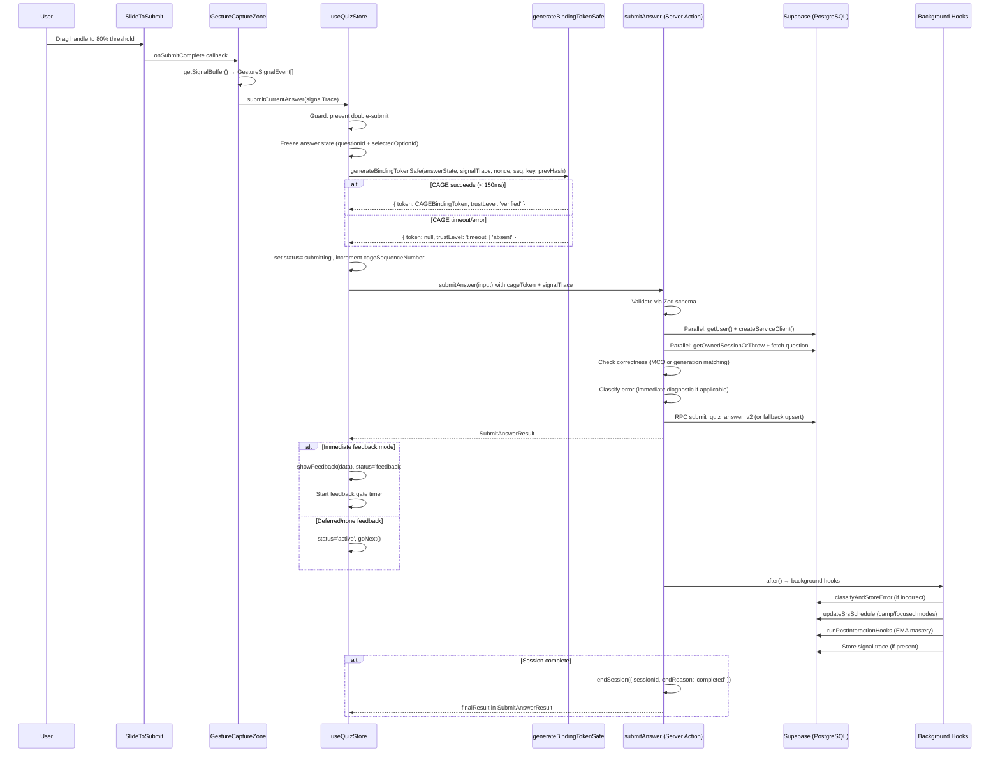
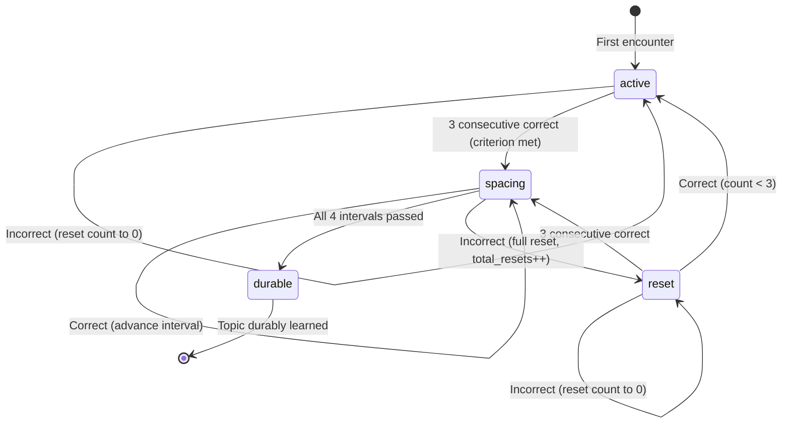

# Drill Feature Specification

**Last Updated:** 2026-04-08
**Status:** Active — Codebase Source of Truth
**Version:** 1.0 (Comprehensive Codebase-Derived Specification)
**Replaces:** `.ai/docs/01-product/002-drill-modes.md` (deprecated)
**Audit Source:** `.ai/plans/drill-feature-specification-plan-2026-04-08.md`

> This document is the authoritative specification for SlateCamp's drill/quiz/testing feature.
> Every claim is derived from and verified against the live codebase as of 2026-04-08.
> No fabricated paths, types, or interfaces. If something is unknown, it is marked ⚠️ NEEDS VERIFICATION.

---

## Table of Contents

1. [Overview & Principles](#1-overview--principles)
2. [Mode Definitions (9 Modes, 3 Zones)](#2-mode-definitions-9-modes-3-zones)
3. [Session Lifecycle](#3-session-lifecycle)
4. [Component Architecture](#4-component-architecture)
5. [State Management](#5-state-management)
6. [Data Flow & API Contract](#6-data-flow--api-contract)
7. [Question Selection Algorithms](#7-question-selection-algorithms)
8. [SRS & Mastery Engine](#8-srs--mastery-engine)
9. [Behavioral Signal Capture (CAGE)](#9-behavioral-signal-capture-cage)
10. [UX Patterns & Interaction Design](#10-ux-patterns--interaction-design)
11. [Results & Review](#11-results--review)
12. [Successive Relearning](#12-successive-relearning)
13. [Database Schema Reference](#13-database-schema-reference)
14. [Failure Handling & Offline Support](#14-failure-handling--offline-support)
15. [Accessibility](#15-accessibility)
16. [Protected Components (Identity Lock)](#16-protected-components-identity-lock)
17. [Open Decisions & Future Work](#17-open-decisions--future-work)

---

## 1. Overview & Principles

### Purpose

SlateCamp's drill feature is the core learning engine for Filipino architects preparing for the Licensure Examination for Architects (LEA). It delivers adaptive, spaced-repetition-driven quiz sessions across 9 modes organized into 3 progressive zones, from low-stakes learning to full exam simulation.

### Terminology Consolidation

The codebase uses three terms interchangeably due to historical evolution. The canonical term going forward is **Drills**.

| Legacy Term | Canonical Term | Context |
|-------------|---------------|---------|
| Quiz | Drill | UI labels, route paths |
| Test | Drill | Database columns (`test_mode`), legacy types |
| Session | Drill Session | A single run of any mode |

**Route:** `/dashboard/drills` (migrated from `/dashboard/testing` via commit `c9597dc`)

### Governing Principles

1. **Config-driven architecture** — All 9 modes share a single `QuizSessionConfig` JSONB object that controls timer, feedback, navigation, results, and breaks. No mode-specific code paths in the shell.
2. **Immediate feedback for formative modes** — Zone 1 and Zone 2 modes show explanations after each answer (gated progression). Zone 3 modes defer or suppress feedback.
3. **Adaptive difficulty** — The Wilson 85% rule governs difficulty adjustment: optimal learning occurs at 85% accuracy (5-question sliding window).
4. **60/30/10 intelligent routing** — Question selection prioritizes 60% unseen, 30% remediation (previously incorrect), 10% spaced repetition (mastered but stale).
5. **CAGE behavioral attestation** — Every answer submission can carry a cryptographic binding token linking the gesture to the answer state (patent-protected).
6. **Never red for time pressure** — Timer warnings use `var(--primary)` and `var(--accent)`, never `var(--destructive)`. Time pressure is informational, not punitive.
7. **SRS must not break the quiz** — All SRS/mastery updates are fire-and-forget with try/catch. A failed background update never blocks the user.

### Target User Context

- Filipino architects on mid-range Android devices (primary)
- Touch-first interaction (slide-to-submit gesture)
- Intermittent connectivity (offline queue for answer submissions)
- LEA exam: 200 MCQ questions, 4 hours, 8 subjects

### Feature Evolution (from git log)

| Date | Commit | Milestone |
|------|--------|-----------|
| Early | `b3128de` | Quiz Engine v2 — unified config-driven shell |
| Mid | `6307eb6` | Patent behavioral signal capture + UX blueprint |
| Mid | `582cd0c` | Patent pipeline wired end-to-end |
| Mid | `102f822` | Quiz-v2 architecture with shells, intelligent routing, DB schema |
| Late | `c9597dc` | Testing to Drills route migration + subscription tier consolidation |
| Late | `a1a3f2c` | Gesture reliability, performance, a11y audit (33 findings) |
| Late | `31ac84f` | Global ALE to LEA terminology migration |
| Latest | — | Drill optimization: P0 results race condition fix, server action parallelization, CAGE verification wired end-to-end, session_status enum expanded, offline queue auto-flush |

---

## 2. Mode Definitions (9 Modes, 3 Zones)

**Source:** `src/lib/constants/testing-modes.ts` (MODE_DEFINITIONS), `src/lib/quiz/mode-presets.ts` (MODE_PRESETS)

### Zone Overview

```
src/lib/constants/testing-modes.ts → ZONE_LABELS, MODES_BY_ZONE
```

| Zone | Number | Name | Modes | Character |
|------|--------|------|-------|-----------|
| 1 | 01 | Foundations | camp, chill, article-review | Low-stakes learning |
| 2 | 02 | Deliberate Practice | subject, focus-review, custom | Targeted mastery |
| 3 | 03 | Exam Readiness | storm, simulation, endurance | Pressure + stamina |

### Complete 9-Mode Feature Matrix

| Property | Camp | Chill | Article Review | Subject | Focus Review | Custom | Storm | Simulation | Endurance |
|----------|------|-------|---------------|---------|-------------|--------|-------|-----------|-----------|
| **UI Key** | `camp` | `chill` | `article-review` | `subject` | `focus-review` | `custom` | `storm` | `simulation` | `endurance` |
| **Preset Key** | `camp` | `chill` | `article_review` | `subject` | `focused` | `custom` | `storm` | `fullexam` | `extended` |
| **DB test_mode** | `camp` | `chill` | `practice` | `practice` | `blindspot` | `custom` | `storm` | `proof_sim` | `endurance` |
| **Zone** | 1 | 1 | 1 | 2 | 2 | 2 | 3 | 3 | 3 |
| **Pro Required** | No | No | No | Yes | Yes | Yes | Yes | Yes | Yes |
| **Default Q Count** | 20 | 10 | 5 | 25 | 15 | 20 | 50 | 200 | 100 |
| **Timer** | Hidden | Hidden | Hidden | Hidden | Hidden | Hidden | Bar | Countdown 4h | Count-up |
| **Timer Pausable** | Yes | Yes | No | Yes | Yes | Yes | No | No | Yes |
| **Feedback** | Immediate | Immediate | Immediate | Immediate | Immediate | Immediate | Deferred | None | Immediate |
| **Explanation Depth** | with-wiki-link | brief | brief | full | with-wiki-link | full | full (deferred) | full (deferred) | full |
| **Confidence Rating** | Yes | No | No | Yes | Yes | No | No | No | No |
| **Gated Delay (ms)** | 3000 | 0 | 2000 | 3000 | 4000 | 0 | 0 | 0 | 2000 |
| **Navigation** | linear | free | linear | linear | linear | free | free | free | linear |
| **Back Allowed** | No | Yes | Yes | Yes | Yes | Yes | Yes | Yes | Yes |
| **Question Palette** | No | No | No | No | No | Yes | Yes | Yes | Yes |
| **Bookmark/Flag** | No | No | No | No | No | Yes | Yes | Yes | Yes |
| **Skip Enabled** | No | Yes | No | No | No | Yes | Yes | Yes | Yes |
| **Confirm Submit** | No | No | No | No | No | Yes | Yes | Yes | No |
| **Difficulty Mode** | adaptive | static | static | adaptive | adaptive | user-selected | static | static | static |
| **Initial Difficulty** | mixed | mixed | mixed | mixed | easy | mixed | mixed | mixed | mixed |
| **Breaks** | No | No | No | No | No | No | Every 25Q / 30s | Every 50Q / 30s | Every 30Q / 30s |
| **Results** | Immediate | Immediate | Immediate | Immediate | Immediate | Immediate | Immediate | Delayed 24h | Immediate |
| **Percentile** | No | No | No | No | No | No | No | Yes | No |
| **Stamina Chart** | No | No | No | No | No | No | No | Yes | Yes |
| **Readiness Impact** | Yes | No | No | Yes | Yes | Yes | Yes | Yes | Yes |
| **CTA Variant** | cobalt | cobalt | cobalt | cobalt | cobalt | cobalt | orange | orange | orange |
| **Shell** | Standard | Standard | Standard | Standard | Standard | Standard | Standard | Simulation | Endurance |

### Mode Key Mapping (UI Key to Preset Key)

The codebase has a critical naming mismatch between `MODE_DEFINITIONS` (UI keys with hyphens) and `MODE_PRESETS` (engine keys with underscores):

| UI Key (MODE_DEFINITIONS) | Preset Key (MODE_PRESETS) | DB source |
|---------------------------|--------------------------|-----------|
| `camp` | `camp` | `camp_mode` |
| `chill` | `chill` | `chill_mode` |
| `article-review` | `article_review` | `article_review` |
| `subject` | `subject` | `subject_mode` |
| `focus-review` | `focused` | `focus_review` |
| `custom` | `custom` | `custom_session` |
| `storm` | `storm` | `storm_mode` |
| `simulation` | `fullexam` | `proof_simulation` |
| `endurance` | `extended` | `extended_practice` |

### TypeScript Types

```typescript
// src/types/quiz-config.ts
export type QuizMode =
  | 'camp' | 'chill' | 'subject' | 'focused' | 'custom'
  | 'storm' | 'fullexam' | 'extended' | 'article_review'

// src/types/testing.ts
export type UIMode =
  | 'camp' | 'chill' | 'subject' | 'focus-review' | 'custom'
  | 'storm' | 'simulation' | 'endurance' | 'article-review'
```

### Question Count Options

```typescript
// src/lib/constants/testing-modes.ts
export const QUESTION_COUNT_OPTIONS: Record<string, number[]> = {
  camp: [10, 20, 30, 50],
  storm: [25, 50, 100],
  subject: [10, 20, 30],
  custom: [5, 10, 20, 30, 50, 100],
}
```

---

## 3. Session Lifecycle

**Source:** `src/stores/useQuizStore.ts` (SessionSlice.status), `src/hooks/useQuizShellHandlers.ts`

### State Machine



### Status Type

```typescript
// src/stores/useQuizStore.ts → SessionSlice.status
type SessionStatus = 'idle' | 'loading' | 'intro' | 'active' | 'feedback' | 'submitting' | 'finalizing' | 'results' | 'review'
```

### State Transitions

| From | To | Trigger | Function |
|------|----|---------|----------|
| `idle` | `loading` | User clicks "Start" | `startSession()` server action called |
| `loading` | `intro` | Server returns questions | `initSession(result)` on store |
| `intro` | `active` | Timer starts or user taps begin | `startTimer()` / `goToQuestion(0)` |
| `active` | `submitting` | User completes slide gesture | `submitCurrentAnswer(signalTrace)` |
| `submitting` | `feedback` | Server returns + immediate feedback | `showFeedback(data)` |
| `submitting` | `active` | Server returns + deferred/none feedback | Direct status set |
| `feedback` | `active` | User dismisses feedback | `hideFeedback()` then `goNext()` |
| `active`/`feedback` | `finalizing` | Last question, deferred mode | `endSession()` called |
| `finalizing` | `results` | Server returns EndSessionResult | `endSession(result)` on store |
| `results` | `review` | User enters review | Client-side navigation |
| `any` | `idle` | User exits / reset | `reset()` on store |
| `submitting` | `active` | Network error | `queueOfflineSubmission(input)` |
| `active` | `submitting` | Timer expires | `handleTimerExpiry(sessionId)` |

### Database Session Status

```typescript
// src/types/quiz-config.ts
export type SessionStatus =
  | 'configuring' | 'in_progress' | 'paused' | 'completed' | 'abandoned' | 'auto_submitted'
```

Note: The DB `paused` status is tracked via a `_pausedAt` field in the config JSONB rather than a true DB enum value (see `src/lib/actions/quiz-v2/pause-resume.ts` line 33).

---

## 4. Component Architecture

### Component Tree



### Component Inventory

| Component | Path | Type | Responsibility |
|-----------|------|------|---------------|
| **DrillsPage** | `src/app/dashboard/drills/page.tsx` | Server | Fetches hub data, renders ReviewHub |
| **ReviewHub** | `src/components/testing/hub/ReviewHub.tsx` | Client | Mode selector, smart suggestions, SR cycles |
| **HeroConfigurator** | `src/components/testing/hub/HeroConfigurator.tsx` | Client | Session launcher with Slide-to-Start |
| **SessionsTable** | `src/components/testing/hub/SessionsTable.tsx` | Client | Session history table |
| **BaseQuizShell** | `src/components/quiz-v2/BaseQuizShell.tsx` | Client | Shared layout: header, timer, body, footer, modals |
| **StandardQuizShell** | `src/components/quiz-v2/StandardQuizShell.tsx` | Client | Shell for formative modes (camp, chill, subject, focused, custom, article_review) |
| **SimulationShell** | `src/components/quiz-v2/SimulationShell.tsx` | Client | Shell for full exam simulation (no immediate feedback, countdown) |
| **EnduranceShell** | `src/components/quiz-v2/EnduranceShell.tsx` | Client | Shell for design endurance (real-time stamina tracking, fatigue nudges) |
| **QuizHeader** | `src/components/quiz-v2/QuizHeader.tsx` | Client | Mode label, progress, exit button |
| **QuizFooter** | `src/components/quiz-v2/QuizFooter.tsx` | Client | Navigation (prev/next), submit all |
| **QuizBody** | `src/components/quiz-v2/QuizBody.tsx` | Client | Two-column layout: question + options |
| **QuestionColumn** | `src/components/quiz-v2/QuestionColumn.tsx` | Client | Question stem, image, taxonomy breadcrumb |
| **OptionsColumn** | `src/components/quiz-v2/OptionsColumn.tsx` | Client | MCQ options, elimination, confidence, slide-to-submit |
| **QuizOption** | `src/components/quiz-v2/QuizOption.tsx` | Client | Individual option button with elimination strikethrough |
| **SwipeableOption** | `src/components/quiz-v2/SwipeableOption.tsx` | Client | Swipe-to-eliminate gesture on options |
| **GenerationInput** | `src/components/quiz-v2/GenerationInput.tsx` | Client | Free-text/numeric input for non-MCQ questions |
| **FeedbackPanel** | `src/components/quiz-v2/FeedbackPanel.tsx` | Client | Immediate feedback: correct/incorrect, rationale, wiki link |
| **ConfidenceInput** | `src/components/quiz-v2/ConfidenceInput.tsx` | Client | Continuous 0-1 confidence slider |
| **TimerDisplay** | `src/components/quiz-v2/TimerDisplay.tsx` | Client | Timer UI (bar, countdown, count-up modes) |
| **TimerTicker** | `src/components/quiz-v2/TimerTicker.tsx` | Client | Interval-based timer tick driver |
| **GestureCaptureZone** | `src/components/quiz-v2/GestureCaptureZone.tsx` | Client | CAGE signal capture wrapper (PROTECTED) |
| **SlideToSubmit** | `src/components/quiz-v2/SlideToSubmit.tsx` | Client | Slide gesture for answer submission (IDENTITY-LOCKED) |
| **QuestionPalette** | `src/components/quiz-v2/QuestionPalette.tsx` | Client | Grid navigator for free-nav modes |
| **ExitConfirmModal** | `src/components/quiz-v2/ExitConfirmModal.tsx` | Client | Confirm exit dialog |
| **SubmitConfirmModal** | `src/components/quiz-v2/SubmitConfirmModal.tsx` | Client | Confirm submit-all dialog (shows unanswered/flagged) |
| **MicroBreakOverlay** | `src/components/quiz-v2/MicroBreakOverlay.tsx` | Client | Timed break between question blocks |
| **CalculatingResultsOverlay** | `src/components/quiz-v2/CalculatingResultsOverlay.tsx` | Client | Loading overlay during result computation |
| **QuestionSkeleton** | `src/components/quiz-v2/QuestionSkeleton.tsx` | Client | Loading skeleton for question display |
| **PacingNudge** | `src/components/quiz-v2/PacingNudge.tsx` | Client | Time-per-question pacing indicator |
| **HintButton** | `src/components/quiz-v2/HintButton.tsx` | Client | Progressive hint for formative quizzes |
| **MnemonicTip** | `src/components/quiz-v2/MnemonicTip.tsx` | Client | Memory aid tip display |
| **CrammingNudge** | `src/components/quiz-v2/CrammingNudge.tsx` | Client | Surface learning detection nudge |
| **SocraticExplorer** | `src/components/quiz-v2/SocraticExplorer.tsx` | Client | Socratic tutor exploration flow |
| **DoseProgressStepper** | `src/components/quiz-v2/DoseProgressStepper.tsx` | Client | Progress stepper for trail sessions |
| **PostdictionPrompt** | `src/components/quiz-v2/PostdictionPrompt.tsx` | Client | Post-session prediction prompt |
| **PredictionSlider** | `src/components/quiz-v2/PredictionSlider.tsx` | Client | Pre-session score prediction |
| **SRCriterionCard** | `src/components/quiz-v2/SRCriterionCard.tsx` | Client | Successive relearning criterion display |
| **SRProgressRing** | `src/components/quiz-v2/SRProgressRing.tsx` | Client | SR cycle progress visualization |
| **SRSpacingTimeline** | `src/components/quiz-v2/SRSpacingTimeline.tsx` | Client | SR spacing interval timeline |
| **ResultsDashboard** | `src/components/quiz-v2/results/ResultsDashboard.tsx` | Client | Orchestrates all result panels |
| **ScoreReveal** | `src/components/quiz-v2/results/ScoreReveal.tsx` | Client | Score percentage with band label |
| **SubjectBreakdown** | `src/components/quiz-v2/results/SubjectBreakdown.tsx` | Client | Per-subject accuracy breakdown |
| **ReadinessImpact** | `src/components/quiz-v2/results/ReadinessImpact.tsx` | Client | Readiness score before/after delta |
| **StaminaChart** | `src/components/quiz-v2/results/StaminaChart.tsx` | Client | Accuracy-over-time block chart |
| **ConfidenceMatrix** | `src/components/quiz-v2/results/ConfidenceMatrix.tsx` | Client | Confidence vs correctness matrix |
| **FeedForwardCards** | `src/components/quiz-v2/results/FeedForwardCards.tsx` | Client | Next-action recommendation cards |
| **CoachObservationCard** | `src/components/quiz-v2/results/CoachObservationCard.tsx` | Client | AI-derived behavioral insight |
| **SimulationDebrief** | `src/components/quiz-v2/results/SimulationDebrief.tsx` | Client | Simulation-specific debrief panel |
| **ResultsCTAs** | `src/components/quiz-v2/results/ResultsCTAs.tsx` | Client | Result action buttons |
| **ReviewCardList** | `src/components/quiz-v2/results/ReviewCardList.tsx` | Client | List of review cards |
| **ReviewCard** | `src/components/quiz-v2/results/ReviewCard.tsx` | Client | Individual question review card |
| **ReviewFilterBar** | `src/components/quiz-v2/results/ReviewFilterBar.tsx` | Client | Filter: all / incorrect / flagged |
| **ResultsWithPostdiction** | `src/components/quiz-v2/results/ResultsWithPostdiction.tsx` | Client | Score + postdiction comparison |
| **PredictionComparison** | `src/components/quiz-v2/results/PredictionComparison.tsx` | Client | Pre vs post prediction comparison |
| **ReviewMode** | `src/components/quiz-v2/review/ReviewMode.tsx` | Client | Full question review with palette |
| **AnnotatedOption** | `src/components/quiz-v2/review/AnnotatedOption.tsx` | Client | Option with correct/incorrect annotation |
| **QuestionHistory** | `src/components/quiz-v2/review/QuestionHistory.tsx` | Client | Per-question history stats (Pro) |

### Setup Components

| Component | Path | Responsibility |
|-----------|------|---------------|
| **SetupFlow** | `src/components/quiz-v2/setup/SetupFlow.tsx` | Setup wizard orchestrator |
| **ModeSelector** | `src/components/quiz-v2/setup/ModeSelector.tsx` | Mode picker |
| **IntroSlide1-3** | `src/components/quiz-v2/setup/IntroSlide{1,2,3}.tsx` | Onboarding slides |
| **PressureLevelSelector** | `src/components/quiz-v2/setup/PressureLevelSelector.tsx` | Progressive pressure ladder (0-3) |
| **QuestionCountPills** | `src/components/quiz-v2/setup/QuestionCountPills.tsx` | Question count selector |
| **SimulationChecklist** | `src/components/quiz-v2/setup/SimulationChecklist.tsx` | Pre-simulation readiness checklist |

### Key Props Interfaces

```typescript
// BaseQuizShell
interface BaseQuizShellProps {
  config: QuizSessionConfig
  children: ReactNode
  direction?: 'forward' | 'backward'
  showPacingNudge?: boolean
  pacingNudgeSlot?: ReactNode
  onExit: () => void
  onSubmitAll: () => void
  onNext: () => void
  onPrevious: () => void
}

// StandardQuizShell / SimulationShell / EnduranceShell (shared shape)
interface ShellProps {
  sessionId: string
  config: QuizSessionConfig
  questions: QuestionForClient[]
  allQuestionIds: string[]
  totalQuestionCount?: number
  initialCurrentIndex?: number
  restoredAnswers?: Record<string, Partial<QuizAnswerState>>
}

// ResultsDashboard
interface ResultsDashboardProps {
  sessionId: string
  result: EndSessionResult
  config: QuizSessionConfig
  staminaBlocks?: StaminaBlock[]
  confidenceMatrix?: ConfidenceMatrixResult | null
  reviewQuestions: ReviewQuestionData[]
  questionHistory?: Record<string, QuestionHistoryStats>
  predictionData?: { predictionScore: number; postdictionScore: number | null } | null
  recommendations?: Recommendation[]
}

// ReviewMode
interface ReviewModeProps {
  data: ReviewDataResult
}
```

---

## 5. State Management

**Source:** `src/stores/useQuizStore.ts`, `src/stores/useQuizTimerStore.ts`

### useQuizStore — 4-Slice Zustand Architecture

The quiz store uses sliced architecture with `subscribeWithSelector` and `persist` middleware.

```typescript
type QuizStore = SessionSlice & UISlice & StatsSlice & SettingsSlice
```

#### SessionSlice

```typescript
interface SessionSlice {
  // Core state
  sessionId: string | null
  config: QuizSessionConfig | null
  status: 'idle' | 'loading' | 'intro' | 'active' | 'feedback' | 'submitting' | 'finalizing' | 'results' | 'review'
  mode: QuizMode | null
  questions: QuestionForClient[]
  currentIndex: number
  totalQuestions: number
  answers: Record<string, QuizAnswerState>
  answersVersion: number            // Incremental counter for render optimization
  flaggedSet: Set<string>
  eliminatedOptions: Record<string, string[]>
  results: EndSessionResult | null
  pendingSubmissions: SubmitAnswerInput[]  // Offline queue
  _hasHydrated: boolean

  // CAGE Chain State (Patent Claim 20)
  nonces: Record<string, { nonce: string; expiresAt: string }>
  sessionKey: string | null
  cageSequenceNumber: number
  previousCageTokenHash: string | null
  deviceSensorsAvailable: boolean

  // Actions
  initSession: (result: StartSessionSuccess & { allQuestionIds?: string[]; initialCurrentIndex?: number; restoredAnswers?: Record<string, Partial<QuizAnswerState>> }) => void
  reset: () => void
  selectAnswer: (questionId: string, optionId: string) => void
  deselectAnswer: (questionId: string) => void
  setConfidence: (questionId: string, level: number) => void
  submitCurrentAnswer: (signalTrace?: GestureSignalEvent[]) => Promise<void>
  skipCurrentQuestion: () => void
  toggleEliminate: (questionId: string, optionId: string) => void
  toggleFlag: (questionId: string) => void
  goToQuestion: (index: number) => void
  goNext: () => void
  goPrevious: () => void
  endSession: (result: EndSessionResult) => void
  queueOfflineSubmission: (input: SubmitAnswerInput) => void
  flushOfflineQueue: () => Promise<void>
  setSensorsAvailable: (available: boolean) => void
  setHasHydrated: (hydrated: boolean) => void
  addQuestions: (newQuestions: QuestionForClient[]) => void
  rebuildDerivedState: () => void
}
```

#### UISlice

```typescript
interface UISlice {
  ui: {
    paletteOpen: boolean
    wikiPanelOpen: boolean
    wikiPanelUrl: string | null
    exitModalOpen: boolean
    submitModalOpen: boolean
    microBreakVisible: boolean
    offlineBannerVisible: boolean
    calculatingResults: boolean
    saveStatus: 'idle' | 'saving' | 'saved' | 'error' | 'offline'
  }
  feedback: {
    visible: boolean
    questionId: string | null
    isCorrect: boolean | null
    correctOptionId: string | null
    rationale: string | null
    wikiUrl: string | null
    errorDiagnostic: ErrorDiagnostic | null
    nextButtonEnabled: boolean
    closeness: number | undefined
    correctAnswer: string | undefined
    questionType: QuestionType | undefined
    feedbackGateActive: boolean
    feedbackGateRemainingMs: number
  }
  // Actions: togglePalette, openWikiPanel, closeWikiPanel, showExitModal, hideExitModal,
  //   showSubmitModal, hideSubmitModal, showMicroBreak, hideMicroBreak,
  //   showFeedback, hideFeedback, enableNextButton, startFeedbackGate, tickFeedbackGate, clearFeedbackGate
}
```

#### StatsSlice

```typescript
interface StatsSlice {
  streakCount: number
  streakBroken: boolean
  clearStreakBroken: () => void
  getCurrentQuestion: () => QuestionForClient | null
  getAnsweredCount: () => number
  getCorrectCount: () => number
  getRunningAccuracy: () => number
  getUnansweredQuestions: () => QuestionForClient[]
  getFlaggedQuestions: () => QuestionForClient[]
  getFlaggedSet: () => Set<string>
  getFeedbackData: () => FeedbackData | null
  getProgress: () => { answered: number; total: number; percent: number }
}
```

#### SettingsSlice

```typescript
interface SettingsSlice {
  settings: {
    hapticEnabled: boolean
    reducedMotion: boolean   // Initialized false, synced with browser preference after mount
  }
  updateSettings: (partial: Partial<SettingsState>) => void
}
```

### Persistence Configuration

```typescript
// Storage key: 'slatecamp-quiz-session'
// Engine: localStorage via createJSONStorage

// Partialized (persisted) fields:
{
  sessionId, config, status, mode,
  // questions EXCLUDED — re-fetched on init, avoids 200KB+ writes per answer
  currentIndex, totalQuestions, answers,
  pendingSubmissions, settings, streakCount
}

// Merge strategy: shallow merge with derived state rebuild
// flaggedSet and answersVersion are recomputed on rehydration
```

### useQuizTimerStore

```typescript
interface QuizTimerState {
  sessionId: string | null
  startedAt: number | null
  endedAt: number | null         // Absolute timestamp for countdown
  pausedAt: number | null
  elapsedMs: number              // For count-up mode (endurance)
  limitMs: number | null
  isRunning: boolean
  colorState: TimerColorState    // 'normal' | 'warning' | 'critical'

  startTimer: (input: { limitMs?: number | null; sessionId?: string | null }) => void
  pauseTimer: () => void
  resumeTimer: () => void        // Shifts endedAt forward by pause duration
  stopTimer: () => void
  resetTimer: () => void
  tickTimer: () => void          // Called by TimerTicker every ~100ms
}
```

Timer color thresholds (countdown mode):
- `normal`: > 50% remaining
- `warning`: 20-50% remaining
- `critical`: < 20% remaining

On timer expiry: calls `handleTimerExpiry(sessionId)` which triggers `endSessionAction({ sessionId, endReason: 'timer_expired' })`.

### Consuming Components

| Store | Primary Consumers |
|-------|-------------------|
| `useQuizStore` | All shell components, QuizBody, OptionsColumn, FeedbackPanel, QuestionPalette, all modals |
| `useQuizTimerStore` | TimerDisplay, TimerTicker, shell components (for start/stop) |

---

## 6. Data Flow & API Contract

### Server Actions

| Action | File | Trigger | Key Tables | Description |
|--------|------|---------|------------|-------------|
| `startSession` | `src/lib/actions/quiz-v2/start-session.ts` | User starts drill | `quiz_sessions`, `questions`, `user_question_states`, `user_subscriptions`, `taxonomy_tree`, `issued_nonces` | Validates tier, merges config with preset, selects questions via 60/30/10 routing, creates session, issues CAGE nonces |
| `submitAnswer` | `src/lib/actions/quiz-v2/submit-answer.ts` | Slide-to-submit gesture | `user_interactions`, `quiz_sessions`, `questions`, `interaction_signal_traces` | Validates answer, records interaction (RPC or fallback), classifies errors, runs SRS + mastery hooks in background |
| `endSession` | `src/lib/actions/quiz-v2/end-session.ts` | Last answer / user exit / timer | `quiz_sessions`, `user_interactions`, `user_global_stats`, `taxonomy_tree`, `session_behavioral_summaries` | Computes results, recomputes readiness score, generates recommendations, writes behavioral summary |
| `abandonSession` | `src/lib/actions/quiz-v2/abandon-session.ts` | User exits without finishing | `quiz_sessions` | Marks session abandoned |
| `pauseSession` | `src/lib/actions/quiz-v2/pause-resume.ts` | User pauses (pausable modes) | `quiz_sessions` | Stores `_pausedAt` in config JSONB |
| `resumeSession` | `src/lib/actions/quiz-v2/pause-resume.ts` | User resumes | `quiz_sessions` | Clears `_pausedAt`, returns pause duration |
| `getReviewData` | `src/lib/actions/quiz-v2/get-review-data.ts` | Enter review mode | `quiz_sessions`, `user_interactions`, `questions`, `taxonomy_tree`, `wiki_article_taxonomy` | Fetches full review data with batched queries for fullexam (200Q) |
| `processSuccessiveRelearning` | `src/lib/actions/quiz-v2/successive-relearning.ts` | Post-answer hook | `successive_relearning_cycles` | SR state machine transitions |
| `getDueSRCycles` | `src/lib/actions/quiz-v2/successive-relearning.ts` | Hub page load | `successive_relearning_cycles`, `taxonomy_tree` | Fetches due spacing retests |
| `getActiveSRCycles` | `src/lib/actions/quiz-v2/successive-relearning.ts` | Hub page load | `successive_relearning_cycles`, `taxonomy_tree` | Fetches active/reset/spacing cycles |
| `getUserSRProgress` | `src/lib/actions/quiz-v2/successive-relearning.ts` | Hub page load | `successive_relearning_cycles` | Counts by status |

### Zod Schemas

```typescript
// src/lib/actions/quiz-v2/schemas.ts

startSessionInputSchema = z.object({
  mode: z.enum(['camp','chill','subject','focused','custom','storm','fullexam','extended','article_review']),
  config: z.record(z.string(), z.unknown()).default({}),
  trailDayId: z.string().uuid().optional(),
})

submitAnswerInputSchema = z.object({
  sessionId: z.string().uuid(),
  questionId: z.string().uuid(),
  selectedOptionId: z.string().trim().min(1).max(256),
  topicId: z.string().uuid().optional(),
  difficulty: z.number().min(0).max(1).optional(),
  confidenceLevel: z.number().min(0).max(1).optional(),
  timeSpentMs: z.number().int().min(0).max(3_600_000),
  cageToken: z.unknown().optional().nullable(),
  cageTrustLevel: z.unknown().optional(),
  signalTrace: z.array(z.unknown()).optional(),
  gestureDurationMs: z.number().int().min(0).optional(),
  sensorsAvailable: z.boolean().optional(),
})

endSessionInputSchema = z.object({
  sessionId: z.string().uuid(),
  endReason: z.enum(['completed', 'user_exit', 'timer_expired', 'auto_submitted']),
})
```

### Answer Submission Sequence



---

## 7. Question Selection Algorithms

### 60/30/10 Intelligent Routing

**Source:** `src/lib/quiz/intelligent-routing.ts`

The default question selection algorithm distributes questions across three pedagogical pools:

| Pool | Quota | Source | Purpose |
|------|-------|--------|---------|
| Discovery (Unseen) | 60% | Questions never seen by user | New material introduction |
| Remediation | 30% | Previously answered incorrectly | Error correction |
| Spaced Repetition | 10% | Correctly answered 14+ days ago | Long-term retention |

**Algorithm:**

1. **Calculate quotas**: `unseenQuota = floor(count * 0.6)`, `remediationQuota = floor(count * 0.3)`, `srQuota = remainder`
2. **Fetch user_question_states** — single query, 2000-row limit, partitions into `interactedIds`, `remediationIds`, `srIds` (correct + last_seen > 14 days)
3. **Fetch unseen pool** — chunked queries (100 topics/chunk) excluding interacted IDs
4. **Fetch remediation pool** — questions previously incorrect, matching difficulty range
5. **Fetch SR pool** — questions correct but stale (14+ days)
6. **Gap filling** — if pool < requested count: first try same difficulty, then drop difficulty filter entirely
7. **Fisher-Yates shuffle** — final pool randomization
8. **Return** `pool.slice(0, questionCount)`

**Chunking:** PostgREST URL length limits (~2000 chars) require chunking `.in()` queries at `CHUNK_SIZE = 100`.

### Interleaved Selection

**Source:** `src/lib/quiz/interleaved-selection.ts`

When `config.interleave === true`, questions from sibling taxonomy topics are mixed in at `interleave_ratio` (default 0.3 = 30%). Questions from sibling topics are marked `is_interleaved: true` on the client.

### Adaptive Difficulty (Wilson 85% Rule)

**Source:** `src/lib/quiz/adaptive-difficulty.ts`

```typescript
// Sliding window of 5 answers
const WINDOW_SIZE = 5

// Adjustment rules (only after 3+ answers):
if (currentAccuracy >= 0.90) → difficulty++  (max 5)
if (currentAccuracy <= 0.60) → difficulty--  (min 1)
// 60-90% → no change (sweet spot around 85%)
```

```typescript
interface AdaptiveState {
  recentWindow: boolean[]      // Last 5 correctness values
  currentAccuracy: number      // Window accuracy
  targetAccuracy: number       // 0.85
  currentDifficulty: number    // 1-5
}
```

Difficulty-to-label mapping: 1-2 = Easy, 3-4 = Medium, 5 = Hard.

---

## 8. SRS & Mastery Engine

### IRT 2-Parameter Logistic Model

**Source:** `src/lib/srs/irt.ts`

```
P(correct | theta, a, b) = 1 / (1 + exp(-a * (theta - b)))
```

| Parameter | Description | Source |
|-----------|-------------|--------|
| `theta` | Student ability estimate | `user_global_stats` or running estimate |
| `a` | Item discrimination | `questions.discrimination_rating` (default 1) |
| `b` | Item difficulty | `questions.difficulty_rating` (default 0.5) |

**Ability Update (EAP-like):**

```typescript
const information = a * a * p * (1 - p)
const delta = (isCorrect - p) / information
newTheta = currentTheta + clamp(delta, -1, 1)
```

**Question Selection:** Targets P(correct) near 0.75 by selecting questions where difficulty minimizes `|b - (theta - ln(3)/a)|`.

### SM-2 Spaced Repetition

**Source:** `src/lib/srs/sm2.ts`

```typescript
interface SrsResult {
  interval: number      // Days until next review
  easeFactor: number    // Multiplier (floor: 1.3)
  repetitions: number   // Successful review count
}
```

**Algorithm:**
- Quality < 3 (incorrect): reset to interval=1, repetitions=0
- Quality >= 3: interval grows — rep0=1day, rep1=6days, rep2+=round(interval * EF)
- Ease factor: `EF = EF + (0.1 - (5 - quality) * (0.08 + (5 - quality) * 0.02))`, floor 1.3

**Quality Derivation** (`src/lib/srs/update.ts`):

| Condition | Quality | Meaning |
|-----------|---------|---------|
| Incorrect | 1 | Complete failure |
| Suspected lucky guess | 2 | Fast correct, low confidence |
| Correct + sure + fast | 5 | Perfect recall |
| Correct + sure + slow | 4 | Good but slow |
| Correct + fast (<1.2x avg) | 4 | Quick recall |
| Correct + other | 3 | Adequate |

**SRS is applied only for `camp` and `focused` modes** (checked in `submit-answer.ts`).

### EMA Mastery Updates

**Source:** `src/lib/actions/mastery/post-interaction-hooks.ts` (called from submit-answer)

After each interaction, `runPostInteractionHooks` updates the `user_node_mastery` table using exponential moving average weights. A `generationMultiplier` of 1.2x is applied for correct non-MCQ answers, and 0.5x for suspected lucky guesses.

### Memory Strength (SS/RS Model)

**Source:** `src/lib/quiz/memory-strength.ts`

Implements Bjork & Bjork (1992) dual-strength model:

| Metric | Description | Formula |
|--------|-------------|---------|
| Storage Strength (SS) | Durable encoding, monotonically increasing | `SS = min(SS + 0.05 + interleaveBonus + difficultyBonus, 1.0)` |
| Retrieval Strength (RS) | Current accessibility, decays with time | `RS(t) = lastRS * exp(-decayRate * daysSinceReview)` where `decayRate = 0.1 / max(SS, 0.1)` |

**Quadrant Classification:**

| Quadrant | SS | RS | Recommendation |
|----------|----|----|---------------|
| Mastered | >= 0.5 | >= 0.5 | None needed |
| Surface Learning | < 0.5 | >= 0.5 | Deepen with interleaving |
| Rusty | >= 0.5 | < 0.5 | Quick refresh (5 questions) |
| Needs Learning | < 0.5 | < 0.5 | Full learning cycle (wiki + quiz) |

### Error Classification

**Source:** `src/lib/quiz/error-classifier.ts`

| Category | Detection Logic | Message Style |
|----------|----------------|---------------|
| `random_guess` | timeRatio < 0.4 | "Moved quickly" |
| `knowledge_gap` | No history + slow, or fallback | "New territory" |
| `misremembered_fact` | Has history + normal time | "Right idea, detail off" |
| `computation_error` | timeRatio > 2.0 | "Check calculation steps" |
| `lucky_guess` | Correct + timeSpentMs < 3000 + difficulty*5000 | "Review rationale" |

### Confidence Calibration

**Source:** `src/lib/quiz/confidence-calibration.ts`

Tracks overconfidence (said "sure" but wrong) and lucky guess rate (said "guessing" but correct). Calibration score is the fraction of answers where confidence matches correctness.

---

## 9. Behavioral Signal Capture (CAGE)

**Status:** Fully implemented, patent-protected (IPOPHL filing).
**Classification:** CONFIDENTIAL — Trade Secret / Patent-Protected IP

### Intellectual Property Context

The drill feature contains SlateCamp's core patent-protected intellectual property. An IPOPHL (Intellectual Property Office of the Philippines) utility model/patent application covers the complete pipeline from gesture capture to cognitive state inference. The system has **six confirmed white spaces** (no prior art identified):

1. **Submission gesture as cognitive signal source** — Using the deliberate answer-submission gesture (not passive behavior) as the primary behavioral signal source. No prior art in educational assessment.
2. **CAGE (Cryptographic Answer-Gesture Binding)** — Cryptographic binding of each answer to the physical gesture that confirmed it. Zero prior art across all domains.
3. **Deliberate interaction as primary behavioral signal** — Inverts the behavioral biometrics field (which uses passive observation). SlateCamp uses the intentional submission act itself.
4. **Educational integrity via internal interaction analysis** — All existing proctoring patents rely on external surveillance (cameras, screen recording). This system analyzes the interaction itself.
5. **Submission state machine + behavioral attestation** — Combined state machine with cryptographic attestation. No combined prior art.
6. **Population-level behavioral modeling for education** — Novel modeling paradigm distinct from individual-profile approaches (e.g., BioCatch).

### Patent Claims → Implementation Mapping

| Claim | Title | Implementation | Files |
|-------|-------|---------------|-------|
| **Claim 1** | Computer-Implemented Method (Broadest) | End-to-end pipeline: instrumented interaction region → signal capture → behavioral feature extraction → cognitive state inference → multi-factor validation → server-enforced state machine | Full drill subsystem |
| **Claim 2** | System Claim | Hardware/software system embodiment | Full stack |
| **Claim 3** | CAGE Method | Cryptographic Answer-Gesture Binding: response hash + behavioral attestation + nonce + sequence → signed token → server verification | `src/lib/cage/*` |
| **Claims 4-8** | Signal Capture | Velocity profiles, path deviation, dwell-time, reversal metrics, touch pressure/area, accelerometer/gyroscope, jerk metric | `useGestureSignalCapture.ts`, `useDeviceSensors.ts` |
| **Claims 9-13** | Feature Extraction & Inference | Sliding window micropatterns, ML model training, confidence classification, multi-signal fusion, individual behavioral profiles | `cognitive_state_indicators` table, `generateCoachObservation.ts` |
| **Claims 14-16** | Submission Control | Start-zone → completion-zone traversal (SlideToSubmit), endpoint + temporal validation, configurable modalities | `SlideToSubmit.tsx` (IDENTITY-LOCKED) |
| **Claims 17-21** | State Machine & Security | Active → confirming → submitted transitions, single-use session tokens, temporal policy enforcement, CAGE hash chain (Claim 20), nonce TTL + active-state gating (Claim 21) | `session-helpers.ts`, `nonceService.ts`, `verifyBindingToken.ts` |
| **Claims 22-25** | Adaptive Output | Scoring weight modification, adaptive item selection, disengagement detection, aggregate session behavioral summary, population-level behavioral models | `adaptive-difficulty.ts`, `session_behavioral_summaries` table |
| **Claims 26-28** | Implementation | React/Next.js client, Supabase/PostgreSQL backend, mobile touchscreen embodiment, real-time streaming during confirmation interaction | Full stack |

### SlideToSubmit — Patent Claim 14 (Identity-Locked)

The `SlideToSubmit` component (`src/components/quiz-v2/SlideToSubmit.tsx`) is the physical embodiment of **Patent Claim 14** (start-zone → completion-zone traversal). It is the primary answer confirmation mechanism and the source of all behavioral signal data used by the CAGE system.

**Why it is identity-locked:** This component is the physical interface between the user and the patent-protected signal capture pipeline. Its gesture physics (spring overshoot, threshold position, haptic feedback timing) are calibrated to produce behavioral signal data with specific statistical properties. Modifying the gesture mechanics would alter the signal characteristics that the cognitive inference model is trained on, and would potentially invalidate the behavioral attestation described in Claim 3.

**Patent-critical properties:**
- 80% threshold (`THRESHOLD_PERCENT = 0.80`) — Claim 14: completion-zone boundary
- Spring-back animation on incomplete drag — Claim 15: endpoint rejection
- Haptic feedback at threshold — Claim 16: configurable modality feedback
- `@use-gesture/react` pointer event capture — Claim 1(b): continuous signal capture
- 44x44px handle — Claim 14: start-zone definition

See [Section 16](#16-protected-components-identity-lock) for complete locked values.

### CAGE Sessions — Patent Claims 3, 18, 20, 21

A CAGE session is the cryptographic context that spans an entire drill session. It consists of:

1. **Session key** (`cage_session_key` on `quiz_sessions`) — A 32-byte random key generated server-side at session start, stored in the DB, and shared with the client. Used as the HMAC-SHA256 signing key for all binding tokens in the session. (Claim 3)
2. **Nonce set** (`issued_nonces` table) — One cryptographic nonce per question, issued at session start with a 15-minute TTL. Each nonce can be consumed exactly once (optimistic lock). Prevents replay attacks. (Claim 21)
3. **Token chain** (`cage_binding_tokens` table) — Each binding token references the hash of the previous token's signature (`previousTokenHash`). This creates a tamper-evident chain — modifying any token invalidates all subsequent tokens. The chain-head can verify entire session integrity. (Claim 20)
4. **Sequence numbers** — Monotonic counter incremented per submission. Combined with the hash chain, ensures ordering integrity. (Claim 20)

**Lifecycle:**
```
Session Start → Generate session key + issue nonces (stored server-side)
                → Return key + nonces to client (stored in Zustand, not persisted)
Per Answer    → Client: capture gesture signals → generate binding token (HMAC with session key)
              → Server: receive token → verify (hash + nonce + signature + chain) → store in cage_binding_tokens
Session End   → Chain verification: validate token sequence integrity
```

### Architecture Overview

The CAGE (Cryptographic Answer-Gesture Envelope) system binds each answer submission to the physical gesture that confirmed it, creating a tamper-evident chain of evidence.

```
Signal Capture → Binding Token → Server Verification → Storage
```

### Signal Capture Layer

**Source:** `src/hooks/useGestureSignalCapture.ts`

```typescript
interface UseGestureSignalCaptureReturn {
  handlePointerDown: (e: React.PointerEvent) => void
  handlePointerMove: (e: React.PointerEvent) => void
  handlePointerUp: (e: React.PointerEvent) => void
  getSignalBuffer: () => GestureSignalEvent[]
  resetBuffer: () => void
  isCapturing: boolean
}
```

- Ring buffer capped at `MAX_BUFFER_SIZE = 500` events
- Captures: timestamp (performance.now()), x/y (normalized to region), pressure, contact width/height
- Buffer resets on each new gesture (onPointerDown)

### GestureSignalEvent Type

```typescript
// src/types/patent.ts
interface GestureSignalEvent {
  timestamp: number          // Sub-ms via performance.now()
  type: 'start' | 'move' | 'end' | 'cancel'
  x: number                 // Normalized to interaction region
  y: number
  contactWidth?: number      // Touch API — Claim 6
  contactHeight?: number
  pressure?: number          // Derived from contact area
  accelerometer?: { x: number; y: number; z: number }    // Claim 7
  gyroscope?: { alpha: number; beta: number; gamma: number }
}
```

### Device Sensors

**Source:** `src/hooks/useDeviceSensors.ts`

Captures accelerometer (DeviceMotionEvent) and gyroscope (DeviceOrientationEvent) readings concurrent with gestures. Handles iOS 13+ permission request. Graceful degradation if unavailable.

### Binding Token Generation (Client-Side)

**Source:** `src/lib/cage/generateBindingToken.ts`

Called at gesture completion with a 150ms budget:

1. **Hash frozen answer state** — SHA-256 of canonical JSON `{ questionId, selectedOptionId }`
2. **Behavioral attestation** — SHA-256 of first 5 signal events
3. **Assemble payload** — `{ responseHash, behavioralAttestation, nonce, sequenceNumber, previousTokenHash }`
4. **HMAC-SHA256 sign** — using session-derived key

```typescript
interface CAGEBindingToken {
  responseHash: string
  behavioralAttestation: string
  nonce: string
  sequenceNumber: number
  signature: string
  previousTokenHash: string | null  // Chain link — Claim 20
  generatedAt: number
}
```

**Graceful degradation:** If generation fails or exceeds 150ms, submission proceeds without CAGE token. Trust levels:

```typescript
type CAGETrustLevel =
  | 'verified'       // All checks pass
  | 'absent'         // No token generated
  | 'failed'         // Verification failed (tampering)
  | 'timeout'        // Exceeded 150ms budget
  | 'nonce_expired'  // Nonce TTL exceeded
  | 'offline_nonce'  // Client-generated nonce
  | 'dev_mode'       // Development, Web Crypto unavailable
```

### Nonce Service (Server-Side)

**Source:** `src/lib/cage/nonceService.ts`

- **Batch issuance:** One nonce per question, issued at session start
- **TTL:** 15 minutes (`NONCE_TTL_MS = 15 * 60 * 1000`)
- **Consumption:** Atomic via optimistic lock (`consumed = false` guard)
- **Storage:** `issued_nonces` table

### Session Key Storage

**Source:** `src/lib/actions/quiz-v2/start-session.ts`

The CAGE session key is generated server-side via `randomBytes(32).toString('hex')` and stored in `quiz_sessions.cage_session_key` (TEXT column, 64-char hex). The key is also returned to the client for HMAC signing. No application-level encryption — access controlled by Supabase service-role boundary.

### Server-Side Verification

**Source:** `src/lib/cage/verifyBindingToken.ts`
**Wired in:** `src/lib/actions/quiz-v2/submit-answer.ts` (fire-and-forget background task)
**Token storage:** `src/lib/cage/cageTokenStore.ts` → `cage_binding_tokens` table

Four checks:
1. **Response hash** — recompute from received answers, compare
2. **Nonce validity** — check issued_nonces: exists, not consumed, not expired
3. **HMAC signature** — verify with server session key (timing-safe comparison)
4. **Chain verification** — verify previousTokenHash matches signature of previous token (Claim 20)

Verification results are persisted to `cage_binding_tokens` with `trust_level` (`verified`/`failed`/`unavailable`) and `verified_at` timestamp. All verification is non-blocking — failures are logged but never prevent answer submission.

### Temporal Bounds

**Source:** `src/lib/quiz/temporal-bounds.ts`

Per-mode acceptable gesture duration ranges:

| Mode | Min (ms) | Max (ms) |
|------|----------|----------|
| camp, subject, focused, custom, article_review | 200 | 10000 |
| chill | 200 | 15000 |
| storm, fullexam | 150 | 5000 |
| extended | 150 | 8000 |

---

## 10. UX Patterns & Interaction Design

### Answer Selection

**MCQ (default):** Tap an option card → highlights with `bg-primary-50 border-primary`. Tap again to deselect. Swipe left on an option to eliminate (strikethrough).

**Generation types** (`numeric`, `short_text`, `formula`): Free-text input via `GenerationInput` component. Answer matching uses closeness scoring (0-1).

### SLIDE TO SUBMIT (Identity-Locked)

See [Section 16](#16-protected-components-identity-lock) for complete locked values.

The primary answer confirmation mechanism. User drags a handle across a track to the 80% threshold to submit. This is a deliberate, high-friction gesture that:

- Prevents accidental submissions
- Captures behavioral signal data (CAGE)
- Provides haptic feedback at threshold
- Springs back with animation on incomplete drag

### Confidence Rating

**Source:** `src/components/quiz-v2/ConfidenceInput.tsx`

Continuous 0-1 slider (not discrete 1-3). Shown when `config.feedback.showConfidenceRating === true` (camp, subject, focused modes). Stored as `confidenceLevel` on `QuizAnswerState`.

### Timer

**Modes:**
- `hidden` — no timer visible (Zone 1, Zone 2)
- `bar` — progress bar depleting left-to-right (storm: 1 min/question)
- `countdown` — digital countdown (fullexam: 4 hours)
- `countup` — elapsed time counter (endurance)

**Color states:**
- `normal` (> 50% remaining): `var(--primary)`
- `warning` (20-50%): `var(--accent)`
- `critical` (< 20%): `var(--accent)` — NEVER red

**Warning thresholds** (storm/fullexam): `[0.75, 0.90, 0.95]` of total time elapsed.

### Progress Indicators

- **QuizHeader:** shows `currentIndex / totalQuestions` and mode label
- **DoseProgressStepper:** visual stepper for trail sessions
- **QuestionPalette:** grid of numbered cells colored by state (unanswered, answered, flagged, current)

### Micro Breaks

Configurable via `config.breaks`:
- **Storm:** every 25 questions, 30-second break
- **Fullexam:** every 50 questions, 30-second break
- **Endurance:** every 30 questions, 30-second break

Break is triggered by `goNext()` when `nextIndex % intervalQuestions === 0`. Shows `MicroBreakOverlay`.

### Feedback Flow with Gate Timer

For immediate feedback modes:

1. Answer submitted → `status = 'feedback'`
2. `FeedbackPanel` renders: correct/incorrect indicator, rationale, wiki link, error diagnostic
3. **Feedback gate** starts (`gatedProgressionDelayMs`): Next button disabled for N ms
   - Camp: 3000ms
   - Subject: 3000ms
   - Focused: 4000ms
   - Article review: 2000ms
   - Endurance: 2000ms
4. Gate timer ticks at 100ms intervals via `tickFeedbackGate()`
5. When gate expires, `nextButtonEnabled = true`
6. User taps Next → `hideFeedback()` → answer status becomes `'reviewed'` → `goNext()`

### Pacing Nudge

**Source:** `src/components/quiz-v2/PacingNudge.tsx`

Shown in the StandardQuizShell when the user's pace deviates significantly from the expected time-per-question.

---

## 11. Results & Review

### ResultsDashboard

**Source:** `src/components/quiz-v2/results/ResultsDashboard.tsx`

Orchestrates all result panels based on mode config:

| Panel | Component | Shown When |
|-------|-----------|-----------|
| Score | `ScoreReveal` | Always |
| Subject Breakdown | `SubjectBreakdown` | `config.results.showSubjectBreakdown` |
| Readiness Impact | `ReadinessImpact` | `config.results.showReadinessScoreImpact` |
| Stamina Chart | `StaminaChart` | `config.results.showStaminaChart` (fullexam, extended) |
| Confidence Matrix | `ConfidenceMatrix` | When confidence data available |
| Feed-Forward Cards | `FeedForwardCards` | When recommendations available |
| Coach Observation | `CoachObservationCard` | When behavioral summary available |
| Simulation Debrief | `SimulationDebrief` | Fullexam mode only |
| Prediction Comparison | `PredictionComparison` | When prediction data available |
| Review Card List | `ReviewCardList` | Always |
| CTAs | `ResultsCTAs` | Always |

### Score Bands

**Source:** `src/types/testing.ts`

| Band | Min % | Color | Copy |
|------|-------|-------|------|
| excellent | 90% | `var(--success)` | "Outstanding. You're building real mastery here." |
| strong | 80% | `var(--success)` | "Strong session. You're locking this in." |
| good | 70% | `var(--primary)` | "Good work. The areas you missed are clear." |
| developing | 60% | `var(--warning)` | "Every question you got wrong showed you what to study next." |
| building | 50% | `var(--warning)` | "Tough session. Now you know exactly where to focus." |
| foundation | 0% | `var(--muted-foreground)` | "This is where the learning happens." |

### EndSessionResult Type

```typescript
interface EndSessionResult {
  score: { correct: number; total: number; percent: number }
  subjectBreakdown: Array<{
    disciplineId: string; disciplineName: string
    correct: number; total: number; percent: number
  }>
  readinessScoreBefore: number
  readinessScoreAfter: number
  readinessScoreDelta: number
  growthVsPrevious: number | null
  resultsAvailableAt: string       // ISO timestamp (delayed for fullexam)
  trailDayCompleted: boolean
  nextTrailDay: { id: string; title: string; topic: string } | null
  missedQuestionCount: number
  recommendations?: Recommendation[]
}
```

### Recommendations

```typescript
interface Recommendation {
  type: 'quiz' | 'wiki' | 'review' | 'rest'
  priority: number  // 0-100
  title: string
  description: string
  action: {
    type: 'start_session' | 'open_wiki' | 'open_srs'
    href: string    // Pre-built URL for one-tap navigation
  }
}
```

### Stamina Analysis

**Source:** `src/lib/quiz/stamina-analysis.ts`

Divides answers into blocks (default 25 questions) and computes per-block accuracy and average time.

**Fatigue detection:** `hasFatigue = accuracyDrop > 0.15 || timeIncrease > 0.30`

The EnduranceShell uses `useMemo` to compute stamina metrics from the live answers record during the session.

### Review Mode

**Source:** `src/components/quiz-v2/review/ReviewMode.tsx`

- **Filters:** all / incorrect / flagged (`FilterMode = 'all' | 'incorrect' | 'flagged'`)
- **Navigation:** Question palette with color-coded cells (correct=green, incorrect=red, flagged=amber)
- **Per-question:** Shows stem, annotated options (correct + user choice highlighted), rationale, wiki link
- **Question History** (Pro only): `QuestionHistory` component shows times seen, times correct/wrong, last seen date

### ReviewDataResult Type

```typescript
interface ReviewDataResult {
  sessionId: string
  mode: QuizMode
  score: { correct: number; total: number; percent: number }
  questions: ReviewQuestionData[]
  questionHistory?: Record<string, QuestionHistoryStats>  // Pro only
}
```

---

## 12. Successive Relearning

**Source:** `src/lib/actions/quiz-v2/successive-relearning.ts`

### State Machine



### Spacing Intervals

```typescript
const SPACING_INTERVALS = [1, 3, 7, 14] as const  // days
const CRITERION_THRESHOLD = 3  // consecutive correct needed
```

### SR Types

```typescript
type SRStatus = 'active' | 'criterion_met' | 'spacing' | 'durable' | 'reset'

interface SRCycle {
  id: string
  user_id: string
  topic_id: string
  status: SRStatus
  consecutive_correct: number
  current_spacing_interval: number | null
  spacing_level: number
  next_retest_at: string | null
  total_resets: number
  created_at: string
  updated_at: string
}

interface SRProcessResult {
  cycle: SRCycle
  previousStatus: SRStatus
  newStatus: SRStatus
  criterionJustMet: boolean
  justBecameDurable: boolean
  justReset: boolean
}
```

### UI Components

| Component | Path | Purpose |
|-----------|------|---------|
| `SRCriterionCard` | `src/components/quiz-v2/SRCriterionCard.tsx` | Shows criterion progress (X/3 correct) |
| `SRProgressRing` | `src/components/quiz-v2/SRProgressRing.tsx` | Ring visualization of SR cycle progress |
| `SRSpacingTimeline` | `src/components/quiz-v2/SRSpacingTimeline.tsx` | Timeline showing spacing intervals and next retest |

### Server Actions

| Action | Signature | Description |
|--------|-----------|-------------|
| `processSuccessiveRelearning` | `(userId, topicId, isCorrect) => SRProcessResult` | Core state machine — upserts cycle |
| `getDueSRCycles` | `(userId) => SRDueCycle[]` | Due spacing retests (past next_retest_at) |
| `getActiveSRCycles` | `(userId) => SRActiveCycle[]` | Active/reset/spacing cycles (limit 20) |
| `getUserSRProgress` | `(userId) => SRProgressSummary` | Count by status: active, spacing, durable, reset |
| `getTopicSRStatus` | `(userId, topicId) => SRCycle | null` | Single topic lookup |

---

## 13. Database Schema Reference

### quiz_sessions

Created via Supabase dashboard or early migration. Schema inferred from server action queries:

| Column | Type | Description |
|--------|------|-------------|
| `session_id` | UUID PK | Primary key |
| `user_id` | UUID FK (auth.users) | Owner |
| `discipline_id` | UUID FK (disciplines) | Current discipline |
| `test_mode` | TEXT | DB mode key (camp, storm, proof_sim, etc.) |
| `status` | session_status (ENUM) | configuring / in_progress / paused / completed / abandoned / auto_submitted |
| `config` | JSONB | Full QuizSessionConfig |
| `question_ids` | UUID[] | Ordered question IDs |
| `subject_ids` | UUID[] | Topic IDs involved |
| `current_question_index` | INTEGER | Last position |
| `started_at` | TIMESTAMPTZ | Session start |
| `completed_at` | TIMESTAMPTZ | Session end |
| `updated_at` | TIMESTAMPTZ | Auto-updated trigger |
| `answered_count` | INTEGER | Running count |
| `correct_count` | INTEGER | Running count |
| `session_discovery` | JSONB | Post-session insights + `_finalization` payload |
| `mastery_snapshot_at_start` | JSONB | Node mastery weights at session start |
| `pre_session_confidence_ratings` | JSONB | Pre-session subject confidence |
| `cage_session_key` | TEXT | CAGE HMAC signing key (64-char hex). Service role only. Null if CAGE unavailable. |

**RLS:** Users can CRUD own sessions. Delete policy added in migration 010. Duplicate public-role policies removed (2026-04-08) — only authenticated-role policies remain.

### user_interactions

| Column | Type | Description |
|--------|------|-------------|
| `interaction_id` | UUID PK | Primary key |
| `session_id` | UUID FK (quiz_sessions) | Parent session |
| `question_id` | UUID FK (questions) | Question answered |
| `topic_id` | UUID FK (taxonomy_tree) | Topic |
| `user_id` | UUID FK (auth.users) | User |
| `selected_option_id` | TEXT | Answer selected |
| `is_correct` | BOOLEAN | Correctness |
| `time_spent_ms` | INTEGER | Time on question |
| `confidence` | TEXT | 'sure' / 'unsure' / null |
| `confidence_score` | NUMERIC | Continuous 0-1 |
| `is_suspected_lucky_guess` | BOOLEAN | Fast correct flag |
| `is_flagged` | BOOLEAN | User flagged |
| `question_order` | INTEGER | Position in session |
| `error_type` | TEXT | Error classification |
| `interaction_timestamp` | TIMESTAMPTZ | When answered |
| `updated_at` | TIMESTAMPTZ | Last update |

**Unique constraint:** `(user_id, session_id, question_id)` — used by upsert fallback.
**Trigger:** `trg_update_user_question_state` — maintains `user_question_states` cache.

### questions

```sql
-- supabase/01_RESET_AND_SEED.sql
CREATE TABLE IF NOT EXISTS public.questions (
  question_id   UUID DEFAULT gen_random_uuid() PRIMARY KEY,
  topic_id      UUID NOT NULL REFERENCES public.taxonomy_tree(node_id),
  text          TEXT NOT NULL,
  options       JSONB DEFAULT '[]'::jsonb NOT NULL,
  correct_option_id TEXT NOT NULL,
  rationale     TEXT,
  difficulty    NUMERIC DEFAULT 0.50,
  created_at    TIMESTAMPTZ DEFAULT now() NOT NULL
);
```

Additional columns used in queries: `question_type`, `correct_value`, `value_tolerance`, `accepted_answers`, `prompt_image_url`, `explanation`, `discrimination_rating`, `difficulty_rating`.

### user_question_states

```sql
-- supabase/migrations/20260406183904_add_user_question_states.sql
CREATE TABLE IF NOT EXISTS user_question_states (
  user_id         UUID NOT NULL,
  question_id     UUID NOT NULL,
  last_seen_at    TIMESTAMPTZ NOT NULL DEFAULT now(),
  last_is_correct BOOLEAN NOT NULL,
  total_attempts  INTEGER NOT NULL DEFAULT 1,
  total_time_ms   INTEGER NOT NULL DEFAULT 0,
  avg_time_ms     INTEGER NOT NULL DEFAULT 0,
  PRIMARY KEY (user_id, question_id)
);
```

**Maintained by trigger** on `user_interactions` INSERT — upserts state on every answer.

### session_questions

```sql
-- supabase/migrations/20260326_quiz_v2_session_questions.sql
CREATE TABLE IF NOT EXISTS public.session_questions (
  id               UUID DEFAULT gen_random_uuid() PRIMARY KEY,
  session_id       UUID NOT NULL REFERENCES public.quiz_sessions(session_id) ON DELETE CASCADE,
  question_id      UUID NOT NULL REFERENCES public.questions(question_id) ON DELETE RESTRICT,
  position         INTEGER NOT NULL,
  user_answer_id   TEXT,
  is_correct       BOOLEAN,
  is_skipped       BOOLEAN NOT NULL DEFAULT false,
  is_flagged       BOOLEAN NOT NULL DEFAULT false,
  confidence_level SMALLINT,
  time_spent_ms    INTEGER,
  answered_at      TIMESTAMPTZ,
  created_at       TIMESTAMPTZ NOT NULL DEFAULT now()
);
```

**RLS:** Users access only via session ownership check.

### blindspot_queues

```sql
-- supabase/migrations/013_analytics_infrastructure.sql
CREATE TABLE IF NOT EXISTS public.blindspot_queues (
  queue_id          UUID PRIMARY KEY DEFAULT gen_random_uuid(),
  user_id           UUID NOT NULL REFERENCES auth.users(id) ON DELETE CASCADE,
  session_id        UUID,
  node_ids          UUID[] NOT NULL,
  question_count    INTEGER DEFAULT 12,
  generated_at      TIMESTAMPTZ DEFAULT NOW(),
  deferred_until    TIMESTAMPTZ,
  completed_at      TIMESTAMPTZ,
  status            TEXT DEFAULT 'pending'
                    CHECK (status IN ('pending','deferred','in_progress','completed','expired')),
  pre_queue_mastery JSONB DEFAULT '{}',
  post_queue_mastery JSONB DEFAULT '{}',
  nodes_improved    INTEGER DEFAULT 0
);
```

### successive_relearning_cycles

Schema inferred from server action queries:

| Column | Type | Description |
|--------|------|-------------|
| `id` | UUID PK | Primary key |
| `user_id` | UUID FK | Owner |
| `topic_id` | UUID FK | Taxonomy node |
| `status` | TEXT | active / criterion_met / spacing / durable / reset |
| `consecutive_correct` | INTEGER | Current streak |
| `spacing_level` | INTEGER | Current interval index (0-4) |
| `current_spacing_interval` | INTEGER | Days for current level |
| `next_retest_at` | TIMESTAMPTZ | When retest is due |
| `total_resets` | INTEGER | Number of full resets |
| `created_at` | TIMESTAMPTZ | Created |
| `updated_at` | TIMESTAMPTZ | Last modified |

### issued_nonces (CAGE)

Schema inferred from `src/lib/cage/nonceService.ts`:

| Column | Type | Description |
|--------|------|-------------|
| `nonce` | UUID PK | The nonce value |
| `session_id` | UUID FK | Parent session |
| `question_id` | UUID FK | Target question |
| `user_id` | UUID FK | Owner |
| `issued_at` | TIMESTAMPTZ | When issued |
| `expires_at` | TIMESTAMPTZ | TTL expiry (15 min) |
| `consumed` | BOOLEAN | Whether used |
| `consumed_at` | TIMESTAMPTZ | When consumed |

### interaction_signal_traces (CAGE)

Schema inferred from `submit-answer.ts` insert:

| Column | Type | Description |
|--------|------|-------------|
| `interaction_id` | UUID FK | Parent interaction |
| `events` | JSONB | Array of GestureSignalEvent |
| `event_count` | INTEGER | Number of events |
| `duration_ms` | INTEGER | Total gesture duration |
| `capture_rate_hz` | NUMERIC | Events per second |
| `device_sensors_available` | BOOLEAN | Whether sensors active |

### session_behavioral_summaries

Schema inferred from `end-session.ts`:

| Column | Type | Description |
|--------|------|-------------|
| `session_id` | UUID FK | Parent session |
| `user_id` | UUID FK | Owner |
| `item_confidence_levels` | JSONB | Per-item confidence classification |
| `session_consistency_score` | NUMERIC | Overall consistency |
| `session_engagement_score` | NUMERIC | Engagement metric |
| `integrity_flag_counts` | JSONB | { cageFailures, temporalAnomalies, behavioralAnomalies } |

### cognitive_state_indicators

Schema inferred from `end-session.ts` behavioral summary query:

| Column | Type | Description |
|--------|------|-------------|
| `interaction_id` | UUID FK | Parent interaction |
| `decision_confidence` | TEXT | high / moderate / low / guessing |
| `hesitancy_index` | NUMERIC | 0-1 |
| `cognitive_load_proxy` | NUMERIC | 0-1 |
| `anomalous_behavior_likelihood` | NUMERIC | 0-1 |
| `identity_consistency_score` | NUMERIC | 0-1 or null |

---

## 14. Failure Handling & Offline Support

### Offline Answer Queue

**Source:** `src/stores/useQuizStore.ts` — `pendingSubmissions`, `queueOfflineSubmission`, `flushOfflineQueue`

When `submitAnswer` throws (network error):

1. Input is pushed to `pendingSubmissions` array
2. `offlineBannerVisible = true`, `saveStatus = 'offline'`
3. On reconnect, `flushOfflineQueue()` iterates pending submissions
4. Failed retries remain in queue; successful ones are removed
5. `pendingSubmissions` is persisted to localStorage

### Online Status Detection

**Source:** `src/hooks/useOnlineStatus.ts`

Listens to `window.online` and `window.offline` events. Returns boolean `isOnline`.

### Fallback Results Builder

**Source:** `src/stores/useQuizTimerStore.ts` — `buildFallbackResults()`

If `endSessionAction` fails (e.g., network error on timer expiry), a client-side fallback result is computed from the store state:

```typescript
{
  score: { correct: getCorrectCount(), total: totalQuestions, percent: ... },
  subjectBreakdown: [],
  readinessScoreBefore: 0, readinessScoreAfter: 0, readinessScoreDelta: 0,
  growthVsPrevious: null,
  resultsAvailableAt: new Date().toISOString(),
  trailDayCompleted: false, nextTrailDay: null,
  missedQuestionCount: getUnansweredQuestions().length,
}
```

### Loading States

| Component | Loading State | Implementation |
|-----------|--------------|----------------|
| DrillsPage | `loading.tsx` | Skeleton layout |
| BaseQuizShell | `QuestionSkeleton` | Shimmer skeleton |
| ResultsDashboard | `ScoreSkeleton`, `ChartSkeleton`, `ReviewSkeleton` | Individual skeleton components |
| CalculatingResultsOverlay | Full-screen overlay | Shows during `ui.calculatingResults` |

### Error Recovery

| Scenario | Handler | Behavior |
|----------|---------|----------|
| Submit fails | `catch` in `submitCurrentAnswer` | Queue offline, show banner |
| End session fails | `catch` in `handleExit` | Reset store, navigate to dashboard |
| Timer expiry + end fails | `catch` in `handleTimerExpiry` | Use fallback results |
| Submit all fails | `catch` in `handleSubmitAll` | Navigate to results URL |
| Start session fails | Returns `StartSessionError` | Show error in hub UI |

### SRS Failure Isolation

**Source:** `src/lib/srs/update.ts` line 67-74

```typescript
} catch (err) {
  // SRS update failed — log for monitoring but do not break quiz flow
  console.error('[SRS] updateSrsSchedule failed...')
  // TODO Phase 5: Add Sentry.captureException(err)
}
```

All SRS, mastery, and error classification updates are wrapped in try/catch or `Promise.allSettled` to ensure they never block the answer submission flow.

---

## 15. Accessibility

### Focus Management

**Source:** `src/hooks/useQuizFocusManager.ts`

| Action | Focus Target | Method |
|--------|-------------|--------|
| New question loads | Question heading (`h2`) | `focusQuestionHeading()` — sets `tabindex="-1"`, defers via `requestAnimationFrame` |
| Answer submitted (immediate) | Feedback panel | `focusFeedbackPanel()` |
| Palette opens | First cell button | `focusPaletteFirstCell()` |
| Modal opens | First focusable in container | `storeFocusAndTrap(container)` |
| Modal closes | Previously focused element | `restoreFocus()` |

### Keyboard Shortcuts

**Source:** `src/hooks/useKeyboardShortcuts.ts`

| Key | Action | Condition |
|-----|--------|-----------|
| `1`-`4` | Select option A-D | Always |
| `Enter` / `Space` | Submit / advance | Not on button/link |
| `Escape` | Close palette/modal/exit | Always |
| `F` | Toggle flag | `bookmarkEnabled !== false` |
| `P` | Toggle question palette | `questionPalette !== false` |
| `T` | Announce time remaining | Timer enabled + visible |
| `ArrowLeft` | Previous question | `backAllowed !== false` |
| `ArrowRight` | Next question | Always |
| `S` | Skip question | `skipEnabled !== false` |

Shortcuts are suppressed when:
- Focus is in INPUT, TEXTAREA, or contentEditable
- Ctrl/Meta/Alt modifier is held
- `active` prop is false (modal/overlay open)

### Reduced Motion

**Source:** `src/hooks/useReducedMotion.ts`

Reads from `useQuizStore.settings.reducedMotion`. Initialized `false`, synced with `prefers-reduced-motion` media query after mount. When true, all animations use instant transitions.

### Semantic HTML in Review Mode

- Palette items have `aria-label` with question number, correctness, and flag status
- `aria-current="true"` on active palette item
- `role` and `tabindex` attributes on programmatically focused elements

### ARIA Patterns in Quiz Components

- Question heading: `tabindex="-1"` for programmatic focus
- Option buttons: semantic `<button>` elements
- Feedback panel: `tabindex="-1"` for focus receipt
- Timer: can be announced via `T` keyboard shortcut (screen reader)

---

## 16. Protected Components (Identity Lock)

**Reference:** `.ai/rules/identity_preservation_lock.md`

### SlideToSubmit

**File:** `src/components/quiz-v2/SlideToSubmit.tsx`

This component is **identity-locked** and must not be modified during any migration or refactoring.

#### Locked Values

| Property | Value | Status |
|----------|-------|--------|
| Track border-radius | `rounded-md` (6px) | LOCKED |
| Handle border-radius | `rounded-sm` (4px) | LOCKED |
| Handle size | 44px x 44px | LOCKED |
| Track padding | 4px | LOCKED |
| Threshold | 80% (`THRESHOLD_PERCENT = 0.80`) | LOCKED |
| Active color | `#1B3FC4` (Camp Cobalt, hardcoded) | LOCKED |
| Muted color | `#8896A7` (Ink Tertiary, hardcoded) | LOCKED |
| Border color | `#D4DAE3` (Border Default, hardcoded) | LOCKED |
| Animation easing | `cubic-bezier(0.34, 1.56, 0.64, 1)` — spring overshoot | LOCKED |
| Animation duration | 300ms (transform), 150ms (color), 200ms (opacity) | LOCKED |
| Gesture library | `@use-gesture/react` (NOT Framer Motion) | LOCKED |
| Haptic feedback | `hapticSelect()` from `@/lib/quiz/haptics` | LOCKED |

#### Token-Dependent Classes (8 total)

These Tailwind classes resolve to CSS variables and are sensitive to token changes:

| Class | Element | Resolves To |
|-------|---------|-------------|
| `bg-surface-light` | Track (resting) | `--surface-light` |
| `bg-primary-50` | Track (completed) | `--primary-50` |
| `bg-primary/10` | Track fill | `--primary` at 10% opacity |
| `border-border` | Track border (resting) | `--border` |
| `border-primary` | Track border (completed) | `--primary` |
| `border-primary/20` | Spinner border | `--primary` at 20% opacity |
| `border-t-primary` | Spinner top border | `--primary` |
| `text-primary` | Labels + chevrons (3 uses) | `--primary` |

#### Usage Sites (7 files)

| File | Context |
|------|---------|
| `src/components/quiz-v2/OptionsColumn.tsx` | Standard quiz answer submission |
| `src/components/quiz-v2/GenerationInput.tsx` | AI-generated question submission |
| `src/components/quiz-v2/GestureCaptureZone.tsx` | Gesture signal integration |
| `src/components/testing/hub/HeroConfigurator.tsx` | "Slide to Start" quiz launcher |
| `src/components/wiki/quiz/WikiQuizModal.tsx` | In-article quiz modal |
| `src/app/dashboard/area-c/design-quiz/_components/QuestionCard.tsx` | Design quiz card |
| `src/components/quiz-v2/index.ts` | Barrel re-export |

### Haptics

**File:** `src/lib/quiz/haptics.ts` — PROTECTED

| Function | Pattern | Duration |
|----------|---------|----------|
| `hapticSelect()` | Single tap | 10ms — gesture threshold reached |
| `hapticCorrect()` | Single tap | 10ms — positive reinforcement |
| `hapticIncorrect()` | Double-pulse | [20, 50, 20]ms — distinct from correct |
| `hapticAchievement()` | Triple-pulse ascending | [15, 40, 20, 40, 30]ms |

All haptics gated by `navigator.vibrate` availability AND `settings.hapticEnabled`.

### GestureCaptureZone

**File:** `src/components/quiz-v2/GestureCaptureZone.tsx` — PROTECTED

Wraps SlideToSubmit with CAGE signal capture. Must not modify `touch-action`, `user-select`, or `box-sizing` globally as these affect gesture capture.

---

## 17. Open Decisions & Future Work

### Codebase TODOs

| Location | Item |
|----------|------|
| `src/lib/srs/update.ts:74` | `TODO Phase 5: Add Sentry.captureException(err)` — monitoring for SRS failures |

### Type Safety Issues

| File | Issue | Status |
|------|-------|--------|
| `src/lib/actions/quiz-v2/end-session.ts:331` | `session.status as any` — unsafe cast on terminal status check | RESOLVED — `SessionRow.status` typed as `SessionStatus` |
| `src/lib/actions/quiz-v2/get-review-data.ts:70,116` | `data as any[]` — question data cast | Open — needs `QuestionReviewRow` type |
| `src/lib/actions/quiz-v2/submit-answer.ts:282` | `rationaleFromDb as any` — rationale type resolution | RESOLVED — cast to `string \| null` |
| `src/lib/actions/quiz-v2/start-session.ts:227` | `(question as any).is_interleaved` — interleaved flag cast | RESOLVED — typed assertion |
| `src/lib/actions/quiz-v2/submit-answer.test.ts:183` | `finalResult as any` — test-only type mismatch | RESOLVED — `expect.objectContaining` |

### Mode Key Naming Mismatch

The `UIMode` type (hyphenated: `focus-review`, `article-review`) and `QuizMode` type (underscored: `focused`, `article_review`) are not aligned. The `MODE_DEFINITIONS` keys use UIMode format while `MODE_PRESETS` keys use QuizMode format. The `start-session.ts` maps between them via `DB_TEST_MODE_BY_APP_MODE`. This could be unified.

### Missing DB Schema Documentation

The `quiz_sessions` and `user_interactions` base `CREATE TABLE` statements are not in the migration files — they were likely created via Supabase dashboard. Their schemas are inferred from query patterns. A definitive migration should be created.

### Pause State Gap

~~The DB `quiz_sessions.status` enum does not include `'paused'`.~~ **RESOLVED (2026-04-08):** The `session_status` enum now includes `paused`, `auto_submitted`, and `configuring` (migration `20260408_drill_session_status_enum.sql`). Pause state is still tracked via `_pausedAt` in config JSONB as the primary mechanism, but the enum now supports direct status transitions.

### Future Work Items

| Area | Description |
|------|-------------|
| **Monitoring** | Add Sentry/observability for SRS failures, CAGE verification failures, and offline queue persistence |
| **CAGE Verification** | **RESOLVED (2026-04-08):** `verifyBindingToken` is now wired as a fire-and-forget background task in `submit-answer.ts`. Session key stored in `quiz_sessions.cage_session_key`. Verified tokens persisted to `cage_binding_tokens` table via `cageTokenStore.ts`. |
| **Fullexam Results Delay** | The 24-hour delay is configured (`delayHours: 24`) but the enforcement mechanism on the client (checking `resultsAvailableAt`) needs verification |
| **Question Pagination** | StandardQuizShell calls `getSessionQuestions` for paginated loading but the full pagination flow for 200-question fullexam sessions needs stress testing |
| **SR Integration** | The `processSuccessiveRelearning` action is defined but its integration point in the post-answer hook chain is not explicitly wired in `submit-answer.ts` |
| **Interleaved Selection** | The `selectQuestionsWithInterleaving` function is used when `config.interleave === true` but no mode preset enables interleaving by default |
| **Pressure Levels** | `PressureLevelSelector` component exists and `pressure_level` is on `QuizSessionConfig`, but its effect on quiz behavior is not yet implemented |
| **Generation Answer Types** | `numeric`, `short_text`, `formula` question types are supported in submit-answer matching but question pool creation does not filter by type |

---

*End of specification. All claims verified against codebase as of 2026-04-08.*
