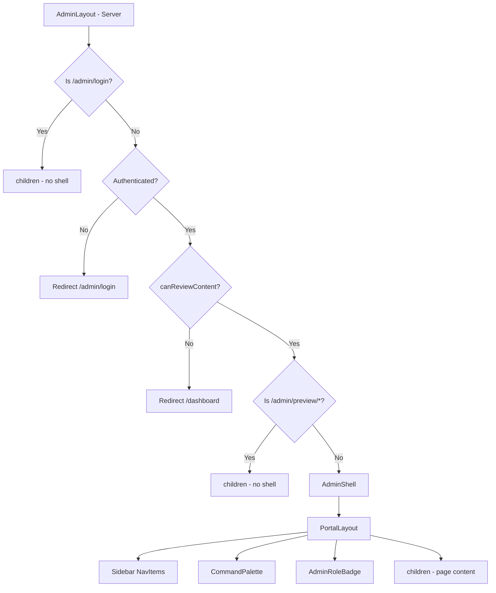
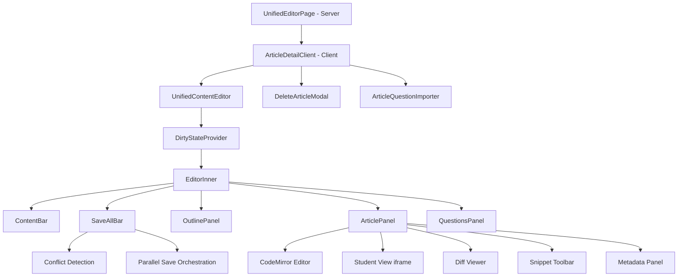
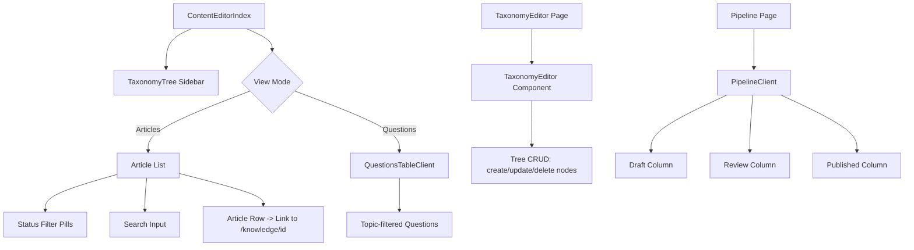
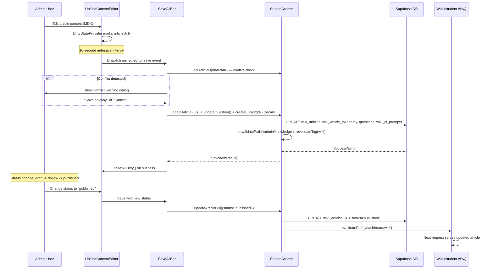
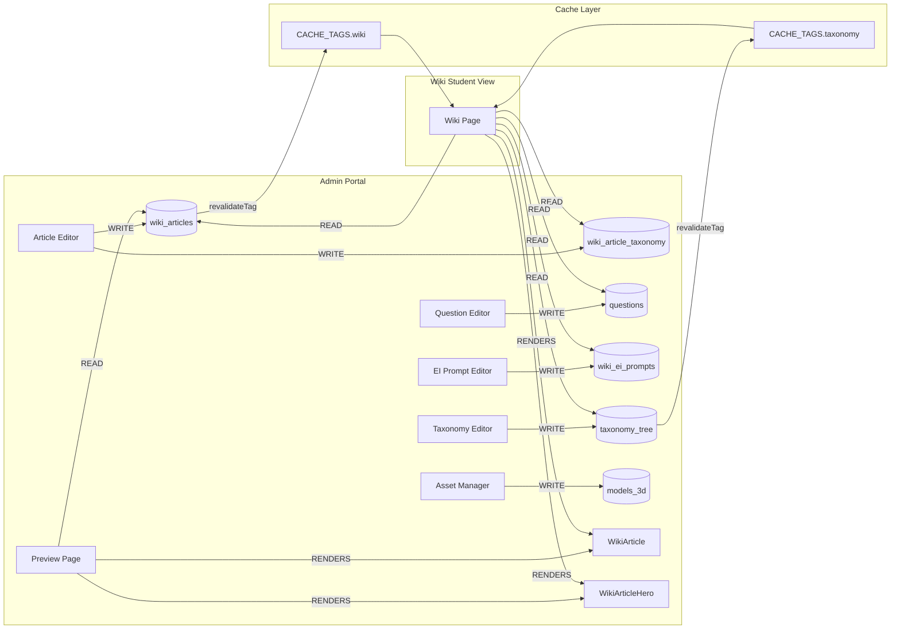

# Admin CMS Feature Specification

**Last Updated:** 2026-04-08
**Status:** Active — Codebase Source of Truth
**Version:** 1.0 (Comprehensive Codebase-Derived Specification)
**Audit Source:** `.ai/plans/admin-feature-specification-plan-2026-04-08.md`
**Cross-Reference:** [Wiki Feature Specification](004-wiki-feature-specification.md) — Admin is the authoring surface for wiki content

> This document is the authoritative specification for SlateCamp's Admin CMS feature.
> Every claim is derived from and verified against the live codebase as of 2026-04-08.
> No fabricated paths, types, or interfaces. If something is unknown, it is marked ⚠️ NEEDS VERIFICATION.

---

## 1. Overview & Principles

### Purpose

The Admin portal is SlateCamp's internal Content Management System (CMS). It is the authoring, question management, taxonomy editing, and publishing pipeline for the Wiki knowledge base. Every piece of student-facing content — articles, questions, EI prompts, taxonomy nodes, 3D assets — is created and managed through this portal.

### Target Users

| User | Role | Primary Activities |
|------|------|--------------------|
| Founder | `super_admin` | Full content lifecycle, user management, audit, settings |
| Subject Matter Experts | `content_admin` | Article authoring, question creation, taxonomy editing |
| Reviewers | `sme_reviewer` | Content review and approval |

### Admin-Wiki Coupling

The Admin portal is tightly coupled with the Wiki feature. Admin **writes** to the same database tables that Wiki **reads**. This is by design — the admin is the authoring surface, the wiki is the rendering surface. See [Section 11: Wiki-Admin Coupling Map](#11-wikiadmin-coupling-map) for the complete coupling inventory.

### Governing Principles

1. **Code is source of truth** — MDX content stored as raw text, no intermediate format
2. **Server Components by default** — `'use client'` only where interactivity is required
3. **Role-gated access** — defense-in-depth via middleware, layout, page, and action checks
4. **Parallel data fetching** — `Promise.all()` for independent queries in all page components
5. **Cache invalidation on write** — every mutation revalidates relevant paths and cache tags
6. **No gamification** — admin is a professional tool, no badges/confetti/streaks

---

## 2. Route & File Architecture

### Directory Tree

```
src/app/admin/
  layout.tsx                          # Server — auth gate, AdminShell wrapper, role check
  page.tsx                            # Server — admin dashboard (stats, charts, quick actions)
  loading.tsx                         # Skeleton loader for dashboard
  error.tsx                           # Client — error boundary with retry

  _components/
    AdminShell.tsx                    # Client — PortalLayout shell, sidebar nav, CommandPalette
    AdminRoleBadge.tsx               # Server — role badge display

  login/
    page.tsx                          # Client — Google OAuth login (public, bypasses shell)
    loading.tsx

  dashboard/
    page.tsx                          # Server — secondary dashboard entry
    loading.tsx

  knowledge/                          # *** THE UNIFIED KNOWLEDGE HUB ***
    page.tsx                          # Server — ContentEditorIndex (taxonomy sidebar + article/question list)
    loading.tsx
    new/
      page.tsx                        # Server — blank UnifiedContentEditor for new article
      loading.tsx
    [id]/
      page.tsx                        # Server — UnifiedContentEditor for existing article
      loading.tsx
    _components/
      ArticleDetailClient.tsx         # Client — wrapper for editor + delete modal + importer
    questions/
      page.tsx                        # Server — ContentEditorIndex with defaultViewMode="questions"
      new/
        page.tsx                      # Question creation
        loading.tsx
      [id]/
        page.tsx                      # Question detail editor
      _components/
        QuestionsTableClient.tsx      # Client — questions table with filtering
    import/
      page.tsx                        # Bulk import from spreadsheet
      loading.tsx
    analytics/
      page.tsx                        # Content quality analytics
      loading.tsx

  articles/                           # LEGACY — superseded by /knowledge
    page.tsx
    new/
      page.tsx
    [id]/
      page.tsx
      loading.tsx

  content/                            # LEGACY — superseded by /knowledge
    page.tsx
    new/
      page.tsx
    [id]/
      page.tsx

  questions/                          # LEGACY — superseded by /knowledge/questions
    page.tsx
    new/
      page.tsx
    [id]/
      page.tsx
    import/
      page.tsx
    analytics/
      page.tsx

  taxonomy/
    page.tsx                          # Server — TaxonomyEditor component
    loading.tsx
    coverage/
      page.tsx                        # Coverage map (questions vs articles by topic)
      loading.tsx

  pipeline/
    page.tsx                          # Server — Kanban-style publish pipeline
    loading.tsx
    _components/
      PipelineCard.tsx               # Individual article card in pipeline
      PipelineClient.tsx             # Client — 3-column (draft/review/published) board

  reviews/
    page.tsx                          # Server — SMEReviewQueue component
    loading.tsx

  search/
    layout.tsx                        # Search layout wrapper
    page.tsx                          # Full-text content search
    loading.tsx
    _components/
      ContentSearchClient.tsx         # Client — real-time Supabase search

  audit/
    page.tsx                          # Server — AuditLogViewer (super_admin only)
    loading.tsx

  activity/
    page.tsx                          # Server — activity feed from audit_logs
    loading.tsx

  assets/
    page.tsx                          # Server — 3D asset manager (upload + list)
    loading.tsx
    [id]/
      page.tsx                        # Asset detail view
      loading.tsx

  3d-models/
    page.tsx                          # 3D model registry
    loading.tsx
    _components/
      ModelConfigDetail.tsx
      ModelRegistryPage.tsx
      ModelRegistryTree.tsx
    _lib/
      model-registry-data.ts

  preview/
    [previewId]/
      page.tsx                        # Server — iframe preview of draft article as student view

  settings/
    page.tsx                          # Server — user role management (super_admin only)
    loading.tsx
```

**Total route count:** ~27 unique page routes (excluding legacy duplicates)

**Legacy routes:** `articles/`, `content/`, `questions/` — superseded by `knowledge/` but still present in codebase. See [Section 20](#20-known-open-decisions--technical-debt) for cleanup recommendation.

### Layout Architecture

The admin layout (`layout.tsx`) implements a multi-layer gate:

1. **Login bypass** — `/admin/login` renders without portal chrome
2. **Auth check** — unauthenticated users redirect to `/admin/login`
3. **Role check** — `canReviewContent()` allows all 3 roles; non-admin users redirect to `/dashboard`
4. **Preview bypass** — `/admin/preview/*` renders without AdminShell
5. **Full-bleed editor** — `/admin/knowledge/[id]` and `/admin/knowledge/questions/[id]` get `noPadding` for full-width editor

### Sidebar Navigation Structure

Defined in `AdminShell.tsx` as `NavGroup[]`:

| Group | Items |
|-------|-------|
| Overview | Dashboard |
| Knowledge Base | Browser (All Content, Create Article), Question Bank (All Questions, Create New, Import, Quality Analytics) |
| Structure | Taxonomy (Tree Editor, Coverage Map), 3D Assets, 3D Models Registry |
| Quality | Review Queue, Publishing Pipeline, Content Search |
| Pulse | Audit Log, Pulse Feed |
| Settings | Settings |

The sidebar also includes:
- **CommandPalette** — `Cmd+K` search across all admin pages (17 indexed pages)
- **AdminRoleBadge** — displays current user's role as a colored badge in the top bar
- **Review Queue badge** — shows count of pending reviews

---

## 3. Role & Permission Model

### Roles

Defined in `src/lib/admin/roles.ts`:

```typescript
export type UserRole = 'super_admin' | 'content_admin' | 'sme_reviewer'
```

| Role | DB Value | Description |
|------|----------|-------------|
| Super Admin | `super_admin` | Full access: content CRUD, taxonomy CRUD, user management, audit logs, settings |
| Content Admin | `content_admin` | Content CRUD, taxonomy CRUD. No user management, no settings |
| SME Reviewer | `sme_reviewer` | Read-only access to content, can review and approve |

### Storage Mechanism

Roles are stored in the `user_roles` table with columns `id`, `user_id`, `role`, `created_at`. A user can have multiple role rows; `getUserRole()` returns the most recent (ordered by `created_at DESC`).

**Fallback:** Legacy `ADMIN_EMAILS` environment variable — if a user's email is in this comma-separated list and they have no DB role, they are granted `super_admin`.

**Dev bypass:** When `NODE_ENV === 'development'` and `DEV_FORCE_USER_ID` env var is set, `getUserRole()` returns `super_admin` unconditionally.

### Route Protection (Defense-in-Depth)

| Layer | File | Mechanism | Scope |
|-------|------|-----------|-------|
| **Middleware** | `src/lib/supabase/middleware.ts` | Queries `user_roles` table for any of the 3 roles; redirects to `/dashboard` if no role found | All `/admin/*` routes except `/admin/login` |
| **Layout** | `src/app/admin/layout.tsx` | Calls `canReviewContent()` (allows all 3 roles); redirects unauthorized users to `/dashboard` | All admin pages |
| **Page-level** | Individual `page.tsx` files | Stricter checks for specific pages | Per-page |
| **Action-level** | `src/lib/actions/admin/*.ts` | Every mutation calls `canManageContent()` or `canManageUsers()` | Per-action |

### Page-Level Access Matrix

| Page | Required Check | `super_admin` | `content_admin` | `sme_reviewer` |
|------|---------------|:---:|:---:|:---:|
| `/admin` (dashboard) | `canReviewContent()` | Y | Y | Y |
| `/admin/knowledge/*` | `canManageContent()` | Y | Y | N |
| `/admin/taxonomy/*` | `canManageContent()` | Y | Y | N |
| `/admin/pipeline` | `canReviewContent()` | Y | Y | Y |
| `/admin/reviews` | `canReviewContent()` | Y | Y | Y |
| `/admin/search` | `canReviewContent()` | Y | Y | Y |
| `/admin/assets` | `canManageContent()` | Y | Y | N |
| `/admin/3d-models` | `canReviewContent()` | Y | Y | Y |
| `/admin/audit` | `isSuperAdmin()` | Y | N | N |
| `/admin/settings` | `isSuperAdmin()` | Y | N | N |
| `/admin/activity` | `canReviewContent()` | Y | Y | Y |

### Role Utility Functions

| Function | Signature | Returns `true` for |
|----------|-----------|-------------------|
| `getUserRole()` | `() => Promise<UserRole \| null>` | N/A — returns the role value |
| `getUserRoles()` | `() => Promise<UserRole[]>` | N/A — returns all roles |
| `isAdmin()` | `() => Promise<boolean>` | `super_admin`, `content_admin` |
| `isSuperAdmin()` | `() => Promise<boolean>` | `super_admin` |
| `canManageContent()` | `() => Promise<boolean>` | `super_admin`, `content_admin` |
| `canReviewContent()` | `() => Promise<boolean>` | All 3 roles |
| `canManageUsers()` | `() => Promise<boolean>` | `super_admin` |

Both `getUserRole()` and `getUserRoles()` are wrapped with React `cache()` to deduplicate calls within a single RSC render pass.

---

## 4. Editor Architecture (CodeMirror + MDX)

### Editor Library

**Primary editor:** CodeMirror via `@uiw/react-codemirror`

| Package | Purpose |
|---------|---------|
| `@uiw/react-codemirror` | React wrapper for CodeMirror |
| `@codemirror/lang-markdown` | Markdown language mode |
| `@codemirror/view` | Editor view extensions |

**Note on Tiptap:** Tiptap is present in `package.json` (with 10+ extensions) but is **NOT** used by the admin article editor. The admin editor exclusively uses CodeMirror for raw MDX editing. See [Section 20](#20-known-open-decisions--technical-debt).

### Editor Configuration

From `ArticlePanel.tsx`:

```typescript
extensions: [markdown(), EditorView.lineWrapping]
basicSetup: {
  lineNumbers: true,
  foldGutter: false,
  highlightActiveLine: true,
  bracketMatching: true,
  closeBrackets: true,
  autocompletion: false,
}
theme: "light"
fontSize: "13px"
```

### Snippet Toolbar

The `ArticlePanel` provides a snippet toolbar with 5 groups containing ~20 MDX component templates:

| Group | Snippets |
|-------|----------|
| **Callouts** | `<Note>`, `<Warn>`, `<Tip>`, `<Example>`, `<ExamTip>`, `<Callout>` |
| **Legal** | `<LawCallout>`, `<AuthorityContent>` |
| **Interactive** | `<InlineQuiz>`, `<KeyValues>`, `<FormulaBlock>`, `<Tabs>`/`<Tab>`, `<Accordion>`/`<AccordionItem>` |
| **Exam** | `<WikiMistakeCard>`, `<WikiCalloutBox>`, `<AlertBox>`, `<ComparisonTable>`, `<ProcessFlow>` |
| **Structure** | `<WikiPartHeader>`, `<WikiChangedPill>` |

Snippets are inserted at cursor position via CodeMirror's `view.dispatch()`.

### Content Storage Format

Raw MDX text stored in `wiki_articles.content` (Postgres TEXT column). No structured JSON, no block editor format. Content is a mix of Markdown + JSX-like component tags.

### Rendering Pipeline

1. Admin authors MDX in CodeMirror
2. Content saved as raw text to `wiki_articles.content`
3. Wiki reader compiles MDX server-side via `next-mdx-remote/rsc`
4. Custom components resolved via `src/components/wiki/mdx-components-shared.ts`
5. Heavy widgets lazy-loaded via widget registry (`src/components/wiki/widgets/registry.ts`)

> **Cross-reference:** See [Wiki Feature Specification](004-wiki-feature-specification.md) for the full rendering pipeline and MDX component registration.

### Three-Panel Editor Layout

The `UnifiedContentEditor` implements a three-panel layout:

| Panel | Component | Position | Purpose |
|-------|-----------|----------|---------|
| Outline | `OutlinePanel` | Left sidebar | Parsed headings navigation |
| Article | `ArticlePanel` | Center | CodeMirror editor with tabs (Editor / Student View / Diff) |
| Questions | `QuestionsPanel` | Right | Question list/editor linked to article |

- Below `xl` breakpoint: panels stack vertically (article 50vh, questions 50vh)
- Outline panel hidden below `xl`

### Preview System

The "Student View" tab in the editor:

1. Writes draft content to `admin_draft_previews` table via `generateDraftPreview()` from `src/lib/actions/preview-actions.ts`
2. Renders in an iframe pointing to `/admin/preview/[previewId]`
3. The preview page uses the **same** wiki rendering components (`WikiArticle`, `WikiArticleHero`, `WikiHeader`, `WikiRightSidebar`, `TeachBackPrompt`) as the student view
4. A yellow banner distinguishes preview from live: "Draft Preview Mode: This is a live preview of your unsaved editor content. Read tracking and analytics are disabled."

### Autosave & Conflict Detection

- **Autosave interval:** 10-second timer dispatches a `unified-editor:save` custom event
- **Conflict detection:** Before saving, `getArticleUpdatedAt()` checks if another user has modified the article since it was loaded
- **Conflict resolution:** If detected, a warning dialog offers "Save anyway" or "Cancel"
- **`beforeunload` warning:** Fires when dirty state exists and user attempts to navigate away
- **Document title:** Prefixed with `"* "` when any unsaved changes exist

---

## 5. Component Architecture

### Component Tree — Admin Layout Shell



### Component Tree — Article Editor



### Component Tree — Knowledge Browser & Pipeline



### Admin Shell Components (`src/app/admin/_components/`)

| Component | Type | Props | Responsibility |
|-----------|------|-------|----------------|
| `AdminShell` | Client | `role: UserRole`, `badgeCounts?: { pendingReviews }`, `noPadding?: boolean`, `children` | Portal layout shell with sidebar nav, command palette, role badge |
| `AdminRoleBadge` | Server | `role: UserRole` | Displays user role as colored badge (danger/warning/info variant) |

### Shared Admin Components (`src/components/admin/`)

| Component | Type | Also Used In Wiki | Responsibility |
|-----------|------|:-----------------:|----------------|
| `ArticleQuestionImporter` | Client | N | JSON question import for a specific article |
| `AssetDetailView` | Client | N | 3D asset detail display |
| `AssetList` | Client | N | 3D asset list with grid layout |
| `AssetUploader` | Client | N | File upload for 3D models (.glb/.gltf) |
| `AuditLogViewer` | Client | N | Filterable audit log table with expand/collapse |
| `BulkActionBar` | Client | N | Bulk select + delete for questions/articles |
| `DeleteArticleModal` | Client | N | Confirmation dialog for article deletion |
| `NeedsAttentionCard` | Client | N | Dashboard card showing pending reviews + missing rationale |
| `QuestionEditor` | Client | N | Full question editing form |
| `QuestionImporter` | Client | N | Standalone question import UI |
| `QuestionQualityBadges` | Client | N | Quality indicator badges for questions |
| `QuestionQuickPreview` | Client | N | Compact question preview card |
| `QuestionsTableClient` | Client | N | Paginated question table with topic grouping |
| `SMEReviewQueue` | Client | N | Review queue for content approval |
| `TaxonomyEditor` | Client | N | Tree editor for taxonomy nodes (CRUD) |
| `RoleSelect` | Client | N | Role dropdown for settings page (`src/components/admin/settings/RoleSelect.tsx`) |

### Unified Editor Components (`src/components/admin/unified-editor/`)

| Component | Type | Responsibility |
|-----------|------|----------------|
| `UnifiedContentEditor` | Client | Root editor: 3-panel layout (outline + article + questions) |
| `ArticlePanel` | Client | CodeMirror MDX editor with snippet toolbar, preview, diff tabs |
| `QuestionsPanel` | Client | Question list/editor panel linked to article |
| `OutlinePanel` | Client | Parsed headings sidebar for navigation |
| `ContentBar` | Client | Top bar with title, status, LEA ID, save indicator |
| `SaveAllBar` | Client | Save orchestrator with conflict detection, retry |
| `DirtyStateProvider` | Client | React Context for tracking unsaved changes |
| `PanelErrorBoundary` | Client | Error boundary per panel |
| `ContentEditorIndex` | Client | Knowledge browser with taxonomy sidebar + article/question list |
| `EIPromptsPanel` | Client | Elaborative Interrogation prompt editor |

---

## 6. Custom Wiki Content Blocks

The admin editor's snippet toolbar inserts MDX component tags into article content. These components are authored in admin and rendered in the Wiki.

### Catalogue

| Component | Snippet Group | Props | Status |
|-----------|--------------|-------|--------|
| `<Note>` | Callouts | `children` | Active |
| `<Warn>` | Callouts | `children` | Active |
| `<Tip>` | Callouts | `children` | Active |
| `<Example>` | Callouts | `children` | Active |
| `<ExamTip>` | Callouts | `children` | Active |
| `<Callout>` | Callouts | `variant`, `title`, `children` | Active |
| `<LawCallout>` | Legal | `code: LawCalloutCode`, `section?`, `children` | Active |
| `<AuthorityContent>` | Legal | `source`, `citation`, `children` | Active |
| `<InlineQuiz>` | Interactive | `question`, `options` (JSON), `rationale` | Active |
| `<KeyValues>` | Interactive | `items` (JSON array of key/value) | Active |
| `<FormulaBlock>` | Interactive | `formula`, `label`, `note` | Active |
| `<Tabs>` / `<Tab>` | Interactive | `label` per Tab, `children` | Active |
| `<Accordion>` / `<AccordionItem>` | Interactive | `title` per item, `children` | Active |
| `<WikiMistakeCard>` | Exam | `mistake`, `correction` | Active |
| `<WikiCalloutBox>` | Exam | `type`, `title`, `children` | Active |
| `<AlertBox>` | Exam | `type`, `title`, `children` | Active |
| `<ComparisonTable>` | Exam | `headers` (JSON), `rows` (JSON) | Active |
| `<ProcessFlow>` | Exam | `steps` (JSON array) | Active |
| `<WikiPartHeader>` | Structure | `part: number`, `title`, `subtitle` | Active |
| `<WikiChangedPill>` | Structure | `date`, `summary` | Active |

### Registration Mechanism

MDX components are registered in `src/components/wiki/mdx-components-shared.ts` and rendered via `next-mdx-remote/rsc` (server-side compilation). The admin editor does **not** render these components directly — it inserts raw MDX markup via the snippet toolbar. The "Student View" tab generates a draft preview through the actual wiki rendering pipeline.

### Serialization Format

Content is stored as raw MDX text in `wiki_articles.content` (TEXT column). No intermediate AST or JSON format. The admin editor works with plain text via CodeMirror with markdown syntax highlighting.

> **Cross-reference:** See [Wiki Feature Specification](004-wiki-feature-specification.md) for the complete MDX component registration and rendering pipeline.

---

## 7. State Management

### DirtyStateProvider (React Context)

**File:** `src/components/admin/unified-editor/DirtyStateProvider.tsx`

| Property | Type | Description |
|----------|------|-------------|
| `articleDirty` | `boolean` | Whether article fields have been modified |
| `questionsDirty` | `Map<string, boolean>` | Per-question dirty tracking |
| `eiPromptsDirty` | `Map<string, boolean>` | Per-EI-prompt dirty tracking |
| `newQuestions` | `QuestionDraft[]` | Newly created questions not yet saved |
| `newEIPrompts` | `EIPromptDraft[]` | Newly created EI prompts not yet saved |
| `deletedQuestions` | `Set<string>` | Question IDs queued for deletion |
| `deletedEIPrompts` | `Set<string>` | EI prompt IDs queued for deletion |
| `isAnythingDirty` | `boolean` (computed) | True if any of the above has changes |
| `dirtyCount` | `number` (computed) | Total count of dirty items |

**Consumers:** `UnifiedContentEditor` (EditorInner), `SaveAllBar`, `ContentBar`

### No Zustand Stores for Admin

The admin portal does **NOT** use any Zustand stores. All admin state is either:

1. **Server-fetched via RSC props** — articles, taxonomy, questions passed from server components
2. **Local `useState`** within client components — filter text, modal open/close, form fields
3. **DirtyStateProvider** React Context — unified editor dirty tracking

---

## 8. Data Flow & Server Actions

### Server Actions (`src/lib/actions/admin/`)

#### `wiki.ts` — Article CRUD

| Action | Type | Payload | Tables | Auth |
|--------|------|---------|--------|------|
| `createWikiArticle` | Mutation | `{title, content, slug?, status?, node_id?}` | `wiki_articles`, `wiki_article_taxonomy` | `canManageContent()` |
| `updateWikiArticle` | Mutation | `{title, content, slug?, status?, node_id?}` | `wiki_articles`, `wiki_article_taxonomy` | `canManageContent()` |
| `deleteWikiArticle` | Mutation | `id: string` | `wiki_articles`, `wiki_article_taxonomy` | `canManageContent()` |

Validation: Zod schemas (`UpdateWikiArticleSchema`, `CreateWikiArticleSchema`). Slug auto-generated from title if not provided. Taxonomy mapping uses delete-then-insert pattern for primary node.

#### `content.ts` — Unified Editor Queries & Mutations

| Action | Type | Key Tables |
|--------|------|------------|
| `compileMdxPreview` | Query | None (in-memory MDX compilation via `next-mdx-remote/serialize`) |
| `getContentEditorIndexData` | Query | `wiki_articles`, `taxonomy_tree`, `wiki_article_taxonomy`, `questions` |
| `getArticleFull` | Query | `wiki_articles` |
| `getArticleUpdatedAt` | Query | `wiki_articles` (conflict detection) |
| `getArticleTaxonomyNodes` | Query | `wiki_article_taxonomy` |
| `getQuestionsByNodeIds` | Query | `questions` |
| `getQuestionsByArticleId` | Query | `questions` |
| `getAllEIPromptsForArticle` | Query | `wiki_ei_prompts` |
| `updateArticleFull` | Mutation | `wiki_articles`, `wiki_article_taxonomy` |
| `updateQuestion` | Mutation | `questions` |
| `createEIPrompt` | Mutation | `wiki_ei_prompts` |
| `updateEIPrompt` | Mutation | `wiki_ei_prompts` |
| `deleteEIPrompt` | Mutation | `wiki_ei_prompts` |
| `importQuestionsForArticle` | Mutation | `questions` |

#### `questions.ts` — Question CRUD

| Action | Type | Payload | Auth |
|--------|------|---------|------|
| `createQuestion` | Mutation | `CreateQuestionInput` (text, options[4], topic_id, article_id?, difficulty?, rationale?, code_citation?, application_context?, practice_context?) | `canManageContent()` |
| `updateQuestion` | Mutation | `id: string, CreateQuestionInput` | `canManageContent()` |
| `deleteQuestion` | Mutation | `id: string` | `canManageContent()` |
| `deleteQuestions` | Mutation | `ids: string[]` | `canManageContent()` |

Validation: Manual — requires exactly 4 options, non-empty text, valid topic_id.

#### `taxonomy.ts` — Taxonomy CRUD

| Action | Type | Payload | Auth |
|--------|------|---------|------|
| `getTaxonomyNodes` | Query | None | None (read-only) |
| `createTaxonomyNode` | Mutation | `{name, parent_id, level, discipline_id, sort_order?}` | `canManageContent()` |
| `updateTaxonomyNode` | Mutation | `{name}` | `canManageContent()` |
| `deleteTaxonomyNode` | Mutation | `id: string` | `canManageContent()` |

Validation: Zod schemas. Slug auto-generated. `lea_id` auto-assigned for level-3 nodes.

#### `pipeline.ts` — Article Status Management

| Action | Type | Payload | Auth |
|--------|------|---------|------|
| `getPipelineArticles` | Query | None | None (read via layout auth) |
| `updateArticleStatus` | Mutation | `{articleId, newStatus: 'draft' \| 'review' \| 'published'}` | `canManageContent()` |

#### `assets.ts` — 3D Asset Management

| Action | Type | Payload | Auth |
|--------|------|---------|------|
| `getAssets` | Query | None | None |
| `getAsset` | Query | `id: string` | None |
| `createAsset` | Mutation | `{name, slug, url, thumbnail?, metadata}` | `canManageContent()` |
| `uploadAssetFile` | Mutation | `FormData (file)` | `canManageContent()` |

Validation: Zod schema for `createAsset`. Upload writes to Supabase Storage bucket `3d-models` at path `assets/{timestamp}-{baseName}.{ext}`.

#### `roles.ts` — User Role Management

| Action | Type | Payload | Auth |
|--------|------|---------|------|
| `getAdminUsers` | Query | None | None (read via layout auth) |
| `assignRole` | Mutation | `FormData {userId, role}` | `canManageUsers()` |
| `revokeRole` | Mutation | `FormData {roleId}` | `canManageUsers()` |

Validation: UUID regex for userId.

#### `dashboard.ts` — Dashboard Data (Cached)

| Action | Cache TTL | Tables |
|--------|-----------|--------|
| `getAdminDashboardData` | 60s (`unstable_cache`) | `questions`, `wiki_articles`, `taxonomy_tree`, `models_3d`, `audit_logs` |
| `getContentBySubject` | 60s | `taxonomy_tree`, `questions`, `wiki_article_taxonomy` |
| `getNeedsAttentionData` | 60s | `wiki_articles`, `questions` |
| `getCriticalCoverageGap` | 60s | `taxonomy_tree`, `questions` |

#### `bulk.ts` — Bulk Operations

| Action | Type | Auth |
|--------|------|------|
| `bulkDeleteQuestions` | Mutation | `canManageContent()` |
| `bulkDeleteArticles` | Mutation | `canManageContent()` |

#### `coverage.ts` — Taxonomy Coverage Analysis

| Action | Type | Auth |
|--------|------|------|
| `fetchCoverageData` | Query | `canReviewContent()` |

Returns level-1 and level-2 nodes with question counts, article presence, and coverage classification (`full`/`partial`/`empty`/`critical`).

#### `wiki-queries.ts` — Article Queries

| Action | Type |
|--------|------|
| `getArticlesWithCoverage` | Query — articles with question counts |
| `getArticles` | Query — basic article list |
| `getArticle` | Query — single article detail |
| `getAdminTaxonomyTree` | Query — full taxonomy tree with article/question counts |

#### `question-queries.ts` — Question Queries

| Action | Type |
|--------|------|
| `getQuestions` | Query — paginated questions |
| `getQuestionsGroupedByArticle` | Query — questions grouped by article |
| `getQuestionsByTopicIds` | Query — questions filtered by topic with search |
| `getQuestionsTaxonomyTree` | Query — taxonomy tree with question/article counts |

### Other Server Actions Used by Admin

| Action | File | Tables |
|--------|------|--------|
| `generateDraftPreview` | `src/lib/actions/preview-actions.ts` | `admin_draft_previews` |
| `updateDraftPreview` | `src/lib/actions/preview-actions.ts` | `admin_draft_previews` |
| `getAuditLogsAction` | `src/lib/audit/audit-actions.ts` | `audit_logs` |

### API Routes

| Route | Method | Purpose | Auth |
|-------|--------|---------|------|
| `/api/admin/flags` | POST | Set feature flag cookies | `isAdmin()` |
| `/api/admin/flags` | DELETE | Clear feature flag cookies | `isAdmin()` |

### Article Publish Flow



---

## 9. Database Schema

### Tables Used by Admin

#### SHARED WITH WIKI (written by Admin, read by Wiki)

| Table | Admin Role | Wiki Role | Key Columns |
|-------|-----------|-----------|-------------|
| `wiki_articles` | WRITE (CRUD) | READ (render) | `article_id` (PK), `title`, `slug`, `content` (MDX TEXT), `status` (`draft`/`review`/`published`), `difficulty_label`, `lea_tests_you`, `updated_note`, `subject_label`, `reviewed_by`, `reviewer_comments`, `created_by`, `created_at`, `updated_at` |
| `wiki_article_taxonomy` | WRITE (CRUD) | READ (nav) | `article_id` (FK), `node_id` (FK), `is_primary` |
| `wiki_ei_prompts` | WRITE (CRUD) | READ (render) | `prompt_id` (PK), `article_id` (FK), `node_id` (FK?), `insert_after_heading`, `prompt_text`, `reveal_text`, `options` (JSONB), `sort_order`, `is_active`, `status`, `reviewed_by`, `reviewed_at`, `reviewer_notes` |
| `questions` | WRITE (CRUD) | READ (quiz) | `question_id` (PK), `topic_id` (FK→taxonomy_tree), `article_id` (FK?), `text`, `options` (JSONB), `correct_option_id`, `rationale`, `explanation`, `code_citation`, `difficulty`, `difficulty_rating`, `discrimination_rating`, `prompt_image_url`, `model_id`, `is_assessment`, `application_context`, `practice_context` (TEXT[]), `created_by`, `updated_by` |
| `taxonomy_tree` | WRITE (CRUD) | READ (nav) | `node_id` (PK), `discipline_id` (FK), `parent_id` (FK self-ref), `name`, `slug`, `lea_id`, `level` (1-3), `subject_area`, `is_leaf`, `sort_order`, `exam_frequency`, `deprecated_at`, `is_cross_ref_only` |
| `disciplines` | READ | READ | `discipline_id` (PK), `name`, `acronym` |
| `models_3d` | WRITE (CRUD) | READ (3D lab) | `model_id` (PK), `name`, `slug`, `url`, `thumbnail`, `status`, `metadata` (JSONB), `created_by` |

#### ADMIN-ONLY Tables

| Table | Purpose | Key Columns |
|-------|---------|-------------|
| `user_roles` | Role assignments | `id` (PK), `user_id`, `role` (`super_admin`/`content_admin`/`sme_reviewer`), `created_at` |
| `audit_logs` | Change history (read-only) | `id` (PK), `actor_id`, `event_type`, `table_name`, `record_id`, `metadata` (JSONB), `content_snapshot` (JSONB), `created_at` |
| `admin_draft_previews` | Temporary draft content for preview | `id` (PK), `article_id` (FK), `content` (TEXT) |

### RLS Notes

- **Mutations:** Admin uses `createAdminClient()` (service role key, bypasses RLS) for all mutations and some aggregate reads
- **Regular reads:** Some queries use `createClient()` (anon key, respects RLS)
- **Student-facing wiki:** Uses RLS-scoped queries — students can only see `status = 'published'` articles

> **Cross-reference:** See [Wiki Feature Specification](004-wiki-feature-specification.md) for the wiki-side schema usage and RLS policies.

---

## 10. Media & Asset Management

### 3D Model Assets

| Aspect | Implementation |
|--------|---------------|
| **Upload component** | `src/components/admin/AssetUploader.tsx` |
| **Upload action** | `uploadAssetFile()` in `src/lib/actions/admin/assets.ts` |
| **Storage bucket** | Supabase Storage bucket `3d-models` |
| **File types** | `.glb`, `.gltf` |
| **File path pattern** | `assets/{timestamp}-{baseName}.{ext}` |
| **URL generation** | `supabase.storage.from('3d-models').getPublicUrl(filePath)` |
| **Metadata** | Stored as JSONB in `models_3d.metadata` |
| **Listing** | `src/components/admin/AssetList.tsx` (grid layout) |
| **Detail view** | `src/components/admin/AssetDetailView.tsx` |
| **Management page** | `/admin/assets` (upload + list) |

### 3D Model Registry

The `/admin/3d-models` page provides a tree-based view of the 3D Lab module registry:

- **Data source:** `src/app/admin/3d-models/_lib/model-registry-data.ts` — aggregates from `ALL_MODULES` (3D Lab registry), `ASSET_TAXONOMY`, and `LEA_SUBJECTS`
- **Tree structure:** LEA Subject → Category → Model (hierarchical)
- **Components:** `ModelRegistryPage`, `ModelRegistryTree`, `ModelConfigDetail`

### Article Images

Article images are referenced via URLs in MDX content (e.g., `prompt_image_url` on questions). No dedicated image upload component exists in the admin — images are referenced by URL.

### No General Media Library

There is no general-purpose media library. 3D assets have their own pipeline; other media (images) are URL-referenced.

---

## 11. Wiki-Admin Coupling Map

### Shared Components

No admin components are directly imported in wiki routes. However, the admin **preview page** (`/admin/preview/[previewId]`) imports and renders wiki components:

| Wiki Component | Used in Admin Preview |
|---------------|:---:|
| `WikiArticle` | Y |
| `WikiArticleHero` | Y |
| `WikiHeader` | Y |
| `WikiRightSidebar` | Y |
| `TeachBackPrompt` | Y |
| `getArticleHeadings` | Y (utility) |

### Shared DB Tables

| Table | Admin Writes | Wiki Reads | Coupling Type |
|-------|:---:|:---:|--------------|
| `wiki_articles` | Y | Y | Content lifecycle |
| `wiki_article_taxonomy` | Y | Y | Navigation/taxonomy |
| `wiki_ei_prompts` | Y | Y | Interactive prompts |
| `questions` | Y | Y | Quiz/assessment |
| `taxonomy_tree` | Y | Y | Curriculum structure |
| `disciplines` | N (read-only) | Y | Top-level grouping |
| `models_3d` | Y | Y | 3D lab assets |

### Shared Types

| Type | File | Admin | Wiki |
|------|------|:---:|:---:|
| `ArticleData` | `src/components/admin/unified-editor/types.ts` | Y | N |
| `QuestionData` | `src/components/admin/unified-editor/types.ts` | Y | N |
| `EIPromptData` | `src/components/admin/unified-editor/types.ts` | Y | N |
| `WikiCalloutType` | `src/types/wiki.ts` | N | Y |
| `LawCalloutCode` | `src/types/wiki.ts` | N | Y |

### Cache Invalidation Flow



### Cross-Reference Consistency Points

1. **Content model:** `ArticleData` type in admin maps to `wiki_articles` table columns used by wiki rendering
2. **MDX blocks:** Admin snippet templates match components registered in `src/components/wiki/mdx-components-shared.ts`
3. **Taxonomy navigation:** Admin taxonomy changes trigger `CACHE_TAGS.taxonomy` revalidation, picked up by wiki navigation
4. **EI prompts:** Admin EI prompt schema (`EIPromptData`) matches wiki EI prompt rendering expectations
5. **Article status lifecycle:** Admin manages `draft` → `review` → `published`; wiki only shows `status = 'published'`
6. **Preview rendering:** Admin preview page uses the same rendering pipeline as wiki — any wiki component changes affect preview

---

## 12. Knowledge Hub (Unified Content Management)

### Overview

The `/admin/knowledge/` route is the unified content management hub that consolidates what were previously separate routes (`/articles`, `/content`, `/questions`) into a single interface.

### Route Structure

| Route | Purpose | Component |
|-------|---------|-----------|
| `/admin/knowledge` | Article browser with taxonomy sidebar | `ContentEditorIndex` |
| `/admin/knowledge/new` | Create new article | `UnifiedContentEditor` (blank) |
| `/admin/knowledge/[id]` | Edit existing article | `ArticleDetailClient` → `UnifiedContentEditor` |
| `/admin/knowledge/questions` | Question browser | `ContentEditorIndex` with `defaultViewMode="questions"` |
| `/admin/knowledge/questions/new` | Create new question | Question creation form |
| `/admin/knowledge/questions/[id]` | Edit existing question | Question editor |
| `/admin/knowledge/import` | Bulk import from spreadsheet | Import UI |
| `/admin/knowledge/analytics` | Content quality analytics | Analytics dashboard |

### Knowledge Browser (`ContentEditorIndex`)

**Layout:** Taxonomy sidebar (280px) + content list (remaining width)

**Features:**
- **View modes:** Articles / Questions toggle (synced to URL params)
- **Taxonomy sidebar:** Hierarchical tree with article counts and question counts per node
- **Status filtering:** Pills for All / Draft / Review / Published
- **Text search:** Filters articles by title or questions by text
- **Article rows:** Icon + title + status badge + difficulty badge + LEA ID + node name + word count + question count + prompt count + date
- **Empty states:** Distinct for "no articles yet" vs "no matching content"

### Data Loading

The page fetches all data server-side via `getContentEditorIndexData()`:
- Articles (up to 500, ordered by `updated_at`)
- Taxonomy nodes
- Article-taxonomy links
- Questions (for counts and search)

Data is assembled into a taxonomy tree with aggregate counts and passed to the client component.

---

## 13. Question Bank Management

### Question CRUD

Questions are managed through:
1. **Standalone routes:** `/admin/knowledge/questions/*` — listing, creation, editing
2. **Inline in editor:** `QuestionsPanel` in the `UnifiedContentEditor` — questions linked to the current article's taxonomy nodes
3. **Import:** `/admin/knowledge/import` — bulk JSON import

### Question Data Shape

```typescript
interface QuestionData {
  question_id: string
  topic_id: string          // FK to taxonomy_tree.node_id
  article_id: string | null // Optional FK to wiki_articles
  text: string
  options: QuestionOption[] // Exactly 4 options
  correct_option_id: string
  rationale: string | null
  explanation: string | null
  code_citation: string | null
  difficulty: number | null
  difficulty_rating: number | null
  discrimination_rating: number | null
  prompt_image_url: string | null
  model_id: string | null
  is_assessment: boolean
  application_context: string | null
  practice_context: string[] | null
}
```

### Validation Rules

- Text must be non-empty string
- Options must be an array of exactly 4 items
- `topic_id` must be a non-empty string
- All mutations require `canManageContent()` authorization

### Quality Indicators

`QuestionQualityBadges` displays quality indicators based on:
- Missing rationale (flagged on dashboard via `NeedsAttentionCard`)
- Difficulty rating
- Discrimination rating

---

## 14. 3D Model Management

### `/admin/3d-models/` — Model Registry

This page provides a read-only hierarchical view of the 3D Lab module registry:

- **Data source:** Static configuration from `src/features/3d-lab/config/registry` and `src/features/3d-lab/config/taxonomy`
- **Not database-backed** — the registry is code-defined, not stored in `models_3d`
- **Tree structure:** LEA Subject → Category → Model with stats

### `/admin/assets/` — 3D Asset Storage

This page manages the actual 3D model files stored in Supabase:

- **Upload:** `.glb`/`.gltf` files to Supabase Storage bucket `3d-models`
- **Metadata:** Name, slug, URL, thumbnail, JSONB metadata, status
- **CRUD:** Create via `createAsset()`, read via `getAssets()`/`getAsset()`
- **Detail view:** `/admin/assets/[id]` — shows asset metadata and preview

### Key Types

```typescript
interface ModelNode {
  id: string; title: string; templateType: string;
  subject: string; categoryId: string; launchPhase: number;
  status: string; description: string;
}

interface CategoryNode {
  key: string; id: string; label: string; description: string;
  icon: string; phase: number; leaSubject: string;
  modules: ModelNode[]; moduleCount: number;
}
```

---

## 15. Article Pipeline & Review

### Publishing Pipeline (`/admin/pipeline`)

A Kanban-style three-column board showing article status progression:

| Column | Status Value | Badge Variant | Empty State |
|--------|-------------|---------------|-------------|
| Draft | `draft` | `warning` | "No drafts" |
| In Review | `review` | `info` | "No articles in review" |
| Published | `published` | `success` | "No published articles" |

**Features:**
- Text filter by title, discipline, or assignee
- `PipelineCard` shows article title, slug, subject label, review status, timestamps
- Status changes via `updateArticleStatus()` action

### Review Queue (`/admin/reviews`)

The `SMEReviewQueue` component displays articles with `status = 'review'`:
- Sorted by most recently updated
- Shows reviewer assignment status
- Actions: approve (change to published) or return to draft

### Status Lifecycle

```
draft → review → published
  ↑        |
  └────────┘ (returned for revision)
```

Every status change triggers:
- `revalidatePath('/admin/pipeline')`
- `revalidatePath('/admin/knowledge')`
- `revalidatePath('/admin/reviews')`

---

## 16. Search & Activity

### Content Search (`/admin/search`)

**Component:** `ContentSearchClient` (client-side)

**Search targets:**
- Questions — text search via Supabase `ilike`
- Articles — title search via Supabase `ilike`
- Taxonomy nodes — name/LEA ID search

**Features:**
- Real-time search with `useDeferredValue` for debouncing
- Tabbed results: Questions / Articles / Taxonomy
- Results link to detail pages
- Empty states per tab

### Activity Feed (`/admin/activity`)

Displays recent entries from the `audit_logs` table:
- Actor ID (truncated UUID), event type badge, table name, record ID
- Relative timestamps via `formatRelativeTime()`
- Links to full audit log

### Audit Log (`/admin/audit`)

**Access:** `isSuperAdmin()` only

`AuditLogViewer` component provides:
- Filterable log table with expand/collapse for metadata
- Event type filtering
- Chronological display with actor, action, table, record details

---

## 17. UX & Interaction Patterns

### Article List (Knowledge Browser)

- **Layout:** Taxonomy sidebar (280px) + content list (remaining width)
- **View modes:** Articles / Questions toggle
- **Filtering:** Status pills (All/Draft/Review/Published), topic tree selection, text search
- **Row format:** Icon + title + status badge + difficulty badge + LEA ID + node name + word count + question count + prompt count + date
- **Empty states:** Distinct messages for "no articles yet" vs "no matching content"
- **URL sync:** View mode and selected topic synced to URL params

### Editor Toolbar

- Snippet dropdowns grouped by category (5 groups)
- Click-to-insert at cursor position
- Custom dropdown implementation (not shadcn Select)

### Taxonomy Selector (in Editor)

- Within article metadata panel (collapsible)
- Searchable text input + select dropdown
- Shows node name + subject area + level
- "Clear" button to unassign

### Publish Flow

- Status managed via dropdown in `ContentBar`
- Three states: `draft` → `review` → `published`
- Status change triggers revalidation of wiki cache
- Pipeline page shows Kanban-style 3-column board

### Form Validation

- Zod schemas for article and taxonomy mutations
- Manual validation for question creation (4 options required, non-empty text, topic_id required)
- Real-time conflict detection via `getArticleUpdatedAt()` before save

### Preview

- "Student View" tab generates/updates draft preview
- Renders in iframe using actual wiki components
- Yellow banner distinguishes from live content
- "Open in new tab" link for full-window preview

### Mobile Handling

- Editor panels stack vertically below `xl` breakpoint (article 50vh, questions 50vh)
- Outline panel hidden below `xl`
- Sidebar collapsible via toggle button
- Pipeline columns stack to single column on mobile

### Login Page

- Google OAuth via Supabase Auth (`signInWithOAuth`)
- Redirect to `/admin/dashboard` on success
- Minimal UI: branded header, login card, "Secure Environment" footer

---

## 18. Hook & Utility Inventory

### Admin-Specific Hooks

No custom hooks in `src/hooks/` are admin-specific. The admin uses:
- `useDirtyState()` — from `DirtyStateProvider` (context hook, not a standalone hook file)

### Utilities Used by Admin

| Utility | File | Description | Shared with Wiki |
|---------|------|-------------|:---:|
| `cn()` | `src/lib/utils.ts` | Tailwind class merge (clsx + twMerge) | Y |
| `formatRelativeTime()` | `src/lib/utils/format-time.ts` | "2 hours ago" formatting | Y |
| `sanitizeMDX()` | `src/lib/wiki-markdown.ts` | MDX content sanitization before compile | Y |
| `estimateReadingTime()` | `src/lib/wiki-markdown.ts` | Word count / reading time estimate | Y |
| `classifyCoverage()` | `src/lib/utils/coverage.ts` | Classify taxonomy coverage level | N (admin only) |
| `CACHE_TAGS` | `src/lib/actions/cache-tags.ts` | Centralized cache tag constants | Y |

### Role Utilities (`src/lib/admin/roles.ts`)

| Function | Signature | Description |
|----------|-----------|-------------|
| `getUserRole()` | `() => Promise<UserRole \| null>` | Get user's role (React `cache()` wrapped) |
| `getUserRoles()` | `() => Promise<UserRole[]>` | Get all roles for user (React `cache()` wrapped) |
| `isAdmin()` | `() => Promise<boolean>` | super_admin OR content_admin |
| `isSuperAdmin()` | `() => Promise<boolean>` | super_admin only |
| `canManageContent()` | `() => Promise<boolean>` | super_admin OR content_admin |
| `canReviewContent()` | `() => Promise<boolean>` | Any of the 3 roles |
| `canManageUsers()` | `() => Promise<boolean>` | super_admin only |

---

## 19. Failure Handling

### Per-Page Loading States

| Page | `loading.tsx` | Error Boundary |
|------|:---:|:---:|
| `/admin` (dashboard) | Y | Global `error.tsx` |
| `/admin/login` | Y | Global `error.tsx` |
| `/admin/dashboard` | Y | Global `error.tsx` |
| `/admin/knowledge` | Y | Global `error.tsx` |
| `/admin/knowledge/[id]` | Y | Global `error.tsx` |
| `/admin/knowledge/new` | Y | Global `error.tsx` |
| `/admin/knowledge/questions` | Via parent | Global `error.tsx` |
| `/admin/knowledge/questions/new` | Y | Global `error.tsx` |
| `/admin/knowledge/questions/[id]` | Via parent | Global `error.tsx` |
| `/admin/knowledge/import` | Y | Global `error.tsx` |
| `/admin/knowledge/analytics` | Y | Global `error.tsx` |
| `/admin/taxonomy` | Y | Global `error.tsx` |
| `/admin/taxonomy/coverage` | Y | Global `error.tsx` |
| `/admin/pipeline` | Y | Global `error.tsx` |
| `/admin/reviews` | Y | Global `error.tsx` |
| `/admin/search` | Y | Global `error.tsx` |
| `/admin/audit` | Y | Global `error.tsx` |
| `/admin/activity` | Y | Global `error.tsx` |
| `/admin/assets` | Y | Global `error.tsx` |
| `/admin/assets/[id]` | Y | Global `error.tsx` |
| `/admin/3d-models` | Y | Global `error.tsx` |
| `/admin/settings` | Y | Global `error.tsx` |
| `/admin/preview/[previewId]` | **N** | Inline fallback |

### Global Error Boundary (`src/app/admin/error.tsx`)

Client component that displays:
- Warning icon in destructive-50 circle
- Error message (or generic fallback)
- Error digest ID (monospace)
- "Try again" button (calls `reset()`)
- "Back to Dashboard" link

### Editor-Level Error Handling

- `PanelErrorBoundary` wraps each panel (Outline, Article, Questions) — per-panel isolation
- `SaveAllBar` shows per-item success/failure with retry via `SaveItemResult[]`
- Conflict detection dialog for concurrent edits
- `beforeunload` warning when unsaved changes exist

### Empty States

| Component | Empty State Message |
|-----------|-------------------|
| Dashboard activity feed | "No recent activity recorded." |
| Knowledge browser | "No articles yet" / "No matching content" |
| Pipeline columns | "No drafts" / "No articles in review" / "No published articles" |
| Activity feed | "No activity yet" |
| Settings user list | "No admin roles assigned" (with `EmptyState` component) |
| Audit log | Handled in `AuditLogViewer` |
| Content search | Handled in `ContentSearchClient` per tab |

### Missing Failure States

- `/admin/preview/[previewId]` has no `loading.tsx` (inline fallback only)
- Questions sub-routes rely on parent loading state
- No offline detection in the editor

---

## 20. Known Open Decisions & Technical Debt

### Legacy Route Duplication

| Issue | Location | Priority |
|-------|----------|----------|
| Legacy `/admin/articles/` routes still exist alongside `/admin/knowledge/` | `src/app/admin/articles/` | SHOULD DELETE |
| Legacy `/admin/content/` routes still exist | `src/app/admin/content/` | SHOULD DELETE |
| Legacy `/admin/questions/` routes still exist alongside `/admin/knowledge/questions/` | `src/app/admin/questions/` | SHOULD DELETE |
| Duplicate `updateQuestion` export exists in both `content.ts` and `questions.ts` | `src/lib/actions/admin/` | SHOULD CONSOLIDATE |

### Code Style Violations

| Violation | Location | Rule |
|-----------|----------|------|
| `select('*')` used in preview page (2 occurrences) | `src/app/admin/preview/[previewId]/page.tsx` lines 67, 92 | MUST FIX — violates CLAUDE.md explicit column select rule |
| `function` declaration in `ThreeDModelsAdminPage` | `src/app/admin/3d-models/page.tsx` | SHOULD FIX — violates arrow function rule |
| `function` declarations in 3D model components (10+ occurrences) | `src/app/admin/3d-models/_components/` | SHOULD FIX |
| `function` declaration in `AdminLandingPage` | `src/app/admin/login/page.tsx` | SHOULD FIX |
| Raw `<button>` elements in snippet toolbar | `ArticlePanel.tsx` | SHOULD FIX — design rules require shadcn components |

### Data Fetching Issues

| Issue | Location | Priority |
|-------|----------|----------|
| Sequential `await` in `getAdminTaxonomyTree` (chunked loops) | `src/lib/actions/admin/wiki-queries.ts` | SHOULD OPTIMIZE |
| `useEffect` data fetch in `AuditLogViewer` and `ContentSearchClient` | Multiple | ACCEPTABLE — client-side search is appropriate |
| Dashboard data cached via `unstable_cache` (60s TTL) | `src/lib/actions/admin/dashboard.ts` | MONITOR — `unstable_cache` API may change |

### Missing Features

| Feature | Status | Notes |
|---------|--------|-------|
| SME notification on "submit for review" | NOT IMPLEMENTED | Status change works but no notification trigger |
| Deep-linking from audit log to content editor | PARTIAL | Audit log shows `record_id` but no clickable links |
| Article versioning / change history | NOT IMPLEMENTED | Only current version stored |
| Admin-specific Storybook stories | MISSING | 15+ admin components with no stories |
| Integration tests for editor save flow | MISSING | Complex multi-entity save with conflict detection has no test coverage |
| Accessibility audit for editor | MISSING | Custom dropdowns, raw buttons, no ARIA labels on some interactive elements |

### Tiptap Investigation

Tiptap is in `package.json` (v3.20.4 with 10+ extensions) but is NOT used by the admin article editor. It may be used elsewhere in the codebase or may be dead weight. Needs investigation — if unused globally, should be removed from dependencies.

---

## 21. Feature History & Evolution

### Key Milestones

| Phase | Description |
|-------|-------------|
| **Initial** | Basic article CRUD and question management with separate routes |
| **Taxonomy integration** | Articles and questions linked via `taxonomy_tree` |
| **Unified knowledge hub** | Consolidated `/articles`, `/questions`, `/content` into `/knowledge` |
| **Editor upgrade** | From basic textarea to CodeMirror with snippet toolbar |
| **Three-panel editor** | Outline + Article + Questions in a single view |
| **Draft preview** | Iframe-based student view with live content injection |
| **Design system migration** | Token enforcement across admin surfaces |
| **ALE to LEA rename** | Global terminology migration |
| **Dashboard overhaul** | Stats cards, coverage alerts, needs-attention cards, activity feed |

### Recent Git Commits Touching Admin

| Hash | Summary |
|------|---------|
| `31ac84f` | Global ALE → LEA terminology migration |
| `92800ce` | Fix broken 3d-lab import paths for Storybook |
| `35f1aaf` | Phase 7 app-wide token enforcement |
| `5c08edd` | Final audit — 90 stories + admin knowledge token fixes |
| `97b8f70` | Phase 3 layout & navigation overhaul |
| `7b5c248` | Consolidate quiz, wiki, admin, and 3d lab modules |
| `f102204` | Implement admin question management with editor and article context |
| `e393de2` | Comprehensive admin dashboard, 3D lab controls, wiki knowledge management |
| `76fdf7d` | Comprehensive admin content management including taxonomy mapping |
| `cb4e94a` | Admin article management system with taxonomy-driven content editing |
| `d63c9f6` | Live draft preview for article editor |
