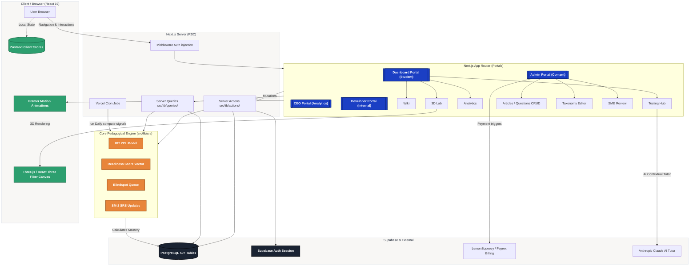

# SlateCamp Architecture Overview

This document contains a comprehensive Mermaid diagram outlining the high-level architecture, portals, major components, state management, and pedagogical engine of the SlateCamp platform.

## High-Level Architecture Diagram

---

### Legend
1. **Blue (Portals):** The four main applications served by Next.js App Router.
2. **Orange (Pedagogical Engine):** The mathematical / algorithmic core that drives user progression, mastery calculations, and spaced repetition. Includes the Item Response Theory (IRT) model.
3. **Green (Client Technologies):** Specific client-side global state management and complex React ecosystem components handling 3D and rich motion.
4. **Dark (Database/Auth Layer):** Managed by Supabase. Connects seamlessly with the Next.js `middleware.ts` for route protection and RLS configuration.
