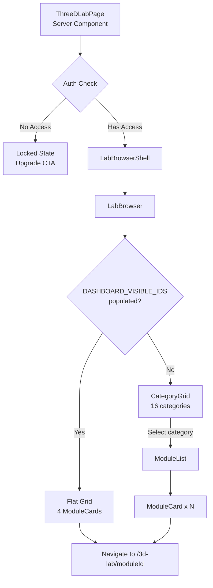
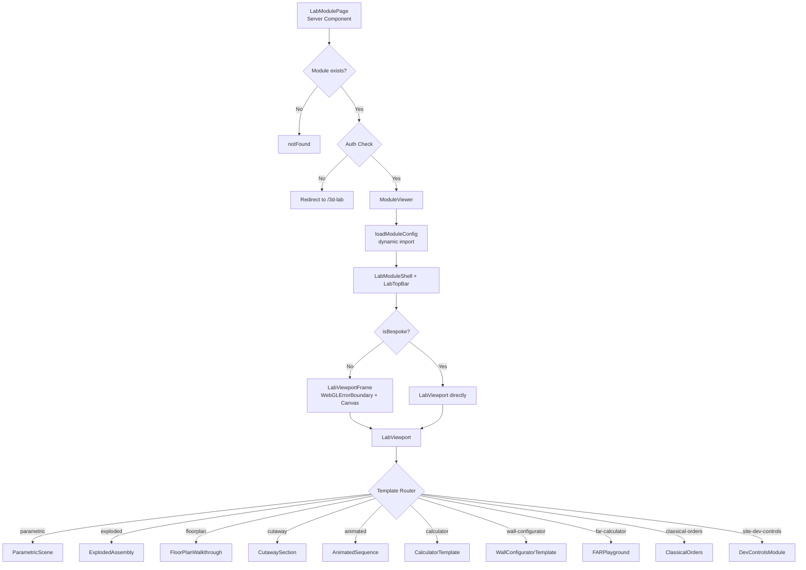
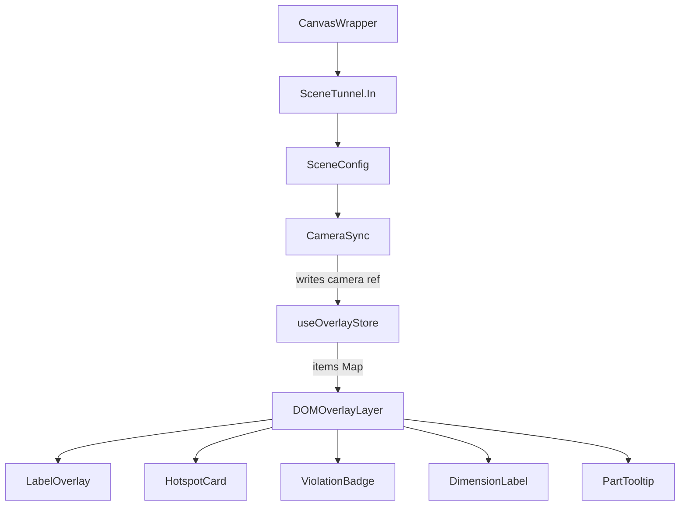
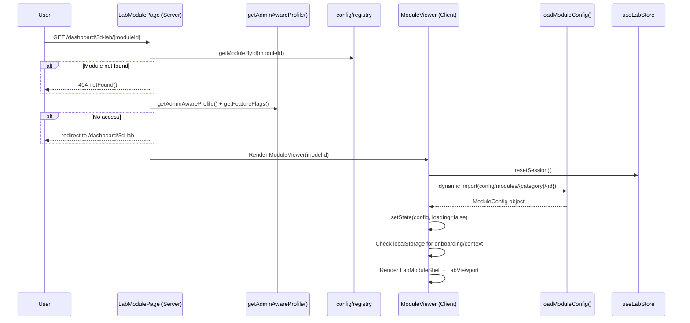

# 3D Lab Feature Specification Plan

## 00. Plan Metadata

| Field | Value |
|-------|-------|
| Date | 2026-04-08 |
| Version | 1.0 |
| Author | Codebase Audit (automated) |
| Target Spec File | `.ai/docs/01-product/008-3d-lab.md` |
| Scope | Audit only -- no source code modifications |
| Total Modules | **209** (across 16 active categories + 2 empty placeholders) |
| Active on Dashboard | **4** (`site-development-controls`, `stairway-configurator`, `calculator-flooring`, `unified-wall-configurator`) |
| Inactive (hidden) | **205** (accessible only via admin or full category drill-down when `DASHBOARD_VISIBLE_IDS` is cleared) |
| Template Types | 7 (`parametric`, `exploded`, `floorplan`, `cutaway`, `animated`, `calculator`, `wall-configurator`) |
| Categories | 16 active, 2 empty placeholders (cat-17: Specialized Concrete, cat-18: Topography & Landscape) |
| Module Status Breakdown | 205 `ready`, 4 `built` (the 4 calculator modules) |

---

## 01. State Audit Summary

| Check | Result |
|-------|--------|
| Previous task conflict | None -- previous task marked COMPLETE |
| Existing spec (008-3d-lab.md) | v2.0, 19 sections -- needs codebase-level verification |
| Git branch | `main` -- clean except `next.config.ts` modification |
| Files read | 141+ files across `src/features/3d-lab/`, `src/app/dashboard/3d-lab/`, `src/components/r3f/`, `src/components/3d/`, `src/types/`, `supabase/` |
| Decision | **GO** -- no conflicts, full traversal complete |

---

## 02. Route & File Tree

### `src/app/dashboard/3d-lab/`

```
src/app/dashboard/3d-lab/
  .chunkhound/                    # ChunkHound analysis artifacts
  .chunkhound.json
  [moduleId]/
    page.tsx                      # Server Component -- module detail page
  3D_LAB_ARCHITECTURE.md          # Local architecture notes
  3D_LAB_MODULE_CATALOG.md        # Module catalog reference doc
  AGENTS.md                       # Agent instructions for this route
  error.tsx                       # Error boundary
  layout.tsx                      # Dashboard layout wrapper
  loading.tsx                     # Loading skeleton
  page.tsx                        # Server Component -- lab browser page
```

### `src/features/3d-lab/`

```
src/features/3d-lab/
  AGENTS.md
  _config/
    taxonomy.ts                   # Re-export of config/taxonomy.ts
  _constants/
    nbcp.ts                       # NBCP constants
  _stores/
    createModuleStore.ts          # Re-export of stores/createModuleStore.ts
    labStore.ts                   # Re-export of stores/legacyLabStore.ts
    nbcpStore.ts                  # Re-export of stores/nbcpStore.ts
    useWallLabStore.ts            # Re-export of stores/useWallLabStore.ts
  _types/
    templates.ts                  # Re-export of types/templates.ts
  components/
    index.ts                      # Barrel exports (20 components)
    CanvasWrapper.tsx              # R3F canvas wrapper with SceneTunnel
    CategoryGrid.tsx              # Category selection grid (16 LEA-aligned)
    CategoryGrid.stories.tsx
    GlobalCanvasPortal.tsx        # tunnel-rat SceneTunnel singleton
    InfoPanel.tsx                 # Hotspot info panel
    LabBrowser.tsx                # Gallery drill-down orchestrator
    LabBrowser.stories.tsx
    LabTopBar.tsx                 # Module top bar with back nav
    LabViewport.tsx               # Template router / scene switcher
    ModuleCard.tsx                # Gallery card component
    ModuleCard.stories.tsx
    ModuleContextCard.tsx         # Context scenario card overlay
    ModuleList.tsx                # Module list within a category
    ModuleViewer.tsx              # Module detail page client component
    OnboardingFlow.tsx            # First-time user onboarding
    _stores/
      labStore.ts                 # Re-export -> stores/legacyLabStore
      useWallLabStore.ts          # Re-export -> stores/useWallLabStore
    overlays/
      CameraSync.tsx              # Syncs R3F camera -> overlay store
      DimensionLabel.tsx          # DOM overlay for dimension values
      DOMOverlayLayer.tsx         # 2D DOM overlay system (replaces in-canvas Html)
      HotspotCard.tsx             # DOM hotspot card
      LabelOverlay.tsx            # Text label overlay
      PartTooltip.tsx             # Part tooltip for exploded views
      ViolationBadge.tsx          # Violation indicator badge
    rendering/
      AssetPreloader.tsx          # Preloads GLB/texture assets
      GroundPlane.tsx             # Ground plane mesh
      SceneBase.tsx               # Sky, fog, tone mapping, ground
      SceneConfig.tsx             # Camera, controls, lighting config
      StudioLighting.tsx          # 4-preset lighting rig
    shell/
      LabBrowserShell.tsx         # Browser page shell/layout
      LabEmptyState.tsx           # Empty state component
      LabMetaPanel.tsx            # Metadata side panel
      LabModuleShell.tsx          # Module detail shell/layout
      LabOverlayLayer.tsx         # Overlay container
      LabViewportFrame.tsx        # Viewport frame with R3F Canvas
    templates/
      ArchMass.tsx                # Architectural massing helper
      CalculatorLighting.tsx      # (deprecated) Calculator lighting
      ComplianceReportPanel.tsx   # Compliance report UI
      ControlPanel.tsx            # Parametric control panel
      FocusModeToggle.tsx         # Focus mode toggle
      GenericControlPanel.tsx     # Generic parameter controls
      GeometryMesh.tsx            # Declarative geometry renderer
      HotspotAnnotation.tsx       # R3F hotspot annotation
      HotspotQuestion.tsx         # Quiz question hotspot
      HumanSilhouette.tsx         # 1.7m human scale reference
      InfoPanel.tsx               # Template info panel
      LabPanelLayout.tsx          # Panel layout wrapper
      LabViewport.tsx             # Template viewport wrapper
      ModuleViewer.tsx            # Template module viewer
      PostModuleCTA.tsx           # Post-module call-to-action
      SceneEmptyState.tsx         # Scene-level empty state
      SceneErrorBoundary.tsx      # Scene-level error boundary
      ViolationIndicator.tsx      # Violation indicator mesh
      Library/
        CategoryGrid.tsx          # Template library category grid
        LabBrowser.tsx            # Template library browser
        ModuleCard.tsx            # Template library module card
        ModuleList.tsx            # Template library module list
      WallConfigurator/
        AreaSummaryBar.tsx        # Wall area summary
        BOMPanel.tsx              # Bill of materials panel
        ConfigPanel.tsx           # Wall config panel
        SponsorPalette.tsx        # Sponsor paint color palette
        steps/
          ColorSponsorStep.tsx    # Step 5: Color & sponsor selection
          CoreTypeStep.tsx        # Step 1: Core type selection
          FinishTypeStep.tsx      # Step 4: Finish type
          GeometryStep.tsx        # Step 2: Wall geometry
          TreatmentStep.tsx       # Step 3: Treatment/lason
  config/
    camera-presets.ts             # 5 named camera presets
    dashboard-visibility.ts       # DASHBOARD_VISIBLE_IDS (4 modules)
    taxonomy.ts                   # 16-category LEA-aligned taxonomy
    constants/
      bp-344.ts                   # BP 344 Accessibility constants
      index.ts                    # Constants barrel export
      nscp.ts                     # NSCP structural constants
      pd-1096.ts                  # PD 1096 building code constants
      ra-9514.ts                  # RA 9514 fire code constants
    modules/
      01-building-code/           # 30 module configs
      02-accessibility/           # 14 module configs
      03-fire-code/               # 22 module configs
      04-structural/              # 17 module configs
      05-plumbing/                # 14 module configs
      06-electrical/              # 10 module configs
      07-mechanical/              #  6 module configs
      08-vertical/                #  4 module configs
      09-construction/            # 14 module configs
      10-materials/               # 14 module configs
      11-arch-history/            # 22 module configs
      12-ph-heritage/             # 10 module configs
      13-planning/                # 18 module configs
      14-prof-practice/           #  4 module configs
      15-estimating/              #  6 module configs
      16-site-dev/                #  4 module configs
    registry/
      index.ts                    # ALL_MODULES aggregator + helpers
      cat-01.ts through cat-18.ts # Per-category registry entries
  constants/
    nbcp.test.ts                  # NBCP calculator tests
    nbcp.ts                       # NBCP constants
    scene-colors.ts               # Scene color palette
  DevControlsModule/              # Bespoke site-development-controls module
    index.tsx                     # Entry point
    canvas/
      annotations/DimensionLines.tsx
      constants.ts
      cursor.ts
      DevControlsCanvas.tsx
      InvalidateBridge.tsx
      materials.ts
      SceneLighting.tsx
      layers/
        DevControlsLayers.tsx
        FirewallMarkers.tsx
        LotGround.tsx
        RROWIndicator.tsx
      context/                    # (directory exists)
    dashboard/
      AMBFThreeWayPanel.tsx
      BhlPanel.tsx
      BottomSheet.tsx
      CameraPresetBar.tsx
      ClosureEquationStrip.tsx
      CollapsibleSection.tsx
      CompactScorecardGrid.tsx
      ComplianceScorecard.tsx
      ComplianceSummary.tsx
      DevControlsDashboard.tsx
      DevControlsLabV2.tsx
      FirewallPanel.tsx
      FlarPanel.tsx
      InputPanel.tsx
      KpiBar.tsx
      KpiChip.tsx
      LayersOverlay.tsx
      LayerToggles.tsx
      LotInputPanel.tsx
      MobileSheetContent.tsx
      OutputPanel.tsx
      PanelResizer.tsx
      PresetSelector.tsx
      ProposedBuildingPanel.tsx
      SetbackInfoPanel.tsx
      StatusBar.tsx
      ViewportToolbar.tsx
      ViewportWrapper.tsx
      ViolationBanner.tsx
      ZoneLegend.tsx
      ZoningInputPanel.tsx
      TourOverlay.tsx
      splits/
        BhlControls.tsx
        BhlInfo.tsx
        FlarControls.tsx
        FlarInfo.tsx
        LotControls.tsx
        LotSummary.tsx
        ZoneSelector.tsx
        ZoneTableRef.tsx
      tabs/
        SettingsTab.tsx
    hooks/
      useKeyboardShortcuts.ts
      usePanelState.ts
    stores/
      useDevControlsStore.ts
      useSelectionStore.ts
  hooks/
    useAnimationComplete.ts       # useFrame with completion detection
    useInvalidateOnChange.ts      # Registers store invalidate bridge
    useModuleInvalidate.ts        # Module-specific invalidation
    useModuleLifecycle.ts         # Store reset on unmount
    useNBCPInvalidateOnChange.ts  # NBCP-specific invalidation
    useWorldToScreen.ts           # World -> screen projection
  scenes/
    ClassicalOrders/
      ClassicalOrders.tsx         # Legacy bespoke scene
      ClassicalOrdersScene.tsx
      index.ts
    FARPlayground/
      FARPlayground.tsx           # Legacy bespoke scene
      FARScene.tsx
      index.ts
    NBCPEnvelope/
      index.ts
      NBCPControlPanel.tsx
      NBCPEnvelope.tsx            # Legacy bespoke scene
      NBCPScene.tsx
      NBCPTelemetry.tsx
  stores/
    createModuleStore.ts          # Factory: per-module Zustand store
    legacyLabStore.ts             # Legacy parametric + hotspot store
    nbcpStore.ts                  # NBCP-specific store
    useLabNavigationStore.ts      # Navigation (sequence, explore mode)
    useLabProgressStore.ts        # Progress (visited, quiz, compliance)
    useLabStore.ts                # Combined facade over 3 focused stores
    useLabViewStore.ts            # View UI (panel, hotspot, toggles)
    useOverlayStore.ts            # DOM overlay item management
    useWallLabStore.ts            # Wall configurator wizard state
  templates/
    AnimatedSequence.tsx          # Animated sequence template
    AnimatedSequenceScene.tsx     # R3F scene for animated sequences
    CalculatorTemplate.tsx        # Calculator template (flooring/paint/drywall/chb)
    CutawaySection.tsx            # Cutaway section template
    CutawaySectionScene.tsx       # R3F scene for cutaway sections
    ExplodedAssembly.tsx          # Exploded assembly template
    ExplodedAssemblyScene.tsx     # R3F scene for exploded views
    FloorPlanScene.tsx            # R3F scene for floor plans
    FloorPlanWalkthrough.tsx      # Floor plan walkthrough template
    ParametricScene.tsx           # Parametric scene template
    ParametricSceneRenderer.tsx   # R3F renderer for parametric scenes
    WallConfiguratorRenderer.tsx  # R3F renderer for wall configurator
    WallConfiguratorTemplate.tsx  # Wall configurator template
  types/
    templates.ts                  # Core type system (ModuleConfig, registry types)
  utils/
    nbcpCalculator.ts             # NBCP FAR/BHL calculator
    nbcpCalculator.test.ts        # Calculator tests
    registryLoader.ts             # Dynamic registry import loader
```

### `src/components/r3f/`

```
src/components/r3f/
  AGENTS.md
  CanvasLoadingOverlay.tsx        # Loading overlay for Canvas
  GeometrySwitch.tsx              # Geometry type switcher
  index.ts                        # Barrel exports
  LoadingProgress.tsx             # Loading progress indicator
  SceneInvalidator.tsx            # Scene invalidation helper
  useDisposeOnUnmount.ts          # WebGL resource disposal hook
  useRegisterInvalidate.ts        # Register invalidate callback
  useWebGLMemoryMonitor.ts        # WebGL memory monitoring
  WebGLErrorBoundary.tsx          # Error boundary for WebGL context
```

### `src/components/3d/`

```
src/components/3d/
  Workspace.tsx                   # Legacy GLTF model viewer (~500 lines)
```

---

## 03. Component Inventory

### Core Components

| Component | File Path | Type | Parent | Responsibility |
|-----------|-----------|------|--------|----------------|
| `ThreeDLabPage` | `src/app/dashboard/3d-lab/page.tsx` | Server | Dashboard layout | Auth gate, tier check, renders LabBrowser |
| `LabModulePage` | `src/app/dashboard/3d-lab/[moduleId]/page.tsx` | Server | Dashboard layout | Auth gate, module validation, renders ModuleViewer |
| `LabBrowser` | `src/features/3d-lab/components/LabBrowser.tsx` | Client | ThreeDLabPage | Gallery orchestrator -- simplified or drill-down mode |
| `CategoryGrid` | `src/features/3d-lab/components/CategoryGrid.tsx` | Client | LabBrowser | 16-category selection grid |
| `ModuleList` | `src/features/3d-lab/components/ModuleList.tsx` | Client | LabBrowser | Module list within a category |
| `ModuleCard` | `src/features/3d-lab/components/ModuleCard.tsx` | Client | LabBrowser / ModuleList | Gallery card with template type badge |
| `ModuleViewer` | `src/features/3d-lab/components/ModuleViewer.tsx` | Client | LabModulePage | Module loader + session manager |
| `LabViewport` | `src/features/3d-lab/components/LabViewport.tsx` | Client | ModuleViewer | Template router -- dispatches to correct scene |
| `CanvasWrapper` | `src/features/3d-lab/components/CanvasWrapper.tsx` | Client | Templates | R3F Canvas wrapper with SceneTunnel |
| `GlobalCanvasPortal` | `src/features/3d-lab/components/GlobalCanvasPortal.tsx` | Client | CanvasWrapper | tunnel-rat SceneTunnel singleton |
| `SceneConfig` | `src/features/3d-lab/components/rendering/SceneConfig.tsx` | Client | CanvasWrapper | Camera, controls, lighting, environment |
| `SceneBase` | `src/features/3d-lab/components/rendering/SceneBase.tsx` | Client | SceneConfig | Sky color, fog, tone mapping, ground plane |
| `StudioLighting` | `src/features/3d-lab/components/rendering/StudioLighting.tsx` | Client | SceneConfig | 4-preset lighting rig |
| `DOMOverlayLayer` | `src/features/3d-lab/components/overlays/DOMOverlayLayer.tsx` | Client | LabModuleShell | 2D DOM overlay projection system |
| `CameraSync` | `src/features/3d-lab/components/overlays/CameraSync.tsx` | Client | CanvasWrapper | Syncs R3F camera to overlay store |
| `WebGLErrorBoundary` | `src/components/r3f/WebGLErrorBoundary.tsx` | Client (class) | LabViewportFrame | Catches render errors + WebGL context loss |
| `LabBrowserShell` | `src/features/3d-lab/components/shell/LabBrowserShell.tsx` | Client | ThreeDLabPage | Browser page layout wrapper |
| `LabModuleShell` | `src/features/3d-lab/components/shell/LabModuleShell.tsx` | Client | ModuleViewer | Module detail layout with top bar |
| `LabViewportFrame` | `src/features/3d-lab/components/shell/LabViewportFrame.tsx` | Client | ModuleViewer | R3F Canvas host with WebGLErrorBoundary |
| `LabTopBar` | `src/features/3d-lab/components/LabTopBar.tsx` | Client | LabModuleShell | Navigation bar with back button |
| `OnboardingFlow` | `src/features/3d-lab/components/OnboardingFlow.tsx` | Client | ModuleViewer | First-time user tutorial overlay |
| `ModuleContextCard` | `src/features/3d-lab/components/ModuleContextCard.tsx` | Client | ModuleViewer | Professional scenario context card |
| `Workspace` | `src/components/3d/Workspace.tsx` | Client | LabViewport | Legacy GLTF viewer (fallback) |

### Template Components

| Template | File Path | Config Type | Responsibility |
|----------|-----------|-------------|----------------|
| `ParametricScene` | `src/features/3d-lab/templates/ParametricScene.tsx` | `ParametricSceneConfig` | Slider-driven parametric 3D models |
| `ExplodedAssembly` | `src/features/3d-lab/templates/ExplodedAssembly.tsx` | `ExplodedAssemblyConfig` | Exploded view with labeled parts |
| `FloorPlanWalkthrough` | `src/features/3d-lab/templates/FloorPlanWalkthrough.tsx` | `FloorPlanConfig` | 2D/3D floor plan with rooms, paths, fixtures |
| `CutawaySection` | `src/features/3d-lab/templates/CutawaySection.tsx` | `CutawaySectionConfig` | Layer-by-layer section cut |
| `AnimatedSequence` | `src/features/3d-lab/templates/AnimatedSequence.tsx` | `AnimatedSequenceConfig` | Step-by-step animated construction |
| `CalculatorTemplate` | `src/features/3d-lab/templates/CalculatorTemplate.tsx` | `CalculatorConfig` | Estimating calculator (flooring/paint/drywall/chb) |
| `WallConfiguratorTemplate` | `src/features/3d-lab/templates/WallConfiguratorTemplate.tsx` | `ParametricSceneConfig` | 5-step wall assembly configurator |

### Bespoke Scenes (Legacy)

| Scene | File Path | Description |
|-------|-----------|-------------|
| `FARPlayground` | `src/features/3d-lab/scenes/FARPlayground/` | FAR calculator playground |
| `ClassicalOrders` | `src/features/3d-lab/scenes/ClassicalOrders/` | Classical orders comparison |
| `NBCPEnvelope` | `src/features/3d-lab/scenes/NBCPEnvelope/` | NBCP building envelope |
| `DevControlsModule` | `src/features/3d-lab/DevControlsModule/` | Site development controls (55+ files, most complex module) |

---

## 04. Component Tree Diagram

### (a) Module Gallery / Selector



### (b) 3D Scene Viewer



### (c) Overlay / HUD System



---

## 05. State Architecture

### Store 1: `useLabNavigationStore`
**File:** `src/features/3d-lab/stores/useLabNavigationStore.ts`

```typescript
interface LabNavigationState {
  currentSequenceIndex: number       // Current step in guided mode
  exploreMode: ExploreMode           // 'guided' | 'free'
  guidedSequenceComplete: boolean    // Whether guided sequence is done

  advanceSequence: () => void
  setExploreMode: (mode: ExploreMode) => void
  setGuidedSequenceComplete: (complete: boolean) => void
  resetNavigation: () => void
}
```

### Store 2: `useLabProgressStore`
**File:** `src/features/3d-lab/stores/useLabProgressStore.ts`

```typescript
interface LabProgressState {
  visitedHotspotIds: Set<string>
  answeredQuestionIds: Set<string>
  correctQuestionIds: Set<string>
  parametricValues: Record<string, number>
  complianceState: ComplianceState   // 'compliant' | 'at-limit' | 'violation'
  quizResults: QuizResult[]

  markHotspotVisited: (id: string) => void
  addQuizResult: (result: QuizResult) => void
  setParametricValue: (controlId: string, value: number) => void
  setComplianceState: (state: ComplianceState) => void
  resetProgress: () => void
}
```

### Store 3: `useLabViewStore`
**File:** `src/features/3d-lab/stores/useLabViewStore.ts`

```typescript
interface LabViewState {
  activeHotspotId: string | null
  panelMode: PanelMode               // 'none' | 'info' | 'question' | 'quiz'
  questionAnswered: boolean
  selectedOptionId: string | null
  crossSectionEnabled: boolean
  explodedViewEnabled: boolean
  quizModeActive: boolean

  openHotspot: (id: string) => void
  closePanel: (markVisited?: boolean) => void
  openQuestion: () => void
  selectOption: (optionId: string) => void
  toggleCrossSection: () => void
  toggleExplodedView: () => void
  enterQuizMode: () => void
  exitQuizMode: () => void
  resetCamera: () => void
  resetView: () => void
}
```

### Store 4: `useLabStore` (Combined Facade)
**File:** `src/features/3d-lab/stores/useLabStore.ts`

Combined selector hook merging all 3 focused stores into the original `useLabStore` API. Provides `resetSession()` which calls `resetView()`, `resetProgress()`, and `resetNavigation()`. Also has static `setState` and `getState` methods for legacy compatibility.

### Store 5: `legacyLabStore`
**File:** `src/features/3d-lab/stores/legacyLabStore.ts`

```typescript
interface LabState {
  lotArea: number                    // Default: 500
  far: number                       // Default: 2.5
  bhl: number                       // Default: 15
  setbackFront: number              // Default: 3
  setbackSide: number               // Default: 2
  activeHotspotId: string | null
  isQuizMode: boolean
  quizTargetPartId: string | null
  invalidateFn: (() => void) | null

  setParam: (key: ParametricKey, val: number) => void
  setActiveHotspot: (id: string | null) => void
  setQuizMode: (active: boolean, targetId?: string) => void
  setInvalidateFn: (fn: (() => void) | null) => void
  resetParametric: () => void
}
```

### Store 6: `useOverlayStore`
**File:** `src/features/3d-lab/stores/useOverlayStore.ts`

```typescript
interface OverlayStore {
  items: Map<string, OverlayItem>    // All overlay items by ID
  cameraRef: THREE.Camera | null     // R3F camera reference

  upsertItem: (item: OverlayItem) => void
  removeItem: (id: string) => void
  clearAll: () => void
  setCameraRef: (camera: THREE.Camera | null) => void
  openHotspot: (id: string) => void
  closeHotspot: (id: string) => void
  closeAllHotspots: () => void
}
```

Overlay item types: `label`, `hotspot`, `violation`, `dimension`, `area-tag`.

### Store 7: `useWallLabStore`
**File:** `src/features/3d-lab/stores/useWallLabStore.ts`

```typescript
interface WallLabState {
  step: WizardStep                   // 1-5
  completedSteps: Set<number>
  coreType: CoreType                 // 'chb' | 'drywall' | 'plywood' | 'cement-board' | 'brick' | 'solid-concrete' | 'existing-wall'
  coreThicknessMM: number
  coreMoistureResistant: boolean
  lengthM: number                    // Default: 5
  heightM: number                    // Default: 3
  sides: SideCount                   // 1 | 2
  layers: Layer[]
  lason: LasonConfig
  finishType: FinishType
  tileConfig: TileConfig
  tilePattern: string
  selectedColorHex: string
  selectedColorName: string
  activeSponsorId: string | null     // 'boysen' | 'davies' | 'island'
  topcoatCoats: number
  paintCoverageSqmPerL: number
  invalidateFn: (() => void) | null
  // ... 15+ action methods
}
```

### Store 8: `createModuleStore` (Factory)
**File:** `src/features/3d-lab/stores/createModuleStore.ts`

```typescript
interface ModuleStoreState {
  params: Record<string, number | boolean | string>
  activeAnnotation: string | null
  invalidateFn: (() => void) | null
  resetOnUnmount: boolean

  setParam: (key: string, value: number | boolean | string) => void
  setParams: (patch: Record<string, number | boolean | string>) => void
  setActiveAnnotation: (id: string | null) => void
  setInvalidateFn: (fn: (() => void) | null) => void
  reset: () => void
}
```

Factory function `createModuleStore(defaults, options)` produces per-module Zustand stores with parameter management and optional unmount reset.

### Store 9: `useDevControlsStore`
**File:** `src/features/3d-lab/DevControlsModule/stores/useDevControlsStore.ts`

Used by the bespoke Site Development Controls module. (Not read in detail -- separate module-specific store.)

### Store 10: `useSelectionStore`
**File:** `src/features/3d-lab/DevControlsModule/stores/useSelectionStore.ts`

Selection state for DevControls module. (Not read in detail.)

---

## 06. Data Flow & API Map

### Module Load Flow



### API / Action Routes

The 3D Lab currently has **no dedicated API routes**. All data flows through:

1. **Static config files** -- Module configs are TypeScript files dynamically imported at runtime
2. **Supabase queries** -- Auth via `getAdminAwareProfile()`, feature flags via `getFeatureFlags()`
3. **Client-side stores** -- All interaction state is client-only (Zustand)
4. **Telemetry** -- `useLabTelemetry({ moduleSlug })` hook (fires analytics events)

### Tables Touched

| Table | Operation | Trigger |
|-------|-----------|---------|
| `profiles` | SELECT | Auth check on page load |
| `feature_flags` | SELECT | Feature gate check |
| `models_3d` | Not actively queried | Legacy table -- module data now in TypeScript config |

---

## 07. Database Schema

### `models_3d` Table

The `CREATE TABLE` statement was not found in migrations (likely in initial schema). Inferred columns from migration files:

```sql
-- Inferred from migrations 004, 006, 007, 012, 20260324, 20260408

CREATE TABLE public.models_3d (
  model_id    UUID PRIMARY KEY DEFAULT gen_random_uuid(),
  name        TEXT,
  slug        TEXT,
  url         TEXT,
  -- Added in 006_add_3d_asset_status.sql:
  status      VARCHAR(20) DEFAULT 'draft'
              CHECK (status IN ('draft', 'pending_review', 'published', 'archived')),
  metadata    JSONB DEFAULT '{}'::jsonb,
  reviewed_by UUID REFERENCES auth.users(id),
  reviewed_at TIMESTAMPTZ,
  -- Added in 20260324:
  created_by  UUID REFERENCES auth.users(id),
  updated_by  UUID REFERENCES auth.users(id),
  -- Renamed in 20260408 (ALE -> LEA):
  lea_question_count INTEGER,   -- was ale_question_count
  lea_question_type  TEXT,      -- was ale_question_type
  created_at  TIMESTAMPTZ DEFAULT now(),
  updated_at  TIMESTAMPTZ DEFAULT now()
);

-- Indexes
CREATE INDEX idx_models_3d_status ON models_3d(status);

-- RLS (from 004)
CREATE POLICY "Admins can manage models_3d"
  ON public.models_3d
  -- admin-only access

-- Audit trigger (from 007)
CREATE TRIGGER audit_models_3d
  AFTER INSERT OR UPDATE OR DELETE ON public.models_3d
  -- fires audit log

-- Referenced by (from 012)
-- camp_trail_nodes.model_id -> models_3d.model_id ON DELETE SET NULL
```

**Current status:** The `models_3d` table is a legacy artifact. Module data has been migrated to TypeScript config files in `src/features/3d-lab/config/modules/`. The table still exists and has RLS policies but is not actively queried by the 3D Lab frontend.

---

## 08. Hook & Utility Inventory

### Hooks (src/features/3d-lab/hooks/)

| Hook | File | Signature | Description |
|------|------|-----------|-------------|
| `useAnimationComplete` | `hooks/useAnimationComplete.ts` | `(callback, isComplete) => { reset }` | Wraps useFrame with completion detection for demand frameloop |
| `useInvalidateOnChange` | `hooks/useInvalidateOnChange.ts` | `() => void` | Registers R3F invalidate callback into store |
| `useModuleInvalidate` | `hooks/useModuleInvalidate.ts` | `() => void` | Module-specific invalidation bridge |
| `useModuleLifecycle` | `hooks/useModuleLifecycle.ts` | `(useStore, resetOnUnmount?) => void` | Calls store.reset() on unmount when resetOnUnmount is true |
| `useNBCPInvalidateOnChange` | `hooks/useNBCPInvalidateOnChange.ts` | `() => void` | NBCP-specific invalidation bridge |
| `useWorldToScreen` | `hooks/useWorldToScreen.ts` | `() => (worldPos, w, h) => ScreenPosition` | Projects THREE.Vector3 to screen coordinates with margin check |

### Hooks (src/components/r3f/)

| Hook | File | Signature | Description |
|------|------|-----------|-------------|
| `useDisposeOnUnmount` | `r3f/useDisposeOnUnmount.ts` | `() => void` | Disposes WebGL resources on component unmount |
| `useRegisterInvalidate` | `r3f/useRegisterInvalidate.ts` | `() => void` | Registers invalidate for demand frameloop |
| `useWebGLMemoryMonitor` | `r3f/useWebGLMemoryMonitor.ts` | `() => void` | Monitors WebGL memory usage |

### Hooks (src/features/3d-lab/DevControlsModule/hooks/)

| Hook | File | Signature | Description |
|------|------|-----------|-------------|
| `useKeyboardShortcuts` | `DevControlsModule/hooks/useKeyboardShortcuts.ts` | `() => void` | Keyboard shortcuts for DevControls |
| `usePanelState` | `DevControlsModule/hooks/usePanelState.ts` | `() => PanelState` | Panel collapse/expand state |

### Utilities

| Utility | File | Description |
|---------|------|-------------|
| `nbcpCalculator` | `utils/nbcpCalculator.ts` | NBCP FAR/BHL computation engine |
| `registryLoader` | `utils/registryLoader.ts` | Dynamic category-scoped registry import with caching |

---

## 09. 3D Module Complete Catalogue

### Visibility Mechanism

The `DASHBOARD_VISIBLE_IDS` constant in `src/features/3d-lab/config/dashboard-visibility.ts` is a `ReadonlySet<string>` controlling which modules appear on the public `/dashboard/3d-lab` route.

- When populated (current state: 4 modules), `LabBrowser` renders a simplified flat grid showing only allowlisted modules
- When empty, `LabBrowser` falls back to full 16-category drill-down (all 209 modules visible)
- All modules remain accessible via admin routes regardless of this setting

**Currently active IDs:** `site-development-controls`, `stairway-configurator`, `calculator-flooring`, `unified-wall-configurator`

### Summary Counts

| Category | ID | Module Count | Phase | LEA Subject |
|----------|----|-------------|-------|-------------|
| BUILDING_CODE | 01 | 30 | 1 | Building Laws & Codes |
| ACCESSIBILITY | 02 | 14 | 1 | Building Laws & Codes |
| FIRE_CODE | 03 | 22 | 1 | Building Laws & Codes |
| STRUCTURAL | 04 | 17 | 1 | Structural Engineering |
| PLUMBING | 05 | 14 | 1 | Building Utilities |
| ELECTRICAL | 06 | 10 | 2 | Building Utilities |
| MECHANICAL | 07 | 6 | 2 | Building Utilities |
| VERTICAL | 08 | 4 | 2 | Building Utilities |
| CONSTRUCTION | 09 | 14 | 2 | Building Materials & Construction |
| MATERIALS | 10 | 14 | 2 | Building Materials & Construction |
| ARCH_HISTORY | 11 | 22 | 1 | Architecture |
| PH_HERITAGE | 12 | 10 | 1 | Architecture |
| PLANNING | 13 | 18 | 2 | Urban Planning & Housing |
| PROF_PRACTICE | 14 | 4 | 3 | Professional Practice & Specs |
| ESTIMATING | 15 | 6 | 3 | Professional Practice & Specs |
| SITE_DEV | 16 | 4 | 3 | Building Laws & Codes |
| (Specialized Concrete) | 17 | 0 | -- | (placeholder) |
| (Topography & Landscape) | 18 | 0 | -- | (placeholder) |
| **TOTAL** | | **209** | | |

### Template Type Distribution

| Template Type | Count |
|---------------|-------|
| `parametric` | ~100 |
| `cutaway` | ~40 |
| `exploded` | ~30 |
| `floorplan` | ~25 |
| `animated` | ~12 |
| `calculator` | 4 |
| `wall-configurator` | 1 |

### Status Distribution

| Status | Count |
|--------|-------|
| `ready` | 205 |
| `built` | 4 (calculator-flooring, calculator-paint, calculator-drywall, calculator-chb) |
| `planned` | 0 |

### Complete Module Catalogue

#### Category 01: PD 1096 -- National Building Code (30 modules)

| # | Module ID | Template | Status | Phase | Notes |
|---|-----------|----------|--------|-------|-------|
| 1 | `attic-requirements` | parametric | ready | 1 | |
| 2 | `balcony-guardrail` | parametric | ready | 1 | |
| 3 | `batch-compliance-verifier` | parametric | ready | 3 | Wave 4 addition |
| 4 | `building-height-limits` | parametric | ready | 1 | |
| 5 | `ceiling-height-configurator` | parametric | ready | 1 | |
| 6 | `corridor-width-calculator` | parametric | ready | 1 | |
| 7 | `court-requirements` | parametric | ready | 1 | |
| 8 | `daylighting-room-depth` | parametric | ready | 3 | |
| 9 | `development-controls-pso` | parametric | ready | 1 | |
| 10 | `exit-door-mechanics` | animated | ready | 1 | |
| 11 | `exit-width-calculator` | parametric | ready | 1 | |
| 12 | `garage-ventilation` | parametric | ready | 1 | |
| 13 | `light-ventilation-openings` | parametric | ready | 1 | |
| 14 | `lot-area-calculator` | parametric | ready | 3 | |
| 15 | `mezzanine-clearances` | cutaway | ready | 1 | |
| 16 | `mixed-occupancy-separator` | cutaway | ready | 1 | |
| 17 | `mounting-heights` | parametric | ready | 1 | |
| 18 | `natural-ventilation-rules` | parametric | ready | 1 | |
| 19 | `nbcp-envelope` | parametric | ready | 1 | |
| 20 | `occupancy-classification` | parametric | ready | 1 | |
| 21 | `occupant-load-calculator` | floorplan | ready | 1 | |
| 22 | `open-space-requirements` | parametric | ready | 1 | |
| 23 | `ramp-gradient-building` | parametric | ready | 1 | |
| 24 | `room-size-minimums` | parametric | ready | 1 | |
| 25 | `saleable-area-ratio` | parametric | ready | 2 | |
| 26 | `shading-device-design` | parametric | ready | 3 | |
| 27 | `site-development-controls` | parametric | ready | 1 | DASHBOARD ACTIVE |
| 28 | `skylight-requirements` | parametric | ready | 1 | |
| 29 | `usa-botanist-calculator` | parametric | ready | 3 | |
| 30 | `vent-shaft-dimensions` | parametric | ready | 1 | |

#### Category 02: BP 344 -- Accessibility Law (14 modules)

| # | Module ID | Template | Status | Phase |
|---|-----------|----------|--------|-------|
| 1 | `accessible-bathing` | cutaway | ready | 1 |
| 2 | `accessible-corridor-widths` | parametric | ready | 1 |
| 3 | `accessible-counter-heights` | parametric | ready | 1 |
| 4 | `accessible-door-clearances` | parametric | ready | 1 |
| 5 | `accessible-elevator-cab` | parametric | ready | 1 |
| 6 | `accessible-parking` | floorplan | ready | 1 |
| 7 | `accessible-signage` | parametric | ready | 1 |
| 8 | `accessible-stair-handrails` | parametric | ready | 1 |
| 9 | `accessible-toilet-detailed` | cutaway | ready | 1 |
| 10 | `ramp-accessible-toilet` | parametric | ready | 1 |
| 11 | `ramp-tactile-warnings` | parametric | ready | 1 |
| 12 | `reach-range-sphere` | parametric | ready | 1 |
| 13 | `tactile-block-types` | exploded | ready | 1 |
| 14 | `wheelchair-maneuvering` | parametric | ready | 1 |

#### Category 03: RA 9514 -- Fire Code & Life Safety (22 modules)

| # | Module ID | Template | Status | Phase |
|---|-----------|----------|--------|-------|
| 1 | `construction-types-comparison` | exploded | ready | 1 |
| 2 | `egress-simulation` | animated | ready | 1 |
| 3 | `emergency-lighting-layout` | floorplan | ready | 1 |
| 4 | `fire-alarm-system` | floorplan | ready | 1 |
| 5 | `fire-detection-layout` | floorplan | ready | 1 |
| 6 | `fire-door-ratings` | cutaway | ready | 1 |
| 7 | `fire-exit-layout` | floorplan | ready | 1 |
| 8 | `fire-extinguisher-placement` | floorplan | ready | 1 |
| 9 | `fire-rated-barrier` | parametric | ready | 1 |
| 10 | `fire-resistance-ratings` | parametric | ready | 1 |
| 11 | `fire-suppression-overview` | cutaway | ready | 1 |
| 12 | `fire-travel-distance` | floorplan | ready | 1 |
| 13 | `fire-zone-classification` | floorplan | ready | 1 |
| 14 | `firewall-construction` | cutaway | ready | 1 |
| 15 | `horizontal-exit-design` | floorplan | ready | 1 |
| 16 | `number-of-exits` | parametric | ready | 1 |
| 17 | `refuge-area-design` | floorplan | ready | 1 |
| 18 | `smoke-control-systems` | animated | ready | 1 |
| 19 | `smoke-partition-requirements` | cutaway | ready | 1 |
| 20 | `sprinkler-layout` | floorplan | ready | 1 |
| 21 | `stairwell-enclosure` | cutaway | ready | 1 |
| 22 | `standpipe-classes` | cutaway | ready | 1 |

#### Category 04: NSCP -- Structural Engineering (17 modules)

| # | Module ID | Template | Status | Phase |
|---|-----------|----------|--------|-------|
| 1 | `base-shear-calculator` | parametric | ready | 1 |
| 2 | `beam-stress-diagram` | parametric | ready | 1 |
| 3 | `column-interaction-diagram` | parametric | ready | 1 |
| 4 | `concrete-density-values` | parametric | ready | 1 |
| 5 | `dead-live-load-toggles` | parametric | ready | 1 |
| 6 | `lrfd-load-combinations` | animated | ready | 1 |
| 7 | `near-source-factors` | parametric | ready | 1 |
| 8 | `rc-cover-requirements` | cutaway | ready | 1 |
| 9 | `rebar-sizes-catalog` | exploded | ready | 1 |
| 10 | `seismic-parameter-map` | parametric | ready | 1 |
| 11 | `seismic-zone-map` | parametric | ready | 1 |
| 12 | `soil-profile-cutaway` | cutaway | ready | 1 |
| 13 | `steel-connections` | exploded | ready | 1 |
| 14 | `structural-load-path` | animated | ready | 1 |
| 15 | `structural-systems-comparison` | parametric | ready | 1 |
| 16 | `superposition-demo` | animated | ready | 1 |
| 17 | `wind-load-analysis` | parametric | ready | 1 |

#### Category 05: NPCP -- Plumbing Code (14 modules)

| # | Module ID | Template | Status | Phase |
|---|-----------|----------|--------|-------|
| 1 | `backflow-prevention` | exploded | ready | 1 |
| 2 | `building-sewer-minimum` | cutaway | ready | 1 |
| 3 | `drainage-system-cutaway` | cutaway | ready | 1 |
| 4 | `fixture-unit-values` | parametric | ready | 1 |
| 5 | `grease-trap-detail` | cutaway | ready | 1 |
| 6 | `hot-water-system` | cutaway | ready | 1 |
| 7 | `pipe-slope-visualization` | cutaway | ready | 1 |
| 8 | `plumbing-fixture-cutaway` | cutaway | ready | 1 |
| 9 | `septic-tank-design` | parametric | ready | 1 |
| 10 | `storm-drainage-system` | cutaway | ready | 1 |
| 11 | `trap-seal-depth` | cutaway | ready | 1 |
| 12 | `vent-pipe-routing` | cutaway | ready | 1 |
| 13 | `water-meter-assembly` | exploded | ready | 1 |
| 14 | `water-supply-riser` | cutaway | ready | 1 |

#### Category 06: PEC -- Electrical Code (10 modules)

| # | Module ID | Template | Status | Phase |
|---|-----------|----------|--------|-------|
| 1 | `circuit-conductor-sizing` | cutaway | ready | 2 |
| 2 | `electrical-room-context` | parametric | ready | 2 |
| 3 | `elevator-dimensions` | parametric | ready | 2 |
| 4 | `emergency-power-system` | floorplan | ready | 2 |
| 5 | `gfci-protection-zones` | floorplan | ready | 2 |
| 6 | `grounding-system` | cutaway | ready | 2 |
| 7 | `illumination-levels` | floorplan | ready | 2 |
| 8 | `lighting-layout` | floorplan | ready | 2 |
| 9 | `outlet-spacing-room` | floorplan | ready | 2 |
| 10 | `panel-board-layout` | cutaway | ready | 2 |

#### Category 07: PMEC -- Mechanical Code (6 modules)

| # | Module ID | Template | Status | Phase |
|---|-----------|----------|--------|-------|
| 1 | `air-changes-per-hour` | animated | ready | 2 |
| 2 | `cross-ventilation-analysis` | animated | ready | 2 |
| 3 | `hvac-duct-layout` | floorplan | ready | 2 |
| 4 | `machine-room-layout` | floorplan | ready | 2 |
| 5 | `refrigeration-cycle` | animated | ready | 2 |
| 6 | `split-ac-cutaway` | cutaway | ready | 2 |

#### Category 08: Vertical Circulation & Transport (4 modules)

| # | Module ID | Template | Status | Phase |
|---|-----------|----------|--------|-------|
| 1 | `elevator-hoistway` | cutaway | ready | 2 |
| 2 | `escalator-section` | cutaway | ready | 2 |
| 3 | `handrail-requirements` | parametric | ready | 2 |
| 4 | `stairway-configurator` | parametric | ready | 2 | DASHBOARD ACTIVE |

#### Category 09: Construction Methods & Sequences (14 modules)

| # | Module ID | Template | Status | Phase |
|---|-----------|----------|--------|-------|
| 1 | `beam-construction-sequence` | animated | ready | 2 |
| 2 | `chb-wall-construction` | animated | ready | 2 |
| 3 | `column-construction-sequence` | animated | ready | 2 |
| 4 | `construction-sequence-foundation` | animated | ready | 2 |
| 5 | `formwork-assembly` | exploded | ready | 2 |
| 6 | `foundation-types` | exploded | ready | 2 |
| 7 | `lintel-over-opening` | cutaway | ready | 2 |
| 8 | `roof-truss-fink` | exploded | ready | 2 |
| 9 | `roof-truss-howe` | exploded | ready | 2 |
| 10 | `roof-truss-king-post` | exploded | ready | 2 |
| 11 | `roof-truss-pratt` | exploded | ready | 2 |
| 12 | `roof-truss-queen-post` | exploded | ready | 2 |
| 13 | `roof-truss-warren` | exploded | ready | 2 |
| 14 | `slab-construction-sequence` | animated | ready | 2 |

#### Category 10: Building Materials (14 modules)

| # | Module ID | Template | Status | Phase |
|---|-----------|----------|--------|-------|
| 1 | `bond-pattern-comparison` | exploded | ready | 2 |
| 2 | `chb-block-types` | exploded | ready | 2 |
| 3 | `concrete-aggregate-visualizer` | parametric | ready | 2 |
| 4 | `concrete-mix-proportions` | parametric | ready | 2 |
| 5 | `lumber-sizes` | exploded | ready | 2 |
| 6 | `mortar-joint-types` | cutaway | ready | 2 |
| 7 | `plastering-layers` | cutaway | ready | 2 |
| 8 | `rebar-catalog` | exploded | ready | 2 |
| 9 | `standard-material-sheets` | exploded | ready | 2 |
| 10 | `steel-sections-catalog` | exploded | ready | 2 |
| 11 | `unified-wall-configurator` | wall-configurator | ready | 2 | DASHBOARD ACTIVE |
| 12 | `wall-section-assembly` | exploded | ready | 2 |
| 13 | `wall-types-comparison` | cutaway | ready | 2 |
| 14 | `waterproofing-systems` | cutaway | ready | 2 |

#### Category 11: History of Architecture (22 modules)

| # | Module ID | Template | Status | Phase |
|---|-----------|----------|--------|-------|
| 1 | `byzantine-pendentive` | cutaway | ready | 1 |
| 2 | `classical-orders-comparison` | exploded | ready | 1 |
| 3 | `colossal-order` | exploded | ready | 1 |
| 4 | `composite-order` | exploded | ready | 1 |
| 5 | `contemporary-parametric` | cutaway | ready | 1 |
| 6 | `corinthian-order` | exploded | ready | 1 |
| 7 | `doric-order` | exploded | ready | 1 |
| 8 | `egyptian-post-lintel` | cutaway | ready | 1 |
| 9 | `florence-cathedral-dome` | cutaway | ready | 1 |
| 10 | `gothic-ribbed-vault` | exploded | ready | 1 |
| 11 | `gothic-structural-system` | cutaway | ready | 1 |
| 12 | `greek-peristyle-temple` | exploded | ready | 1 |
| 13 | `guggenheim-bilbao` | cutaway | ready | 1 |
| 14 | `hagia-sophia-section` | cutaway | ready | 1 |
| 15 | `ionic-order` | exploded | ready | 1 |
| 16 | `modernism-five-points` | exploded | ready | 1 |
| 17 | `notre-dame-section` | cutaway | ready | 1 |
| 18 | `pantheon-cutaway` | cutaway | ready | 1 |
| 19 | `renaissance-dome-construction` | cutaway | ready | 1 |
| 20 | `roman-arch-vault` | cutaway | ready | 1 |
| 21 | `romanesque-barrel-vault` | cutaway | ready | 1 |
| 22 | `tuscan-order` | exploded | ready | 1 |

#### Category 12: Philippine Vernacular & Heritage (10 modules)

| # | Module ID | Template | Status | Phase |
|---|-----------|----------|--------|-------|
| 1 | `art-deco-manila` | cutaway | ready | 1 |
| 2 | `bahay-kubo` | exploded | ready | 1 |
| 3 | `bahay-na-bato` | exploded | ready | 1 |
| 4 | `earthquake-baroque-church` | cutaway | ready | 1 |
| 5 | `ifugao-house` | exploded | ready | 1 |
| 6 | `ivatan-stone-house` | exploded | ready | 1 |
| 7 | `locsin-cultural-center` | cutaway | ready | 1 |
| 8 | `manila-cathedral-section` | cutaway | ready | 1 |
| 9 | `san-agustin-church` | cutaway | ready | 1 |
| 10 | `vigan-heritage-house` | exploded | ready | 1 |

#### Category 13: Urban Planning, Zoning & Housing (18 modules)

| # | Module ID | Template | Status | Phase |
|---|-----------|----------|--------|-------|
| 1 | `building-typology-commercial` | parametric | ready | 2 |
| 2 | `building-typology-institutional` | parametric | ready | 2 |
| 3 | `building-typology-residential` | parametric | ready | 2 |
| 4 | `clup-zoning-overlay` | floorplan | ready | 2 |
| 5 | `erosion-control-fence` | parametric | ready | 2 |
| 6 | `fault-line-setback` | floorplan | ready | 2 |
| 7 | `housing-lot-minimums` | parametric | ready | 2 |
| 8 | `housing-open-space` | parametric | ready | 2 |
| 9 | `lot-frontage-requirements` | parametric | ready | 2 |
| 10 | `pd957-vs-bp220-comparison` | floorplan | ready | 2 |
| 11 | `road-hierarchy-standards` | parametric | ready | 2 |
| 12 | `rowhouse-cluster` | parametric | ready | 2 |
| 13 | `shoreline-setback` | floorplan | ready | 2 |
| 14 | `site-circulation-analysis` | floorplan | ready | 2 |
| 15 | `subdivision-layout-bp220` | floorplan | ready | 2 |
| 16 | `subdivision-layout-pd957` | floorplan | ready | 2 |
| 17 | `water-code-easements` | floorplan | ready | 2 |
| 18 | `zoning-setback-overlay` | floorplan | ready | 2 |

#### Category 14: Professional Practice & Specs (4 modules)

| # | Module ID | Template | Status | Phase |
|---|-----------|----------|--------|-------|
| 1 | `contract-document-hierarchy` | exploded | ready | 3 |
| 2 | `csi-masterformat-explorer` | parametric | ready | 3 |
| 3 | `door-schedule-configurator` | parametric | ready | 3 |
| 4 | `project-delivery-methods` | animated | ready | 3 |

#### Category 15: Estimating & Quantity Surveying (6 modules)

| # | Module ID | Template | Status | Phase |
|---|-----------|----------|--------|-------|
| 1 | `calculator-chb` | calculator | built | 3 |
| 2 | `calculator-drywall` | calculator | built | 3 |
| 3 | `calculator-flooring` | calculator | built | 3 | DASHBOARD ACTIVE |
| 4 | `calculator-paint` | calculator | built | 3 |
| 5 | `earthwork-volume` | parametric | ready | 3 |
| 6 | `quantity-takeoff-room` | parametric | ready | 3 |

#### Category 16: Site Development & Parking (4 modules)

| # | Module ID | Template | Status | Phase |
|---|-----------|----------|--------|-------|
| 1 | `carport-abutment-rules` | parametric | ready | 3 |
| 2 | `parking-layout` | floorplan | ready | 3 |
| 3 | `parking-slot-dimensions` | parametric | ready | 3 |
| 4 | `solar-orientation-painter` | parametric | ready | 3 |

---

## 10. Asset Pipeline

### Current State

The 3D Lab does **not** use external GLB/GLTF files for any of the 209 modules. All geometry is generated procedurally via TypeScript config files that define `GeometryInstruction[]` arrays.

### Geometry Generation Pattern

Each module config file exports a `geometry()` function that returns an array of `GeometryInstruction` objects:

```typescript
interface GeometryInstruction {
  id: string
  type: 'box' | 'cylinder' | 'plane' | 'line' | 'ring' | 'sphere' | 'cone'
  position: Vector3Tuple
  rotation?: Vector3Tuple
  scale?: Vector3Tuple
  args: number[]           // Constructor args per geometry type
  color: string
  opacity?: number
  transparent?: boolean
  label?: string
}
```

The `GeometryMesh` component in `src/features/3d-lab/components/templates/GeometryMesh.tsx` renders these instructions as Three.js meshes with `MeshStandardMaterial`.

### Asset Manifest (Prepared but Unused)

The `ModuleRegistryEntry` type includes an optional `assets` field for future preloading:

```typescript
assets?: {
  models?: string[]     // GLTF/GLB/DRACO paths
  textures?: string[]   // Texture image paths
}
```

No modules currently populate this field. The `AssetPreloader` component exists at `src/features/3d-lab/components/rendering/AssetPreloader.tsx` but has no active consumers.

### Legacy GLTF Viewer

The `Workspace` component (`src/components/3d/Workspace.tsx`) supports loading external GLB models via `useGLTF`, but no current lab modules route to it. It serves as a fallback path.

---

## 11. Rendering & Performance Architecture

### Canvas Configuration

The R3F Canvas is created in `LabViewportFrame` (not directly examined but inferred from SceneConfig):

| Property | Value | Source |
|----------|-------|--------|
| `frameloop` | `"demand"` | Performance optimization -- only re-renders on invalidate |
| `dpr` | `[1, 1.5]` | Device pixel ratio capped at 1.5x |
| `shadows` | `true` | Shadow mapping enabled |
| `gl.toneMapping` | `ACESFilmicToneMapping` | Set by SceneBase |
| `gl.outputColorSpace` | `SRGBColorSpace` | Set by SceneBase |

### Lighting Presets (StudioLighting)

| Preset | Ambient | Key | Fill | Shadows | Use Case |
|--------|---------|-----|------|---------|----------|
| `studio` | 0.35 | 1.2 (warm #FFF5E6) | 0.4 (cool #E6EFFF) | Yes | Default -- architectural viz |
| `clinical` | 0.70 | 1.0 (white) | 0.6 (white) | No | Detail inspection |
| `dramatic` | 0.10 | 2.0 (warm) | 0.1 (cool) | Yes | Presentation / hero |
| `flat` | 0.60 | 0.8 (white) | 0 | No | Calculator / diagram |

### Camera Presets

| Preset | Position | FOV | Use Case |
|--------|----------|-----|----------|
| `front` | [0, 2, 8] | 35 | Facade / elevation |
| `top` | [0, 12, 0.01] | 45 | Plan / layout |
| `isometric` | [6, 6, 6] | 35 | Default lab view |
| `close-up` | [2, 2, 3] | 28 | Hotspot detail |
| `wide` | [10, 8, 10] | 50 | Site context |

### Scene Environment

- **Sky color:** `#F2F0EB` (warm off-white)
- **Ground color:** `#f1f5f9` (slate-100)
- **Fog:** Linear fog from 40 to 80 units
- **Ground plane:** 80x80 unit plane with `MeshStandardMaterial` (roughness 0.92)
- **Shadow disc:** 24-unit diameter circle with 8% opacity

### Performance Optimizations

1. **Demand frameloop** -- Canvas only re-renders when `invalidate()` is called
2. **Invalidation bridge** -- Each store calls `invalidateFn?.()` after state changes
3. **Animation completion** -- `useAnimationComplete` stops useFrame after animation settles
4. **Dynamic imports** -- All template components are `next/dynamic` with `ssr: false`
5. **Registry code-splitting** -- `registryLoader.ts` uses dynamic import per category
6. **tunnel-rat** -- `SceneTunnel` avoids Canvas re-mount on scene changes
7. **WebGL memory monitor** -- `useWebGLMemoryMonitor` tracks GPU memory
8. **Disposal lifecycle** -- `useDisposeOnUnmount` cleans up Three.js resources

---

## 12. Interaction & UX Pattern Inventory

### Implemented Interactions

| Interaction | Template(s) | Implementation |
|-------------|-------------|----------------|
| **Parametric sliders** | parametric, all | `GenericControlPanel` + `createModuleStore` |
| **Toggle parameters** | parametric | `ParameterDef.type: 'toggle'` |
| **Dropdown selection** | parametric | `ParameterDef.type: 'dropdown'` |
| **Explode slider** | exploded | Per-part `explodeOffset` interpolation |
| **Step-through animation** | animated | `SequenceStep[]` with auto-play |
| **Layer reveal** | cutaway | Per-layer visibility along cut axis |
| **Violation indicators** | parametric | `ViolationRule.check()` + `ViolationBadge` overlay |
| **Annotations** | parametric, exploded | `AnnotationDef` + `LabelOverlay` / `HotspotCard` |
| **Compliance scoring** | DevControls | `ComplianceScorecard` + `ComplianceSummary` |
| **Presets** | parametric | `Preset[]` with bulk parameter assignment |
| **Human silhouette** | parametric | `HumanSilhouette` (1.7m scale reference) |
| **Orbit controls** | all | drei `OrbitControls` with configurable limits |
| **Camera presets** | DevControls | `CameraPresetBar` (5 named presets) |
| **Wizard steps** | wall-configurator | 5-step wizard (CoreType -> Geometry -> Treatment -> Finish -> Color) |
| **Sponsor palettes** | wall-configurator | `SponsorPalette` (Boysen, Davies, Island Paints) |
| **BOM (Bill of Materials)** | wall-configurator | `BOMPanel` with material quantity estimates |
| **Onboarding** | all | `OnboardingFlow` (localStorage-gated) |
| **Context scenario** | all | `ModuleContextCard` (per-module localStorage-gated) |
| **Hotspot quiz** | via stores | `enterQuizMode()` / `exitQuizMode()` + `QuizResult` tracking |
| **Guided sequence** | via stores | `advanceSequence()` / `setExploreMode('guided' | 'free')` |

### Not Yet Implemented (Scaffolded in Types)

| Feature | Evidence |
|---------|----------|
| Cross-section toggle | `crossSectionEnabled` in store, `supportsCrossSection` in ModuleConfig |
| Exploded view toggle | `explodedViewEnabled` in store, `supportsExplodedView` in ModuleConfig |
| Challenge mode (find violations) | `hasChallengeMode` in config types |
| Learning phases (guided/faded/sandbox/challenge) | `supportedPhases` in config types |
| Camera tours | `presetViews` in ModuleConfig (plan/section/elevation) |
| Asset preloading | `assets.models[]` and `assets.textures[]` in registry |

### Mobile Touch

No explicit mobile touch handling in the core lab -- OrbitControls handles touch natively. The DevControlsModule has a `BottomSheet` and `MobileSheetContent` for mobile layouts.

---

## 13. Failure State Inventory

| Component | Loading | Error | Empty | Offline |
|-----------|---------|-------|-------|---------|
| `ThreeDLabPage` | `loading.tsx` skeleton | `error.tsx` boundary | Locked state (no access) | -- |
| `ModuleViewer` | CircleNotch spinner | Error message + back button | -- | -- |
| `LabViewport` | `LoadingSpinner` per template | Falls through to `Workspace` | -- | -- |
| `CanvasWrapper` | `CanvasLoadingOverlay` | -- | -- | -- |
| `WebGLErrorBoundary` | -- | Retry UI for render errors + context loss | -- | -- |
| `LabBrowser` | -- | -- | `LabEmptyState` (if no modules) | -- |
| `SceneErrorBoundary` | -- | Template-level error boundary | -- | -- |
| `registryLoader` | -- | Returns `[]` on import failure | -- | -- |
| DOMOverlayLayer | -- | -- | -- | -- |
| StudioLighting | -- | -- | -- | -- |

**Missing failure states (flagged):**

- `DOMOverlayLayer`: No error boundary for overlay projection failures
- `LabViewportFrame`: No explicit offline state detection
- `ModuleContextCard`: No error state if module metadata is malformed
- Template scenes: Individual template scenes rely on `SceneErrorBoundary` but no per-template recovery

---

## 14. Known Open Decisions & Technical Debt

| Location | Description | Tag |
|----------|-------------|-----|
| `CategoryGrid.tsx:62` | `TODO: Re-enable phase locking before production launch` | DECISION: Phase-based access control disabled |
| `legacyLabStore.ts` | Legacy store with hardcoded NBCP defaults, not yet fully replaced by focused stores | TECH DEBT: Remove after all consumers migrate |
| `cat-17.ts`, `cat-18.ts` | Empty placeholder categories (Specialized Concrete, Topography & Landscape) | DECISION: Whether to populate or remove |
| `ModuleViewer.tsx:200` | `isBespoke` check hardcoded to `site-development-controls` only | TECH DEBT: Should be data-driven |
| `LabViewport.tsx:156-158` | Legacy scene routing hardcoded for `far-calculator`, `classical-orders` | TECH DEBT: Should be registered in module registry |
| `models_3d` table | Legacy DB table no longer actively used by frontend | TECH DEBT: Evaluate deprecation/removal |
| `ModuleViewer.tsx:78` | `config` typed as `any` | TECH DEBT: Should use discriminated union |
| `useLabStore.ts` | Combined facade re-subscribes to all 3 stores on every render | PERF: Consider memoization or selector optimization |
| `DASHBOARD_VISIBLE_IDS` | Only 4 of 209 modules visible | DECISION: Rollout strategy for remaining modules |
| `_stores/`, `_types/`, `_config/` | Shadow directories with re-exports -- duplicate navigation paths | TECH DEBT: Consolidate to single path |

---

## 15. Feature History & Evolution Notes

### Git Log (Most Recent 30 Commits)

| Date | Commit | Description |
|------|--------|-------------|
| 2026-04-08 | `31ac84f` | refactor: global ALE -> LEA terminology migration |
| 2026-04-08 | `33b420b` | feat: complete Wave 4 -- egress sim + batch verifier |
| 2026-04-07 | `15b488e` | refactor: migrate Cat 01 + Cat 03 to shared constants |
| 2026-04-07 | `68c5a1f` | feat: add LegalCitation type, shared constants, audit script |
| 2026-04-07 | `ec07ede` | feat: complete Wave 4 -- 5 new modules |
| 2026-04-06 | `b10b728` | feat: complete Wave 2+3 -- 7 new modules, 13 verified |
| 2026-04-06 | `205e8f2` | feat: complete Wave 1 -- verify 11 modules, build 2 new |
| 2026-04-06 | `257eafa` | fix: repair 3 broken modules |
| 2026-04-06 | `942d848` | refactor: remove unused SCIcon wrapper |
| 2026-04-06 | `c3b63ab` | feat: add asset preloading and loading progress (P6) |
| 2026-04-06 | `011887d` | feat: add animation completion detection (P7) |
| 2026-04-06 | `2ecf755` | refactor: normalize templates with error boundaries (P9) |
| 2026-04-06 | `c84a249` | refactor: add focused stores and lifecycle hook (P5) |
| 2026-04-06 | `9ee93d9` | refactor: split useLabStore and add lifecycle management (P5) |
| 2026-04-06 | `77560de` | feat: implement 2D DOM overlay system (P3) |
| 2026-04-06 | `83f7b23` | feat: add WebGL error boundary and disposal lifecycle (P2) |
| 2026-04-06 | `14b1053` | refactor: add configurable lighting presets (P4) |
| 2026-04-06 | `acb46ef` | refactor: extract SceneConfig from CanvasWrapper (P1) |
| Earlier | Various | Design system cleanup, token enforcement, Storybook init |

### Evolution Summary

1. **Initial build:** Legacy GLTF viewer with `Workspace` component and `models_3d` DB table
2. **Phase 1 (P1-P9):** Major architecture refactor -- SceneConfig extraction, WebGL error boundary, DOM overlay system, store splitting, lighting presets, asset preloading, animation completion, template normalization
3. **Wave 1-4:** Rapid module content buildout -- from ~50 to 209 modules across 16 categories
4. **Taxonomy migration:** ALE -> LEA terminology migration (2026-04-08)
5. **Current:** 209 modules defined, 4 visible on dashboard, template system mature

---

## 16. LEA Subject Coverage Map

| LEA Subject | Categories | Module Count | Coverage Assessment |
|-------------|-----------|-------------|---------------------|
| Building Laws & Codes | BUILDING_CODE (30), ACCESSIBILITY (14), FIRE_CODE (22), SITE_DEV (4) | **70** | Comprehensive -- covers PD 1096, BP 344, RA 9514, parking |
| Structural Engineering | STRUCTURAL (17) | **17** | Good -- seismic, wind, load paths, LRFD, materials |
| Building Utilities | PLUMBING (14), ELECTRICAL (10), MECHANICAL (6), VERTICAL (4) | **34** | Good -- all major utility codes covered |
| Building Materials & Construction | CONSTRUCTION (14), MATERIALS (14) | **28** | Good -- sequences, trusses, material catalogs |
| Architecture | ARCH_HISTORY (22), PH_HERITAGE (10) | **32** | Strong -- Egyptian through Contemporary + PH vernacular |
| Urban Planning & Housing | PLANNING (18) | **18** | Good -- zoning, subdivision, housing laws |
| Professional Practice & Specs | PROF_PRACTICE (4), ESTIMATING (6) | **10** | Moderate -- basics covered, could expand specs |

### Coverage Gaps

| Gap Area | Notes |
|----------|-------|
| Environmental/Sustainability | No modules for green building, LEED, energy efficiency |
| Acoustics | No sound transmission, noise control modules |
| Interior Design | No interior finishes, furniture layout, color theory |
| Cost Engineering | Limited to basic quantity takeoff -- no cost estimation, scheduling |
| Geotechnical Engineering | Only soil-profile-cutaway -- no deep foundation, retaining walls |
| Advanced Structural | No prestressed concrete, steel detailing, connection design |
| MEP Coordination | No clash detection, combined services coordination |
| Landscape Architecture | Cat-18 (Topography & Landscape) is empty placeholder |
| Specialized Concrete | Cat-17 (Specialized Concrete) is empty placeholder |

---

## 17. Spec Document Implementation Plan

### Proposed Sections for Updated 008-3d-lab.md

| Section | Content Source | Audit Section | Complexity |
|---------|---------------|---------------|------------|
| 1. Overview & Purpose | Rewrite from codebase evidence | 00, 01 | Low |
| 2. Architecture Diagram | Component tree + data flow | 03, 04, 06 | Medium |
| 3. Route Map | Verified from page.tsx files | 02 | Low |
| 4. Module Registry | Full 209-module catalogue | 09 | High (volume) |
| 5. Category Taxonomy | 16-category LEA alignment | 09, 16 | Low |
| 6. Template System | 7 template types with configs | 03, types | Medium |
| 7. State Architecture | 10 Zustand stores | 05 | Medium |
| 8. Rendering Pipeline | Canvas config, lighting, scene | 11 | Medium |
| 9. Overlay System | DOM overlay architecture | 04c, 08 | Low |
| 10. Interaction Patterns | Complete UX inventory | 12 | Medium |
| 11. Asset Pipeline | Procedural geometry system | 10 | Low |
| 12. Visibility & Access Control | Dashboard gate mechanism | 09 | Low |
| 13. Performance | frameloop, code-splitting, disposal | 11 | Medium |
| 14. Error Handling | Failure state inventory | 13 | Low |
| 15. Database Schema | models_3d table (legacy) | 07 | Low |
| 16. LEA Coverage Map | Subject mapping + gaps | 16 | Low |
| 17. Technical Debt | Open decisions, TODOs | 14 | Low |
| 18. Feature Roadmap | From gaps + placeholders | 16, 14 | Medium |

### Write Order

1. Sections 1, 3, 12 (quick wins -- overview, routes, visibility)
2. Sections 5, 6, 7 (structural -- taxonomy, templates, stores)
3. Section 4 (volume -- full module catalogue, can be generated)
4. Sections 2, 8, 9, 11 (architecture -- requires diagrams)
5. Sections 10, 13, 14, 15 (details -- interactions, performance, errors, DB)
6. Sections 16, 17, 18 (strategic -- coverage, debt, roadmap)

### Key Gaps Between Current Spec and Codebase

| Current Spec Claim | Codebase Reality | Action |
|--------------------|------------------|--------|
| "209 modules" | Confirmed: 209 module config files, 209 registry entries | Verify -- MATCHES |
| "16 categories" | 16 active + 2 empty placeholders (17, 18) | Update to 18 total |
| "7 templates" | Confirmed: parametric, exploded, floorplan, cutaway, animated, calculator, wall-configurator | Verify -- MATCHES |
| Database-driven modules | TypeScript config files are the source of truth | Update -- DB is legacy |
| GLB/GLTF assets | All geometry is procedural (no external 3D files) | Update -- major clarification |

---

*End of plan. This document was generated from exhaustive codebase traversal. All file paths, type definitions, and counts are verified against source code as of 2026-04-08.*
