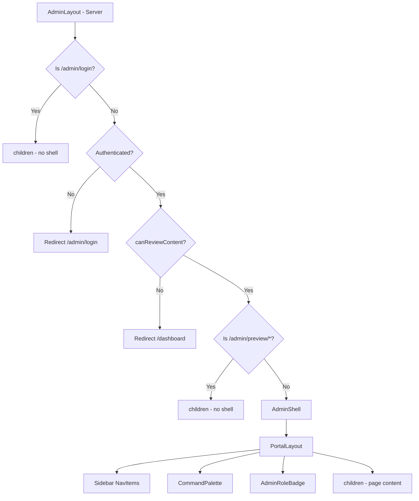
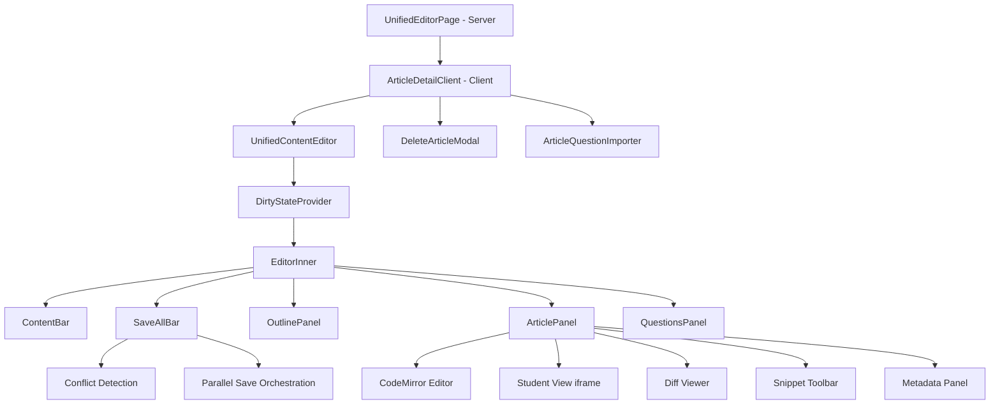
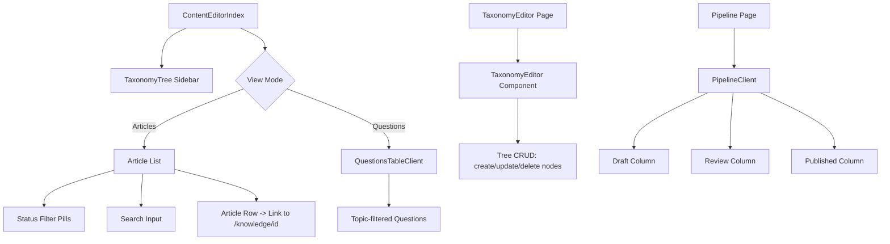
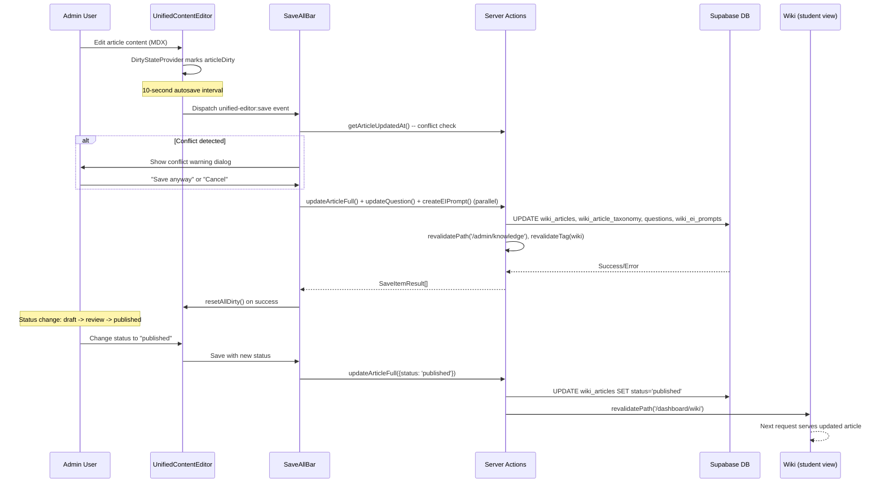
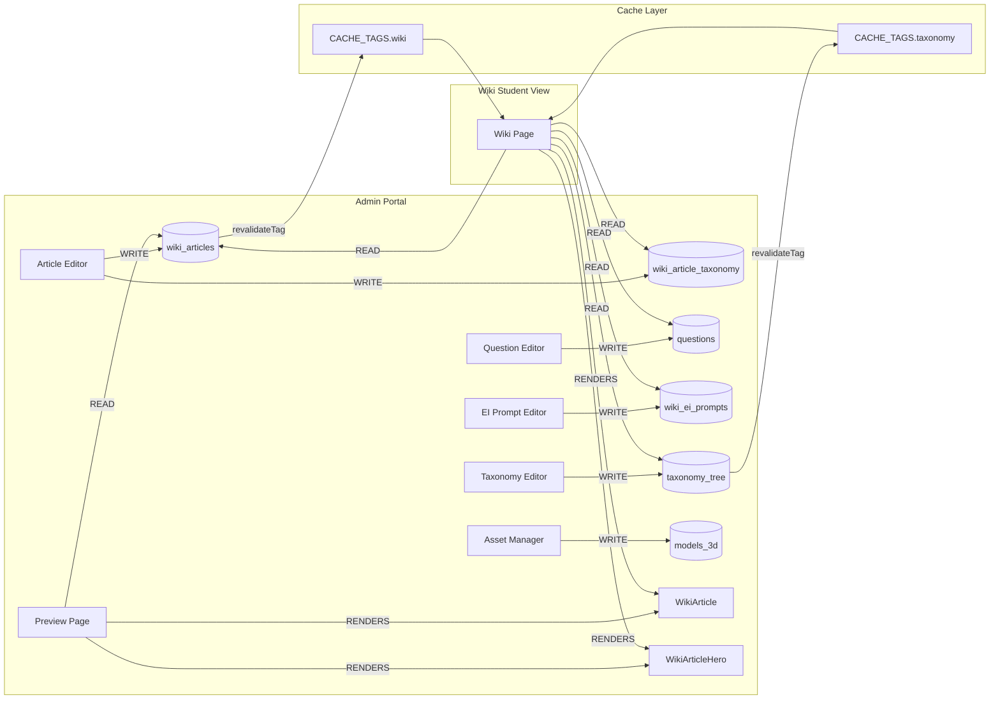

# Admin Feature Specification Plan

## 00. Plan Metadata

| Field | Value |
|-------|-------|
| **Date** | 2026-04-08 |
| **Version** | 1.0 |
| **Author** | Claude Opus 4.6 (codebase audit agent) |
| **Target Spec** | `009-admin-feature-specifications.md` -- DOES NOT EXIST yet; to be created |
| **Cross-reference** | `.ai/docs/01-product/004-wiki-feature-specification.md` (v2.0, 2026-04-08) |
| **Scope** | Audit only -- no source code modifications |
| **Executive Summary** | The Admin portal is SlateCamp's internal CMS, serving as the content authoring, question management, taxonomy editing, and publishing pipeline for the Wiki knowledge base. It comprises ~27 routes under `src/app/admin/`, 15+ shared components in `src/components/admin/`, 12 server action modules in `src/lib/actions/admin/`, and a 12-file unified content editor subsystem. The admin is tightly coupled with the Wiki feature -- it writes to the same DB tables (`wiki_articles`, `wiki_article_taxonomy`, `questions`, `taxonomy_tree`) that the Wiki reads. Three roles govern access: `super_admin`, `content_admin`, `sme_reviewer`. The editor uses CodeMirror for MDX authoring (not Tiptap, despite Tiptap being in `package.json`), with a three-panel layout (outline + article + questions) and 10-second autosave with concurrent edit detection. |

---

## 01. State Audit Summary

| Check | Result |
|-------|--------|
| Files read | ~50 source files across `src/app/admin/`, `src/components/admin/`, `src/lib/actions/admin/`, `src/lib/admin/`, `src/types/`, `middleware.ts` |
| Active tasks | No conflicting tasks in `.ai/plans/` |
| Wiki spec exists | YES at `.ai/docs/01-product/004-wiki-feature-specification.md` |
| Admin spec exists | NO -- `009-admin-feature-specifications.md` does not exist |
| Content workflow doc | YES at `.ai/docs/portal/admin/004-content-workflow.md` |
| Admin AGENTS.md | YES at `src/app/admin/AGENTS.md` |
| Conflicts | None detected |
| **Decision** | **GO** -- proceed with audit |

---

## 02. Route & File Tree

```
src/app/admin/
  AGENTS.md                           # Agent instructions for admin portal
  layout.tsx                          # Server -- auth gate, AdminShell wrapper, role check
  page.tsx                            # Server -- admin dashboard (stats, charts, quick actions)
  loading.tsx                         # Skeleton loader for dashboard
  error.tsx                           # Client -- error boundary with retry

  _components/
    AdminShell.tsx                    # Client -- PortalLayout shell, sidebar nav, CommandPalette
    AdminRoleBadge.tsx               # Server -- role badge display (super_admin/content_admin/sme_reviewer)

  login/
    page.tsx                          # Client -- Google OAuth login (public, bypasses shell)
    loading.tsx

  dashboard/
    page.tsx                          # Server -- redirects or secondary dashboard
    loading.tsx

  knowledge/                          # *** THE UNIFIED KNOWLEDGE HUB ***
    page.tsx                          # Server -- ContentEditorIndex (taxonomy sidebar + article/question list)
    loading.tsx
    new/
      page.tsx                        # Server -- blank UnifiedContentEditor for new article
      loading.tsx
    [id]/
      page.tsx                        # Server -- UnifiedContentEditor for existing article
      loading.tsx
    _components/
      ArticleDetailClient.tsx         # Client -- wrapper for editor + delete modal + importer
    questions/
      page.tsx                        # Server -- ContentEditorIndex with defaultViewMode="questions"
      new/
        page.tsx                      # Question creation
        loading.tsx
      [id]/
        page.tsx                      # Question detail editor
      _components/
        QuestionsTableClient.tsx      # Client -- questions table with filtering
    import/
      page.tsx                        # Bulk import from spreadsheet
      loading.tsx
    analytics/
      page.tsx                        # Content quality analytics
      loading.tsx

  articles/                           # LEGACY -- superseded by /knowledge
    page.tsx
    new/
      page.tsx
    [id]/
      page.tsx
      loading.tsx

  content/                            # LEGACY -- superseded by /knowledge
    page.tsx
    new/
      page.tsx
    [id]/
      page.tsx

  questions/                          # LEGACY -- superseded by /knowledge/questions
    page.tsx
    new/
      page.tsx
    [id]/
      page.tsx
    import/
      page.tsx
    analytics/
      page.tsx

  taxonomy/
    page.tsx                          # Server -- TaxonomyEditor component
    loading.tsx
    coverage/
      page.tsx                        # Coverage map (questions vs articles by topic)
      loading.tsx

  pipeline/
    page.tsx                          # Server -- Kanban-style publish pipeline
    loading.tsx
    _components/
      PipelineCard.tsx               # Individual article card in pipeline
      PipelineClient.tsx             # Client -- 3-column (draft/review/published) board

  reviews/
    page.tsx                          # Server -- SMEReviewQueue component
    loading.tsx

  search/
    layout.tsx                        # Search layout wrapper
    page.tsx                          # Full-text content search
    loading.tsx
    _components/
      ContentSearchClient.tsx         # Client -- real-time Supabase search

  audit/
    page.tsx                          # Server -- AuditLogViewer (super_admin only)
    loading.tsx

  activity/
    page.tsx                          # Server -- activity feed from audit_logs
    loading.tsx

  assets/
    page.tsx                          # Server -- 3D asset manager (upload + list)
    loading.tsx
    [id]/
      page.tsx                        # Asset detail view
      loading.tsx

  3d-models/
    page.tsx                          # 3D model registry
    loading.tsx
    _components/
      ModelConfigDetail.tsx
      ModelRegistryPage.tsx
      ModelRegistryTree.tsx
    _lib/
      model-registry-data.ts

  preview/
    [previewId]/
      page.tsx                        # Server -- iframe preview of draft article as student view

  settings/
    page.tsx                          # Server -- user role management (super_admin only)
    loading.tsx
```

**Total route count:** ~27 unique page routes (excluding legacy duplicates)
**Legacy routes:** `articles/`, `content/`, `questions/` -- superseded by `knowledge/` but still present in codebase

---

## 03. Component Inventory

### Admin Shell Components (`src/app/admin/_components/`)

| Component | File Path | Type | Also Used In Wiki | Responsibility |
|-----------|-----------|------|-------------------|----------------|
| `AdminShell` | `src/app/admin/_components/AdminShell.tsx` | Client | N | Portal layout shell with sidebar nav, command palette, role badge |
| `AdminRoleBadge` | `src/app/admin/_components/AdminRoleBadge.tsx` | Server | N | Displays user role as colored badge |

### Shared Admin Components (`src/components/admin/`)

| Component | File Path | Type | Also Used In Wiki | Responsibility |
|-----------|-----------|------|-------------------|----------------|
| `ArticleQuestionImporter` | `src/components/admin/ArticleQuestionImporter.tsx` | Client | N | JSON question import for a specific article |
| `AssetDetailView` | `src/components/admin/AssetDetailView.tsx` | Client | N | 3D asset detail display |
| `AssetList` | `src/components/admin/AssetList.tsx` | Client | N | 3D asset list with grid layout |
| `AssetUploader` | `src/components/admin/AssetUploader.tsx` | Client | N | File upload for 3D models (.glb/.gltf) |
| `AuditLogViewer` | `src/components/admin/AuditLogViewer.tsx` | Client | N | Filterable audit log table with expand/collapse |
| `BulkActionBar` | `src/components/admin/BulkActionBar.tsx` | Client | N | Bulk select + delete for questions/articles |
| `DeleteArticleModal` | `src/components/admin/DeleteArticleModal.tsx` | Client | N | Confirmation dialog for article deletion |
| `NeedsAttentionCard` | `src/components/admin/NeedsAttentionCard.tsx` | Client | N | Dashboard card showing pending reviews + missing rationale |
| `QuestionEditor` | `src/components/admin/QuestionEditor.tsx` | Client | N | Full question editing form |
| `QuestionImporter` | `src/components/admin/QuestionImporter.tsx` | Client | N | Standalone question import UI |
| `QuestionQualityBadges` | `src/components/admin/QuestionQualityBadges.tsx` | Client | N | Quality indicator badges for questions |
| `QuestionQuickPreview` | `src/components/admin/QuestionQuickPreview.tsx` | Client | N | Compact question preview card |
| `QuestionsTableClient` | `src/components/admin/QuestionsTableClient.tsx` | Client | N | Paginated question table with topic grouping |
| `SMEReviewQueue` | `src/components/admin/SMEReviewQueue.tsx` | Client | N | Review queue for content approval |
| `TaxonomyEditor` | `src/components/admin/TaxonomyEditor.tsx` | Client | N | Tree editor for taxonomy nodes (CRUD) |
| `RoleSelect` | `src/components/admin/settings/RoleSelect.tsx` | Client | N | Role dropdown for settings page |

### Unified Editor Components (`src/components/admin/unified-editor/`)

| Component | File Path | Type | Also Used In Wiki | Responsibility |
|-----------|-----------|------|-------------------|----------------|
| `UnifiedContentEditor` | `unified-editor/UnifiedContentEditor.tsx` | Client | N | Root editor: 3-panel layout (outline + article + questions) |
| `ArticlePanel` | `unified-editor/ArticlePanel.tsx` | Client | N | CodeMirror MDX editor with snippet toolbar, preview, diff tabs |
| `QuestionsPanel` | `unified-editor/QuestionsPanel.tsx` | Client | N | Question list/editor panel linked to article |
| `OutlinePanel` | `unified-editor/OutlinePanel.tsx` | Client | N | Parsed headings sidebar for navigation |
| `ContentBar` | `unified-editor/ContentBar.tsx` | Client | N | Top bar with title, status, LEA ID, save indicator |
| `SaveAllBar` | `unified-editor/SaveAllBar.tsx` | Client | N | Save orchestrator with conflict detection, retry |
| `DirtyStateProvider` | `unified-editor/DirtyStateProvider.tsx` | Client | N | React Context for tracking unsaved changes |
| `PanelErrorBoundary` | `unified-editor/PanelErrorBoundary.tsx` | Client | N | Error boundary per panel |
| `ContentEditorIndex` | `unified-editor/ContentEditorIndex.tsx` | Client | N | Knowledge browser with taxonomy sidebar + article/question list |
| `EIPromptsPanel` | `unified-editor/EIPromptsPanel.tsx` | Client | N | Elaborative Interrogation prompt editor |

### Sub-sections for Non-trivial Components

#### `UnifiedContentEditor`
- **Props:** `article: ArticleData`, `questions: QuestionData[]`, `articleQuestions?: QuestionData[]`, `eiPrompts: EIPromptData[]`, `taxonomyNodes: TaxonomyNodeInfo[]`, `taxonomyLinks: TaxonomyLink[]`
- **State:** Title, content, status, difficultyLabel, leaTestsYou, updatedNote, subjectLabel, reviewerComments, nodeId, questions, eiPrompts, headings, isSaving, saveError
- **Effects:** `beforeunload` warning when dirty, 10-second autosave interval via custom event
- **Form handling:** All mutations dispatched through `DirtyStateProvider` + `SaveAllBar`

#### `ArticlePanel`
- **Editor:** CodeMirror (`@uiw/react-codemirror`) with markdown language mode
- **Tabs:** Editor | Student View (iframe preview) | Diff
- **Snippet toolbar:** 5 groups (Callouts, Legal, Interactive, Exam, Structure) with ~20 MDX snippet templates
- **Metadata panel:** Collapsible section with taxonomy mapping, LEA tests, subject label, reviewer comments, 3D asset link

#### `DirtyStateProvider`
- **Context shape:** Tracks `articleDirty`, `questionsDirty` (Map), `eiPromptsDirty` (Map), `newQuestions`, `newEIPrompts`, `deletedQuestions`, `deletedEIPrompts`
- **Computed:** `isAnythingDirty`, `dirtyCount`
- **Document title:** Prefixes `"* "` when dirty

---

## 04. Component Tree Diagram

### (a) Admin Layout Shell



### (b) Article Editor



### (c) Taxonomy & Question Management



---

## 05. Custom Wiki Article Components -- Complete Catalogue

The ArticlePanel provides an MDX snippet toolbar that inserts these custom components into article content. These are authored in admin and rendered in the Wiki.

### Snippet Templates (Available in Admin Editor Toolbar)

| Component Name | Snippet Group | Block Type | Rendered in Wiki | Props | Status |
|---------------|---------------|-----------|-----------------|-------|--------|
| `<Note>` | Callouts | Block | Y | children | Active |
| `<Warn>` | Callouts | Block | Y | children | Active |
| `<Tip>` | Callouts | Block | Y | children | Active |
| `<Example>` | Callouts | Block | Y | children | Active |
| `<ExamTip>` | Callouts | Block | Y | children | Active |
| `<Callout>` | Callouts | Block | Y | `variant`, `title`, children | Active |
| `<LawCallout>` | Legal | Block | Y | `code: LawCalloutCode`, `section?`, children | Active |
| `<AuthorityContent>` | Legal | Block | Y | `source`, `citation`, children | Active |
| `<InlineQuiz>` | Interactive | Inline | Y | `question`, `options` (JSON), `rationale` | Active |
| `<KeyValues>` | Interactive | Inline | Y | `items` (JSON array of key/value) | Active |
| `<FormulaBlock>` | Interactive | Inline | Y | `formula`, `label`, `note` | Active |
| `<Tabs>` / `<Tab>` | Interactive | Block | Y | `label` per Tab, children | Active |
| `<Accordion>` / `<AccordionItem>` | Interactive | Block | Y | `title` per item, children | Active |
| `<WikiMistakeCard>` | Exam | Inline | Y | `mistake`, `correction` | Active |
| `<WikiCalloutBox>` | Exam | Block | Y | `type`, `title`, children | Active |
| `<AlertBox>` | Exam | Block | Y | `type`, `title`, children | Active |
| `<ComparisonTable>` | Exam | Inline | Y | `headers` (JSON), `rows` (JSON) | Active |
| `<ProcessFlow>` | Exam | Inline | Y | `steps` (JSON array) | Active |
| `<WikiPartHeader>` | Structure | Inline | Y | `part: number`, `title`, `subtitle` | Active |
| `<WikiChangedPill>` | Structure | Inline | Y | `date`, `summary` | Active |

### Registration Mechanism

MDX components are registered in `src/components/wiki/mdx-components-shared.ts` and rendered via `next-mdx-remote/rsc` (server-side compilation). The admin editor does not render these components directly -- it inserts raw MDX markup via the snippet toolbar. The "Student View" tab generates a draft preview by writing content to `admin_draft_previews` table and loading it in an iframe that uses the actual wiki rendering pipeline.

### Serialization Format

Content is stored as raw MDX text in `wiki_articles.content` (TEXT column). No intermediate AST or JSON format. The admin editor works with plain text via CodeMirror with markdown syntax highlighting.

---

## 06. State Architecture

### DirtyStateProvider (React Context)

| Property | Type | Description |
|----------|------|-------------|
| `articleDirty` | `boolean` | Whether article fields have been modified |
| `questionsDirty` | `Map<string, boolean>` | Per-question dirty tracking |
| `eiPromptsDirty` | `Map<string, boolean>` | Per-EI-prompt dirty tracking |
| `newQuestions` | `QuestionDraft[]` | Newly created questions not yet saved |
| `newEIPrompts` | `EIPromptDraft[]` | Newly created EI prompts not yet saved |
| `deletedQuestions` | `Set<string>` | Question IDs queued for deletion |
| `deletedEIPrompts` | `Set<string>` | EI prompt IDs queued for deletion |
| `isAnythingDirty` | `boolean` (computed) | True if any of the above has changes |
| `dirtyCount` | `number` (computed) | Total count of dirty items |

**File:** `src/components/admin/unified-editor/DirtyStateProvider.tsx`
**Consumers:** `UnifiedContentEditor` (EditorInner), `SaveAllBar`, `ContentBar`

### No Zustand Stores for Admin

The admin portal does NOT use any Zustand stores. All admin state is either:
1. Server-fetched via RSC props (articles, taxonomy, questions)
2. Local `useState` within client components
3. `DirtyStateProvider` React Context for the unified editor

---

## 07. Data Flow & API Map

### Server Actions (`src/lib/actions/admin/`)

| File | Action | Method | Payload | Tables | Wiki Overlap |
|------|--------|--------|---------|--------|-------------|
| `wiki.ts` | `createWikiArticle` | Mutation | `{title, content, slug?, status?, node_id?}` | `wiki_articles`, `wiki_article_taxonomy` | SHARED |
| `wiki.ts` | `updateWikiArticle` | Mutation | `{title, content, slug?, status?, node_id?}` | `wiki_articles`, `wiki_article_taxonomy` | SHARED |
| `wiki.ts` | `deleteWikiArticle` | Mutation | `id: string` | `wiki_articles`, `wiki_article_taxonomy` | SHARED |
| `content.ts` | `compileMdxPreview` | Query | `source: string` | None (in-memory) | SHARED |
| `content.ts` | `getContentEditorIndexData` | Query | None | `wiki_articles`, `taxonomy_tree`, `wiki_article_taxonomy`, `questions` | SHARED |
| `content.ts` | `getArticleFull` | Query | `id: string` | `wiki_articles` | SHARED |
| `content.ts` | `getArticleUpdatedAt` | Query | `id: string` | `wiki_articles` | SHARED |
| `content.ts` | `getArticleTaxonomyNodes` | Query | `articleId: string` | `wiki_article_taxonomy` | SHARED |
| `content.ts` | `getQuestionsByNodeIds` | Query | `nodeIds: string[]` | `questions` | SHARED |
| `content.ts` | `getQuestionsByArticleId` | Query | `articleId: string` | `questions` | SHARED |
| `content.ts` | `getAllEIPromptsForArticle` | Query | `articleId: string` | `wiki_ei_prompts` | SHARED |
| `content.ts` | `updateArticleFull` | Mutation | `{title, content, status, node_id, ...metadata}` | `wiki_articles`, `wiki_article_taxonomy` | SHARED |
| `content.ts` | `updateQuestion` | Mutation | `{text, options, ...fields}` | `questions` | SHARED |
| `content.ts` | `createEIPrompt` | Mutation | `{article_id, prompt_text, reveal_text, ...}` | `wiki_ei_prompts` | SHARED |
| `content.ts` | `updateEIPrompt` | Mutation | `{prompt_text, reveal_text, ...}` | `wiki_ei_prompts` | SHARED |
| `content.ts` | `deleteEIPrompt` | Mutation | `promptId: string` | `wiki_ei_prompts` | SHARED |
| `content.ts` | `importQuestionsForArticle` | Mutation | `{articleId, topicId, questionsJson}` | `questions` | SHARED |
| `questions.ts` | `createQuestion` | Mutation | `CreateQuestionInput` | `questions` | SHARED |
| `questions.ts` | `updateQuestion` | Mutation | `CreateQuestionInput` | `questions` | SHARED |
| `questions.ts` | `deleteQuestion` | Mutation | `id: string` | `questions` | SHARED |
| `questions.ts` | `deleteQuestions` | Mutation | `ids: string[]` | `questions` | SHARED |
| `bulk.ts` | `bulkDeleteQuestions` | Mutation | `ids: string[]` | `questions` | SHARED |
| `bulk.ts` | `bulkDeleteArticles` | Mutation | `ids: string[]` | `wiki_articles` | SHARED |
| `taxonomy.ts` | `getTaxonomyNodes` | Query | None | `taxonomy_tree` | SHARED |
| `taxonomy.ts` | `updateTaxonomyNode` | Mutation | `{name}` | `taxonomy_tree` | SHARED |
| `taxonomy.ts` | `createTaxonomyNode` | Mutation | `{name, parent_id, level, discipline_id}` | `taxonomy_tree` | SHARED |
| `taxonomy.ts` | `deleteTaxonomyNode` | Mutation | `id: string` | `taxonomy_tree` | SHARED |
| `pipeline.ts` | `getPipelineArticles` | Query | None | `wiki_articles` | SHARED |
| `pipeline.ts` | `updateArticleStatus` | Mutation | `{articleId, newStatus}` | `wiki_articles` | SHARED |
| `assets.ts` | `getAssets` | Query | None | `models_3d` | N |
| `assets.ts` | `getAsset` | Query | `id: string` | `models_3d` | N |
| `assets.ts` | `createAsset` | Mutation | `{name, slug, url, metadata}` | `models_3d` | N |
| `assets.ts` | `uploadAssetFile` | Mutation | `FormData (file)` | Supabase Storage `3d-models` | N |
| `dashboard.ts` | `getAdminDashboardData` | Query (cached 60s) | None | `questions`, `wiki_articles`, `taxonomy_tree`, `models_3d`, `audit_logs` | SHARED |
| `dashboard.ts` | `getContentBySubject` | Query (cached 60s) | None | `taxonomy_tree`, `questions`, `wiki_article_taxonomy` | SHARED |
| `dashboard.ts` | `getNeedsAttentionData` | Query (cached 60s) | None | `wiki_articles`, `questions` | SHARED |
| `dashboard.ts` | `getCriticalCoverageGap` | Query (cached 60s) | None | `taxonomy_tree`, `questions` | SHARED |
| `roles.ts` | `getAdminUsers` | Query | None | `user_roles` | N |
| `roles.ts` | `assignRole` | Mutation | `FormData {userId, role}` | `user_roles` | N |
| `roles.ts` | `revokeRole` | Mutation | `FormData {roleId}` | `user_roles` | N |
| `coverage.ts` | `fetchCoverageData` | Query | None | `taxonomy_tree`, `questions`, `wiki_article_taxonomy` | SHARED |
| `wiki-queries.ts` | `getArticlesWithCoverage` | Query | None | `wiki_articles`, `wiki_article_taxonomy`, `questions` | SHARED |
| `wiki-queries.ts` | `getArticles` | Query | None | `wiki_articles` | SHARED |
| `wiki-queries.ts` | `getArticle` | Query | `id: string` | `wiki_articles` | SHARED |
| `wiki-queries.ts` | `getAdminTaxonomyTree` | Query | None | `disciplines`, `taxonomy_tree`, `wiki_articles`, `wiki_article_taxonomy`, `questions` | SHARED |
| `question-queries.ts` | `getQuestions` | Query | `page, pageSize` | `questions` | SHARED |
| `question-queries.ts` | `getQuestionsGroupedByArticle` | Query | `page, pageSize` | `questions`, `wiki_article_taxonomy`, `wiki_articles` | SHARED |
| `question-queries.ts` | `getQuestionsByTopicIds` | Query | `topicIds[], searchQuery?` | `questions`, `wiki_article_taxonomy`, `wiki_articles` | SHARED |
| `question-queries.ts` | `getQuestionsTaxonomyTree` | Query | None | `taxonomy_tree`, `questions`, `wiki_article_taxonomy`, `wiki_articles` | SHARED |

### Other Server Actions Used by Admin

| File | Action | Tables |
|------|--------|--------|
| `src/lib/actions/preview-actions.ts` | `generateDraftPreview` | `admin_draft_previews` |
| `src/lib/actions/preview-actions.ts` | `updateDraftPreview` | `admin_draft_previews` |
| `src/lib/audit/audit-actions.ts` | `getAuditLogsAction` | `audit_logs` |

### API Routes

| Route | Method | Purpose | Auth |
|-------|--------|---------|------|
| `/api/admin/flags` | POST | Set feature flag cookies | `isAdmin()` |
| `/api/admin/flags` | DELETE | Clear feature flag cookies | `isAdmin()` |

### Article Publish Flow



---

## 08. Database Schema

### Tables Used by Admin (SHARED WITH WIKI marked)

| Table | Admin Role | Wiki Role | Key Columns |
|-------|-----------|-----------|-------------|
| `wiki_articles` | **WRITE** (CRUD) | **READ** (render) | `article_id` (PK), `title`, `slug`, `content` (MDX text), `status` (`draft`/`review`/`published`), `difficulty_label`, `lea_tests_you`, `updated_note`, `subject_label`, `reviewed_by`, `reviewer_comments`, `created_by`, `created_at`, `updated_at` |
| `wiki_article_taxonomy` | **WRITE** (CRUD) | **READ** (navigation) | `article_id` (FK), `node_id` (FK), `is_primary` |
| `wiki_ei_prompts` | **WRITE** (CRUD) | **READ** (render) | `prompt_id` (PK), `article_id` (FK), `node_id` (FK?), `insert_after_heading`, `prompt_text`, `reveal_text`, `options` (JSONB), `sort_order`, `is_active`, `status`, `reviewed_by`, `reviewed_at`, `reviewer_notes` |
| `questions` | **WRITE** (CRUD) | **READ** (quiz) | `question_id` (PK), `topic_id` (FK to taxonomy_tree), `article_id` (FK?), `text`, `options` (JSONB), `correct_option_id`, `rationale`, `explanation`, `code_citation`, `difficulty`, `difficulty_rating`, `discrimination_rating`, `prompt_image_url`, `model_id`, `is_assessment`, `application_context`, `practice_context` (TEXT[]), `created_by`, `updated_by` |
| `taxonomy_tree` | **WRITE** (CRUD) | **READ** (navigation) | `node_id` (PK), `discipline_id` (FK), `parent_id` (FK, self-ref), `name`, `slug`, `lea_id`, `level` (1-3), `subject_area`, `is_leaf`, `sort_order`, `exam_frequency`, `deprecated_at`, `is_cross_ref_only` |
| `disciplines` | **READ** | **READ** | `discipline_id` (PK), `name`, `acronym` |
| `models_3d` | **WRITE** (CRUD) | **READ** (3D lab) | `model_id` (PK), `name`, `slug`, `url`, `thumbnail`, `status`, `metadata` (JSONB), `created_by` |
| `audit_logs` | **READ** | N/A | `id` (PK), `actor_id`, `event_type`, `table_name`, `record_id`, `metadata` (JSONB), `content_snapshot` (JSONB), `created_at` |
| `user_roles` | **WRITE** (CRUD) | N/A | `id` (PK), `user_id`, `role` (`super_admin`/`content_admin`/`sme_reviewer`), `created_at` |
| `admin_draft_previews` | **WRITE** (CRUD) | N/A | `id` (PK), `article_id` (FK), `content` (TEXT) |

### ADMIN-ONLY Tables

- `user_roles` -- role assignments
- `audit_logs` -- change history (read-only from admin)
- `admin_draft_previews` -- temporary draft content for preview iframe

### SHARED Tables (written by Admin, read by Wiki)

- `wiki_articles` -- the core content table
- `wiki_article_taxonomy` -- article-to-taxonomy junction
- `wiki_ei_prompts` -- elaborative interrogation prompts
- `questions` -- assessment items
- `taxonomy_tree` -- curriculum hierarchy
- `disciplines` -- top-level curriculum groupings
- `models_3d` -- 3D asset metadata

### RLS Notes

Admin uses `createAdminClient()` (service role key, bypasses RLS) for mutations and some reads. Regular reads use `createClient()` (anon key, respects RLS). The student-facing wiki uses RLS-scoped queries.

---

## 09. Role & Permission Model

### Roles (verified from `src/lib/admin/roles.ts`)

| Role | DB Value | Description |
|------|----------|-------------|
| Super Admin | `super_admin` | Full access: content CRUD, taxonomy CRUD, user management, audit logs, settings |
| Content Admin | `content_admin` | Content CRUD, taxonomy CRUD. No user management, no settings |
| SME Reviewer | `sme_reviewer` | Read-only access to content, can review and approve |

### Type Definition

```typescript
export type UserRole = 'super_admin' | 'content_admin' | 'sme_reviewer'
```

### Storage Mechanism

Roles are stored in the `user_roles` table (`user_id`, `role`). A user can have multiple role rows; `getUserRole()` returns the most recent. Fallback: legacy `ADMIN_EMAILS` env var grants `super_admin`.

### Route Protection

1. **Middleware** (`middleware.ts`): Sets `x-pathname` header but does NOT perform role checks. All routes pass through.
2. **Layout** (`src/app/admin/layout.tsx`): Server-side gate. Calls `canReviewContent()` (allows all 3 roles). Redirects unauthorized users to `/dashboard`.
3. **Page-level checks**: Some pages add stricter checks:
   - `/admin/settings` -- `isSuperAdmin()` only
   - `/admin/audit` -- `isSuperAdmin()` only
   - `/admin/knowledge/*` -- `canManageContent()` (super_admin + content_admin)
4. **Action-level checks**: Every mutation action calls `canManageContent()` or `canManageUsers()`.

### Permission Matrix

| Capability | `super_admin` | `content_admin` | `sme_reviewer` |
|-----------|:---:|:---:|:---:|
| View admin dashboard | Y | Y | Y |
| Create/edit articles | Y | Y | N |
| Create/edit questions | Y | Y | N |
| Publish articles | Y | Y | N |
| Manage taxonomy | Y | Y | N |
| Upload 3D assets | Y | Y | N |
| Bulk delete content | Y | Y | N |
| Review content | Y | Y | Y |
| View audit log | Y | N | N |
| Manage user roles | Y | N | N |
| Access settings | Y | N | N |

### Dev Mode Bypass

In development, if `DEV_FORCE_USER_ID` env var is set, `getUserRole()` returns `super_admin` unconditionally.

---

## 10. Editor Architecture

### Editor Library

**Primary editor:** CodeMirror via `@uiw/react-codemirror` v4.25.9
- Language: `@codemirror/lang-markdown` v6.5.0
- View: `@codemirror/view` v6.40.0

**Tiptap** is in `package.json` (v3.20.4 with 10+ extensions) but is NOT used by the admin article editor. Tiptap may be used elsewhere in the codebase (e.g., wiki blocks or other features). The admin editor exclusively uses CodeMirror for raw MDX editing.

### Editor Configuration

```typescript
// From ArticlePanel.tsx
extensions: [markdown(), EditorView.lineWrapping]
basicSetup: {
  lineNumbers: true,
  foldGutter: false,
  highlightActiveLine: true,
  bracketMatching: true,
  closeBrackets: true,
  autocompletion: false,
  // ... other settings
}
theme: "light"
fontSize: "13px"
```

### Toolbar

The snippet toolbar provides 5 groups with ~20 MDX component templates:
1. **Callouts** -- Note, Warn, Tip, Example, ExamTip, Callout
2. **Legal** -- LawCallout, AuthorityContent
3. **Interactive** -- InlineQuiz, KeyValues, FormulaBlock, Tabs, Accordion
4. **Exam** -- WikiMistakeCard, WikiCalloutBox, AlertBox, ComparisonTable, ProcessFlow
5. **Structure** -- WikiPartHeader, WikiChangedPill

Snippets are inserted at cursor position via CodeMirror's `view.dispatch()`.

### Content Storage Format

Raw MDX text stored in `wiki_articles.content` (Postgres TEXT column). No structured JSON, no block editor format. This means content is a mix of Markdown + JSX-like component tags.

### Rendering Pipeline

1. Admin authors MDX in CodeMirror
2. Content saved as raw text to `wiki_articles.content`
3. Wiki reader compiles MDX server-side via `next-mdx-remote/rsc`
4. Custom components resolved via `src/components/wiki/mdx-components-shared.ts`
5. Heavy widgets lazy-loaded via widget registry (`src/components/wiki/widgets/registry.ts`)

### Preview System

The "Student View" tab in the editor:
1. Writes draft content to `admin_draft_previews` table via `generateDraftPreview()`
2. Renders in an iframe pointing to `/admin/preview/[previewId]`
3. The preview page uses the SAME wiki rendering components (`WikiArticle`, `WikiArticleHero`, `WikiHeader`, `WikiRightSidebar`) as the student view
4. A yellow banner distinguishes preview from live: "Draft Preview Mode"

---

## 11. Media & Asset Management

### 3D Model Assets

| Aspect | Implementation |
|--------|---------------|
| **Upload component** | `src/components/admin/AssetUploader.tsx` |
| **Upload action** | `uploadAssetFile()` in `src/lib/actions/admin/assets.ts` |
| **Storage bucket** | Supabase Storage bucket `3d-models` |
| **File types** | `.glb`, `.gltf` |
| **File path** | `assets/{timestamp}-{baseName}.{ext}` |
| **URL generation** | `supabase.storage.from('3d-models').getPublicUrl(filePath)` |
| **Metadata** | Stored as JSONB in `models_3d.metadata` |
| **Listing** | `src/components/admin/AssetList.tsx` (grid layout) |
| **Detail view** | `src/components/admin/AssetDetailView.tsx` |
| **Management page** | `/admin/assets` (upload + list) |
| **Registry page** | `/admin/3d-models` (tree-based model registry) |

### Article Images

Article images are referenced via URLs in MDX content (e.g., `prompt_image_url` on questions). No dedicated image upload component exists in the admin -- images are referenced by URL. The `<Image>` MDX component or markdown image syntax is used.

### No General Media Library

There is no general-purpose media library or file manager. 3D assets have their own pipeline; other media (images) are URL-referenced.

---

## 12. Wiki-Admin Coupling Map

### Shared Components

No admin components are directly imported in wiki routes. However, the admin **preview page** (`/admin/preview/[previewId]`) imports and renders wiki components:

| Wiki Component | Used in Admin Preview |
|---------------|---------------------|
| `WikiArticle` | Y -- renders draft content |
| `WikiArticleHero` | Y -- renders article hero |
| `WikiHeader` | Y -- renders navigation header |
| `WikiRightSidebar` | Y -- renders sidebar |
| `TeachBackPrompt` | Y -- renders teach-back section |
| `getArticleHeadings` | Y -- utility function |

### Shared DB Tables

| Table | Admin Writes | Wiki Reads | Coupling Type |
|-------|:---:|:---:|--------------|
| `wiki_articles` | Y | Y | Content lifecycle |
| `wiki_article_taxonomy` | Y | Y | Navigation/taxonomy |
| `wiki_ei_prompts` | Y | Y | Interactive prompts |
| `questions` | Y | Y | Quiz/assessment |
| `taxonomy_tree` | Y | Y | Curriculum structure |
| `disciplines` | N (read-only) | Y | Top-level grouping |
| `models_3d` | Y | Y | 3D lab assets |

### Shared Types

| Type | File | Used By Admin | Used By Wiki |
|------|------|:---:|:---:|
| `WikiCalloutType` | `src/types/wiki.ts` | N | Y |
| `WikiTableRow` | `src/types/wiki.ts` | N | Y |
| `WikiArticleHeroProps` | `src/types/wiki.ts` | N | Y |
| `LawCalloutCode` | `src/types/wiki.ts` | N | Y |
| `ArticleData` | `src/components/admin/unified-editor/types.ts` | Y | N |
| `QuestionData` | `src/components/admin/unified-editor/types.ts` | Y | N |
| `EIPromptData` | `src/components/admin/unified-editor/types.ts` | Y | N |

### Shared Actions

| Action | File | Admin Calls | Wiki Calls |
|--------|------|:---:|:---:|
| `getEIPromptsForArticle` | `src/lib/actions/ei-prompts.ts` | N (uses `getAllEIPromptsForArticle` instead) | Y |
| `getArticleSources` | `src/lib/actions/wiki-actions.ts` | Y (in preview page) | Y |
| `getTeachBackCriteria` | `src/lib/actions/teach-back.ts` | Y (in preview page) | Y |

### Data Flow Diagram



---

## 13. Hook & Utility Inventory

### Admin-specific Hooks

No custom hooks in `src/hooks/` are admin-specific. The admin uses:
- `useDirtyState()` -- from `DirtyStateProvider` (context hook, not a standalone hook file)

### Utilities Used by Admin

| Utility | File | Description | Shared with Wiki |
|---------|------|-------------|:---:|
| `cn()` | `src/lib/utils.ts` | Tailwind class merge (clsx + twMerge) | Y |
| `formatRelativeTime()` | `src/lib/utils/format-time.ts` | "2 hours ago" formatting | Y |
| `sanitizeMDX()` | `src/lib/wiki-markdown.ts` | MDX content sanitization before compile | Y |
| `estimateReadingTime()` | `src/lib/wiki-markdown.ts` | Word count / reading time estimate | Y |
| `classifyCoverage()` | `src/lib/utils/coverage.ts` | Classify taxonomy coverage level | N (admin only) |
| `CACHE_TAGS` | `src/lib/actions/cache-tags.ts` | Centralized cache tag constants | Y |

### Role Utilities (`src/lib/admin/roles.ts`)

| Function | Signature | Description |
|----------|-----------|-------------|
| `getUserRole()` | `() => Promise<UserRole \| null>` | Get user's role (React cached) |
| `getUserRoles()` | `() => Promise<UserRole[]>` | Get all roles for user |
| `isAdmin()` | `() => Promise<boolean>` | super_admin OR content_admin |
| `isSuperAdmin()` | `() => Promise<boolean>` | super_admin only |
| `canManageContent()` | `() => Promise<boolean>` | super_admin OR content_admin |
| `canReviewContent()` | `() => Promise<boolean>` | Any of the 3 roles |
| `canManageUsers()` | `() => Promise<boolean>` | super_admin only |

---

## 14. UX & Interaction Patterns

### Article List (Knowledge Browser)

- **Layout:** Taxonomy sidebar (280px) + content list (remaining width)
- **View modes:** Articles | Questions toggle
- **Filtering:** Status pills (All/Draft/Review/Published), topic tree selection, text search
- **Row format:** Icon + title + status badge + difficulty badge + LEA ID + node name + word count + question count + prompt count + date
- **Empty states:** Distinct for "no articles yet" vs "no matching content"
- **URL sync:** View mode and selected topic are synced to URL params

### Editor Toolbar

- Snippet dropdowns grouped by category (Callouts, Legal, Interactive, Exam, Structure)
- Click-to-insert at cursor position
- Custom dropdown implementation (not shadcn Select)

### Image Upload (3D Assets)

- File input for `.glb`/`.gltf` files
- Uploads to Supabase Storage
- Returns public URL for metadata storage

### Taxonomy Selector

- Within article metadata panel (collapsible)
- Searchable text input + select dropdown
- Shows node name + subject area + level
- "Clear" button to unassign

### Publish Flow

- Status managed via dropdown in ContentBar
- Three states: `draft` -> `review` -> `published`
- Status change triggers revalidation of wiki cache
- Pipeline page shows Kanban-style 3-column board

### Form Validation

- Zod schemas for article and taxonomy mutations
- Manual validation for question creation (4 options required, non-empty text, topic_id required)
- Real-time conflict detection via `getArticleUpdatedAt()` before save

### Preview

- "Student View" tab generates/updates draft preview
- Renders in iframe using actual wiki components
- Yellow banner distinguishes from live content
- "Open in new tab" link for full-window preview

### Mobile Handling

- Editor panels stack vertically below `xl` breakpoint (article 50vh, questions 50vh)
- Outline panel hidden below `xl`
- Sidebar collapsible via toggle button
- Pipeline columns stack to single column on mobile

---

## 15. Failure State Inventory

### Per-Page Loading States

| Page | `loading.tsx` Present | Error Boundary |
|------|:---:|:---:|
| `/admin` (dashboard) | Y | Global `error.tsx` |
| `/admin/login` | Y | Global `error.tsx` |
| `/admin/dashboard` | Y | Global `error.tsx` |
| `/admin/knowledge` | Y | Global `error.tsx` |
| `/admin/knowledge/[id]` | Y | Global `error.tsx` |
| `/admin/knowledge/new` | Y | Global `error.tsx` |
| `/admin/knowledge/questions` | via parent | Global `error.tsx` |
| `/admin/knowledge/questions/new` | Y | Global `error.tsx` |
| `/admin/knowledge/questions/[id]` | via parent | Global `error.tsx` |
| `/admin/knowledge/import` | Y | Global `error.tsx` |
| `/admin/knowledge/analytics` | Y | Global `error.tsx` |
| `/admin/taxonomy` | Y | Global `error.tsx` |
| `/admin/taxonomy/coverage` | Y | Global `error.tsx` |
| `/admin/pipeline` | Y | Global `error.tsx` |
| `/admin/reviews` | Y | Global `error.tsx` |
| `/admin/search` | Y | Global `error.tsx` |
| `/admin/audit` | Y | Global `error.tsx` |
| `/admin/activity` | Y | Global `error.tsx` |
| `/admin/assets` | Y | Global `error.tsx` |
| `/admin/assets/[id]` | Y | Global `error.tsx` |
| `/admin/3d-models` | Y | Global `error.tsx` |
| `/admin/settings` | Y | Global `error.tsx` |
| `/admin/preview/[previewId]` | N | Inline fallback |

### Editor-level Error Handling

- `PanelErrorBoundary` wraps each panel (Outline, Article, Questions)
- `SaveAllBar` shows per-item success/failure with retry
- Conflict detection dialog for concurrent edits
- `beforeunload` warning when unsaved changes exist

### Empty States

| Component | Has Empty State |
|-----------|:---:|
| Dashboard activity feed | Y ("No recent activity recorded") |
| Knowledge browser | Y ("No articles yet" / "No matching content") |
| Pipeline columns | Y ("No drafts" / "No articles in review" / "No published articles") |
| Activity feed | Y ("No activity yet") |
| Settings user list | Y ("No admin roles assigned") |
| Audit log | Y (handled in AuditLogViewer) |
| Content search | Y (handled in ContentSearchClient) |

### Missing Failure States

- WARNING: `/admin/preview/[previewId]` has no `loading.tsx`
- WARNING: Questions sub-routes rely on parent loading state rather than their own
- WARNING: No offline detection in the editor

---

## 16. Known Open Decisions & Technical Debt

### Legacy Route Duplication

| Issue | Location | Action Tag |
|-------|----------|-----------|
| Legacy `/admin/articles/` routes still exist alongside `/admin/knowledge/` | `src/app/admin/articles/` | SHOULD DELETE -- per AGENTS.md, legacy routes should redirect to /knowledge |
| Legacy `/admin/content/` routes still exist | `src/app/admin/content/` | SHOULD DELETE |
| Legacy `/admin/questions/` routes still exist alongside `/admin/knowledge/questions/` | `src/app/admin/questions/` | SHOULD DELETE |
| Duplicate `updateQuestion` export: exists in both `content.ts` and `questions.ts` | `src/lib/actions/admin/content.ts`, `src/lib/actions/admin/questions.ts` | SHOULD CONSOLIDATE |

### Editor Issues

| Issue | Location | Action Tag |
|-------|----------|-----------|
| Tiptap in `package.json` but not used in admin editor | `package.json` | INVESTIGATE -- may be used elsewhere, or remove |
| `type="button"` raw `<button>` elements in snippet toolbar instead of shadcn Button | `ArticlePanel.tsx` | SHOULD FIX -- design rules require shadcn components |
| `select('*')` used in preview page | `src/app/admin/preview/[previewId]/page.tsx` line 68 | MUST FIX -- violates CLAUDE.md rule |
| `function` declaration used in `AdminTaxonomyPage` | `src/app/admin/taxonomy/page.tsx` | SHOULD FIX -- violates arrow function rule |
| `function` declaration used in `AdminReviewsPage` | `src/app/admin/reviews/page.tsx` | SHOULD FIX |
| `function` declaration used in `AdminAuditPage` | `src/app/admin/audit/page.tsx` | SHOULD FIX |
| `function` declaration used in `AdminAssetsPage` | `src/app/admin/assets/page.tsx` | SHOULD FIX |
| `function` declaration used in `AdminSettingsPage` declared but then `const` assigned | `src/app/admin/settings/page.tsx` | Mixed pattern |

### Data Fetching Issues

| Issue | Location | Action Tag |
|-------|----------|-----------|
| Sequential `await` in `getAdminTaxonomyTree` (chunked loops) | `src/lib/actions/admin/wiki-queries.ts` | SHOULD OPTIMIZE -- use `Promise.all` for chunks |
| `useEffect` data fetch in `AuditLogViewer` and `ContentSearchClient` | Multiple | ACCEPTABLE -- client-side search is appropriate |
| Dashboard data cached for 60s via `unstable_cache` | `src/lib/actions/admin/dashboard.ts` | MONITOR -- `unstable_cache` API may change |

### Missing Features (from AGENTS.md / content workflow)

| Feature | Status | Notes |
|---------|--------|-------|
| SME notification on "submit for review" | NOT IMPLEMENTED | Status change works but no notification trigger |
| Deep-linking from audit log to content editor | PARTIAL | Audit log shows `record_id` but no clickable links |
| Article versioning / change history | NOT IMPLEMENTED | Only current version stored |

---

## 17. Feature History & Evolution Notes

### Git History (last 30 commits touching `src/app/admin/`)

| Date | Hash | Summary |
|------|------|---------|
| Recent | `31ac84f` | Global ALE -> LEA terminology migration |
| Recent | `92800ce` | Fix broken 3d-lab import paths for Storybook |
| Recent | `35f1aaf` | Phase 7 app-wide token enforcement |
| Recent | `5c08edd` | Final audit -- 90 stories + admin knowledge token fixes |
| Recent | `97b8f70` | Phase 3 layout & navigation overhaul |
| Recent | `91636fc` | Quiz-v2 remediation and 3d-lab refactor |
| Recent | `6e1af2c` | Storybook overhaul |
| Recent | `7b5c248` | Consolidate quiz, wiki, admin, and 3d lab modules |
| Recent | `3986dcd` | Overhaul study surfaces and quiz workflows |
| Recent | `c2fdf78` | UI refinement and design system cleanup |
| Recent | `f102204` | Implement admin question management with editor and article context |
| Recent | `e393de2` | Comprehensive admin dashboard, 3D lab controls, wiki knowledge management |
| Recent | `a6af9a3` | 3D lab site controls, admin content management, wiki taxonomy navigation |
| Recent | `f394a62` | Restructure 3D Lab to 16-category LEA taxonomy with admin model registry |
| Recent | `76fdf7d` | Comprehensive admin content management including taxonomy mapping |
| Recent | `cb4e94a` | Admin article management system with taxonomy-driven content editing |
| Earlier | `d63c9f6` | Live draft preview for article editor |

### Key Evolution Points

1. **Initial phase:** Basic article CRUD and question management
2. **Taxonomy integration:** Articles and questions linked via `taxonomy_tree`
3. **Unified knowledge hub:** Consolidated `/articles`, `/questions`, `/content` into `/knowledge`
4. **Editor upgrade:** From basic textarea to CodeMirror with snippet toolbar
5. **Three-panel editor:** Outline + Article + Questions in a single view
6. **Draft preview:** Iframe-based student view with live content injection
7. **Design system migration:** Token enforcement across admin surfaces
8. **ALE -> LEA rename:** Global terminology migration

---

## 18. Spec Document Implementation Plan

### Target File

`.ai/docs/01-product/009-admin-feature-specifications.md` (to be created from scratch)

### Proposed Sections

```
1. Overview & Principles
2. Route Architecture (from Section 02 of this plan)
3. Role & Permission Model (from Section 09)
4. Component Architecture (from Sections 03, 04)
5. Unified Content Editor (deep dive from Section 10)
6. Custom MDX Blocks Catalogue (from Section 05)
7. State Management (from Section 06)
8. Server Actions & Data Flow (from Section 07)
9. Database Schema (from Section 08)
10. Wiki Coupling (from Section 12)
11. Media & Asset Management (from Section 11)
12. UX Patterns & Interaction Design (from Section 14)
13. Failure States & Error Handling (from Section 15)
14. Technical Debt & Open Decisions (from Section 16)
```

### Audit-to-Spec Mapping

| Plan Section | Spec Section | Transformation |
|-------------|-------------|----------------|
| 02. Route & File Tree | 2. Route Architecture | Annotate with purpose, auth level, and status (active/legacy) |
| 03. Component Inventory | 4. Component Architecture | Add prop tables, dependency graphs, and usage guidelines |
| 04. Component Tree Diagram | 4. Component Architecture | Include as-is |
| 05. Custom Wiki Blocks | 6. Custom MDX Blocks | Add rendering examples and usage guidelines for content authors |
| 06. State Architecture | 7. State Management | Add state flow diagrams and guidelines for new state additions |
| 07. Data Flow & API Map | 8. Server Actions & Data Flow | Add error handling documentation, rate limits |
| 08. Database Schema | 9. Database Schema | Add RLS policies, indexes, migration references |
| 09. Role & Permission | 3. Role & Permission Model | Add permission extension guidelines |
| 10. Editor Architecture | 5. Unified Content Editor | Add keyboard shortcuts, CodeMirror extension guide |
| 11. Media & Assets | 11. Media & Asset Management | Add file size limits, supported formats |
| 12. Wiki Coupling | 10. Wiki Coupling | Cross-reference every claim with 004-wiki-feature-specification.md |
| 14. UX Patterns | 12. UX Patterns | Add screenshots/wireframes reference |
| 15. Failure States | 13. Failure States | Document required vs optional failure handling |
| 16. Technical Debt | 14. Technical Debt | Prioritize by impact |

### Cross-reference Instructions for 004-wiki-feature-specification.md

The admin spec MUST cross-reference the wiki spec in the following areas:

1. **Content model consistency:** Verify that `ArticleData` type in admin matches the article shape used by wiki rendering
2. **MDX block catalogue:** Ensure admin snippet templates match the component registration in `mdx-components-shared.ts`
3. **Taxonomy navigation:** Admin taxonomy editor changes must be reflected in wiki navigation (cache invalidation verified via `CACHE_TAGS.taxonomy`)
4. **EI prompts:** Admin EI prompt editor schema must match wiki EI prompt rendering expectations
5. **Article status lifecycle:** Admin `draft`/`review`/`published` states must match wiki filtering (wiki only shows `published`)
6. **Preview rendering:** Admin preview page uses the same rendering pipeline as wiki -- any wiki component changes affect preview

### Gaps Identified

| Gap | Priority | Description |
|-----|----------|-------------|
| No admin-specific types file | Medium | Admin types are scattered across `unified-editor/types.ts` and inline in action files |
| No Storybook stories for admin components | Medium | 15+ admin components with no stories |
| No integration tests for editor save flow | High | Complex multi-entity save with conflict detection has no test coverage |
| No accessibility audit for editor | Medium | Custom dropdowns, raw buttons, no ARIA labels on some interactive elements |
| No mobile editor experience | Low | Editor is desktop-first; mobile stacking works but is not optimized |

### Complexity Estimate

| Section | Complexity | Estimated Effort |
|---------|-----------|-----------------|
| Overview & Principles | Low | 0.5 hours |
| Route Architecture | Low | 1 hour |
| Role & Permission Model | Low | 0.5 hours |
| Component Architecture | Medium | 2 hours |
| Unified Content Editor | High | 3 hours |
| MDX Blocks Catalogue | Medium | 1.5 hours |
| State Management | Medium | 1 hour |
| Server Actions & Data Flow | High | 2.5 hours |
| Database Schema | Medium | 1.5 hours |
| Wiki Coupling | High | 2 hours |
| Media & Asset Management | Low | 0.5 hours |
| UX Patterns | Medium | 1.5 hours |
| Failure States | Low | 1 hour |
| Technical Debt | Low | 0.5 hours |
| **Total** | | **~19 hours** |

### Recommended Write Order

1. Database Schema (foundation -- all other sections reference tables)
2. Role & Permission Model (needed for understanding access patterns)
3. Route Architecture (structural overview)
4. Component Architecture (depends on routes)
5. Server Actions & Data Flow (depends on schema + components)
6. Unified Content Editor (deepest section, depends on all above)
7. State Management (subset of editor)
8. MDX Blocks Catalogue (subset of editor)
9. Wiki Coupling (synthesis section, requires both admin + wiki knowledge)
10. Media & Asset Management (standalone)
11. UX Patterns (requires all component knowledge)
12. Failure States (depends on components + routes)
13. Technical Debt (final assessment)
14. Overview & Principles (write last as summary)
