# Analytics Feature Audit & Specification Plan

**Created:** 2026-04-08
**Purpose:** Exhaustive codebase audit of the analytics feature + implementation plan for updating `.ai/docs/01-product/006-analytics.md`
**Status:** Complete — ready for spec execution

---

## STATE AUDIT

| Location | Finding |
|----------|---------|
| `.ai/state/current-task.md` | Active: Route Constants Consolidation Phase 1. **No conflict.** |
| `.ai/state/memory.md` | References analytics tangentially (3D Lab, quiz shell). No dedicated analytics context. |
| `.ai/state/` (other) | `multi-agent.md`, `.chunkhound.json`, `.mcp.json` — none reference analytics. |
| `.ai/plans/` | Empty directory — no existing plans. |
| `.ai/docs/01-product/006-analytics.md` | **EXISTS but OUTDATED.** Dated 2026-04-06. Lists 7 visualization components; actual page imports 23 sections. CEO analytics section is accurate. |
| `src/app/dashboard/analytics/` | 4 files: `AGENTS.md`, `layout.tsx`, `loading.tsx`, `page.tsx`. No subdirectories. |

**HALT conditions:** None triggered.

---

# PART 1 — CODEBASE AUDIT

## 1.1 Feature History & Context

### Git History (last 30 commits touching analytics)

```
31ac84f refactor: global ALE → LEA terminology migration
35f1aaf style(design-system): Phase 7 app-wide token enforcement
c9597dc feat: subscription tier consolidation + testing→drills route migration
4f208d8 feat: execute nightwatch queue — database-layer and auth-and-gating domains
6e1af2c feat(storybook): complete overhaul and archive plans
7b5c248 refactor: consolidate quiz, wiki, admin, and 3d lab modules
876062f build: add storybook catalog and shared component entrypoints
3986dcd feat: overhaul study surfaces and quiz workflows
c2fdf78 chore: broad UI refinement, typography updates, and design system cleanup across portals
be45506 feat: implement SubjectDrillSelector component and add agent documentation
fb0cf2a feat: add WIP metacognitive review and analytics flows
2d72bc8 feat: Analytics page — 6 new data visualizations
a8ca7bd feat: Full implementation plan — Sprints 0-3 + Design Quiz Mode
de197c0 fix: Incremental polish — audit fixes, Card migrations, test errors
618d04e feat: Medium priority — hex migration, Card migration, loading skeletons
5d6787e feat: High-priority — IRT wiring, select(*) elimination, dashboard redesign
7725976 feat: Phase 4 DB velocity + Phase 6 hex→token migration
0b17052 feat: Tier 2 remediation — waterfalls, IRT theta, hex-to-token
2e7fcb4 refactor: dashboard, quiz, wiki, marketing, analytics — Campfire rebrand
```

**Key milestones:**
- Feature introduced: `c4d5fc2 dashboard redesign` (early commit)
- Major expansion: `2d72bc8 feat: Analytics page — 6 new data visualizations`
- WIP expansion: `fb0cf2a feat: add WIP metacognitive review and analytics flows`
- Design system enforcement: `35f1aaf style(design-system): Phase 7 app-wide token enforcement`
- Terminology migration: `31ac84f refactor: global ALE → LEA terminology migration`

**Known technical debt:**
1. Three data fetchers exist in `src/lib/actions/analytics/` but are NOT rendered by any section component (orphaned): `get-error-patterns.ts`, `get-review-calendar.ts`, `get-memory-strength-data.ts`
2. The `006-analytics.md` spec lists 7 components but actual page has 23 sections — massive documentation drift
3. Some section components use `dynamic()` imports while others directly import client components — inconsistent pattern
4. `ReadinessSection` makes its own direct Supabase queries in addition to calling `getReadinessTrajectory()` — duplicated auth/data fetching
5. Several hardcoded hex colors in client chart components (e.g., `ReadinessTrajectory.tsx:76-81` uses `#1B3FC4`, `#D4DAE3`, `#2D9F6F`, `#4A5568`)
6. `CalibrationCurve.tsx` is exported in barrel but not referenced by any section component — possibly dead code
7. `chart-data.ts:88-100` hardcodes mode colors with hex values instead of using design tokens

---

## 1.2 Route & Page Structure

| Route Segment | File Path | Page or Layout | Server or Client | Purpose |
|---------------|-----------|----------------|------------------|---------|
| `/dashboard/analytics` | `src/app/dashboard/analytics/layout.tsx` | Layout | Server | Wraps children in `SharedPageLayout` |
| `/dashboard/analytics` | `src/app/dashboard/analytics/page.tsx` | Page | Server | Composes 23 analytics section components in Suspense boundaries |
| `/dashboard/analytics` | `src/app/dashboard/analytics/loading.tsx` | Loading | Server | Full-page skeleton with chart placeholder shapes |
| (docs) | `src/app/dashboard/analytics/AGENTS.md` | N/A | N/A | Agent instructions for this directory |

**No parallel routes, intercepting routes, or error.tsx present.**

### Layout Chain
```
RootLayout → DashboardLayout → AnalyticsPageLayout(SharedPageLayout) → AnalyticsPage
```

### Page Config
- `export const dynamic = 'force-dynamic'` — forces server-side rendering on every request

---

## 1.3 Component Inventory

### 1.3.1 Section Components (Server, async — fetchers + data-passers)

| # | Component | File Path | Dynamic Import? | Data Source Function | Data Module |
|---|-----------|-----------|-----------------|---------------------|-------------|
| 1 | `ReadinessSection` | `src/components/analytics/ReadinessSection.tsx` | Yes (`ReadinessTrajectory`) | `getReadinessTrajectory()` + direct Supabase (`user_global_stats`, `readiness_score_snapshots`) | `@/lib/actions/analytics` |
| 2 | `ExamCountdownSection` | `src/components/analytics/ExamCountdownSection.tsx` | Yes (`ExamCountdown`) | `getExamCountdownData()` | `@/lib/actions/analytics/chart-data` |
| 3 | `TimelineHeatmapSection` | `src/components/analytics/TimelineHeatmapSection.tsx` | No (direct import) | `getTimelineHeatmapData()` | `@/lib/actions/analytics` |
| 4 | `SessionHistorySection` | `src/components/analytics/SessionHistorySection.tsx` | No (direct import) | `getSessionHistory()` | `@/lib/actions/analytics-data` |
| 5 | `ProgressCardSection` | `src/components/analytics/ProgressCardSection.tsx` | Yes (`ProgressCard`) | `getMonthlyReport()` | `@/lib/actions/progress-report/actions` |
| 6 | `SimulationTrajectorySection` | `src/components/analytics/SimulationTrajectorySection.tsx` | Yes (`SimulationTrajectory`) | `getSimulationTrajectory()` | `@/lib/actions/progress-report/actions` |
| 7 | `PacingQuadrantSection` | `src/components/analytics/PacingQuadrantSection.tsx` | Yes (`PacingQuadrant`) | `getPacingQuadrantData()` | `@/lib/actions/analytics` |
| 8 | `StaminaSection` | `src/components/analytics/StaminaSection.tsx` | Yes (`StaminaCurve`) | `getStaminaCurveData()` | `@/lib/actions/analytics` |
| 9 | `StaminaHeatmapSection` | `src/components/analytics/StaminaHeatmapSection.tsx` | Yes (`StaminaHeatmap`) | `getStaminaHeatmapData()` | `@/lib/actions/analytics/chart-data` |
| 10 | `DifficultyMasterySection` | `src/components/analytics/DifficultyMasterySection.tsx` | Yes (`DifficultyMasteryScatter`) | `getDifficultyMasteryData()` | `@/lib/actions/analytics/chart-data` |
| 11 | `AccuracyBySubjectSection` | `src/components/analytics/AccuracyBySubjectSection.tsx` | No (direct import) | `getAccuracyBySubject()` | `@/lib/actions/analytics-data` |
| 12 | `TimeSpentDistributionSection` | `src/components/analytics/TimeSpentDistributionSection.tsx` | No (direct import) | `getTimeSpentDistribution()` | `@/lib/actions/analytics-data` |
| 13 | `ForgettingCurvesSection` | `src/components/analytics/ForgettingCurvesSection.tsx` | Yes (`ForgettingCurves`) | `getForgettingCurveData()` | `@/lib/actions/analytics/chart-data` |
| 14 | `StudyVelocitySection` | `src/components/analytics/StudyVelocitySection.tsx` | Yes (`StudyVelocity`) | `getStudyVelocityData()` | `@/lib/actions/analytics/chart-data` |
| 15 | `RadarSection` | `src/components/analytics/RadarSection.tsx` | Yes (`SubjectRadarChart` from `@/components/dashboard/`) | `getSubjectMasteryData()` | `@/lib/actions/mastery` |
| 16 | `MemorySection` | `src/components/analytics/MemorySection.tsx` | No (direct import) | `getMemoryHealthData()` | `@/lib/actions/analytics` |
| 17 | `PacingInsightsSection` | `src/components/analytics/PacingInsightsSection.tsx` | No (direct import) | `getPacingInsights()` | `@/lib/actions/analytics` |
| 18 | `PacingAccuracySection` | `src/components/analytics/PacingAccuracySection.tsx` | Yes (`PacingAccuracy`) | `getPacingAccuracyData()` | `@/lib/actions/analytics/chart-data` |
| 19 | `CalibrationScoreSection` | `src/components/analytics/CalibrationScoreSection.tsx` | No (direct import) | `getCalibrationCurveData()` | `@/lib/actions/analytics/get-calibration-data` |
| 20 | `ConfidenceCalibrationSection` | `src/components/analytics/ConfidenceCalibrationSection.tsx` | No (direct import) | `getConfidenceCalibration()` | `@/lib/actions/analytics-data` |
| 21 | `StudyStreakCalendarSection` | `src/components/analytics/StudyStreakCalendarSection.tsx` | No (direct import) | `getStudyActivity()` | `@/lib/actions/analytics-data` |
| 22 | `WeakestTopicsSection` | `src/components/analytics/WeakestTopicsSection.tsx` | No (direct import) | `getWeakestTopics()` | `@/lib/actions/analytics-data` |
| 23 | `ExamOutcomeSection` | `src/components/analytics/ExamOutcomeSection.tsx` | Yes (`ExamOutcomeForm`) | Direct Supabase (`user_global_stats.target_exam_date`) | N/A — queries inline |

### 1.3.2 Client Components ('use client')

| # | Component | File Path | Props Interface | Hooks Used | Recharts? | Purpose |
|---|-----------|-----------|-----------------|-----------|-----------|---------|
| 1 | `ReadinessTrajectory` | `ReadinessTrajectory.tsx` | `Props { data, currentScore, previousScore }` | None | Yes | Readiness score area chart with trend badge |
| 2 | `ExamCountdown` | `ExamCountdown.tsx` | `Props { data: ExamCountdownData }` | None | No | Exam countdown card with readiness metrics |
| 3 | `TimelineHeatmap` | `TimelineHeatmap.tsx` | (inline) | `useState`, `useMemo` (×4) | No | Subject×week heatmap grid with time range filter |
| 4 | `SessionHistory` | `SessionHistory.tsx` | `Props { data: SessionHistoryData }` | None | Yes | Session accuracy over time line chart |
| 5 | `ProgressCard` | `ProgressCard.tsx` | `Props { report: ProgressReport }` | `useCallback` (×2) | No | Monthly progress summary with download/share |
| 6 | `SimulationTrajectory` | `SimulationTrajectory.tsx` | `Props { data: SimulationPoint[] }` | None | Yes | Simulation scores over time line chart |
| 7 | `PacingQuadrant` | `PacingQuadrant.tsx` | `Props { data: PacingQuadrantPoint[] }` | None | Yes | Speed vs accuracy scatter plot with quadrant overlay |
| 8 | `StaminaCurve` | `StaminaCurve.tsx` | `Props { data: StaminaBucket[] }` | None | Yes | Accuracy by question position bar chart |
| 9 | `StaminaHeatmap` | `StaminaHeatmap.tsx` | `Props { data: StaminaHeatmapData }` | None | No | Per-session question result heatmap grid |
| 10 | `DifficultyMasteryScatter` | `DifficultyMasteryScatter.tsx` | `Props { data: DifficultyMasteryPoint[] }` | `useState` | Yes | Difficulty vs mastery scatter plot |
| 11 | `AccuracyBySubject` | `AccuracyBySubject.tsx` | `Props { data: AccuracyBySubjectItem[] }` | None | Yes | Horizontal bar chart by subject |
| 12 | `TimeSpentDistribution` | `TimeSpentDistribution.tsx` | `Props { data: TimeSpentDistributionData }` | None | Yes | Response time histogram |
| 13 | `ForgettingCurves` | `ForgettingCurves.tsx` | `Props { data: ForgettingCurveData }` | None | Yes | Multi-topic exponential decay curves |
| 14 | `StudyVelocity` | `StudyVelocity.tsx` | `Props { data: StudyVelocityData }` | None | Yes | Nodes mastered per week bar chart |
| 15 | `MemoryHealthMap` | `MemoryHealthMap.tsx` | `Props { data: MemoryHealthItem[] }` | None | No | Topic retention status list |
| 16 | `PacingInsights` | `PacingInsights.tsx` | `Props { data: PacingInsightItem[] }` | None | No | Top 3 slowest subjects with pacing ratio bars |
| 17 | `PacingAccuracy` | `PacingAccuracy.tsx` | `Props { data: PacingAccuracyPoint[] }` | None | Yes | Session speed vs accuracy scatter by mode |
| 18 | `CalibrationScoreCard` | `CalibrationScoreCard.tsx` | `Props { data: CalibrationData }` | None | No | Brier score card with confidence breakdown |
| 19 | `CalibrationCurve` | `CalibrationCurve.tsx` | `Props { data: CalibrationData }` | None | Yes | Calibration line chart (confidence vs accuracy) |
| 20 | `ConfidenceCalibration` | `ConfidenceCalibration.tsx` | `Props { data: ConfidenceCalibrationItem[] }` | None | Yes | Confidence level bar chart |
| 21 | `WeakestTopics` | `WeakestTopics.tsx` | `Props { data: WeakestTopicItem[] }` | None | No | Weakest topics list with mastery bars |
| 22 | `StudyStreakCalendar` | `StudyStreakCalendar.tsx` | `Props { data: StudyActivityDay[] }` | None | No | Monthly calendar grid with activity intensity |
| 23 | `ExamOutcomeForm` | `ExamOutcomeForm.tsx` | `Props { targetExamDate: string \| null }` | `useState` (×5), `useTransition` | No | Exam result self-report form |
| 24 | `QuadrantOverlay` | `QuadrantOverlay.tsx` | `QuadrantOverlayProps { labels, colors?, className? }` | None | No | 2×2 quadrant label overlay for scatter charts |

### 1.3.3 Utility Components (no 'use client', not async)

| Component | File Path | Props | Purpose |
|-----------|-----------|-------|---------|
| `ChartSkeleton` | `ChartSkeleton.tsx` | `{ height?: string }` | Skeleton loading card for chart placeholders |
| `ChartCoachingAnnotation` | `ChartCoachingAnnotation.tsx` | `Props { text, variant? }` | Coaching insight annotation below charts |

### 1.3.4 Shared Components Imported from Outside Analytics

| Component | Source Path | Used By |
|-----------|-----------|---------|
| `SharedPageLayout` | `@/components/layouts/SharedPageLayout` | `layout.tsx` |
| `SubjectRadarChart` | `@/components/dashboard/SubjectRadarChart` | `RadarSection` (dynamic import) |
| `RichInfoPopover` | `@/components/dashboard/RichInfoPopover` | `ReadinessTrajectory` |
| `SCIcon` | `@/components/graphics/icons/Icon` | `ReadinessTrajectory`, `ChartCoachingAnnotation` |
| `Card`, `CardContent`, `CardHeader`, `CardTitle` | `@/components/ui/card` | Most client components |
| `Skeleton` | `@/components/ui/skeleton` | `loading.tsx` |
| `getScoreColor` | `@/components/shared/score-display` | `ReadinessTrajectory` |

### 1.3.5 Barrel Export

`src/components/analytics/index.ts` re-exports all 50 components (25 Section + 24 Client + 1 utility). `CalibrationCurve` is exported but **not used by any section component** — possible dead code or intended for future use.

---

## 1.4 Component Tree Diagram

```mermaid
graph TD
  subgraph Route["src/app/dashboard/analytics/"]
    Layout["AnalyticsPageLayout<br/><small>Server · layout.tsx</small>"]
    Page["AnalyticsPage<br/><small>Server · page.tsx</small>"]
    Loading["AnalyticsLoading<br/><small>Server · loading.tsx</small>"]
  end

  Layout --> Page

  subgraph TopRow["Top Row (2-col grid)"]
    RS["ReadinessSection<br/><small>Server</small>"]
    ECS["ExamCountdownSection<br/><small>Server</small>"]
  end

  subgraph FullWidth1["Full Width"]
    THS["TimelineHeatmapSection<br/><small>Server</small>"]
    SHS["SessionHistorySection<br/><small>Server</small>"]
  end

  subgraph ProgressRow["Progress Row (2-col)"]
    PCS["ProgressCardSection<br/><small>Server</small>"]
    STS["SimulationTrajectorySection<br/><small>Server</small>"]
  end

  subgraph PerfRow["Performance (7/5 split)"]
    PQS["PacingQuadrantSection<br/><small>Server</small>"]
    SS["StaminaSection<br/><small>Server</small>"]
  end

  subgraph PerfRow2["Performance (2-col)"]
    SHMS["StaminaHeatmapSection<br/><small>Server</small>"]
    DMS["DifficultyMasterySection<br/><small>Server</small>"]
  end

  subgraph AccuracyRow["Accuracy (2-col)"]
    ABS["AccuracyBySubjectSection<br/><small>Server</small>"]
    TSDS["TimeSpentDistributionSection<br/><small>Server</small>"]
  end

  subgraph LearningRow["Learning (2-col)"]
    FCS["ForgettingCurvesSection<br/><small>Server</small>"]
    SVS["StudyVelocitySection<br/><small>Server</small>"]
  end

  subgraph InsightRow["Insights (3-col)"]
    RadS["RadarSection<br/><small>Server</small>"]
    MS["MemorySection<br/><small>Server</small>"]
    PIS["PacingInsightsSection<br/><small>Server</small>"]
  end

  subgraph CalibRow["Calibration (3-col)"]
    CSS["CalibrationScoreSection<br/><small>Server</small>"]
    CCS["ConfidenceCalibrationSection<br/><small>Server</small>"]
    SSCS["StudyStreakCalendarSection<br/><small>Server</small>"]
  end

  subgraph BottomRows["Bottom"]
    PAS["PacingAccuracySection<br/><small>Server · full width</small>"]
    WTS["WeakestTopicsSection<br/><small>Server · full width</small>"]
    EOS["ExamOutcomeSection<br/><small>Server · full width</small>"]
  end

  Page --> TopRow
  Page --> FullWidth1
  Page --> ProgressRow
  Page --> PerfRow
  Page --> PerfRow2
  Page --> AccuracyRow
  Page --> LearningRow
  Page --> InsightRow
  Page --> CalibRow
  Page --> BottomRows

  %% Client component children (dynamic imports)
  RS -->|dynamic| RT["ReadinessTrajectory<br/><small>Client · recharts</small>"]
  ECS -->|dynamic| EC["ExamCountdown<br/><small>Client</small>"]
  THS --> TH["TimelineHeatmap<br/><small>Client</small>"]
  SHS --> SH["SessionHistory<br/><small>Client · recharts</small>"]
  PCS -->|dynamic| PC["ProgressCard<br/><small>Client</small>"]
  STS -->|dynamic| ST["SimulationTrajectory<br/><small>Client · recharts</small>"]
  PQS -->|dynamic| PQ["PacingQuadrant<br/><small>Client · recharts</small>"]
  PQ --> QO["QuadrantOverlay<br/><small>Client</small>"]
  SS -->|dynamic| SC["StaminaCurve<br/><small>Client · recharts</small>"]
  SHMS -->|dynamic| SHM["StaminaHeatmap<br/><small>Client</small>"]
  DMS -->|dynamic| DMS2["DifficultyMasteryScatter<br/><small>Client · recharts</small>"]
  ABS --> AB["AccuracyBySubject<br/><small>Client · recharts</small>"]
  TSDS --> TSD["TimeSpentDistribution<br/><small>Client · recharts</small>"]
  FCS -->|dynamic| FC["ForgettingCurves<br/><small>Client · recharts</small>"]
  SVS -->|dynamic| SV["StudyVelocity<br/><small>Client · recharts</small>"]
  RadS -->|dynamic| SRC["SubjectRadarChart<br/><small>Client · recharts<br/>from dashboard/</small>"]
  MS --> MHM["MemoryHealthMap<br/><small>Client</small>"]
  PIS --> PI["PacingInsights<br/><small>Client</small>"]
  PAS -->|dynamic| PA["PacingAccuracy<br/><small>Client · recharts</small>"]
  CSS --> CSC["CalibrationScoreCard<br/><small>Client</small>"]
  CCS --> CC["ConfidenceCalibration<br/><small>Client · recharts</small>"]
  SSCS --> SSC["StudyStreakCalendar<br/><small>Client</small>"]
  WTS --> WT["WeakestTopics<br/><small>Client</small>"]
  EOS -->|dynamic| EOF["ExamOutcomeForm<br/><small>Client · form</small>"]
```



---

## 1.5 Data Layer Audit

### 1.5.1 Supabase Tables & Views Referenced

| Table/View | Referenced In | Columns Selected | Filters | Purpose |
|-----------|--------------|-----------------|---------|---------|
| `user_interactions` | `analytics.ts:168-172`, `analytics.ts:217-219`, `analytics.ts:265-269`, `analytics.ts:365-369`, `analytics.ts:488-493`, `analytics-data.ts:91-95`, `analytics-data.ts:136-141`, `analytics-data.ts:170-181`, `analytics-data.ts:225-229`, `analytics-data.ts:305-310`, `chart-data.ts:226-230`, `chart-data.ts:476-479`, `get-calibration-data.ts:62-67`, `get-error-patterns.ts:45-51`, `progress-report/generate.ts:36-56,119-131` | `is_correct, time_spent_ms, topic_id, interaction_timestamp, session_id, confidence, error_type, question_id, question_order` | `user_id`, various date ranges, confidence filters | Primary interaction data — most queried table |
| `quiz_sessions` | `analytics.ts:315-319`, `analytics-data.ts:170-176`, `chart-data.ts:214-220`, `chart-data.ts:462-468`, `progress-report/actions.ts:68-74`, `progress-report/generate.ts:42-48` | `session_id, question_ids, started_at, completed_at, test_mode, status, user_id` | `status='completed'`, `user_id`, mode filters | Session metadata and question ordering |
| `user_node_mastery` | `analytics.ts:121-123`, `analytics.ts:415-419`, `analytics-data.ts:263-268`, `chart-data.ts:128-131`, `chart-data.ts:307-310`, `chart-data.ts:367-370`, `chart-data.ts:539-541`, `get-memory-strength-data.ts:49-53`, `get-review-calendar.ts:68-73`, `mastery.ts:39-42`, `progress-report/generate.ts:109-112` | `topic_id, current_mastery_weight, total_attempts, last_encountered, distinct_questions_seen, total_correct, updated_at, storage_strength, retrieval_strength, predicted_recall, optimal_review_at, decay_rate, practice_count` | `user_id`, mastery thresholds | Per-topic mastery state |
| `taxonomy_tree` | `analytics.ts:77-83`, `analytics.ts:106-112`, `analytics.ts:429-430`, `analytics-data.ts:74-81`, `analytics-data.ts:275-279`, `chart-data.ts:107-117`, `chart-data.ts:138-140`, `chart-data.ts:337-340`, `chart-data.ts:388-391`, `mastery.ts:29-34` | `node_id, parent_id, level, name, discipline_id, is_cross_ref_only, deprecated_at, lea_id` | `discipline_id`, `is_cross_ref_only=false`, `deprecated_at IS NULL`, `lea_id IS NOT NULL` | Taxonomy hierarchy for subject grouping |
| `user_global_stats` | `analytics.ts:201-203`, `analytics.ts:273-276`, `analytics.ts:477-480`, `analytics.ts:589-591`, `analytics-data.ts:97-100`, `chart-data.ts:527-533`, `chart-data.ts:546-548`, `mastery.ts:19-22`, `progress-report/actions.ts:131-134` | `global_readiness_score, current_discipline_id, target_exam_date` | `user_id` | User-level aggregated state |
| `readiness_score_snapshots` | `analytics.ts:208-212`, `analytics.ts:244-248`, `chart-data.ts:534-538`, `progress-report/generate.ts:58-68` | `score, computed_at` | `user_id`, date ordering | Historical readiness scores |
| `questions` | `chart-data.ts:319-322` | `topic_id, difficulty` | `topic_id IN (...)`, `difficulty IS NOT NULL` | Question difficulty for scatter plots |
| `calibration_snapshots` | `get-calibration-data.ts:40-48`, `get-calibration-data.ts:52-57` | `calibration_score, brier_score, sample_size, confident_accuracy, guessing_accuracy, overconfidence_index, underconfidence_index, created_at` | `user_id` | Calibration metrics snapshots |
| `exam_outcomes` | `progress-report/actions.ts:152-163` | INSERT only: `user_id, exam_batch, result, self_reported_score, reported_at, peak_readiness_score, discipline_id, total_sessions_completed, total_questions_answered, verified` | N/A (write) | Exam outcome self-reports |

### 1.5.2 Available But Unused Data Sources

Based on Supabase MCP `list_tables` (85 tables total), these contain analytics-relevant data but are NOT queried:

| Table | Rows | Relevant Columns | Potential Analytics Use | Currently Used? |
|-------|------|-----------------|------------------------|----------------|
| `user_mastery_history` | 454 | ⚠️ NEEDS INVESTIGATION: schema not inspected | Historical mastery progression per topic over time | **No** — could power mastery trend charts |
| `analytics_events` | 0 | ⚠️ NEEDS INVESTIGATION: schema not inspected | Generic analytics event tracking | **No** — table exists but is empty |
| `user_theta` | 0 | ⚠️ NEEDS INVESTIGATION: IRT theta estimates | IRT ability parameter tracking | **No** — could power IRT-based analytics |
| `user_srs_cards` | 43 | ⚠️ NEEDS INVESTIGATION: SRS card states | SRS review card states and scheduling | **No** — `user_node_mastery` used instead |
| `user_computed_signals` | 0 | ⚠️ NEEDS INVESTIGATION: computed feature signals | Derived behavioral signals | **No** — empty |
| `behavioral_features` | 0 | ⚠️ NEEDS INVESTIGATION: behavioral feature vectors | ML-computed behavioral features | **No** — empty |
| `cognitive_state_indicators` | 0 | ⚠️ NEEDS INVESTIGATION: cognitive state | Fatigue, engagement, flow state indicators | **No** — empty |
| `session_behavioral_summaries` | 0 | ⚠️ NEEDS INVESTIGATION: per-session behavioral data | Session-level behavioral analysis | **No** — empty |
| `user_behavioral_profiles` | 0 | ⚠️ NEEDS INVESTIGATION: behavioral profiles | Long-term behavioral patterns | **No** — empty |
| `interaction_signal_traces` | 18 | ⚠️ NEEDS INVESTIGATION: per-interaction signals | CAGE verification signal traces | **No** — patent-backed signals |
| `session_predictions` | 0 | ⚠️ NEEDS INVESTIGATION: pre-session predictions | Predicted vs actual session performance | **No** — empty |
| `blindspot_queues` | 0 | ⚠️ NEEDS INVESTIGATION: blindspot detection | Current blindspot topics queue | **No** — empty |
| `successive_relearning_cycles` | 0 | ⚠️ NEEDS INVESTIGATION: relearning cycle data | Successive relearning progress | **No** — empty |
| `confusion_pairs` | 0 | ⚠️ NEEDS INVESTIGATION: confused concept pairs | Topic confusion pair analysis | **No** — empty |
| `daily_doses` | 0 | ⚠️ NEEDS INVESTIGATION: daily study doses | Daily recommended study assignments | **No** — empty |
| `user_endurance_profiles` | 0 | ⚠️ NEEDS INVESTIGATION: endurance modeling | Fatigue/endurance profile data | **No** — empty |
| `user_question_states` | 240 | ⚠️ NEEDS INVESTIGATION: per-question user state | Per-question mastery state tracking | **No** — could show question-level analytics |
| `session_questions` | 0 | ⚠️ NEEDS INVESTIGATION: session-question join | Session-question relationships | **No** — `quiz_sessions.question_ids` array used instead |
| `camp_trails` | 22 | ⚠️ NEEDS INVESTIGATION: learning trail definitions | Learning path completion analytics | **No** — trail system exists but analytics doesn't surface it |
| `user_trail_progress` | 0 | ⚠️ NEEDS INVESTIGATION: trail progress tracking | Learning path progress | **No** — empty |

### 1.5.3 Orphaned Data Fetchers (exist but not rendered)

| Function | File Path | Tables Queried | Why Orphaned |
|---------|-----------|---------------|-------------|
| `getErrorPatterns()` | `src/lib/actions/analytics/get-error-patterns.ts` | `user_interactions` (error_type, topic_id), `taxonomy_tree` | Built for error pattern analysis section — no section component imports it |
| `getReviewCalendarData()` | `src/lib/actions/analytics/get-review-calendar.ts` | `user_node_mastery` (predicted_recall, optimal_review_at, decay_rate), `taxonomy_tree` | Built for SRS review calendar — no section component imports it |
| `getMemoryStrengthOverview()` | `src/lib/actions/analytics/get-memory-strength-data.ts` | `user_node_mastery` (storage_strength, retrieval_strength, practice_count), `taxonomy_tree` | Built for SS/RS quadrant classification — no section component imports it |

### 1.5.4 Server Actions & API Routes

| Function | File Path | Input Params | Tables Queried | Return Type | Called By |
|---------|-----------|-------------|---------------|-------------|----------|
| `getReadinessTrajectory()` | `analytics.ts:239` | none | `readiness_score_snapshots` | `ReadinessTrajectoryPoint[]` | `ReadinessSection` |
| `getPacingQuadrantData()` | `analytics.ts:260` | none | `user_interactions`, `user_global_stats`, `taxonomy_tree` | `PacingQuadrantPoint[]` | `PacingQuadrantSection` |
| `getStaminaCurveData()` | `analytics.ts:309` | none | `quiz_sessions`, `user_interactions` | `StaminaBucket[]` | `StaminaSection` |
| `getPacingInsights()` | `analytics.ts:359` | none | `user_interactions`, `user_global_stats`, `taxonomy_tree` | `PacingInsightItem[]` | `PacingInsightsSection` |
| `getMemoryHealthData()` | `analytics.ts:410` | none | `user_node_mastery`, `taxonomy_tree` | `MemoryHealthItem[]` | `MemorySection` |
| `getTimelineHeatmapData()` | `analytics.ts:470` | none | `user_global_stats`, `user_interactions`, `taxonomy_tree` | `TimelineHeatmapData` | `TimelineHeatmapSection` |
| `getAnalyticsSummaryMetrics()` | `analytics.ts:577` | none | `user_interactions`, `quiz_sessions`, `user_global_stats` | `AnalyticsSummaryMetrics` | ⚠️ NOT USED by any section — orphaned |
| `getTaxonomyHeatmap()` | `analytics.ts:99` | `disciplineId: string` | `taxonomy_tree`, `user_node_mastery` | `HeatmapCluster[]` | ⚠️ Used by dashboard, not analytics page |
| `getAccuracyBySubject()` | `analytics-data.ts:86` | none | `user_interactions`, `user_global_stats`, `taxonomy_tree` | `AccuracyBySubjectItem[]` | `AccuracyBySubjectSection` |
| `getTimeSpentDistribution()` | `analytics-data.ts:131` | none | `user_interactions` | `TimeSpentDistributionData` | `TimeSpentDistributionSection` |
| `getSessionHistory()` | `analytics-data.ts:164` | none | `quiz_sessions`, `user_interactions` | `SessionHistoryData` | `SessionHistorySection` |
| `getConfidenceCalibration()` | `analytics-data.ts:220` | none | `user_interactions` | `ConfidenceCalibrationItem[]` | `ConfidenceCalibrationSection` |
| `getWeakestTopics()` | `analytics-data.ts:258` | none | `user_node_mastery`, `taxonomy_tree` | `WeakestTopicItem[]` | `WeakestTopicsSection` |
| `getStudyActivity()` | `analytics-data.ts:294` | none | `user_interactions` | `StudyActivityDay[]` | `StudyStreakCalendarSection` |
| `getForgettingCurveData()` | `chart-data.ts:122` | none | `user_node_mastery`, `taxonomy_tree` | `ForgettingCurveData` | `ForgettingCurvesSection` |
| `getStaminaHeatmapData()` | `chart-data.ts:208` | none | `quiz_sessions`, `user_interactions` | `StaminaHeatmapData` | `StaminaHeatmapSection` |
| `getDifficultyMasteryData()` | `chart-data.ts:301` | none | `user_node_mastery`, `questions`, `taxonomy_tree` | `DifficultyMasteryPoint[]` | `DifficultyMasterySection` |
| `getStudyVelocityData()` | `chart-data.ts:360` | none | `user_node_mastery`, `user_global_stats`, `taxonomy_tree` | `StudyVelocityData` | `StudyVelocitySection` |
| `getPacingAccuracyData()` | `chart-data.ts:456` | none | `quiz_sessions`, `user_interactions` | `PacingAccuracyPoint[]` | `PacingAccuracySection` |
| `getExamCountdownData()` | `chart-data.ts:511` | none | `user_global_stats`, `readiness_score_snapshots`, `user_node_mastery`, `taxonomy_tree` | `ExamCountdownData` | `ExamCountdownSection` |
| `getCalibrationCurveData()` | `get-calibration-data.ts:31` | `userId?: string` | `calibration_snapshots`, `user_interactions` | `CalibrationData \| null` | `CalibrationScoreSection` |
| `getSubjectMasteryData()` | `mastery.ts:11` | none | `user_global_stats`, `taxonomy_tree`, `user_node_mastery` | `SubjectMastery[]` | `RadarSection` |
| `getMonthlyReport()` | `progress-report/actions.ts:26` | none | via `generateProgressReport()` | `ProgressReport \| null` | `ProgressCardSection` |
| `getSimulationTrajectory()` | `progress-report/actions.ts:50` | none | `quiz_sessions`, `user_interactions` | `SimulationPoint[]` | `SimulationTrajectorySection` |
| `reportExamOutcome()` | `progress-report/actions.ts:125` | `ExamOutcomeInput` | `user_global_stats`, `quiz_sessions`, `user_interactions` → INSERT `exam_outcomes` | `{ success, error? }` | `ExamOutcomeForm` |
| `generateProgressReport()` | `progress-report/generate.ts:20` | `userId, periodStart, periodEnd` | `user_interactions`, `quiz_sessions`, `readiness_score_snapshots`, `user_node_mastery`, `taxonomy_tree` | `ProgressReport` | `getMonthlyReport()` |

### 1.5.5 Zustand Stores

**None.** No Zustand stores are used by any analytics component. All state is either server-fetched (Server Components) or local React state (`useState`, `useTransition`).

---

## 1.6 UI/UX Inventory

### 1.6.1 Charts & Visualizations

| # | Visualization | Component | Library | Data Source | Interactive? | Chart Type |
|---|--------------|-----------|---------|------------|-------------|-----------|
| 1 | Readiness Trajectory | `ReadinessTrajectory` | Recharts | `getReadinessTrajectory()` | Tooltip hover | ComposedChart (Area + ReferenceLine) |
| 2 | Session History | `SessionHistory` | Recharts | `getSessionHistory()` | Tooltip hover | Line chart |
| 3 | Simulation Trajectory | `SimulationTrajectory` | Recharts | `getSimulationTrajectory()` | Tooltip hover | Line chart |
| 4 | Pacing Quadrant | `PacingQuadrant` | Recharts | `getPacingQuadrantData()` | Tooltip hover | ScatterChart + QuadrantOverlay |
| 5 | Stamina Curve | `StaminaCurve` | Recharts | `getStaminaCurveData()` | Tooltip hover | BarChart |
| 6 | Accuracy by Subject | `AccuracyBySubject` | Recharts | `getAccuracyBySubject()` | Tooltip hover | Horizontal BarChart |
| 7 | Time Spent Distribution | `TimeSpentDistribution` | Recharts | `getTimeSpentDistribution()` | Tooltip hover | BarChart (histogram) |
| 8 | Forgetting Curves | `ForgettingCurves` | Recharts | `getForgettingCurveData()` | Tooltip hover | LineChart (multiple series) |
| 9 | Study Velocity | `StudyVelocity` | Recharts | `getStudyVelocityData()` | Tooltip hover | BarChart |
| 10 | Subject Radar | `SubjectRadarChart` | Recharts | `getSubjectMasteryData()` | Tooltip hover | RadarChart |
| 11 | Confidence Calibration | `ConfidenceCalibration` | Recharts | `getConfidenceCalibration()` | Tooltip hover | BarChart |
| 12 | Difficulty vs Mastery | `DifficultyMasteryScatter` | Recharts | `getDifficultyMasteryData()` | Tooltip hover, point click | ScatterChart |
| 13 | Pacing vs Accuracy | `PacingAccuracy` | Recharts | `getPacingAccuracyData()` | Tooltip hover | ScatterChart |
| 14 | Calibration Curve | `CalibrationCurve` | Recharts | `getCalibrationCurveData()` | Tooltip hover | LineChart |
| 15 | Timeline Heatmap | `TimelineHeatmap` | Custom CSS grid | `getTimelineHeatmapData()` | Time range filter, hover tooltips | Subject×week grid |
| 16 | Stamina Heatmap | `StaminaHeatmap` | Custom CSS grid | `getStaminaHeatmapData()` | None | Session×question result grid |
| 17 | Study Streak Calendar | `StudyStreakCalendar` | Custom CSS grid | `getStudyActivity()` | None | Monthly calendar grid |
| 18 | Memory Health Map | `MemoryHealthMap` | Custom list | `getMemoryHealthData()` | None | Status-colored topic list |
| 19 | Pacing Insights | `PacingInsights` | Custom bars | `getPacingInsights()` | None | Pacing ratio bar indicators |
| 20 | Weakest Topics | `WeakestTopics` | Custom list | `getWeakestTopics()` | None | Mastery progress bars |
| 21 | Exam Countdown | `ExamCountdown` | Custom card | `getExamCountdownData()` | None | Metrics card with countdown |
| 22 | Progress Card | `ProgressCard` | Custom card | `getMonthlyReport()` | Download/share buttons | Monthly summary card |
| 23 | Calibration Score | `CalibrationScoreCard` | Custom card | `getCalibrationCurveData()` | None | Brier score display card |

### 1.6.2 Filters, Controls & User Inputs

| Control | Component | Type | Options/Range | Affects |
|---------|-----------|------|---------------|---------|
| Time range selector | `TimelineHeatmap` | Button group (`useState`) | `4w`, `8w`, `12w` | Visible weeks in heatmap |
| Exam date input | `ExamOutcomeForm` | `<input type="date">` | Past dates only (max=today) | Exam outcome submission |
| Result toggle | `ExamOutcomeForm` | Button pair (`useState`) | `pass` / `fail` | Exam outcome submission |
| Score input | `ExamOutcomeForm` | `<input type="number">` | 0-100, step 0.1 | Exam outcome submission |
| Topic point click | `DifficultyMasteryScatter` | Click handler (`useState`) | Any data point | Selected topic highlight |

### 1.6.3 Loading, Error, and Empty States

| Page/Section | Loading State | Error State | Empty State | Notes |
|-------------|-------------|-------------|-------------|-------|
| Full page | `loading.tsx` (skeleton) | ⚠️ MISSING: no `error.tsx` | N/A | Loading skeleton covers full page |
| Each Section | `<ChartSkeleton height="h-[Npx]">` via Suspense | ⚠️ MISSING: no error boundaries per section | Handled per-component | Section failures are uncaught |
| ReadinessTrajectory | ChartSkeleton h-[220px] | ⚠️ MISSING | "Complete more quizzes..." message (line 67-70) | Has empty state |
| ExamOutcomeForm | N/A | Inline error message | Conditional render (hidden if exam date future) | |
| Most client components | N/A | ⚠️ MISSING: functions return `[]` silently | ⚠️ NEEDS INVESTIGATION: check each component for empty data handling | Server actions return empty arrays on no data |

### 1.6.4 Mobile Responsiveness

| Breakpoint | Layout Change |
|-----------|--------------|
| Default (mobile) | All sections stack to single column (`grid-cols-1`) |
| `md` (768px) | 2-column grids activate for paired sections |
| `xl` (1280px) | Pacing Quadrant + Stamina use 7/5 column split (`xl:grid-cols-12`) |
| Gap | Consistent `gap-2` (8px) between all sections |

**No mobile-specific components or conditional rendering detected.** Charts use `ResponsiveContainer width="100%"` for fluid sizing.

---

## 1.7 Type Definitions

### From `src/lib/actions/analytics.ts`

```typescript
export interface ReadinessTrajectoryPoint {
  date: string; score: number; target: number
}
export interface PacingQuadrantPoint {
  subject: string; avgTimeMs: number; accuracy: number; questionCount: number; color: string
}
export interface StaminaBucket {
  bucket: string; accuracy: number; sampleSize: number
}
export interface PacingInsightItem {
  subject: string; avgTimeMs: number; targetTimeMs: number; ratio: number; accuracy: number
}
export interface MemoryHealthItem {
  topic: string; topicId: string; lastEncountered: string; daysSince: number
  estimatedRetention: number; status: 'strong' | 'review' | 'fading' | 'critical'; totalAttempts: number
}
export interface AnalyticsSummaryMetrics {
  totalQuestions: number; avgAccuracy: number; avgPacingMs: number
  streak: number; daysUntilExam: number | null; totalSessions: number
}
export interface TimelineHeatmapData {
  rows: Array<{ subject: string; color: string; totalQuestions: number; cells: Array<{ weekStart: string; subject: string; count: number; accuracy: number | null }> }>
  weekLabels: string[]
}
```

### From `src/lib/actions/analytics-data.ts`

```typescript
export interface AccuracyBySubjectItem { subject: string; accuracy: number; total: number }
export interface TimeSpentBucket { label: string; count: number }
export interface TimeSpentDistributionData { buckets: TimeSpentBucket[]; avgMs: number }
export interface SessionHistoryPoint { date: string; accuracy: number; questionCount: number }
export interface SessionHistoryData { points: SessionHistoryPoint[]; trend: 'improving' | 'declining' | 'stable' }
export interface ConfidenceCalibrationItem { level: string; confidence: number; accuracy: number; count: number }
export interface WeakestTopicItem { topicId: string; topic: string; masteryPct: number; attempts: number; lastEncountered: string | null }
export interface StudyActivityDay { date: string; count: number; intensity: 0 | 1 | 2 | 3 | 4 }
```

### From `src/lib/actions/analytics/chart-data.ts`

```typescript
export interface ForgettingCurvePoint { daysSince: number; recall: number }
export interface ForgettingCurveTopic { topicId: string; topicName: string; decayRate: number; optimalReviewDay: number; curve: ForgettingCurvePoint[]; color: string }
export interface ForgettingCurveData { topics: ForgettingCurveTopic[]; reviewThreshold: number }
export interface StaminaHeatmapCell { result: 'correct' | 'incorrect' | 'skipped' }
export interface StaminaHeatmapRow { sessionId: string; date: string; mode: string; cells: StaminaHeatmapCell[] }
export interface StaminaHeatmapData { rows: StaminaHeatmapRow[]; maxQuestions: number; fatiguePoint: number | null }
export interface DifficultyMasteryPoint { topicId: string; topicName: string; avgDifficulty: number; masteryPct: number; questionCount: number }
export interface StudyVelocityWeek { weekLabel: string; weekStart: string; nodesMastered: number }
export interface StudyVelocityData { weeks: StudyVelocityWeek[]; avgPerWeek: number; totalNodes: number; projectedCompletionDate: string | null }
export interface PacingAccuracyPoint { sessionId: string; avgSeconds: number; accuracy: number; mode: string; questionCount: number; color: string }
export interface ExamCountdownData { daysUntilExam: number | null; targetExamDate: string | null; readinessScore: number; readinessTrend: 'up' | 'down' | 'flat'; readinessDelta: number; redNodeCount: number; unexploredCount: number; dailyDoseNeeded: number; projectedPassProbability: number | null }
```

### From `src/lib/actions/analytics/get-calibration-data.ts`

```typescript
export interface CalibrationTrendPoint { date: string; score: number }
export interface CalibrationData { score: number; brierScore: number; confidentAccuracy: number; guessingAccuracy: number; partlyAccuracy: number; overconfidence: number; underconfidence: number; sampleSize: number; trend: CalibrationTrendPoint[] }
```

### From `src/lib/actions/progress-report/actions.ts`

```typescript
export interface SimulationPoint { date: string; score: number; questionCount: number; mode: string }
export interface ExamOutcomeInput { examDate: string; result: 'pass' | 'fail'; selfReportedScore?: number | null; examBatch: string }
```

### From `src/lib/actions/progress-report/generate.ts`

```typescript
export interface ProgressReport {
  period: { start: string; end: string }; questionsAnswered: number; sessionsCompleted: number
  studyMinutes: number; nodesImproved: number; readinessScoreChange: number
  weakestNodes: { topicId: string; topicName: string; mastery: number }[]
  strongestImprovement: { topicId: string; topicName: string; delta: number }[]
}
```

### From `src/lib/actions/mastery.ts`

```typescript
export interface SubjectMastery { subject: string; score: number; fullMark: number }
```

### From `src/lib/constants/analytics.ts`

```typescript
export const PACING_TARGET_MS = 120_000
export const PASSING_ACCURACY = 75
export const SUBJECT_COLORS: Record<string, string> // 16 entries (LEA-* IDs + full names)
export const SUBJECT_COLOR_FALLBACK = '#71717a'
```

---

## 1.8 Dependencies & Shared Utilities

| Dependency | Type | Used For | Files Using It |
|-----------|------|---------|---------------|
| `recharts` | npm | All chart rendering (14 components) | See §1.6.1 |
| `@phosphor-icons/react` | npm | Icons in ReadinessTrajectory, ChartCoachingAnnotation | 2 files |
| `next/dynamic` | npm (Next.js) | Lazy-loading client components in section wrappers | 13 section components |
| `next/cache` (`unstable_cache`) | npm (Next.js) | Caching progress report and simulation data | `progress-report/actions.ts` |
| `@/lib/supabase/server` | internal | `createClient()`, `getUser()`, `createServiceClient()` | All data fetcher files |
| `@/lib/constants/analytics` | internal | `PACING_TARGET_MS`, `PASSING_ACCURACY`, `getSubjectColor()` | `analytics.ts`, `chart-data.ts` |
| `@/lib/utils` (`cn()`) | internal | Class name merging | Most client components |
| `@/components/ui/card` | internal | Card, CardHeader, CardContent, CardTitle | Most client components |
| `@/components/ui/skeleton` | internal | Skeleton loading primitives | `loading.tsx` |
| `@/components/dashboard/RichInfoPopover` | internal | Info popover overlays | `ReadinessTrajectory` |
| `@/components/graphics/icons/Icon` (`SCIcon`) | internal | Icon rendering wrapper | `ReadinessTrajectory`, `ChartCoachingAnnotation` |
| `@/components/shared/score-display` (`getScoreColor`) | internal | Score color utility | `ReadinessTrajectory` |
| `@/lib/quiz/memory-strength` | internal | SS/RS calculations, quadrant classification | `get-memory-strength-data.ts` |
| `@/lib/quiz/error-classifier` | internal | Error category types | `get-error-patterns.ts` |
| `@/lib/actions/cache-tags` (`getDashboardCacheTags`) | internal | Cache tag generation | `progress-report/actions.ts` |

---

## 1.9 Known Gaps & Technical Debt

### Missing Error Handling
- **No `error.tsx`** in the analytics route — unhandled server errors will bubble to parent
- **No per-section error boundaries** — if a section's Suspense-wrapped component throws, no graceful degradation
- Most server actions silently return empty arrays on failure (e.g., `analytics.ts:252` returns `[]` on no data) — no distinction between "no data" and "error"

### Missing Loading/Empty States
- Empty states are inconsistent: `ReadinessTrajectory` has one (`line 67-70`), but most components render nothing or an empty chart when data is `[]`
- No unified "No data yet" component — each handles it differently

### Hardcoded Values
- `chart-data.ts:88-100`: Mode colors hardcoded as hex (`MODE_COLORS` constant) — should reference design tokens
- `ReadinessTrajectory.tsx:76-81`: Hardcoded hex colors `#1B3FC4`, `#D4DAE3`, `#2D9F6F`, `#4A5568` in Recharts config
- `QuadrantOverlay.tsx:29-32`: Hardcoded hex fallback colors `#4A5568`
- `analytics.ts:231`: `targetSecondsPerItem: 120` and `enduranceMinutes: 240` hardcoded instead of using constants
- `chart-data.ts:123`: `REVIEW_THRESHOLD = 70` hardcoded inside function

### Dead/Orphaned Code
- `getAnalyticsSummaryMetrics()` (`analytics.ts:577`) — exported but not called by any section
- `getAnalyticsSummary()` (`analytics.ts:195`) — exported but not called by any section
- `getTaxonomyHeatmap()` (`analytics.ts:99`) — used by dashboard, not analytics page
- `getNodePerformance()` (`analytics.ts:159`) — exported but not called by analytics page
- `getAnalyticsDashboardData()` (`chart-data.ts:628`) — aggregated fetch wrapper, not used
- `CalibrationCurve` component — exported in barrel but no section renders it
- Three orphaned data fetchers (§1.5.3)

### Performance Concerns
- **No pagination**: `getAccuracyBySubject()` fetches ALL `user_interactions` for a user without limit
- **Repeated taxonomy tree fetches**: `fetchTaxonomyNodeMap()` is called independently by multiple data fetchers — duplicated work per page load
- **23 independent Supabase round trips**: Each section fetches independently (by design for Suspense), but many query the same tables
- **`force-dynamic`**: Entire page is server-rendered on every request — no caching (except `ProgressCardSection` and `SimulationTrajectorySection` which use `unstable_cache`)
- **N+1 pattern**: Several functions fetch mastery then separately fetch topic names via `IN` clause

### Accessibility Gaps
- Charts lack screen reader alternatives (no `aria-label` or accessible descriptions on Recharts components)
- Color-only encoding in heatmaps (no pattern/shape alternatives for colorblind users)
- `ExamOutcomeForm` uses raw `<input>` and `<button>` instead of shadcn/ui components (violates design rules)

### Inconsistent Patterns
- 13/23 sections use `dynamic()` imports, 10/23 use direct imports — no clear rationale for the split
- `ReadinessSection` makes direct Supabase calls alongside its data fetcher — others delegate entirely
- Duplicated `fetchTaxonomyNodeMap()` and `buildLevel1Resolver()` helper functions exist in both `analytics.ts` and `analytics-data.ts`

---

# PART 2 — IMPLEMENTATION PLAN FOR 006-analytics.md

## 2.1 Proposed Specification Document Structure

```markdown
# 006 — Analytics Dashboard

## 1. Overview
## 2. Route Structure
## 3. Page Layout & Grid System
## 4. Section Components (23 sections)
  ### 4.1 ReadinessSection — Readiness Trajectory
  ### 4.2 ExamCountdownSection — Exam Countdown
  ### 4.3 TimelineHeatmapSection — Study Timeline Heatmap
  ### 4.4 SessionHistorySection — Session Performance History
  ### 4.5 ProgressCardSection — Monthly Progress Card
  ### 4.6 SimulationTrajectorySection — Simulation Trajectory
  ### 4.7 PacingQuadrantSection — Pacing Quadrant
  ### 4.8 StaminaSection — Stamina Curve
  ### 4.9 StaminaHeatmapSection — Stamina Heatmap
  ### 4.10 DifficultyMasterySection — Difficulty vs Mastery
  ### 4.11 AccuracyBySubjectSection — Accuracy by Subject
  ### 4.12 TimeSpentDistributionSection — Time Spent Distribution
  ### 4.13 ForgettingCurvesSection — Forgetting Curves
  ### 4.14 StudyVelocitySection — Study Velocity
  ### 4.15 RadarSection — Subject Radar
  ### 4.16 MemorySection — Memory Health
  ### 4.17 PacingInsightsSection — Pacing Insights
  ### 4.18 PacingAccuracySection — Pacing vs Accuracy
  ### 4.19 CalibrationScoreSection — Calibration Score (Brier)
  ### 4.20 ConfidenceCalibrationSection — Confidence Calibration
  ### 4.21 StudyStreakCalendarSection — Study Streak Calendar
  ### 4.22 WeakestTopicsSection — Topics to Focus On
  ### 4.23 ExamOutcomeSection — Exam Outcome Self-Report
## 5. Data Layer Architecture
  ### 5.1 Data Source Modules
  ### 5.2 Supabase Tables Referenced
  ### 5.3 Data Flow Diagram
## 6. Shared Utilities & Constants
## 7. Component Tree Diagram
## 8. Type Definitions
## 9. Available But Unused Data Sources
## 10. Orphaned/WIP Components
## 11. Known Gaps & Technical Debt
## 12. CEO Analytics (separate portal)
```

## 2.2 Section-by-Section Writing Plan

| Section | Source Data | Writing Approach | Est. Tokens | Diagrams? |
|---------|-----------|-----------------|-------------|----------|
| 1. Overview | Audit §1.1, git history | Summarize purpose, tech stack, key metrics | 300 | No |
| 2. Route Structure | Audit §1.2 | Direct table copy from audit | 200 | No |
| 3. Page Layout | `page.tsx` (lines 31-150) | Document grid system, breakpoints, Suspense pattern | 500 | Yes (grid diagram) |
| 4. Section Components (×23) | Audit §1.3 + §1.6 | Per-section: purpose, data source, chart type, empty state, props | 4000 | No |
| 5. Data Layer | Audit §1.5 | Module list, table reference, data flow | 1000 | Yes (data flow) |
| 6. Shared Utilities | Audit §1.8 | Constants, helpers, shared components | 400 | No |
| 7. Component Tree | Audit §1.4 | Mermaid diagram (copy from audit, refine) | 300 | Yes (Mermaid) |
| 8. Type Definitions | Audit §1.7 | Extracted interfaces (copy from audit) | 1500 | No |
| 9. Unused Data Sources | Audit §1.5.2 | Table with potential uses | 500 | No |
| 10. Orphaned Components | Audit §1.5.3, §1.9 | List with explanation | 300 | No |
| 11. Technical Debt | Audit §1.9 | Categorized list with file references | 500 | No |
| 12. CEO Analytics | Existing 006-analytics.md §CEO | Preserve existing accurate content | 300 | No |

**Total estimated: ~9,800 tokens**

## 2.3 Mermaid Diagrams Required

| Diagram | Type | Purpose | Data Source |
|---------|------|---------|-------------|
| Component Tree | graph TD | Full hierarchy from layout→page→sections→client components | Audit §1.4 |
| Data Flow | flowchart LR | Client request → Server Component → Server Action → Supabase → Props → Client Component → Recharts | Audit §1.5 |
| Page Grid Layout | graph TD | Visual representation of 2-col, 3-col, 7/5 split grid sections | `page.tsx` lines 33-148 |

## 2.4 Execution Sequence

```
Step 1: Read this plan document (this file)

Step 2: Read the current 006-analytics.md
  File: .ai/docs/01-product/006-analytics.md

Step 3: Write Section 1 (Overview)
  Read: None (use plan §1.1)

Step 4: Write Section 2 (Route Structure)
  Read: None (use plan §1.2)

Step 5: Write Section 3 (Page Layout)
  Read: src/app/dashboard/analytics/page.tsx (lines 31-150)

Step 6: Write Section 4 (23 Section Components)
  For each section, use plan §1.3.1 + §1.3.2 + §1.6.1.
  No additional file reads needed — all data is in this plan.

Step 7: Write Section 5 (Data Layer)
  Read: None (use plan §1.5)
  Create data flow Mermaid diagram.

Step 8: Write Section 6 (Shared Utilities)
  Read: src/lib/constants/analytics.ts (already extracted in plan §1.7)

Step 9: Write Section 7 (Component Tree)
  Copy and refine Mermaid diagram from plan §1.4.

Step 10: Write Section 8 (Type Definitions)
  Copy from plan §1.7.

Step 11: Write Section 9 (Unused Data Sources)
  Copy from plan §1.5.2.

Step 12: Write Section 10 (Orphaned Components)
  Combine plan §1.5.3 + §1.9 dead code items.

Step 13: Write Section 11 (Technical Debt)
  Copy from plan §1.9.

Step 14: Write Section 12 (CEO Analytics)
  Read: .ai/docs/01-product/006-analytics.md (existing CEO section, lines 98-125)
  Preserve as-is (already accurate).

Step 15: Verify against checklist (§2.5)
```

## 2.5 Verification Checklist for the Final Spec

- [ ] Every component from Audit §1.3 (23 sections + 24 client + 3 utility) appears in the spec
- [ ] Every route from Audit §1.2 (layout, page, loading) is documented
- [ ] Every data source from Audit §1.5.1 (9 Supabase tables) is documented
- [ ] All 23 server actions from Audit §1.5.4 are documented with input/output types
- [ ] Component tree Mermaid diagram is present and matches §1.4
- [ ] Data flow Mermaid diagram is present
- [ ] All TypeScript interfaces from §1.7 are included
- [ ] Loading/error/empty states are documented per §1.6.3
- [ ] Mobile responsive behavior is documented per §1.6.4
- [ ] Available-but-unused data sources from §1.5.2 are listed
- [ ] Orphaned data fetchers from §1.5.3 are listed
- [ ] Dead code items from §1.9 are listed
- [ ] CEO analytics section is preserved from existing doc
- [ ] No file path or interface is fabricated — every reference traceable to this audit
- [ ] Three Mermaid diagrams present (component tree, data flow, page grid)

---

## APPENDIX: File Index

### Route Files (4)
- `src/app/dashboard/analytics/layout.tsx`
- `src/app/dashboard/analytics/page.tsx`
- `src/app/dashboard/analytics/loading.tsx`
- `src/app/dashboard/analytics/AGENTS.md`

### Component Files (51)
- `src/components/analytics/` — 51 files total
  - 23 Section components (`*Section.tsx`)
  - 24 Client components (`'use client'`)
  - 2 Utility components (`ChartSkeleton.tsx`, `ChartCoachingAnnotation.tsx`)
  - 1 Barrel export (`index.ts`)
  - 1 Agent docs (`AGENTS.md`)

### Data Layer Files (10)
- `src/lib/actions/analytics.ts` (630 lines)
- `src/lib/actions/analytics-data.ts` (337 lines)
- `src/lib/actions/analytics/chart-data.ts` (654 lines)
- `src/lib/actions/analytics/get-calibration-data.ts` (97 lines)
- `src/lib/actions/analytics/get-error-patterns.ts` (135 lines) — orphaned
- `src/lib/actions/analytics/get-review-calendar.ts` (183 lines) — orphaned
- `src/lib/actions/analytics/get-memory-strength-data.ts` (119 lines) — orphaned
- `src/lib/actions/progress-report/actions.ts` (175 lines)
- `src/lib/actions/progress-report/generate.ts` (202 lines)
- `src/lib/actions/mastery.ts` (93 lines)

### Supporting Files (2)
- `src/lib/constants/analytics.ts` (30 lines)
- `src/lib/actions/analytics.test.ts` (test file, not audited)
