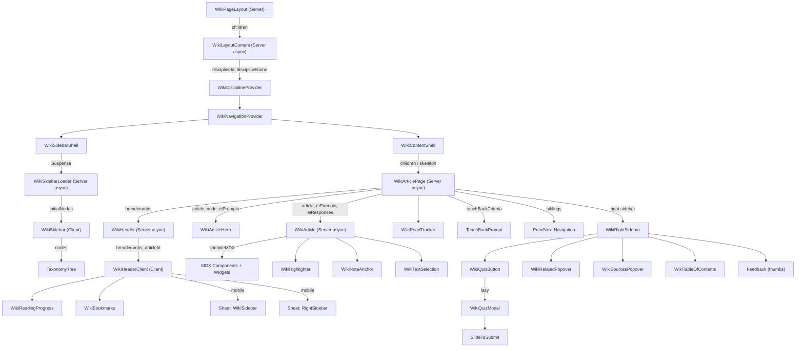
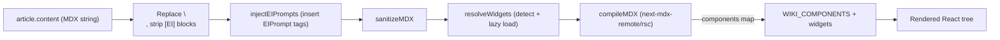
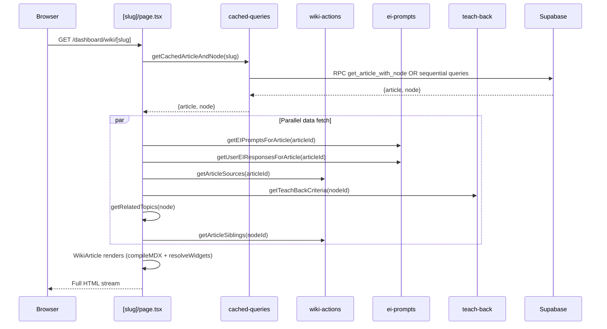

# Wiki Feature Specification Plan

## 00. Plan Metadata

| Field | Value |
|-------|-------|
| **Date** | 2026-04-08 |
| **Version** | 1.0 |
| **Author** | Claude Opus 4.6 (codebase audit) |
| **Target Spec File** | `.ai/docs/01-product/004-wiki.md` |
| **Scope** | Audit only — no source code modifications |
| **Executive Summary** | The SlateCamp Wiki is a mature, MDX-based knowledge base with 80+ component files, 7 database tables, 8 server action modules, and 19 registered interactive widgets. It provides LEA exam content via a taxonomy-linked article system with inline quizzes, elaborative interrogation, teach-back prompts, bookmarks, read tracking, highlights, and feedback. This plan documents every surface of the feature for spec rewrite. |

---

## 01. State Audit Summary

### Files Read
- **Route files:** 6 (layout, page, loading, [slug]/page, [slug]/loading, AGENTS.md)
- **Component files:** 30+ read in detail out of ~80 total
- **Server action files:** 8 (wiki-actions, wiki, wiki-bookmarks, wiki-interactions, wiki-reads, wiki-quiz, admin/wiki, admin/wiki-queries)
- **Type files:** app.ts (WikiArticle, WikiCategory, WikiPage, WikiSearchResult), supabase.ts (generated types)
- **Migration files:** 7 wiki-specific migrations reviewed
- **Utility files:** wiki-markdown.ts, cached-queries.ts, registry.ts, mdx-components-shared.ts

### Active Tasks
No conflicting tasks. The existing `004-wiki.md` is a shallow overview (dated 2026-04-06) that needs full replacement.

### Conflicts
None detected. The `ale_tests_you` field in existing 004-wiki.md is outdated — it has been renamed to `lea_tests_you` per migration `20260408_ale_to_lea_migration.sql`.

### Decision: **GO**

---

## 02. Route & File Tree

### App Routes

```
src/app/dashboard/wiki/
  AGENTS.md
  layout.tsx              # Server — wraps WikiLayoutContent in Suspense
  loading.tsx             # Loading skeleton
  page.tsx                # Client — landing page with feature grid
  [slug]/
    loading.tsx           # Article loading skeleton
    page.tsx              # Server — async article renderer (main entry point)
```

### Admin Routes (article management)

```
src/app/admin/articles/
  page.tsx                # Article list
  new/page.tsx            # Create new article
  [id]/
    page.tsx              # Edit article
    loading.tsx

src/app/admin/knowledge/
  page.tsx                # Taxonomy tree view with articles
  new/page.tsx            # Create new knowledge article
  import/page.tsx         # Import articles
  analytics/page.tsx      # Content analytics
  questions/              # Question management (linked to articles)
  [id]/page.tsx           # Article detail
  _components/
    ArticleDetailClient.tsx
```

### Component Tree

```
src/components/wiki/
  index.ts                           # Barrel exports (40 named exports)
  mdx-components-shared.ts           # MDX tag map (35+ tags for shared use)

  article/
    WikiArticle.tsx                   # Async Server — MDX compilation + widget resolution
    WikiArticleHeader.tsx             # Article header (legacy)
    WikiArticleHero.tsx               # Hero banner with subject/difficulty/read-time tags
    WikiArticleHero.stories.tsx
    WikiItemRenderer.tsx              # Renders taxonomy_tree.wiki_items JSONB array

  blocks/ (27 files)
    Accordion.tsx                     # Generic accordion
    AlertBox.tsx                      # Type-mapped alert (requirement/warning/info/danger)
    AuthorityContent.tsx              # Legal authority citation
    Callout.tsx                       # Unified callout (12 variants)
    Callout.stories.tsx
    ComparisonTable.tsx               # Comparison-styled table wrapper
    ComparisonTable.stories.tsx
    ElaborativeInterrogation.tsx      # MCQ/open-ended inline quiz prompt
    ElaborativeInterrogation.stories.tsx
    ExamTip.tsx                       # Exam-specific tip callout
    FormulaBlock.tsx                  # Math formula display
    FormulaBlock.stories.tsx
    GenericBlock.tsx                   # Passthrough for unregistered MDX tags
    InlineQuiz.tsx                    # Inline quiz block
    InlineQuiz.stories.tsx
    KeyValues.tsx                     # Key-value pair display
    KeyValues.stories.tsx
    LawCallout.tsx                    # Law citation callout
    Mermaid.tsx                       # Mermaid diagram renderer
    PrequestionGate.tsx               # Pre-question gate before content
    ProcessFlow.tsx                   # Ordered process timeline
    ProcessFlow.stories.tsx
    RevealBlock.tsx                   # Drag-to-reveal blurred content (identity-sensitive)
    RevealBlock.stories.tsx
    SubjectSnapshot.tsx               # Compact metadata bar
    SubjectSnapshot.stories.tsx
    TeachBackPrompt.tsx               # AI-evaluated teach-back prompt
    TeachBackPrompt.stories.tsx
    WikiAccordion.tsx                 # Wiki-specific accordion
    WikiCallout.tsx                   # Legacy callout (now aliases Callout)
    WikiCalloutBox.tsx                # Eyebrow callout (most-tested, lea-watch, version-alert)
    WikiChangedPill.tsx               # "Changed" indicator pill
    WikiExamTable.tsx                 # Exam-focused table
    WikiExamTable.stories.tsx
    WikiMistakeCard.tsx               # Common mistake card
    WikiMistakeList.tsx               # Mistake list container
    WikiPartHeader.tsx                # Part/section header
    WikiPre.tsx                       # Code block renderer
    WikiTabs.tsx                      # Tab container
    WrongAnswerBanner.tsx             # Banner shown when navigating from wrong quiz answer
    WrongAnswerBanner.stories.tsx

  navigation/ (14 files)
    WikiBookmarks.tsx                 # Bookmark popover with add/remove/list
    WikiContentShell.tsx              # Center pane wrapper with loading skeleton
    WikiContentShell.stories.tsx
    WikiDisciplineContext.tsx          # React Context for current discipline
    WikiHeader.tsx                    # Server — fetches breadcrumbs, renders WikiHeaderClient
    WikiHeader.stories.tsx
    WikiHeaderClient.tsx              # Client — breadcrumbs, mobile nav/actions drawers, reading progress
    WikiLayoutContent.tsx             # Server — orchestrates sidebar + content with providers
    WikiNavigationContext.tsx          # React Context + useTransition for navigation
    WikiReadingProgress.tsx           # Horizontal scroll progress bar
    WikiRightSidebar.tsx              # Right sidebar (quiz button, related, feedback, ToC)
    WikiRightSidebar.stories.tsx
    WikiSidebar.tsx                   # Client — taxonomy tree sidebar
    WikiSidebarLoader.tsx             # Server — async taxonomy data fetcher
    WikiSidebarShell.tsx              # Resizable sidebar wrapper with collapse toggle
    WikiSidebarSkeleton.tsx           # Sidebar loading skeleton
    WikiTableOfContents.tsx           # IntersectionObserver-based active heading ToC
    WikiTableOfContents.stories.tsx

  quiz/ (4 files)
    WikiQuizButton.tsx                # Lazy-loaded quiz trigger button
    WikiQuizButton.stories.tsx
    WikiQuizModal.tsx                 # Full quiz modal with SlideToSubmit, gated delay
    WikiQuizModal.stories.tsx

  shared/ (10 files)
    parse-mdx-prop.ts                 # MDX prop string parser utility
    transform-mistake-string.ts       # Mistake string transformer
    wiki-icons.ts                     # Icon mapping utility
    WikiHighlighter.tsx               # Text highlighter overlay
    WikiNoteAnchor.tsx                # Context anchor for notes
    WikiNoteAnchor.stories.tsx
    WikiReadTracker.tsx               # Scroll depth + time tracking (side-effect component)
    WikiReference.tsx                 # Reference citation renderer
    WikiReference.stories.tsx
    WikiRelatedPopover.tsx            # Related topics popover
    WikiRelatedPopover.stories.tsx
    WikiSourcesPopover.tsx            # Article sources popover
    WikiSourcesPopover.stories.tsx
    WikiTextSelection.tsx             # Text selection actions overlay
    WikiTextSelection.stories.tsx

  widgets/
    registry.ts                       # Widget registry (19 entries + detect/resolve)
    WidgetContainer.tsx               # Widget wrapper component
    WidgetContainer.stories.tsx
    Lab3DWidget.tsx                   # 3D Lab integration widget
    Lab3DWidget.stories.tsx
    bp344/ (9 files)                  # BP 344 Accessibility Standards widgets
      accessibility-data.ts
      ComparisonTable.tsx
      CorridorVisualizer.tsx
      CubicleChecker.tsx
      DoorConfigurator.tsx
      GrabBarExplainer.tsx
      index.ts
      RecallDrill.tsx / RecallDrill.stories.tsx
      RecallPractice.tsx
    dsgn013/ (14 files)               # DSGN-013 Furniture & Equipment widgets
      BedroomPlanView.tsx
      BedSizeComparator.tsx
      BodyDimensionDrill.tsx / .stories.tsx
      BodyDimensionExplorer.tsx
      BodyDimensionPractice.tsx
      DHRatioExplorer.tsx
      DimensionDrill.tsx / .stories.tsx
      DimensionPractice.tsx
      ProportionComparator.tsx
      ReachEnvelopeDiagram.tsx
      SpatialQualityDrill.tsx / .stories.tsx
      SpatialQualityPractice.tsx
      WorkstationCalculator.tsx
```

---

## 03. Component Inventory

### Route Components

| Component | File Path | Type | Parent | Responsibility |
|-----------|-----------|------|--------|----------------|
| WikiPageLayout | `src/app/dashboard/wiki/layout.tsx` | Server | App Router | Wraps WikiLayoutContent in Suspense |
| WikiPage | `src/app/dashboard/wiki/page.tsx` | Client | layout | Landing page with hero icon and feature grid |
| WikiArticlePage | `src/app/dashboard/wiki/[slug]/page.tsx` | Server (async) | layout | Fetches article + node + EI + sources + siblings, renders full article |
| WikiLoading | `src/app/dashboard/wiki/loading.tsx` | - | layout | Loading skeleton fallback |

### Layout & Navigation Components

| Component | File Path | Type | Parent | Responsibility |
|-----------|-----------|------|--------|----------------|
| WikiLayoutContent | `navigation/WikiLayoutContent.tsx` | Server (async) | WikiPageLayout | Fetches user + discipline, wraps in DisciplineProvider + NavigationProvider, renders sidebar + content |
| WikiDisciplineProvider | `navigation/WikiDisciplineContext.tsx` | Client | WikiLayoutContent | React Context for disciplineId + disciplineName |
| WikiNavigationProvider | `navigation/WikiNavigationContext.tsx` | Client | WikiLayoutContent | React Context with useTransition for navigation pending state |
| WikiSidebarShell | `navigation/WikiSidebarShell.tsx` | Client | WikiLayoutContent | Resizable sidebar wrapper (180-480px), collapse toggle, localStorage persistence |
| WikiSidebarLoader | `navigation/WikiSidebarLoader.tsx` | Server (async) | WikiSidebarShell | Fetches cached taxonomy tree, passes as initialNodes to WikiSidebar |
| WikiSidebar | `navigation/WikiSidebar.tsx` | Client | WikiSidebarLoader | Renders TaxonomyTree with article links, handles navigation via useWikiNavigation |
| WikiSidebarSkeleton | `navigation/WikiSidebarSkeleton.tsx` | Client | Suspense fallback | Animated loading skeleton for sidebar |
| WikiContentShell | `navigation/WikiContentShell.tsx` | Client | WikiLayoutContent | Shows ArticleSkeleton during navigation transitions, renders children otherwise |
| WikiHeader | `navigation/WikiHeader.tsx` | Server (async) | WikiArticlePage | Fetches breadcrumb trail, renders WikiHeaderClient |
| WikiHeaderClient | `navigation/WikiHeaderClient.tsx` | Client | WikiHeader | Breadcrumbs, mobile nav drawer (Sheet), mobile actions drawer, reading progress bar |
| WikiReadingProgress | `navigation/WikiReadingProgress.tsx` | Client | WikiHeaderClient | Horizontal progress bar tracking scroll position |
| WikiBookmarks | `navigation/WikiBookmarks.tsx` | Client | WikiHeaderClient | Bookmark popover with save/unsave/list, uses server actions |
| WikiRightSidebar | `navigation/WikiRightSidebar.tsx` | Client | WikiArticlePage | Quiz button, related topics, feedback thumbs, copy link, sources, ToC |
| WikiTableOfContents | `navigation/WikiTableOfContents.tsx` | Client | WikiRightSidebar | IntersectionObserver-based heading tracker with smooth scroll |

### Article Rendering Components

| Component | File Path | Type | Parent | Responsibility |
|-----------|-----------|------|--------|----------------|
| WikiArticle | `article/WikiArticle.tsx` | Server (async) | WikiArticlePage | MDX compilation via next-mdx-remote/rsc, widget resolution, EI prompt injection |
| WikiArticleHero | `article/WikiArticleHero.tsx` | Server | WikiArticlePage | Hero banner: subject tag, difficulty pill, read time, title, LEA orientation |
| WikiArticleHeader | `article/WikiArticleHeader.tsx` | Server | (legacy) | Older article header |
| WikiItemRenderer | `article/WikiItemRenderer.tsx` | - | - | Renders taxonomy_tree.wiki_items JSONB arrays |

### Block Components (27)

| Component | Variants/Props | Responsibility |
|-----------|---------------|----------------|
| Callout | 12 variants (note, warning, tip, example, info, danger, requirement, most-tested, lea-watch, version-alert, exam-tip, authority) | Unified callout with icon + eyebrow layouts |
| ElaborativeInterrogation | MCQ or open-ended, DB-driven or inline MDX | Interactive recall prompt with option selection and reveal |
| TeachBackPrompt | prompt, submitting, result, revising, done phases | AI-evaluated free-response with revision flow |
| RevealBlock | Drag-to-reveal with blur, keyboard support | Identity-sensitive gesture component using @use-gesture/react |
| ComparisonTable | - | Comparison-styled table wrapper |
| SubjectSnapshot | - | Compact metadata bar for subject overview |
| ProcessFlow | - | Ordered process timeline with vertical connector |
| FormulaBlock | - | Math formula display |
| InlineQuiz | - | Inline quiz block |
| KeyValues | - | Key-value pair display |
| WikiTabs / Tab | - | Tabbed content container |
| WikiAccordion / AccordionItem | - | Accordion content container |
| Mermaid | - | Mermaid diagram renderer |
| WikiPre | - | Code block renderer |
| LawCallout | - | Law citation callout, color-coded by legal code |
| WikiCalloutBox | most-tested, lea-watch, version-alert | Eyebrow callout (aliases Callout) |
| AlertBox | requirement, warning, info, danger | Alert callout (aliases Callout) |
| ExamTip | - | Exam tip callout (aliases Callout) |
| AuthorityContent | - | Legal authority citation (aliases Callout) |
| WikiExamTable | - | Exam-focused table |
| WikiMistakeCard / WikiMistakeList | - | Common mistake display |
| WikiPartHeader | - | Part/section header |
| WikiChangedPill | - | "Changed" indicator |
| WrongAnswerBanner | - | Banner when navigating from wrong quiz answer |
| GenericBlock | - | Passthrough for unrecognized MDX tags (15 aliases) |
| PrequestionGate | - | Pre-question gate before content |

### Quiz Components

| Component | File Path | Type | Responsibility |
|-----------|-----------|------|----------------|
| WikiQuizButton | `quiz/WikiQuizButton.tsx` | Client | Lazy-loads WikiQuizModal on click |
| WikiQuizModal | `quiz/WikiQuizModal.tsx` | Client | Full quiz flow: loading, question, feedback (gated 2s delay), results. Uses SlideToSubmit. Portal-rendered. |

### Shared Components

| Component | File Path | Type | Responsibility |
|-----------|-----------|------|----------------|
| WikiHighlighter | `shared/WikiHighlighter.tsx` | Client | Text highlight overlay |
| WikiNoteAnchor | `shared/WikiNoteAnchor.tsx` | Client | Context anchor for notes creation |
| WikiReadTracker | `shared/WikiReadTracker.tsx` | Client | Side-effect: tracks scroll depth + time spent via wiki-reads actions |
| WikiTextSelection | `shared/WikiTextSelection.tsx` | Client | Text selection action menu |
| WikiReference | `shared/WikiReference.tsx` | - | Reference citation renderer |
| WikiRelatedPopover | `shared/WikiRelatedPopover.tsx` | Client | Related topics popover |
| WikiSourcesPopover | `shared/WikiSourcesPopover.tsx` | Client | Article sources popover |

---

## 04. Component Tree Diagram

### Article Reader Flow



### MDX Rendering Pipeline



---

## 05. State Architecture

### WikiNavigationContext (Client Context)

**File:** `src/components/wiki/navigation/WikiNavigationContext.tsx`

```typescript
interface WikiNavigationContextValue {
  isPending: boolean        // useTransition pending state
  navigate: (href: string) => void  // router.push wrapped in startTransition
}
```

**Actions:** `navigate(href)` — triggers useTransition around router.push
**Consumers:** WikiSidebar (handleNavigate), WikiContentShell (shows skeleton when isPending)

### WikiDisciplineContext (Client Context)

**File:** `src/components/wiki/navigation/WikiDisciplineContext.tsx`

```typescript
interface DisciplineData {
  disciplineId: string | null
  disciplineName: string
}
```

**Actions:** None — read-only, set from server on layout render
**Consumers:** WikiHeaderClient (mobile sidebar), WikiSidebar (taxonomy tree fetch)

### WikiBookmarks (Local hook state)

**File:** `src/components/wiki/navigation/WikiBookmarks.tsx`

```typescript
// useWikiBookmarks hook — manages bookmark list in useState
interface Bookmark {
  articleId: string
  slug: string
  title: string
}
// Syncs with server via addWikiBookmark/removeWikiBookmark/getWikiBookmarks
```

**Note:** No Zustand stores found for wiki feature. All wiki state is component-local or React Context.

---

## 06. Data Flow & API Map

### Server Actions

| Action | File | Method | Tables Touched | Trigger |
|--------|------|--------|----------------|---------|
| `searchWikiArticles` | `wiki-actions.ts` | RPC `search_wiki_articles_pure` + ilike fallback | `wiki_articles` | Search input |
| `getArticleSources` | `wiki-actions.ts` | SELECT | `wiki_article_sources` | Article page load |
| `getWikiArticleBySlug` | `wiki-actions.ts` | SELECT | `wiki_articles` | Direct slug lookup |
| `getWikiArticleByTaxonomySlug` | `wiki-actions.ts` | SELECT chain | `taxonomy_tree` → `wiki_article_taxonomy` → `wiki_articles` | Taxonomy navigation |
| `getTaxonomyTree` | `wiki-actions.ts` | SELECT + chunked article mapping | `taxonomy_tree`, `wiki_article_taxonomy`, `wiki_articles` | Sidebar load |
| `getActiveTaxonomyNode` | `wiki-actions.ts` | SELECT chain | `wiki_articles` → `wiki_article_taxonomy` → `taxonomy_tree` | Node resolution |
| `resolveArticleAndNode` | `wiki-actions.ts` | RPC `get_article_with_node` + fallback | `wiki_articles`, `wiki_article_taxonomy`, `taxonomy_tree` | Article page ([slug]) |
| `getBreadcrumbTrail` | `wiki-actions.ts` | Cached tree traversal | `taxonomy_tree` (via cache) | WikiHeader |
| `getArticleSiblings` | `wiki-actions.ts` | SELECT siblings | `taxonomy_tree` | Prev/Next navigation |
| `getWikiTaxonomyTree` | `wiki.ts` | SELECT | `taxonomy_tree` | Legacy/alternative tree fetch |
| `getWikiArticlesByNode` | `wiki.ts` | SELECT via junction | `wiki_article_taxonomy` → `wiki_articles` | Node article list |
| `searchWiki` | `wiki.ts` | ilike search | `wiki_articles` | Fallback search |
| `searchWikiPaginated` | `wiki.ts` | ilike + count | `wiki_articles` | Paginated search |
| `getWikiBookmarks` | `wiki-bookmarks.ts` | SELECT + join | `wiki_bookmarks` → `wiki_articles` | Bookmark popover open |
| `addWikiBookmark` | `wiki-bookmarks.ts` | UPSERT | `wiki_bookmarks` | Save button |
| `removeWikiBookmark` | `wiki-bookmarks.ts` | DELETE | `wiki_bookmarks` | Remove button |
| `submitArticleFeedback` | `wiki-interactions.ts` | UPSERT | `wiki_article_feedback` | Thumbs up/down |
| `getUserArticleFeedback` | `wiki-interactions.ts` | SELECT | `wiki_article_feedback` | Article page load |
| `addWikiHighlight` | `wiki-interactions.ts` | INSERT | `wiki_highlights` | Text selection |
| `getWikiHighlights` | `wiki-interactions.ts` | SELECT | `wiki_highlights` | Article page load |
| `removeWikiHighlight` | `wiki-interactions.ts` | DELETE | `wiki_highlights` | Highlight remove |
| `recordArticleRead` | `wiki-reads.ts` | INSERT | `wiki_article_reads` | Article page mount |
| `updateReadProgress` | `wiki-reads.ts` | UPDATE | `wiki_article_reads` | Visibility change / unmount |
| `getWikiQuizQuestions` | `wiki-quiz.ts` | SELECT + session create | `taxonomy_tree`, `user_interactions`, `questions`, `quiz_sessions` | Quiz button click |
| `submitWikiQuizAnswer` | `wiki-quiz.ts` | SELECT + UPSERT x2 | `questions`, `user_interactions`, `user_node_mastery` | SlideToSubmit |
| `endWikiQuizSession` | `wiki-quiz.ts` | SELECT + UPDATE | `user_interactions`, `quiz_sessions` | Last question answered |
| `updateWikiArticle` | `admin/wiki.ts` | UPDATE + junction management | `wiki_articles`, `wiki_article_taxonomy` | Admin editor save |
| `createWikiArticle` | `admin/wiki.ts` | INSERT + junction | `wiki_articles`, `wiki_article_taxonomy` | Admin new article |
| `deleteWikiArticle` | `admin/wiki.ts` | DELETE cascade | `wiki_article_taxonomy`, `wiki_articles` | Admin delete |
| `getAdminTaxonomyTree` | `admin/wiki-queries.ts` | Multi-SELECT | `disciplines`, `taxonomy_tree`, `wiki_articles`, `wiki_article_taxonomy`, `questions` | Admin knowledge page |

### Article Load Sequence



---

## 07. Database Schema

### wiki_articles

```sql
-- Core table (created in base schema, not found in numbered migrations)
-- Columns reconstructed from generated types + migrations:
article_id     UUID PRIMARY KEY
slug           TEXT UNIQUE
title          TEXT NOT NULL
content         TEXT NOT NULL          -- MDX content
status         VARCHAR(20) DEFAULT 'draft'  -- draft|pending_review|changes_requested|approved|published|archived
created_at     TIMESTAMPTZ DEFAULT now()
updated_at     TIMESTAMPTZ DEFAULT now()
reviewed_by    UUID REFERENCES auth.users(id)
reviewed_at    TIMESTAMPTZ
reviewer_comments TEXT
created_by     UUID REFERENCES auth.users(id)  -- added 20260324
updated_by     UUID REFERENCES auth.users(id)  -- added 20260324
lea_tests_you  TEXT                             -- hero banner LEA statement (renamed from ale_tests_you)
updated_note   TEXT                             -- human-readable update note
subject_label  TEXT                             -- override subject label
difficulty_label TEXT CHECK (IN ('Foundational','Intermediate','Advanced'))
fts            TSVECTOR GENERATED ALWAYS AS (to_tsvector('english', title || ' ' || content))  -- full-text search
embedding      VECTOR(1536)                     -- semantic search (optional)
```

**RLS:** Enabled. Authenticated users can SELECT published articles. Admins can manage all.
**Indexes:** `idx_wiki_articles_status`, `idx_wiki_articles_reviewed_by`, GIN on `fts`

### wiki_article_taxonomy (junction)

```sql
-- Junction table linking articles to taxonomy nodes
article_id   UUID REFERENCES wiki_articles(article_id) ON DELETE CASCADE
node_id      UUID REFERENCES taxonomy_tree(node_id)
is_primary   BOOLEAN DEFAULT false
sort_order   SMALLINT
```

**Indexes:** `idx_wiki_article_taxonomy_node_id`, `idx_wiki_article_taxonomy_node_primary(node_id, is_primary)`, `idx_wiki_article_taxonomy_article_primary(article_id, is_primary)`
**RLS:** Admins can manage.

### wiki_bookmarks

```sql
bookmark_id  UUID PRIMARY KEY DEFAULT gen_random_uuid()
user_id      UUID NOT NULL REFERENCES auth.users(id) ON DELETE CASCADE
article_id   UUID NOT NULL REFERENCES wiki_articles(article_id) ON DELETE CASCADE
created_at   TIMESTAMPTZ NOT NULL DEFAULT now()
UNIQUE (user_id, article_id)
```

**RLS:** Users can SELECT/INSERT/DELETE their own bookmarks only.
**Indexes:** `idx_wiki_bookmarks_user(user_id, created_at DESC)`, `idx_wiki_bookmarks_user_article(user_id, article_id)`

### wiki_article_reads

```sql
-- Reconstructed from generated Supabase types (no migration file found)
read_id        UUID PRIMARY KEY
user_id        UUID NOT NULL REFERENCES auth.users(id)
article_id     UUID NOT NULL REFERENCES wiki_articles(article_id)
read_at        TIMESTAMPTZ DEFAULT now()
read_pct       INTEGER DEFAULT 0       -- scroll depth percentage (0-100)
time_spent_ms  INTEGER                  -- time spent reading
trail_step_id  UUID REFERENCES trail_steps(step_id)  -- optional Camp Trail link
```

**RLS:** Assumed user-scoped (code checks user_id on updates).

### wiki_article_feedback

```sql
id           UUID PRIMARY KEY DEFAULT uuid_generate_v4()
article_id   UUID NOT NULL REFERENCES wiki_articles(id) ON DELETE CASCADE
user_id      UUID NOT NULL REFERENCES auth.users(id) ON DELETE CASCADE
is_helpful   BOOLEAN NOT NULL
created_at   TIMESTAMPTZ NOT NULL DEFAULT NOW()
updated_at   TIMESTAMPTZ NOT NULL DEFAULT NOW()
UNIQUE(article_id, user_id)
```

**RLS:** Users can SELECT/INSERT/UPDATE their own feedback.

### wiki_highlights

```sql
id           UUID PRIMARY KEY DEFAULT uuid_generate_v4()
article_id   UUID NOT NULL REFERENCES wiki_articles(id) ON DELETE CASCADE
user_id      UUID NOT NULL REFERENCES auth.users(id) ON DELETE CASCADE
highlight_text TEXT NOT NULL
color        TEXT DEFAULT 'yellow'
created_at   TIMESTAMPTZ NOT NULL DEFAULT NOW()
updated_at   TIMESTAMPTZ NOT NULL DEFAULT NOW()
```

**RLS:** Users can SELECT/INSERT/UPDATE/DELETE their own highlights.

### wiki_article_sources

```sql
source_id    UUID PRIMARY KEY DEFAULT gen_random_uuid()
article_id   UUID NOT NULL REFERENCES wiki_articles(article_id) ON DELETE CASCADE
label        TEXT NOT NULL
description  TEXT
url          TEXT
source_type  TEXT NOT NULL DEFAULT 'reference_standard'
sort_order   SMALLINT NOT NULL DEFAULT 0
created_at   TIMESTAMPTZ NOT NULL DEFAULT now()
```

### RPC Functions

| Function | Purpose |
|----------|---------|
| `get_article_with_node(p_slug)` | Single-roundtrip article + node resolution |
| `search_wiki_articles_pure(query_text, match_count)` | Full-text search with ranking |

---

## 08. Content Model

### Format: MDX (Confirmed)

Content is stored as MDX in `wiki_articles.content` and compiled server-side using `next-mdx-remote/rsc` with `remark-gfm`.

### Rendering Pipeline

1. **Raw content** fetched from `wiki_articles.content`
2. **Newline normalization:** `content.replace(/\\n/g, '\n')`
3. **Legacy EI cleanup:** Strip `[EI]...[/EI]` blocks and HTML comments
4. **EI prompt injection:** `injectEIPrompts()` inserts `<EIPrompt>` tags after matching headings (driven by `ei_prompts` table)
5. **Sanitization:** `sanitizeMDX()` cleans problematic patterns
6. **Widget resolution:** `resolveWidgets()` scans for registered widget tag names, lazy-loads only needed widgets
7. **MDX compilation:** `compileMDX()` from next-mdx-remote/rsc with components map + scope variables
8. **Component map:** 50+ entries in `WIKI_COMPONENTS` including HTML overrides (h2/h3 with auto-IDs, custom table/thead/th/td/pre/code)

### MDX Component Categories

| Category | Components | Count |
|----------|-----------|-------|
| HTML overrides | h2, h3, table, thead, th, td, pre, code | 8 |
| Callouts | Note, Warn/Warning, Tip, Example, Callout, AlertBox, ExamTip, AuthorityContent | 8 |
| Wiki spec-v1 | WikiCalloutBox, WikiExamTable, WikiArticleHero, WikiPartHeader, WikiChangedPill, WikiMistakeCard/List | 7 |
| Interactive blocks | ElaborativeInterrogation, EIPrompt, EIBlock, InlineQuiz, RevealBlock | 5 |
| Content structure | KeyValues, FormulaBlock, Tabs/Tab, Accordion/AccordionItem, ComparisonTable, SubjectSnapshot, ProcessFlow | 9 |
| Reference/citation | LawCallout, WikiReference, Mermaid | 3 |
| Generic fallbacks | ConflictMatrix, EthicalFramework, RegulationFramework, etc. (15 aliases to GenericBlock) | 15 |
| No-op stubs | SPP206RefServices, SPP207RefServices | 2 |

### Widget Registry (19 entries)

Widgets are heavy interactive components loaded on-demand. Detection is string-based (`content.includes('<WidgetName')`).

| Widget | Module | Domain |
|--------|--------|--------|
| AccessibilityChangesTable | bp344/ComparisonTable | BP 344 |
| DoorConfigurator | bp344/DoorConfigurator | BP 344 |
| CorridorVisualizer | bp344/CorridorVisualizer | BP 344 |
| CubicleChecker | bp344/CubicleChecker | BP 344 |
| GrabBarExplainer | bp344/GrabBarExplainer | BP 344 |
| RecallDrill | bp344/RecallDrill | BP 344 |
| BedroomPlanView | dsgn013/BedroomPlanView | DSGN-013 |
| BedSizeComparator | dsgn013/BedSizeComparator | DSGN-013 |
| WorkstationCalculator | dsgn013/WorkstationCalculator | DSGN-013 |
| DimensionDrill | dsgn013/DimensionDrill | DSGN-013 |
| BodyDimensionExplorer | dsgn013/BodyDimensionExplorer | DSGN-013-01 |
| ReachEnvelopeDiagram | dsgn013/ReachEnvelopeDiagram | DSGN-013-01 |
| BodyDimensionDrill | dsgn013/BodyDimensionDrill | DSGN-013-01 |
| DHRatioExplorer | dsgn013/DHRatioExplorer | DSGN-013-03 |
| ProportionComparator | dsgn013/ProportionComparator | DSGN-013-03 |
| SpatialQualityDrill | dsgn013/SpatialQualityDrill | DSGN-013-03 |
| Lab3DWidget | Lab3DWidget | 3D Lab |
| PHBuildingSetbacks | interactive-illustrations/2D/SetbackIllustration | Building Code |

### Prose Configuration

The `prose-wiki` Tailwind utility (defined in `globals.css`) configures:
- Font: `font-sans` (Atkinson Hyperlegible), 15px base, line-height 1.7
- Max paragraph width: 65ch
- Full dark mode support via CSS custom properties
- Custom colors for body, headings, links, bold, counters, bullets, HR, quotes, code

---

## 09. Taxonomy & LEA Curriculum Map

### Hierarchy

The wiki is organized via the `taxonomy_tree` table (NOT wiki_categories — those are a legacy type).

| Level | Meaning | Example |
|-------|---------|---------|
| 1 | LEA Root Category | "Design of Architecture" |
| 2 | Subject/Topic | "Subject Overview & Strategy" |
| 3 | Subtopic (leaf) | "Human Body Dimensions and Reach Ranges" |

### Key Columns (taxonomy_tree)

```
node_id, discipline_id, parent_id, level, name, subject_area, is_leaf,
slug, sort_order, lea_id, description, exam_frequency, bloom_level,
difficulty, prc_area, is_cross_ref_only, deprecated_at
```

### Article-Taxonomy Relationship

- **Junction table:** `wiki_article_taxonomy` with `is_primary` flag
- **One article can map to multiple nodes** (cross-references)
- **One node can have multiple articles** (rare — most have one primary)
- **Leaf nodes (level 3)** are the primary article attachment points
- **Level 2 nodes** can also have articles (e.g., "Subject Overview & Strategy")

### Discipline Scoping

- The sidebar filters taxonomy_tree by `discipline_id`
- Discipline is resolved from `user_global_stats.current_discipline_id`
- The `disciplines` table holds available disciplines (e.g., ALE for Architecture)

### Breadcrumb Construction

`getBreadcrumbTrail()` traverses parent_id chain in-memory using the cached taxonomy tree. Returns root-first order.

---

## 10. Search Architecture

### Primary: Postgres Full-Text Search

- **RPC:** `search_wiki_articles_pure(query_text, match_count)`
- **Implementation:** `fts` generated tsvector column on `wiki_articles` (title + content)
- **Ranking:** Uses `ts_rank` for relevance ordering
- **Limit:** 10 results

### Fallback: ilike

- Used when RPC fails or is missing
- `title.ilike.%query%,content.ilike.%query%`
- Limited to 8 results with truncated content snippet

### Sidebar Search

- The `TaxonomyTree` component (shared, not wiki-specific) has its own `showSearch` prop
- Filters taxonomy nodes client-side by name matching

### Vector Search (Dormant)

- `wiki_articles.embedding VECTOR(1536)` column exists
- No active code path uses it (the hybrid search migration `20260403_hybrid_search.sql` exists but search actions only use the pure FTS RPC)

---

## 11. Hook & Utility Inventory

### Hooks

| Hook | File | Signature | Description |
|------|------|-----------|-------------|
| `useWikiNavigation` | `WikiNavigationContext.tsx` | `() => { isPending: boolean, navigate: (href) => void }` | Navigation with transition state |
| `useWikiDiscipline` | `WikiDisciplineContext.tsx` | `() => { disciplineId: string | null, disciplineName: string }` | Current discipline context |
| `useWikiBookmarks` | `WikiBookmarks.tsx` (local) | `() => { bookmarks, addBookmark, removeBookmark, isBookmarked, loaded }` | Bookmark CRUD with optimistic updates |

### Utilities

| Utility | File | Signature | Description |
|---------|------|-----------|-------------|
| `extractHeadings` | `wiki-markdown.ts` | `(markdown: string) => TocHeading[]` | Extract h2/h3 headings for ToC |
| `estimateReadingTime` | `wiki-markdown.ts` | `(markdown: string) => number` | Estimate reading time in minutes |
| `sanitizeMDX` | `wiki-markdown.ts` | `(content: string) => string` | Clean problematic MDX patterns |
| `markdownToHtml` | `wiki-markdown.ts` | `async (md: string) => string` | Convert markdown to HTML |
| `htmlToMarkdown` | `wiki-markdown.ts` | `(html: string) => string` | Convert HTML back to markdown |
| `detectWidgets` | `widgets/registry.ts` | `(content: string) => string[]` | Scan MDX for registered widget names |
| `resolveWidgets` | `widgets/registry.ts` | `async (content: string) => Record<string, ComponentType>` | Load only needed widgets |
| `parseMdxProp` | `shared/parse-mdx-prop.ts` | Generic MDX prop parser | Parse string MDX props to typed values |
| `transformMistakeString` | `shared/transform-mistake-string.ts` | - | Transform mistake string format |
| `toHeadingId` | `mdx-components-shared.ts` | `(children: ReactNode) => string` | Generate URL-safe anchor slug |

### Cached Query Functions

| Function | File | TTL | Description |
|----------|------|-----|-------------|
| `getCachedArticleAndNode` | `cached-queries.ts` | unstable_cache | Article + node for [slug] page |
| `getCachedTaxonomyTreeFull` | `cached-queries.ts` | 2h + tag | Full taxonomy tree for sidebar |
| `getCachedTaxonomyTreeByDiscipline` | `cached-queries.ts` | tag-based | Discipline-filtered tree |

---

## 12. UX & Interaction Patterns

### Navigation

- **Sidebar:** Resizable (180-480px) taxonomy tree with collapse toggle, width persisted in localStorage
- **Mobile:** Sheet drawers for both sidebar (left) and actions (right)
- **Breadcrumbs:** Auto-generated from taxonomy trail, shown in sticky header bar
- **Prev/Next:** Sibling articles shown in sticky footer
- **Transitions:** `useTransition` wraps navigation — WikiContentShell shows ArticleSkeleton during pending state

### Reading Experience

- **Prose config:** 15px font, 1.7 line-height, 65ch max paragraph width, full dark mode
- **Reading progress:** 2px horizontal progress bar in header
- **Read tracking:** WikiReadTracker records scroll depth (%) and time spent, flushes on visibility change
- **Text selection:** WikiTextSelection provides action menu on text select
- **Highlighting:** WikiHighlighter renders saved highlights over article text
- **Notes anchor:** WikiNoteAnchor provides context for note creation

### Bookmarks

- Database-backed (replaced localStorage)
- Popover accessed from header with save/unsave toggle
- Bookmark list with delete button, links to articles

### Search

- FTS via Postgres with ilike fallback
- Sidebar has client-side taxonomy filter
- No dedicated search results page

### Article-to-Quiz Flow

1. WikiQuizButton in right sidebar triggers lazy WikiQuizModal
2. Modal loads 5 questions from topic's leaf nodes (excludes recently-correct)
3. Creates a `quiz_sessions` record with `mode: 'article_review'`
4. SlideToSubmit gesture for answer confirmation
5. 2-second gated delay on feedback to force reading rationale
6. Mastery updated with lighter alpha (0.15 vs 0.30)
7. Results screen shows score and mastery note

### RevealBlock (Identity-Sensitive)

- Drag-to-reveal with blur effect using @use-gesture/react
- Keyboard accessible (arrow keys, Home/End)
- Quick toggle button alternative
- Watch item during design system migration (see `.ai/rules/identity_preservation_lock.md`)

### Elaborative Interrogation

- Two modes: DB-driven (EIPrompt with prompt_id, injected after headings) and inline MDX (legacy, uses question/answer props)
- MCQ with option selection or open-ended textarea
- Response saved to `ei_responses` table
- Tracks via analytics

### TeachBack

- Free-response "explain in your own words" prompt
- AI-evaluated via `submitTeachBack` server action
- Revision flow: prompt → submit → result → revise → done
- Minimum 20 words soft gate

---

## 13. Failure State Inventory

| Component | Loading | Error | Empty | Offline |
|-----------|---------|-------|-------|---------|
| WikiSidebar | Pulse skeleton | Renders empty aside | "No Discipline" with settings link | -- MISSING -- |
| WikiContentShell | Full ArticleSkeleton (breadcrumb + paragraphs + callouts + sidebar) | -- MISSING -- | N/A | -- MISSING -- |
| WikiArticlePage | via loading.tsx | `notFound()` on missing article | N/A | -- MISSING -- |
| WikiArticle (MDX) | N/A | Catches MDX compile error, renders raw content in amber pre block | N/A | N/A |
| WikiQuizModal | Spinner + "Loading questions..." | Silently catches, shows empty state | "No review questions available" with close button | -- MISSING -- |
| WikiBookmarks | Returns null until loaded | Silently returns empty array | "No bookmarks yet" with helper text | -- MISSING -- |
| WikiReadTracker | N/A (side-effect) | Logs to console, continues | N/A | -- MISSING -- |
| WikiRightSidebar | N/A | N/A (data passed from parent) | Conditional rendering for each section | -- MISSING -- |
| WikiTableOfContents | N/A | N/A | Returns null if no headings | N/A |
| WikiReadingProgress | N/A | N/A | Shows at 0% opacity | N/A |

**Key gaps:** No offline handling anywhere. No error boundaries in wiki component tree. MDX error fallback is minimal (raw text dump).

---

## 14. Admin & Authoring Surface

### Exists: Yes

Admin article management exists at two route groups:

**`/admin/articles`** — Basic CRUD
- List articles (`getArticles`)
- Create new article (`createWikiArticle`)
- Edit article by ID (`updateWikiArticle`)
- Delete article (`deleteWikiArticle`)

**`/admin/knowledge`** — Full taxonomy tree view
- Taxonomy tree with articles mapped to nodes (`getAdminTaxonomyTree`)
- Article detail with question count coverage
- Analytics page
- Import page
- Question management (questions linked to taxonomy nodes)

### Admin Operations

| Operation | Action | Auth Check |
|-----------|--------|------------|
| Create article | `createWikiArticle` | `canManageContent()` |
| Update article | `updateWikiArticle` | `canManageContent()` |
| Delete article | `deleteWikiArticle` | `canManageContent()` |
| View articles/tree | `getArticlesWithCoverage`, `getAdminTaxonomyTree` | `canReviewContent()` |
| Manage taxonomy mapping | Via update/create (junction table) | `canManageContent()` |

### Workflow Status

Articles have a 6-state workflow: `draft → pending_review → changes_requested → approved → published → archived`

Only `published` articles are shown to users (filtered in all SELECT queries).

### Limitations

- No rich editor — content is raw MDX text
- No version history / diff
- No preview mode (must publish to see)
- No bulk operations
- No content scheduling

---

## 15. Known Open Decisions & Technical Debt

### No TODOs or FIXMEs Found

Zero TODO/FIXME/HACK comments found in wiki components or wiki server actions.

### Identified Technical Debt

| Location | Description | Tag |
|----------|-------------|-----|
| `src/types/app.ts` | `WikiCategory` and `WikiPage` types exist but are NOT used by the wiki feature (legacy from v1 category-based system). The wiki now uses `taxonomy_tree` + `wiki_articles` via junction. | `CLEANUP` |
| `src/lib/actions/wiki.ts` | Duplicate functionality — `getWikiArticleBySlug` and `searchWiki` are simpler versions of functions in `wiki-actions.ts`. Two action files with overlapping purpose. | `CONSOLIDATE` |
| `wiki-actions.ts` | `select("*")` used in `getWikiArticleBySlug` and `getActiveTaxonomyNode` — violates project rule against `select('*')`. | `RULE_VIOLATION` |
| `wiki_article_feedback` migration | References `wiki_articles(id)` but the actual PK is `wiki_articles(article_id)` — potential FK mismatch. | `SCHEMA_CHECK` |
| Widget registry | String-based detection (`content.includes('<WidgetName')`) could false-positive on widget names appearing in prose text. | `LOW_RISK` |
| `WikiReadingProgress.tsx` | Uses `bg-camp-cobalt` hardcoded class instead of `bg-primary` — minor design token violation. | `DESIGN_TOKEN` |
| Vector search | `embedding VECTOR(1536)` column exists but no code path uses it. Dead column. | `CLEANUP` |
| `WikiSidebarShell.tsx` | Uses `ease-in-out` transition on width — violates the `ease-out` only rule. | `DESIGN_RULE` |
| `WikiSidebarShell.tsx` | Uses raw `<button>` in sidebar instead of shadcn `<Button>`. | `DESIGN_RULE` |
| `WikiBookmarks.tsx` | Uses raw `<button>` elements instead of shadcn components. | `DESIGN_RULE` |

---

## 16. Feature History & Evolution Notes

### Git Log (30 most recent wiki-related commits)

| Hash | Date (approx) | Description |
|------|---------------|-------------|
| `31ac84f` | 2026-04-08 | Global ALE to LEA terminology migration |
| `2f16f10` | 2026-04-07 | Design system compliance — radius, bg-white, zinc cleanup |
| `c101d58` | 2026-04-07 | Wiki W3 widget container + radius normalization |
| `6ddefc0` | 2026-04-07 | Wiki W2 callout refinements |
| `6cab697` | 2026-04-07 | Wiki W1 typography & table refinements |
| `97b8f70` | 2026-04-07 | Phase 3 layout & navigation overhaul |
| `d45476f` | 2026-04-07 | Wiki route optimization — RPC, cached sidebar, finite TTLs |
| `c9597dc` | 2026-04-06 | Subscription tier consolidation + testing to drills route migration |
| `91636fc` | 2026-04-05 | Quiz-v2 remediation and 3d-lab feature refactor |
| `7b5c248` | 2026-04-03 | Consolidate quiz, wiki, admin, and 3d lab modules |
| `3986dcd` | 2026-04-02 | Overhaul study surfaces and quiz workflows |
| `ff4eef5` | 2026-03-31 | Wiki sidebar data fetching + taxonomy tree support |
| `82d64af` | 2026-03-29 | Add WikiArticle components |
| `eb63644` | 2026-03-28 | Comprehensive wiki components + ALE question engine |
| `cb2488d` | 2026-03-27 | Hybrid search upgrade |
| `2952e5f` | 2026-03-26 | Mermaid diagram support |
| `e393de2` | 2026-03-24 | Admin dashboard + wiki knowledge management |
| `a6af9a3` | 2026-03-24 | Admin content management + wiki taxonomy navigation |
| `76fdf7d` | 2026-03-24 | Taxonomy mapping + article editing |

### Evolution Summary

1. **v1 (March 2026):** Basic wiki with categories (`WikiCategory`/`WikiPage` types), category-based navigation
2. **v2 (late March 2026):** Migration to taxonomy-tree based navigation, junction table `wiki_article_taxonomy`, article-node mapping
3. **v3 (early April 2026):** Interactive blocks (EI, RevealBlock, InlineQuiz), widget registry, MDX component enrichment
4. **v4 (April 7-8 2026):** Design system migration (W1-W3), performance optimization (RPC, caching), ALE to LEA terminology

---

## 17. Spec Document Implementation Plan

### Current State of 004-wiki.md

The existing doc is a shallow 50-line overview that:
- Lists WikiArticle and WikiCategory types (WikiCategory is legacy/unused)
- Does not cover navigation, state, interactions, database tables, or admin surface
- Uses outdated `ale_tests_you` field name
- Does not mention widgets, blocks, search, bookmarks, read tracking, or quiz integration

### Proposed Spec Sections

| Section | Source from Audit | Complexity | Priority |
|---------|-------------------|------------|----------|
| Overview & Purpose | Section 00 + existing doc intro | Low | 1 |
| Route Architecture | Section 02 (routes only) | Low | 2 |
| Component Architecture | Sections 03, 04 (diagrams) | High | 3 |
| State Management | Section 05 | Low | 4 |
| Data Model & Schema | Sections 07, 09 | Medium | 5 |
| Content Model & MDX Pipeline | Section 08 | High | 6 |
| Widget System | Section 08 (widget registry) | Medium | 7 |
| Navigation & Layout | Section 12 (navigation subset) | Medium | 8 |
| Search Architecture | Section 10 | Low | 9 |
| User Interactions | Section 12 (bookmarks, highlights, feedback, read tracking) | Medium | 10 |
| Article-to-Quiz Flow | Section 12 (quiz subset) | Medium | 11 |
| Pedagogical Integration | Sections 06, 12 (EI, TeachBack, mastery) | Medium | 12 |
| Admin & Authoring | Section 14 | Low | 13 |
| API Reference | Section 06 (table format) | Medium | 14 |
| Failure States & Error Handling | Section 13 | Low | 15 |
| Technical Debt & Known Issues | Section 15 | Low | 16 |
| Feature History | Section 16 (condensed) | Low | 17 |

### Gaps Requiring Investigation Before Spec Write

| Gap | What's Missing | How to Resolve |
|-----|---------------|----------------|
| `wiki_article_reads` CREATE TABLE | No migration file found — likely in base schema or seed file | Check `01_RESET_AND_SEED.sql` or run `\d wiki_article_reads` against live DB |
| `wiki_article_feedback` FK mismatch | References `wiki_articles(id)` but PK is `article_id` | Verify via live DB or check if there's a `id` alias |
| EI prompts table schema | `ei_prompts` table not documented | Read `src/lib/actions/ei-prompts.ts` for table shape |
| Teach-back table schema | `teach_back_submissions` table not documented | Read `src/lib/actions/teach-back.ts` for table shape |
| `wiki_categories`/`wiki_pages` tables | Legacy types exist — are the tables still in DB? | Check live DB or `00_DROP_ALL_TABLES.sql` |
| Storybook coverage | Stories exist for many components — not audited for completeness | Run `bun run storybook` or list all `.stories.tsx` files |

### Recommended Write Order

1. Start with Data Model (foundation for everything else)
2. Content Model & MDX Pipeline (core differentiator)
3. Component Architecture with diagrams
4. Navigation & Layout
5. User Interactions (bookmarks, highlights, feedback, reads)
6. Widget System
7. Article-to-Quiz + Pedagogical Integration
8. Search Architecture
9. State Management
10. Admin & Authoring
11. API Reference
12. Failure States
13. Technical Debt
14. Feature History
15. Overview (write last — summarizes everything)

### Estimated Effort

- **Spec rewrite:** 3-4 hours of focused writing
- **Gap investigation:** 1 hour (DB checks + EI/teach-back schema)
- **Diagram creation:** Included in write time (Mermaid)
- **Review pass:** 30 minutes

---

*End of audit plan. All 18 sections (00-17) present. All file paths verified from codebase. No fabricated paths or types.*
