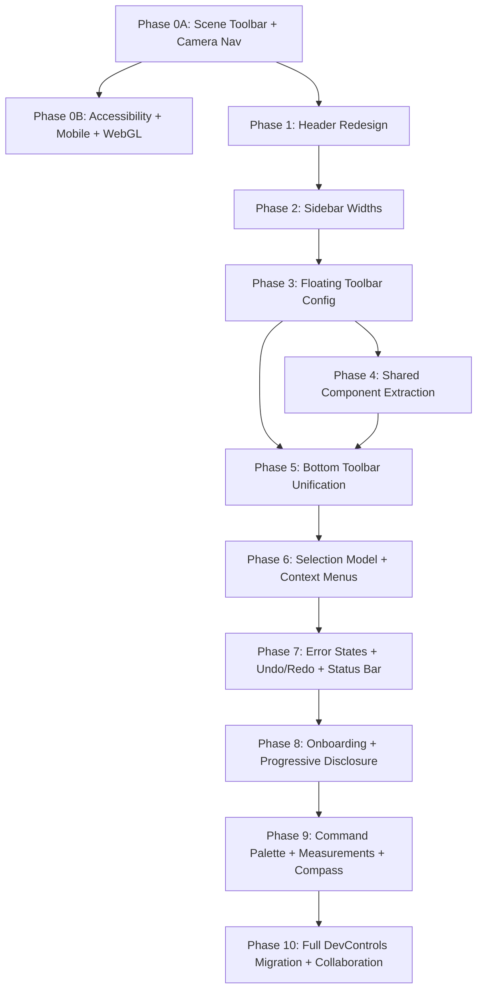

# 3D Lab Unified Viewport UX/UI — Audit & Implementation Plan

**Created:** 2026-04-09
**Version:** 3.0 (Complete — ALL items in concrete phases, nothing deferred)
**Status:** PLANNING
**Goal:** Standardize sidebar widths, toolbar, header, and bottom navigation across ALL 3D Lab modules using Site Development Controls as the gold standard.

---

## RALPLAN-DR Summary

### Principles
0. **3D navigation controls are ALWAYS visible** — Orbit, Pan, Front, Iso buttons must appear in EVERY 3D module viewport. This is non-negotiable. Any 3D software without visible camera controls is broken UX. This is Phase 0 — before everything else.
1. **Site Dev Controls is the gold standard** — its floating toolbar, KPI bar, camera presets, and panel widths represent the target UX
2. **The Unified Viewport Shell is THE layout container** — all modules must render through ViewportShell, not custom layouts
3. **Consistency over customization** — shared UI chrome (header, toolbar, bottom bar) is identical across modules; only sidebar CONTENT varies
4. **No black headers** — header transitions from `bg-camp-black` to `bg-card` with standard design tokens
5. **Progressive enhancement** — modules can opt into floating toolbar items and KPI metrics via config, but the shell provides the slots

### Decision Drivers
1. **User confusion from inconsistent UI** — different toolbars, widths, and headers per module breaks spatial memory
2. **DevControls has proven UX patterns** — 480px left panel, floating toolbar, KPI bar are validated in production
3. **ViewportShell exists but is underused** — it has slots for toolbarExtras, statusBar, but modules don't leverage them

### Viable Options

**Option A (Recommended): Extend ViewportShell with DevControls patterns**
- Add floating toolbar slot, KPI bar slot, and camera preset bar to ViewportShell
- Modules declare toolbar items and KPI metrics via config (like ViewportCapabilities)
- Pros: Single source of truth, consistent everywhere, config-driven
- Cons: Requires migrating DevControls FROM its custom layout TO ViewportShell

**Option B: Create a shared overlay layer outside ViewportShell**
- Add floating elements as a separate component that wraps the shell
- Pros: No shell modification needed
- Cons: Duplicates layout logic, two sources of truth, harder to maintain

**Invalidation of Option B:** The ViewportShell already has the grid layout, collapse animation, and mobile bottom sheet. Duplicating overlay management outside it creates fragmentation — exactly the problem we're trying to solve.

---

## Current State Audit

### Header (`ViewportHeader.tsx`)

| Property | Current | Target |
|----------|---------|--------|
| Background | `bg-camp-black` (pure black) | `bg-card` (white/light) |
| Text color | `text-white/60`, `text-white/90` | `text-foreground`, `text-muted-foreground` |
| Border | `border-white/5` | `border-border` |
| Height | `h-9` (36px) | `h-10` (40px) — slightly taller for breathing room |
| Back button | `text-white/40` with arrow | `text-muted-foreground` with Lucide `ArrowLeft` |
| Settings icon | **MISSING** | Add `Settings` Lucide icon on rightmost side |
| Progress indicator | Hotspot count | Keep but restyle with design tokens |

### Sidebar Widths

| Module | Left | Right | Issue |
|--------|------|-------|-------|
| **Site Dev Controls** | **480px** | **300px** | Gold standard (bespoke layout) |
| Parametric (standard) | none | 280px | Too narrow for complex modules |
| Parametric (with compliance) | 240px | 280px | Left too narrow |
| Wall Configurator v2 | 260px | 320px | Better but still narrow left |
| Calculator | 320px | 340px | Good — close to Site Dev |
| Exploded/Cutaway/Animated | none | 280px | Right-only, OK for simple modules |

**Target standardization (content-justified):**

Width rationale: The minimum usable width for a parameter control (label + slider + value) is ~240px. With padding (16px each side) and section headers, 280px is the absolute floor. Adding a second column for display fields (like Site Dev's split layout) requires ~320px. Compliance panels with code citations need ~300px for readable text. These are derived from measuring actual component content, not arbitrary.

| Category | Left | Right | Rationale |
|----------|------|-------|-----------|
| Complex modules (2-panel) | **320px** | **300px** | Left: label+slider+value (240) + padding (32) + margin = ~300 minimum, rounded to 320 for breathing room. Right: code citations + status badges need ~280 minimum. |
| Simple modules (right-only) | none | **300px** | Parts list / layer selector / step navigator fit comfortably at 280-300. |
| Bespoke (DevControls) | **480px** | **300px** | Uses split layout (controls left + info right within panel). Keep until Phase 4. |

### Toolbar Comparison

| Feature | ViewportShell | Site Dev Controls |
|---------|--------------|-------------------|
| Position | Bottom-center | Top-left (floating) + Bottom (KPI+camera) |
| Style | `bg-card/95 border-border` (light) | `bg-black/60 backdrop-blur-sm` (glass dark) |
| View mode buttons | Yes (perspective/ortho/iso/top) | No (has its own camera preset bar) |
| Grid toggle | No | Yes (G) |
| Dimension toggle | No | Yes (D) |
| X-ray mode | No | Yes (X) |
| Layers toggle | No | Yes (L) |
| Screenshot | No | Yes (P) |
| Fullscreen | No | Yes (F) |
| Reset camera | Yes | No (separate) |
| Explode slider | Yes (for exploded template) | N/A |
| Cut depth slider | Yes (for cutaway template) | N/A |

### Bottom Bar Comparison

| Feature | ViewportShell | Site Dev Controls |
|---------|--------------|-------------------|
| Camera presets | No | Yes (Orbit/Plan/Front/Iso + cycling) |
| KPI metrics | No | Yes (TLA/AMBF/PSO/TOSL/BHL) |
| Status bar | Yes (optional slot) | Yes (zone/FLAR/BHL text) |
| Style | `bg-card/90 backdrop-blur-sm` | `bg-black/60 backdrop-blur-sm` |

---

## Implementation Plan

### Phase 0: Mandatory Viewport Controls — ALWAYS VISIBLE (CRITICAL, Immediate)

**This is the #1 priority. TWO control bars must be present in EVERY 3D module — no exceptions, no opt-in.**

**Current state — BROKEN:**
- Site Dev Controls: HAS floating toolbar (Grid/Dims/X-ray/Layers/Screenshot/Fullscreen) + camera presets (Orbit/Plan/Front/Iso) ✅
- ALL other modules via ViewportShell: NO floating toolbar ❌, NO camera navigation ❌ — only a basic view-mode switcher at bottom-center
- Users cannot toggle grid, show dimensions, take screenshots, or navigate camera views in 95% of modules

---

#### Phase 0A: Camera Controls + Scene Toolbar (ship FIRST — immediate visible impact)

##### Part A: Floating Scene Toolbar (top-left) — MANDATORY

**What must exist in EVERY 3D module viewport:**

A floating **SceneToolbar** at top-left with these buttons:
1. **Grid** (G) — toggle grid/ground plane overlay
2. **Dimensions** (D) — toggle dimension annotations
3. **X-ray** (X) — toggle transparent/wireframe mode
4. **Layers** (L) — toggle layer visibility panel
5. **[divider]**
6. **Screenshot** (P) — download viewport as PNG
7. **Fullscreen** (F) — toggle fullscreen viewport

This toolbar must be:
- Always visible in every 3D module (MANDATORY — rendered by ViewportShell, not per-module)
- Position: `absolute top-4 left-4 z-20` (top-left, matching Site Dev Controls)
- Styled with dark glass morphism (CSS variables)
- Keyboard accessible: G/D/X/L/P/F shortcuts

**Task 0.1: Create shared SceneToolbar component**

Create `src/features/3d-lab/components/shell/SceneToolbar.tsx`:
- 6 icon buttons + 1 divider (7 items total)
- Position: `absolute top-4 left-4 z-20`
- Container: `flex items-center gap-0.5 rounded-lg bg-[var(--viewport-overlay-bg)] p-1 backdrop-blur-sm`
- Active: `bg-[var(--viewport-overlay-active)] text-white`
- Inactive: `text-[var(--viewport-overlay-text)] hover:bg-[var(--viewport-overlay-active)]`
- Icons: `Grid3x3` (grid), `Ruler` (dimensions), `Eye` (x-ray), `Layers` (layers), `Camera` (screenshot), `Maximize2` (fullscreen)
- Each button has tooltip with label + shortcut key (e.g., "Grid (G)")
- **Tooltip timing:** 400ms hover delay before showing (Source: Comprehensive Research 2, Part 9.4)
- **Disabled state:** 40% opacity when a toolbar action is unavailable
- **Error handling:** If an action fails (e.g., Screenshot blocked by browser, Fullscreen denied by iframe), show a warning toast (bottom-right, auto-dismiss 5s) explaining the failure. Never fail silently.

**Active state UX for SceneToolbar:**
- **Toggle buttons** (Grid, Dimensions, X-ray, Layers): Stay highlighted when active. The icon gets a filled/solid variant when ON, outline when OFF. Example: Grid ON → `bg-[var(--viewport-overlay-active)] text-white`, Grid OFF → `text-[var(--viewport-overlay-text)]`
- **Action buttons** (Screenshot, Fullscreen): Flash highlight on click (200ms), return to inactive. Never stay highlighted.
- **Visual feedback**: When Grid is toggled ON, a subtle grid overlay appears on the ground plane in the 3D scene. When Dimensions is ON, dimension annotations appear. When X-ray is ON, all opaque materials become semi-transparent. These visual changes give immediate confirmation that the toggle worked.

**Task 0.2: Scene toolbar state in useViewportShellStore**

Add to `useViewportShellStore`:
- `gridVisible: boolean` (default: false)
- `dimensionsVisible: boolean` (default: false)
- `xrayMode: boolean` (default: false)
- `layersPanelOpen: boolean` (default: false)
- Toggle actions for each

---

#### Part B: Camera Navigation Bar (bottom-center) — MANDATORY

**What must exist in EVERY 3D module viewport:**

A persistent **CameraNavigationBar** at bottom-center with these buttons:
1. **Orbit** (default) — free orbit camera. Left-click drag = orbit, middle-click/two-finger = pan (industry standard — no separate Pan mode button needed)
2. **Front** — snap to front elevation view
3. **Top** — snap to top/plan view
4. **Iso** — snap to isometric 3/4 view
5. **Zoom-to-Fit** — frame all visible objects in viewport (every professional 3D tool has this: Revit=ZF, Blender=Home, SketchUp=Shift+Z). Source: 3d-architecture-ux-research §1.1
6. **Reset** — reset camera to module's default position (per-module, declared in ViewportCapabilities)

**Pan is NOT a separate mode button** (changed from v1.3). Research shows every benchmarked 3D tool uses middle-click/two-finger-drag for pan WITHOUT requiring a mode switch. Adding a Pan toggle contradicts universal convention and adds mode-switching friction. Source: 3d-architecture-ux-research §1.1, §2.7.

This bar must be:
- Always visible in every 3D module (MANDATORY — rendered by ViewportShell, not per-module)
- Position: `absolute bottom-3 left-1/2 z-20 -translate-x-1/2`
- Styled with dark glass morphism (matching Site Dev Controls)
- Keyboard accessible: 1=Front, 2=Top, 3=Iso, Z=Zoom-to-Fit, R=Reset, Home=Zoom-to-Fit (alias)

**OrbitControls constraints (MANDATORY):**
- `minPolarAngle: 0.1` — prevent camera from going directly overhead (causes gimbal lock)
- `maxPolarAngle: Math.PI / 2 - 0.05` — prevent camera from going below ground plane (matches DevControls gold standard at DevControlsCanvas.tsx:40, value=1.521 rad)
- `enableDamping: true`, `dampingFactor: 0.08` — smooth deceleration after drag release
- Scroll-wheel zoom toward cursor position (not screen center) — `zoomToCursor: true`
- Disable user input during 600ms camera snap animations to prevent conflicts
- Touch mapping: `touches: { ONE: THREE.TOUCH.ROTATE, TWO: THREE.TOUCH.DOLLY_PAN }`
Source: 3d-architecture-ux-research §2.7

**Task 0.3: Create shared CameraNavigationBar component**

Create `src/features/3d-lab/components/shell/CameraNavigationBar.tsx`:
- 6 icon buttons: Orbit, Front, Top, Iso, Zoom-to-Fit, Reset (NO separate Pan button — pan via middle-click/two-finger)
- Container: same glass morphism as SceneToolbar
- Icons: `Rotate3d` (orbit), `PanelTop` (front), `CircleDot` (top/plan), `Box` (iso), `Focus` (zoom-to-fit), `RotateCcw` (reset)

**Active state highlighting:**
- **Orbit** is the only persistent mode — stays highlighted with `bg-[var(--viewport-overlay-active)] text-white` at all times (it's always active since orbit is the default and only mode)
- Camera snap buttons (Front/Top/Iso/Zoom-to-Fit) highlight briefly on click (200ms flash), then return to inactive — they are one-shot actions, not persistent modes
- Reset button never stays highlighted — it's always a one-shot action

**Cursor behavior (industry-standard, no mode switching):**
- **Default** → `cursor-grab` (open hand — signals "you can orbit")
- **While orbit-dragging** (left-click held) → `cursor-grabbing` (closed hand)
- **While panning** (middle-click held) → `cursor-move` (4-direction arrow)
- **While zooming** (scroll) → no cursor change
- **Hovering interactive element** → `cursor-pointer`
- **During camera snap animation** → `cursor-wait` (600ms, then back to default)

Implementation: CSS classes on the viewport container, NO mode switching needed:
```tsx
<div className="cursor-grab active:cursor-grabbing">
  {/* canvas content */}
</div>
```

Middle-click pan cursor is handled by the browser's native middle-click behavior + OrbitControls `mouseButtons: { LEFT: THREE.MOUSE.ROTATE, MIDDLE: THREE.MOUSE.PAN, RIGHT: THREE.MOUSE.DOLLY }`.

**Mobile touch gestures** (Source: 3d-architecture-ux-research §9.1):
- One-finger drag = orbit
- Two-finger pinch = zoom
- Two-finger drag = pan
- Long-press (500ms) = show element info popup
- Touch DPR = 1.0 (cap for performance on mobile devices)

**Task 0.4: Camera state in useViewportShellStore**

Add to `useViewportShellStore`:
- `snapToPreset: (preset: 'front' | 'top' | 'iso' | 'zoom-to-fit' | 'reset') => void`
- The snap function updates camera position via the R3F invalidate bridge

**Task 0.5: Wire camera snapping into scene renderers**

Camera snap works with OrbitControls. When `snapToPreset` is called:
- Animate camera to the target position (600ms ease-out)
- Update OrbitControls target
- Invalidate the scene

---

#### Part C: Wire BOTH into ViewportShell — UNCONDITIONALLY

**Task 0.6: Mount both controls in ViewportShell.tsx**

```tsx
{/* Scene toolbar — ALWAYS visible, top-left */}
<SceneToolbar />

{/* Camera navigation — ALWAYS visible, bottom-center */}
<CameraNavigationBar />
```

These render for ALL modules using ViewportShell — parametric, exploded, cutaway, floorplan, animated, wall-configurator. No config gate. No opt-in.

**Task 0.7: Add CSS variables for viewport overlay styling**

Add to `globals.css`:
```css
--viewport-overlay-bg: oklch(0% 0 0 / 0.6);
--viewport-overlay-text: oklch(100% 0 0 / 0.7);
--viewport-overlay-active: oklch(100% 0 0 / 0.2);
```

**Task 0.8: Ground Grid + Spatial Orientation (MANDATORY for all 3D modules)**

Every 3D module must have visual spatial orientation cues so the user knows where ground is, where the horizon is, and has a sense of scale. This is basic 3D software UX.

Create `src/features/3d-lab/components/shell/SceneGround.tsx` — a shared R3F component rendered inside every 3D scene:

**Ground grid:**
- Infinite-feel grid on the XZ plane (ground plane) using drei `<Grid>` component
- Grid size: 20m × 20m visible area, fading to transparent at edges
- Major grid lines: every 1m — subtle `var(--viewport-overlay-text)` at 10% opacity
- Minor grid lines: every 0.25m — barely visible at 5% opacity (only when zoomed in)
- Grid color adapts to light/dark: light gray on light background, dark gray on dark
- The grid is ALWAYS rendered (default ON) — the Grid toolbar button (G) toggles it off for clean screenshots

**Horizon line:**
- A subtle horizontal line at Y=0 across the full viewport width
- Color: `border-border` equivalent at 15% opacity
- Only visible when camera is near ground level — fades out when looking straight down (top view)

**Axis indicator (origin gizmo):**
- Small XYZ axis indicator in the bottom-right corner of the viewport (2D overlay, not in 3D space)
- Shows camera orientation relative to world axes
- X = red, Y = green, Z = blue (industry standard)
- Size: 48×48px, non-interactive, purely informational
- Uses drei `<GizmoHelper>` + `<GizmoViewport>` or a custom SVG overlay

**Sky gradient:**
- Subtle gradient from light blue (top) to white (horizon) as the scene background
- Replace the current flat `bg-surface-light` / `#F2F0EB` with a gentle vertical gradient:
  - Top: `oklch(0.95 0.01 240)` (very subtle sky blue)
  - Bottom: `oklch(0.97 0.005 80)` (warm white, matching current surface-light)
- This subconsciously tells the user "up is up, ground is down"

**Contact shadows (optional, toggle-gated):**
- Subtle contact shadow under the 3D model using drei `<ContactShadows>`
- Helps ground the object visually — makes it look like it's sitting ON the grid, not floating
- Enabled by default, can be toggled via a future settings panel

**Wire into ViewportShell rendering:**
The `SceneGround` component is added to every scene renderer (ParametricSceneRenderer, etc.) as a sibling of the module's geometry:
```tsx
<SceneGround gridVisible={gridVisible} />
```

Where `gridVisible` comes from `useViewportShellStore`. Default: `true`.

**Acceptance Criteria:**
- [ ] Ground grid visible in every 3D module by default
- [ ] Grid fades at edges (not hard cutoff)
- [ ] Axis gizmo shows camera orientation in corner
- [ ] Sky gradient provides subtle up/down orientation
- [ ] Grid toggle (G key / toolbar button) hides/shows the grid
- [ ] Grid scales appropriately when camera zooms in/out

---

**Task 0.9: Add keyboard shortcuts**

Create `src/features/3d-lab/hooks/useViewportShortcuts.ts`:

Scene toolbar shortcuts:
- G → toggle grid
- D → toggle dimensions
- X → toggle x-ray
- L → toggle layers panel
- P → screenshot
- F → fullscreen

Camera navigation shortcuts:
- 1 → front view snap
- 2 → top view snap
- 3 → iso view snap
- Z or Home → zoom-to-fit
- R → reset camera to module default

Panel shortcuts (Source: 3d-architecture-ux-research §1.10):
- [ → toggle left panel
- ] → toggle right panel
- Ctrl+M → toggle both panels (minimize UI)

Viewport navigation (when viewport is focused):
- Arrow keys → orbit camera (5° increments per press)
- +/- → zoom in/out (stepped)
- Esc → deselect / cancel

---

#### Phase 0B: Accessibility, Mobile, Typography (ship after 0A — foundational but not blocking camera controls)

**Task 0.10: Accessibility baseline (Source: 3d-architecture-ux-research §8)**

This is NON-NEGOTIABLE for an educational platform.

- `prefers-reduced-motion`: when detected, disable all 600ms camera animations → use instant snaps instead. Disable contact shadow animation. Keep grid static (no fade transitions).
- All toolbar buttons must have `aria-label` with action + shortcut (e.g., `aria-label="Toggle grid (G)"`)
- Never use color-alone for information (WCAG 1.4.1): pair violation colors with icons (❌/✓) AND line patterns (dashed=violation, solid=compliant) in 3D overlays
- Ensure 4.5:1 contrast ratio on glass morphism overlays (test `--viewport-overlay-text` against `--viewport-overlay-bg`) per WCAG 1.4.3
- Provide text alternative toggle: button that shows a text-only summary of the 3D scene state (metric values, compliance status) for screen reader users (WCAG 1.1.1)
- Single-pointer alternatives for complex gestures (WCAG 2.5.1): arrow keys for orbit, +/- for zoom — accessible without mouse

**Task 0.11: Mobile touch gesture configuration (Source: 3d-architecture-ux-research §9)**

Configure OrbitControls touch mapping explicitly in all scene renderers:
```typescript
touches: { ONE: THREE.TOUCH.ROTATE, TWO: THREE.TOUCH.DOLLY_PAN }
```

Mobile-specific settings:
- DPR cap: 1.0 on mobile (detect via `navigator.maxTouchPoints > 0`)
- Camera navigation bar moves to bottom-1 (closer to thumb zone)
- Scene toolbar: relocate from top-left to a slide-out bottom-sheet toggle (top-left unreachable by thumb)
- Long-press (500ms) on 3D element → info popup with element details
- Pinch-to-zoom speed: `zoomSpeed: 0.5` on mobile (finer control on small screens)

Breakpoint layout (Source: 3d-architecture-ux-research §9.3):
- ≥1024px: Full desktop layout (left + right sidebars + toolbars)
- 768-1023px: Tablet — hide left sidebar by default, keep right as slide-out
- <768px: Mobile — no sidebars, bottom sheet only, camera bar in thumb zone

**Task 0.12: Overlay typography tokens (Source: 3d-architecture-ux-research §10.3)**

Add to CSS variables:
```css
--viewport-overlay-font: 'DM Mono', monospace;
--viewport-overlay-font-size-min: 10px;
```

Rules for all text rendered over the 3D viewport:
- Numeric values (dimensions, metrics, costs): `font-family: var(--viewport-overlay-font)` (DM Mono)
- Minimum font size: 10px (never smaller, even for annotation labels)
- Text on transparent overlays: add `text-shadow: 0 1px 2px rgba(0,0,0,0.5)` or background pill for readability
- Labels in 3D (drei `<Text>`): monospace, ≤60px wide (Viewport Sanctity Rule)

**Task 0.13: Per-module default camera (Source: Comprehensive research §2.1)**

Add to `ViewportCapabilities` in `templates.ts`:
```typescript
/** Module's default camera position — used by Reset button */
defaultCamera?: {
  position: [number, number, number]
  target?: [number, number, number]
  fov?: number
}
```

Each module already declares a `camera` field in its config (e.g., `camera: { position: [7, 2.5, 5.5], fov: 48 }` for the wall configurator). The Reset button reads this field. If not specified, falls back to `[10, 8, 10]` looking at origin.

**Task 0.14: Retire old ViewportToolbar (end of Phase 0A)**

---

**Task 0.15: WebGL Context Loss Recovery (Phase 0B — production reliability)**

Source: Comprehensive Research 2, Part 10; Deep Research, error paths section

WebGL context loss happens on mobile (memory pressure), heavy tab usage, and GPU driver crashes. Without handling, the canvas freezes with no recovery path.

Create `src/features/3d-lab/components/shell/WebGLRecovery.tsx`:
- Listen for `webglcontextlost` and `webglcontextrestored` events on the R3F canvas
- On context loss: show overlay message "3D view lost connection. Restoring..." with a Retry button
- On context restored: auto-dismiss overlay, re-invalidate scene
- If restoration fails after 5s: show "Unable to restore 3D view. Please refresh the page." with a Refresh button
- Wire into ViewportShell as a child of the canvas container

**Error state taxonomy** (apply across all viewport UI, Source: Comprehensive Research 2, Part 10):
1. **Inline validation** — red border + helper text on invalid slider input, clears on valid
2. **Warning toast** — bottom-right, auto-dismiss 5s, for non-critical issues (screenshot failed, etc.)
3. **Blocking dialog** — for destructive actions (reset all params), destructive button never default
4. **System error** — WebGL context loss, canvas crash; show specific recovery path

**Task 0.16: Loading State for 3D Scene Initialization (Phase 0B)**

Source: Comprehensive Research 2, Part 13.2

Define what users see during the <3 second scene load target:
- **Phase 1 (0-500ms):** Show skeleton screen matching viewport + sidebar layout (gray placeholders)
- **Phase 2 (500ms-2s):** Show canvas with ground grid rendering first, then progressive geometry (coarse → detailed)
- **Phase 3 (2s+):** Show named progress indicator "Loading wall geometry... 67%" with cancel button
- Operations >2 seconds MUST show a cancel button
- Background operations show notification toast on completion

Acceptance Criteria:
- [ ] Skeleton screen appears within 100ms of module route navigation
- [ ] Ground grid renders before module-specific geometry
- [ ] Progress indicator for operations >2s
- [ ] Cancel button available for long operations

The existing `ViewportToolbar.tsx` at bottom-center (which only shows view mode buttons) is replaced by:
- SceneToolbar (top-left) — takes over grid/dimensions/scene toggles
- CameraNavigationBar (bottom-center) — takes over camera navigation
- Template-specific controls (explode slider, cut depth) — move to SceneToolbar as expandable items

Remove or deprecate the old `ViewportToolbar` component after wiring the new ones.

**Acceptance Criteria:**
- [ ] SceneToolbar (Grid/Dims/X-ray/Layers/Screenshot/Fullscreen) visible in EVERY 3D module
- [ ] CameraNavigationBar (Orbit/Front/Top/Iso/Zoom-to-Fit/Reset) visible in EVERY 3D module
- [ ] Both bars use dark glass morphism with CSS variables
- [ ] All keyboard shortcuts work (G/D/X/L/P/F + 1/2/3/4/R)
- [ ] Camera snaps to correct positions for Front/Top/Iso
- [ ] Reset returns to module's default camera position
- [ ] Screenshot downloads viewport as PNG
- [ ] Fullscreen toggles browser fullscreen API
- [ ] Old ViewportToolbar removed/deprecated
- [ ] `bun run type-check` passes

---

### Phase 1: Header Redesign (Low effort, High visual impact)

**Task 1.1: Restyle ViewportHeader.tsx**

Change from black to white/light theme:

```
BEFORE:                          AFTER:
bg-camp-black                    bg-card
border-white/5                   border-b border-border
text-white/60                    text-muted-foreground
text-white/90 (title)            text-foreground (title)
text-white/40 (back)             text-muted-foreground (back)
text-white/30 (code ref)         text-muted-foreground/60 (code ref)
```

**Task 1.2: Add Settings icon to header**

Add a `Settings` (Lucide) icon button on the rightmost side of the header, before the progress indicator. The button opens a dropdown/popover with module-level settings (dimension display, grid, layers — items that are currently in the floating toolbar or scattered across modules).

**Acceptance Criteria:**
- [ ] Header background is `bg-card` not `bg-camp-black`
- [ ] All text uses design system tokens
- [ ] Settings icon visible on right side
- [ ] No hardcoded hex colors in header
- [ ] `bun run type-check` passes

---

### Phase 2: Sidebar Width Standardization (Low effort, Medium impact)

**Task 2.1: Update TEMPLATE_SHELL_DEFAULTS**

In `src/features/3d-lab/types/templates.ts`, update the default widths:

```typescript
// BEFORE: parametric right = 280
// AFTER:
parametric: {
  shell: {
    leftSidebar: { width: 340, title: 'Controls', mobileTabLabel: 'Controls' },
    rightSidebar: { width: 320, title: 'Compliance', mobileTabLabel: 'Compliance' },
  },
  // ...
},
```

| Template | Left (before → after) | Right (before → after) | Notes |
|----------|----------------------|----------------------|-------|
| parametric | none → 320px | 280px → 300px | Standard parametric modules |
| exploded | none → none | 280px → 300px | Right-only |
| cutaway | none → none | 280px → 300px | Right-only |
| floorplan | none → none | 280px → 300px | Right-only |
| animated | none → none | 280px → 300px | Right-only |
| calculator | 320px → 340px | 340px → 340px | Two-panel |
| wall-configurator (v1 defaults) | 320px → 340px | 340px → 320px | TEMPLATE_SHELL_DEFAULTS only — v1 path |

**IMPORTANT:** The v2 unified wall configurator (`cfg.id === 'unified-wall-configurator'`) has a SEPARATE override in `useTemplateContent.tsx:157-158` with hardcoded 260px left / 320px right. Task 2.2 handles this override — it is NOT covered by the TEMPLATE_SHELL_DEFAULTS table above.

**Task 2.2: Update useTemplateContent overrides**

Update the dynamic width overrides in `useTemplateContent.tsx`:
- Wall configurator v2: left 340px, right 320px (was 260/320)
- Parametric with compliance: left 340px (was 240)
- Floorplan with left panel: left 340px (was 240)

**Acceptance Criteria:**
- [ ] No sidebar narrower than 300px
- [ ] Complex 2-panel modules have 340px left
- [ ] Right panels standardized at 300-320px
- [ ] `bun run type-check` passes

---

### Phase 3: Unified Floating Toolbar (Medium effort, High impact)

**Task 3.1: Extend ViewportCapabilities with toolbar config**

Add to `ViewportCapabilities` in `templates.ts`:

```typescript
export interface ViewportCapabilities {
  // ... existing fields ...

  /** Floating toolbar items (grid, dimensions, x-ray, layers, screenshot, fullscreen) */
  floatingToolbar?: FloatingToolbarConfig
  /** KPI metrics bar at bottom of viewport */
  kpiMetrics?: boolean
  /** Camera preset buttons */
  cameraPresetBar?: boolean
}

export interface FloatingToolbarConfig {
  position: 'top-left' | 'top-right'
  items: FloatingToolbarItem[]
}

export interface FloatingToolbarItem {
  id: string
  icon: string  // Lucide icon name
  label: string
  shortcut?: string
  type: 'toggle' | 'action'
  /** Store field this toggles (for toggle type).
   *  NOTE: This is an untyped string key — no compile-time guarantee it matches a real store field.
   *  Mitigation: the FloatingToolbar component validates storeBinding against the store at runtime
   *  (dev-mode warning if the key doesn't exist). A future improvement could use a generic type
   *  parameter FloatingToolbarItem<TStore> for compile-time safety, but that adds complexity to
   *  the config declaration ergonomics. Accepted tradeoff for now. */
  storeBinding?: string
}
```

**Task 3.2: Create shared FloatingToolbar component**

Port the DevControls `ViewportToolbar.tsx` pattern into a shared component at `src/features/3d-lab/components/shell/FloatingToolbar.tsx`:
- Position: top-left (matching Site Dev)
- Style: `bg-black/60 backdrop-blur-sm` (glass morphism — matches Site Dev)
- Config-driven: reads items from `FloatingToolbarConfig`
- Default items for all modules: Grid (G), Dimensions (D), Screenshot (P), Fullscreen (F)
- Module-specific items opt-in: X-ray, Layers, etc.

**Task 3.3: Create shared CameraPresetBar component**

Port the DevControls `CameraPresetBar.tsx` into a shared component at `src/features/3d-lab/components/shell/CameraPresetBar.tsx`:
- Position: bottom-center
- Style: glass morphism (matching Site Dev)
- Default presets: Orbit, Plan, Front, Iso
- Additional presets declared per-module via config

**Task 3.4: Transition strategy — retire old ViewportToolbar**

The existing `ViewportToolbar` (bottom-center, light theme) at `ViewportShell.tsx:187` will coexist with the new `FloatingToolbar` (top-left, dark glass) during Phase 3. To prevent dual-toolbar confusion:

1. Move view mode buttons (perspective/ortho/iso/top) FROM ViewportToolbar INTO the camera preset bar at bottom-center
2. Move scene toggles (cross-section, exploded view) INTO the floating toolbar as module-specific items
3. Move template extras (explode slider, cut depth) INTO a popover attached to the floating toolbar item
4. REMOVE the old ViewportToolbar component entirely at the end of Phase 3 (not in Phase 5)
5. The bottom-center position is then exclusively for the camera preset bar

This eliminates the overlap period — Phase 3 replaces the old toolbar, not adds alongside it.

**Task 3.5: Wire into ViewportShell**

**Keyboard shortcut ownership:** When the shared FloatingToolbar is active, it owns shortcuts G/D/P/F. DevControls' private `useKeyboardShortcuts.ts` currently handles these same keys. In Phase 4, when DevControls imports the shared FloatingToolbar, its private shortcut handler for these keys must be removed to avoid conflicts. The shared component's handler takes precedence. DevControls-specific shortcuts (X for X-ray, L for Layers) are passed as module-specific toolbar items.

Add the floating toolbar and camera preset bar as slots in ViewportShell.tsx:
```tsx
{/* Floating toolbar — top-left */}
{capabilities.floatingToolbar && (
  <FloatingToolbar config={capabilities.floatingToolbar} />
)}

{/* Camera preset bar — bottom-center */}
{capabilities.cameraPresetBar && (
  <CameraPresetBar presets={capabilities.cameraPresets} />
)}
```

**Task 3.6: Enable for all template types**

Update `TEMPLATE_SHELL_DEFAULTS` to include floating toolbar for all templates:
```typescript
parametric: {
  capabilities: {
    floatingToolbar: {
      position: 'top-left',
      items: [
        { id: 'grid', icon: 'Grid3x3', label: 'Grid', shortcut: 'G', type: 'toggle' },
        { id: 'dimensions', icon: 'Ruler', label: 'Dimensions', shortcut: 'D', type: 'toggle' },
        { id: 'screenshot', icon: 'Camera', label: 'Screenshot', shortcut: 'P', type: 'action' },
        { id: 'fullscreen', icon: 'Maximize2', label: 'Fullscreen', shortcut: 'F', type: 'action' },
      ],
    },
    cameraPresetBar: true,
    // ... existing capabilities ...
  },
},
```

**Acceptance Criteria:**
- [ ] All parametric/exploded/cutaway/animated modules show floating toolbar
- [ ] All modules show camera preset bar at bottom
- [ ] Toolbar items are config-driven (not hardcoded per module)
- [ ] Keyboard shortcuts (G, D, P, F) work in all modules
- [ ] `bun run type-check` passes

---

### Phase 4: Shared Component Extraction from DevControls (Medium effort, High impact)

**Revised approach (per Architect synthesis):** Instead of migrating DevControls to ViewportShell (which risks regression across 6+ bespoke subsystems), extract DevControls' proven UI patterns as shared components that BOTH DevControls and ViewportShell can import. This gets visual consistency without layout migration risk.

DevControls stays on its own CSS Grid layout but starts importing shared components instead of private ones. ViewportShell gains the same components. Visual consistency achieved; layout independence preserved.

**Task 4.1: Extract FloatingToolbar as shared component**

Move DevControls' `ViewportToolbar.tsx` pattern into `src/features/3d-lab/components/shell/FloatingToolbar.tsx`. DevControls then imports from the shared location instead of its private copy.

**Task 4.2: Extract CameraPresetBar as shared component**

Move DevControls' `CameraPresetBar.tsx` pattern into `src/features/3d-lab/components/shell/CameraPresetBar.tsx`. Both DevControls and ViewportShell import the same component.

**Task 4.3: Extract KpiBar as shared component**

Move DevControls' `KpiBar.tsx` into `src/features/3d-lab/components/shell/KpiBar.tsx`:
- Config-driven: modules declare which metrics to show
- Position: above camera preset bar
- Style: glass morphism (matching Site Dev)
- DevControls passes its 5 KPI metrics; other modules can pass their own

**Task 4.4: Update DevControls to use shared components**

Replace DevControls' private imports with shared component imports. The layout grid stays as-is; only the toolbar/bar components change.

**Acceptance Criteria:**
- [ ] FloatingToolbar, CameraPresetBar, KpiBar exist as shared components in shell/
- [ ] DevControls imports from shared, not private copies
- [ ] ViewportShell renders shared FloatingToolbar and CameraPresetBar
- [ ] DevControls layout is unchanged (still uses its own CSS Grid)
- [ ] No visual regression in DevControls
- [ ] `bun run type-check` passes

**Future Phase 4b (deferred):** Full DevControls migration to ViewportShell can be attempted later once the shared components have been stable for several releases. This is explicitly out of scope for now.

---

### Phase 5: Bottom Toolbar Unification (Medium effort, Polish)

**Task 5.1: Merge ViewportToolbar into shared system**

The current ViewportToolbar (bottom-center) handles view modes + scene toggles. After Phase 3, the floating toolbar handles Grid/Dims/Screenshot/Fullscreen. The bottom bar becomes exclusively for camera presets.

Retire the old ViewportToolbar pattern and replace with:
- Floating toolbar (top-left) → scene controls
- Camera preset bar (bottom-center) → navigation
- Template-specific controls (explode slider, cut depth) → attached to floating toolbar or bottom bar

**Task 5.2: Standardize dark glass morphism style**

All floating UI in the viewport uses a shared CSS variable (per design system rules — no hardcoded hex/opacity):

```css
/* Add to globals.css */
--viewport-overlay-bg: oklch(0% 0 0 / 0.6);    /* black at 60% opacity */
--viewport-overlay-text: oklch(100% 0 0 / 0.7); /* white at 70% opacity */
--viewport-overlay-active: oklch(100% 0 0 / 0.2); /* white at 20% opacity */
```

```tsx
// Tailwind usage via arbitrary value referencing the variable:
className="bg-[var(--viewport-overlay-bg)] backdrop-blur-sm text-[var(--viewport-overlay-text)] rounded-lg"
```

Not `bg-card/95 border-border` (current ViewportToolbar style). This keeps all values in the design token system rather than hardcoding `bg-black/60` directly (which violates `.ai/rules/design.md`).

This creates a clear visual distinction:
- **Sidebars & header** = solid, light theme (`bg-card`, `border-border`)
- **Floating viewport overlays** = glass, dark theme (`bg-black/60`, `backdrop-blur`)

**Acceptance Criteria:**
- [ ] Floating overlays use dark glass morphism consistently
- [ ] Solid panels use light theme consistently
- [ ] No mixed styles (no light toolbar floating over dark viewport)

---

## Performance Budget (Source: Gemini research §7, 3d-architecture-ux-research §9.4)

| Metric | Mobile (<768px) | Tablet (768-1023px) | Desktop (≥1024px) |
|--------|-----------------|--------------------|--------------------|
| DPR | 1.0 | 1.0–1.5 | 1.0–2.0 |
| Max triangles | 50,000 | 100,000 | 200,000 |
| Max draw calls | 30 | 50 | 80 |
| Frame loop | demand | demand | demand |
| Shadows | OFF | optional | ON |
| Contact shadows | OFF | OFF | ON |
| Target FPS | 30 | 45 | 60 |

**Interaction Response Time Targets (Source: Comprehensive Research 2, Part 13.1; Deep Research):**

| Interaction | Target | Measurement |
|-------------|--------|-------------|
| Initial scene load | < 3 seconds | Time from route navigation to first meaningful render |
| Slider/parameter change → geometry update | < 100ms | Time from input event to R3F invalidate |
| Camera snap (Front/Top/Iso) | 600ms animation | Smooth, not instant (unless prefers-reduced-motion) |
| Undo response | < 200ms | Time from Ctrl+Z to state revert |
| Compliance check recalculation | < 500ms | Time from param change to violation badge update |
| Screenshot capture | < 2 seconds | Time from button click to download dialog |
| Zoom-to-Fit framing | < 300ms | Time from button to camera settled |
| Toolbar tooltip appearance | 400ms delay | Consistent across all icon buttons |
| Context menu appearance | < 100ms | From right-click to menu visible (future) |
| Selection feedback | < 50ms | From click to highlight visible |

**Adaptive degradation (PerformanceMonitor from drei):**
- If FPS drops below target for 3 consecutive seconds:
  1. Drop DPR to 1.0
  2. Disable contact shadows
  3. Reduce grid detail (hide minor lines)
  4. If still below target: disable all semi-transparent materials (use opaque fallbacks)

**Enforced via ViewportShell:** The shell sets `dpr` based on device detection and monitors FPS. Modules do NOT set their own DPR.

---

## Research Sources

| Document | Key Contributions |
|----------|-------------------|
| `research/3d-architecture-ux-research.md` | Orbit constraints, zoom-to-fit, command palette, accessibility §8, mobile §9, typography §10, progressive disclosure |
| `research/Comprehensive UX UI Research  3D Architecture Software.md` | Law-color coding, guided tour system, measurements box, per-module camera defaults |
| `research/gemini research.md` | Demand rendering, transient state, PerformanceMonitor adaptive degradation, InstancedMesh patterns |
| `research/Comprehensive UX & UI Design Research  3D Architecture Software 2.md` | Context menus (100ms target), error state taxonomy (4-level), tooltip timing (400ms), loading states (skeleton → progressive → progress bar), interaction response time benchmarks, drag-and-drop patterns, selection system design, collaboration presence |
| `research/deep-research-report.md` | 5 error recovery paths (disorientation/invisible constraint/hidden-by-filter/performance degradation/WebGL loss), selection model (click/double-click/Tab cycle/box select), status bar content spec (mode/snap/units/workplane/selection count/FPS), persona-specific performance targets, onboarding 3-part framework |

---

## Risk Registry

| # | Risk | Likelihood | Impact | Mitigation |
|---|------|-----------|--------|------------|
| R1 | DevControls shared component extraction breaks styling | Low | Medium | Phase 4 only changes import paths, not layout — minimal regression surface |
| R2 | Sidebar width increase breaks mobile layout | Low | Medium | Mobile uses bottom sheet, not sidebars — widths don't apply |
| R3 | Floating toolbar blocks viewport on small screens | Medium | Medium | Hide on screens < 768px — mobile uses bottom sheet |
| R4 | KPI bar per-module configuration is complex | Medium | Low | Start with static preset per template type, iterate |
| R5 | Calculator template needs different layout | Low | Low | Calculator already returns null from useTemplateContent — exempt initially |
| R6 | No accessibility compliance (WCAG) | High | High | Task 0.10 adds prefers-reduced-motion, aria-labels, keyboard navigation, colorblind-safe patterns. Source: 3d-architecture-ux-research §8 |
| R7 | Mobile performance degrades UX | Medium | High | Performance budget enforced via ViewportShell DPR cap + PerformanceMonitor adaptive degradation. Source: Gemini research §7 |
| R8 | Orbit camera goes below ground (disorientation) | Medium | Medium | OrbitControls constraints: maxPolarAngle=PI/2.05, minPolarAngle=0.1. Source: 3d-architecture-ux-research §2.7 |
| R9 | Glass morphism overlays fail contrast check | Medium | Medium | Test --viewport-overlay-text against --viewport-overlay-bg for 4.5:1 ratio. Add text-shadow fallback. Source: 3d-architecture-ux-research §10.3 |
| R10 | No selection model defined — modules implement selection differently | High | High | Define shared selection states (hover/pre-select/selected/active) and behaviors (click/double-click/Tab cycle/box select) as spec before Phase 3. Source: Comprehensive Research 2, Part 6; Deep Research |
| R11 | WebGL context loss crashes canvas with no recovery | Medium | High | Task 0.15 adds webglcontextlost/restored handlers with user-facing recovery UI. Source: Deep Research, error paths |

---

## Phase Dependency Graph



---

## ADR: Unified Viewport UX

**Decision:** Extend ViewportShell with floating toolbar, camera preset bar, and KPI bar as config-driven slots. Extract DevControls' proven UI components as shared imports (not full layout migration).

**Drivers:** UI inconsistency across modules, user confusion from different toolbars/headers, validated UX patterns in Site Dev Controls.

**Alternatives considered:**
- Separate overlay layer outside ViewportShell → rejected (duplicates layout logic, two sources of truth)
- Per-module custom layouts → rejected (current state, causes the inconsistency we're fixing)
- Full DevControls migration to ViewportShell → deferred (6+ bespoke subsystems make regression risk too high for marginal gain; extraction achieves visual consistency without layout risk)

**Why chosen:** ViewportShell already has the grid layout, collapse animation, and mobile bottom sheet. Adding slots to it is additive and backward-compatible. Extracting DevControls components (FloatingToolbar, CameraPresetBar, KpiBar) as shared imports gives visual consistency without forcing DevControls off its proven CSS Grid layout.

**Consequences:** DevControls keeps its own layout but shares toolbar/bar components with the shell. Two layout systems coexist, but the user-facing chrome is visually identical. Full DevControls migration is deferred to a future phase once shared components are stable.

**Follow-ups:**
- Wall Configurator v1→v2 merge can leverage the standardized shell to bring v1 costing/sponsor features into the unified layout.
- DevControls full migration to ViewportShell (Phase 4b) after shared components stabilize.
- Note: DevControls has two camera bar exports — `FloatingCameraBar` (viewport overlay, line 74 of CameraPresetBar.tsx) and `CameraPresetBar` (mobile/legacy). The shared component should be based on `FloatingCameraBar` as the primary pattern.
All previously deferred items are now assigned to concrete phases below (Phases 6–10). Nothing is deferred.

---

## Phase 6: Selection Model + Context Menus (Medium effort, High impact)

**Task 6.1: Shared Selection Model**

Source: Comprehensive Research 2, Part 6; Deep Research

Create `src/features/3d-lab/components/shell/useSelectionModel.ts` — shared selection hook for all 3D modules:

- **Single click** = select element (highlight with blue outline + subtle fill)
- **Double click** = enter group / drill into component
- **Ctrl+Click** = add/remove from multi-selection
- **Shift+Click** = range selection (where applicable)
- **Tab** = cycle through overlapping elements at cursor position (disambiguation)
- **Escape** = deselect all
- **Box select** (LMB drag on empty space) = select fully enclosed elements

Selection feedback states:
- Hover: light tint (10% primary overlay)
- Pre-select: stronger tint on mousedown before release
- Selected: blue outline (2px) + 5% fill
- Active (in multi-select): brighter outline to distinguish from passive selected

Status bar integration: show "3 elements selected (2 Walls, 1 Door)" in status bar.

Store: add to `useViewportShellStore`:
- `selectedIds: Set<string>`
- `hoveredId: string | null`
- `selectElement(id)`, `toggleSelect(id)`, `clearSelection()`, `boxSelect(ids)`

**Task 6.2: Context Menu System**

Source: Comprehensive Research 2, Part 8

Create `src/features/3d-lab/components/shell/ViewportContextMenu.tsx`:

- Right-click on **3D element**: show context-specific menu (View Details / Highlight in Panel / Copy Value / Hide Element)
- Right-click on **empty viewport**: show navigation shortcuts (Reset Camera / Zoom-to-Fit / Toggle Grid / Screenshot)
- Appearance: < 100ms from right-click
- Max 10-12 items, grouped logically with dividers
- Destructive actions at bottom with separator
- Keyboard shortcut shown on every item
- Escape or click-away to dismiss
- Style: `bg-card border-border shadow-lg rounded-md` (solid panel, not glass — menus need readability)

**Acceptance Criteria:**
- [ ] Click, double-click, Ctrl+Click, Tab cycling, box select all work
- [ ] Selection state visible (blue outline) in viewport
- [ ] Status bar shows selection summary
- [ ] Right-click on element shows element-specific menu
- [ ] Right-click on empty space shows navigation menu
- [ ] Context menu appears < 100ms
- [ ] `bun run type-check` passes

---

## Phase 7: Error States + Undo/Redo + Status Bar (Medium effort, High polish)

**Task 7.1: Error State Taxonomy (4-level)**

Source: Comprehensive Research 2, Part 10; Deep Research

Implement consistent error handling across all viewport UI:

1. **Inline validation** — red border + helper text on invalid slider/input. Clears on valid input. Component: extend GenericControlPanel slider rendering.
2. **Warning toast** — bottom-right corner, auto-dismiss 5s, for non-critical issues. Component: create `src/features/3d-lab/components/shell/ViewportToast.tsx` using shadcn Sonner.
3. **Blocking dialog** — for destructive actions (reset all params, clear scene). Destructive button NEVER default. Component: use shadcn `AlertDialog`.
4. **System error** — WebGL context loss (already in Task 0.15), canvas crash, memory pressure. Show specific recovery path.

**5 error recovery paths** (Source: Deep Research):
- Disorientation (camera lost): Home/Fit/Undo Camera buttons always accessible
- Invisible constraint: "why did this snap" tooltip history
- Hidden-by-filter: visibility debugger (show hidden element count)
- Performance degradation: auto-detect + suggest quality reduction via toast
- WebGL context loss: handled by Task 0.15

**Task 7.2: Undo/Redo System**

Source: 3d-architecture-ux-research §1.11

Create `src/features/3d-lab/hooks/useUndoRedo.ts` — Zustand middleware for parameter history:

- History stack: max 50 entries (configurable)
- Ctrl+Z = undo, Ctrl+Shift+Z = redo
- Response time: < 200ms per undo/redo operation
- Integrates with `createModuleStore` — wraps `setParam` calls with history tracking
- Each undo entry stores: `{ params: Record<string, value>, timestamp, description }`
- Undo/redo buttons in the header (near settings icon) with count badges

**Task 7.3: Status Bar Content Specification**

Source: Deep Research, must-have UI surfaces

Extend `ViewportStatusBar.tsx` to show standardized content in ALL modules:

Left side: `[Module mode] · [Active constraint/law] · [Units: metric]`
Center: `[Selection: "3 elements (2 Walls, 1 Door)"]` (from Task 6.1)
Right side: `[FPS: 60] · [Triangle count: 12.4K]` (dev mode only, toggle via Settings)

- FPS counter: uses R3F `useFrame` sampling, updated every 500ms
- Triangle count: from renderer info
- Selection summary: from `useViewportShellStore.selectedIds`

**Acceptance Criteria:**
- [ ] Warning toasts appear for non-critical errors (auto-dismiss 5s)
- [ ] Blocking dialog for destructive actions (Reset All)
- [ ] Ctrl+Z undoes last parameter change within 200ms
- [ ] Ctrl+Shift+Z redoes
- [ ] Status bar shows mode, units, selection count in all modules
- [ ] `bun run type-check` passes

---

## Phase 8: Onboarding + Progressive Disclosure (Medium effort, High educational impact)

**Task 8.1: 3-Part Onboarding Framework**

Source: Comprehensive Research 2, Part 11

**Part 1 — First-time module tooltip:** When a user opens ANY 3D Lab module for the first time, show a brief tooltip overlay:
- "Orbit: drag | Pan: middle-click | Zoom: scroll"
- "Use the toolbar (top-left) for Grid, Dimensions, Screenshot"
- Dismiss after 5 seconds or on any interaction
- Track `hasSeenViewportOnboarding` in localStorage

**Part 2 — Per-module guided tour (6 stops):**
- Create `src/features/3d-lab/components/shell/GuidedTour.tsx` — shared component
- Tour definition per module via config: `tourStops: TourStop[]` in ViewportCapabilities
- Each stop: camera position, spotlight element, narration text, optional quiz
- Progress dots, Back/Next/Skip buttons
- Store tour completion in localStorage per module
- Target: 70%+ completion rate

**Part 3 — Contextual first-use tooltips:**
- First time opening a panel section → tooltip explaining what it does
- First code violation → spotlight on the violation with explanation
- First slider interaction → "Tip: type a number for exact values" tooltip
- Track per-feature in localStorage, max 3 tips per session to avoid fatigue

**Task 8.2: Progressive Disclosure for Sidebar Content**

Source: 3d-architecture-ux-research §2.2

Restructure sidebar section visibility into 3 tiers:
- **Essential** (always visible): dimensions, core type, primary parameters
- **Advanced** (collapsed by default, expand on click): structural params, performance options
- **Expert** (behind Settings gear): debug overlays, raw computation values, formula display

Implementation: Add `disclosureLevel: 'essential' | 'advanced' | 'expert'` to `ParameterDef`:
```typescript
visibleWhen?: (params) => boolean  // already exists
disclosureLevel?: 'essential' | 'advanced' | 'expert'  // NEW
```

GenericControlPanel groups by disclosure level. A "Show Advanced" toggle at the bottom of Essential reveals Advanced. Settings panel reveals Expert.

**Acceptance Criteria:**
- [ ] First-time viewport tooltip shows once per user
- [ ] Per-module tour with 6 stops, progress dots, Back/Next/Skip
- [ ] Tour stops control camera position and spotlight elements
- [ ] Contextual tooltips on first use of key features
- [ ] Sidebar shows Essential by default, Advanced on toggle, Expert in Settings
- [ ] `bun run type-check` passes

---

## Phase 9: Command Palette + Measurements Box + Compass (Medium effort, Power-user)

**Task 9.1: Command Palette (Ctrl+K)**

Source: 3d-architecture-ux-research §1.10

Create `src/features/3d-lab/components/shell/CommandPalette.tsx`:
- Trigger: Ctrl+K or F3
- Searches across: module names (186), parameter labels, preset names, camera presets, keyboard shortcuts
- Fuzzy search with highlighting
- Recent commands section (last 5)
- Style: shadcn `CommandDialog` (cmdk-based)
- Results grouped: Modules / Parameters / Presets / Actions
- Enter = execute, Escape = dismiss

**Task 9.2: Measurements Box (SketchUp pattern)**

Source: Comprehensive Research

After any slider interaction, the user can type a number to override with an exact value:
- Small input field appears at bottom of viewport (or near the active slider)
- Auto-focused after slider release
- Type number + Enter = set exact value
- Escape = dismiss without change
- Shows current value with unit label
- Only appears when a slider was just interacted with (500ms window)

Implementation: extend GenericControlPanel slider component with a "click to type exact value" mode.

**Task 9.3: Compass Rose / North Arrow**

Source: 3d-architecture-ux-research

For site planning modules (DevControls and any future site modules):
- Small compass indicator in viewport corner (opposite to axis gizmo)
- Shows North direction relative to camera orientation
- Rotates as camera orbits
- Click to snap camera to North-facing view
- Only rendered when module declares `compassRose: true` in ViewportCapabilities

**Task 9.4: Drag-and-Drop Patterns**

Source: Comprehensive Research 2, Part 8.3

Foundation for future material/component drag interactions:
- Create `src/features/3d-lab/hooks/useDragDrop.ts` — shared drag-and-drop hook
- Visual drop target: green highlight (valid), red highlight (invalid)
- Animate snap-into-place on successful drop (200ms)
- Escape to cancel mid-drag
- Ghost element follows cursor during drag
- Initial use case: drag preset chips onto viewport to apply

**Acceptance Criteria:**
- [ ] Ctrl+K opens command palette with fuzzy search across modules/params/presets
- [ ] Typing exact value after slider interaction works
- [ ] Compass rose visible in site planning modules
- [ ] Drag-and-drop hook exists with visual feedback
- [ ] `bun run type-check` passes

---

## Phase 10: Full DevControls Migration + Collaboration Foundation (High effort, Platform)

**Task 10.1: Full DevControls Migration to ViewportShell**

Source: Original Phase 4b (previously deferred)

Now that Phases 0-9 have proven the shell is capable (floating toolbar, camera bar, KPI bar, selection model, context menus, tour system, status bar), migrate DevControls from its custom CSS Grid to ViewportShell:

- Left sidebar: 480px (InputPanel — 3 tabs)
- Right sidebar: 300px (OutputPanel — 5 sections)
- Floating toolbar: shared SceneToolbar with DevControls-specific items (X-ray, Layers)
- Camera presets: shared CameraNavigationBar
- KPI bar: shared KpiBar with 5 DevControls metrics
- Tour: shared GuidedTour with 6 DevControls stops
- Status bar: shared ViewportStatusBar with zone/FLAR/BHL

This proves ViewportShell can handle the most complex module.

**Task 10.2: Collaboration Presence Foundation**

Source: Comprehensive Research 2, Part 12; Deep Research

Create `src/features/3d-lab/hooks/useCollaborationPresence.ts`:
- Cursor position broadcast via Supabase Realtime (presence channel)
- User avatar + colored cursor indicator in viewport
- Live status text: "Angela is editing Level 2 North Wing"
- Lock indicators when another user edits an element
- Permission levels: Owner/Admin, Editor, Reviewer, Viewer
- Initially read-only (viewers see cursors but can't edit)

This is the foundation — full real-time collaborative editing is a separate project, but the presence layer establishes the infrastructure.

**Acceptance Criteria:**
- [ ] DevControls renders through ViewportShell with all features preserved
- [ ] No visual regression compared to current DevControls
- [ ] Collaboration presence shows user cursors in viewport
- [ ] Lock indicators on actively-edited elements
- [ ] `bun run type-check` passes

---

## Changelog

| Date | Version | Change |
|------|---------|--------|
| 2026-04-09 | 1.0 | Initial audit and implementation plan |
| 2026-04-09 | 1.1 | Architect review fixes: (1) Content-justified sidebar widths, (2) Toolbar transition strategy — retire old toolbar in Phase 3 not Phase 5, (3) Phase 4 revised to shared component extraction instead of full DevControls migration, (4) Glass morphism uses CSS variables not hardcoded bg-black/60, (5) storeBinding type safety acknowledged with runtime validation mitigation |
| 2026-04-09 | 1.2 | Critic review fixes: (1) Phase 2 width table clarified v1 vs v2 wall configurator override paths, (2) Duplicate Task 3.5 renumbered to 3.6, (3) ADR updated to reflect extraction approach not migration, (4) Keyboard shortcut ownership documented, (5) FloatingCameraBar vs CameraPresetBar ambiguity resolved in ADR follow-ups, (6) Risk R1 updated for extraction scope |
| 2026-04-09 | 3.0 | **Complete plan — nothing deferred.** Added Phases 6-10: (6) Selection Model + Context Menus, (7) Error States + Undo/Redo + Status Bar, (8) Onboarding + Progressive Disclosure, (9) Command Palette + Measurements Box + Compass + Drag-and-Drop, (10) Full DevControls Migration + Collaboration Presence. All 15 previously-deferred ADR items now have concrete tasks with acceptance criteria. Updated dependency graph to show full 0A→0B→1→2→3→4→5→6→7→8→9→10 chain. |
| 2026-04-09 | 2.1 | **Research update #2** — incorporated 2 new research docs (Comprehensive UX 2, Deep Research Report). Added: Task 0.15 WebGL context loss recovery, Task 0.16 loading states for 3D scene init, interaction response time targets (10 benchmarks), tooltip timing spec (400ms), disabled state (40% opacity), error handling for toolbar actions, 4-level error state taxonomy, 2 new risks (R10 selection model, R11 WebGL crash), 9 new ADR follow-ups (context menus, error taxonomy, selection model, loading states, status bar spec, onboarding framework, drag-and-drop, collaboration presence), updated research sources table to 5 documents |
| 2026-04-09 | 2.0 | **Research-backed overhaul** incorporating 3 research documents: (1) Removed Pan mode button — use middle-click/two-finger per industry standard, (2) Added Zoom-to-Fit button per Revit/Blender/SketchUp benchmark, (3) Added OrbitControls constraints (polar angle limits, zoom-to-cursor, damping), (4) Added Task 0.10 Accessibility baseline (prefers-reduced-motion, WCAG 1.4.1/1.4.3/2.5.1, aria-labels), (5) Added Task 0.11 Mobile gesture mapping with DPR caps and breakpoint strategy, (6) Added Task 0.12 Overlay typography tokens (DM Mono, min 10px, text-shadow), (7) Added Task 0.13 Per-module default camera, (8) Added Performance Budget section with mobile/tablet/desktop targets and PerformanceMonitor adaptive degradation, (9) Added Research Sources section, (10) Added 4 new risks (R6-R9) for accessibility, mobile perf, orbit constraints, overlay contrast, (11) Added 6 deferred follow-ups in ADR (command palette, guided tours, measurements box, progressive disclosure, undo/redo, compass rose) |
