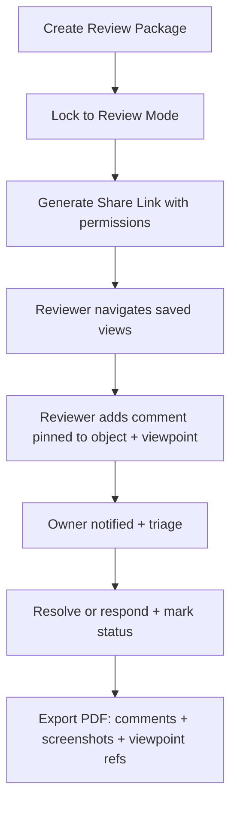
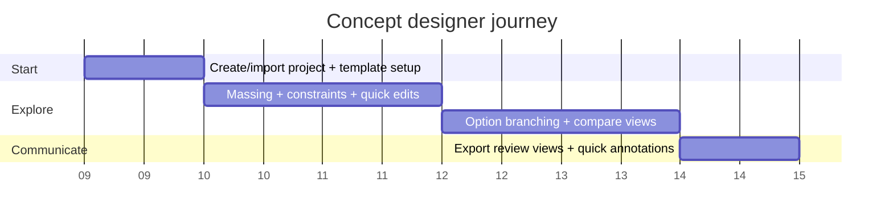
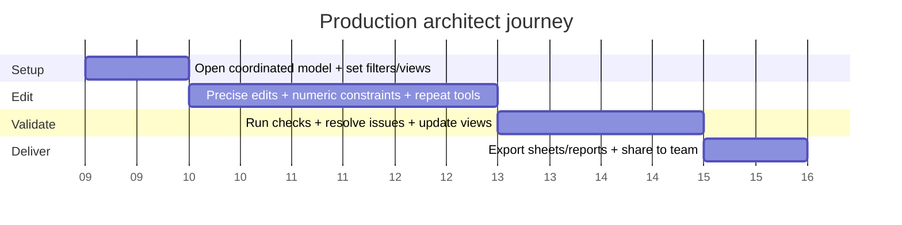
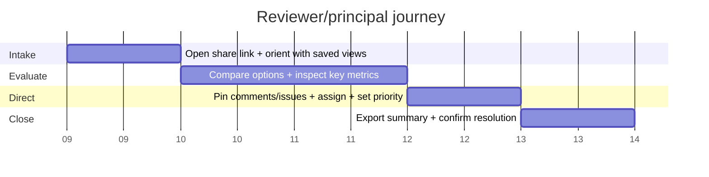
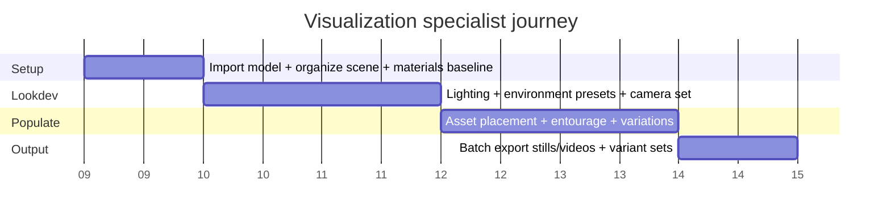
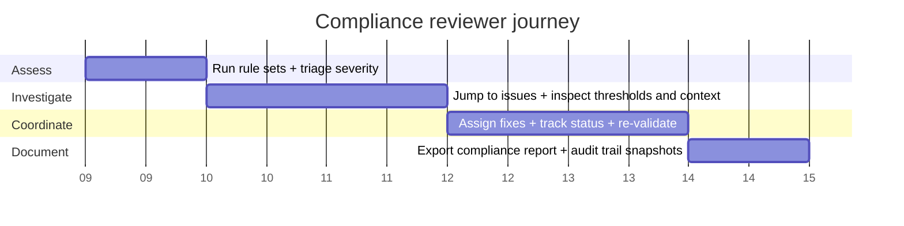
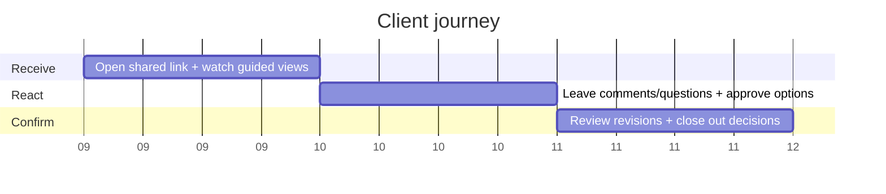

# Slatecamp UX and UI Design Research for 3D Architecture Software

## Executive summary

Slatecamp is not “a 3D app.” It is a high-stakes decision environment for architecture, where users must maintain spatial orientation, precision, and accountability while switching rapidly between exploration and production. The UX must treat **state clarity**, **recoverability**, and **visibility control** as first-class systems, not secondary polish. This is consistent with foundational HCD guidance emphasizing explicit understanding of users, tasks, and context, plus iterative evaluation across the lifecycle. citeturn3search0turn3search8

The evidence base for 3D interaction design groups most low-level tasks into navigation, selection/manipulation, and system control, and stresses that technique choice is inseparable from feedback, mode design, and error tolerance. citeturn3search31turn3search1 This matters because the biggest UX failures in 3D architecture software are not “missing features,” they are predictable breakdowns in user situation awareness: users do not know what is selected, what mode they are in, what constraints are active, or why the system behaved the way it did. citeturn4search0turn4search7turn4search22

Comparative teardown shows a convergent pattern across serious tools:

- **Revit** operationalizes BIM work through a persistent “table of contents” (Project Browser) and a context-driven inspector (Properties palette), plus formal shortcut support. citeturn7search0turn7search16turn5search3turn5search7  
- **Rhino** prioritizes speed and expert mastery via command-centric workflow, direct manipulation (Gumball), and strong layer and property tooling. citeturn0search4turn5search2turn8search19turn8search3  
- **SketchUp** is built around “learnable precision” via the inference engine, hierarchical organization via Outliner, and object attribute inspection via Entity Info, now paired with collaboration workflows tied to Trimble Connect. citeturn5search4turn5search19turn5search1turn6search2  
- **Navisworks** centers on model review and coordination through Selection Tree, saved sets, and clash results lists. citeturn8search0turn8search1turn7search21  
- **Autodesk Viewer / Autodesk Construction Cloud viewers** standardize browser-based review through Model Browser, Properties, Comments, Markups, Settings (including performance tuning), and Share. citeturn2search0turn2search12turn2search19  
- **Twinmotion** surfaces a real-time viz-first interface with a Navigation panel and a Scene graph hierarchy. citeturn1search2turn7search2turn7search6  
- **Enscape** (as a plug-in) succeeds by integrating into host CAD UX but exposing a consistent Enscape UI (toolbar, asset library, placement) in the rendering viewport. citeturn1search1turn1search3turn1search25  
- **Archicad** anchors user flow on the Info Box (tool and element settings) and Navigator (project viewpoints, views, layouts, publishing), paired with BIMcloud collaboration. citeturn1search8turn6search3turn6search0  
- **Blender** demonstrates an “editor-based” composition UI with Outliner and Properties Editor, plus explicit support for industry-compatible keymaps to reduce muscle-memory switching cost. citeturn0search6turn0search2turn7search7turn7search3  

The practical conclusion: Slatecamp must ship with a coherent platform UX that unifies geometry editing, information design, review, and compliance into one shared mental model. If each module behaves differently, professionals will not trust it in production.

## Evidence base and comparative teardown

### Interaction science that matters for 3D architecture UX

Most 3D UI work can be reduced to three universal task families: navigation, selection/manipulation, and system control. This framing is widely used in 3D UI literature and is directly applicable to architecture tools because every “architecture task” decomposes into these primitives. citeturn3search31turn3search1

Classic human factors and UX principles apply with extra force in 3D because cognitive load is higher:

- **Visibility of system status** and **user control and freedom** are not optional. They are the difference between trust and abandonment. citeturn4search0turn4search4  
- **Direct manipulation** succeeds when users can act on visible objects with immediate feedback, reducing the gulf between intent and effect. citeturn4search2turn4search6  
- **Human-centered design** standards emphasize explicit understanding of users and tasks, iterative design, and evaluation. In 3D architecture workflows, that means studying real project behaviors, not demo scenes. citeturn3search0turn3search8  

Slatecamp should treat these as contractual requirements, not design taste.

### Comparative teardown of major tools

The table is intentionally blunt. It focuses on what each tool standardizes well (patterns worth copying) and what it structurally deprioritizes (risks to avoid), mapped to the areas you requested.

| Product | Onboarding and learnability | Viewport controls | Selection and edit feedback | Inspector and outliner patterns | Issue tracking and collaboration | Performance posture | Shortcut posture |
|---|---|---|---|---|---|---|---|
| Revit | UI legibility is supported by a project “table of contents” (Project Browser) and standardized property editing (Properties palette). citeturn7search0turn7search16 | Navigation is integrated into BIM context via view-oriented workflows and UI customization pathways. citeturn7search4turn7search8 | Selection drives context: Properties show instance/type behavior; relocation via palettes and view controls. citeturn0search3turn7search16 | Persistent inspector (Properties palette) plus structured project tree (Project Browser). citeturn7search0turn7search8 | Collaboration is formalized through cloud workflows (BIM Collaborate Pro / cloud worksharing). citeturn6search9turn6search29 | Enterprise-scale posture, but heavy models demand discipline in view ranges, links, and content management (the UX assumes process maturity). | Official shortcut guides and customization support exist. citeturn5search3turn5search7 |
| Rhino | Experts ramp fast via command-line + customization culture; steep for novices without training. citeturn8search3turn8search7 | Strong navigation conventions; status bar exposes modeling aids. citeturn5search6turn5search14 | Gumball provides highly legible direct manipulation, with alignment concepts (CPlane/world/object) and hotkey cycling. citeturn0search4 | Strong layer system surfaced in status bar and Layers panel; Properties show object-specific controls and fall back to viewport properties when nothing selected. citeturn5search2turn8search19 | Primarily file-based collaboration patterns; customization and scripting enable workflow standardization. | UI exposes precision and modeling aids; assumes user manages complexity. | Extensive customization: toolbars, shortcuts, macros, aliases. citeturn8search3turn8search22 |
| SketchUp | “Learnable precision” via inference engine and screen tips; encourages occasional orbit to validate true plane/axis alignment. citeturn5search4 | Navigation is core to the experience; simple orbit/pan/zoom metaphors are central. | Inference feedback is the critical UX feature for correctness. citeturn5search4 | Outliner manages hierarchy; Entity Info exposes object attributes and measurements. citeturn5search19turn5search1 | Collaboration bar enables sharing, measurement, comments, and real-time updates for shared models tied to Trimble Connect. citeturn6search2turn6search10 | Performance is managed through model discipline; newer UI work addresses grip access occlusion issues. citeturn0search21 | Shortcut culture is strong and widely used, though many references are community-driven; official workflows increasingly surface collaboration tooling. citeturn6search2 |
| Blender | Editor-based UI can be intimidating; mitigates via documentation and configurable workspaces. | Navigation includes explicit navigation gizmo and multiple modes. citeturn7search19turn0search10 | Selection and activation sync between viewport and Outliner. citeturn0search6 | Outliner plus Properties Editor is the canonical pairing for scene structure and attributes. citeturn0search14turn0search2 | Collaboration is not the primary product thesis; pipelines solve it externally. | Performance is treated as a technical craft; users are expected to manage scene complexity. | Explicit “Industry Compatible” keymap exists to reduce friction for users migrating from other tools. citeturn7search7turn7search3 |
| Archicad | Tool and element onboarding is supported by the Info Box and a structured Navigator for views, layouts, and publishing. citeturn1search8turn6search3 | View settings and navigation are view-driven; project structure is central. citeturn6search3 | Selection drives Info Box controls (last selected element behavior is documented). citeturn1search8 | Navigator is the project spine; Info Box acts as contextual tool settings. citeturn6search3turn1search0 | BIMcloud provides real-time model collaboration and offline work support (Teamwork workflows). citeturn6search0turn6search4 | Pattern assumes professional governance: project organization, publishing sets, and disciplined teamwork. | Shortcuts exist, but the deeper advantage is structured project organization and publish pipelines. |
| Enscape | Onboarding is simplified by being a plug-in: users stay in host CAD mental model, then open Enscape viewport UI. citeturn1search1turn1search9 | Viz navigation is integrated into a real-time renderer viewport; shortcuts and mode toggles are key. | “Asset placement” and library access are exposed both from CAD toolbar and Enscape viewport UI. citeturn1search25turn1search3 | UI surfaces focus on visual settings, assets, and export rather than deep model structure. citeturn1search1 | Collaboration is typically via exports, panoramas, web outputs, or host platform workflows (varies by integration). | Real-time rendering performance is a core product assumption; users manage quality/performance tradeoffs through settings. | Most workflows are button + preset driven; shortcut use exists but is secondary to quick visual iteration. |
| Twinmotion | “Getting started” content explicitly includes UI explanation and navigation basics. citeturn7search26 | Navigation panel shows shortcuts and options at top of viewport; separate documentation lists keyboard and mouse shortcuts. citeturn1search2turn1search6 | Viz-first editing, with emphasis on scene composition and library application. | Scene graph panel provides hierarchy of scene elements; supports containers for organization. citeturn7search2turn7search6 | Collaboration often through presentations and cloud deliverables (product-dependent). | Real-time performance is central; UX emphasizes smooth camera movement and immediate feedback. | Shortcuts are taught primarily for navigation and viz workflows. citeturn1search6 |
| Navisworks | Onboarding is task-driven: open aggregated models, review, coordinate, clash. | Viewpoints are central for jumping between prepared review states. citeturn1search15 | Selection Tree provides structured selection by model hierarchy, plus Sets mode for selection/search sets. citeturn8search0 | Selection Tree is dockable with multiple structuring modes; can organize by properties and sets. citeturn8search0 | Clash Detective Results tab provides list-driven clash review and grouping. citeturn7search21turn1search4 | Assumes large coordination models; filters and sets are the survival tools. | Shortcuts exist; more importantly, “sets” and “find items” enable repeatable selection workflows. citeturn8search1 |
| Autodesk Viewer and ACC viewers | Browser review onboarding is simplified by a small set of tools: Model Browser, Properties, Settings, Comments, Markup, Share. citeturn2search0turn2search12 | View navigation is standardized; share links support stakeholder access without full desktop software. citeturn2search19turn2search3 | Selection is tied to properties and comment anchoring; UX is review-first, not authoring-first. citeturn2search0 | Model Browser for hierarchy and filtering; Properties modal exposes metadata. citeturn2search0turn2search12 | Comment history export, markup workflows, and share links support review governance. citeturn2search0turn2search19 | Settings explicitly include performance tuning such as reducing image quality. citeturn2search0 | Shortcuts exist but are not the UX center; accessibility and simplicity for stakeholders dominates. |

image_group{"layout":"carousel","aspect_ratio":"16:9","query":["Autodesk Revit Properties palette Project Browser interface screenshot","Rhino 3D Gumball and Layers panel interface screenshot","SketchUp Outliner panel and inference engine screenshot","Navisworks Clash Detective Results tab screenshot"],"num_per_query":1}

## Must-have UX systems for architecture-grade 3D software

Slatecamp must implement these as **systems** with explicit rules, consistent UI surfaces, and measurable success criteria. These systems are aligned with 3D UI research on universal tasks and established usability heuristics emphasizing visibility, error prevention, and recoverability. citeturn3search31turn4search0

### Spatial orientation and navigation system

Architecture users lose time and trust when they get disoriented. Navigation must be recoverable, previewable, and consistent.

Non-negotiables:

- Orbit, pan, zoom, dolly; orthographic vs perspective.
- Fit to selection, frame all, home view, and “return to last view.”
- Orientation widget (axes or cube) and a visible camera mode indicator. Blender documents a navigation gizmo for explicit orientation feedback. citeturn7search19
- Saved views as first-class objects. Navisworks emphasizes review through viewpoints; this is the right mental model for review and compliance. citeturn1search15
- Navigation hints for novices: Twinmotion’s Navigation panel is a strong pattern, showing navigation options and shortcuts at top of viewport. citeturn1search2

Slatecamp design rule: **Every navigation operation must have a fast “recover” path** (home, fit, undo camera, reset clip), because loss of orientation is a predictable failure mode in 3D.

### Selection, scoping, and editability system

Selection drives everything: inspector content, tool affordances, snapping targets, transform handles, and issue anchoring. Blender explicitly documents selection synchronization between viewport and Outliner. citeturn0search6

Non-negotiables:

- Clear states for: hover, preselect, selected, multi-select, locked, referenced (read-only), hidden-by-filter.
- Overlap resolution (cycling selection under cursor) and “select through” modes.
- Hierarchical selection with breadcrumbs (object > sub-object > face/edge/vertex equivalents, if supported).
- Selection scopes: “edit instance vs edit type,” “edit group vs edit contents,” “edit current story vs all stories.”

Revit’s pattern (Project Browser + Properties palette) shows the productivity advantage of stable selection-driven context. citeturn7search0turn7search16

Slatecamp design rule: **No invisible selection scopes.** If scope exists, it must be visible in the status bar and inspector, and it must be overrideable.

### Precision and constraint system

Architecture workflows require precision without intimidation. SketchUp’s inference engine demonstrates how visible, contextual guidance can make precision learnable: inference points, screen tips, axis colors, and locking behaviors. citeturn5search4

Non-negotiables:

- Grid and snap controls with visible indicators.
- Inference guides: axis alignment, perpendicular, parallel, midpoint, intersection.
- Numeric input at point of action (heads-up dimension box + inspector fields).
- Constraint toggles that are always visible when active.
- Units and tolerances surfaced in status (Rhino status bar pattern includes units and modeling aids). citeturn5search6

Slatecamp design rule: **Snapping must be previewed.** Silent snapping is a defect, because it destroys user trust in geometry correctness.

### Direct manipulation and transform system

Rhino’s Gumball is the benchmark for legible direct manipulation: a single transform widget appears on selection, supports alignment modes, and supports relocation and reset. citeturn0search4 Shneiderman’s direct manipulation framing supports why this matters: operating on visible objects with immediate feedback reduces cognitive distance. citeturn4search2turn4search6

Non-negotiables:

- A consistent transform gizmo with clear axis colors and plane handles.
- Local vs world vs custom plane alignment as explicit state.
- Transform preview and commit, with cancellable operations.
- Repeat last command or “sticky tool” behavior for production speed.

Slatecamp design rule: **The transform widget is a contract.** It cannot change semantics per module.

### Visibility management system

Visibility is not cosmetic. It is operational infrastructure.

Non-negotiables:

- Layer/category system plus “discipline filters” and “phase filters.”
- Temporary isolate and ghost (x-ray) modes.
- “Reveal hidden” and “why is this not selectable” introspection.
- Filter-driven hide via properties. Autodesk Docs Model Browser supports filtering elements by properties for review and issue resolution. citeturn2search12

Slatecamp design rule: **Hidden state must be explainable.** Users need a “Visibility Debugger” that answers: hidden by layer, by filter, by phase, by isolate, by clip, by workset, by permission.

### Scene organization system

Every serious tool provides a tree or hierarchy surface:

- SketchUp Outliner helps manage groups and components and their hierarchy. citeturn5search19  
- Navisworks Selection Tree offers multiple hierarchical views and a “Sets” mode for selection/search sets. citeturn8search0  
- Twinmotion Scene graph panel is explicitly positioned as visual hierarchy of scene elements. citeturn7search2turn7search6  

Non-negotiables:

- A scene tree with search, filters, visibility toggles, lock toggles, and selection sync.
- Stable naming and bulk rename tools.
- “Componentization” workflows: group, component/instance, convert, explode, and warnings on destructive operations.

Slatecamp design rule: **Large models die without hierarchy.** The tree cannot be an afterthought.

### Views, markup, and issue system

For architecture, review and compliance require anchored communication, not floating chat.

Two key standards emerge:

- Navisworks Clash Detective Results tab is list-driven clash management, supporting grouping and review workflows. citeturn7search21turn1search4  
- buildingSMART’s BCF describes model-based issue topics with comments, screenshots, object references, and viewpoint attachments for navigation and status tracking. citeturn9search0turn9search4  

Non-negotiables:

- Saved views that can include camera, clip, visibility state, and annotation overlays.
- Issue topics anchored to objects and camera viewpoints (BCF-aligned).
- Status workflow: open, in progress, resolved, closed; with audit trail.
- Exportable reports for governance.

Slatecamp design rule: **Every issue must answer: where, what, why, and who owns it.** If any of those are missing, issue tracking becomes noise.

### Collaboration system

Collaboration is not the same for all personas. Stakeholders often need review without authoring privileges.

Patterns worth adopting:

- Autodesk Viewer supports share links, comments, and collaboration without requiring stakeholders to install desktop software, with account requirements only when commenting. citeturn2search19turn2search3  
- SketchUp’s Collaboration Bar enables sharing and feedback, including measurements and comments tied to shared models. citeturn6search2  
- Archicad BIMcloud supports real-time teamwork workflows and offline work support. citeturn6search0  
- Autodesk BIM Collaborate Pro describes cloud co-authoring and aggregated browser visualization for distributed teams. citeturn6search9  

Slatecamp design rule: **Collaboration must be role-based by default.** If the Client persona can break geometry, your product is not production-safe.

### Performance and reliability system

Performance is UX. Autodesk Viewer puts performance tuning in Settings, including reducing quality to improve performance. citeturn2search0

If Slatecamp is web-based and uses React Three Fiber, performance constraints become more sensitive:

- R3F documents that pointer events are implemented via raycasting and that default raycasting is interaction-driven. citeturn9search9turn9search1  
- R3F provides guidance on scaling performance and avoiding pitfalls like reactive state updates in fast loops. citeturn9search35turn9search33  
- Three.js documents InstancedMesh as a method to reduce draw calls and improve performance for repeated objects. citeturn9search10  
- WebGL specs define context loss behavior; production systems must handle context lost and restored events. citeturn9search3turn9search15  

Slatecamp design rule: **You must design for degraded mode.** When FPS drops or WebGL context is lost, users need explicit messaging and safe recovery, not a frozen canvas.

## Must-have UI components and information architecture

Slatecamp needs an architecture-grade interface skeleton that stays stable while modules change. The recurring success pattern across tools is: viewport-centric workspace plus stable side panels for structure and properties, with context-sensitive tool controls.

### Recommended platform-level IA

A workable architecture for Slatecamp is a platform “workspace” model:

- Model (authoring and diagramming)
- Analyze (metrics, performance, simulation hooks)
- Compliance (rule checks, overlays, issue workflows)
- Review (comments, compare, approvals)
- Render (visual output, presets, media)
- Export (reports, packages, share links)

This aligns with how real teams split work: concept, production, review, viz, compliance, and handover.

### Must-have UI surfaces

Slatecamp should standardize these surfaces across every module:

- Global top bar: project switch, branch/version, collaboration presence, export/share.
- Viewport: the primary interaction surface.
- Left tool rail: creation and edit tools, always in the same order.
- Right inspector: properties and context, selection-driven.
- Outliner/tree panel (dockable): hierarchy, filters, search.
- Bottom status bar: mode, snap state, constraint state, units, active workplane, selection count, performance indicator.
- Command palette: fast access to commands and tools; essential for expert adoption.

These patterns are visible across many products: Revit’s Project Browser + Properties palette; Rhino’s status bar and panels; SketchUp’s Outliner and Entity Info; Autodesk Viewer’s Model Browser and Properties; Twinmotion’s scene graph. citeturn7search0turn5search6turn5search19turn2search0turn7search2

### Wireframe suggestions

The wireframes below are conceptual. The point is layout discipline and stable affordances.

```mermaid
flowchart TB
  Top[Global Top Bar: Project | Branch/Version | Collaborators | Share/Export | Help] --> Main
  Main --> Left[Left Tool Rail\nCreate | Edit | Measure | Annotate | Review | Compliance]
  Main --> Viewport[Viewport\nNavigation Gizmo | View Presets | Overlay Toggles]
  Main --> Right[Right Inspector\nSelection Properties | Constraints | Materials | Metadata]
  Main --> Bottom[Status Bar\nMode | Snaps | Units | Workplane | Selection | FPS/Perf | Background Tasks]
  Right --> Tabs[Dockable Tabs\nProperties | Issues | Views | Comments | History]
  Left --> ToolOpts[Context Tool Options\nInline + Inspector Mirroring]
```

A dedicated review layout should reduce cognitive load for non-authors by collapsing creation tools.

```mermaid
flowchart TB
  Top[Review Mode Top Bar: Views | Issues | Comments | Compare | Export] --> Viewport
  Viewport --> Issues[Issues Panel\nList | Filter | Severity | Assignee | Status]
  Viewport --> Comments[Comments Panel\nThreads | Attachments | Viewpoint link]
  Viewport --> Props[Light Properties\nRead-only key fields + references]
```

image_group{"layout":"carousel","aspect_ratio":"16:9","query":["3D modeling software UI layout viewport outliner properties inspector wireframe","BIM clash detection issue list interface example","command palette interface example design software","Autodesk Viewer model browser properties comments interface screenshot"],"num_per_query":1}

### Component inventory principles

A component list is worthless unless it includes: states, behavior rules, and failure handling. Slatecamp components must be designed around these invariants:

- State visibility: users must always know what is active. citeturn4search0turn4search4  
- Recoverability: undo, cancel, and safe exits must exist. citeturn4search0  
- Consistency: tool semantics must not change across modules. citeturn4search0  

## Workflows: happy paths, error paths, and UX trails

This section defines the required operational flows for Slatecamp, including failure handling. The biggest differentiator for professional adoption is not “more features,” it is **predictable flow control under error**.

### Happy path flowcharts

#### Happy path: project start to first meaningful model

```mermaid
flowchart LR
  A[Open Slatecamp] --> B[Create or Import Project]
  B --> C[Choose Template: Units | Levels | Grid | Code Profile]
  C --> D[Viewport opens in known orientation + saved Home view]
  D --> E[User creates first geometry or opens reference model]
  E --> F[Auto-save baseline + Version 0.1 created]
  F --> G[User saves 2-3 key views: Plan | 3D | Section]
```

Why this matters: onboarding must reach “first meaningful action” fast, consistent with HCD standards emphasizing effectiveness and efficiency. citeturn3search0turn3search8

#### Happy path: compliance check to resolution

This should be BCF-aligned so issues can be shared across systems if needed. citeturn9search0turn9search4

```mermaid
flowchart TB
  A[Run Compliance Check] --> B[Issues Panel: grouped by rule + severity]
  B --> C[Select Issue]
  C --> D[Auto-focus viewport to viewpoint + highlight offending objects]
  D --> E[Explain: rule | threshold | measured value | location]
  E --> F[User chooses fix path: edit geometry or override with justification]
  F --> G[Re-validate affected scope only]
  G --> H[Issue status updates + audit trail + report snapshot]
```

#### Happy path: design review and client feedback

This pattern mirrors Autodesk Viewer and SketchUp collaboration patterns: share link, navigation, comments, exportable history. citeturn2search0turn2search19turn6search2



### Error paths and recovery rules

Error paths are where production trust is earned. Slatecamp should treat the following as mandatory error flows.

**Disorientation error path**
- Triggers: user “gets lost,” camera inside geometry, or clipping hides context.
- Required recovery: “Home,” “Fit to selection,” “Frame all,” “Undo camera,” and a visible navigation gizmo. Blender’s navigation gizmo exists specifically to reduce orientation confusion. citeturn7search19

**Invisible constraint error path**
- Triggers: snap or constraint causes unexpected placement (wrong plane, locked axis).
- Required recovery: snap preview, constraint state shown in status bar, and “why did this snap” tooltip history. SketchUp inference feedback is the model: it shows screen tips and axis colors that communicate precision decisions. citeturn5search4

**Hidden-by-filter error path**
- Triggers: object exists but cannot be found or selected.
- Required recovery: visibility debugger identifies layer/filter/phase/isolate status; “Reveal hidden.” Revit training materials emphasize workflow around views and view-related properties for managing visibility. citeturn7search4turn7search0

**Collaboration permission error path**
- Triggers: stakeholder cannot comment, cannot see markups, or cannot access link.
- Required recovery: clearly indicate permission boundary and provide remedial actions. Autodesk Shared Views documentation clarifies access and commenting requirements. citeturn2search3turn2search19

**Performance degradation error path**
- Triggers: FPS drops, heavy scene, raycasting overload, memory pressure.
- Required recovery:
  - auto-detect performance and suggest quality reduction (Autodesk Viewer Settings pattern). citeturn2search0  
  - degrade overlays, reduce raycasts, and support “on-demand rendering” patterns for web. R3F explicitly discusses scaling performance and pitfalls. citeturn9search35turn9search33  

**WebGL context loss error path (web platform risk)**
- Triggers: GPU reset, tab thrash, device constraints.
- Required recovery: handle `webglcontextlost` and restore; show user-facing recovery UX. WebGL specifications define context loss mechanisms; ignoring them is unacceptable for production reliability. citeturn9search3turn9search15

### UX trails

A UX trail is the actual sequence footprint users leave while working. Slatecamp should instrument and design around these trails:

**Creation trail (concept designer)**
- Open project -> orbit -> place mass -> infer axis -> adjust dimensions -> duplicate option -> save views.

**Production trail (architect)**
- Filter view -> select by hierarchy -> edit precisely -> validate -> annotate -> export package.

**Review trail (principal)**
- Open saved views -> compare -> comment pinned -> assign resolution -> export issues summary.

**Visualization trail**
- camera set -> material preset -> lighting tweak -> render preview -> export still/video.

**Compliance trail**
- run checks -> issue list -> focus to issue -> inspect threshold -> fix -> re-check -> publish report.

These trails should remain stable across releases. Users build muscle memory and internal SOPs; chaotic rearrangement destroys adoption.

## Detailed user journey maps by persona

Each persona map includes: objectives, journey timeline, “make or break” moments, and success criteria. These are written to be testable, not inspirational.

### Concept designer

Primary objective: generate spatial options fast while keeping enough correctness to hand off.

Make-or-break moments:
- first 15 minutes: can they create massing without fighting navigation and snapping?
- option comparison: can they branch and review without duplicating chaos?

Key UX needs:
- inference guides and snapping (SketchUp pattern). citeturn5search4  
- direct manipulation with predictable transform alignment (Rhino Gumball pattern). citeturn0search4  
- saved views and option sets (Navisworks viewpoint mindset, repurposed for design options). citeturn1search15  

Journey timeline:



Success criteria:
- time to first valid mass < 5 minutes (trained user) and < 15 minutes (new user).
- user can generate and label 3 options and export a review package without losing orientation.

### Production architect

Primary objective: precision edits, documentation-ready structure, low error tolerance.

Make-or-break moments:
- selection scope errors and hidden-state debugging.
- property editing speed and repeatability.

Key UX needs:
- stable inspector and project tree patterns similar to Revit’s Properties palette and Project Browser concept. citeturn7search0turn7search16  
- strong hierarchy and naming tools (Outliner/Selection Tree patterns). citeturn5search19turn8search0  
- shortcut and customization posture for speed, as Revit supports shortcut guides and customization. citeturn5search3turn5search7  

Journey timeline:



Success criteria:
- selection-to-edit time (select element -> correct property edit) within 10 seconds for common operations.
- hidden-state resolution (cannot find object) within 30 seconds using visibility debugger.

### Reviewer or principal

Primary objective: make decisions quickly, see risk, communicate direction without operating the modeling machinery.

Make-or-break moments:
- can they navigate without being taught?
- are comments anchored to geometry and viewpoint so teams can act?

Key UX needs:
- review mode that hides authoring complexity and focuses on curated views.
- comments and issue export for governance. Autodesk Viewer exposes Comments and allows exporting comment history to PDF. citeturn2search0  
- share links and stakeholder access without installing heavy software. citeturn2search19turn2search3

Journey timeline:



Success criteria:
- reviewer completes a full review pass (10 views, 10 comments) without needing tool training.
- every comment is actionable: location, intent, priority, owner, due date.

### Visualization specialist

Primary objective: output quality visuals fast, with controlled presets and repeatability.

Make-or-break moments:
- can they set consistent cameras and render presets without fighting scene organization?
- can they place assets efficiently?

Key UX needs:
- scene graph and asset libraries, as Twinmotion exposes a Scene graph and navigation panel for scene work. citeturn7search2turn7search6turn1search2  
- Enscape-style asset placement accessible from both host UI and renderer UI; Enscape documents asset placement via Asset Library accessible in CAD toolbar or in-viewport UI. citeturn1search25turn1search3  

Journey timeline:



Success criteria:
- batch export pipeline produces consistent outputs across model revisions.
- minimal rework when upstream model changes: stable object IDs and scene organization.

### Compliance reviewer

Primary objective: identify violations and coordination risks, explain them, and track resolution with audit trail.

Make-or-break moments:
- can they trust that “red overlays” are accurate and explainable?
- can they export defensible, traceable findings?

Key UX needs:
- list-driven issue management similar to Navisworks clash results workflows. citeturn7search21turn1search4  
- BCF-style issue topics with viewpoint and object references for cross-platform exchange. citeturn9search0turn9search4  

Journey timeline:



Success criteria:
- every flagged issue includes: rule identifier, code version, threshold, measured value, object references, viewpoint, and reviewer attribution.
- false positive rate is measured and kept below an agreed target.

### Client

Primary objective: understand design intent and make prioritized decisions, without being exposed to authoring complexity.

Make-or-break moments:
- can they navigate without getting lost?
- can they leave feedback that the team can actually act on?

Key UX needs:
- simplified navigation with guided views (review mode).
- comments pinned to geometry and view, similar to Autodesk Viewer share-and-comment flows. citeturn2search19turn2search3  
- permission boundaries by default.

Journey timeline:



Success criteria:
- client can complete a guided walkthrough and leave 5 anchored comments in under 20 minutes.
- the client never sees authoring tools unless explicitly granted.

## Slatecamp module-specific recommendations

The module list implies Slatecamp is a platform composed of multiple workspaces. The right approach is to standardize cross-module primitives, then let modules specialize.

### Cross-module primitives that must be shared

These primitives must exist in a shared core (not re-implemented per module), otherwise UX consistency collapses:

1. **Selection model**: IDs, selection sets, hover, multi-select, selection scope.
2. **Scene graph**: hierarchy, naming, visibility, locks, filtering, search.
3. **Inspector schema**: property groups, units, validation rules, read-only vs editable fields.
4. **View objects**: saved views with camera, clip, visibility state, overlays.
5. **Issue objects**: topic, status, assignee, viewpoint, object refs, attachments, audit trail; ideally BCF-compatible for interoperability. citeturn9search0turn9search4
6. **Performance governor**: LOD policies, overlay throttles, raycast budget, FPS sampling.
7. **Event and interaction layer**: if using R3F, design interaction budgets around raycasting-event costs and document them. citeturn9search9turn9search1

### Module-by-module UX posture

| Slatecamp module | Primary users | Primary job | Module must standardize | Module-specific UX risks | “Tell it like it is” recommendation |
|---|---|---|---|---|---|
| /slatecamp-3d-arch-diagram-modeler | Concept Designer, Production Architect | Geometry creation and diagramming | Navigation, selection, transform, precision guides, views | Mode confusion, snap invisibility, plane confusion | Copy SketchUp inference feedback discipline and Rhino-style direct manipulation legibility. citeturn5search4turn0search4 |
| /slatecamp-3d-code-compliance-viz | Compliance Reviewer, Production Architect, Reviewer | Explainable rule checking and overlays | Issue objects, severity taxonomy, re-validation scope | Black-box flags, false positives, un-auditable outputs | Align with BCF “topic + viewpoint + object refs + status,” and provide exportable audit trail. citeturn9search0turn9search4 |
| /slatecamp-3d-information-designer | Reviewer, Client, Production Architect | Layered information and decision overlays | Overlay system, legend system, visibility debugger | Information overload, inconsistent semantics between overlays | Treat overlays like a contract: every overlay must have a name, legend, source, and toggle state in saved views. |
| /slatecamp-3d-interaction-designer | All | Interaction patterns and tool behaviors | Tool state machine, shortcut system, command palette | Inconsistent tool semantics breaks trust | Maintain a centralized interaction spec, enforce by tests. Follow “consistency and standards” discipline. citeturn4search0 |
| /slatecamp-3d-lab-engineer | Internal power users | Experimentation and prototyping | Feature flags, instrumentation, replay logs | Prototype behaviors leaking into production UX | Build a strict sandbox workspace that cannot ship without UX gates and instrumentation checks. |
| /slatecamp-3d-parametric-engine | Concept Designer, Production Architect | Parametric constraints and generators | Constraint visibility, dependency graph, safe editing | Hidden dependencies and cascading failures | Make dependency graph inspectable and provide “preview then commit” for param edits. |
| /slatecamp-3d-performance-engineer | Internal, Production Architect | Performance profiling and adaptive UX | FPS telemetry, draw call stats, raycast budget | Users blame “bugs” when it is performance collapse | Implement a performance HUD and auto-degrade rules; document them. Tie to R3F scaling guidance if applicable. citeturn9search35turn9search33 |
| /slatecamp-3d-visual-rendering | Visualization Specialist, Reviewer | Render presets and outputs | scene graph integration, camera sets, preset management | Render settings fragmentation, inconsistent outputs | Borrow Enscape/Twinmotion mental model: presets, batch export, asset library, scene graph organization. citeturn1search25turn7search6 |
| /slatecamp-r3f-api-master | Internal | Shared rendering and interaction API | event architecture, selection and raycasting rules, resource lifecycle | Raycast overhead, leaking resources, state thrash | Treat events as a budgeted subsystem (document raycast triggers and update strategy); follow R3F guidance on event raycasting behavior. citeturn9search9turn9search1 |

### Specific UX architecture decisions Slatecamp should lock early

**One navigation model across the platform**
Twinmotion can show navigation options in-viewport; Blender exposes a navigation gizmo; these are compatible patterns. citeturn1search2turn7search19

**One hierarchy model**
A usable hybrid is:
- Scene graph for object hierarchy (Twinmotion, Blender, SketchUp Outliner). citeturn7search6turn0search14turn5search19  
- Selection sets and search sets for repeatable workflows (Navisworks Sets patterns). citeturn8search0turn8search1  

**One review and issue model**
Adopt:
- list + focus mechanics (Navisworks clash results list). citeturn7search21  
- share link + comment export mechanics (Autodesk Viewer patterns). citeturn2search0turn2search19  
- BCF-compatible objects for exchange. citeturn9search4turn9search8  

## Research methods, testing plan, metrics, analytics, and tables

This is the operational plan for building a defensible UX and proving it works.

### Research methods

These methods align with human-centered design fundamentals: understand context, iterate, evaluate. citeturn3search0turn3search8

**Contextual inquiry (field observation)**
Observe real users in real projects across these contexts:
- concept exploration sessions
- production edits under deadlines
- coordination review meetings
- compliance review workflows
- client presentations

**Comparative usability sessions**
Give the same task to users in Slatecamp prototype and in reference tools (Revit, Rhino, SketchUp, Navisworks, Autodesk Viewer). Measure time, errors, and subjective workload.

**Task-based usability testing**
Use benchmark tasks (below) with clear success criteria.

**Mental model interviews**
Ask users to explain:
- what they think “selection” means in each mode
- what they think a “saved view” contains
- how they expect issues to behave across revisions

**Diary study for longitudinal adoption**
Because muscle memory and trust form over weeks, not hours.

### Testing scenarios with success criteria

Each task must have measurable success criteria, including error tolerance, recovery, and confidence rating.

1. **Onboarding**
- Task: create project, set units, create first mass, save plan and 3D views.
- Success: complete within target time; no unrecovered disorientation events; user can explain current mode.

2. **Precision modeling**
- Task: create a room, set dimensions numerically, align to grid, verify perpendicular relationships.
- Success: geometry meets tolerance; snaps are understood, not accidental.

3. **Hierarchy control**
- Task: name objects, group them, isolate level/category, filter by property.
- Success: user can hide and reveal correctly and explain “why hidden.”

4. **Compliance workflow**
- Task: run a rule set, interpret a violation, fix it, re-check, export report.
- Success: user can explain what failed and why; report includes viewpoint and object refs.

5. **Review workflow**
- Task: share link, reviewer leaves 5 pinned comments, owner resolves 3, exports summary.
- Success: comments remain anchored; statuses reliable; export is accurate.

6. **Performance stress test**
- Task: open large model, navigate, isolate floor, run check, export.
- Success: system maintains responsiveness; adaptive degradation triggers at known thresholds.

### Metrics and measurement instruments

Use both behavioral metrics and validated subjective instruments.

**Core behavioral metrics**
- Time to first meaningful action
- Task completion rate
- Critical error rate (errors requiring restart or external assistance)
- Recovery time from disorientation
- Mis-selection rate (select wrong object or scope)
- Visibility debugging time
- Issue resolution time (open -> resolved)
- Repeatability (does the user get faster on second attempt)

**Subjective usability**
- System Usability Scale (SUS) provides a 10-item scale for global usability assessment. citeturn3search6  

**Workload**
- NASA TLX measures perceived workload across multiple dimensions and is widely used in human factors. citeturn3search29turn3search19  

Slatecamp should treat SUS and TLX as release gates for Tier 1 workflows, not optional research artifacts.

### Analytics plan for Slatecamp

Analytics must reflect the UX trails and the failure modes that kill adoption.

**Event families**
- Session: open project, load duration, error states.
- Navigation: orbit/pan/zoom counts, “home view” usage, camera reset frequency.
- Selection: selection changes, multi-select, selection cycles, deselect errors.
- Visibility: hide/isolate usage, reveal hidden usage, visibility debugger open, filter changes.
- Editing: tool starts, tool commits, tool cancels, undo/redo frequency.
- Compliance: rule run, issues count by severity, focus-to-issue, re-validation, export reports.
- Review: share link created, comment created, comment resolved, export comments.
- Performance: FPS buckets, raycast time budget, draw call estimates, degradations triggered.

**Web-specific instrumentation if using R3F**
- Event handler density and raycast triggers (R3F describes pointer events via raycasting). citeturn9search9turn9search1  
- Throttling strategies and on-demand rendering signals (R3F scaling guidance). citeturn9search35  

**Reliability**
- WebGL context lost and restored events must be handled and logged. citeturn9search3turn9search15  

### UX requirements matrix

This matrix is the minimum governance tool to prevent the platform from turning into feature sprawl.

| UX system | User goal | Must-have behavior | Must-have UI components | Instrumentation | Priority |
|---|---|---|---|---|---|
| Navigation and orientation | Do not get lost | Home, fit, undo camera, orientation widget always visible | Navigation gizmo/cube, view presets, status bar camera mode | disorientation recovery time, home usage rate | Tier 1 |
| Selection and scope | Edit the right thing | Clear hover/selected states; scope labels; selection breadcrumb | selection outline, breadcrumb, scope pill | mis-selection rate, scope-change frequency | Tier 1 |
| Precision and snapping | Model accurately | Snap preview; inference guides; numeric entry | snap toggles, inference lines, heads-up input | snap override count, correction edits | Tier 1 |
| Transform and manipulation | Move fast without damage | Preview, cancel, commit; consistent gizmo semantics | transform gizmo, tool options | tool cancel rate, undo after transform | Tier 1 |
| Visibility management | Control complexity | isolate/ghost; reveal hidden; visibility debugger | layers/categories panel, filters, visibility debugger | time-to-find-hidden, debugger usage | Tier 1 |
| Scene organization | Manage large models | hierarchy, naming, search, batch actions | outliner/tree, search, bulk rename | tree search use, rename coverage | Tier 1 |
| Saved views | Repeatable review | views save camera + visibility + overlays | views panel, view capture | view usage rate, review completion time | Tier 1 |
| Issues and compliance | Resolve problems | issue list -> focus -> explain -> fix -> re-check | issues panel, overlays, report exporter | issue resolution time, false positive feedback | Tier 1 |
| Review and comments | Communicate decisions | comments pinned to viewpoint + objects; exportable | comments panel, pins | comments per review, resolution lag | Tier 2 |
| Collaboration and permissions | Safe sharing | role-based access; share links; audit | share panel, role editor | permission errors, link opens | Tier 2 |
| Performance governance | Stay responsive | degrade gracefully; show status | perf indicator, quality settings | FPS buckets, degrade triggers | Tier 2 |
| Versioning and change tracking | Trust outputs | save points, branches, compare | version panel, compare mode | rollback frequency, compare usage | Tier 2 |
| Keyboard and command palette | Expert speed | searchable commands; customizable shortcuts | command palette, shortcut editor | palette usage, shortcut adoption | Tier 2 |
| Export and reporting | Defensible deliverables | exports preserve views and issue refs | export center, templates | export success rate, re-export loops | Tier 3 |

### Component inventory table

This is the design system backbone. It should be treated as a controlled spec.

| Component | Where it lives | Required states | Behavior rules | Failure handling |
|---|---|---|---|---|
| Viewport | Center | idle, navigating, selecting, editing, reviewing | always shows orientation; tool cursor feedback | show recovery controls on disorientation |
| Orientation widget / navigation gizmo | Viewport corner | normal, hover, dragging | click to snap views; drag to orbit | always accessible; never hidden by panels |
| Left tool rail | Left | tool active, tool disabled, tool locked | stable order; tooltips; shortcut hints | disabled tools explain why |
| Context tool options | Near viewport + inspector | auto, pinned | mirrors active tool settings | reset-to-default available |
| Outliner / scene graph | Dockable panel | search, filter active, multi-select | selection sync with viewport | if selection missing, show why hidden |
| Inspector | Right | selection empty, single, multi, read-only | grouped fields, units aware | invalid inputs show constrained guidance |
| Status bar | Bottom | always visible | shows mode, snaps, units, scope | “visibility debug” entry point |
| Issues panel | Dockable | empty, list, filtered, grouped | click focuses viewport, shows explanation | if cannot focus, explain missing refs |
| Comments panel | Dockable | thread list, pinned, resolved | pinned to viewpoint + object refs | export always available |
| Views panel | Dockable | lists, folders, compare | capture includes overlays + visibility | stale view warns on missing objects |
| Command palette | Overlay | search, categories | launches commands, shows shortcuts | no-op commands explain prerequisites |
| Share/export center | Modal or side sheet | preparing, ready, sent | permission profiles and link expiry | link errors reported with fix steps |
| Performance HUD | Optional overlay | normal, warning, degraded | shows FPS bucket and active degradations | provides “reduce quality” controls |

### Prioritized feature roadmap (Tier 1 to Tier 3)

This roadmap is sequenced by adoption risk. Tier 1 is what makes Slatecamp usable on real projects.

| Tier | Features | Rationale | Release gate |
|---|---|---|---|
| Tier 1 | Navigation + recovery, selection system, snapping/inference, transform gizmo, outliner + inspector, visibility debugger, saved views, issue list -> focus workflow | Without these, professionals cannot trust the platform | Task completion > 85% on Tier 1 tasks; SUS baseline established citeturn3search6 |
| Tier 2 | Review mode, pinned comments, share links + permissions, BCF-aligned topic model, compare mode, command palette + shortcut editor, performance governance and HUD | Converts usability into team workflow adoption | Reduced workload vs baseline (NASA TLX), issue resolution time targets citeturn3search29turn3search19 |
| Tier 3 | Advanced parametrics, simulation integrations, automation, enterprise governance, deep analytics dashboards, customizable workspaces for organizations | Differentiators after trust is earned | Longitudinal retention and job success metrics |

