# Analytics Dashboard Gap Remediation Plan <!-- updated: 2026-04-09 -->

**Created:** 2026-04-09
**Source:** `.ai/docs/01-product/006-analytics.md` (Sections 4, 10, 11)
**Purpose:** Phased, dependency-aware implementation plan to close every documented gap in the analytics feature.
**Status:** Ready for execution

---

## 0. Gap Inventory <!-- updated: 2026-04-09 -->

### From Section 4 — Per-Section Gaps

| # | Gap | Source | Category | File(s) Affected |
|---|-----|--------|----------|-----------------|
| GAP-001 | Missing error state — ReadinessSection | §4.1 | Error Handling | `ReadinessSection.tsx` |
| GAP-002 | Hardcoded hex `#1B3FC4`, `#D4DAE3`, `#2D9F6F`, `#4A5568` in Recharts config | §4.1 | Hardcoded Values | `ReadinessTrajectory.tsx:76-81` |
| GAP-003 | Missing error state — ExamCountdownSection | §4.2 | Error Handling | `ExamCountdownSection.tsx` |
| GAP-004 | Missing error state — TimelineHeatmapSection | §4.3 | Error Handling | `TimelineHeatmapSection.tsx` |
| GAP-005 | Missing error state — SessionHistorySection | §4.4 | Error Handling | `SessionHistorySection.tsx` |
| GAP-006 | Missing error state — ProgressCardSection | §4.5 | Error Handling | `ProgressCardSection.tsx` |
| GAP-007 | Missing error state — SimulationTrajectorySection | §4.6 | Error Handling | `SimulationTrajectorySection.tsx` |
| GAP-008 | Hardcoded quadrant overlay fallback color `#4A5568` | §4.7 | Hardcoded Values | `QuadrantOverlay.tsx:29-32` |
| GAP-009 | Missing error state — PacingQuadrantSection | §4.7 | Error Handling | `PacingQuadrantSection.tsx` |
| GAP-010 | Missing error state — StaminaSection | §4.8 | Error Handling | `StaminaSection.tsx` |
| GAP-011 | Missing error state — StaminaHeatmapSection | §4.9 | Error Handling | `StaminaHeatmapSection.tsx` |
| GAP-012 | Missing error state — DifficultyMasterySection | §4.10 | Error Handling | `DifficultyMasterySection.tsx` |
| GAP-013 | Missing error state — AccuracyBySubjectSection | §4.11 | Error Handling | `AccuracyBySubjectSection.tsx` |
| GAP-014 | Hardcoded bucket definitions in time distribution | §4.12 | Hardcoded Values | `analytics-data.ts:146-152` |
| GAP-015 | Missing error state — TimeSpentDistributionSection | §4.12 | Error Handling | `TimeSpentDistributionSection.tsx` |
| GAP-016 | `REVIEW_THRESHOLD = 70` hardcoded inside function | §4.13 | Hardcoded Values | `chart-data.ts:123` |
| GAP-017 | Forgetting curve color interpolation uses hardcoded hex `#D64545`, `#D4951A`, `#2D9F6F` | §4.13 | Hardcoded Values | `chart-data.ts:191-192` |
| GAP-018 | Missing error state — ForgettingCurvesSection | §4.13 | Error Handling | `ForgettingCurvesSection.tsx` |
| GAP-019 | Mastery threshold `0.7` hardcoded in velocity calc | §4.14 | Hardcoded Values | `chart-data.ts:371` |
| GAP-020 | Missing error state — StudyVelocitySection | §4.14 | Error Handling | `StudyVelocitySection.tsx` |
| GAP-021 | Missing error state — RadarSection | §4.15 | Error Handling | `RadarSection.tsx` |
| GAP-022 | Retention decay formula `100 * exp(-days/14)` hardcoded | §4.16 | Hardcoded Values | `analytics.ts:436` |
| GAP-023 | Missing error state — MemorySection | §4.16 | Error Handling | `MemorySection.tsx` |
| GAP-024 | Missing error state — PacingInsightsSection | §4.17 | Error Handling | `PacingInsightsSection.tsx` |
| GAP-025 | `MODE_COLORS` map uses hardcoded hex values | §4.18 | Hardcoded Values | `chart-data.ts:88-98` |
| GAP-026 | Missing error state — PacingAccuracySection | §4.18 | Error Handling | `PacingAccuracySection.tsx` |
| GAP-027 | Missing error state — CalibrationScoreSection | §4.19 | Error Handling | `CalibrationScoreSection.tsx` |
| GAP-028 | Confidence label map `{1:'Low', 2:'Medium', 3:'High'}` hardcoded | §4.20 | Hardcoded Values | `analytics-data.ts:243` |
| GAP-029 | Missing error state — ConfidenceCalibrationSection | §4.20 | Error Handling | `ConfidenceCalibrationSection.tsx` |
| GAP-030 | Intensity thresholds hardcoded in study activity | §4.21 | Hardcoded Values | `analytics-data.ts:327-330` |
| GAP-031 | Missing error state — StudyStreakCalendarSection | §4.21 | Error Handling | `StudyStreakCalendarSection.tsx` |
| GAP-032 | Min attempts `3` and limit `10` hardcoded in weakest topics | §4.22 | Hardcoded Values | `analytics-data.ts:267,269` |
| GAP-033 | Missing error state — WeakestTopicsSection | §4.22 | Error Handling | `WeakestTopicsSection.tsx` |
| GAP-034 | Design violation: raw `<input>` and `<button>` instead of shadcn/ui | §4.23 | Design Violation | `ExamOutcomeForm.tsx` |

### From Section 10 — Orphaned/WIP

| # | Gap | Source | Category | File(s) Affected |
|---|-----|--------|----------|-----------------|
| GAP-035 | Orphaned fetcher: `getErrorPatterns()` — built but not wired | §10 | Orphaned Code | `get-error-patterns.ts` |
| GAP-036 | Orphaned fetcher: `getReviewCalendarData()` — built but not wired | §10 | Orphaned Code | `get-review-calendar.ts` |
| GAP-037 | Orphaned fetcher: `getMemoryStrengthOverview()` — built but not wired | §10 | Orphaned Code | `get-memory-strength-data.ts` |
| GAP-038 | Orphaned action: `getAnalyticsSummaryMetrics()` | §10 | Orphaned Code | `analytics.ts:577` |
| GAP-039 | Orphaned action: `getAnalyticsSummary()` | §10 | Orphaned Code | `analytics.ts:195` |
| GAP-040 | Orphaned action: `getNodePerformance()` | §10 | Orphaned Code | `analytics.ts:159` |
| GAP-041 | Orphaned action: `getAnalyticsDashboardData()` | §10 | Orphaned Code | `chart-data.ts:628` |
| GAP-042 | Orphaned component: `CalibrationCurve` exported but not rendered | §10 | Orphaned Code | `CalibrationCurve.tsx` |

### From Section 11 — Technical Debt

| # | Gap | Source | Category | File(s) Affected |
|---|-----|--------|----------|-----------------|
| GAP-043 | No `error.tsx` in analytics route | §11 Error Handling | Error Handling | `src/app/dashboard/analytics/` |
| GAP-044 | No per-section error boundaries | §11 Error Handling | Error Handling | All 23 section components |
| GAP-045 | Server actions silently return empty on failure — no error/empty distinction | §11 Error Handling | Error Handling | All data layer files |
| GAP-046 | Empty states inconsistent — most render nothing or empty charts | §11 Loading/Empty | Empty State | All 23 client components |
| GAP-047 | No unified "No data yet" component | §11 Loading/Empty | Empty State | N/A (new component) |
| GAP-048 | ExamOutcome conditionally hidden when exam future — confusing UX | §11 Loading/Empty | Empty State | `ExamOutcomeForm.tsx` |
| GAP-049 | `targetSecondsPerItem: 120` and `enduranceMinutes: 240` hardcoded | §11 Hardcoded | Hardcoded Values | `analytics.ts:231` |
| GAP-050 | No pagination in `getAccuracyBySubject()` — fetches ALL interactions | §11 Performance | Performance | `analytics-data.ts:91-95` |
| GAP-051 | Repeated `fetchTaxonomyNodeMap()` calls across multiple actions per page | §11 Performance | Performance | `analytics.ts`, `analytics-data.ts` |
| GAP-052 | 23 independent Supabase round trips per page load | §11 Performance | Performance | All section components |
| GAP-053 | `force-dynamic` — no caching except 2 sections | §11 Performance | Performance | `page.tsx:29` |
| GAP-054 | Duplicated `fetchTaxonomyNodeMap()` and `buildLevel1Resolver()` across files | §11 Performance | Performance | `analytics.ts`, `analytics-data.ts` |
| GAP-055 | Charts lack `aria-label` / screen reader alternatives | §11 Accessibility | Accessibility | All 14 Recharts components |
| GAP-056 | Heatmaps color-only encoding — no colorblind alternatives | §11 Accessibility | Accessibility | `TimelineHeatmap.tsx`, `StaminaHeatmap.tsx`, `StudyStreakCalendar.tsx` |
| GAP-057 | 13/23 sections use `dynamic()`, 10/23 direct import — inconsistent | §11 Inconsistent | Inconsistent Pattern | 10 section components |
| GAP-058 | `ReadinessSection` makes direct Supabase queries alongside data fetcher | §11 Inconsistent | Inconsistent Pattern | `ReadinessSection.tsx` |

**Total: 58 gaps** across 8 categories.

### Category Summary

| Category | Count | Gap IDs |
|---------|-------|---------|
| Error Handling (missing error states) | 24 | GAP-001,003-013,015,018,020-021,023-024,026-027,029,031,033,043-045 |
| Hardcoded Values | 14 | GAP-002,008,014,016-017,019,022,025,028,030,032,049 |
| Orphaned Code | 8 | GAP-035–042 |
| Empty State | 3 | GAP-046–048 |
| Performance | 5 | GAP-050–054 |
| Accessibility | 2 | GAP-055–056 |
| Design Violation | 1 | GAP-034 |
| Inconsistent Pattern | 2 | GAP-057–058 |

---

## 1. Dependency Map <!-- updated: 2026-04-09 -->

```mermaid
graph TD
  subgraph P0["Phase 0 — Foundations"]
    GAP047["GAP-047: Unified empty state component"]
    GAP054["GAP-054: Deduplicate fetchTaxonomyNodeMap"]
    ERRDECISION["Decide error boundary pattern"]
    TOKENDECISION["Extract chart color constants"]
  end

  subgraph P1["Phase 1 — Error Resilience"]
    GAP043["GAP-043: Add error.tsx"]
    GAP044["GAP-044: Per-section error boundaries"]
    GAP045["GAP-045: Error/empty differentiation in server actions"]
    ALLERRORS["GAP-001,003-013,015,018,020-021,023-024,026-027,029,031,033"]
  end

  subgraph P2["Phase 2 — Design Token Migration"]
    GAP002["GAP-002: ReadinessTrajectory hex"]
    GAP008["GAP-008: QuadrantOverlay hex"]
    GAP017["GAP-017: ForgettingCurves hex"]
    GAP025["GAP-025: MODE_COLORS hex"]
    OTHERHEX["GAP-014,016,019,022,028,030,032,049"]
  end

  subgraph P3["Phase 3 — Consistency"]
    GAP034["GAP-034: ExamOutcomeForm shadcn"]
    GAP057["GAP-057: Standardize dynamic imports"]
    GAP058["GAP-058: ReadinessSection direct queries"]
  end

  subgraph P4["Phase 4 — Performance"]
    GAP050["GAP-050: Pagination"]
    GAP051["GAP-051: Taxonomy cache"]
    GAP052["GAP-052: Round trip reduction"]
    GAP053["GAP-053: Caching strategy"]
  end

  subgraph P5["Phase 5 — Orphan Resolution"]
    ORPHANS["GAP-035–042"]
  end

  subgraph P6["Phase 6 — Accessibility"]
    GAP055["GAP-055: aria-labels"]
    GAP056["GAP-056: Colorblind alternatives"]
  end

  subgraph P7["Phase 7 — Empty State Polish"]
    GAP046["GAP-046: Apply unified empty states"]
    GAP048["GAP-048: ExamOutcome UX"]
  end

  ERRDECISION --> GAP043
  ERRDECISION --> GAP044
  GAP043 --> ALLERRORS
  GAP044 --> ALLERRORS
  GAP045 --> GAP046

  TOKENDECISION --> GAP002
  TOKENDECISION --> GAP008
  TOKENDECISION --> GAP017
  TOKENDECISION --> GAP025
  TOKENDECISION --> OTHERHEX

  GAP054 --> GAP051
  GAP054 --> GAP050

  GAP047 --> GAP046
  GAP047 --> GAP048
```

**Critical path:** Phase 0 (Foundations) → Phase 1 (Errors) → Phase 7 (Empty States)
**Parallel paths:** Phase 2 (Tokens), Phase 3 (Consistency), Phase 5 (Orphans), Phase 6 (Accessibility) can run in parallel after Phase 0.
**Phase 4 (Performance)** depends on Phase 0 (dedup) and benefits from Phase 1 (error differentiation).

---

## 2. Phase Definitions <!-- updated: 2026-04-09 -->

#### Phase 0: Foundations <!-- updated: 2026-04-09 -->

**Priority:** P0 (critical — unblocks all other phases)
**Estimated effort:** 3h
**Dependencies:** NONE
**Gaps addressed:** GAP-047, GAP-054, plus pattern decisions for errors and tokens

**Rationale:** Four foundational pieces must exist before other phases can proceed: (1) a unified empty state component, (2) deduplication of the taxonomy helper, (3) error boundary component, (4) a `useChartColors()` hook for Recharts SVG color resolution — Recharts renders to SVG where `var(--token)` does NOT resolve in `fill`/`stroke` attributes.

##### Tasks

| Task | Gap(s) | File(s) | Change Description | Verification |
|------|--------|---------|-------------------|-------------|
| T0.1 Create `ChartEmptyState` component | GAP-047 | Create `src/components/analytics/ChartEmptyState.tsx` | Server Component with configurable message, icon, and optional CTA. Props: `{ title: string, description?: string, height?: string }`. Uses `Card` from shadcn/ui. | Component renders with default and custom messages |
| T0.2 Extract shared taxonomy helpers | GAP-054 | Create `src/lib/actions/analytics/shared-helpers.ts`, modify `analytics.ts`, `analytics-data.ts` | Move `fetchTaxonomyNodeMap()`, `buildLevel1Resolver()`, and `TaxNode` type into shared file. Update imports in both consumers. | `bun run type-check` passes, no behavior change |
| T0.3 Create chart color constants file | — (unblocks P2) | Create `src/lib/constants/chart-colors.ts` | Extract `MODE_COLORS`, Recharts color mappings, and forgetting curve color scale into a centralized constants file that maps design token names to resolved hex values. | Constants file exports all needed colors, type-checks clean |
| T0.4 Create error boundary component | — (unblocks P1) | Create `src/components/analytics/AnalyticsErrorBoundary.tsx` | Create a reusable `AnalyticsErrorBoundary` client component wrapping React's `ErrorBoundary` pattern. Shows Card with error message and retry button. | Error boundary catches thrown errors and renders fallback |
| T0.5 Create `useChartColors()` hook | — (unblocks P2 + all expansion Recharts) | Create `src/hooks/useChartColors.ts` | Client hook that reads CSS custom properties via `getComputedStyle(document.documentElement)` and returns resolved hex values for all chart tokens (primary, success, destructive, warning, border, text-secondary, muted-foreground). Memoized — recomputes only on theme change. This is the **primary approach** for Recharts color resolution, not a fallback. SVG `fill`/`stroke` attributes do not resolve `var(--token)`. | Hook returns resolved hex values matching design tokens, updates on theme change |

##### Codebase AI Execution Notes
- Files to read: `src/lib/actions/analytics.ts` (lines 58-84 for helpers), `src/lib/actions/analytics-data.ts` (lines 57-82 for duplicate helpers), `src/lib/constants/analytics.ts`, `src/components/analytics/ChartSkeleton.tsx` (for pattern reference), `src/app/globals.css` (for token values)
- Files to create: `ChartEmptyState.tsx`, `shared-helpers.ts`, `chart-colors.ts`, `AnalyticsErrorBoundary.tsx`, `useChartColors.ts`
- Design tokens needed: `--primary`, `--success`, `--destructive`, `--warning`, `--border`, `--text-secondary`, `--muted-foreground` from `globals.css`

---

#### Phase 1A: Error Boundaries (low risk, immediate value) <!-- updated: 2026-04-09 -->

**Priority:** P0 (critical)
**Estimated effort:** 2h
**Dependencies:** Phase 0 (error boundary component)
**Gaps addressed:** GAP-001, GAP-003–013, GAP-015, GAP-018, GAP-020–021, GAP-023–024, GAP-026–027, GAP-029, GAP-031, GAP-033, GAP-043, GAP-044

**Rationale:** 22 sections have no error handling. Adding `error.tsx` + per-section error boundaries provides immediate resilience WITHOUT changing any server action return types. Low risk, high value.

##### Tasks

| Task | Gap(s) | File(s) | Change Description | Verification |
|------|--------|---------|-------------------|-------------|
| T1A.1 Add `error.tsx` to analytics route | GAP-043 | Create `src/app/dashboard/analytics/error.tsx` | Client component with "Something went wrong" message and "Try again" button calling `reset()`. Uses `Card` from shadcn/ui. | Navigate to analytics with simulated error → error.tsx renders |
| T1A.2 Wrap all 23 sections in error boundaries | GAP-044, GAP-001,003-013,015,018,020-021,023-024,026-027,029,031,033 | `src/app/dashboard/analytics/page.tsx` | Wrap each `<Suspense>` child in `<AnalyticsErrorBoundary>`. Pattern: `<Suspense fallback={...}><AnalyticsErrorBoundary><Section /></AnalyticsErrorBoundary></Suspense>` | Individual section error → only that section shows error card, others unaffected |

##### Codebase AI Execution Notes
- Files to read: `src/app/dashboard/analytics/page.tsx`, `AnalyticsErrorBoundary.tsx` (from Phase 0)
- Files to modify: `page.tsx` only (wrap sections)
- Zero changes to server actions or section components — purely additive

---

#### Phase 1B: Result Type Migration (high risk, foundational) <!-- updated: 2026-04-09 -->

**Priority:** P0 (critical)
**Estimated effort:** 5h
**Dependencies:** Phase 1A
**Gaps addressed:** GAP-045

**Rationale:** Server actions silently return `[]`/`null` for both "no data" and "error". This phase introduces `AnalyticsResult<T>` as a discriminated union. HIGH BLAST RADIUS — 33 files minimum. Use pilot-first approach.

##### Tasks

| Task | Gap(s) | File(s) | Change Description | Verification |
|------|--------|---------|-------------------|-------------|
| T1B.1 Define `AnalyticsResult<T>` type | GAP-045 | `src/lib/actions/analytics/shared-helpers.ts` | Add `type AnalyticsResult<T> = { data: T; error: string | null }`. Add `wrapResult<T>(fn)` helper that try/catches and returns the typed result. | Type exports, type-checks clean |
| T1B.2 Pilot: migrate ReadinessSection end-to-end | GAP-045 | `analytics.ts` (`getReadinessTrajectory`), `ReadinessSection.tsx`, `ReadinessTrajectory.tsx` | Wrap `getReadinessTrajectory()` return in `AnalyticsResult`. Update section to unwrap. If error, throw to trigger error boundary. If empty data, render `ChartEmptyState`. | Readiness section handles error and empty correctly |
| T1B.3 Batch-migrate remaining 22 sections | GAP-045 | All 10 data layer files, all 22 remaining section components | Apply same pattern as pilot. Wrap each server action return, update each section consumer. | All 23 sections handle `AnalyticsResult<T>`, `bun run type-check` passes |

##### Codebase AI Execution Notes
- Files to read: pilot files first (ReadinessSection + getReadinessTrajectory), then batch
- Risk mitigation: complete T1B.2 pilot and verify before starting T1B.3 batch
- If pilot reveals unexpected complexity, STOP and reassess before batch migration

---

#### Phase 2: Design Token Migration <!-- updated: 2026-04-09 -->

**Priority:** P1 (high)
**Estimated effort:** 3h
**Dependencies:** Phase 0 (chart-colors.ts)
**Gaps addressed:** GAP-002, GAP-008, GAP-014, GAP-016, GAP-017, GAP-019, GAP-022, GAP-025, GAP-028, GAP-030, GAP-032, GAP-049

**Rationale:** 12 hardcoded values across data layer and client components violate the design system rules (`.ai/rules/design.md`). Centralizing them into constants supports dark mode readiness and consistent theming.

##### Tasks

| Task | Gap(s) | File(s) | Change Description | Verification |
|------|--------|---------|-------------------|-------------|
| T2.1 Replace ReadinessTrajectory hex colors | GAP-002 | `ReadinessTrajectory.tsx` | Replace `#1B3FC4` → `var(--primary)`, `#D4DAE3` → `var(--border)`, `#2D9F6F` → `var(--success)`, `#4A5568` → `var(--text-secondary)` in Recharts stroke/fill config. Use CSS variables via inline style or import from `chart-colors.ts`. | Chart renders identically with token colors |
| T2.2 Replace QuadrantOverlay fallback | GAP-008 | `QuadrantOverlay.tsx` | Replace `#4A5568` → import from `chart-colors.ts` or use `var(--text-secondary)` | Quadrant labels render with correct color |
| T2.3 Replace MODE_COLORS hex map | GAP-025 | `chart-data.ts` | Import mode colors from `chart-colors.ts` instead of inline hex map at lines 88-98 | Pacing accuracy scatter renders with correct mode colors |
| T2.4 Replace forgetting curve hex interpolation | GAP-017 | `chart-data.ts` | Replace `#D64545`, `#D4951A`, `#2D9F6F` with imports from `chart-colors.ts` at lines 191-192 | Forgetting curves render with correct decay colors |
| T2.5 Extract REVIEW_THRESHOLD to constant | GAP-016 | `chart-data.ts`, `src/lib/constants/analytics.ts` | Move `REVIEW_THRESHOLD = 70` to constants file, import in `chart-data.ts:123` | No behavior change, constant is importable |
| T2.6 Extract mastery threshold to constant | GAP-019 | `chart-data.ts`, `src/lib/constants/analytics.ts` | Move `0.7` mastery threshold at line 371 to `MASTERY_THRESHOLD` constant | No behavior change |
| T2.7 Extract retention decay constant | GAP-022 | `analytics.ts`, `src/lib/constants/analytics.ts` | Move `14` (decay half-life days) at line 436 to `RETENTION_HALF_LIFE_DAYS` constant | No behavior change |
| T2.8 Extract remaining hardcoded values | GAP-014,028,030,032,049 | `analytics-data.ts`, `analytics.ts` | Move bucket defs (146-152), confidence labels (243), intensity thresholds (327-330), weakest limits (267,269), target seconds/endurance (231) to constants | No behavior change, all values importable |

##### Codebase AI Execution Notes
- Files to read: `src/lib/constants/analytics.ts`, `chart-colors.ts` (from Phase 0), `ReadinessTrajectory.tsx`, `QuadrantOverlay.tsx`, `chart-data.ts`, `analytics.ts`, `analytics-data.ts`
- **IMPORTANT:** Recharts renders to SVG. SVG `fill`/`stroke` attributes do NOT resolve `var(--token)`. All Phase 2 tasks MUST use `useChartColors()` hook (created in Phase 0, T0.5) to get resolved hex values. Import the hook in each client chart component and use the returned values in Recharts props.

---

#### Phase 3: Consistency Normalization <!-- updated: 2026-04-09 -->

**Priority:** P2 (medium)
**Estimated effort:** 2h
**Dependencies:** NONE (can run in parallel with Phase 1-2)
**Gaps addressed:** GAP-034, GAP-057, GAP-058

**Rationale:** Three inconsistencies make the codebase harder to maintain. The ExamOutcomeForm design violation is the most visible; the import pattern and ReadinessSection inconsistency are engineering hygiene.

##### Tasks

| Task | Gap(s) | File(s) | Change Description | Verification |
|------|--------|---------|-------------------|-------------|
| T3.1 Migrate ExamOutcomeForm to shadcn/ui | GAP-034 | `ExamOutcomeForm.tsx` | Replace raw `<input type="date">` → `<Input>`, raw `<input type="number">` → `<Input>`, raw `<button>` → `<Button>` from `@/components/ui/`. Keep form logic unchanged. | Form renders identically, submits correctly, uses shadcn components |
| T3.2 Standardize dynamic imports | GAP-057 | 10 section files that use direct imports | Convert `AccuracyBySubjectSection`, `ConfidenceCalibrationSection`, `SessionHistorySection`, `StudyStreakCalendarSection`, `TimeSpentDistributionSection`, `TimelineHeatmapSection`, `MemorySection`, `PacingInsightsSection`, `CalibrationScoreSection`, `WeakestTopicsSection` to use `dynamic()` import pattern matching the other 13 sections. | All 23 sections use consistent `dynamic()` pattern, no rendering change |
| T3.3 Refactor ReadinessSection direct queries | GAP-058 | `ReadinessSection.tsx` | Move the direct Supabase queries (user_global_stats, readiness_score_snapshots) into `getReadinessTrajectory()` or a new `getReadinessSectionData()` function. Section should only call one data fetcher. | ReadinessSection calls single server action, no direct Supabase imports |

##### Codebase AI Execution Notes
- Files to read: `ExamOutcomeForm.tsx`, `ReadinessSection.tsx`, one example of each import pattern (e.g., `PacingQuadrantSection.tsx` for dynamic, `AccuracyBySubjectSection.tsx` for direct)
- Design tokens needed for T3.1: `@/components/ui/input`, `@/components/ui/button`

---

#### Phase 4: Performance <!-- updated: 2026-04-09 -->

**Priority:** P2 (medium)
**Estimated effort:** 4h
**Dependencies:** Phase 0 (shared helpers), Phase 1 (error differentiation)
**Gaps addressed:** GAP-050, GAP-051, GAP-052, GAP-053

**Rationale:** The analytics page makes 23+ independent Supabase calls per load with no caching. For a data-heavy dashboard, this creates unnecessary latency and database load. These optimizations reduce round trips without breaking the Suspense architecture.

##### Tasks

| Task | Gap(s) | File(s) | Change Description | Verification |
|------|--------|---------|-------------------|-------------|
| T4.1 Add pagination to `getAccuracyBySubject()` | GAP-050 | `analytics-data.ts` | Add `.limit(10000)` to the `user_interactions` query at line 91-95. For users with >10k interactions, consider a 90-day window filter. | Query performance improves for high-volume users, results unchanged for typical users |
| T4.2 Cache taxonomy node map per request | GAP-051 | `shared-helpers.ts` (from Phase 0) | Use `React.cache()` (Next.js request-level dedup) to wrap `fetchTaxonomyNodeMap()`. Multiple sections calling it in the same request get the cached result. | `fetchTaxonomyNodeMap()` called once per request instead of N times, verified via console.log count |
| T4.3 Evaluate `unstable_cache` for stable sections | GAP-053 | Multiple section files | Add `unstable_cache` with 5-minute revalidation to sections with data that changes infrequently: `AccuracyBySubjectSection`, `WeakestTopicsSection`, `ForgettingCurvesSection`, `StudyVelocitySection`. Keep `force-dynamic` on page but let individual sections cache. | Subsequent page loads within 5min are faster, data is at most 5min stale |
| T4.4 Audit round trip reduction opportunities | GAP-052 | N/A (analysis task) | Identify sections that query the same tables and could share a single query. Document findings but DO NOT merge sections (Suspense independence is by design). Consider `React.cache()` for shared sub-queries like user stats. | Analysis document produced, no code changes unless clear wins |

##### Codebase AI Execution Notes
- Files to read: `shared-helpers.ts` (Phase 0), `analytics-data.ts:86-129` (getAccuracyBySubject), all section components to audit query patterns
- **RESOLVED:** 5-minute `unstable_cache` for slow-changing sections (AccuracyBySubject, WeakestTopics, ForgettingCurves, StudyVelocity). Keep `force-dynamic` for readiness score and study streak (real-time data).

---

#### Phase 5: Orphaned Code Resolution <!-- updated: 2026-04-09 -->

**Priority:** P3 (low)
**Estimated effort:** 2h
**Dependencies:** NONE (can run independently)
**Gaps addressed:** GAP-035–042

**Rationale:** 8 orphaned items create confusion about feature completeness. Each needs a keep/wire/delete decision.

##### Tasks

| Task | Gap(s) | File(s) | Change Description | Verification |
|------|--------|---------|-------------------|-------------|
| T5.1 Wire `getErrorPatterns()` — refactor for Topic Intelligence | GAP-035 | `get-error-patterns.ts` | **RESOLVED: Wire.** This fetcher overlaps with expansion EX-5.2 (Topic Intelligence Cards) which subsumes error pattern data. Refactor `getErrorPatterns()` to serve as one data source for Topic Intelligence. Do NOT create a standalone ErrorPatternsSection — the data feeds into the expansion section. For now: keep the file, clean up the interface to align with expansion needs. | File retained, interface cleaned, exported from barrel |
| T5.2 Wire `getMemoryStrengthOverview()` — refactor for Relearning | GAP-037 | `get-memory-strength-data.ts` | **RESOLVED: Wire.** This fetcher overlaps with expansion EX-1.5 (Relearning Velocity). Evaluate: if it does 70%+ of what the expansion section needs, refactor it as the data source. If not, delete and build fresh in EX-Phase 1. Likely outcome: refactor — it already computes SS/RS quadrants which Relearning Velocity needs. | File retained or refactored, no standalone section |
| T5.3 Delete `getReviewCalendarData()` | GAP-036 | `get-review-calendar.ts` | **RESOLVED: Delete.** The expansion plan covers SRS review through other surfaces. No expansion section needs this specific 7-day calendar format. Remove file and barrel export entry. | File deleted, barrel export clean, `bun run type-check` passes |
| T5.4 Delete orphaned server actions | GAP-038,039,040,041 | `analytics.ts`, `chart-data.ts` | Remove `getAnalyticsSummaryMetrics()`, `getAnalyticsSummary()`, `getNodePerformance()`, `getAnalyticsDashboardData()`. Update barrel exports if needed. | Functions removed, `bun run type-check` passes, no runtime references |
| T5.5 Wire CalibrationCurve into CalibrationScoreSection | GAP-042 | `CalibrationScoreSection.tsx`, `CalibrationCurve.tsx`, `CalibrationScoreCard.tsx` | **RESOLVED: Option B — card + curve in same section.** Card gives the quick-read Brier score, curve gives the detail. Update `CalibrationScoreSection` to render both: `CalibrationScoreCard` on top, `CalibrationCurve` below. Both already accept the same `CalibrationData` prop. | Section renders card summary + curve detail, both from same data fetch |

##### Codebase AI Execution Notes
- Files to read: `get-error-patterns.ts`, `get-memory-strength-data.ts`, `CalibrationCurve.tsx`, `CalibrationScoreCard.tsx`, `CalibrationScoreSection.tsx`
- Cross-reference with expansion plan: EX-1.5 (Relearning Velocity) and EX-5.2 (Topic Intelligence Cards)
- Evaluate orphaned fetchers against expansion needs BEFORE deciding refactor vs rebuild

---

#### Phase 6: Accessibility <!-- updated: 2026-04-09 -->

**Priority:** P2 (medium)
**Estimated effort:** 3h
**Dependencies:** NONE (can run in parallel)
**Gaps addressed:** GAP-055, GAP-056

**Rationale:** Charts are invisible to screen readers and colorblind users face difficulty with heatmaps. WCAG 2.1 AA compliance requires text alternatives and non-color differentiation.

##### Tasks

| Task | Gap(s) | File(s) | Change Description | Verification |
|------|--------|---------|-------------------|-------------|
| T6.1 Add `aria-label` to all Recharts charts | GAP-055 | All 14 Recharts client components | Add `aria-label` to the outermost `<ResponsiveContainer>` or wrapper `
` describing the chart purpose. Add `role="img"` to chart containers. Pattern: `
` | Each chart has descriptive `aria-label`, screen reader announces chart purpose |
| T6.2 Add pattern/shape alternatives to heatmaps | GAP-056 | `TimelineHeatmap.tsx`, `StaminaHeatmap.tsx`, `StudyStreakCalendar.tsx` | Add text or pattern overlays to heatmap cells: for TimelineHeatmap add count numbers in cells; for StaminaHeatmap add check/x/dash symbols; for StudyStreakCalendar add count numbers. Ensure minimum 3:1 contrast. | Heatmaps are distinguishable without color perception |

##### Codebase AI Execution Notes
- Files to read: `ReadinessTrajectory.tsx` (for Recharts wrapper pattern), `TimelineHeatmap.tsx`, `StaminaHeatmap.tsx`, `StudyStreakCalendar.tsx`
- Design tokens needed: ensure text overlays use `text-foreground` for contrast

---

#### Phase 7: Empty State Polish <!-- updated: 2026-04-09 -->

**Priority:** P2 (medium)
**Estimated effort:** 3h
**Dependencies:** Phase 0 (ChartEmptyState component), Phase 1 (error/empty differentiation)
**Gaps addressed:** GAP-046, GAP-048

**Rationale:** New users with no quiz history see a page of empty charts with no guidance. A unified empty state with a study CTA improves onboarding.

##### Tasks

| Task | Gap(s) | File(s) | Change Description | Verification |
|------|--------|---------|-------------------|-------------|
| T7.1 Apply `ChartEmptyState` to all 23 sections | GAP-046 | All 23 client components | In each client component, check if data is empty and render `<ChartEmptyState>` instead of empty chart. Customize message per section. E.g., Readiness: "Complete a few quizzes to see your readiness trajectory." | New user sees helpful messages instead of empty charts |
| T7.2 Fix ExamOutcome conditional hiding | GAP-048 | `ExamOutcomeForm.tsx` | Instead of returning `null` when exam date is future, show a message: "Your exam is on [date]. After the exam, you can report your result here." | Section always visible with appropriate messaging |

##### Codebase AI Execution Notes
- Files to read: `ChartEmptyState.tsx` (from Phase 0), all 23 client components
- **RESOLVED:** Section-specific messages. Each section gets a tailored empty state (e.g., Readiness: "Complete a few quizzes to see your readiness trajectory.", Forgetting Curves: "Practice more topics to see how your memory decays over time."). The expansion plan already models this pattern — apply it to all 23 existing sections.

---

## 3. Per-Gap Detail Cards <!-- updated: 2026-04-09 -->

Due to the volume (58 gaps), detail cards are grouped by phase. Each phase's task table above serves as the implementation specification. Below are detail cards for the most complex or high-risk gaps only.

#### GAP-043: Add error.tsx to analytics route

**Category:** Error Handling
**Phase:** 1
**Priority:** P0
**Spec Reference:** Section 2, Section 11

**Current behavior:** Unhandled server errors in any section component bubble to the parent dashboard layout error boundary (if one exists) or crash the entire page.
**Target behavior:** Analytics-specific error page with "Something went wrong" message and "Try again" button.

**Files to create:**
- `src/app/dashboard/analytics/error.tsx` — Client component (`'use client'`), accepts `{ error, reset }` props per Next.js convention.

**Implementation approach:**
Create a `'use client'` component that renders a Card with error message and Button calling `reset()`. Follow the pattern from other error.tsx files in the codebase if they exist. Use shadcn Card + Button.

**Verification:**
- [ ] Simulate server error → error.tsx renders
- [ ] Click "Try again" → page re-renders

**Risks:** None — additive change.

---

#### GAP-045: Error/empty result differentiation

**Category:** Error Handling
**Phase:** 1
**Priority:** P0
**Spec Reference:** Section 11

**Current behavior:** All server actions return `[]` or `null` for both "no data" and "query error" — consumers cannot distinguish.
**Target behavior:** Server actions return a typed result: `{ data: T, error?: string }` or similar discriminated union.

**Files to modify:**
- All 10 data layer files (return types)
- All 23 section components (unwrap results)

**Implementation approach:**
Create `AnalyticsResult<T>` type in `shared-helpers.ts`: `{ data: T; error: string | null }`. Wrap existing return values. Section components check `result.error` and throw to trigger error boundary, or check `result.data` emptiness for empty state.

**Verification:**
- [ ] Server action with invalid auth returns `{ data: [], error: 'Not authenticated' }`
- [ ] Supabase query error returns `{ data: [], error: 'Query failed: ...' }`
- [ ] Successful query returns `{ data: [...], error: null }`

**Risks:**
- High blast radius — changes 33 files. Recommend migrating one section end-to-end first as proof of concept, then batch the rest.

---

#### GAP-054: Deduplicate fetchTaxonomyNodeMap

**Category:** Performance
**Phase:** 0
**Priority:** P0
**Spec Reference:** Section 11

**Current behavior:** `fetchTaxonomyNodeMap()` and `buildLevel1Resolver()` are copy-pasted in both `analytics.ts` (lines 60-84) and `analytics-data.ts` (lines 57-82). Both are called independently per section.
**Target behavior:** Single implementation in shared module, wrapped in `React.cache()` for request-level dedup.

**Files to modify:**
- Create `src/lib/actions/analytics/shared-helpers.ts`
- `src/lib/actions/analytics.ts` — remove duplicate, import from shared
- `src/lib/actions/analytics-data.ts` — remove duplicate, import from shared

**Implementation approach:**
Move both functions and the `TaxNode` type to `shared-helpers.ts`. Wrap `fetchTaxonomyNodeMap` in `React.cache()` (import from `'react'`). Update all imports. Run type-check.

**Verification:**
- [ ] `bun run type-check` passes
- [ ] Only one definition of `fetchTaxonomyNodeMap` exists (verified via grep)
- [ ] Analytics page renders identically

**Risks:** Low — pure refactor, no behavior change.

---

## 4. Effort Summary <!-- updated: 2026-04-09 -->

| Phase | Name | Priority | Gaps | Est. Hours | Dependencies |
|-------|------|----------|------|-----------|-------------|
| 0 | Foundations | P0 | 2 + decisions | 4h | NONE |
| 1A | Error Boundaries | P0 | 23 | 2h | Phase 0 |
| 1B | Result Type Migration | P0 | 1 (33 files) | 5h | Phase 1A |
| 2 | Design Token Migration | P1 | 12 | 3h | Phase 0 |
| 3 | Consistency Normalization | P2 | 3 | 2h | NONE |
| 4 | Performance | P2 | 5 | 4h | Phase 0 |
| 5 | Orphan Resolution | P3 | 8 | 3h | NONE |
| 6 | Accessibility | P2 | 2 | 3h | NONE |
| 7 | Empty State Polish | P2 | 3 | 3h | Phase 0, Phase 1B |
| **Total** | | | **58** | **29h** | |

**Recommended execution order:** 0 → 1A → 2 + 3 + 4 + 5 + 6 (parallel) → 1B → 7

### 16-Hour Priority Cut

If you can only do ~16h, here's the highest-value subset:

| Phase | Hours | What You Get |
|-------|-------|-------------|
| Phase 0 (Foundations) | 4h | Shared infrastructure — unblocks everything |
| Phase 1A (Error Boundaries) | 2h | error.tsx + per-section error boundaries — immediate resilience |
| Phase 2 (Design Tokens) | 3h | Design system compliance — all hardcoded hex removed |
| Phase 3 (Consistency) | 2h | shadcn migration, dynamic imports standardized, ReadinessSection fixed |
| EX-Phase 0 (Data Pipeline) | 6h | Wire user_theta, session_predictions, wiki reads, analytics events |
| **Total** | **17h** | Resilient, design-compliant analytics + populated data pipeline ready for expansion |

This gives you a solid analytics page AND a working data pipeline. The student analytics sections (EX-Phase 1-2) are the next 14h after that.

---

## 5. Risk Register <!-- updated: 2026-04-09 -->

| Risk | Likelihood | Impact | Mitigation | Related Gaps |
|------|-----------|--------|-----------|-------------|
| Breaking chart rendering during token migration | Medium | Medium | Test each chart individually after color swap. Recharts may not accept CSS variables — prepare `useChartColors()` fallback hook. | GAP-002, 008, 017, 025 |
| High blast radius of server action return type change | High | High | Migrate one section end-to-end first (ReadinessSection as pilot). Then batch the rest. Keep backward compatibility during migration. | GAP-045 |
| Performance regression from error boundaries | Low | Low | React error boundaries add minimal overhead. Measure before/after with Lighthouse. | GAP-044 |
| Orphaned fetcher deletion breaks future plans | Medium | Low | Get explicit product sign-off before deleting. Git history preserves code if needed later. | GAP-035-037 |
| `force-dynamic` removal causing stale analytics data | Medium | Medium | Keep `force-dynamic` on page, use `unstable_cache` per-section with short TTL (5min). User always sees "fresh enough" data. | GAP-053 |
| Recharts `aria-label` not announced by screen readers | Low | Medium | Test with VoiceOver/NVDA. Recharts SVG may need `<title>` element inside SVG rather than wrapper `aria-label`. | GAP-055 |

---

## 6. Open Product Decisions <!-- updated: 2026-04-09 -->

| Decision | Context | Options | Recommended | Blocking Gaps |
|----------|---------|---------|------------|--------------|
| Wire or delete orphaned fetchers? | 3 data fetchers exist for error patterns, review calendar, and memory strength quadrant | A) Wire to 3 new section components B) Delete files C) Keep as-is for future | ⚠️ NEEDS PRODUCT INPUT — if features are planned, wire; if not, delete to reduce confusion | GAP-035, 036, 037 |
| CalibrationCurve: replace, supplement, or delete? | `CalibrationCurve.tsx` is exported but unused. `CalibrationScoreCard.tsx` is the active renderer. | A) Replace card with curve chart B) Show both (card summary + curve detail) C) Delete curve | ⚠️ NEEDS PRODUCT INPUT — option B gives most information | GAP-042 |
| Unified empty state messaging? | Each section needs an empty state message | A) Generic message everywhere B) Section-specific messages C) Tiered: generic for first 5 quizzes, then specific | ⚠️ NEEDS PRODUCT INPUT — option C is ideal but higher effort | GAP-046, 047 |
| Analytics data staleness tolerance? | `force-dynamic` means every visit hits Supabase | A) Keep force-dynamic (fresh but slow) B) 5-min cache per section C) 1h cache for slow-changing data | Recommend B (5-min) for most sections, keep force-dynamic for readiness/streak | GAP-053 |

---

## 7. Spec Update Plan <!-- updated: 2026-04-09 -->

After each phase, `006-analytics.md` must be updated:

| Phase | Spec Sections to Update | What Changes |
|-------|------------------------|-------------|
| 0 | §6 (Shared Utilities) | Add `ChartEmptyState`, `AnalyticsErrorBoundary`, `shared-helpers.ts`, `chart-colors.ts` |
| 1 | §2 (Route Structure), §4 (all 23 subsections), §11 (Error Handling) | Add `error.tsx` to route table. Update all "Error State: Missing" to document new boundary. Remove error handling items from §11. |
| 2 | §4 (affected subsections), §6 (Constants), §11 (Hardcoded Values) | Update "Hardcoded Values" fields to "None". Add new constants to §6. Remove hardcoded items from §11. |
| 3 | §4.1 (ReadinessSection), §4.23 (ExamOutcome), §11 (Inconsistent/Design) | Update dynamic import fields. Update ExamOutcome to note shadcn components. Remove items from §11. |
| 4 | §5 (Data Layer), §11 (Performance) | Document caching strategy, pagination. Remove performance items from §11. |
| 5 | §10 (Orphaned) | Remove resolved items. Add new sections to §4 if fetchers wired. |
| 6 | §4 (affected subsections), §11 (Accessibility) | Document aria-labels and colorblind alternatives. Remove a11y items from §11. |
| 7 | §4 (all subsections), §11 (Empty States) | Update all "Empty State" fields. Remove empty state items from §11. |

---

## 9. Cross-Feature Analytics Expansion <!-- updated: 2026-04-09 -->

> **Companion plan:** `.ai/plans/analytics-cross-feature-expansion-2026-04-09.md`
> This section summarizes the expansion opportunities. The companion plan contains full implementation details, phasing, and coordination with this remediation plan.

### 9.1 Untapped Data Sources from Drills

| Data Source | Table | Rows | Analytics Opportunity |
|---|---|---|---|
| IRT ability estimates | `user_theta` | 0 (infra ready) | Ability trajectory chart — most rigorous progress metric |
| Mastery snapshots per session | `user_mastery_history` | 454 | Per-topic mastery sparkline trends |
| Pre/post-diction scores | `session_predictions` | 0 | Metacognitive accuracy calibration |
| Successive relearning cycles | `successive_relearning_cycles` | 0 | Relearning velocity — cycles to mastery |
| CAGE behavioral signals | `interaction_signal_traces` | 18 | Gesture hesitation vs stated confidence |
| Session behavioral summaries | `session_behavioral_summaries` | 0 | Engagement quality scoring |
| Per-question states | `user_question_states` | 240 | Question-level difficulty heatmap |
| Endurance profiles | `user_endurance_profiles` | 0 | Personalized session length recommendations |
| Confusion pairs | `confusion_pairs` | 0 | Concept confusion network graph |
| Blindspot queues | `blindspot_queues` | 0 | Blindspot resolution tracking |
| Daily doses | `daily_doses` | 0 | Planned vs actual study adherence |
| Quiz mode distribution | `quiz_sessions.test_mode` | 196 | Zone progression funnel |

### 9.2 Untapped Data Sources from Wiki

| Data Source | Table | Rows | Analytics Opportunity |
|---|---|---|---|
| Article read tracking | `wiki_article_reads` | 0 | Reading depth analytics — scroll depth %, time per article |
| User bookmarks | `wiki_bookmarks` | 0 | Study intent signals — bookmarked but unread = study debt |
| User highlights | `wiki_highlights` | 0 | Active reading score — highlights correlate with engagement |
| EI prompt responses | `wiki_ei_prompts` / `wiki_ei_responses` | 0 | Inline quiz accuracy vs formal drill accuracy |
| Teach-back submissions | `teach_back_submissions` | 0 | Explanation quality — Bloom's taxonomy progression |
| Article feedback | `wiki_article_feedback` | 0 | Content quality signal for CEO/content team |

### 9.3 Proposed New Student Analytics Sections (7)

1. **IRT Ability Trajectory** — `user_theta` → Line chart with theta ± SE confidence band
2. **Mastery History Sparklines** — `user_mastery_history` → Small multiples per topic
3. **Study Mode Funnel** — `quiz_sessions.test_mode` → Stacked area showing zone progression
4. **Reading ↔ Drilling Correlation** — `wiki_article_reads` + `user_node_mastery` → Scatter plot
5. **Metacognitive Accuracy** — `session_predictions` → Predicted vs actual calibration line
6. **Relearning Velocity** — `successive_relearning_cycles` → Bar chart (cycles to mastery)
7. **Reading Depth Map** — `wiki_article_reads` → Heatmap overlay on taxonomy

### 9.4 Proposed New CEO/Business Analytics Sections (8)

1. **Content Effectiveness** — `wiki_article_reads` + `wiki_article_feedback` + `user_node_mastery` → Read time → mastery lift per article
2. **Feature Adoption Funnel** — `quiz_sessions` + `wiki_article_reads` + `analytics_events` → Signup → first drill → Zone 2 → Zone 3 → simulation
3. **Engagement Depth Score** — `wiki_highlights` + `wiki_bookmarks` + `teach_back_submissions` + `wiki_ei_responses` + `session_behavioral_summaries` → Composite engagement metric
4. **Content Coverage Gap** — `taxonomy_tree` vs `wiki_articles` vs `questions` → Topics missing articles or questions
5. **Predictive Pass Rate** — `user_theta` + `exam_outcomes` → Projected pass rate by cohort
6. **CAGE Signal Quality** — `interaction_signal_traces` + `cage_binding_tokens` + integrity flags → Anomaly rates, verification success
7. **Study Pattern Cohorts** — `quiz_sessions` + `wiki_article_reads` → User archetypes (Crammer, Steady, Deep Diver, Skimmer)
8. **Question Bank Health** — `questions` + `user_interactions` → Item discrimination, difficulty spread, unused questions

### 9.5 Coordination with Gap Remediation

The expansion work MUST sequence after remediation Phase 0 (Foundations) and Phase 1 (Error Resilience). Expansion phases use the same shared infrastructure: `ChartEmptyState`, `AnalyticsErrorBoundary`, `shared-helpers.ts`, `chart-colors.ts`.

See companion plan for full phasing.

---

## 8. Changelog <!-- updated: 2026-04-09 -->

| Date | Change | Author |
|------|--------|--------|
| 2026-04-09 | Review incorporation: Phase 1 split into 1A (boundaries, 2h) + 1B (result types, 5h). Added T0.5 useChartColors() to Phase 0. All 4 product decisions resolved (orphaned fetchers, CalibrationCurve, empty states, caching). Orphaned fetchers cross-referenced with expansion. 16h priority cut added. Total revised to 29h. | AI |
| 2026-04-09 | Added Section 9: Cross-feature analytics expansion — 7 student sections, 8 CEO sections proposed from drill + wiki data. Companion implementation plan created. | AI |
| 2026-04-09 | Initial gap remediation plan created from 006-analytics.md. 58 gaps inventoried across 8 phases, ~24h estimated. 4 product decisions identified. | AI |
