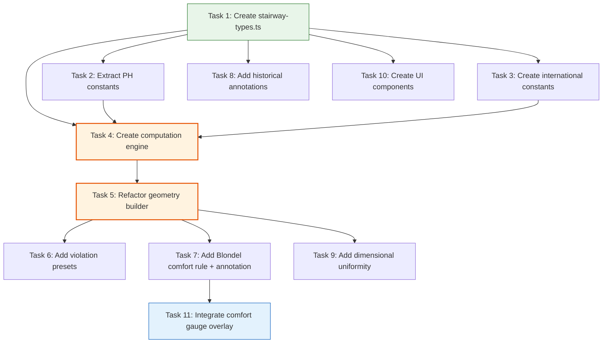

# Stairway Configurator v2 — Phase 1 Implementation Playbook

**Created:** 2026-04-09
**Version:** 1.0
**Status:** READY FOR EXECUTION
**Author:** SlateCamp 3D Lab Systems Engineering

---

## Reference Documents

| Document | Location | Role |
|----------|----------|------|
| Innovation Research | `.ai/plans/stairway-configurator-improvement/stairway-configurator-innovation-research.md` | WHAT and WHY — 10 innovations, international code data, Blondel research, prioritization |
| Technical Implementation Plan | `.ai/plans/stairway-configurator-improvement/stairway-configurator-technical-implementation-plan.md` | Architectural CONSTRAINTS — computation engine, geometry pipeline, performance budget |
| UX Implementation Plan | `.ai/plans/stairway-configurator-improvement/stairway-configurator-ux-implementation-plan.md` | UX REQUIREMENTS — Viewport Sanctity, presets, component library, mobile strategy |
| 3D Lab Feature Specification | `.ai/docs/01-product/008-3d-lab-feature-specification.md` | AUTHORITATIVE SPEC — types, stores, templates, component inventory |

---

## Phase 1 Scope and Goals

### What Phase 1 Delivers

1. **Computation/geometry separation** — Extract all compliance logic into a pure-function computation engine (`stairway-computation.ts`) that produces a single `ComputedStairState` object
2. **Constants extraction** — All Philippine code thresholds (PD 1096, BP 220, BP 344, RA 9514) moved to a dedicated constants file with code citation comments; international constants (IBC 2024, ADA/ANSI A117.1, IRC) in a separate file marked UNVERIFIED
3. **Blondel comfort gauge** — Real-time 2R+T comfort formula as an `info` severity violation rule + corner-anchored DOM overlay (120x60px max)
4. **Violation presets** — 11 new presets (violation scenarios + cross-law conflicts + edge cases) added alongside 4 existing scenario presets
5. **Historical annotations layer** — Toggle-activated annotations with research/historical context (Blondel 1672, Templer 1976, Cocoanut Grove 1942)
6. **Dimensional uniformity toggle** — Seeded per-step riser variation simulation with 9.5mm tolerance violation detection
7. **Stair type abstraction scaffold** — `StairTypeConfig` discriminated union (straight-only implemented; L-shape and U-shape ready for Phase 3)
8. **New UI components** — PresetChip, PresetChipStrip, ViolationRow, ComplianceLawCard, ComplianceSummaryBadge, DimensionSlider, FixButton, LawActivationDot component shells with Storybook stories

### What Phase 1 Explicitly Does NOT Deliver

- Nosing profile cross-section view (Phase 2)
- International code comparison mode with ghost geometry (Phase 2)
- L-shape or U-shape stair geometry (Phase 3)
- Evacuation flow simulation (Phase 3)
- Handrail graspability detail (Phase 2)
- Material and slip resistance layer (Phase 3)
- Guided tour system (Phase 2+)
- CAGE quiz integration (undecided)
- `<ViewportContent>` enforcement component (open decision — flagged in Risk Registry)

### Success Criteria

- [ ] All 22 existing violation rules still fire with identical behavior
- [ ] All 4 existing presets produce identical 3D output
- [ ] Module renders identically in 3D Lab browser and module detail page
- [ ] TypeScript compiles with zero errors (`bun run type-check`)
- [ ] No new console warnings in browser
- [ ] `ComputedStairState` is computed by pure functions with zero Three.js/React imports
- [ ] Performance budget met: <200 GeometryInstructions, <30K triangles, <50 draw calls, <2ms computation time
- [ ] Comfort gauge renders as corner-anchored DOM element ≤120x60px (Viewport Sanctity Rule)
- [ ] All new constants have code citation comments
- [ ] All international code values marked `UNVERIFIED`

---

## Current State Snapshot

**Source file:** `src/features/3d-lab/config/modules/08-vertical/stairway-configurator.ts`

| Metric | Value |
|--------|-------|
| Total lines | 896 |
| Parameters | 10 (4 classification toggles/dropdown + 6 geometry sliders) |
| Violation rules | 22 (8 PD 1096 + 3 BP 220 + 2 BP 344 + 4 RA 9514 + 3 cross-law conflict + 2 headroom/vertical) |
| Annotations | 8 (5 always-visible + 3 BP 344 overlay) |
| Presets | 4 (Standard House, BP 220 Housing, Public Hall, Exit Stair) |
| Helper functions | 13 (mm, num, str, bool, isBP220, isAccessible, isExit, isHighOcc, isResidential, riserViolColor, treadViolColor, widthViolColor, strictestMinWidth) |
| Geometry instructions at defaults | ~30+ (base platform, 12 treads, 12 risers, 2 handrails, top landing, headroom plane) |
| Imports | 6 types from `@/features/3d-lab/types/templates` |
| Export | Single `stairwayConfigurator: ParametricSceneConfig` |

### Existing Color Palette (Hardcoded in File)

```typescript
const LAW = {
  RA_9514: '#E74C3C',  // Evacuation Red
  BP_344:  '#3498DB',   // Access Blue
  PD_1096: '#4A7FAD',   // Code Slate
  BP_220:  '#F5A623',   // Housing Amber
  PASS:    '#2ECC71',   // Clearance Green
}
const NEUTRAL = {
  TREAD:    '#a1a1aa',
  RISER:    '#a1a1aa',
  LANDING:  '#a1a1aa',
  HANDRAIL: '#71717a',
}
```

### Existing Parameters

| Key | Type | Default | Range | Group |
|-----|------|---------|-------|-------|
| `projectType` | dropdown | `'general_residential'` | 6 options | Project Classification |
| `isAccessibleRoute` | toggle | `false` | — | Project Classification |
| `isExitStair` | toggle | `false` | — | Project Classification |
| `isHighOccupancy` | toggle | `false` | — | Project Classification |
| `stairWidth` | slider | 900 | 500–1500 mm, step 25 | Stair Geometry |
| `riserHeight` | slider | 185 | 100–300 mm, step 5 | Stair Geometry |
| `treadDepth` | slider | 250 | 150–350 mm, step 5 | Stair Geometry |
| `headroom` | slider | 2100 | 1800–2500 mm, step 50 | Stair Geometry |
| `handrailHeight` | slider | 900 | 600–1200 mm, step 25 | Stair Geometry |
| `numRisers` | slider | 12 | 3–20, step 1 | Stair Geometry |

### Existing Presets

| Label | projectType | Width | Riser | Tread | Headroom | Handrail | Risers | Overlays |
|-------|-------------|-------|-------|-------|----------|----------|--------|----------|
| Standard House | general_residential | 900 | 185 | 250 | 2100 | 860 | 12 | None |
| BP 220 Housing | bp220_socialized | 620 | 240 | 210 | 2100 | 850 | 14 | None |
| Public Hall | commercial | 1250 | 175 | 280 | 2200 | 900 | 12 | Accessible + HighOcc |
| Exit Stair | commercial | 950 | 190 | 260 | 2100 | 900 | 14 | Exit + HighOcc |

---

## Target File Structure

After Phase 1 completion, the 08-vertical directory will contain:

```
src/features/3d-lab/config/modules/08-vertical/
├── elevator-hoistway.ts                    # (unchanged)
├── escalator-section.ts                    # (unchanged)
├── handrail-requirements.ts                # (unchanged)
├── stairway-configurator.ts                # MODIFIED — refactored to import from sub-modules
├── stairway-types.ts                       # NEW — ComputedStairState, StairTypeConfig, comfort types
├── stairway-constants.ts                   # NEW — PH code constants (PD 1096, BP 220, BP 344, RA 9514)
├── stairway-constants-international.ts     # NEW — IBC 2024, ADA/ANSI A117.1, IRC (all UNVERIFIED)
├── stairway-computation.ts                 # NEW — pure computation engine
└── stairway-presets.ts                     # NEW — 4 existing + 11 new violation presets

src/features/3d-lab/components/stairway/    # NEW — stairway-specific UI components
├── PresetChip.tsx                          # NEW
├── PresetChipStrip.tsx                     # NEW
├── ViolationRow.tsx                        # NEW
├── ComplianceLawCard.tsx                   # NEW
├── ComplianceSummaryBadge.tsx              # NEW
├── DimensionSlider.tsx                     # NEW
├── FixButton.tsx                           # NEW
├── LawActivationDot.tsx                    # NEW
├── ViewportComfortGauge.tsx                # NEW
└── index.ts                               # NEW — barrel export

stories/3d-lab/stairway/                    # NEW — Storybook stories
├── PresetChip.stories.tsx                  # NEW
├── PresetChipStrip.stories.tsx             # NEW
├── ViolationRow.stories.tsx                # NEW
├── ComplianceLawCard.stories.tsx           # NEW
├── ComplianceSummaryBadge.stories.tsx      # NEW
├── DimensionSlider.stories.tsx             # NEW
├── FixButton.stories.tsx                   # NEW
├── LawActivationDot.stories.tsx            # NEW
└── ViewportComfortGauge.stories.tsx         # NEW
```

**Note:** The Storybook `stories/` directory path follows the project's existing convention. Verify actual Storybook config (`main.ts`) for the correct stories glob before creating files.

---

## New Type Definitions

All new types are defined in `src/features/3d-lab/config/modules/08-vertical/stairway-types.ts`. They extend — never replace — existing types from `src/features/3d-lab/types/templates.ts`.

```typescript
// ──────────────────────────────────────────────
// stairway-types.ts — Phase 1 Type Definitions
// ──────────────────────────────────────────────

/** Raw parameter record type alias (matches ParametricSceneConfig geometry function signature) */
export type StairParams = Record<string, number | boolean | string>

// ── Comfort & Pitch ──────────────────────────

export type ComfortZoneStatus = 'comfortable' | 'too-cramped' | 'too-stretched'

export type PitchStatus = 'ramp-like' | 'comfortable' | 'steep' | 'ladder-like'

// ── Per-Law Compliance ───────────────────────

export interface PerLawEvaluation {
  applies: boolean
  passes: boolean
  limit: number       // The code-mandated threshold (mm)
  actual: number      // The current parameter value (mm)
  message: string     // Human-readable violation or pass message
  citation: string    // e.g., "PD 1096 IRR Rule VIII §804"
}

export interface ComplianceResult {
  pd1096: PerLawEvaluation
  bp220: PerLawEvaluation
  bp344: PerLawEvaluation
  ra9514: PerLawEvaluation
  conflicts: ConflictFlag[]
}

export interface ConflictFlag {
  id: string            // e.g., "conflict-riser-bp220-vs-pd1096"
  laws: [string, string] // e.g., ["BP 220", "PD 1096"]
  dimension: string      // e.g., "riserHeight"
  message: string
}

// ── International Comparison ─────────────────

/** ⚠️ All international values are UNVERIFIED — require SME review before production */
export interface InternationalComparisonDelta {
  dimension: string    // e.g., "riserHeight"
  phValue: number      // Current Philippine law limit (mm)
  ibcValue: number     // IBC 2024 limit (mm)  ⚠️ UNVERIFIED
  adaValue: number     // ADA/ANSI A117.1 limit (mm)  ⚠️ UNVERIFIED
  ircValue: number     // IRC limit (mm)  ⚠️ UNVERIFIED
  phLaw: string        // Which PH law applies
}

// ── Stair Type Abstraction ───────────────────

export type StairTypeConfig =
  | { type: 'straight' }
  | { type: 'l-shape'; turnDirection: 'left' | 'right'; risersBeforeTurn: number }
  | { type: 'u-shape'; risersBeforeTurn: number }

// ── Computed State (Single Source of Truth) ───

export interface ComputedStairState {
  // ── Raw parameters (passthrough) ──
  projectType: string
  isAccessibleRoute: boolean
  isExitStair: boolean
  isHighOccupancy: boolean
  stairWidth: number       // mm
  riserHeight: number      // mm
  treadDepth: number       // mm
  headroom: number         // mm
  handrailHeight: number   // mm
  numRisers: number

  // ── Stair type (Phase 1: always straight) ──
  stairType: StairTypeConfig

  // ── Derived metrics ──
  twoRPlusT: number               // 2R+T Blondel value (mm)
  rPlusT: number                   // R+T secondary comfort check (mm)
  comfortStatus: ComfortZoneStatus // 600–650 mm → 'comfortable'
  pitchAngle: number               // degrees (atan2(riserHeight, treadDepth))
  pitchStatus: PitchStatus         // classification by angle range
  totalRise: number                // numRisers × riserHeight (mm)
  totalRun: number                 // (numRisers - 1) × treadDepth (mm)
  stringerLength: number           // √(totalRise² + totalRun²) (mm)
  landingRequired: boolean         // totalRise > applicable maxVerticalRise

  // ── Regime flags ──
  isBP220: boolean
  isResidential: boolean
  strictestMinWidth: number        // mm — max of all applicable law minimums
  widthDeficit: number             // max(0, strictestMinWidth - stairWidth) (mm)

  // ── Compliance evaluations (per dimension) ──
  riserCompliance: ComplianceResult
  treadCompliance: ComplianceResult
  widthCompliance: ComplianceResult
  headroomCompliance: ComplianceResult
  handrailCompliance: ComplianceResult
  verticalRiseCompliance: ComplianceResult

  // ── Resolved violation colors (for geometry builder) ──
  riserColor: string | null       // Most severe active violation color, or null (pass)
  treadColor: string | null
  widthColor: string | null
  headroomViolation: boolean
  handrailColor: string | null

  // ── Tolerance mode (dimensional uniformity) ──
  toleranceMode: boolean
  toleranceRange: number           // mm (0–20)
  perStepRiserVariations: number[] // Array of length numRisers, each a deviation in mm
  uniformityViolationIndices: number[] // Indices of steps with >9.5mm deviation

  // ── International comparison deltas (Phase 2 preview) ──
  internationalDeltas: InternationalComparisonDelta[]
}

// ── Violation Preset Metadata ────────────────

export interface ViolationPresetMeta {
  primaryViolation: string   // Violation rule ID that this preset triggers
  primaryLaw: string         // Law code (e.g., "PD 1096")
  teachingGoal: string       // One-sentence pedagogical objective
}
```

---

## Task Dependency Graph



**Critical path:** Task 1 → Task 2 → Task 4 → Task 5 → Task 7 → Task 11

**Parallel opportunities:**
- Tasks 2 and 3 can run in parallel (both depend only on Task 1)
- Task 8 can run in parallel with Tasks 4–9 (depends only on Task 1)
- Task 10 can run in parallel with Tasks 2–9 (depends only on Task 1 for types)
- Tasks 6, 7, and 9 can run in parallel (all depend on Task 5)

---

## Task List

---

### Task 1: Create Module-Specific Type Definitions

**Objective:** Define all new TypeScript types for the stairway configurator v2 in a dedicated types file.

**Dependencies:** None (first task)

**Input Files (Read):**
- `src/features/3d-lab/types/templates.ts` — existing types to extend (ParametricSceneConfig, ViolationRule, AnnotationDef, ParameterDef, Preset, GeometryInstruction)
- `src/features/3d-lab/config/modules/08-vertical/stairway-configurator.ts` — existing parameter keys and value types

**Output Files (Create):**
- `src/features/3d-lab/config/modules/08-vertical/stairway-types.ts` — NEW

**Detailed Instructions:**

1. Create `stairway-types.ts` at the path above
2. Define all types from the "New Type Definitions" section of this playbook:
   - `StairParams` — type alias for `Record<string, number | boolean | string>` (matches existing `ParametricSceneConfig.geometry` function signature)
   - `ComfortZoneStatus` — union: `'comfortable' | 'too-cramped' | 'too-stretched'`
   - `PitchStatus` — union: `'ramp-like' | 'comfortable' | 'steep' | 'ladder-like'`
   - `PerLawEvaluation` — interface with `applies`, `passes`, `limit`, `actual`, `message`, `citation`
   - `ComplianceResult` — interface with per-law evaluations + `conflicts: ConflictFlag[]`
   - `ConflictFlag` — interface with `id`, `laws`, `dimension`, `message`
   - `InternationalComparisonDelta` — interface with `dimension`, `phValue`, `ibcValue`, `adaValue`, `ircValue`, `phLaw`. Add JSDoc `⚠️ UNVERIFIED` comment
   - `StairTypeConfig` — discriminated union: `straight | l-shape | u-shape`
   - `ComputedStairState` — the master computed state interface (see full definition in Type Definitions section above)
   - `ViolationPresetMeta` — metadata for violation presets
3. Export all types as named exports
4. Do NOT import from Three.js, React, or any store — this is a pure type file
5. Use `import type` for any template type references

**Acceptance Criteria:**
- [ ] File compiles with `bun run type-check`
- [ ] Zero `any` types
- [ ] Zero Three.js or React imports
- [ ] `ComputedStairState` includes all fields from the technical plan's derived metrics table
- [ ] `StairTypeConfig` has 3 variants (straight, l-shape, u-shape)
- [ ] All international-related types have `⚠️ UNVERIFIED` JSDoc comments
- [ ] Existing stairway-configurator.ts is untouched and still works

**Estimated Complexity:** Low — pure type definitions, no runtime code

**Risks:**
| Risk | Likelihood | Impact | Mitigation |
|------|-----------|--------|------------|
| Type incompatibility with existing `Record<string, number\|boolean\|string>` param pattern | Low | Medium | `StairParams` is an alias for the exact same type |
| Over-specification of ComputedStairState fields | Medium | Low | Fields can be added/removed in Phase 1 without breaking consumers since no consumers exist yet |

---

### Task 2: Extract Philippine Code Constants

**Objective:** Move all hardcoded Philippine code thresholds from `stairway-configurator.ts` into a dedicated constants file with code citation comments, following the existing pattern in `src/features/3d-lab/config/constants/`.

**Dependencies:** Task 1 (types file exists for import)

**Input Files (Read):**
- `src/features/3d-lab/config/modules/08-vertical/stairway-configurator.ts` — extract all numeric thresholds from violation rule checks and helper functions
- `src/features/3d-lab/config/constants/pd-1096.ts` — existing constant pattern to follow
- `src/features/3d-lab/config/constants/ra-9514.ts` — existing constant pattern to follow
- `src/features/3d-lab/config/constants/bp-344.ts` — existing constant pattern to follow
- `src/features/3d-lab/config/constants/index.ts` — existing barrel export pattern

**Output Files (Create):**
- `src/features/3d-lab/config/modules/08-vertical/stairway-constants.ts` — NEW

**Detailed Instructions:**

1. Create `stairway-constants.ts` at the path above
2. Extract every numeric threshold from the existing violation checks and helper functions. Use `SCREAMING_SNAKE_CASE` with law prefix and unit suffix per the technical plan's naming convention:

```typescript
// ──────────────────────────────────────────────────────────
// PD 1096 — National Building Code (NBCP)
// Source: PD 1096 IRR Rule VIII §804
// ──────────────────────────────────────────────────────────
export const PD1096_MAX_RISER_HEIGHT_MM = 200       // PD 1096 IRR Rule VIII §804
export const PD1096_MIN_TREAD_DEPTH_MM = 200        // PD 1096 IRR Rule VIII §804
export const PD1096_MIN_HEADROOM_MM = 2000          // PD 1096 IRR Rule VIII §804
export const PD1096_MAX_VERTICAL_RISE_MM = 3600     // PD 1096 IRR Rule VIII §804
export const PD1096_MIN_WIDTH_HIGH_OCC_MM = 1100    // PD 1096 IRR Rule VIII §804 (occupant load > 50)
export const PD1096_MIN_WIDTH_COMMERCIAL_MM = 900   // PD 1096 IRR Rule VIII §804 (10–50 occupants)
export const PD1096_MIN_WIDTH_RESIDENTIAL_MM = 750  // PD 1096 IRR Rule VIII §804 (private, ≤10 persons)
export const PD1096_HANDRAIL_MIN_HEIGHT_MM = 800    // PD 1096 IRR Rule VIII §804
export const PD1096_HANDRAIL_MAX_HEIGHT_MM = 900    // PD 1096 IRR Rule VIII §804

// ──────────────────────────────────────────────────────────
// BP 220 — Socialized/Economic Housing
// Source: BP 220 IRR · DHSUD
// ──────────────────────────────────────────────────────────
export const BP220_MAX_RISER_HEIGHT_MM = 250        // BP 220 IRR · DHSUD
export const BP220_MIN_TREAD_DEPTH_MM = 200         // BP 220 IRR · DHSUD
export const BP220_MIN_WIDTH_MM = 600               // BP 220 IRR · DHSUD

// ──────────────────────────────────────────────────────────
// BP 344 — Accessibility Law
// Source: BP 344 IRR · DPWH
// ──────────────────────────────────────────────────────────
export const BP344_MIN_ACCESSIBLE_WIDTH_MM = 1200   // BP 344 IRR · DPWH
export const BP344_HANDRAIL_UPPER_HEIGHT_MM = 900   // BP 344 IRR · DPWH
export const BP344_HANDRAIL_LOWER_HEIGHT_MM = 700   // BP 344 IRR · DPWH
export const BP344_HANDRAIL_EXTENSION_MM = 300      // BP 344 IRR · DPWH

// ──────────────────────────────────────────────────────────
// RA 9514 — Fire Code of the Philippines
// Source: RA 9514 IRR · BFP
// ──────────────────────────────────────────────────────────
export const RA9514_MAX_RISER_HEIGHT_MM = 180       // RA 9514 IRR · BFP
export const RA9514_MIN_TREAD_DEPTH_MM = 200        // RA 9514 IRR · BFP
export const RA9514_MIN_WIDTH_MM = 900              // RA 9514 IRR · BFP
export const RA9514_MAX_VERTICAL_RISE_MM = 3000     // RA 9514 IRR · BFP

// ──────────────────────────────────────────────────────────
// Blondel Comfort Formula
// Source: François Blondel, Cours d'Architecture (1675)
// ──────────────────────────────────────────────────────────
export const BLONDEL_COMFORT_MIN_MM = 600           // 2R+T minimum (Blondel 1672)
export const BLONDEL_COMFORT_MAX_MM = 650           // 2R+T maximum (Blondel 1672)
export const BLONDEL_COMFORT_OPTIMAL_MM = 630       // 2R+T sweet spot (Blondel 1672)
export const BLONDEL_SECONDARY_MIN_MM = 430         // R+T minimum (European practice)
export const BLONDEL_SECONDARY_MAX_MM = 450         // R+T maximum (European practice)

// ──────────────────────────────────────────────────────────
// Pitch Angle Thresholds (degrees)
// Source: Stairway ergonomics research (Templer, 1976)
// ──────────────────────────────────────────────────────────
export const PITCH_RAMP_THRESHOLD_DEG = 20          // Below = ramp-like
export const PITCH_COMFORTABLE_MAX_DEG = 35         // Above = steep
export const PITCH_STEEP_MAX_DEG = 42               // Above = ladder-like

// ──────────────────────────────────────────────────────────
// Dimensional Uniformity
// Source: IBC 2024 §1011.5.4 (tolerance applies to Philippine practice)
// ──────────────────────────────────────────────────────────
export const UNIFORMITY_TOLERANCE_MM = 9.5          // Max deviation between largest/smallest in flight

// ──────────────────────────────────────────────────────────
// Geometry Rendering Constants (scene units = meters)
// ──────────────────────────────────────────────────────────
export const TREAD_THICKNESS_M = 0.03
export const RISER_THICKNESS_M = 0.015
export const STRINGER_THICKNESS_M = 0.04
export const HANDRAIL_RADIUS_M = 0.02
export const BP344_GHOST_RAIL_RADIUS_M = 0.015
export const BP344_GHOST_OPACITY = 0.4
export const BP344_GHOST_OFFSET_M = 0.03
export const WIDTH_DEFICIT_OPACITY = 0.15
export const HEADROOM_PLANE_OPACITY = 0.3

// ──────────────────────────────────────────────────────────
// Law Color Palette
// ──────────────────────────────────────────────────────────
export const LAW_COLORS = {
  RA_9514: '#E74C3C',   // Evacuation Red (highest severity)
  BP_344:  '#3498DB',    // Access Blue
  PD_1096: '#4A7FAD',    // Code Slate
  BP_220:  '#F5A623',    // Housing Amber
  PASS:    '#2ECC71',    // Clearance Green
} as const

export const NEUTRAL_COLORS = {
  TREAD:    '#a1a1aa',
  RISER:    '#a1a1aa',
  LANDING:  '#a1a1aa',
  HANDRAIL: '#71717a',
} as const
```

3. Every constant must have an inline code citation comment
4. Group constants by law, then by topic within each law
5. Export all constants as named exports (not a namespace object) for tree-shaking

**Acceptance Criteria:**
- [ ] Every numeric literal from the existing violation check predicates is now a named constant
- [ ] Every constant has a code citation comment (e.g., `// PD 1096 IRR Rule VIII §804`)
- [ ] Constants follow `SCREAMING_SNAKE_CASE` with law prefix and `_MM` or `_DEG` unit suffix
- [ ] File has zero runtime dependencies (pure constants)
- [ ] Existing `stairway-configurator.ts` is untouched and still works
- [ ] `bun run type-check` passes

**Estimated Complexity:** Low — extraction of existing hardcoded values, no logic changes

**Risks:**
| Risk | Likelihood | Impact | Mitigation |
|------|-----------|--------|------------|
| Missing a hardcoded value in the existing file | Medium | Low | Grep for numeric literals in violation checks and helper functions |
| Blondel constants not verified against authoritative source | Low | Medium | Values come from research doc with 7+ citations |

---

### Task 3: Create International Code Constants

**Objective:** Create a constants file for IBC 2024, ADA/ANSI A117.1, and IRC stairway values. All values marked `UNVERIFIED`.

**Dependencies:** Task 1 (types file exists)

**Input Files (Read):**
- `.ai/plans/stairway-configurator-improvement/stairway-configurator-innovation-research.md` — international comparison table
- `src/features/3d-lab/config/modules/08-vertical/stairway-constants.ts` — follow same naming convention (created in Task 2, but Task 3 can run in parallel)

**Output Files (Create):**
- `src/features/3d-lab/config/modules/08-vertical/stairway-constants-international.ts` — NEW

**Detailed Instructions:**

1. Create `stairway-constants-international.ts` at the path above
2. Add a file-level JSDoc banner:
   ```typescript
   /**
    * ⚠️ UNVERIFIED — International Code Constants for Stairway Design
    *
    * These values are sourced from publicly available code summaries and
    * have NOT been verified against the official published standards.
    * Do NOT use for production compliance checking without SME review.
    *
    * Sources: IBC 2024, ADA/ANSI A117.1, IRC (US Residential)
    */
   ```

3. Define constants following the same naming convention as `stairway-constants.ts`:

```typescript
// ⚠️ UNVERIFIED — IBC 2024 (International Building Code)
export const IBC_MAX_RISER_HEIGHT_MM = 178          // IBC 2024 §1011.5.2 ⚠️ UNVERIFIED
export const IBC_MIN_TREAD_DEPTH_MM = 279           // IBC 2024 §1011.5.2 ⚠️ UNVERIFIED
export const IBC_MIN_HEADROOM_MM = 2032             // IBC 2024 §1011.3 (80") ⚠️ UNVERIFIED
export const IBC_HANDRAIL_MIN_HEIGHT_MM = 864       // IBC 2024 §1014.2 (34") ⚠️ UNVERIFIED
export const IBC_HANDRAIL_MAX_HEIGHT_MM = 965       // IBC 2024 §1014.2 (38") ⚠️ UNVERIFIED
export const IBC_MIN_WIDTH_MM = 914                 // IBC 2024 §1011.2 (36") ⚠️ UNVERIFIED
export const IBC_MIN_WIDTH_HIGH_OCC_MM = 1118       // IBC 2024 §1011.2 (44") ⚠️ UNVERIFIED
export const IBC_MAX_VERTICAL_RISE_MM = 3658        // IBC 2024 §1011.8 (12') ⚠️ UNVERIFIED
export const IBC_UNIFORMITY_TOLERANCE_MM = 9.5      // IBC 2024 §1011.5.4 (⅜") ⚠️ UNVERIFIED
export const IBC_HANDRAIL_EXTENSION_TOP_MM = 305    // IBC 2024 §1014.6 (12") ⚠️ UNVERIFIED
export const IBC_LANDING_MIN_DEPTH_MM = 1219        // IBC 2024 §1011.6 (48") ⚠️ UNVERIFIED
export const IBC_GUARD_SPACING_MM = 102             // IBC 2024 §1015.4 (4") ⚠️ UNVERIFIED

// ⚠️ UNVERIFIED — ADA/ANSI A117.1 (Accessibility)
export const ADA_MAX_RISER_HEIGHT_MM = 180          // ADA/ANSI A117.1 ⚠️ UNVERIFIED
export const ADA_MIN_TREAD_DEPTH_MM = 280           // ADA/ANSI A117.1 ⚠️ UNVERIFIED
export const ADA_HANDRAIL_MIN_HEIGHT_MM = 864       // ADA/ANSI A117.1 (34") ⚠️ UNVERIFIED
export const ADA_HANDRAIL_MAX_HEIGHT_MM = 965       // ADA/ANSI A117.1 (38") ⚠️ UNVERIFIED
export const ADA_MIN_ACCESSIBLE_WIDTH_MM = 1220     // ADA/ANSI A117.1 (48") ⚠️ UNVERIFIED
export const ADA_HANDRAIL_WALL_CLEARANCE_MM = 38    // ADA/ANSI A117.1 (1.5") ⚠️ UNVERIFIED
export const ADA_HANDRAIL_EXTENSION_TOP_MM = 305    // ADA/ANSI A117.1 (12") ⚠️ UNVERIFIED
export const ADA_NOSING_MAX_PROJECTION_MM = 38      // ADA/ANSI A117.1 (1.5") ⚠️ UNVERIFIED
export const ADA_NOSING_MAX_RADIUS_MM = 13          // ADA/ANSI A117.1 (0.5") ⚠️ UNVERIFIED
export const ADA_CHILDREN_HANDRAIL_HEIGHT_MM = 711  // ADA recommendation (28") ⚠️ UNVERIFIED

// ⚠️ UNVERIFIED — IRC (International Residential Code)
export const IRC_MAX_RISER_HEIGHT_MM = 196          // IRC §R311.7.5.1 (7¾") ⚠️ UNVERIFIED
export const IRC_MIN_TREAD_DEPTH_MM = 254           // IRC §R311.7.5.2 (10") ⚠️ UNVERIFIED
export const IRC_MIN_HEADROOM_MM = 2032             // IRC §R311.7.2 (80") ⚠️ UNVERIFIED
export const IRC_MIN_WIDTH_MM = 914                 // IRC §R311.7.1 (36") ⚠️ UNVERIFIED
export const IRC_MAX_VERTICAL_RISE_MM = 3658        // IRC §R311.7.3 (12') ⚠️ UNVERIFIED
export const IRC_HANDRAIL_MIN_HEIGHT_MM = 864       // IRC §R311.7.8.1 (34") ⚠️ UNVERIFIED
export const IRC_HANDRAIL_MAX_HEIGHT_MM = 965       // IRC §R311.7.8.1 (38") ⚠️ UNVERIFIED
export const IRC_GUARD_SPACING_MM = 102             // IRC §R312.1.3 (4") ⚠️ UNVERIFIED
export const IRC_NOSING_MAX_PROJECTION_MM = 32      // IRC §R311.7.5.3 (1¼") ⚠️ UNVERIFIED
```

4. Every constant must end with `⚠️ UNVERIFIED` in its inline comment
5. No runtime logic — pure constant exports

**Acceptance Criteria:**
- [ ] Every constant has `⚠️ UNVERIFIED` in its comment
- [ ] File-level JSDoc banner warns about unverified status
- [ ] Constants follow same `SCREAMING_SNAKE_CASE` convention as Task 2
- [ ] All values match the international comparison table in the research document
- [ ] File has zero runtime dependencies
- [ ] `bun run type-check` passes

**Estimated Complexity:** Low — data transcription from research document

**Risks:**
| Risk | Likelihood | Impact | Mitigation |
|------|-----------|--------|------------|
| Incorrect international code values | High | Medium | Every value marked UNVERIFIED; requires SME review before Phase 2 comparison mode |
| Unit conversion errors (inches to mm) | Medium | Medium | Cross-check: 1" = 25.4mm. IBC 7" = 178mm, 11" = 279mm, etc. |

⚠️ **NEEDS VERIFICATION:** All international code values require review by a licensed architect or code consultant before use in the international comparison mode (Phase 2).

---

### Task 4: Create Computation Engine

**Objective:** Create a pure-function computation module that transforms raw stair parameters into a single `ComputedStairState` object. This becomes the single source of truth for all downstream systems.

**Dependencies:** Task 1 (types), Task 2 (PH constants), Task 3 (international constants)

**Input Files (Read):**
- `src/features/3d-lab/config/modules/08-vertical/stairway-types.ts` — ComputedStairState, ComplianceResult, etc.
- `src/features/3d-lab/config/modules/08-vertical/stairway-constants.ts` — PH thresholds
- `src/features/3d-lab/config/modules/08-vertical/stairway-constants-international.ts` — international thresholds
- `src/features/3d-lab/config/modules/08-vertical/stairway-configurator.ts` — existing helper functions to extract (isBP220, isAccessible, isExit, isHighOcc, isResidential, riserViolColor, treadViolColor, widthViolColor, strictestMinWidth)

**Output Files (Create):**
- `src/features/3d-lab/config/modules/08-vertical/stairway-computation.ts` — NEW

**Detailed Instructions:**

1. Create `stairway-computation.ts` at the path above
2. **CRITICAL: Zero Three.js, React, or store imports.** This file imports ONLY from:
   - `./stairway-types` (type imports only)
   - `./stairway-constants` (PH code thresholds)
   - `./stairway-constants-international` (international thresholds)
3. Define and export the main computation function:
   ```typescript
   export const computeStairState = (params: StairParams): ComputedStairState => { ... }
   ```
4. Extract and convert the following helper functions from `stairway-configurator.ts` into pure computation functions. Each function takes explicit arguments (NOT the full params record) and returns a typed result:
   - `computeIsBP220(projectType: string): boolean` — replaces `isBP220(p)`
   - `computeIsResidential(projectType: string): boolean` — replaces `isResidential(p)`
   - `computeStrictestMinWidth(...)` — replaces `strictestMinWidth(p)`, uses named constants instead of magic numbers
   - `computeRiserCompliance(riserHeight: number, isBP220: boolean, isExit: boolean): ComplianceResult`
   - `computeTreadCompliance(treadDepth: number, isBP220: boolean, isExit: boolean): ComplianceResult`
   - `computeWidthCompliance(width: number, isBP220: boolean, isAccessible: boolean, isExit: boolean, isHighOcc: boolean, isResidential: boolean): ComplianceResult`
   - `computeHeadroomCompliance(headroom: number): ComplianceResult`
   - `computeHandrailCompliance(handrailHeight: number, isBP220: boolean, isAccessible: boolean): ComplianceResult`
   - `computeVerticalRiseCompliance(totalRise: number, isExit: boolean): ComplianceResult`
5. Add the NEW derived metric computations:
   - `computeBlondelComfort(riserHeight: number, treadDepth: number): { twoRPlusT: number, rPlusT: number, comfortStatus: ComfortZoneStatus }`
   - `computePitch(riserHeight: number, treadDepth: number): { pitchAngle: number, pitchStatus: PitchStatus }`
   - `computeGeometryMetrics(numRisers: number, riserHeight: number, treadDepth: number): { totalRise, totalRun, stringerLength }`
   - `computeToleranceVariations(numRisers: number, toleranceRange: number, seed: number): { perStepRiserVariations: number[], uniformityViolationIndices: number[] }`
   - `computeInternationalDeltas(...)` — builds `InternationalComparisonDelta[]` for each dimension
6. Add color resolution functions:
   - `resolveRiserColor(compliance: ComplianceResult): string | null` — replaces `riserViolColor(p)`, uses law color constants
   - `resolveTreadColor(compliance: ComplianceResult): string | null`
   - `resolveWidthColor(compliance: ComplianceResult): string | null`
   - `resolveHandrailColor(compliance: ComplianceResult): string | null`
7. The `computeStairState` main function calls all of the above and assembles the complete `ComputedStairState` object
8. The Blondel comfort computation logic:
   ```typescript
   const twoRPlusT = 2 * riserHeight + treadDepth  // mm
   const comfortStatus: ComfortZoneStatus =
     twoRPlusT < BLONDEL_COMFORT_MIN_MM ? 'too-cramped' :
     twoRPlusT > BLONDEL_COMFORT_MAX_MM ? 'too-stretched' :
     'comfortable'
   ```
9. The pitch computation:
   ```typescript
   const pitchAngle = Math.atan2(riserHeight, treadDepth) * (180 / Math.PI)  // degrees
   const pitchStatus: PitchStatus =
     pitchAngle < PITCH_RAMP_THRESHOLD_DEG ? 'ramp-like' :
     pitchAngle <= PITCH_COMFORTABLE_MAX_DEG ? 'comfortable' :
     pitchAngle <= PITCH_STEEP_MAX_DEG ? 'steep' :
     'ladder-like'
   ```
10. The tolerance variation computation uses a seeded pseudo-random function (simple mulberry32 or similar) to produce reproducible per-step deviations within `±toleranceRange`:
    ```typescript
    // Seed from numRisers to ensure reproducible output
    const seed = numRisers * 1337
    // For each riser, compute a deviation in range [-toleranceRange, +toleranceRange]
    // Then find indices where deviation from flight min/max exceeds UNIFORMITY_TOLERANCE_MM
    ```

**Acceptance Criteria:**
- [ ] File compiles with `bun run type-check`
- [ ] Zero `import` statements referencing `three`, `@react-three`, `react`, `zustand`, or any store
- [ ] `computeStairState` returns a fully populated `ComputedStairState` with all fields
- [ ] All threshold checks use named constants from `stairway-constants.ts` (zero magic numbers)
- [ ] Blondel comfort: `computeBlondelComfort(185, 250)` returns `{ twoRPlusT: 620, comfortStatus: 'comfortable' }`
- [ ] Pitch angle: `computePitch(185, 250)` returns approximately `{ pitchAngle: 36.5, pitchStatus: 'steep' }`
- [ ] Riser compliance: `computeRiserCompliance(210, false, false)` flags PD 1096 violation
- [ ] Riser compliance: `computeRiserCompliance(210, false, true)` flags RA 9514 violation (higher severity)
- [ ] Riser compliance: `computeRiserCompliance(240, true, false)` passes BP 220 (≤250)
- [ ] Cross-law conflict: riser 195mm with `isExit=true` passes PD 1096 but fails RA 9514
- [ ] Tolerance mode: with `toleranceRange=10`, produces reproducible per-step deviations
- [ ] Existing `stairway-configurator.ts` is untouched and still works
- [ ] Performance: `computeStairState` completes in <2ms (measure with `performance.now()`)

**Estimated Complexity:** High — core architectural piece, must replicate all existing compliance logic faithfully

**Risks:**
| Risk | Likelihood | Impact | Mitigation |
|------|-----------|--------|------------|
| Behavioral divergence from existing helper functions | High | High | Write test cases comparing existing helper output vs. new computation output for all 4 presets |
| Computation taking >2ms on mobile | Low | Medium | Profile early; the function is simple arithmetic, unlikely to exceed budget |
| Seeded random producing visually poor distributions | Medium | Low | Use mulberry32 PRNG; test with different numRiser values |
| Circular import if constants file imports from types | Low | Low | Constants file has zero imports; types file has zero imports from constants |

---

### Task 5: Refactor Geometry Builder to Consume ComputedStairState

**Objective:** Modify the geometry builder inside `stairway-configurator.ts` to use the computation engine internally while preserving the existing `ParametricSceneConfig.geometry` function signature for backward compatibility.

**Dependencies:** Task 4 (computation engine exists)

**Input Files (Read):**
- `src/features/3d-lab/config/modules/08-vertical/stairway-configurator.ts` — existing geometry function to refactor
- `src/features/3d-lab/config/modules/08-vertical/stairway-computation.ts` — computation engine (Task 4)
- `src/features/3d-lab/config/modules/08-vertical/stairway-constants.ts` — rendering constants (Task 2)
- `src/features/3d-lab/types/templates.ts` — ParametricSceneConfig.geometry signature

**Output Files (Modify):**
- `src/features/3d-lab/config/modules/08-vertical/stairway-configurator.ts` — MODIFY

**Detailed Instructions:**

1. **Add imports** at top of `stairway-configurator.ts`:
   ```typescript
   import { computeStairState } from './stairway-computation'
   import { LAW_COLORS, NEUTRAL_COLORS, TREAD_THICKNESS_M, RISER_THICKNESS_M, ... } from './stairway-constants'
   import type { ComputedStairState } from './stairway-types'
   ```

2. **Create adapter pattern** — The `ParametricSceneConfig.geometry` function signature is `(params: Record<string, number | boolean | string>) => GeometryInstruction[]`. This cannot change. Instead:
   ```typescript
   // Internal geometry sub-builder that receives computed state
   const buildGeometryFromState = (state: ComputedStairState): GeometryInstruction[] => {
     // ... all existing geometry logic, but reading from `state` instead of raw params
   }

   // Adapter: existing signature → computation engine → sub-builder
   const geometry = (p: P): GeometryInstruction[] => {
     const state = computeStairState(p)
     return buildGeometryFromState(state)
   }
   ```

3. **Migrate geometry logic** into `buildGeometryFromState`:
   - Replace `mm(p.riserHeight)` → `state.riserHeight / 1000` (state stores mm, scene uses meters)
   - Replace `riserViolColor(p)` → `state.riserColor ?? NEUTRAL_COLORS.RISER`
   - Replace `treadViolColor(p)` → `state.treadColor ?? NEUTRAL_COLORS.TREAD`
   - Replace `widthViolColor(p)` → `state.widthColor`
   - Replace `num(p.headroom) < 2000` → `state.headroomViolation`
   - Replace `strictestMinWidth(p)` → `state.strictestMinWidth`
   - Replace all hardcoded geometry constants (`0.03`, `0.015`, `0.04`, `0.02`) with named imports from `stairway-constants.ts`
   - Replace `LAW` and `NEUTRAL` object references with `LAW_COLORS` and `NEUTRAL_COLORS` from constants

4. **Remove extracted helpers** from `stairway-configurator.ts`:
   - Remove: `isBP220`, `isAccessible`, `isExit`, `isHighOcc`, `isResidential`
   - Remove: `riserViolColor`, `treadViolColor`, `widthViolColor`, `strictestMinWidth`
   - Remove: `LAW` and `NEUTRAL` color objects
   - Keep: `mm`, `num`, `str`, `bool` utility functions (still used by violation rule checks until those are migrated in a later task)

5. **Update violation rule checks** to use named constants:
   - Replace `num(p.riserHeight) > 200` → `num(p.riserHeight) > PD1096_MAX_RISER_HEIGHT_MM`
   - Import all threshold constants from `./stairway-constants`
   - Do NOT change the `ViolationRule.check` function signature — it still receives raw `params` for backward compat with `ParametricSceneRenderer.tsx`

6. **Preserve all existing exports** — the `stairwayConfigurator` export must remain identical in shape

**Acceptance Criteria:**
- [ ] `bun run type-check` passes
- [ ] `bun run dev` — module renders identically in 3D Lab browser
- [ ] All 4 existing presets produce visually identical 3D output (spot-check each)
- [ ] All 22 violation rules fire with identical conditions
- [ ] All 8 annotations display at correct positions
- [ ] No `LAW` or `NEUTRAL` objects remain in `stairway-configurator.ts` (moved to constants)
- [ ] No `isBP220`, `isAccessible`, `isExit`, `isHighOcc`, `isResidential` function definitions remain in file (moved to computation engine)
- [ ] No `riserViolColor`, `treadViolColor`, `widthViolColor`, `strictestMinWidth` function definitions remain in file
- [ ] `computeStairState` is called exactly once per geometry rebuild
- [ ] Zero new Three.js object allocations in the geometry function
- [ ] Geometry instruction count at default params matches pre-refactor count (~30+)
- [ ] Performance: geometry build time remains <5ms

**Estimated Complexity:** High — touching the core geometry function with many downstream effects; requires careful 1:1 behavioral verification

**Risks:**
| Risk | Likelihood | Impact | Mitigation |
|------|-----------|--------|------------|
| Geometry position drift from unit conversion errors | High | High | mm→meters conversion must be exact. State stores mm; geometry uses meters. Double-check every `state.X / 1000` |
| Breaking existing violation checks by removing helpers prematurely | Medium | High | Keep `mm`, `num`, `str`, `bool` in file. Only remove compliance helpers that are replaced by computation engine |
| ParametricSceneRenderer not re-rendering after refactor | Low | Medium | Geometry function signature unchanged; store still calls invalidate on param change |
| BP 344 ghost geometry not rendering | Medium | Medium | Ghost geometry uses `isAccessible(p)` — must now check `state.isAccessibleRoute` in buildGeometryFromState |

---

### Task 6: Add 11 Violation Presets

**Objective:** Add 11 new presets to demonstrate specific violations, cross-law conflicts, and edge cases. Organize into scenario presets (existing 4) and violation presets (new 11) using a naming convention.

**Dependencies:** Task 5 (geometry builder uses computation engine)

**Input Files (Read):**
- `.ai/plans/stairway-configurator-improvement/stairway-configurator-ux-implementation-plan.md` — Section 5.3 preset registry with parameter values
- `src/features/3d-lab/config/modules/08-vertical/stairway-configurator.ts` — existing 4 presets
- `src/features/3d-lab/types/templates.ts` — `Preset` type: `{ label: string, values: Record<string, number|boolean|string> }`

**Output Files (Create/Modify):**
- `src/features/3d-lab/config/modules/08-vertical/stairway-presets.ts` — NEW
- `src/features/3d-lab/config/modules/08-vertical/stairway-configurator.ts` — MODIFY (import presets from new file)

**Detailed Instructions:**

1. Create `stairway-presets.ts` at the path above
2. Move the existing 4 presets from `stairway-configurator.ts` into this file
3. Add 11 new violation presets per the UX plan. Each preset uses the existing `Preset` type:

```typescript
import type { Preset } from '@/features/3d-lab/types/templates'

// ── Scenario Presets (existing) ──────────────────
export const SCENARIO_PRESETS: Preset[] = [
  { label: 'Standard House', values: { /* existing values */ } },
  { label: 'BP 220 Housing', values: { /* existing values */ } },
  { label: 'Public Hall', values: { /* existing values */ } },
  { label: 'Exit Stair', values: { /* existing values */ } },
]

// ── Violation Presets (new) ──────────────────────
export const VIOLATION_PRESETS: Preset[] = [
  {
    label: '⚠ Riser Violation (PD 1096)',
    values: {
      projectType: 'general_residential', isAccessibleRoute: false,
      isExitStair: false, isHighOccupancy: false,
      stairWidth: 900, riserHeight: 210, treadDepth: 250,
      headroom: 2100, handrailHeight: 900, numRisers: 12,
    },
  },
  {
    label: '⚠ Tread Too Shallow (PD 1096)',
    values: {
      projectType: 'general_residential', isAccessibleRoute: false,
      isExitStair: false, isHighOccupancy: false,
      stairWidth: 900, riserHeight: 185, treadDepth: 185,
      headroom: 2100, handrailHeight: 900, numRisers: 12,
    },
  },
  {
    label: '⚠ Too Narrow for Public (PD 1096)',
    values: {
      projectType: 'commercial', isAccessibleRoute: false,
      isExitStair: false, isHighOccupancy: true,
      stairWidth: 900, riserHeight: 185, treadDepth: 250,
      headroom: 2100, handrailHeight: 900, numRisers: 12,
    },
  },
  {
    label: '⚠ Headroom Crush (PD 1096)',
    values: {
      projectType: 'general_residential', isAccessibleRoute: false,
      isExitStair: false, isHighOccupancy: false,
      stairWidth: 900, riserHeight: 185, treadDepth: 250,
      headroom: 1900, handrailHeight: 900, numRisers: 12,
    },
  },
  {
    label: '⚠ Exit Riser Violation (RA 9514)',
    values: {
      projectType: 'commercial', isAccessibleRoute: false,
      isExitStair: true, isHighOccupancy: true,
      stairWidth: 950, riserHeight: 195, treadDepth: 260,
      headroom: 2100, handrailHeight: 900, numRisers: 14,
    },
  },
  {
    label: '⚠ No Landing (RA 9514)',
    values: {
      projectType: 'commercial', isAccessibleRoute: false,
      isExitStair: true, isHighOccupancy: true,
      stairWidth: 950, riserHeight: 185, treadDepth: 260,
      headroom: 2100, handrailHeight: 900, numRisers: 18,
      // totalRise = 18 × 185 = 3,330 mm > RA 9514 max 3,000 mm
    },
  },
  {
    label: '⚠ Too Narrow for Wheelchair (BP 344)',
    values: {
      projectType: 'commercial', isAccessibleRoute: true,
      isExitStair: false, isHighOccupancy: false,
      stairWidth: 1000, riserHeight: 175, treadDepth: 280,
      headroom: 2200, handrailHeight: 900, numRisers: 12,
    },
  },
  {
    label: '⚠ BP 220 vs PD 1096 Conflict',
    values: {
      projectType: 'bp220_socialized', isAccessibleRoute: false,
      isExitStair: false, isHighOccupancy: false,
      stairWidth: 650, riserHeight: 230, treadDepth: 210,
      headroom: 2100, handrailHeight: 850, numRisers: 14,
      // Passes BP 220 (≤250) but exceeds PD 1096 (≤200)
    },
  },
  {
    label: '⚠ RA 9514 vs PD 1096 Conflict',
    values: {
      projectType: 'commercial', isAccessibleRoute: false,
      isExitStair: true, isHighOccupancy: true,
      stairWidth: 950, riserHeight: 195, treadDepth: 260,
      headroom: 2100, handrailHeight: 900, numRisers: 14,
      // Passes PD 1096 (≤200) but exceeds RA 9514 (≤180)
    },
  },
  {
    label: '✓ All Laws Happy',
    values: {
      projectType: 'commercial', isAccessibleRoute: true,
      isExitStair: true, isHighOccupancy: true,
      stairWidth: 1250, riserHeight: 170, treadDepth: 290,
      headroom: 2200, handrailHeight: 900, numRisers: 12,
      // Satisfies ALL laws including BP 344 + RA 9514
    },
  },
  {
    label: '⚠ Everything Wrong',
    values: {
      projectType: 'commercial', isAccessibleRoute: true,
      isExitStair: true, isHighOccupancy: true,
      stairWidth: 500, riserHeight: 280, treadDepth: 155,
      headroom: 1850, handrailHeight: 650, numRisers: 20,
      // Triggers maximum simultaneous violations across all laws
    },
  },
]

export const ALL_PRESETS: Preset[] = [...SCENARIO_PRESETS, ...VIOLATION_PRESETS]
```

4. Update `stairway-configurator.ts`:
   - Remove inline preset definitions
   - Add `import { ALL_PRESETS } from './stairway-presets'`
   - Set `presets: ALL_PRESETS` in the config export

5. Verify each violation preset triggers its intended primary violation by mentally running the existing violation checks against the preset values

**Acceptance Criteria:**
- [ ] 15 total presets (4 scenario + 11 violation)
- [ ] Each violation preset triggers exactly one primary violation (except "Everything Wrong" and "All Laws Happy")
- [ ] All 4 existing presets are preserved with identical parameter values
- [ ] Preset labels use `⚠` prefix for violations, `✓` prefix for "All Laws Happy"
- [ ] All presets use valid parameter keys matching existing `ParameterDef` keys
- [ ] Module renders correctly when each preset is selected
- [ ] `bun run type-check` passes

**Estimated Complexity:** Medium — requires careful parameter tuning to trigger exactly the right violations

**Risks:**
| Risk | Likelihood | Impact | Mitigation |
|------|-----------|--------|------------|
| Preset triggers unintended additional violations | High | Low | Verify each preset against all 22 rules mentally or with a test harness |
| "All Laws Happy" preset impossible to achieve | Low | Medium | Use conservative values well within all limits (riser 170, tread 290, width 1250) |

---

### Task 7: Add Blondel Comfort Formula Rule and Annotation

**Objective:** Add the 2R+T Blondel comfort formula as an `info` severity violation rule and a new annotation showing the current comfort value.

**Dependencies:** Task 5 (geometry builder uses computation engine which computes twoRPlusT)

**Input Files (Read):**
- `src/features/3d-lab/config/modules/08-vertical/stairway-configurator.ts` — existing violations and annotations arrays
- `src/features/3d-lab/config/modules/08-vertical/stairway-computation.ts` — provides twoRPlusT via computeStairState
- `src/features/3d-lab/config/modules/08-vertical/stairway-constants.ts` — BLONDEL_COMFORT_MIN_MM, BLONDEL_COMFORT_MAX_MM
- `src/features/3d-lab/types/templates.ts` — ViolationRule and AnnotationDef interfaces

**Output Files (Modify):**
- `src/features/3d-lab/config/modules/08-vertical/stairway-configurator.ts` — MODIFY (add violation rule + annotation)

**Detailed Instructions:**

1. Add a new `ViolationRule` to the violations array:
   ```typescript
   {
     id: 'blondel-comfort',
     check: (p) => {
       const rH = num(p.riserHeight)
       const tD = num(p.treadDepth)
       const twoRPlusT = 2 * rH + tD
       return twoRPlusT < BLONDEL_COMFORT_MIN_MM || twoRPlusT > BLONDEL_COMFORT_MAX_MM
     },
     field: 'riserHeight',  // Primary parameter (also affects treadDepth)
     message: 'Blondel comfort formula: 2R+T should be 600–650 mm',
     codeCitation: 'Blondel, Cours d\'Architecture (1675) — 2R+T ergonomic formula',
     severity: 'info',
     position: (p) => {
       // Position near the top of the stair, offset to the right
       const n = num(p.numRisers)
       const rH = mm(p.riserHeight)
       const tD = mm(p.treadDepth)
       return [0.8, n * rH + 0.3, -(n * tD / 2)]
     },
   }
   ```

2. Add a new `AnnotationDef` to the annotations array:
   ```typescript
   {
     id: 'blondel-formula',
     label: '2R+T Comfort',
     description: 'Blondel ergonomic formula: 2R+T = 600–650 mm is the comfortable range. Current value computed from riser height and tread depth.',
     codeCitation: 'Blondel, Cours d\'Architecture (1675)',
     position: (p) => {
       const n = num(p.numRisers)
       const rH = mm(p.riserHeight)
       const tD = mm(p.treadDepth)
       return [0.8, n * rH + 0.3, -(n * tD / 2)]
     },
     // Always visible — comfort gauge is a core Phase 1 feature
   }
   ```

3. Import Blondel constants from `./stairway-constants`

4. **CRITICAL:** The comfort formula severity is `info`, not `error`. Per the technical plan: "Comfort formula does NOT override element colors. Displayed as SEPARATE gauge element." The existing `ComplianceReportPanel` already handles `info` severity.

**Acceptance Criteria:**
- [ ] Violation fires when `2 * riserHeight + treadDepth` is outside 600–650 mm
- [ ] Violation severity is `info` (not `error` or `warning`)
- [ ] At default params (riser 185, tread 250): 2(185)+250 = 620 mm → within range, no violation
- [ ] At riser 200, tread 300: 2(200)+300 = 700 mm → violation fires (too-stretched)
- [ ] At riser 130, tread 200: 2(130)+200 = 460 mm → violation fires (too-cramped)
- [ ] Code citation references Blondel 1675
- [ ] Annotation position is near the top of the stair, offset from geometry
- [ ] `bun run type-check` passes
- [ ] Existing 22 violation rules unchanged

**Estimated Complexity:** Low — adding one violation rule and one annotation to existing arrays

**Risks:**
| Risk | Likelihood | Impact | Mitigation |
|------|-----------|--------|------------|
| Info severity not rendered by ComplianceReportPanel | Low | Medium | Verify ComplianceReportPanel handles `info` severity; if not, file a follow-up task |
| Annotation position overlapping existing annotations | Medium | Low | Position offset to the right (+0.8 X) to avoid existing left-side annotations |

---

### Task 8: Add Historical Context Annotations

**Objective:** Add toggle-activated annotations providing historical and research context for code values (Blondel 1672, Templer 1976, Cocoanut Grove 1942).

**Dependencies:** Task 1 (types file for reference)

**Input Files (Read):**
- `src/features/3d-lab/config/modules/08-vertical/stairway-configurator.ts` — existing parameters and annotations arrays
- `.ai/plans/stairway-configurator-improvement/stairway-configurator-innovation-research.md` — historical anchors (Section: "The Why Layer")

**Output Files (Modify):**
- `src/features/3d-lab/config/modules/08-vertical/stairway-configurator.ts` — MODIFY (add toggle param + annotations)

**Detailed Instructions:**

1. Add a new `ParameterDef` toggle to the parameters array:
   ```typescript
   {
     key: 'showHistory',
     label: 'Show Historical Context',
     type: 'toggle' as const,
     default: false,
     group: 'Learning Overlays',
   }
   ```

2. Add historical `AnnotationDef` entries to the annotations array, each with `visibleWhen: (p) => bool(p.showHistory)`:

   ```typescript
   {
     id: 'history-blondel',
     label: 'Blondel (1672)',
     description: 'François Blondel, Royal Academy of Architecture, Paris. Discovered that 2R+T ≈ 630 mm matches human stride length. When R=0 (flat), stride ≈ 630 mm. When T=0 (ladder), rung spacing ≈ 315 mm (half stride).',
     codeCitation: 'Blondel, Cours d\'Architecture, 1675–1683',
     position: (p) => {
       const rH = mm(p.riserHeight)
       return [1.2, rH * 3, 0.2]
     },
     visibleWhen: (p) => bool(p.showHistory),
   },
   {
     id: 'history-templer',
     label: 'Templer (1976)',
     description: 'John Templer\'s research on stair safety: 279 mm tread depth minimizes missteps. Basis for IBC\'s 11-inch (279 mm) minimum tread requirement.',
     codeCitation: 'Templer, J. "Stair Shape and Human Movement", 1976',
     position: (p) => {
       const rH = mm(p.riserHeight)
       const tD = mm(p.treadDepth)
       return [0, rH + 0.06, -tD]
     },
     visibleWhen: (p) => bool(p.showHistory),
   },
   {
     id: 'history-cocoanut-grove',
     label: 'Cocoanut Grove (1942)',
     description: 'The Cocoanut Grove nightclub fire in Boston killed 492 people. Narrow, locked, and inward-opening exit doors caused fatal bottlenecks. This disaster drove modern exit stair width and vertical rise limits in fire codes worldwide, including RA 9514.',
     codeCitation: 'Cocoanut Grove fire, Boston, November 28, 1942',
     position: (p) => {
       const n = num(p.numRisers)
       const rH = mm(p.riserHeight)
       const tD = mm(p.treadDepth)
       return [-0.6, n * rH * 0.5, -(n * tD * 0.5)]
     },
     visibleWhen: (p) => bool(p.showHistory),
   },
   {
     id: 'history-uniformity',
     label: 'Uniformity Litigation (1970s–80s)',
     description: 'Slip-and-fall litigation in the 1970s–80s established that inconsistent riser heights within a stair flight are a primary cause of missteps. This drove the 9.5 mm (⅜") maximum deviation tolerance in IBC §1011.5.4.',
     codeCitation: 'IBC Commentary, slip-and-fall case law precedent',
     position: (p) => {
       const rH = mm(p.riserHeight)
       return [0.6, rH * 5, -0.3]
     },
     visibleWhen: (p) => bool(p.showHistory),
   },
   {
     id: 'history-handrail-height',
     label: 'Handrail Height Origin',
     description: 'Handrail height range (800–900 mm) derives from the 5th–95th percentile wrist height of standing adults. The dual-height requirement in BP 344 (700 mm + 900 mm) accommodates wheelchair users and children.',
     codeCitation: 'Ergonomic anthropometric data, human factors research',
     position: (p) => {
       const n = num(p.numRisers)
       const rH = mm(p.riserHeight)
       const tD = mm(p.treadDepth)
       const mid = Math.floor(n / 2)
       return [0.8, mid * rH + mm(p.handrailHeight), -(mid * tD)]
     },
     visibleWhen: (p) => bool(p.showHistory),
   }
   ```

3. The new parameter group "Learning Overlays" separates educational toggles from project classification and geometry controls

**Acceptance Criteria:**
- [ ] New `showHistory` toggle parameter added to parameters array
- [ ] 5 historical annotations added to annotations array
- [ ] All 5 annotations have `visibleWhen: (p) => bool(p.showHistory)`
- [ ] Annotations are invisible by default (`showHistory` default is `false`)
- [ ] When `showHistory` is toggled on, all 5 annotations appear
- [ ] Each annotation has a `codeCitation` referencing its historical source
- [ ] Annotations do not overlap existing dimension annotations (positions offset)
- [ ] `bun run type-check` passes
- [ ] Existing 8 annotations unchanged

**Estimated Complexity:** Low — adding a toggle parameter and annotation entries to existing arrays

**Risks:**
| Risk | Likelihood | Impact | Mitigation |
|------|-----------|--------|------------|
| Annotation position collisions with existing annotations | Medium | Low | Each uses a unique offset direction (+X, -X, +Z) |
| Too many annotations visible simultaneously | Low | Medium | All historical annotations gated behind single toggle; max 5 visible at once |

---

### Task 9: Add Dimensional Uniformity Simulation

**Objective:** Add `toleranceMode` and `toleranceRange` parameters that simulate per-step riser height variations and highlight steps exceeding the 9.5mm tolerance threshold.

**Dependencies:** Task 5 (geometry builder uses computation engine which provides tolerance variations)

**Input Files (Read):**
- `src/features/3d-lab/config/modules/08-vertical/stairway-configurator.ts` — geometry builder's tread/riser loop
- `src/features/3d-lab/config/modules/08-vertical/stairway-computation.ts` — `computeToleranceVariations` function
- `src/features/3d-lab/config/modules/08-vertical/stairway-constants.ts` — `UNIFORMITY_TOLERANCE_MM`

**Output Files (Modify):**
- `src/features/3d-lab/config/modules/08-vertical/stairway-configurator.ts` — MODIFY (add params + modify geometry loop + add violation rule)

**Detailed Instructions:**

1. Add two new `ParameterDef` entries to the parameters array:
   ```typescript
   {
     key: 'toleranceMode',
     label: 'Construction Tolerance Mode',
     type: 'toggle' as const,
     default: false,
     group: 'Learning Overlays',
   },
   {
     key: 'toleranceRange',
     label: 'Tolerance Range',
     type: 'slider' as const,
     min: 0, max: 20, step: 1, default: 5,
     unit: 'mm',
     group: 'Learning Overlays',
   }
   ```

2. Modify the `buildGeometryFromState` function's tread/riser loop to apply per-step riser variations when `state.toleranceMode` is true:
   ```typescript
   // Inside the riser/tread loop:
   for (let i = 0; i < state.numRisers; i++) {
     // Apply tolerance variation to this step's riser height
     const riserDeviation = state.toleranceMode
       ? state.perStepRiserVariations[i] / 1000  // mm to meters
       : 0
     const thisRiserHeight = rH + riserDeviation  // rH is base riser in meters

     // Accumulate Y position (not uniform anymore)
     y += thisRiserHeight

     // Determine riser color: if this step violates uniformity, use PD 1096 color
     const isUniformityViolation = state.toleranceMode &&
       state.uniformityViolationIndices.includes(i)
     const thisRiserColor = isUniformityViolation
       ? LAW_COLORS.PD_1096
       : (state.riserColor ?? NEUTRAL_COLORS.RISER)

     // ... existing tread/riser GeometryInstruction creation, but using thisRiserHeight and thisRiserColor
   }
   ```

3. **IMPORTANT:** When tolerance mode is OFF, the geometry must be identical to pre-Task-9 output. The `riserDeviation` is 0, so `thisRiserHeight === rH` and loop produces same positions.

4. Add a new violation rule for dimensional uniformity:
   ```typescript
   {
     id: 'uniformity-tolerance',
     check: (p) => {
       if (!bool(p.toleranceMode)) return false
       // Recompute to check — or rely on the fact that computeStairState
       // already computed uniformityViolationIndices
       const state = computeStairState(p)
       return state.uniformityViolationIndices.length > 0
     },
     field: 'toleranceRange',
     message: 'Per-step riser deviation exceeds 9.5 mm tolerance (IBC §1011.5.4)',
     codeCitation: 'IBC 2024 §1011.5.4 — Dimensional uniformity',
     severity: 'warning',
     position: (p) => {
       // Position at the step with worst violation
       const state = computeStairState(p)
       const worstIdx = state.uniformityViolationIndices[0] ?? Math.floor(num(p.numRisers) / 2)
       return [0.5, (worstIdx + 1) * mm(p.riserHeight), -(worstIdx * mm(p.treadDepth))]
     },
   }
   ```

5. **Performance note:** `computeStairState` may be called twice — once in geometry builder, once in violation check. This is acceptable for Phase 1 (<2ms per call). Optimization to cache can be done in Phase 2 if profiling shows concern.

**Acceptance Criteria:**
- [ ] Two new parameters added: `toleranceMode` (toggle, default false) and `toleranceRange` (slider, 0–20mm, default 5)
- [ ] When tolerance mode is OFF, geometry is identical to pre-Task-9
- [ ] When tolerance mode is ON, risers have visually different heights
- [ ] Steps with deviation >9.5mm from flight min/max are colored in PD 1096 color
- [ ] `uniformity-tolerance` violation rule fires when any step exceeds tolerance
- [ ] Changing `toleranceRange` slider adjusts the magnitude of variations
- [ ] Reproducible: same `numRisers` always produces same variation pattern (seeded PRNG)
- [ ] `bun run type-check` passes
- [ ] Performance: <200 GeometryInstructions at maximum settings (20 risers + tolerance mode)

**Estimated Complexity:** Medium — modifying the geometry loop requires careful position accumulation

**Risks:**
| Risk | Likelihood | Impact | Mitigation |
|------|-----------|--------|------------|
| Accumulated position error from riser deviations causing visual artifacts | Medium | Medium | Track cumulative Y offset; ensure top landing aligns with accumulated height |
| Double computation of stairState in violation check | Low | Low | <2ms per call; acceptable for Phase 1 |
| Tolerance mode breaking treads alignment | Medium | Medium | Treads snap to their riser's Y position; test with extreme tolerance (20mm) |

---

### Task 10: Create New UI Components

**Objective:** Create component files with TypeScript interfaces and basic implementations using existing Shadcn primitives for the 8 new stairway-specific UI components, plus Storybook stories.

**Dependencies:** Task 1 (types for component props)

**Input Files (Read):**
- `.ai/plans/stairway-configurator-improvement/stairway-configurator-ux-implementation-plan.md` — Section 13: component specs
- `src/components/ui/badge.tsx` — existing Shadcn Badge
- `src/components/ui/button.tsx` — existing Shadcn Button
- `src/components/ui/card.tsx` — existing Shadcn Card
- `src/components/ui/slider.tsx` — existing Shadcn Slider (if exists)
- `src/components/ui/scroll-area.tsx` — existing Shadcn ScrollArea (if exists)
- `src/features/3d-lab/components/templates/ComplianceReportPanel.tsx` — existing compliance UI pattern

**Output Files (Create):**
- `src/features/3d-lab/components/stairway/PresetChip.tsx` — NEW
- `src/features/3d-lab/components/stairway/PresetChipStrip.tsx` — NEW
- `src/features/3d-lab/components/stairway/ViolationRow.tsx` — NEW
- `src/features/3d-lab/components/stairway/ComplianceLawCard.tsx` — NEW
- `src/features/3d-lab/components/stairway/ComplianceSummaryBadge.tsx` — NEW
- `src/features/3d-lab/components/stairway/DimensionSlider.tsx` — NEW
- `src/features/3d-lab/components/stairway/FixButton.tsx` — NEW
- `src/features/3d-lab/components/stairway/LawActivationDot.tsx` — NEW
- `src/features/3d-lab/components/stairway/index.ts` — NEW (barrel export)

**Detailed Instructions:**

1. Create the `src/features/3d-lab/components/stairway/` directory
2. For each component, define the props interface and a basic implementation using existing Shadcn primitives. These are **functional shells** — they render correctly with the right props structure but visual polish is deferred to Phase 2 design review.

3. **Component API Definitions:**

```typescript
// PresetChip.tsx
interface PresetChipProps {
  label: string
  isActive: boolean
  isViolation: boolean    // If true, uses law color fill
  lawColor?: string       // Hex color for violation presets
  onClick: () => void
}

// PresetChipStrip.tsx
interface PresetChipStripProps {
  presets: Array<{ label: string; isViolation: boolean; lawColor?: string }>
  activeIndex: number | null
  onSelect: (index: number) => void
}

// ViolationRow.tsx
interface ViolationRowProps {
  message: string
  currentValue: number
  limit: number
  unit: string              // 'mm', 'deg', etc.
  severity: 'error' | 'warning' | 'info'
  lawColor: string
  onFix?: () => void        // If provided, shows Fix button
  onClick?: () => void      // Highlights 3D element
}

// ComplianceLawCard.tsx
interface ComplianceLawCardProps {
  lawName: string           // 'PD 1096', 'BP 344', etc.
  lawColor: string
  subtitle: string          // 'Exit stair · Life-safety overlay'
  citation: string          // 'RA 9514 IRR · BFP'
  violations: ViolationRowProps[]
  passes: Array<{ message: string }>
  isApplicable: boolean
}

// ComplianceSummaryBadge.tsx
interface ComplianceSummaryBadgeProps {
  issueCount: number
  warningCount: number
}

// DimensionSlider.tsx
interface DimensionSliderProps {
  label: string
  value: number
  min: number
  max: number
  step: number
  unit: string
  thresholds: Array<{ value: number; lawColor: string; label: string }>
  isViolating: boolean
  onChange: (value: number) => void
}

// FixButton.tsx
interface FixButtonProps {
  onClick: () => void
  lawColor: string
}

// LawActivationDot.tsx
interface LawActivationDotProps {
  lawColor: string
  isActive: boolean
}
```

4. Each component implementation should:
   - Import from `@/components/ui/` (Badge, Button, Card, etc.) — use existing Shadcn primitives
   - Use `cn()` from `@/lib/utils` for class merging
   - Follow arrow function style (per CLAUDE.md rules)
   - Have `'use client'` directive (these are interactive components)
   - Use Tailwind semantic token classes (per design system rules)

5. Create `index.ts` barrel export:
   ```typescript
   export { PresetChip } from './PresetChip'
   export { PresetChipStrip } from './PresetChipStrip'
   // ... etc
   ```

6. **Storybook stories** — Check the project's Storybook configuration for the stories directory path. Create one `.stories.tsx` file per component with at least 2 variants (default + edge case). Mark visual design as **PENDING DESIGN REVIEW** in story descriptions.

**Acceptance Criteria:**
- [ ] All 8 component files created with proper TypeScript interfaces
- [ ] All components use existing Shadcn primitives (no ad-hoc card/button divs)
- [ ] All components have `'use client'` directive
- [ ] Arrow functions only (no `function` declarations)
- [ ] Tailwind classes use semantic tokens (no hardcoded hex)
- [ ] Barrel export in `index.ts`
- [ ] `bun run type-check` passes
- [ ] Components render without errors in isolation (Storybook)
- [ ] Visual design marked as PENDING DESIGN REVIEW

**Estimated Complexity:** Medium — 8 component shells with proper types, but no complex logic

**Risks:**
| Risk | Likelihood | Impact | Mitigation |
|------|-----------|--------|------------|
| Missing Shadcn primitives (Slider, ScrollArea) | Medium | Low | Check `src/components/ui/` — install missing primitives with `bunx shadcn@latest add slider scroll-area` |
| Storybook config mismatch | Low | Low | Verify Storybook stories glob in `.storybook/main.ts` before creating story files |
| Component props may change after design review | High | Low | Props are defined as interfaces — easy to extend. Mark as PENDING DESIGN REVIEW |

⚠️ **PENDING DESIGN REVIEW:** All 8 component visual designs need design system review before final implementation. The Phase 1 implementation is functional shells with correct APIs.

---

### Task 11: Integrate Comfort Gauge into DOM Overlay

**Objective:** Create a `ViewportComfortGauge` component that displays 2R+T value, pitch angle, and comfort status as a corner-anchored HTML overlay in the 3D viewport, following the Viewport Sanctity Rule.

**Dependencies:** Task 7 (Blondel comfort data available via computation engine)

**Input Files (Read):**
- `src/features/3d-lab/config/modules/08-vertical/stairway-computation.ts` — provides twoRPlusT, pitchAngle, comfortStatus
- `src/features/3d-lab/stores/createModuleStore.ts` — ModuleStoreState for reading params
- `src/features/3d-lab/components/shell/LabOverlayLayer.tsx` or `DOMOverlayLayer.tsx` — existing overlay rendering layer
- `.ai/plans/stairway-configurator-improvement/stairway-configurator-ux-implementation-plan.md` — comfort gauge spec (Section 8.1, 11.2)

**Output Files (Create):**
- `src/features/3d-lab/components/stairway/ViewportComfortGauge.tsx` — NEW

**Detailed Instructions:**

1. Create `ViewportComfortGauge.tsx` as a `'use client'` component
2. The component reads parameters from the module store and computes comfort values:
   ```typescript
   interface ViewportComfortGaugeProps {
     useStore: UseBoundStore<StoreApi<ModuleStoreState>>
   }

   const ViewportComfortGauge = ({ useStore }: ViewportComfortGaugeProps) => {
     const riserHeight = useStore(s => s.params.riserHeight as number)
     const treadDepth = useStore(s => s.params.treadDepth as number)

     // Compute comfort values (pure function, no Three.js)
     const { twoRPlusT, comfortStatus } = computeBlondelComfort(riserHeight, treadDepth)
     const { pitchAngle, pitchStatus } = computePitch(riserHeight, treadDepth)

     // ... render
   }
   ```

3. **Viewport Sanctity Rule compliance:**
   - Maximum size: 120x60px
   - Corner-anchored (bottom-right of viewport, not following camera)
   - Semi-transparent background (`bg-black/60` or similar)
   - Monospace font (`font-mono`)
   - No card styling, no shadows — minimal footprint

4. **Rendering approach:** This component renders as a positioned HTML element OUTSIDE the R3F Canvas, in the DOM overlay layer. It does NOT use drei `<Html>` inside the canvas. It is a standard React component positioned absolutely over the viewport area.

5. **Display format:**
   ```
   ┌─────────────────────┐
   │ 2R+T: 620 mm ✓      │
   │ Pitch: 36.5° Steep   │
   └─────────────────────┘
   ```
   - Line 1: `2R+T: {value} mm` + status icon (✓ comfortable, ⚠ outside range)
   - Line 2: `Pitch: {angle}° {status}`
   - Text color: green when comfortable, amber when outside range

6. **Mobile simplification:** On screens <768px, show single line only: `2R+T: 620 mm ✓`

7. **Integration point:** The gauge is rendered by the `ParametricScene.tsx` template when the module is a stairway configurator. Detection can be by module ID (`config.id === 'stairway-configurator'`) or by a new config flag. For Phase 1, render it conditionally based on module ID.

8. Import `computeBlondelComfort` and `computePitch` from `./stairway-computation` (these are pure functions, safe to import in a client component)

**Acceptance Criteria:**
- [ ] Gauge renders in the bottom-right corner of the viewport area
- [ ] Gauge is ≤120x60px
- [ ] Uses monospace font (`font-mono`)
- [ ] Semi-transparent background
- [ ] Shows correct 2R+T value (matches manual calculation: 2 × riser + tread)
- [ ] Shows correct pitch angle (matches `atan2(riser, tread) × 180/π`)
- [ ] Updates in real-time when riserHeight or treadDepth sliders change
- [ ] Green text when 2R+T is 600–650mm; amber when outside range
- [ ] Does NOT use drei `<Html>` inside the R3F canvas
- [ ] Mobile: single-line display on <768px screens
- [ ] `bun run type-check` passes
- [ ] No Three.js object allocations
- [ ] Gauge does not obscure 3D model (corner-anchored, small footprint)

**Estimated Complexity:** Medium — requires integration with module store + responsive behavior + overlay positioning

**Risks:**
| Risk | Likelihood | Impact | Mitigation |
|------|-----------|--------|------------|
| Overlay positioning varies across viewport layouts | Medium | Medium | Use absolute positioning relative to viewport container, not page |
| Gauge re-renders on every param change (not just riser/tread) | Low | Low | Zustand selector subscribes only to `riserHeight` and `treadDepth` |
| Integration with ParametricScene.tsx layout | Medium | Medium | Render gauge as a sibling to the canvas container in the existing layout |

---

## Integration Test Plan

After all 11 tasks are complete, run through this checklist:

### Existing Behavior Preservation
- [ ] **Preset: Standard House** — renders identical 3D output (no riser/tread violations, 900mm width, 12 risers)
- [ ] **Preset: BP 220 Housing** — BP 220 regime active, relaxed limits (riser 240, width 620)
- [ ] **Preset: Public Hall** — BP 344 ghost handrails render at 700mm and 900mm, width 1250mm
- [ ] **Preset: Exit Stair** — RA 9514 overlay active, riser 190mm triggers conflict warning
- [ ] All 22 existing violation rules fire with identical conditions
- [ ] All 8 existing annotations display at correct positions
- [ ] Module renders in 3D Lab browser (`/dashboard/3d-lab`)
- [ ] Module renders on module detail page (`/dashboard/3d-lab/stairway-configurator`)

### New Feature Verification
- [ ] **Blondel gauge** visible in viewport corner, updates on riser/tread change
- [ ] **Violation presets** — each of 11 new presets triggers its intended violation
- [ ] **Historical annotations** — toggle on → 5 annotations appear; toggle off → disappear
- [ ] **Tolerance mode** — toggle on → risers visually vary; >9.5mm steps colored; toggle off → uniform again
- [ ] **Comfort formula** — `info` severity appears in compliance panel when 2R+T outside 600–650mm

### Performance Budget
- [ ] GeometryInstruction count <200 at maximum settings (20 risers + tolerance mode + accessible + exit)
- [ ] Triangle count <30,000
- [ ] Draw calls <50
- [ ] Computation time <2ms (profile `computeStairState` with `performance.now()`)
- [ ] Sustained 30fps on mid-range Android phone (if device available)

### Code Quality
- [ ] `bun run type-check` — zero errors
- [ ] `bun run lint` — no new errors (warnings acceptable)
- [ ] No console errors or warnings in browser
- [ ] No Three.js or React imports in `stairway-computation.ts`
- [ ] No magic numbers in any modified file (all thresholds are named constants)
- [ ] All international code values have `⚠️ UNVERIFIED` markers

---

## Phase 2 Readiness Checklist

Phase 2 (Nosing Profile, International Comparison Mode, Handrail Graspability) can begin when:

- [ ] `ComputedStairState` type is stable and tested across all presets
- [ ] `StairTypeConfig` scaffold exists with `straight` variant implemented
- [ ] All Philippine code constants are extracted to `stairway-constants.ts`
- [ ] All international code constants exist in `stairway-constants-international.ts` (still UNVERIFIED)
- [ ] Computation engine is tested and produces correct compliance results for all 4 laws
- [ ] Geometry builder successfully consumes `ComputedStairState`
- [ ] New UI component APIs are defined (even if visual design is pending review)
- [ ] Phase 1 integration test checklist passes completely
- [ ] International code values have been scheduled for SME verification

---

## Risk Registry

| # | Risk | Task(s) | Likelihood | Impact | Mitigation |
|---|------|---------|-----------|--------|------------|
| R1 | Behavioral divergence between existing helpers and new computation engine | T4, T5 | High | High | Write comparison tests for all 4 presets; verify violation firing parity |
| R2 | Geometry position drift from mm↔meter conversion | T5 | High | High | Every conversion must use `/ 1000`; spot-check visually for each preset |
| R3 | Breaking 209 modules by modifying shared types | T1 | Low | Critical | Task 1 creates NEW types only; no modification to `templates.ts` |
| R4 | International code values incorrect | T3 | High | Medium | All values marked UNVERIFIED; no production compliance use until SME review |
| R5 | Tolerance mode causing visual artifacts at extreme settings | T9 | Medium | Medium | Test with tolerance=20mm and numRisers=20; ensure top landing aligns |
| R6 | Comfort gauge overlapping 3D model on small viewports | T11 | Medium | Low | Corner-anchored with max 120x60px; test at 768px viewport width |
| R7 | ComplianceReportPanel not rendering `info` severity | T7 | Low | Medium | Verify before Task 7; if not supported, add `info` handling as sub-task |
| R8 | Missing Shadcn primitives (Slider, ScrollArea) | T10 | Medium | Low | Check and install before Task 10 |
| R9 | Double computation of stairState (geometry + violation check) | T9 | Low | Low | <2ms per call; defer optimization to Phase 2 |
| R10 | ViewportContent enforcement approach undecided | — | — | Low | Flagged as open decision; does not block Phase 1 |
| R11 | Preset parameter values trigger unintended violations | T6 | High | Low | Verify each preset against all 22 rules before committing |
| R12 | Storybook configuration mismatch | T10 | Low | Low | Check `.storybook/main.ts` stories glob before creating files |

---

## Open Decisions (Flagged, Not Blocking Phase 1)

1. **ViewportContent enforcement approach** — The UX plan defines a `<ViewportContent>` wrapper that warns when viewport HTML elements exceed 80px width. Implementation approach (React component vs. ESLint rule vs. both) is undecided. Phase 1 enforces the Viewport Sanctity Rule manually via acceptance criteria.

2. **CAGE quiz integration points** — The "Why Layer" annotations (Task 8) have natural quiz anchor points (e.g., "Quiz me on Blondel formula"). Phase 1 does NOT implement quiz features but the annotation IDs (`history-blondel`, `history-templer`, etc.) are designed as stable anchors for future CAGE integration.

3. **Component visual design** — All 8 new UI components (Task 10) are functional shells. Visual design (exact colors, spacing, hover states, animations) requires design system review before Phase 2 integration.

4. **International code SME verification** — All IBC/ADA/IRC constants (Task 3) are marked UNVERIFIED and must be reviewed by a licensed architect or code consultant before the Phase 2 international comparison mode goes live.

---

## Changelog

| Date | Version | Change |
|------|---------|--------|
| 2026-04-09 | 1.0 | Initial Phase 1 playbook created. 11 tasks covering computation engine, constants extraction, Blondel comfort, violation presets, historical annotations, dimensional uniformity, stair type scaffold, UI components, and comfort gauge overlay. |
