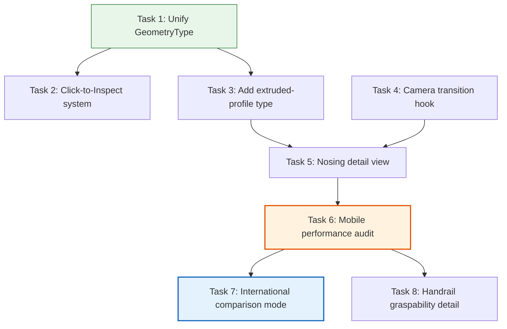

# Stairway Configurator v2 — Phase 2 Implementation Playbook

**Created:** 2026-04-09
**Version:** 1.0
**Status:** READY FOR EXECUTION
**Author:** SlateCamp 3D Lab Systems Engineering
**Predecessor:** `stairway-configurator-v2-phase1-playbook.md` (11/11 tasks complete)

---

## Reference Documents

| Document | Location | Role |
|----------|----------|------|
| Phase 1 Playbook | `.ai/plans/stairway-configurator-improvement/stairway-configurator-v2-phase1-playbook.md` | Phase 1 scope, architecture decisions, Phase 2 readiness checklist |
| Innovation Research | `.ai/plans/stairway-configurator-improvement/stairway-configurator-innovation-research.md` | Phase 2 features: Nosing Profile (#2), International Comparison (#3), Handrail Graspability (#6) |
| Technical Implementation Plan | `.ai/plans/stairway-configurator-improvement/stairway-configurator-technical-implementation-plan.md` | Architecture: extruded-profile type, camera transitions, click-to-inspect, performance budget |
| UX Implementation Plan | `.ai/plans/stairway-configurator-improvement/stairway-configurator-ux-implementation-plan.md` | Comparison mode UI, detail view UX, Viewport Sanctity Rule |
| 3D Lab Feature Specification | `.ai/docs/01-product/008-3d-lab-feature-specification.md` | Authoritative spec: types, stores, templates, components |

---

## Phase 2 Scope and Goals

### What Phase 2 Delivers

1. **GeometryType unification** — Prerequisite: merge the two independent `GeometryType` unions in `templates.ts` and `GeometrySwitch.tsx` into a single shared definition to prevent silent rendering failures
2. **Click-to-Inspect system** — Raycasting-based element inspection with popover annotations showing per-law compliance data
3. **`extruded-profile` GeometryInstruction type** — New geometry type for cross-section rendering (nosing profiles, handrail cross-sections)
4. **Nosing Profile Cross-Section Detail View** — Camera-animated detail view of a single tread nosing junction with ADA/IBC violation coloring
5. **International Code Comparison Mode** — Ghost geometry overlays showing IBC/ADA/IRC dimensions alongside Philippine code geometry, with a comparison panel
6. **Handrail Graspability Detail** — Cross-section view of handrail showing diameter, wall clearance, and graspability violations

### What Phase 2 Explicitly Does NOT Deliver

- L-shape or U-shape stair geometry (Phase 3)
- Evacuation flow simulation (Phase 3)
- Material and slip resistance layer (Phase 3)
- Children's handrail and guard spacing (Phase 3)
- Guided tour system (Phase 3+)
- CAGE quiz integration (undecided)

### Success Criteria

- [ ] All Phase 1 features continue to work identically (22 violations, 15 presets, comfort gauge, historical annotations, tolerance mode)
- [ ] `GeometryType` is a single shared definition imported by both `templates.ts` consumers and `GeometrySwitch.tsx`
- [ ] Click-to-inspect works on all stairway geometry elements without conflicting with orbit controls
- [ ] `extruded-profile` renders correctly on desktop and degrades gracefully on mobile
- [ ] Nosing detail view: camera animates smoothly (0.8s lerp) with continuous `invalidate()` during transition
- [ ] Comparison mode: ghost geometry visible at 15-25% opacity when toggle is active
- [ ] Handrail detail view: cross-section shows diameter and wall clearance
- [ ] TypeScript compiles with zero errors (`bun run type-check`)
- [ ] Performance: sustained 30fps on target mid-range Android with detail view active
- [ ] All international code values in comparison UI display `⚠️ UNVERIFIED` badge until SME verification

---

## Phase 1 Foundation (Already Built)

| Component | File | Phase 2 Usage |
|-----------|------|---------------|
| `ComputedStairState` | `stairway-types.ts` | All features read compliance data from this |
| `computeStairState()` | `stairway-computation.ts` | Click-to-inspect reads compliance results |
| `computeInternationalDeltas()` | `stairway-computation.ts` | Comparison mode consumes directly |
| International constants | `stairway-constants-international.ts` | All IBC/ADA/IRC values (UNVERIFIED) |
| `computeBlondelComfort()` / `computePitch()` | `stairway-computation.ts` | Detail view annotations |
| Adapter pattern geometry | `stairway-configurator.ts` | `buildGeometryFromState()` extended for comparison ghost geometry |
| 10 UI components | `components/stairway/` | ComplianceLawCard, ViolationRow, FixButton reused |
| ViewportShell | `components/shell/ViewportShell.tsx` | Detail view camera controls, comparison panel in sidebar |
| Stable element IDs | `tread-{i}`, `riser-{i}`, `handrail-L/R` | Click-to-inspect raycasting targets |

---

## Target File Structure (Phase 2 Additions)

```
src/features/3d-lab/config/modules/08-vertical/
├── stairway-configurator.ts           # MODIFIED — comparison ghost geometry, new params
├── stairway-computation.ts            # MODIFIED — nosing compliance, handrail graspability
├── stairway-types.ts                  # MODIFIED — NosingProfile, HandrailProfile, ClickTarget types
├── stairway-constants.ts              # MODIFIED — nosing/handrail constants
├── stairway-constants-international.ts # (unchanged)
├── stairway-presets.ts                # MODIFIED — comparison mode presets
├── stairway-click-targets.ts          # NEW — click-target registry
└── stairway-nosing.ts                 # NEW — nosing profile geometry builder

src/features/3d-lab/types/
└── templates.ts                       # MODIFIED — add 'extruded-profile' to GeometryType

src/components/r3f/
└── GeometrySwitch.tsx                 # MODIFIED — import shared GeometryType, add extruded-profile case

src/features/3d-lab/components/stairway/
├── ClickInspectPopover.tsx            # NEW — click-to-inspect popover component
├── NosingDetailPanel.tsx              # NEW — nosing cross-section annotations panel
├── ComparisonPanel.tsx                # NEW — international code comparison table
├── ComparisonToggle.tsx               # NEW — toggle for comparison mode
├── HandrailDetailPanel.tsx            # NEW — handrail cross-section panel
└── index.ts                           # MODIFIED — add new exports

src/features/3d-lab/hooks/
└── useCameraTransition.ts             # NEW — animated camera lerp with invalidate() wiring
```

---

## New Type Definitions (Phase 2)

```typescript
// ── Added to stairway-types.ts ──────────────────────────────────────────────

/** Nosing profile parameters for detail view */
export interface NosingProfile {
  projectionMm: number       // 0–40 mm (nosing overhang beyond riser face)
  radiusMm: number           // 0–20 mm (leading edge radius of curvature)
  underCutAngleDeg: number   // 0–45° (riser undercut angle from vertical)
  contrastStripWidthMm: number // 25–51 mm (visual contrast strip per IBC 504.6)
}

/** Handrail cross-section profile for graspability detail */
export interface HandrailProfile {
  diameterMm: number         // 32–38 mm (ADA 505 gripping surface)
  wallClearanceMm: number    // 38–64 mm (ADA 505 clearance from wall)
  profileShape: 'circular' | 'oval' | 'rectangular-rounded'
}

/** Click-target registry entry */
export interface ClickTarget {
  idPattern: string          // Glob pattern: 'tread-*', 'riser-*', 'handrail-*'
  elementName: string        // Human-readable: 'Tread', 'Riser', 'Handrail'
  dimensionKey: string       // Maps to ComputedStairState field: 'treadDepth', 'riserHeight'
  unit: string               // 'mm', 'deg'
}

/** Camera transition target for detail views */
export interface CameraTransitionTarget {
  position: [number, number, number]
  target: [number, number, number]
  fov?: number
  duration: number           // ms (default 800)
  constrainOrbit?: {
    azimuthRange: number     // ±degrees from target (e.g., 30)
    elevationRange: number   // ±degrees (e.g., 20)
  }
}
```

---

## Task Dependency Graph



**Critical path:** T1 → T3 → T5 → T6 → T7/T8

**Parallel opportunities:**
- Tasks 2 (click-to-inspect) and 3 (extruded-profile) can run in parallel after Task 1
- Task 4 (camera hook) has no dependencies — can start immediately
- Tasks 7 (comparison) and 8 (handrail) run in parallel after the performance gate (Task 6)

**Key change from initial plan (per Architect review):**
- Task 6 (performance audit) inserted as a mandatory gate between nosing and the next features
- Tasks 7 and 8 decoupled — they share no actual dependency; running in parallel prevents SME verification delay from stalling handrail work

---

## Task List

---

### Task 1: Unify GeometryType Definition

**Objective:** Merge the two independent `GeometryType` unions (`templates.ts` and `GeometrySwitch.tsx`) into a single shared definition to prevent silent rendering failures when adding new types.

**Dependencies:** None (prerequisite for all Phase 2 work)

**Input Files (Read):**
- `src/features/3d-lab/types/templates.ts` — current `GeometryType` union (~line 100)
- `src/components/r3f/GeometrySwitch.tsx` — independent `GeometryType` union (~line 6)

**Output Files (Modify):**
- `src/features/3d-lab/types/templates.ts` — MODIFY (export `GeometryType` explicitly)
- `src/components/r3f/GeometrySwitch.tsx` — MODIFY (import `GeometryType` from templates.ts instead of defining locally)

**Detailed Instructions:**

1. In `templates.ts`, ensure `GeometryType` is exported as a named type:
   ```typescript
   export type GeometryType = 'box' | 'cylinder' | 'plane' | 'line' | 'ring' | 'sphere' | 'cone'
   ```
2. In `GeometrySwitch.tsx`, remove the local `GeometryType` definition and import from templates:
   ```typescript
   import type { GeometryType } from '@/features/3d-lab/types/templates'
   ```
3. Verify the `switch` statement in `GeometrySwitch.tsx` covers all variants in the shared union
4. Remove the `default` fallback that silently renders a 0.1m box — replace with a dev-mode console warning:
   ```typescript
   default:
     if (process.env.NODE_ENV === 'development') {
       console.warn(`GeometrySwitch: unknown type "${type}"`)
     }
     return null
   ```

**Acceptance Criteria:**
- [ ] Single `GeometryType` definition in `templates.ts`, imported by `GeometrySwitch.tsx`
- [ ] No local `GeometryType` definition in `GeometrySwitch.tsx`
- [ ] Dev-mode warning on unknown geometry types (replaces silent fallback)
- [ ] All 209 modules still render correctly
- [ ] `bun run type-check` passes

**Estimated Complexity:** Low (30 minutes)

**Risks:**
| Risk | Likelihood | Impact | Mitigation |
|------|-----------|--------|------------|
| Import path mismatch | Low | Medium | Use `@/features/3d-lab/types/templates` path alias |
| Missing switch cases revealed by removal of default | Low | Low | The 7 existing types are already handled; only future types would hit null |

---

### Task 2: Click-to-Inspect System

**Objective:** Enable clicking/tapping any 3D stairway element to display a popover with element-specific compliance data.

**Dependencies:** Task 1 (unified GeometryType ensures stable type system)

**Input Files (Read):**
- `src/features/3d-lab/config/modules/08-vertical/stairway-configurator.ts` — geometry IDs and element structure
- `src/features/3d-lab/templates/ParametricSceneRenderer.tsx` — how geometry instructions are rendered (for raycasting integration)
- `src/features/3d-lab/config/modules/08-vertical/stairway-computation.ts` — compliance data to display

**Output Files (Create/Modify):**
- `src/features/3d-lab/config/modules/08-vertical/stairway-click-targets.ts` — NEW (click-target registry)
- `src/features/3d-lab/components/stairway/ClickInspectPopover.tsx` — NEW (popover component)
- `src/features/3d-lab/components/stairway/index.ts` — MODIFY (add export)

**Detailed Instructions:**

1. Create `stairway-click-targets.ts` with a registry mapping ID patterns to element metadata:
   ```typescript
   import type { ClickTarget } from './stairway-types'

   export const STAIRWAY_CLICK_TARGETS: ClickTarget[] = [
     { idPattern: 'tread-*', elementName: 'Tread', dimensionKey: 'treadDepth', unit: 'mm' },
     { idPattern: 'riser-*', elementName: 'Riser', dimensionKey: 'riserHeight', unit: 'mm' },
     { idPattern: 'handrail-*', elementName: 'Handrail', dimensionKey: 'handrailHeight', unit: 'mm' },
     { idPattern: 'headroom-plane', elementName: 'Headroom', dimensionKey: 'headroom', unit: 'mm' },
     { idPattern: 'base-platform', elementName: 'Landing', dimensionKey: 'stairWidth', unit: 'mm' },
     { idPattern: 'top-landing', elementName: 'Landing', dimensionKey: 'stairWidth', unit: 'mm' },
     { idPattern: 'bp344-rail-*', elementName: 'BP 344 Rail', dimensionKey: 'handrailHeight', unit: 'mm' },
     { idPattern: 'width-gap-*', elementName: 'Width Deficit', dimensionKey: 'stairWidth', unit: 'mm' },
   ]

   /** Match a geometry instruction ID to a click target */
   export const matchClickTarget = (id: string): ClickTarget | null => {
     return STAIRWAY_CLICK_TARGETS.find(t => {
       if (t.idPattern.endsWith('*')) {
         return id.startsWith(t.idPattern.slice(0, -1))
       }
       return id === t.idPattern
     }) ?? null
   }
   ```

2. Create `ClickInspectPopover.tsx`:
   - Props: `elementId`, `position` (screen coords), `useStore`, `onClose`
   - Reads `ComputedStairState` from store to get compliance data
   - Uses `matchClickTarget()` to get element metadata
   - Shows: element name, current value, per-law limits, compliance status
   - Uses shadcn `Card` with `position: fixed` at click point
   - Dismiss on click-outside or orbit start

3. **Click vs drag discrimination:** Track `onPointerDown` and `onPointerUp` positions. If distance > 5px, it was a drag (orbit) — do NOT trigger inspect. Use `e.stopPropagation()` on mesh click handlers to prevent orbit interference.

4. Integration approach: The click handler is added at the `ParametricSceneRenderer` level or as a wrapper around `InstructionMesh`. For Phase 2, add it specifically to the stairway configurator by wrapping geometry meshes with click handlers when the module ID is `stairway-configurator`. A more generic approach can be generalized in Phase 3.

**Acceptance Criteria:**
- [ ] Clicking a tread shows popover with tread depth, PD 1096/BP 220 limits, pass/fail
- [ ] Clicking a riser shows riser height compliance
- [ ] Clicking a handrail shows handrail height compliance
- [ ] Dragging (orbit) does NOT trigger popover (5px threshold)
- [ ] Popover dismisses on click-outside
- [ ] Popover does not conflict with orbit controls
- [ ] `bun run type-check` passes

**Estimated Complexity:** Medium (1-2 weeks)

**Risks:**
| Risk | Likelihood | Impact | Mitigation |
|------|-----------|--------|------------|
| Raycasting conflicts with OrbitControls | Medium | Medium | stopPropagation + 5px drag threshold |
| Popover positioning off-screen on mobile | Medium | Low | Clamp to viewport bounds |
| Click handler on every mesh degrades performance | Low | Medium | Only attach to stairway module; use event delegation if possible |

---

### Task 3: Add `extruded-profile` GeometryInstruction Type

**Objective:** Extend the geometry system with a new `extruded-profile` type for rendering cross-section profiles (nosing, handrail).

**Dependencies:** Task 1 (unified GeometryType)

**Input Files (Read):**
- `src/features/3d-lab/types/templates.ts` — GeometryType union, GeometryInstruction interface
- `src/components/r3f/GeometrySwitch.tsx` — renderer switch statement

**Output Files (Modify):**
- `src/features/3d-lab/types/templates.ts` — MODIFY (add `'extruded-profile'` to GeometryType)
- `src/components/r3f/GeometrySwitch.tsx` — MODIFY (add extruded-profile case)
- `src/features/3d-lab/types/templates.ts` — MODIFY (extend GeometryInstruction with optional `profilePoints` and `extrudeDepth` fields)

**Detailed Instructions:**

1. Add `'extruded-profile'` to the shared `GeometryType` union:
   ```typescript
   export type GeometryType = 'box' | 'cylinder' | 'plane' | 'line' | 'ring' | 'sphere' | 'cone' | 'extruded-profile'
   ```

2. Extend `GeometryInstruction` with optional fields for extruded profiles:
   ```typescript
   interface GeometryInstruction {
     // ... existing fields ...
     profilePoints?: [number, number][]  // 2D cross-section points (extruded-profile only)
     extrudeDepth?: number               // Extrusion depth in scene units (extruded-profile only)
   }
   ```

3. Add the rendering case in `GeometrySwitch.tsx`:
   ```typescript
   case 'extruded-profile': {
     if (!profilePoints || !extrudeDepth) return null
     const shape = new THREE.Shape()
     shape.moveTo(profilePoints[0][0], profilePoints[0][1])
     for (let i = 1; i < profilePoints.length; i++) {
       shape.lineTo(profilePoints[i][0], profilePoints[i][1])
     }
     shape.closePath()
     return <extrudeGeometry args={[shape, { depth: extrudeDepth, bevelEnabled: false }]} />
   }
   ```

4. **CRITICAL: Do NOT allocate `new THREE.Shape()` inside a render function.** Use `useMemo` to memoize the shape based on `profilePoints` and `extrudeDepth`.

5. **Performance note:** `ExtrudeGeometry` is more expensive than `BoxGeometry`. The nosing detail view renders only ONE extruded tread at a time; all others remain boxes. This keeps the polygon budget constant.

**Acceptance Criteria:**
- [ ] `'extruded-profile'` is part of the `GeometryType` union
- [ ] `GeometryInstruction` accepts optional `profilePoints` and `extrudeDepth`
- [ ] `GeometrySwitch` renders extruded profiles using `THREE.Shape` + `ExtrudeGeometry`
- [ ] Shape creation is memoized (not allocated every render)
- [ ] All 209 existing modules unaffected (no `extruded-profile` instructions in their configs)
- [ ] `bun run type-check` passes

**Estimated Complexity:** Medium (3-5 days)

**Risks:**
| Risk | Likelihood | Impact | Mitigation |
|------|-----------|--------|------------|
| THREE.Shape allocation in render path | High | Medium | Mandate useMemo; add dev-mode warning if unmemoized |
| ExtrudeGeometry performance on mobile | Medium | High | Only 1 extruded tread at a time; measure in Task 6 performance audit |
| Optional fields on GeometryInstruction pollute interface | Low | Low | Fields are optional; existing instructions don't set them |

---

### Task 4: Camera Transition Hook

**Objective:** Create a reusable hook for animated camera transitions with continuous `invalidate()` wiring for the demand-render frameloop.

**Dependencies:** None (can start immediately, parallel with Tasks 1-3)

**Input Files (Read):**
- `src/features/3d-lab/hooks/useModuleInvalidate.ts` — existing invalidation pattern
- `src/features/3d-lab/templates/ParametricSceneRenderer.tsx` — how the renderer uses OrbitControls

**Output Files (Create):**
- `src/features/3d-lab/hooks/useCameraTransition.ts` — NEW

**Detailed Instructions:**

1. Create `useCameraTransition.ts`:
   ```typescript
   import { useRef, useCallback } from 'react'
   import { useThree, useFrame } from '@react-three/fiber'
   import type { CameraTransitionTarget } from '../config/modules/08-vertical/stairway-types'

   /**
    * Animated camera transition hook with demand-frameloop invalidation.
    * During transition, calls invalidate() every frame to drive the lerp.
    * After transition completes, stops calling invalidate() (returns to demand mode).
    */
   export const useCameraTransition = () => {
     const { camera, invalidate } = useThree(s => ({ camera: s.camera, invalidate: s.invalidate }))
     const isTransitioning = useRef(false)
     const startTime = useRef(0)
     const from = useRef({ position: [0,0,0], target: [0,0,0] })
     const to = useRef<CameraTransitionTarget | null>(null)

     useFrame(({ clock }) => {
       if (!isTransitioning.current || !to.current) return
       const elapsed = (clock.getElapsedTime() * 1000) - startTime.current
       const progress = Math.min(elapsed / to.current.duration, 1)
       const eased = 1 - Math.pow(1 - progress, 3) // ease-out cubic

       // Lerp camera position
       camera.position.set(
         from.current.position[0] + (to.current.position[0] - from.current.position[0]) * eased,
         from.current.position[1] + (to.current.position[1] - from.current.position[1]) * eased,
         from.current.position[2] + (to.current.position[2] - from.current.position[2]) * eased,
       )

       if (progress >= 1) {
         isTransitioning.current = false
       } else {
         invalidate() // Keep rendering during transition
       }
     })

     const transitionTo = useCallback((target: CameraTransitionTarget) => {
       from.current.position = [camera.position.x, camera.position.y, camera.position.z]
       to.current = target
       startTime.current = performance.now()
       isTransitioning.current = true
       invalidate() // Kick off first frame
     }, [camera, invalidate])

     const cancelTransition = useCallback(() => {
       isTransitioning.current = false
     }, [])

     return { transitionTo, cancelTransition, isTransitioning: isTransitioning.current }
   }
   ```

2. **CRITICAL:** The hook calls `invalidate()` continuously during transition to drive the demand-frameloop. After completion, it stops — returning to zero-GPU-cost idle state.

3. The `useFrame` callback must NOT allocate `new THREE.Vector3()` — use direct property sets on `camera.position`.

**Acceptance Criteria:**
- [ ] Hook exports `transitionTo(target)` and `cancelTransition()`
- [ ] Camera smoothly animates over specified duration
- [ ] `invalidate()` called every frame during transition
- [ ] `invalidate()` stops being called after transition completes
- [ ] No Three.js object allocations in `useFrame`
- [ ] `bun run type-check` passes

**Estimated Complexity:** Medium (3-5 days)

**Risks:**
| Risk | Likelihood | Impact | Mitigation |
|------|-----------|--------|------------|
| OrbitControls fighting with camera lerp | Medium | High | Disable OrbitControls during transition; re-enable with constrained bounds after |
| useFrame running when not transitioning | Low | Medium | Guard with `isTransitioning.current` check at top of callback |

---

### Task 5: Nosing Profile Cross-Section Detail View

**Objective:** Add a detail view that zooms to a single tread's nosing junction, replaces the box with an extruded-profile showing nosing radius/projection/undercut, and displays ADA/IBC nosing violation annotations.

**Dependencies:** Task 3 (extruded-profile type), Task 4 (camera transition hook)

**Input Files (Read):**
- `src/features/3d-lab/config/modules/08-vertical/stairway-configurator.ts` — geometry builder, parameters
- `src/features/3d-lab/config/modules/08-vertical/stairway-computation.ts` — extend with nosing compliance
- `src/features/3d-lab/config/modules/08-vertical/stairway-constants-international.ts` — ADA_NOSING_MAX_PROJECTION_MM, ADA_NOSING_MAX_RADIUS_MM, IRC_NOSING_MAX_PROJECTION_MM

**Output Files (Create/Modify):**
- `src/features/3d-lab/config/modules/08-vertical/stairway-nosing.ts` — NEW (nosing geometry builder)
- `src/features/3d-lab/config/modules/08-vertical/stairway-configurator.ts` — MODIFY (add nosing params, detail view toggle, nosing geometry in builder)
- `src/features/3d-lab/config/modules/08-vertical/stairway-types.ts` — MODIFY (add NosingProfile)
- `src/features/3d-lab/components/stairway/NosingDetailPanel.tsx` — NEW (annotations panel)
- `src/features/3d-lab/components/stairway/index.ts` — MODIFY (add export)

**Detailed Instructions:**

1. Add nosing parameters to the configurator:
   ```typescript
   { key: 'nosingProjection', label: 'Nosing Projection', type: 'slider', min: 0, max: 40, step: 1, default: 25, unit: 'mm', group: 'Nosing Detail' },
   { key: 'nosingRadius', label: 'Edge Radius', type: 'slider', min: 0, max: 20, step: 1, default: 10, unit: 'mm', group: 'Nosing Detail' },
   { key: 'riserUndercut', label: 'Riser Undercut', type: 'slider', min: 0, max: 45, step: 1, default: 15, unit: '°', group: 'Nosing Detail' },
   { key: 'contrastStripWidth', label: 'Contrast Strip', type: 'slider', min: 0, max: 60, step: 1, default: 38, unit: 'mm', group: 'Nosing Detail' },
   { key: 'detailViewActive', label: 'Nosing Detail View', type: 'toggle', default: false, group: 'Nosing Detail' },
   ```

2. Create `stairway-nosing.ts` with a function that builds the `extruded-profile` instruction for a single tread:
   ```typescript
   export const buildNosingProfile = (
     nosingProjection: number, // mm
     nosingRadius: number,     // mm
     riserUndercut: number,    // degrees
     contrastStripWidth: number, // mm
     stairWidth: number,       // mm (extrude depth)
   ): GeometryInstruction => {
     // Convert mm to scene units for profilePoints
     // Build 2D profile: flat tread top → rounded nosing edge → undercut riser face
     // Return extruded-profile instruction
   }
   ```

3. In the geometry builder, when `detailViewActive` is true:
   - Replace the `tread-{mid}` box instruction (at stair midpoint) with the extruded-profile instruction
   - Dim all non-selected treads to 30% opacity
   - Add nosing-specific annotations (projection, radius, undercut, contrast strip)

4. Add nosing violation rules (ADA/IBC comparison — `info` severity since PH codes don't specify nosing):
   - Nosing projection > 38mm (ADA) → info violation
   - Nosing radius > 13mm (ADA) → info violation
   - Contrast strip < 25mm or > 51mm (IBC 504.6) → info violation

5. **Camera transition:** When `detailViewActive` toggles on, use `useCameraTransition().transitionTo()` to animate to a side-section view of the midpoint tread.

**Acceptance Criteria:**
- [ ] 5 new nosing parameters in 'Nosing Detail' group
- [ ] Detail view toggle replaces midpoint tread with extruded-profile
- [ ] Non-selected treads dim to 30% opacity
- [ ] Camera animates to side-section view (0.8s ease-out)
- [ ] Nosing annotations visible in detail view
- [ ] ADA/IBC nosing violation rules fire at correct thresholds
- [ ] "Back to Overview" restores normal view and camera
- [ ] `bun run type-check` passes

**Estimated Complexity:** High (2-3 weeks)

**Risks:**
| Risk | Likelihood | Impact | Mitigation |
|------|-----------|--------|------------|
| ExtrudeGeometry looks wrong at small scale | Medium | Medium | Test with various nosing dimensions; adjust profile point precision |
| Camera transition conflicts with OrbitControls | Medium | High | Disable controls during transition; constrain after arrival |
| Profile geometry too detailed for mobile | Medium | Medium | Measured in Task 6 performance audit |

---

### Task 6: Mobile Performance Audit (Mandatory Gate)

**Objective:** Measure rendering performance with extruded-profile geometry active on target hardware. Gate Tasks 7 and 8 on passing the performance budget.

**Dependencies:** Task 5 (nosing detail view functional)

**Input Files (Read):**
- Performance budget from technical plan: <30K triangles, <50 draw calls, 30fps on Realme C55

**Output Files (Create):**
- `.ai/plans/stairway-configurator-improvement/phase2-performance-audit.md` — NEW (audit results)

**Detailed Instructions:**

1. Test on desktop (Chrome DevTools throttled to 4x CPU slowdown):
   - Default params with 12 risers: measure FPS, draw calls, triangle count
   - Detail view active with extruded-profile: measure delta
   - 20 risers with detail view: measure upper bound

2. Test on actual mid-range Android device (if available) or Chrome DevTools mobile emulation:
   - Same 3 scenarios
   - Record sustained FPS over 10 seconds of orbit interaction

3. **Pass criteria:**
   - Sustained 30fps with detail view active on throttled desktop
   - Triangle count <30K with detail view active
   - ExtrudeGeometry creation time <5ms

4. **If fail:**
   - Reduce nosing profile complexity (fewer points)
   - Reduce bevel segments in ExtrudeGeometry
   - Consider canvas-2D cross-section instead of 3D geometry

5. Document results in audit file with screenshots/measurements

**Acceptance Criteria:**
- [ ] Audit document created with measurements for all 3 scenarios
- [ ] 30fps sustained on throttled desktop with detail view
- [ ] Triangle count <30K with detail view active
- [ ] Pass/fail verdict documented
- [ ] If pass: Tasks 7 and 8 unblocked
- [ ] If fail: mitigation plan documented before proceeding

**Estimated Complexity:** Low (1 day)

**Risks:**
| Risk | Likelihood | Impact | Mitigation |
|------|-----------|--------|------------|
| No physical Android device available | Medium | Low | Use Chrome DevTools 4x throttle as proxy |
| ExtrudeGeometry too slow | Low | High | Fall back to simplified profile or canvas-2D rendering |

---

### Task 7: International Code Comparison Mode

**Objective:** Add a toggle-activated comparison mode showing ghost geometry overlays at IBC/ADA/IRC dimensions alongside the current Philippine code geometry, with a comparison data panel.

**Dependencies:** Task 6 (performance gate passed)

**Input Files (Read):**
- `src/features/3d-lab/config/modules/08-vertical/stairway-computation.ts` — `computeInternationalDeltas()` already produces comparison data
- `src/features/3d-lab/config/modules/08-vertical/stairway-constants-international.ts` — IBC/ADA/IRC values
- `src/features/3d-lab/config/modules/08-vertical/stairway-configurator.ts` — geometry builder for ghost geometry

**Output Files (Create/Modify):**
- `src/features/3d-lab/config/modules/08-vertical/stairway-configurator.ts` — MODIFY (add comparison toggle, ghost geometry in builder)
- `src/features/3d-lab/components/stairway/ComparisonPanel.tsx` — NEW
- `src/features/3d-lab/components/stairway/ComparisonToggle.tsx` — NEW
- `src/features/3d-lab/components/stairway/index.ts` — MODIFY

**Detailed Instructions:**

1. Add comparison parameter:
   ```typescript
   { key: 'compareMode', label: 'International Comparison', type: 'toggle', default: false, group: 'Learning Overlays' }
   ```

2. In `buildGeometryFromState`, when `state.compareMode` is true, add ghost geometry for IBC dimensions:
   - Ghost treads at IBC tread depth (279mm vs PH 200mm) — wider/deeper
   - Ghost risers at IBC riser height (178mm vs PH 200mm) — shorter
   - Color: `#94a3b8` (comparison ghost color from UX plan)
   - Opacity: 0.2
   - ID prefix: `compare-ibc-{element}-{index}`

3. Create `ComparisonPanel.tsx`:
   - Table showing each dimension with PH value, IBC value, ADA value, IRC value
   - Pass/fail indicator per code per dimension
   - Uses existing `ComplianceLawCard` pattern
   - Displays `⚠️ UNVERIFIED` badge on all international values

4. Create `ComparisonToggle.tsx`:
   - Simple toggle with "Compare with IBC / ADA / IRC" label
   - Activates ghost geometry overlay

5. **CRITICAL:** All international values must display `⚠️ UNVERIFIED` badge in the UI until SME verification is complete. The computation engine already computes deltas; the UI rendering is the new work.

**Acceptance Criteria:**
- [ ] Toggle activates comparison mode
- [ ] Ghost treads/risers appear at IBC dimensions with 20% opacity
- [ ] Comparison panel shows per-dimension per-code pass/fail
- [ ] All international values display UNVERIFIED badge
- [ ] Ghost geometry uses `compare-ibc-` ID prefix
- [ ] When toggle is off, no ghost geometry rendered
- [ ] `bun run type-check` passes

**Estimated Complexity:** Medium (2-3 weeks)

⚠️ **NEEDS VERIFICATION:** All international code values require SME review before production deployment. Phase 2 UI shows UNVERIFIED badges. Production removal of badges requires sign-off.

**Risks:**
| Risk | Likelihood | Impact | Mitigation |
|------|-----------|--------|------------|
| Ghost geometry clutters viewport | Medium | Medium | Low opacity (20%) + toggle off by default |
| International values incorrect | High | Medium | All values marked UNVERIFIED; comparison is educational, not compliance-grade |
| SME verification delayed | High | Low | Feature ships with UNVERIFIED badges; verification is non-blocking for code |

---

### Task 8: Handrail Graspability Detail

**Objective:** Add a detail view showing handrail cross-section with diameter, wall clearance, and graspability compliance using the same `extruded-profile` type and camera pattern from the nosing detail view.

**Dependencies:** Task 6 (performance gate passed)

**Input Files (Read):**
- `src/features/3d-lab/config/modules/08-vertical/stairway-nosing.ts` — reuse extruded-profile pattern
- `src/features/3d-lab/hooks/useCameraTransition.ts` — reuse camera transition
- `src/features/3d-lab/config/modules/08-vertical/stairway-constants-international.ts` — ADA handrail constants

**Output Files (Create/Modify):**
- `src/features/3d-lab/config/modules/08-vertical/stairway-configurator.ts` — MODIFY (add handrail params, detail toggle)
- `src/features/3d-lab/config/modules/08-vertical/stairway-types.ts` — MODIFY (add HandrailProfile)
- `src/features/3d-lab/components/stairway/HandrailDetailPanel.tsx` — NEW
- `src/features/3d-lab/components/stairway/index.ts` — MODIFY

**Detailed Instructions:**

1. Add handrail detail parameters:
   ```typescript
   { key: 'handrailDiameter', label: 'Grip Diameter', type: 'slider', min: 20, max: 60, step: 1, default: 35, unit: 'mm', group: 'Handrail Detail' },
   { key: 'wallClearance', label: 'Wall Clearance', type: 'slider', min: 20, max: 80, step: 1, default: 45, unit: 'mm', group: 'Handrail Detail' },
   { key: 'handrailProfile', label: 'Profile Shape', type: 'dropdown', default: 'circular', options: [
     { value: 'circular', label: 'Circular' },
     { value: 'oval', label: 'Oval' },
     { value: 'rectangular-rounded', label: 'Rectangular (Rounded)' },
   ], group: 'Handrail Detail' },
   { key: 'handrailDetailActive', label: 'Handrail Detail View', type: 'toggle', default: false, group: 'Handrail Detail' },
   ```

2. When `handrailDetailActive` is true:
   - Replace midpoint handrail cylinder with `extruded-profile` showing cross-section
   - Camera transition to handrail cross-section view (reuse `useCameraTransition`)
   - Show annotations: diameter, wall clearance, graspability status

3. Handrail violation rules (info severity — ADA comparison):
   - Diameter < 32mm or > 38mm → info violation
   - Wall clearance < 38mm → info violation

4. `HandrailDetailPanel.tsx` shows:
   - Current diameter vs ADA 32-38mm range
   - Current wall clearance vs ADA 38mm minimum
   - Profile shape visualization
   - Graspability assessment (power grip vs hook grip)

**Acceptance Criteria:**
- [ ] 4 new handrail detail parameters
- [ ] Detail view toggle replaces handrail with extruded-profile cross-section
- [ ] Camera animates to handrail detail view
- [ ] ADA diameter and clearance violations fire correctly
- [ ] "Back to Overview" restores normal view
- [ ] Reuses `useCameraTransition` from Task 4
- [ ] `bun run type-check` passes

**Estimated Complexity:** Medium (2-3 weeks)

**Risks:**
| Risk | Likelihood | Impact | Mitigation |
|------|-----------|--------|------------|
| Circular profile ExtrudeGeometry quality | Low | Low | Use sufficient profile points (16+) for smooth circle |
| Handrail detail view and nosing detail view active simultaneously | Medium | Low | Mutually exclusive — toggling one deactivates the other |

---

## Integration Test Plan

After all 8 tasks are complete:

### Phase 1 Preservation
- [ ] All 22 existing violation rules fire identically
- [ ] All 15 presets produce correct output
- [ ] Comfort gauge displays correctly
- [ ] Historical annotations toggle on/off
- [ ] Tolerance mode produces per-step variations
- [ ] Module renders in 3D Lab browser and detail page

### Phase 2 New Features
- [ ] Click-to-inspect: click tread → popover shows tread depth compliance
- [ ] Click-to-inspect: drag orbit → no popover triggered
- [ ] Nosing detail: toggle → camera animates, extruded tread appears, non-selected dim
- [ ] Nosing detail: ADA violations fire at >38mm projection, >13mm radius
- [ ] Comparison mode: toggle → ghost geometry appears at IBC dimensions
- [ ] Comparison mode: panel shows per-dimension pass/fail with UNVERIFIED badges
- [ ] Handrail detail: toggle → camera animates, cross-section shows diameter/clearance
- [ ] Handrail detail: ADA violations fire at <32mm or >38mm diameter

### Performance
- [ ] 30fps sustained on throttled desktop (4x CPU slowdown)
- [ ] <30K triangles with one detail view active
- [ ] <50 draw calls
- [ ] Camera transitions complete in ≤1s
- [ ] No Three.js object allocations in useFrame callbacks

---

## Phase 3 Readiness Checklist

Phase 3 (L-shape/U-shape geometry, evacuation simulation) can begin when:

- [ ] `extruded-profile` GeometryInstruction type is stable and tested
- [ ] Camera transition hook is reusable across multiple view types
- [ ] Click-to-inspect registry pattern is established and extensible
- [ ] Performance audit confirms headroom for additional geometry complexity
- [ ] `StairTypeConfig` discriminated union tested with straight variant (Phase 1)
- [ ] International constants SME verification scheduled or completed

---

## Risk Registry

| # | Risk | Task(s) | Likelihood | Impact | Mitigation |
|---|------|---------|-----------|--------|------------|
| R1 | Dual GeometryType definitions cause silent render failure | T1 | High | High | Task 1 prerequisite — unify before any new types |
| R2 | ExtrudeGeometry performance on mobile | T3, T5, T8 | Medium | High | Task 6 performance gate; fall back to canvas-2D if needed |
| R3 | Camera lerp freezes in demand-frameloop mode | T4, T5, T8 | Medium | High | Explicit invalidate() wiring in useCameraTransition hook |
| R4 | OrbitControls fights camera transition | T4, T5, T8 | Medium | Medium | Disable controls during transition; constrain after |
| R5 | International constants incorrect | T7 | High | Medium | UNVERIFIED badges on all values; SME verification before production |
| R6 | Click handler conflicts with orbit gesture | T2 | Medium | Medium | 5px drag threshold + stopPropagation |
| R7 | Nosing and handrail detail views active simultaneously | T5, T8 | Medium | Low | Mutually exclusive toggles |
| R8 | No physical Android device for performance audit | T6 | Medium | Low | Use Chrome DevTools 4x throttle as proxy |

---

## Open Decisions

1. **International constants SME verification timing** — Must be scheduled. Comparison mode ships with UNVERIFIED badges regardless; verification is a production deployment gate, not a development gate.

2. **Detail view mutual exclusivity** — Should nosing and handrail detail views be mutually exclusive (toggle one deactivates the other) or should both be available simultaneously? Recommendation: mutually exclusive for Phase 2 simplicity.

3. **Click-to-inspect scope** — Phase 2 implements for stairway configurator only. Generalization to all parametric modules is a Phase 3 consideration.

4. **Comparison mode code selection** — Phase 2 shows IBC ghost geometry only (simplest). ADA and IRC ghost geometry could be added as separate toggles. Recommendation: IBC only for Phase 2; expand in Phase 3.

---

## Changelog

| Date | Version | Change |
|------|---------|--------|
| 2026-04-09 | 1.0 | Initial Phase 2 playbook. 8 tasks: GeometryType unification, click-to-inspect, extruded-profile type, camera transition hook, nosing detail, performance audit, international comparison, handrail graspability. Incorporates Architect review feedback: unified types prerequisite, invalidate() wiring, parallel Tasks 7/8, performance gate. |
