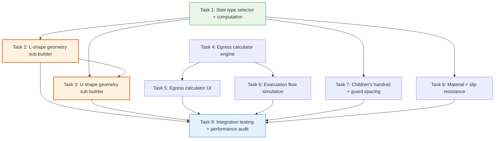

# Stairway Configurator v2 — Phase 3 Implementation Playbook

**Created:** 2026-04-09
**Version:** 1.0
**Status:** READY FOR EXECUTION
**Author:** SlateCamp 3D Lab Systems Engineering
**Predecessors:**
- Phase 1 Playbook (11/11 tasks complete) — computation engine, constants, presets, UI shells
- Phase 2 Playbook (8/8 tasks complete) — extruded-profile, click-to-inspect, nosing detail, comparison mode, handrail graspability

---

## Reference Documents

| Document | Location | Role |
|----------|----------|------|
| Phase 1 Playbook | `.ai/plans/stairway-configurator-improvement/stairway-configurator-v2-phase1-playbook.md` | Foundation architecture |
| Phase 2 Playbook | `.ai/plans/stairway-configurator-improvement/stairway-configurator-v2-phase2-playbook.md` | Depth features, extruded-profile, camera transitions |
| Innovation Research | `.ai/plans/stairway-configurator-improvement/stairway-configurator-innovation-research.md` | Phase 3 features: stair types, evacuation, children's handrail, materials |
| Technical Implementation Plan | `.ai/plans/stairway-configurator-improvement/stairway-configurator-technical-implementation-plan.md` | Geometry sub-builders, particle system, performance budget |
| UX Implementation Plan | `.ai/plans/stairway-configurator-improvement/stairway-configurator-ux-implementation-plan.md` | UX for multi-flight stairs, evacuation sim, material selector |

---

## Phase 3 Scope and Goals

### What Phase 3 Delivers

1. **L-Shape stair geometry** — Quarter-turn stair with configurable turn direction, intermediate landing, landing compliance checks, corner handrail continuity
2. **U-Shape stair geometry** — Half-turn (switchback) stair with intermediate landing, continuous interior handrail spanning both flights
3. **Evacuation flow simulation** — Instanced particle system showing abstract "person dots" descending stairs, with bottleneck detection and capacity analysis
4. **Egress calculator** — Occupant load computation from floor area + occupancy type, required exit count (RA 9514 + PD 1096), exit width capacity check (5.1mm/person rule), travel distance validation
5. **Children's handrail and guard spacing** — Primary users parameter, secondary handrail at 711mm, 102mm guard sphere rule, solid riser entrapment check
6. **Material and slip resistance layer** — 6-material selector with PBR properties, wet/dry slip coefficient badges, contrast strip compliance interaction

### What Phase 3 Explicitly Does NOT Deliver

- Winder stairs (complex tread geometry — deferred to Phase 4)
- Spiral stairs (requires completely different geometry model — deferred to Phase 4)
- Guided tour system (deferred)
- CAGE quiz integration (undecided)

### Success Criteria

- [ ] L-shape and U-shape stairs render correctly with proper landing geometry
- [ ] Stair type selector switches between straight/L-shape/U-shape without breaking violations or annotations
- [ ] Evacuation particles flow at geometry-dependent speed using drei `<Instances>` (1 draw call)
- [ ] Egress calculator correctly computes occupant load, exit count, and exit width for all 6 occupancy types
- [ ] Children's mode shows secondary handrail ghost and guard spacing sphere
- [ ] Material selector changes tread PBR properties in real-time
- [ ] All Phase 1 + Phase 2 features continue to work
- [ ] TypeScript compiles with zero errors
- [ ] Performance: <200 GeometryInstructions at max L-shape scenario

---

## Phase 2 Foundation (Already Built)

| Component | Phase 3 Usage |
|-----------|---------------|
| `StairTypeConfig` discriminated union (straight, l-shape, u-shape) | Phase 3 implements l-shape and u-shape variants |
| `extruded-profile` GeometryInstruction | Nosing profiles on L/U-shape treads |
| `useCameraTransition` hook | Camera animation for multi-flight overview positions |
| `computeStairState()` pure engine | Extended with landing compliance, guard spacing, evacuation capacity |
| Click-to-inspect system | Works on L/U-shape elements via stable IDs |
| International constants (UNVERIFIED) | Landing depth requirements (IBC 1011.6) |
| Ghost geometry pattern (comparison mode) | Reused for children's secondary handrail |
| ViewportComfortGauge | Works for any stair type (reads riser/tread from state) |

---

## Task Dependency Graph



**Critical path:** T1 → T2 → T3 → T9

**Parallel opportunities:**
- Task 4 (egress engine) has no dependency on Tasks 1-3 — can start immediately
- Tasks 7 (children's) and 8 (materials) depend only on Task 1
- Tasks 5 and 6 depend on Task 4

---

## Task List

---

### Task 1: Stair Type Selector + Computation Extensions

**Objective:** Add a stair type dropdown parameter, extend `computeStairState` to handle L-shape and U-shape stair types with landing compliance, and route the geometry builder to type-specific sub-builders.

**Dependencies:** None (first task)

**Output Files (Create/Modify):**
- `src/features/3d-lab/config/modules/08-vertical/stairway-types.ts` — MODIFY (add LandingCompliance, EgressCalculation types)
- `src/features/3d-lab/config/modules/08-vertical/stairway-computation.ts` — MODIFY (add landing compliance, stair type routing)
- `src/features/3d-lab/config/modules/08-vertical/stairway-constants.ts` — MODIFY (add landing constants)
- `src/features/3d-lab/config/modules/08-vertical/stairway-configurator.ts` — MODIFY (add stairType parameter, geometry routing)

**Detailed Instructions:**

1. Add new constants to `stairway-constants.ts`:
   ```typescript
   // Landing Requirements
   // Source: IBC 2024 §1011.6 (Philippine practice follows IBC for landing dimensions)
   export const IBC_LANDING_MIN_DEPTH_MM = 1219     // IBC 2024 §1011.6 (48") ⚠️ UNVERIFIED
   export const LANDING_MIN_WIDTH_FACTOR = 1.0       // Landing width ≥ stair width
   ```

2. Add stair type parameter to configurator:
   ```typescript
   {
     key: 'stairType',
     label: 'Stair Type',
     type: 'dropdown',
     default: 'straight',
     options: [
       { value: 'straight', label: 'Straight Run' },
       { value: 'l-shape', label: 'L-Shape (Quarter Turn)' },
       { value: 'u-shape', label: 'U-Shape (Switchback)' },
     ],
     group: 'Stair Geometry',
   },
   {
     key: 'turnDirection',
     label: 'Turn Direction',
     type: 'dropdown',
     default: 'right',
     options: [
       { value: 'left', label: 'Left' },
       { value: 'right', label: 'Right' },
     ],
     group: 'Stair Geometry',
   },
   {
     key: 'risersBeforeTurn',
     label: 'Risers Before Turn',
     type: 'slider',
     min: 2,
     max: 12,
     step: 1,
     default: 6,
     group: 'Stair Geometry',
   },
   ```

3. Extend `computeStairState` to:
   - Parse `stairType` param into `StairTypeConfig`
   - Compute landing dimensions for L/U shapes
   - Add `computeLandingCompliance()` function
   - Route `totalRise` calculation: straight uses full count, L/U split into flights

4. Modify geometry builder to route by stair type:
   ```typescript
   const buildGeometryFromState = (state: ComputedStairState, rawParams: StairParams): GeometryInstruction[] => {
     switch (state.stairType.type) {
       case 'straight':
         return buildStraightGeometry(state, rawParams)
       case 'l-shape':
         return buildLShapeGeometry(state, rawParams)
       case 'u-shape':
         return buildUShapeGeometry(state, rawParams)
     }
   }
   ```
   Extract existing straight-run geometry into `buildStraightGeometry` (rename of current `buildGeometryFromState` body).

**Acceptance Criteria:**
- [ ] Stair type dropdown with 3 options in Stair Geometry group
- [ ] Turn direction and risers-before-turn parameters (visible when L/U selected)
- [ ] `computeStairState` produces correct `stairType` field
- [ ] Landing compliance computed for L/U shapes
- [ ] Geometry builder routes to type-specific sub-builder
- [ ] Straight-run still works identically (extracted to `buildStraightGeometry`)
- [ ] `bun run type-check` passes

**Estimated Complexity:** High (1–2 weeks)

---

### Task 2: L-Shape Geometry Sub-Builder

**Objective:** Implement the L-shape (quarter-turn) stair geometry with intermediate landing, two flights at 90°, and corner handrail continuity.

**Dependencies:** Task 1 (stair type routing exists)

**Output Files (Create):**
- `src/features/3d-lab/config/modules/08-vertical/stairway-geometry-l-shape.ts` — NEW

**Detailed Instructions:**

1. Create `buildLShapeGeometry(state, rawParams)` returning `GeometryInstruction[]`
2. Geometry structure:
   - **Flight 1:** `risersBeforeTurn` treads + risers ascending in Z direction
   - **Landing platform:** Square platform at turn point, dimensions = stairWidth × landingDepth
   - **Flight 2:** remaining risers ascending in X direction (turned 90° based on `turnDirection`)
   - **Handrails:** Follow each flight slope, navigate the corner with a 90° horizontal arc at the landing
   - **BP 344 ghost rails:** Both flights + corner if accessible

3. Landing dimensions:
   - Depth = `min(stairWidth, IBC_LANDING_MIN_DEPTH_MM)` in mm
   - Width = stairWidth

4. Element IDs follow extended pattern:
   - `tread-f1-{i}` (flight 1), `tread-f2-{i}` (flight 2)
   - `riser-f1-{i}`, `riser-f2-{i}`
   - `landing-intermediate`
   - `handrail-f1-L/R`, `handrail-f2-L/R`

5. All Phase 1/2 features must work:
   - Violation colors from `ComputedStairState`
   - Tolerance mode per-step variations (applied per flight)
   - Comparison ghost geometry (if compare mode active)

**Performance Budget:**
- Max +30 instructions, +3K triangles, +15 draw calls

**Acceptance Criteria:**
- [ ] L-shape stair renders with two flights at 90° angle
- [ ] Intermediate landing visible at turn point
- [ ] Handrails navigate the corner
- [ ] Violation colors apply correctly to both flights
- [ ] `bun run type-check` passes

**Estimated Complexity:** High (2–3 weeks)

---

### Task 3: U-Shape Geometry Sub-Builder

**Objective:** Implement the U-shape (switchback) stair with intermediate landing and continuous interior handrail spanning both flights.

**Dependencies:** Task 2 (L-shape pattern established, shares landing code)

**Output Files (Create):**
- `src/features/3d-lab/config/modules/08-vertical/stairway-geometry-u-shape.ts` — NEW

**Detailed Instructions:**

1. Create `buildUShapeGeometry(state, rawParams)` returning `GeometryInstruction[]`
2. Geometry structure:
   - **Flight 1:** `risersBeforeTurn` treads ascending in Z direction
   - **Landing platform:** Rectangular landing at turn (depth = min(stairWidth, 1219mm))
   - **Flight 2:** Remaining risers ascending in -Z direction (parallel to flight 1, offset in X by stairWidth + gap)
   - **Interior handrail:** Continuous from flight 1 bottom → landing → flight 2 top (unbroken per ADA §505.3)
   - **Exterior handrails:** Two separate rails, one per flight

3. Element IDs:
   - `tread-f1-{i}`, `tread-f2-{i}`
   - `riser-f1-{i}`, `riser-f2-{i}`
   - `landing-intermediate`
   - `handrail-interior` (continuous), `handrail-f1-outer`, `handrail-f2-outer`

4. Interior handrail continuity violation:
   - New rule: if interior handrail has any break → `error` severity
   - The geometry builder ensures continuity by default; the violation checks for impossible configurations

**Performance Budget:**
- Max +50 instructions, +4.5K triangles, +20 draw calls

**Acceptance Criteria:**
- [ ] U-shape stair renders with two parallel flights connected by landing
- [ ] Interior handrail is one continuous element spanning both flights
- [ ] Landing dimensions comply with IBC minimum
- [ ] All violation colors apply to both flights
- [ ] `bun run type-check` passes

**Estimated Complexity:** High (2–3 weeks)

---

### Task 4: Egress Calculator Engine

**Objective:** Create a pure computation module that calculates occupant load, required number of exits, required exit width, and travel distance compliance per RA 9514 and PD 1096.

**Dependencies:** None (can start in parallel with Tasks 1-3)

**Output Files (Create/Modify):**
- `src/features/3d-lab/config/modules/08-vertical/stairway-egress.ts` — NEW (pure computation)
- `src/features/3d-lab/config/modules/08-vertical/stairway-constants.ts` — MODIFY (add egress constants)

**Detailed Instructions:**

1. Add egress constants to `stairway-constants.ts`:
   ```typescript
   // ── Egress Requirements ──────────────────────────────────────────────────
   // Source: RA 9514 IRR Rule 10 + PD 1096 Rule X

   // Occupant Load Factors (sqm per person) — RA 9514 IRR Rule 10 §1004
   export const OCCUPANT_LOAD_FACTORS: Record<string, number> = {
     assembly: 0.65,       // RA 9514 IRR Rule 10 §1004
     business: 9.3,        // RA 9514 IRR Rule 10 §1004
     educational: 1.85,    // RA 9514 IRR Rule 10 §1004
     residential: 18.6,    // RA 9514 IRR Rule 10 §1004
     mercantile: 2.8,      // RA 9514 IRR Rule 10 §1004
     industrial: 9.3,      // RA 9514 IRR Rule 10 §1004
   } as const

   // Required Exits by Occupant Load — RA 9514 IRR Rule 10 §1005
   export const RA9514_EXIT_THRESHOLDS = [
     { maxOccupants: 10, minExits: 1 },   // RA 9514 IRR Rule 10 §1005
     { maxOccupants: 100, minExits: 2 },   // RA 9514 IRR Rule 10 §1005
     { maxOccupants: 500, minExits: 3 },   // RA 9514 IRR Rule 10 §1005
     { maxOccupants: Infinity, minExits: 4 }, // RA 9514 IRR Rule 10 §1005
   ] as const

   // PD 1096 Floor Area Threshold for Minimum 2 Exits
   export const PD1096_LARGE_FLOOR_AREA_MM2 = 500    // PD 1096 Rule X §1004 (500 sqm)

   // Exit Width Capacity — RA 9514 IRR Rule 10 §10.2.5
   export const RA9514_WIDTH_PER_PERSON_MM = 5.1     // RA 9514 IRR Rule 10 §10.2.5
   export const RA9514_MIN_EXIT_WIDTH_MM = 710        // RA 9514 IRR Rule 10 §1008

   // Travel Distance Limits (meters) — RA 9514 IRR Rule 10 §1016
   export const TRAVEL_DISTANCE_UNSPRINKLERED: Record<string, number> = {
     assembly: 46,     // RA 9514 IRR Rule 10 §1016
     business: 46,     // RA 9514 IRR Rule 10 §1016
     educational: 46,  // RA 9514 IRR Rule 10 §1016
     residential: 46,  // RA 9514 IRR Rule 10 §1016
     mercantile: 30,   // RA 9514 IRR Rule 10 §1016
     industrial: 31,   // RA 9514 IRR Rule 10 §1016
   } as const

   export const TRAVEL_DISTANCE_SPRINKLERED: Record<string, number> = {
     assembly: 61,     // RA 9514 IRR Rule 10 §1016
     business: 61,     // RA 9514 IRR Rule 10 §1016
     educational: 61,  // RA 9514 IRR Rule 10 §1016
     residential: 61,  // RA 9514 IRR Rule 10 §1016
     mercantile: 46,   // RA 9514 IRR Rule 10 §1016
     industrial: 46,   // RA 9514 IRR Rule 10 §1016
   } as const
   ```

2. Create `stairway-egress.ts` with pure computation functions:
   ```typescript
   export interface EgressCalculation {
     floorArea: number              // sqm
     occupancyType: string          // assembly, business, etc.
     occupantLoad: number           // computed: floorArea / loadFactor
     requiredExits: number          // from RA 9514 thresholds
     pd1096Override: boolean        // true if floorArea > 500 sqm forces 2 exits
     effectiveRequiredExits: number // max(ra9514 exits, pd1096 override)
     providedExits: number          // user input
     exitsCompliant: boolean
     requiredWidthPerExit: number   // mm
     totalRequiredWidth: number     // mm
     stairCountsAsExit: boolean     // true if stair width meets RA 9514 minimums
     travelDistanceLimit: number    // meters
     isSprinklered: boolean
   }

   export const computeEgressRequirements = (
     floorArea: number,
     occupancyType: string,
     providedExits: number,
     stairWidth: number,
     isSprinklered: boolean,
   ): EgressCalculation => { ... }
   ```

3. The egress calculator is **independent of the 3D geometry** — it's a pure computation that feeds into annotations and a summary panel. The stair's width determines whether it qualifies as one of the required exits.

**Acceptance Criteria:**
- [ ] `computeEgressRequirements` returns correct occupant load for all 6 occupancy types
- [ ] Assembly 300 sqm → OL=462, 3 exits required
- [ ] Business 500 sqm → OL=54, 2 exits (both RA 9514 and PD 1096 agree)
- [ ] PD 1096 override: >500 sqm always requires ≥2 exits
- [ ] Exit width: 200 persons, 2 exits → min 710mm per exit
- [ ] Travel distance correct for all occupancy types (sprinklered and unsprinklered)
- [ ] Stair counts as exit only if width ≥ RA9514_MIN_EXIT_WIDTH_MM
- [ ] `bun run type-check` passes

**Estimated Complexity:** Medium (1 week)

---

### Task 5: Egress Calculator UI Panel

**Objective:** Create an interactive egress calculator panel that shows occupant load, required exits, exit width capacity, and whether the current stair qualifies as a compliant exit.

**Dependencies:** Task 4 (egress engine)

**Output Files (Create/Modify):**
- `src/features/3d-lab/components/stairway/EgressCalculatorPanel.tsx` — NEW
- `src/features/3d-lab/config/modules/08-vertical/stairway-configurator.ts` — MODIFY (add egress parameters)
- `src/features/3d-lab/components/stairway/index.ts` — MODIFY

**Detailed Instructions:**

1. Add egress parameters to the configurator:
   ```typescript
   // ── Egress Calculator ────────────────────────────────────────────────────
   {
     key: 'floorArea',
     label: 'Floor Area',
     type: 'slider',
     min: 50, max: 2000, step: 10, default: 300,
     unit: 'sqm',
     group: 'Egress Calculator',
   },
   {
     key: 'occupancyType',
     label: 'Occupancy Type',
     type: 'dropdown',
     default: 'business',
     options: [
       { value: 'assembly', label: 'Assembly (0.65 sqm/person)' },
       { value: 'business', label: 'Business (9.3 sqm/person)' },
       { value: 'educational', label: 'Educational (1.85 sqm/person)' },
       { value: 'residential', label: 'Residential (18.6 sqm/person)' },
       { value: 'mercantile', label: 'Mercantile (2.8 sqm/person)' },
       { value: 'industrial', label: 'Industrial (9.3 sqm/person)' },
     ],
     group: 'Egress Calculator',
   },
   {
     key: 'providedExits',
     label: 'Exits Provided',
     type: 'slider',
     min: 1, max: 6, step: 1, default: 2,
     group: 'Egress Calculator',
   },
   {
     key: 'isSprinklered',
     label: 'Sprinkler System?',
     type: 'toggle',
     default: false,
     group: 'Egress Calculator',
   },
   ```

2. Create `EgressCalculatorPanel.tsx`:
   - Reads floor area, occupancy type, provided exits from store
   - Calls `computeEgressRequirements()`
   - Displays:
     - **Occupant Load:** "462 persons" (bold, large)
     - **Required Exits:** "3 exits" with color (green if provided ≥ required, red if not)
     - **PD 1096 Check:** "Floor area 300 sqm < 500 sqm — no override" or "> 500 sqm — 2 exits minimum"
     - **This Stair:** "Width 900mm ≥ 710mm — ✓ Counts as 1 exit" or "✗ Too narrow"
     - **Exit Width Capacity:** "Total needed: 1,530mm across 2 exits (765mm each)"
     - **Travel Distance:** "Max 46m (business, unsprinklered)"
   - Uses existing Card/Badge primitives from shadcn

3. Add egress violation rules:
   - `egress-insufficient-exits`: provided < required → error
   - `egress-stair-too-narrow`: stair width < 710mm → error (can't count as exit)
   - `egress-pd1096-floor-area`: floor > 500sqm and exits < 2 → error

**Acceptance Criteria:**
- [ ] 4 new parameters in Egress Calculator group
- [ ] EgressCalculatorPanel shows occupant load, exit count, stair qualification
- [ ] PD 1096 floor area override displayed when applicable
- [ ] Egress violation rules fire correctly
- [ ] `bun run type-check` passes

**Estimated Complexity:** Medium (1 week)

---

### Task 6: Evacuation Flow Simulation

**Objective:** Add an instanced particle system showing abstract person dots flowing down the stair, with speed determined by geometry and bottleneck detection at narrow widths or missing landings.

**Dependencies:** Task 4 (egress calculations for occupant load)

**Output Files (Create/Modify):**
- `src/features/3d-lab/config/modules/08-vertical/stairway-configurator.ts` — MODIFY (add evacuation toggle + geometry)
- `src/features/3d-lab/components/stairway/EvacuationControls.tsx` — NEW

**Detailed Instructions:**

1. Add evacuation parameter:
   ```typescript
   {
     key: 'evacuationActive',
     label: 'Evacuation Simulation',
     type: 'toggle',
     default: false,
     group: 'Egress Calculator',
   },
   ```

2. When `evacuationActive` is true, the geometry builder adds dot positions along the stair trajectory:
   - Dots are colored spheres positioned along the tread centers
   - Dot count = `min(occupantLoad / 2, 200)` (performance cap)
   - Dots are distributed along the stair from top to bottom
   - At bottleneck points (narrow width or missing landing), dots cluster
   - Use low-poly spheres (4 segments) for performance

3. **Performance:** Use individual `sphere` GeometryInstructions (already supported). If performance is a concern, this can be upgraded to drei `<Instances>` in a future iteration. The sphere count is capped at 200.

4. Bottleneck visualization:
   - If `stairWidth < RA9514_MIN_EXIT_WIDTH_MM`, dots turn red at that section
   - If `totalRise > maxVerticalRise` without landing, dots pile up at the critical height

5. Create `EvacuationControls.tsx` with summary:
   - Estimated evacuation time (rough: occupantLoad / (stairWidth_m * flow_rate))
   - Bottleneck locations flagged
   - Capacity vs demand comparison

**Acceptance Criteria:**
- [ ] Evacuation toggle activates dot visualization
- [ ] Dot count scales with occupant load (capped at 200)
- [ ] Dots positioned along stair trajectory
- [ ] Bottleneck coloring at narrow sections
- [ ] `bun run type-check` passes

**Estimated Complexity:** Medium (1–2 weeks)

---

### Task 7: Children's Handrail and Guard Spacing

**Objective:** Add a primary users parameter that activates children-specific safety features: secondary handrail at 711mm, 102mm guard sphere rule, and solid riser entrapment check.

**Dependencies:** Task 1 (stair type routing for handrail placement)

**Output Files (Create/Modify):**
- `src/features/3d-lab/config/modules/08-vertical/stairway-configurator.ts` — MODIFY (add parameter, violations, ghost geometry)
- `src/features/3d-lab/config/modules/08-vertical/stairway-constants.ts` — MODIFY (add children's constants)
- `src/features/3d-lab/components/stairway/ChildSafetyPanel.tsx` — NEW

**Detailed Instructions:**

1. Add constants:
   ```typescript
   // Children's Safety — ADA §504 Advisory + IBC §1013.2
   export const ADA_CHILDREN_HANDRAIL_MAX_HEIGHT_MM = 711   // ADA §504 Advisory (28") ⚠️ UNVERIFIED
   export const ADA_CHILDREN_HANDRAIL_MIN_CLEARANCE_MM = 229 // ADA §504 min clearance (9") ⚠️ UNVERIFIED
   export const IBC_GUARD_MAX_SPACING_MM = 102               // IBC §1013.2 (4" sphere rule) ⚠️ UNVERIFIED
   export const IBC_RISER_MAX_OPENING_MM = 13                // IBC §1011.3 (½" sphere) ⚠️ UNVERIFIED
   ```

2. Add parameter:
   ```typescript
   {
     key: 'primaryUsers',
     label: 'Primary Users',
     type: 'dropdown',
     default: 'general',
     options: [
       { value: 'general', label: 'General' },
       { value: 'children', label: 'Children (Schools, Daycare)' },
       { value: 'elderly', label: 'Elderly (Healthcare, Senior)' },
       { value: 'mixed', label: 'Mixed (All Age Groups)' },
     ],
     group: 'User Safety',
   },
   ```

3. When `primaryUsers` includes children:
   - Ghost geometry: secondary handrail at 711mm height (same pattern as BP 344 ghost rails)
   - Guard sphere visualization: small sphere at guard openings (102mm diameter)
   - 3 new violation rules (info severity, ⚠️ UNVERIFIED):
     - `children-handrail-clearance`: clearance between rails < 229mm
     - `children-guard-spacing`: guard opening > 102mm
     - `children-riser-opening`: riser opening > 13mm (passes by default with solid risers)

4. `ChildSafetyPanel.tsx` shows:
   - Secondary handrail height (711mm) and clearance status
   - Guard spacing compliance (102mm sphere rule)
   - Riser entrapment status
   - All values marked ⚠️ UNVERIFIED (ADA/IBC reference)

**Acceptance Criteria:**
- [ ] Primary users dropdown with 4 options
- [ ] Children mode shows ghost secondary handrail at 711mm
- [ ] Guard spacing violation fires when applicable
- [ ] ChildSafetyPanel shows all checks with UNVERIFIED badges
- [ ] `bun run type-check` passes

**Estimated Complexity:** Medium (1 week)

---

### Task 8: Material and Slip Resistance Layer

**Objective:** Add a material selector that changes tread appearance with PBR properties and displays wet/dry slip resistance badges.

**Dependencies:** Task 1 (stair type routing for material application to all flights)

**Output Files (Create/Modify):**
- `src/features/3d-lab/config/modules/08-vertical/stairway-configurator.ts` — MODIFY (add parameter, material-based tread colors)
- `src/features/3d-lab/config/modules/08-vertical/stairway-materials.ts` — NEW (material definitions)
- `src/features/3d-lab/components/stairway/MaterialSelectorPanel.tsx` — NEW

**Detailed Instructions:**

1. Create `stairway-materials.ts`:
   ```typescript
   export interface StairMaterial {
     id: string
     label: string
     baseColor: string      // Hex color for tread surface
     roughness: number      // PBR roughness (0–1)
     metalness: number      // PBR metalness (0–1)
     dryCoF: number         // Coefficient of friction (dry)
     wetCoF: number         // Coefficient of friction (wet)
     slipDryStatus: 'safe' | 'caution' | 'danger'
     slipWetStatus: 'safe' | 'caution' | 'danger'
   }

   export const STAIR_MATERIALS: StairMaterial[] = [
     { id: 'polished-marble', label: 'Polished Marble', baseColor: '#E8E8E8', roughness: 0.1, metalness: 0.0, dryCoF: 0.48, wetCoF: 0.26, slipDryStatus: 'safe', slipWetStatus: 'danger' },
     { id: 'honed-granite', label: 'Honed Granite', baseColor: '#9C9C9C', roughness: 0.4, metalness: 0.0, dryCoF: 0.65, wetCoF: 0.42, slipDryStatus: 'safe', slipWetStatus: 'caution' },
     { id: 'ceramic-tile', label: 'Ceramic Tile (Matte)', baseColor: '#D4D4D4', roughness: 0.5, metalness: 0.0, dryCoF: 0.65, wetCoF: 0.50, slipDryStatus: 'safe', slipWetStatus: 'caution' },
     { id: 'concrete', label: 'Concrete (Textured)', baseColor: '#B8B8B8', roughness: 0.7, metalness: 0.0, dryCoF: 0.70, wetCoF: 0.60, slipDryStatus: 'safe', slipWetStatus: 'caution' },
     { id: 'wood', label: 'Wood (Sealed)', baseColor: '#8B7355', roughness: 0.6, metalness: 0.0, dryCoF: 0.55, wetCoF: 0.35, slipDryStatus: 'safe', slipWetStatus: 'danger' },
     { id: 'steel', label: 'Steel (Diamond Plate)', baseColor: '#A9A9A9', roughness: 0.2, metalness: 0.8, dryCoF: 0.40, wetCoF: 0.25, slipDryStatus: 'safe', slipWetStatus: 'danger' },
   ]
   ```

2. Add parameter:
   ```typescript
   {
     key: 'treadMaterial',
     label: 'Tread Material',
     type: 'dropdown',
     default: 'concrete',
     options: STAIR_MATERIALS.map(m => ({ value: m.id, label: m.label })),
     group: 'Material',
   },
   ```

3. In geometry builder, apply material color to tread geometry instructions:
   - Find selected material from `STAIR_MATERIALS`
   - Override tread color with `material.baseColor` (unless violation color takes precedence)
   - Violation colors always win over material colors

4. Contrast strip violation:
   - If tread material color is too similar to riser color (both light), fire info violation
   - "Material contrast insufficient — add 51–102 mm contrasting nosing strip"

5. `MaterialSelectorPanel.tsx` shows:
   - Material dropdown
   - Slip resistance badges: "Dry: Safe" / "Wet: Danger" with color coding
   - CoF values
   - Contrast strip compliance note

**Acceptance Criteria:**
- [ ] Material dropdown with 6 options
- [ ] Tread color changes when material selected
- [ ] Slip resistance badges show correct dry/wet status per material
- [ ] Polished Marble shows "Wet: Danger" (CoF 0.26)
- [ ] Concrete shows "Wet: Caution" (CoF 0.60)
- [ ] Violation colors override material colors
- [ ] `bun run type-check` passes

**Estimated Complexity:** Medium (1 week)

---

### Task 9: Integration Testing + Performance Audit

**Objective:** Verify all Phase 3 features work together and meet performance budgets.

**Dependencies:** All Tasks 1–8

**Output Files (Create):**
- `.ai/plans/stairway-configurator-improvement/phase3-performance-audit.md` — NEW

**Detailed Instructions:**

1. Run through all stair types with all overlays:
   - Straight + all overlays: verify instruction count <200
   - L-shape + comparison mode: verify instruction count <200
   - U-shape + children's mode + material: verify instruction count <200

2. Verify egress calculator:
   - Assembly 300 sqm → 462 persons, 3 exits
   - Business 500 sqm → 54 persons, 2 exits (PD 1096 agrees)
   - Residential 100 sqm → 6 persons, 1 exit

3. Verify cross-feature interactions:
   - L-shape + tolerance mode: per-step variations in both flights
   - U-shape + nosing detail: detail view targets midpoint of flight 1
   - Material + comparison mode: ghost geometry unaffected by material color
   - Evacuation + L-shape: dots navigate the turn

4. Document performance measurements in audit file

**Acceptance Criteria:**
- [ ] All stair types render without errors
- [ ] All cross-feature combinations tested
- [ ] Performance budget met (<200 instructions for all scenarios)
- [ ] Audit document created
- [ ] `bun run type-check` passes

**Estimated Complexity:** Low (2-3 days)

---

## Integration Test Plan

### Phase 1+2 Preservation
- [ ] All 22+ violation rules still fire correctly
- [ ] All 15 presets produce correct output
- [ ] Comfort gauge, historical annotations, tolerance mode all work
- [ ] Click-to-inspect works on all elements
- [ ] Nosing and handrail detail views work

### Phase 3 New Features
- [ ] L-shape: intermediate landing renders, corner handrails navigate turn
- [ ] U-shape: two parallel flights, continuous interior handrail
- [ ] Egress: occupant load correct for all 6 types, exit count matches RA 9514 table
- [ ] Evacuation: dots flow down stair, bottleneck at narrow sections
- [ ] Children's: ghost handrail at 711mm, guard sphere visible
- [ ] Material: tread color changes, slip badges correct, violation color override works

### Performance
- [ ] <200 GeometryInstructions for L-shape with all overlays
- [ ] <200 GeometryInstructions for U-shape with all overlays
- [ ] Evacuation dots capped at 200 (performance limit)
- [ ] Type-check clean, no console errors

---

## Risk Registry

| # | Risk | Task(s) | Likelihood | Impact | Mitigation |
|---|------|---------|-----------|--------|------------|
| R1 | L-shape geometry position calculations complex | T2 | High | High | Build incrementally: flight 1 first, then landing, then flight 2 |
| R2 | U-shape interior handrail continuity | T3 | High | Medium | Use multiple cylinder segments joined at landing; visual continuity sufficient |
| R3 | Evacuation particle count exceeds budget | T6 | Medium | Medium | Cap at 200; use low-poly spheres (4 segments) |
| R4 | Egress occupant load factors need verification | T4 | Medium | High | Values from existing codebase `ra-9514.ts` constants; cross-reference with IRR text |
| R5 | Material PBR changes conflict with violation colors | T8 | Medium | Medium | Violation colors always override material; use material only when no violation active |
| R6 | Children's constants all UNVERIFIED | T7 | High | Medium | Mark all with ⚠️ UNVERIFIED; ADA/IBC reference only |
| R7 | Performance budget exceeded with U-shape + all overlays | T9 | Medium | High | Monitor instruction count; consider instanced rendering if needed |

---

## Changelog

| Date | Version | Change |
|------|---------|--------|
| 2026-04-09 | 1.0 | Initial Phase 3 playbook. 9 tasks: stair type selector, L-shape geometry, U-shape geometry, egress calculator (engine + UI), evacuation flow sim, children's safety, material layer, integration testing. Egress calculator includes RA 9514 exit count table, PD 1096 500sqm override, 5.1mm/person width rule, occupant load factors for 6 occupancy types, travel distance limits. |
