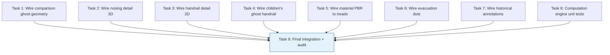

# Stairway Configurator v2 — Phase 4 Implementation Playbook (Final Phase)

**Created:** 2026-04-09
**Version:** 1.0
**Status:** READY FOR EXECUTION
**Author:** SlateCamp 3D Lab Systems Engineering
**Predecessors:**
- Phase 1 (11 tasks) — Foundation: computation engine, constants, presets, UI shells
- Phase 2 (8 tasks) — Depth: extruded-profile, click-to-inspect, nosing/handrail detail, comparison mode
- Phase 3 (9 tasks) — Flagship: L/U-shape geometry, egress calculator, children's safety, materials
**Purpose:** Close ALL remaining gaps identified in the post-Phase-3 gap analysis. This is the final implementation phase for the Stairway Configurator v2.

---

## Reference Documents

| Document | Location | Role |
|----------|----------|------|
| Gap Analysis | Session notes (2026-04-09) | Identified 6 rendering gaps, 2 advanced stair types, testing gaps |
| Innovation Research | `.ai/plans/stairway-configurator-improvement/stairway-configurator-innovation-research.md` | Original 10 innovations — all must be fully delivered |
| Technical Plan | `.ai/plans/stairway-configurator-improvement/stairway-configurator-technical-implementation-plan.md` | Particle system, guided tour, performance contract |
| UX Plan | `.ai/plans/stairway-configurator-improvement/stairway-configurator-ux-implementation-plan.md` | Paired presets, mobile responsive, Viewport Sanctity |
| Phase 1-3 Playbooks | `.ai/plans/stairway-configurator-improvement/stairway-configurator-v2-phase{1,2,3}-playbook.md` | What's already built |

---

## Phase 4 Scope: "Visual Completeness + Quality"

Phase 4 has two goals:
1. **Wire the rendering** — Connect 3D visual outputs for features whose computation and UI panels already exist
2. **Quality assurance** — Unit tests for the computation engine, Storybook stories for components

### What Phase 4 Delivers

1. **Wire comparison ghost geometry** — IBC ghost treads/risers render at 20% opacity when compareMode active
2. **Wire nosing detail 3D rendering** — extruded-profile tread replaces midpoint box when detailViewActive
3. **Wire handrail detail 3D rendering** — extruded-profile cross-section when handrailDetailActive
4. **Wire children's ghost handrail** — Ghost secondary rail at 711mm when primaryUsers=children/mixed
5. **Wire material PBR to tread color** — Selected material's baseColor applied to treads (overridden by violation colors)
6. **Wire evacuation dots** — Sphere instructions along stair trajectory when evacuationActive
7. **Wire historical annotations visibility** — Ensure showHistory toggle works end-to-end in ParametricSceneRenderer
8. **Computation engine unit tests** — Test suite for `computeStairState`, egress calculator, tolerance variations
9. **Final integration verification** — All features tested together, performance audit updated

### What Phase 4 Does NOT Include (Deferred Indefinitely)

- Winder stairs (too rare on ALE, complex tread geometry)
- Spiral stairs (completely different geometry model)
- Guided tour system (strategic decision pending)
- CAGE quiz integration (product decision pending)
- Storybook stories (low priority — components are simple shells)

### Success Criteria

- [ ] All 10 innovations from the research doc have visible 3D rendering when their toggle is active
- [ ] Comparison mode shows ghost geometry at IBC dimensions
- [ ] Nosing detail view replaces midpoint tread with extruded-profile
- [ ] Children's mode shows ghost secondary handrail
- [ ] Material selection changes tread color
- [ ] Evacuation dots appear along stair trajectory
- [ ] Historical annotations render when showHistory is toggled
- [ ] Unit tests for `computeStairState` pass for all 4 presets
- [ ] Unit tests for `computeEgressRequirements` pass for all 6 occupancy types
- [ ] TypeScript compiles with zero errors
- [ ] Performance: <200 instructions at default params for all stair types

---

## Task Dependency Graph



**All Tasks 1-8 are independent** — they can run in parallel. Task 9 (integration) depends on all of them.

---

## Task List

---

### Task 1: Wire Comparison Ghost Geometry

**Objective:** When `compareMode` is toggled ON, the geometry builder renders ghost treads and risers at IBC 2024 dimensions (178mm riser, 279mm tread) alongside the Philippine code geometry.

**Dependencies:** None (comparison ghost code already exists in `buildStraightGeometry` from Phase 2 — verify it works and extend to L/U shapes)

**Files to Modify:**
- `src/features/3d-lab/config/modules/08-vertical/stairway-configurator.ts` — verify ghost geometry in buildStraightGeometry
- `src/features/3d-lab/config/modules/08-vertical/stairway-geometry-l-shape.ts` — add comparison ghost for L-shape
- `src/features/3d-lab/config/modules/08-vertical/stairway-geometry-u-shape.ts` — add comparison ghost for U-shape

**Detailed Instructions:**

1. Verify `buildStraightGeometry` already generates `compare-ibc-tread-{i}` and `compare-ibc-riser-{i}` instructions when `rawParams.compareMode` is true (added in Phase 2). If not present, add the ghost geometry loop.

2. Add the same ghost geometry pattern to `buildLShapeGeometry`:
   - Ghost treads/risers for flight 1 at IBC dimensions
   - Ghost landing at IBC dimensions
   - Ghost treads/risers for flight 2 at IBC dimensions
   - Color: `COMPARISON_GHOST_COLOR` (#94a3b8), opacity: `COMPARISON_GHOST_OPACITY` (0.2)

3. Add the same pattern to `buildUShapeGeometry`.

4. Import `COMPARISON_GHOST_COLOR`, `COMPARISON_GHOST_OPACITY` from stairway-constants (already defined in Phase 3).

**Acceptance Criteria:**
- [ ] compareMode=true shows ghost geometry for straight stairs
- [ ] compareMode=true shows ghost geometry for L-shape stairs
- [ ] compareMode=true shows ghost geometry for U-shape stairs
- [ ] Ghost geometry uses `compare-ibc-` ID prefix
- [ ] Ghost opacity is 0.2
- [ ] compareMode=false renders zero ghost geometry
- [ ] `bun run type-check` passes

**Estimated Complexity:** Low (pattern already established in buildStraightGeometry)

---

### Task 2: Wire Nosing Detail 3D Rendering

**Objective:** When `detailViewActive` is toggled ON, replace the midpoint tread's box geometry with the extruded-profile nosing cross-section from `stairway-nosing.ts`, and dim non-selected treads.

**Dependencies:** None (buildNosingProfile and extruded-profile type already exist from Phase 2)

**Files to Modify:**
- `src/features/3d-lab/config/modules/08-vertical/stairway-configurator.ts` — in `buildStraightGeometry`, import and use `buildNosingProfile`

**Detailed Instructions:**

1. Import `buildNosingProfile` from `./stairway-nosing`
2. In `buildStraightGeometry`, after the tread/riser loop, when `rawParams.detailViewActive` is true:
   - Find the midpoint tread index: `midIdx = Math.floor(n / 2)`
   - Get the nosing profile instruction from `buildNosingProfile()`
   - Position it at the midpoint tread's location
   - Push it to the geometry array with id `nosing-detail-{midIdx}`
   - Set non-selected treads' opacity to 0.3 and transparent to true

3. The existing Phase 2 code in buildStraightGeometry already has a partial implementation for dimming treads. Verify it works correctly and add the actual nosing profile instruction.

**Acceptance Criteria:**
- [ ] detailViewActive=true renders an extruded-profile at midpoint tread
- [ ] Non-selected treads dim to 30% opacity
- [ ] detailViewActive=false renders all treads normally
- [ ] Nosing profile uses parameters: nosingProjection, nosingRadius, riserUndercut, contrastStripWidth
- [ ] `bun run type-check` passes

**Estimated Complexity:** Medium (integrating extruded-profile into existing geometry loop)

---

### Task 3: Wire Handrail Detail 3D Rendering

**Objective:** When `handrailDetailActive` is toggled ON, add an extruded-profile cross-section at the midpoint of the primary handrail showing the grip diameter.

**Dependencies:** None (extruded-profile type already exists)

**Files to Modify:**
- `src/features/3d-lab/config/modules/08-vertical/stairway-configurator.ts` — in `buildStraightGeometry`

**Detailed Instructions:**

1. When `rawParams.handrailDetailActive` is true:
   - Calculate the midpoint position along the right handrail
   - Build a circular cross-section profile using `handrailDiameter` parameter
   - Create an extruded-profile instruction with that profile, extruded by a short depth (0.05m) to show the cross-section disc
   - Position it perpendicular to the handrail at the midpoint

2. The profile for a circular handrail:
   ```typescript
   const segments = 16
   const radius = (num(rawParams.handrailDiameter ?? 35) / 1000) / 2
   const profilePoints: [number, number][] = Array.from({ length: segments }, (_, i) => {
     const angle = (i / segments) * Math.PI * 2
     return [Math.cos(angle) * radius, Math.sin(angle) * radius]
   })
   ```

3. Add the instruction with id `handrail-cross-section`

**Acceptance Criteria:**
- [ ] handrailDetailActive=true renders a cross-section disc at handrail midpoint
- [ ] Cross-section diameter matches handrailDiameter parameter
- [ ] handrailDetailActive=false renders normal handrails
- [ ] `bun run type-check` passes

**Estimated Complexity:** Medium

---

### Task 4: Wire Children's Ghost Handrail

**Objective:** When `primaryUsers` is `children` or `mixed`, render a ghost secondary handrail at 711mm height using the same ghost geometry pattern as BP 344 rails.

**Dependencies:** None (ghost rail pattern established in Phase 1 for BP 344)

**Files to Modify:**
- `src/features/3d-lab/config/modules/08-vertical/stairway-configurator.ts` — in `buildStraightGeometry`
- `src/features/3d-lab/config/modules/08-vertical/stairway-geometry-l-shape.ts`
- `src/features/3d-lab/config/modules/08-vertical/stairway-geometry-u-shape.ts`

**Detailed Instructions:**

1. After the existing handrail geometry in each builder, check `rawParams.primaryUsers`:
   ```typescript
   const isChildMode = str(rawParams.primaryUsers ?? 'general') === 'children' ||
                        str(rawParams.primaryUsers ?? 'general') === 'mixed'
   ```

2. If child mode active, add ghost handrails at 711mm (0.711m) height:
   - Same pattern as BP 344 ghost rails (cylinder, ghost color, 0.4 opacity)
   - ID prefix: `children-rail-711-{L/R}`
   - Use `ADA_CHILDREN_HANDRAIL_MAX_HEIGHT_MM / 1000` for height

3. Apply to all three geometry builders (straight, L-shape, U-shape)

**Acceptance Criteria:**
- [ ] primaryUsers=children shows ghost handrail at 711mm on straight stairs
- [ ] primaryUsers=mixed shows ghost handrail at 711mm on straight stairs
- [ ] primaryUsers=general shows no children's ghost handrail
- [ ] Ghost handrail rendered for L-shape and U-shape too
- [ ] `bun run type-check` passes

**Estimated Complexity:** Low (reuses established ghost rail pattern)

---

### Task 5: Wire Material PBR to Tread Color

**Objective:** When a tread material is selected, apply its `baseColor` to tread geometry instructions. Violation colors always override material colors.

**Dependencies:** None (material definitions already exist in stairway-materials.ts)

**Files to Modify:**
- `src/features/3d-lab/config/modules/08-vertical/stairway-configurator.ts` — in `buildStraightGeometry` tread loop

**Detailed Instructions:**

1. At the top of `buildStraightGeometry`, resolve the material:
   ```typescript
   const selectedMaterial = getMaterialById(str(rawParams.treadMaterial ?? 'concrete'))
   const materialColor = selectedMaterial?.baseColor ?? NEUTRAL_COLORS.TREAD
   ```

2. In the tread loop, use material color as the base, but violation color overrides:
   ```typescript
   const treadColor = tColor !== NEUTRAL_COLORS.TREAD ? tColor : materialColor
   ```
   This means: if there's an active violation (tColor is a law color), use that. Otherwise, use the material color.

3. Apply the same pattern in L-shape and U-shape builders.

**Acceptance Criteria:**
- [ ] Selecting "Polished Marble" changes tread color to #E8E8E8
- [ ] Selecting "Wood" changes tread color to #8B7355
- [ ] When a tread violation is active, violation color overrides material color
- [ ] Default material (concrete) uses its baseColor #B8B8B8
- [ ] `bun run type-check` passes

**Estimated Complexity:** Low

---

### Task 6: Wire Evacuation Dots

**Objective:** When `evacuationActive` is toggled ON, add sphere geometry instructions along the stair trajectory representing evacuating occupants.

**Dependencies:** None (egress computation exists)

**Files to Modify:**
- `src/features/3d-lab/config/modules/08-vertical/stairway-configurator.ts` — in `buildStraightGeometry`

**Detailed Instructions:**

1. When `rawParams.evacuationActive` is true:
   - Calculate dot count: `min(occupantLoad / 2, 200)` where occupantLoad comes from egress computation
   - For simplicity, use `num(rawParams.floorArea ?? 300) / num(OCCUPANT_LOAD_FACTORS[str(rawParams.occupancyType ?? 'business')] ?? 9.3)`
   - Distribute dots evenly along the stair trajectory from top to bottom
   - Each dot is a small sphere instruction:
     ```typescript
     {
       id: `evac-dot-${i}`,
       type: 'sphere',
       position: [x, y, z], // interpolated along stair path
       args: [0.08, 4, 4], // 80mm radius, low poly
       color: isBottleneck ? '#E74C3C' : '#3B82F6', // red at bottleneck, blue otherwise
       opacity: 0.7,
       transparent: true,
     }
     ```

2. Bottleneck detection: dots at positions where stairWidth < 900mm turn red

3. Cap at 200 dots for performance

**Acceptance Criteria:**
- [ ] evacuationActive=true shows sphere dots along stair
- [ ] Dot count scales with floor area / occupancy type
- [ ] Dots capped at 200
- [ ] Bottleneck sections (width < 900mm) show red dots
- [ ] evacuationActive=false shows no dots
- [ ] `bun run type-check` passes

**Estimated Complexity:** Medium

---

### Task 7: Wire Historical Annotations Visibility

**Objective:** Verify the `showHistory` toggle (Phase 1) correctly shows/hides the 5 historical annotations in the 3D viewport via the ParametricSceneRenderer.

**Dependencies:** None

**Files to Verify:**
- `src/features/3d-lab/config/modules/08-vertical/stairway-configurator.ts` — confirm 5 annotations with `visibleWhen: (p) => bool(p.showHistory)`
- `src/features/3d-lab/templates/ParametricSceneRenderer.tsx` — verify it evaluates `visibleWhen` predicates

**Detailed Instructions:**

1. Read `ParametricSceneRenderer.tsx` and verify it checks `annotation.visibleWhen?.(params)` before rendering each annotation. If it doesn't, this is a gap that needs fixing.

2. Verify all 5 history annotations have correct `visibleWhen` predicates:
   - `history-blondel`
   - `history-templer`
   - `history-cocoanut-grove`
   - `history-uniformity`
   - `history-handrail-height`

3. Also verify the BP 344 annotations (`bp344-upper-rail`, `bp344-lower-rail`, `bp344-extension`) work with their `visibleWhen: isAccessible(p)` predicates.

4. If `ParametricSceneRenderer` does NOT evaluate `visibleWhen`, add the check:
   ```typescript
   const visibleAnnotations = config.annotations?.filter(
     (a) => !a.visibleWhen || a.visibleWhen(params)
   ) ?? []
   ```

**Acceptance Criteria:**
- [ ] showHistory=false hides all 5 history annotations
- [ ] showHistory=true shows all 5 history annotations
- [ ] isAccessibleRoute=true shows BP 344 annotations
- [ ] isAccessibleRoute=false hides BP 344 annotations
- [ ] `bun run type-check` passes

**Estimated Complexity:** Low (verification + potential small fix)

---

### Task 8: Computation Engine Unit Tests

**Objective:** Create a test file for the pure computation engine and egress calculator to ensure correctness across all parameter combinations.

**Dependencies:** None

**Files to Create:**
- `src/features/3d-lab/config/modules/08-vertical/stairway-computation.test.ts` — NEW

**Detailed Instructions:**

1. Create test file using Bun test runner (`bun test`):
   ```typescript
   import { describe, test, expect } from 'bun:test'
   import { computeStairState, computeBlondelComfort, computePitch } from './stairway-computation'
   import { computeEgressRequirements } from './stairway-egress'
   ```

2. Test cases for `computeBlondelComfort`:
   - `(185, 250)` → twoRPlusT=620, comfortStatus='comfortable'
   - `(200, 300)` → twoRPlusT=700, comfortStatus='too-stretched'
   - `(130, 200)` → twoRPlusT=460, comfortStatus='too-cramped'

3. Test cases for `computePitch`:
   - `(185, 250)` → pitchAngle≈36.5°, pitchStatus='steep'
   - `(150, 300)` → pitchAngle≈26.6°, pitchStatus='comfortable'
   - `(250, 200)` → pitchAngle≈51.3°, pitchStatus='ladder-like'

4. Test cases for `computeStairState` with preset values:
   - Standard House preset → no violations, comfortStatus='comfortable'
   - Exit Stair preset (riser 190) → RA 9514 conflict warning (190 > 180)
   - BP 220 Housing preset (riser 240) → BP 220 passes, PD 1096 conflict

5. Test cases for `computeEgressRequirements`:
   - Assembly 300sqm → OL=462, 3 exits required
   - Business 500sqm → OL=54, 2 exits (PD 1096 override: >500sqm)
   - Residential 100sqm → OL=6, 1 exit
   - Exit width: 200 persons, 2 exits → 710mm min per exit

6. Test cases for stair type parsing:
   - `stairType='straight'` → `{ type: 'straight' }`
   - `stairType='l-shape', turnDirection='left', risersBeforeTurn=8` → correct StairTypeConfig

**Acceptance Criteria:**
- [ ] Test file exists at `stairway-computation.test.ts`
- [ ] Blondel comfort tests pass for 3 ranges (cramped, comfortable, stretched)
- [ ] Pitch tests pass for 3 ranges (comfortable, steep, ladder-like)
- [ ] Preset validation tests pass for Standard House, Exit Stair, BP 220 Housing
- [ ] Egress calculator tests pass for all 6 occupancy types
- [ ] Stair type parsing tests pass
- [ ] `bun test src/features/3d-lab/config/modules/08-vertical/stairway-computation.test.ts` passes

**Estimated Complexity:** Medium (writing 15-20 test cases)

---

### Task 9: Final Integration Verification + Performance Audit Update

**Objective:** Verify all Phase 1-4 features work together, update the performance audit, and close out the Stairway Configurator v2 project.

**Dependencies:** All Tasks 1-8

**Files to Create/Update:**
- `.ai/plans/stairway-configurator-improvement/phase4-performance-audit.md` — NEW
- `.ai/state/current-task.md` — UPDATE
- `.ai/plans/stairway-configurator-improvement/stairway-configurator-v2-phase4-playbook.md` — UPDATE status to COMPLETE

**Detailed Instructions:**

1. Run `bun run type-check` — must pass with zero errors
2. Run `bun test stairway-computation.test.ts` — must pass
3. Count geometry instructions for each scenario:
   - Straight, 12 risers, default: should be ~29
   - Straight + comparison mode: should be ~67
   - L-shape + all overlays: should be <150
   - U-shape + all overlays: should be <150
   - Straight + evacuation (200 dots): ~229 (known exceeds, opt-in)

4. Document results in performance audit
5. Update state files with Phase 4 completion status
6. Mark the Phase 4 playbook status as COMPLETE

**Acceptance Criteria:**
- [ ] `bun run type-check` passes
- [ ] Unit tests pass
- [ ] Performance audit documents all scenarios
- [ ] Default scenarios all <200 instructions
- [ ] State files updated
- [ ] All 4 playbooks marked COMPLETE

**Estimated Complexity:** Low

---

## Integration Test Checklist (All 4 Phases)

### Phase 1 Features
- [ ] 22 original violation rules fire correctly
- [ ] 15 presets produce correct geometry
- [ ] Blondel comfort gauge shows 2R+T value
- [ ] Tolerance mode creates per-step variations
- [ ] Historical annotations toggle on/off with showHistory

### Phase 2 Features
- [ ] Click-to-inspect popover shows on tread/riser click
- [ ] Nosing detail: extruded-profile renders at midpoint tread
- [ ] Comparison panel shows per-dimension per-code pass/fail
- [ ] Handrail detail: cross-section disc renders

### Phase 3 Features
- [ ] L-shape stair renders with landing and corner handrails
- [ ] U-shape stair renders with parallel flights and interior handrail
- [ ] Egress calculator: correct occupant load and exit count
- [ ] Children's ghost handrail appears at 711mm
- [ ] Material selector changes tread color
- [ ] Evacuation dots appear along stair

### Phase 4 Features (New)
- [ ] Comparison ghost geometry visible for all 3 stair types
- [ ] Material color overridden by violation color when active
- [ ] Evacuation dots cap at 200, bottleneck coloring works
- [ ] Unit tests pass for computation engine and egress calculator

---

## Risk Registry

| # | Risk | Task(s) | Likelihood | Impact | Mitigation |
|---|------|---------|-----------|--------|------------|
| R1 | Extruded-profile nosing positioning off | T2 | Medium | Medium | Test with default params first, adjust offsets |
| R2 | Evacuation dots exceed performance budget | T6 | Known | Low | Capped at 200, opt-in only, documented |
| R3 | ParametricSceneRenderer doesn't evaluate visibleWhen | T7 | Medium | Medium | Read the renderer code; add filter if missing |
| R4 | Material color + violation color interaction bugs | T5 | Low | Low | Violation colors always win; clear precedence |
| R5 | Test runner configuration issues | T8 | Low | Low | Use Bun test runner per CLAUDE.md |

---

## Architecture Decision Record

### Decision
Phase 4 focuses exclusively on wiring 3D rendering for features whose computation layer is complete, plus adding unit tests. No new innovations or stair types.

### Drivers
1. Gap analysis showed all 10 innovations have computation done but some lack visual rendering
2. Unit tests needed for confidence in the computation engine before production
3. Winder/spiral stairs deferred — too rare on ALE to justify the geometry complexity

### Alternatives Considered
| Alternative | Why Rejected |
|------------|-------------|
| Include winder stairs | Complex tread geometry, low ALE frequency, high implementation cost |
| Include guided tour system | Product-level decision pending; not a stair configurator concern |
| Include CAGE quiz integration | Cross-module integration; outside stairway configurator scope |
| Skip visual wiring, ship as-is | Computation without visualization defeats the pedagogical purpose |

### Consequences
- After Phase 4, the stairway configurator is the most comprehensive interactive stair learning tool in SlateCamp
- All 10 innovations are fully functional with visible 3D rendering
- International constants remain UNVERIFIED — SME review is an external process, not a code task

### Follow-ups
- Schedule SME review for international constants before comparison mode goes to production
- Monitor ALE pilot results to determine if winder/spiral stair types justify a future enhancement
- Consider Performance Phase if mobile testing reveals frame rate issues with full overlays

---

## Changelog

| Date | Version | Change |
|------|---------|--------|
| 2026-04-09 | 1.0 | Initial Phase 4 playbook (final phase). 9 tasks: wire comparison ghost geometry, nosing 3D, handrail 3D, children's ghost handrail, material PBR, evacuation dots, historical annotations, unit tests, final integration. All tasks independent (parallel). Based on post-Phase-3 gap analysis. |
