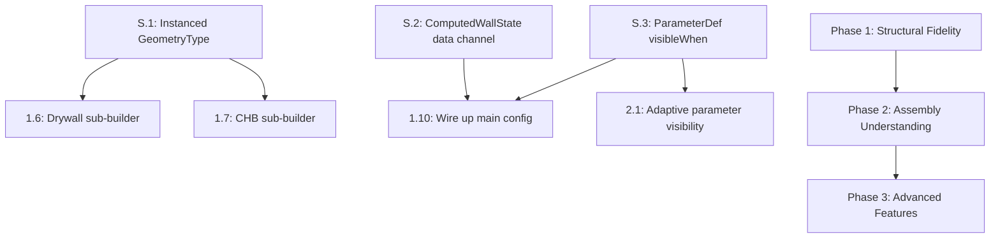
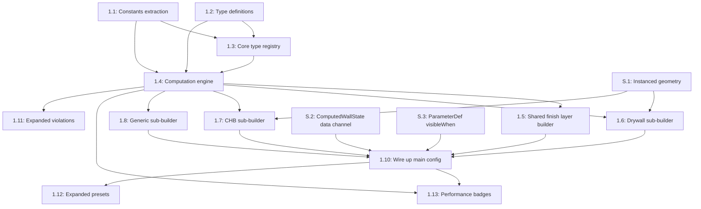
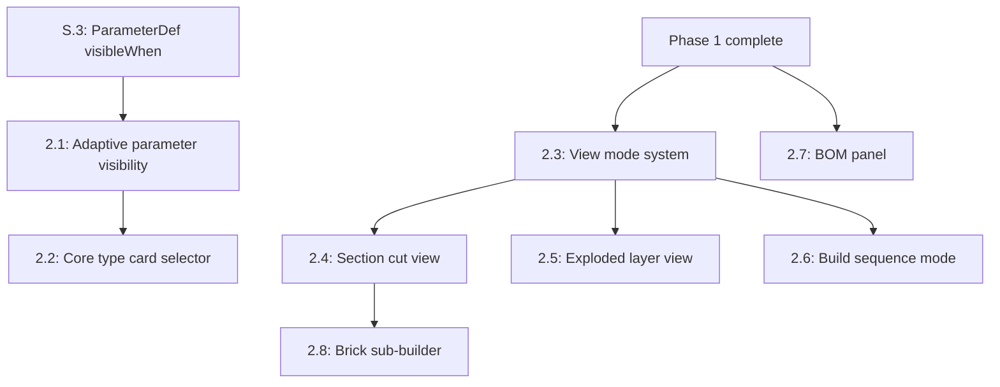
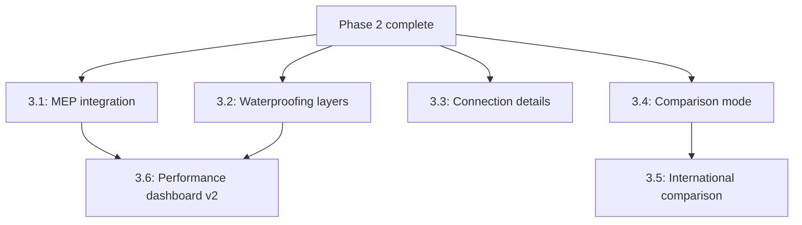

# Unified Wall Configurator v2 — Complete Implementation Playbook

**Created:** 2026-04-09
**Version:** 1.2 (post-Architect + Critic consensus)
**Status:** READY FOR EXECUTION
**Author:** SlateCamp 3D Lab Systems Engineering

---

## Reference Documents

| Document | Location | Role |
|----------|----------|------|
| Innovation Research | `.ai/docs/XX-3D-Modules/Unified-Wall-Configurator/V2/unified-wall-configurator-innovation-research.md` | WHAT and WHY — 12 innovations, PH construction data, fire/STC/BOM data |
| Technical Implementation Plan | `.ai/docs/XX-3D-Modules/Unified-Wall-Configurator/V2/unified-wall-configurator-technical-implementation-plan.md` | Architectural CONSTRAINTS — Multi-Core System, ComputedWallState, performance budgets |
| UX Implementation Plan | `.ai/docs/XX-3D-Modules/Unified-Wall-Configurator/V2/unified-wall-configurator-ux-implementation-plan.md` | UX REQUIREMENTS — Viewport Sanctity, adaptive params, BOM panel, comparison mode |
| 3D Lab Feature Specification | `.ai/docs/01-product/008-3d-lab-feature-specification.md` | AUTHORITATIVE SPEC — types, stores, templates, rendering pipeline |

---

## Scope — All Phases

### Phase 1 — Structural Fidelity (Foundation)

Delivers: Multi-file architecture extraction, computation engine, instanced geometry type extension, drywall framing sub-builder (studs + tracks + board), CHB reinforcement sub-builder (rebar + grout + bond beams + representative section), shared finish layer builder, fire resistance badge, STC acoustic badge.

### Phase 2 — Assembly Understanding

Delivers: Adaptive parameter visibility (params show/hide per core type), view mode system (overview/section cut/exploded/build sequence), exploded layer view, section cut view, BOM computation + panel, progressive build animation.

### Phase 3 — Advanced Features

Delivers: MEP integration layer, waterproofing layers, wall-to-structure connection details, comparison mode + ComparisonDashboard, international wall type comparison, performance comparison dashboard.

### Dependency Chain

Phase 1 must complete before Phase 2 begins (Phase 2 depends on ComputedWallState, instanced geometry, and sub-builders). Phase 2 must complete before Phase 3 begins (Phase 3 depends on view mode system and BOM panel). Within each phase, tasks have explicit per-task dependencies.

---

## Current State Snapshot

**Source file:** `src/features/3d-lab/config/modules/10-materials/unified-wall-configurator.ts`

| Metric | Value |
|--------|-------|
| Total lines | ~600 |
| Parameters | 9 (2 dimension sliders + 1 core type dropdown + 1 sides dropdown + 4 finish toggles + 1 paint color dropdown) |
| Core types | 7 (CHB, drywall, plywood, cement-board, brick, solid-concrete, existing-wall) |
| CoreConfig fields | 9 per entry (thickness, color, label, hasMortarPattern, mortarSpacingH, mortarSpacingV, mortarColor, supportsPlaster) |
| Violation rules | 3 (height-below-min, chb-thickness-min, brick-load-bearing) |
| Annotations | 4 (wall-height, wall-thickness, layer-callout, total-buildout) |
| Presets | 7 (Standard CHB Room, Drywall Office Partition, Plywood Temp Partition, HardieFlex Exterior, Brick Feature Wall, Concrete Basement, Quick Repaint) |
| Helper functions | 4 (mm, num, str, bool) |
| Paint colors | 6 (White, Cream, Light Gray, Sky Blue, Sage Green, Warm Beige) |
| Geometry at defaults | ~65 instructions (ground + core + ~20 mortar-h + ~40 mortar-v + layer-front-plaster + layer-front-primer + layer-front-paint + thickness-edge) |
| Layer thicknesses | plaster 12.7mm, skim 3mm, primer 1mm, paint 1mm |
| Import types | ParametricSceneConfig, ParameterDef, GeometryInstruction, ViolationRule, AnnotationDef, Preset |
| Export | Single `unifiedWallConfiguratorConfig: ParametricSceneConfig` |

### Existing GeometryType Union (from `src/features/3d-lab/types/templates.ts`)

```typescript
export type GeometryType =
  | 'box'
  | 'cylinder'
  | 'plane'
  | 'line'
  | 'ring'
  | 'sphere'
  | 'cone'
  | 'extruded-profile'
```

### Key Architectural Facts

- `GeometrySwitch` (`src/components/r3f/GeometrySwitch.tsx`) uses a pure `switch` with a `default` case that returns `null` + dev warning — safe for extension
- `InstructionMesh` (`src/features/3d-lab/components/templates/GeometryMesh.tsx`) wraps `GeometrySwitch` with mesh + material — needs parallel path for instanced geometry
- `ParametricSceneRenderer` (`src/features/3d-lab/templates/ParametricSceneRenderer.tsx`) maps `geometryInstructions.map(inst => <InstructionMesh>)` — needs to detect instanced instructions and render via drei `<Instances>`
- `ParameterDef` does NOT have a `visibleWhen` field — `AnnotationDef` does
- `createModuleStore` (`src/features/3d-lab/stores/createModuleStore.ts`) provides `params`, `setParam`, `setParams`, `reset`
- Stairway configurator Phase 1 playbook does NOT define shared instanced geometry infrastructure or ViewportContent enforcement component (both listed as deferred/open decisions)

---

## Shared Infrastructure Tasks

The following tasks create infrastructure used by both the wall configurator and (eventually) the stairway configurator. They are defined here because the stairway Phase 1 playbook explicitly deferred them. These tasks come BEFORE any phase-specific work.

---

### Task S.1: Extend GeometryType with 'instanced' Variant

**Phase:** Shared Infrastructure
**Objective:** Add the `'instanced'` geometry type to the type system and rendering pipeline without breaking any existing module.

**Dependencies:** None

**Input Files (Read):**
- `src/features/3d-lab/types/templates.ts` — GeometryType union, GeometryInstruction interface
- `src/components/r3f/GeometrySwitch.tsx` — geometry element factory
- `src/features/3d-lab/components/templates/GeometryMesh.tsx` — InstructionMesh component
- `src/features/3d-lab/templates/ParametricSceneRenderer.tsx` — main renderer loop

**Output Files (Create/Modify):**
- `src/features/3d-lab/types/templates.ts` — MODIFY: extend GeometryType and GeometryInstruction
- `src/features/3d-lab/components/templates/InstancedMesh.tsx` — CREATE: instanced geometry renderer
- `src/features/3d-lab/templates/ParametricSceneRenderer.tsx` — MODIFY: handle instanced instructions

**Detailed Instructions:**

1. In `src/features/3d-lab/types/templates.ts`, add `'instanced'` to the `GeometryType` union:
   ```typescript
   export type GeometryType =
     | 'box'
     | 'cylinder'
     | 'plane'
     | 'line'
     | 'ring'
     | 'sphere'
     | 'cone'
     | 'extruded-profile'
     | 'instanced'
   ```

2. Add optional instanced fields to `GeometryInstruction` (follows the `extruded-profile` precedent with `profilePoints`/`extrudeDepth`):
   ```typescript
   export interface GeometryInstruction {
     // ... existing fields unchanged ...

     /** 2D cross-section points for extruded-profile type */
     profilePoints?: [number, number][]
     /** Extrusion depth in scene units for extruded-profile type */
     extrudeDepth?: number

     // ── Instanced geometry fields (used when type === 'instanced') ──
     /** Base shape for instanced geometry */
     instancedShape?: 'box' | 'cylinder' | 'sphere'
     /** Constructor args for the base shape */
     instancedShapeArgs?: number[]
     /** World-space positions for each instance */
     instancedPositions?: Vector3Tuple[]
     /** Per-instance rotations (optional — defaults to [0,0,0]) */
     instancedRotations?: Vector3Tuple[]
     /** Per-instance colors (optional — uses `color` for all if omitted) */
     instancedColors?: string[]
   }
   ```

3. Create `src/features/3d-lab/components/templates/InstancedMesh.tsx`:
   - Import `Instances`, `Instance` from `@react-three/drei`
   - Accept a `GeometryInstruction` with `type === 'instanced'`
   - Render a single `<Instances>` group with the base shape geometry
   - Map `instancedPositions` to `<Instance>` children
   - Apply per-instance rotation and color if provided
   - Use `meshStandardMaterial` with the instruction's base `color` and `opacity`

4. In `src/features/3d-lab/templates/ParametricSceneRenderer.tsx`, modify the geometry rendering loop:
   ```typescript
   {geometryInstructions.map((inst) =>
     inst.type === 'instanced' ? (
       <InstancedMesh key={inst.id} inst={inst} />
     ) : (
       <InstructionMesh key={inst.id} inst={inst} />
     )
   )}
   ```

5. **Do NOT modify `GeometrySwitch.tsx`** — instanced geometry bypasses GeometrySwitch entirely because it uses drei `<Instances>` (a different rendering paradigm from individual meshes).

6. **Proof-of-concept step:** Before wiring into the full pipeline, create a minimal test: add a temporary test instruction in the wall configurator's `geometry()` function that returns one instanced instruction with 5 box positions. Verify it renders 5 boxes. Remove after confirming. This is important because drei `<Instances>` is not currently used anywhere in the codebase — zero existing imports. The POC validates the pattern before sub-builders depend on it.

7. **Note on performance justification:** At the budgeted instance counts (≤ 45 blocks, ≤ 16 studs), the GPU draw-call savings from instancing are marginal. The primary benefit is **organizational** — one instanced instruction = one logical element (e.g., "all studs") vs. 16 separate instructions cluttering the array. This simplifies the geometry builder, the instruction ID namespace, and future LOD gating. The instancing infrastructure also benefits the stairway configurator (Phase 3: multiple treads/risers) where instance counts will be higher.

**Acceptance Criteria:**
- [ ] TypeScript compiles with zero errors (`bun run type-check`)
- [ ] All 209 existing modules render identically (no visual regression)
- [ ] `GeometrySwitch` default case does NOT log warning for `'instanced'` type (because instanced instructions never reach GeometrySwitch)
- [ ] A test instruction with `type: 'instanced'`, `instancedShape: 'box'`, and 5 positions renders 5 boxes in a single draw call
- [ ] Existing modules producing only standard instructions work unchanged

**Estimated Complexity:** Medium
**Risks:** The drei `<Instances>` API may have version-specific behavior. Check drei version in `package.json` (10.7) and verify `<Instances>` API compatibility.

---

### Task S.2: ComputedWallState Data Channel

**Phase:** Shared Infrastructure
**Objective:** Solve the architectural gap where `ParametricSceneConfig.geometry()` returns only `GeometryInstruction[]` but UI components (PerformanceDashboard, BOMPanel) need access to `ComputedWallState` (performance metrics, BOM data, violations).

**Dependencies:** None

**The Problem:** The `geometry` function at `templates.ts:148` has signature `(params) => GeometryInstruction[]`. Computing `ComputedWallState` inside `geometry()` and discarding everything except instructions wastes work. Worse, the BOM panel and performance badges can't access the computed data — they'd need to independently recompute it, duplicating the entire computation engine.

**The Solution:** Compute `ComputedWallState` once at the template renderer level and distribute via a module-scoped React context.

**Input Files (Read):**
- `src/features/3d-lab/templates/ParametricSceneRenderer.tsx` — existing `useMemo` at line 41-44
- `src/features/3d-lab/stores/createModuleStore.ts` — ModuleStoreState interface
- `src/features/3d-lab/types/templates.ts` — ParametricSceneConfig interface

**Output Files (Create/Modify):**
- `src/features/3d-lab/config/modules/10-materials/wall-computed-context.tsx` — CREATE: React context + provider for ComputedWallState
- The wall configurator's custom renderer wrapper (created in Task 1.10) will use this context

**Detailed Instructions:**

1. Create `wall-computed-context.tsx` with:
   ```typescript
   const WallComputedContext = createContext<ComputedWallState | null>(null)
   
   export const WallComputedProvider = ({ params, children }) => {
     const state = useMemo(() => computeWallState(params), [params])
     return (
       <WallComputedContext.Provider value={state}>
         {children}
       </WallComputedContext.Provider>
     )
   }
   
   export const useWallComputed = () => {
     const ctx = useContext(WallComputedContext)
     if (!ctx) throw new Error('useWallComputed must be used within WallComputedProvider')
     return ctx
   }
   ```

2. The wall configurator's `geometry()` function still returns `GeometryInstruction[]` (preserving the `ParametricSceneConfig` contract). But in the module's custom viewport layout (wired up in Task 1.10), the `WallComputedProvider` wraps both the 3D canvas and the sidebar panels. This way:
   - `geometry()` calls `computeWallState()` → `buildWallGeometry()` → returns instructions (for the R3F renderer)
   - Sidebar components call `useWallComputed()` to get the same state (recomputed via the provider's `useMemo`, which is driven by the same `params`)

3. **Note on double computation:** `computeWallState` runs twice per param change — once inside `geometry()` (via ParametricSceneRenderer's useMemo) and once in the `WallComputedProvider`. This is acceptable because: (a) the function is pure and < 1ms, (b) the alternative — modifying `ParametricSceneConfig` interface — would break all 209 modules. If performance becomes an issue, a shared memoization cache keyed on params can be added later.

4. **Alternative considered and rejected:** Extending `ModuleStoreState` with a `computedData` slot. Rejected because it couples the generic store to wall-specific types, and because React context is the idiomatic pattern for derived-data distribution in a component tree.

**Acceptance Criteria:**
- [ ] `useWallComputed()` returns valid `ComputedWallState` within the provider
- [ ] `useWallComputed()` throws outside the provider (developer error detection)
- [ ] PerformanceDashboard and BOMPanel can read performance/BOM data without duplicating computation logic
- [ ] `ParametricSceneConfig.geometry` signature is unchanged
- [ ] TypeScript compiles

**Estimated Complexity:** Medium
**Risks:** Double computation of `ComputedWallState` (once in geometry(), once in context). Mitigated by < 1ms computation time and memoization.

---

### Task S.3: Add `visibleWhen` to ParameterDef

**Phase:** Shared Infrastructure
**Objective:** Add an optional `visibleWhen` predicate to `ParameterDef` enabling config-driven parameter visibility gating per core type.

**Dependencies:** None (can run in parallel with S.1)

**Input Files (Read):**
- `src/features/3d-lab/types/templates.ts` — ParameterDef interface
- `src/features/3d-lab/components/templates/GenericControlPanel.tsx` — the actual parametric control panel (NOT `ControlPanel.tsx` which is a legacy scene-specific panel using `labStore`)

**Output Files (Modify):**
- `src/features/3d-lab/types/templates.ts` — add `visibleWhen` to ParameterDef
- `src/features/3d-lab/components/templates/GenericControlPanel.tsx` — add visibility filtering

**Detailed Instructions:**

1. In `src/features/3d-lab/types/templates.ts`, add to `ParameterDef`:
   ```typescript
   export interface ParameterDef {
     // ... existing fields unchanged ...

     /** Optional visibility predicate — parameter hidden when this returns false.
      *  Receives current param values. Used for core-type-dependent parameter panels. */
     visibleWhen?: (params: Record<string, number | boolean | string>) => boolean
   }
   ```

2. In `GenericControlPanel.tsx`, the parameter grouping logic (around lines 302-311) groups parameters by `group` field before rendering. Add filtering BEFORE grouping:
   ```typescript
   const visibleParams = parameters.filter(
     (p) => !p.visibleWhen || p.visibleWhen(params)
   )
   ```
   Then use `visibleParams` instead of `config.parameters` in the grouping logic.

3. **Empty group handling:** After grouping `visibleParams` by `group`, filter out groups with zero visible parameters before rendering. The `Section` component (around lines 25-56) renders group headers — if a group has no visible params, the entire Section should not render:
   ```typescript
   const groups = groupBy(visibleParams, (p) => p.group ?? 'General')
   // Only render groups that have at least one visible parameter
   Object.entries(groups).filter(([, params]) => params.length > 0).map(...)
   ```

4. **Verify** that all existing modules (which have no `visibleWhen` field) render all parameters as before (the `!p.visibleWhen` check defaults to visible).

5. **IMPORTANT:** Do NOT modify `ControlPanel.tsx` — that is a legacy panel using `labStore` (lines 38-43), not `createModuleStore`. The parametric template uses `GenericControlPanel.tsx`.

**Acceptance Criteria:**
- [ ] TypeScript compiles
- [ ] Existing modules show all parameters unchanged (no `visibleWhen` = always visible)
- [ ] A parameter with `visibleWhen: (p) => p.coreType === 'chb'` only appears when coreType is 'chb'
- [ ] Parameter groups with all parameters hidden are also hidden

**Estimated Complexity:** Low
**Risks:** The control panel component may group parameters by `group` field — ensure that empty groups (all params hidden) collapse gracefully.

---

## Target File Structure (All Phases)

```
src/features/3d-lab/config/modules/10-materials/
├── unified-wall-configurator.ts            # Main config export (MODIFY — Phase 1)
├── wall-types.ts                           # TypeScript types (CREATE — Phase 1)
├── wall-constants.ts                       # PH code constants: NSCP, PD 1096 (CREATE — Phase 1)
├── wall-constants-performance.ts           # Fire, STC, R-value, cost data (CREATE — Phase 1)
├── wall-constants-international.ts         # IBC, ASTM references — UNVERIFIED (CREATE — Phase 3)
├── wall-core-registry.ts                   # Extended CoreTypeRegistry (CREATE — Phase 1)
├── wall-computation.ts                     # Pure computation engine (CREATE — Phase 1)
├── wall-geometry.ts                        # Main geometry dispatcher (CREATE — Phase 1)
├── wall-geometry-chb.ts                    # CHB sub-builder (CREATE — Phase 1)
├── wall-geometry-drywall.ts                # Drywall sub-builder (CREATE — Phase 1)
├── wall-geometry-brick.ts                  # Brick sub-builder (CREATE — Phase 2)
├── wall-geometry-generic.ts                # Generic sub-builder (plywood, cement-board, concrete, existing) (CREATE — Phase 1)
├── wall-geometry-layers.ts                 # Shared finish layer builder (CREATE — Phase 1)
├── wall-violations.ts                      # Violation rules — expanded (CREATE — Phase 1)
├── wall-annotations.ts                     # Annotations (CREATE — Phase 2)
├── wall-presets.ts                         # Presets — expanded (CREATE — Phase 1)
├── wall-bom.ts                             # BOM computation (CREATE — Phase 2)
├── wall-geometry-mep.ts                    # MEP sub-builder (CREATE — Phase 3)
├── wall-geometry-connections.ts            # Connection detail sub-builder (CREATE — Phase 3)
└── wall-computed-context.tsx               # React context + provider for ComputedWallState (CREATE — Shared S.2)

src/features/3d-lab/components/templates/
├── InstancedMesh.tsx                       # Instanced geometry renderer (CREATE — Shared S.1)
├── PerformanceDashboard.tsx                # 2×2 performance metrics grid (CREATE — Phase 1)
├── PerformanceMetricCell.tsx               # Single metric cell (CREATE — Phase 1)
├── BOMPanel.tsx                            # Bill of Materials panel (CREATE — Phase 2)
├── CoreTypeCardStrip.tsx                   # Horizontal scrollable core type selector (CREATE — Phase 2)
├── CoreTypeCard.tsx                        # Single core type card (CREATE — Phase 2)
├── ViewModeButtonStrip.tsx                 # View mode toggle buttons (CREATE — Phase 2)
└── ComparisonDashboard.tsx                 # Side-by-side comparison table (CREATE — Phase 3)

src/features/3d-lab/types/
└── templates.ts                            # MODIFY — add 'instanced' to GeometryType, visibleWhen to ParameterDef (Shared S.1, S.2)
```

---

## New Type Definitions

All new types are defined in `src/features/3d-lab/config/modules/10-materials/wall-types.ts` unless noted otherwise.

```typescript
// ─── Core Type System ───────────────────────────────────────────────────────

export type CoreType =
  | 'chb'
  | 'drywall'
  | 'plywood'
  | 'cement-board'
  | 'brick'
  | 'solid-concrete'
  | 'existing-wall'

export type StructuralSystem = 'unit-masonry' | 'framed' | 'panel' | 'monolithic' | 'generic'

export type WallLocation = 'interior' | 'exterior' | 'bathroom' | 'below-grade'

// Named WallViewMode to avoid collision with ViewMode in templates.ts:405
// (templates.ts ViewMode = 'perspective' | 'orthographic' | 'isometric' | 'top-down' — camera projection)
// (WallViewMode = wall visualization state — different concept entirely)
export type WallViewMode = 'overview' | 'section-cut' | 'exploded' | 'build-sequence' | 'compare'

// ─── Extended Core Type Registry ────────────────────────────────────────────

export interface CoreTypeRegistryEntry {
  // ── Existing CoreConfig fields (preserved) ──
  thickness: number
  color: string
  label: string
  hasMortarPattern: boolean
  mortarSpacingH: number
  mortarSpacingV: number
  mortarColor: string
  supportsPlaster: boolean

  // ── Structural metadata (new) ──
  structuralSystem: StructuralSystem
  isLoadBearing: boolean | 'configurable'
  supportsInsulation: boolean
  supportsWaterproofing: boolean
  supportsMEP: boolean
  hasInternalCavity: boolean

  // ── Base performance data (new) ── ⚠️ NEEDS VERIFICATION
  baseFireRatingMinutes: number
  baseSTC: number
  baseRValue: number
  baseCostPerSqm: number   // Philippine Peso, approximate Metro Manila rates

  // ── Material quantity data (new) ──
  unitsPerSqm: number | null       // 12.5 for CHB, ~50 for brick, null for non-unit types
  mortarVolumePerSqm: number | null // cu.m. per sqm, null for non-masonry
}

// ─── CHB-Specific Structural Data ───────────────────────────────────────────

export interface CHBStructural {
  rebarSpacingMm: number          // 600–1200mm
  rebarDiameterMm: number         // 10, 12, or 16
  bondBeamIntervalCourses: number // Every 3rd or 4th course
  chbSizeMm: number              // 100 or 150 (width)
  showReinforcement: boolean
  showStiffenerColumns: boolean
  groutingLevel: 'none' | 'partial' | 'solid'
}

// ─── Drywall-Specific Structural Data ───────────────────────────────────────

export interface DrywallStructural {
  studSpacingMm: number           // 400 or 600
  studDepthMm: number             // 64, 92, or 150
  gypsumThicknessMm: number       // 12.5 or 15.9
  gypsumLayers: 1 | 2
  showInsulation: boolean
  showBridging: boolean
  insulationType: 'fiberglass' | 'mineral-wool'
}

// ─── Generic Structural Data ────────────────────────────────────────────────

export interface GenericStructural {
  // Placeholder — no additional structural parameters
}

// ─── Concrete-Specific Structural Data ──────────────────────────────────────

export interface ConcreteStructural {
  rebarMeshSpacingMm: number      // 150 or 200
  rebarDiameterMm: number         // 10, 12
  showReinforcement: boolean
}

// ─── Performance Metrics ────────────────────────────────────────────────────

export interface PerformanceMetrics {
  fireRatingMinutes: number
  fireRatingLabel: string         // e.g., "2 hours"
  stcRating: number
  rValue: number
  costPerSqm: number
  totalCost: number
}

// ─── BOM Entry ──────────────────────────────────────────────────────────────

export interface BOMEntry {
  material: string
  quantity: number
  unit: string
  unitCost: number                // Philippine Peso
  subtotal: number
  group: 'core' | 'finish' | 'structural' | 'labor' | 'waste'
}

// ─── Layer Stack Entry ──────────────────────────────────────────────────────

export interface LayerStackEntry {
  id: string
  label: string
  thickness: number               // meters
  cumulativeOffset: number        // meters from core face
  color: string
  opacity: number
  side: 'front' | 'back'
}

// ─── Computed Wall State (Central Data Object) ──────────────────────────────

export interface ComputedWallState {
  // ── Raw parameters (passthrough) ──
  coreType: CoreType
  wallLengthMm: number
  wallHeightMm: number
  bothSides: boolean

  // ── Resolved assembly ──
  coreThickness: number           // meters
  layerStack: LayerStackEntry[]
  totalThickness: number          // meters (core + all layers)
  wallAreaSqm: number

  // ── Structural data (discriminated by core type) ──
  structural: CHBStructural | DrywallStructural | ConcreteStructural | GenericStructural

  // ── Performance metrics ── ⚠️ NEEDS VERIFICATION
  performance: PerformanceMetrics

  // ── BOM ──
  bom: BOMEntry[]
  bomTotal: number

  // ── Violation results ──
  violations: Array<{
    id: string
    message: string
    codeCitation: string
    severity: 'error' | 'warning' | 'info'
  }>

  // ── Registry entry for the active core type ──
  registryEntry: CoreTypeRegistryEntry
}
```

---

## Task Dependency Graphs

### Overall Phase Dependencies



### Phase 1 Dependency Graph



### Phase 2 Dependency Graph



### Phase 3 Dependency Graph



---

## Phase 1 — Structural Fidelity

### Task 1.1: Constants Extraction

**Phase:** 1
**Objective:** Extract all Philippine code thresholds and material data into dedicated constants files with code citation comments.

**Dependencies:** None

**Input Files (Read):**
- `src/features/3d-lab/config/modules/10-materials/unified-wall-configurator.ts` — existing hardcoded values (layer thicknesses, paint colors)
- `src/features/3d-lab/config/constants/pd-1096.ts` — existing naming pattern
- `src/features/3d-lab/config/constants/nscp.ts` — existing naming pattern
- `.ai/docs/XX-3D-Modules/Unified-Wall-Configurator/V2/unified-wall-configurator-innovation-research.md` — material data tables

**Output Files (Create):**
- `src/features/3d-lab/config/modules/10-materials/wall-constants.ts`
- `src/features/3d-lab/config/modules/10-materials/wall-constants-performance.ts`

**Detailed Instructions:**

1. Create `wall-constants.ts` with Philippine code constants:
   - `WALL_CODES` object containing:
     - `PD_1096.MIN_HABITABLE_HEIGHT_MM: 2400` — citation: PD 1096 Rule VII §708
     - `PD_1096.MIN_SERVICE_HEIGHT_MM: 2100` — citation: PD 1096 Rule VII §708
     - `NSCP.CHB_BEARING_MIN_MM: 150` — citation: NSCP 2015 §702.1
     - `NSCP.CHB_NON_BEARING_MIN_MM: 100` — citation: NSCP 2015 §702.1
     - `NSCP.BRICK_HEIGHT_REVIEW_MM: 3600` — citation: NSCP 2015 §705.2
     - `NSCP.CHB_MAX_REBAR_SPACING_MM: 1200` — citation: NSCP 2015 structural notes
     - `NSCP.CHB_MAX_STIFFENER_SPACING_MM: 4000` — citation: NSCP structural notes
   - `LAYER_THICKNESSES` object (all in meters):
     - `plaster: 0.0127`, `skimCoat: 0.003`, `primer: 0.001`, `paint: 0.001`
   - `PAINT_COLORS` record (moved from main file): White, Cream, Light Gray, Sky Blue, Sage Green, Warm Beige
   - `STRUCTURAL_ELEMENT_COLORS` record:
     - `metalStud: '#94a3b8'`, `metalTrack: '#64748b'`, `rebar: '#374151'`, `groutFill: '#6b7280'`,
     - `insulationFiberglass: '#fda4af'`, `insulationMineralWool: '#fde047'`, `bondBeam: '#9ca3af'`

2. Create `wall-constants-performance.ts` with performance and cost data:
   - `FIRE_RATINGS` table (all marked `⚠️ UNVERIFIED`):
     - Base ratings per core type and configuration
     - Bonus values: gypsum layer (+30 or +60 min), plaster (+15 min), grouting (+60 to +180 min)
   - `STC_RATINGS` table (`⚠️ UNVERIFIED`):
     - Base STC per core type
     - Insulation bonus: +6 to +10 points
     - Surface seal bonus: +2 to +3 points
   - `MATERIAL_COSTS_PHP` table:
     - CHB per piece, mortar per cu.m., rebar per piece, gypsum per sheet, studs per piece, etc.
     - `LAST_UPDATED: '2026-04'`, `REGION: 'Metro Manila'`, `DISCLAIMER` string
   - `MATERIAL_QUANTITIES` table:
     - CHB: 12.5 pcs/sqm, mortar: 0.02 cum/sqm, gypsum board: 1 sheet per 2.98 sqm, etc.
   - `WASTE_FACTORS`: CHB 0.08, gypsum 0.12, mortar 0.10
   - `LABOR_RATES_PHP`: mason per day, painter per day, drywaller per day

   Every constant must have a `// Source: [citation]` comment.

**Acceptance Criteria:**
- [ ] TypeScript compiles
- [ ] Every constant has a source citation comment
- [ ] All Peso values are in `wall-constants-performance.ts` (not in computation logic)
- [ ] All international code values marked `⚠️ UNVERIFIED`
- [ ] Constants are typed `as const` for literal type inference

**Estimated Complexity:** Low
**Risks:** Material costs are approximate — disclaimer must be prominent.

---

### Task 1.2: Type Definitions

**Phase:** 1
**Objective:** Create the wall-specific TypeScript types that all other Phase 1 files depend on.

**Dependencies:** None (can run in parallel with 1.1)

**Input Files (Read):**
- `src/features/3d-lab/types/templates.ts` — existing types for compatibility
- `.ai/docs/XX-3D-Modules/Unified-Wall-Configurator/V2/unified-wall-configurator-technical-implementation-plan.md` — type specifications

**Output Files (Create):**
- `src/features/3d-lab/config/modules/10-materials/wall-types.ts`

**Detailed Instructions:**

Create `wall-types.ts` containing all types listed in the "New Type Definitions" section above: `CoreType`, `StructuralSystem`, `WallLocation`, `WallViewMode`, `CoreTypeRegistryEntry`, `CHBStructural`, `DrywallStructural`, `ConcreteStructural`, `GenericStructural`, `PerformanceMetrics`, `BOMEntry`, `LayerStackEntry`, `ComputedWallState`.

Import `Vector3Tuple` from `three` only if needed for geometry-related types. Keep the file pure types — no runtime code.

**Acceptance Criteria:**
- [ ] TypeScript compiles
- [ ] No runtime code — only `type`, `interface`, and `export` statements
- [ ] All types are compatible with existing `GeometryInstruction` and `ParametricSceneConfig`
- [ ] `ComputedWallState` contains all fields specified in the tech plan

**Estimated Complexity:** Low
**Risks:** None.

---

### Task 1.3: Extended Core Type Registry

**Phase:** 1
**Objective:** Create the extended registry that maps each CoreType to its structural metadata, performance baselines, and material data.

**Dependencies:** 1.1 (constants), 1.2 (types)

**Input Files (Read):**
- `src/features/3d-lab/config/modules/10-materials/unified-wall-configurator.ts` — existing `CORE_CONFIGS` record
- `src/features/3d-lab/config/modules/10-materials/wall-types.ts` — CoreTypeRegistryEntry type
- `.ai/docs/XX-3D-Modules/Unified-Wall-Configurator/V2/unified-wall-configurator-innovation-research.md` — fire/STC/cost data tables

**Output Files (Create):**
- `src/features/3d-lab/config/modules/10-materials/wall-core-registry.ts`

**Detailed Instructions:**

1. Create `WALL_CORE_REGISTRY: Record<CoreType, CoreTypeRegistryEntry>` that extends the existing `CORE_CONFIGS` data with structural metadata.

2. Preserve ALL existing `CoreConfig` field values exactly (thickness, color, label, hasMortarPattern, mortarSpacingH, mortarSpacingV, mortarColor, supportsPlaster).

3. Add new fields per core type:

| CoreType | structuralSystem | isLoadBearing | supportsInsulation | hasInternalCavity | baseFireRatingMinutes | baseSTC | baseCostPerSqm |
|----------|-----------------|---------------|-------------------|-------------------|----------------------|---------|----------------|
| chb | unit-masonry | configurable | false | true | 60 | 45 | 3200 |
| drywall | framed | false | true | true | 30 | 35 | 1800 |
| plywood | panel | false | true | true | 0 | 28 | 1200 |
| cement-board | panel | false | true | true | 60 | 33 | 2100 |
| brick | unit-masonry | true | false | false | 120 | 50 | 3800 |
| solid-concrete | monolithic | true | false | false | 120 | 47 | 4200 |
| existing-wall | generic | configurable | false | false | 60 | 40 | 0 |

4. Mark all performance values with `// ⚠️ UNVERIFIED — approximate for educational use`.

**Acceptance Criteria:**
- [ ] TypeScript compiles
- [ ] All 7 core types have complete registry entries
- [ ] Existing CORE_CONFIGS field values are preserved exactly
- [ ] All performance base values have UNVERIFIED comments
- [ ] Registry is typed `as const satisfies Record<CoreType, CoreTypeRegistryEntry>`

**Estimated Complexity:** Low
**Risks:** Performance base values are educational approximations — SME review needed.

---

### Task 1.4: Computation Engine — ComputedWallState

**Phase:** 1
**Objective:** Create the pure-function computation engine that produces `ComputedWallState` from raw parameters.

**Dependencies:** 1.1 (constants), 1.2 (types), 1.3 (registry)

**Input Files (Read):**
- `src/features/3d-lab/config/modules/10-materials/wall-types.ts`
- `src/features/3d-lab/config/modules/10-materials/wall-core-registry.ts`
- `src/features/3d-lab/config/modules/10-materials/wall-constants.ts`
- `src/features/3d-lab/config/modules/10-materials/wall-constants-performance.ts`
- `.ai/docs/XX-3D-Modules/Unified-Wall-Configurator/V2/unified-wall-configurator-technical-implementation-plan.md` — formulas

**Output Files (Create):**
- `src/features/3d-lab/config/modules/10-materials/wall-computation.ts`

**Detailed Instructions:**

1. Create `computeWallState(params: Record<string, number | boolean | string>): ComputedWallState`.

2. The function must be **pure** — no Three.js imports, no React, no store access. Input: raw parameter map. Output: immutable ComputedWallState.

3. Computation sections:
   a. **Parameter resolution:** Extract and type-cast all params (coreType, wallLength, wallHeight, sides, finish toggles, paint color, structural params).
   b. **Assembly resolution:** Compute core thickness from registry, build layer stack with cumulative offsets (same `addLayer` accumulator pattern as existing code), compute total thickness and wall area.
   c. **Structural data resolution:** Switch on coreType to build CHBStructural, DrywallStructural, ConcreteStructural, or GenericStructural from params.
   d. **Performance estimation:** Compute fire rating, STC, R-value, cost using formulas from the tech plan:
      - **Fire:** `baseFireRatingMinutes + gypsumBonus + groutingBonus + plasterBonus`
      - **STC:** `baseSTC + insulationBonus + surfaceSealBonus`
      - **R-value:** `baseRValue + insulationRValue + airGapRValue`
      - **Cost:** Sum of BOM entries
   e. **BOM computation:** Call a `computeBOM()` helper that calculates material quantities from wall area, core type, structural params, and finish layers. Uses `MATERIAL_QUANTITIES` and `MATERIAL_COSTS_PHP` constants with waste factors.
   f. **Violation evaluation:** Run all violation rules against current params. Return violation results array.

4. Export helper: `computeBOM(...)` separately for reuse in BOM panel.

5. All formulas are approximations — add `// ⚠️ UNVERIFIED` to each formula block.

**Acceptance Criteria:**
- [ ] TypeScript compiles with zero imports from Three.js or React
- [ ] `computeWallState` is a pure function (no side effects)
- [ ] All 7 core types produce valid ComputedWallState
- [ ] Fire rating: CHB 150mm unfilled = 60 min, solidly grouted = 240 min
- [ ] STC: Drywall 92mm single ½" no insulation = 35, with fiberglass = ~43
- [ ] BOM: 5m × 3m CHB = ~188 blocks (12.5 × 15 sqm, rounded up)
- [ ] Layer stack: both sides plaster + skim + primer + paint = correct cumulative offsets
- [ ] Computation time < 1ms for any parameter combination

**Estimated Complexity:** High
**Risks:** Formula accuracy for educational vs engineering use. Mark all UNVERIFIED.

---

### Task 1.5: Shared Finish Layer Builder

**Phase:** 1
**Objective:** Extract the existing `addLayer` pattern into a shared utility that builds finish layer GeometryInstructions for any core type.

**Dependencies:** 1.2 (types), 1.1 (constants for layer thicknesses and colors)

**Input Files (Read):**
- `src/features/3d-lab/config/modules/10-materials/unified-wall-configurator.ts` — existing `addLayer` helper (lines 331–369)
- `src/features/3d-lab/config/modules/10-materials/wall-constants.ts`

**Output Files (Create):**
- `src/features/3d-lab/config/modules/10-materials/wall-geometry-layers.ts`

**Detailed Instructions:**

1. Create `buildFinishLayers(state: ComputedWallState): GeometryInstruction[]`.

2. Port the existing `addLayer` helper logic with `frontOffset`/`backOffset` accumulation. The function reads layer toggles from state, builds plaster → skim coat → primer → paint in sequence, and returns the GeometryInstruction array.

3. The function must handle `bothSides` correctly (front-only or both).

4. Layer colors and thicknesses come from `wall-constants.ts` — not hardcoded.

5. Paint color comes from state (resolved from PAINT_COLORS map).

6. Each instruction ID follows the pattern: `layer-{side}-{layerName}` (e.g., `layer-front-plaster`, `layer-back-paint`).

7. **Do NOT duplicate this logic in any sub-builder.** All sub-builders call `buildFinishLayers` and append the result to their instruction arrays.

**Acceptance Criteria:**
- [ ] TypeScript compiles
- [ ] Produces identical output to the existing `addLayer` calls for the same parameters
- [ ] Both sides produces double the layer instructions
- [ ] Paint color correctly maps through PAINT_COLORS
- [ ] Plaster layer only appears when `supportsPlaster` is true for the core type
- [ ] No hardcoded colors or thicknesses — all from constants

**Estimated Complexity:** Low
**Risks:** Must match existing visual output pixel-for-pixel during initial migration.

---

### Task 1.6: Drywall Framing Sub-Builder

**Phase:** 1
**Objective:** Create the drywall geometry sub-builder that renders metal studs, tracks, gypsum board, insulation, and bridging using instanced geometry.

**Dependencies:** S.1 (instanced geometry type), 1.2 (types), 1.1 (constants)

**Input Files (Read):**
- `src/features/3d-lab/config/modules/10-materials/wall-types.ts` — DrywallStructural
- `src/features/3d-lab/config/modules/10-materials/wall-constants.ts` — structural element colors
- `.ai/docs/XX-3D-Modules/Unified-Wall-Configurator/V2/unified-wall-configurator-innovation-research.md` — Innovation 1 specifications

**Output Files (Create):**
- `src/features/3d-lab/config/modules/10-materials/wall-geometry-drywall.ts`

**Detailed Instructions:**

1. Create `buildDrywallGeometry(state: ComputedWallState): GeometryInstruction[]`.

2. Generate the following geometry:
   a. **Bottom U-track:** Single box at floor level, full wall length, track dimensions based on `studDepthMm`.
   b. **Top U-track:** Same as bottom, at wall height.
   c. **C-studs:** Single `type: 'instanced'` instruction with `instancedShape: 'box'`. Calculate stud count from wall length / stud spacing. Generate positions array with studs at regular intervals. Stud dimensions: `studDepthMm` × `wallHeightMm - trackFlange*2` × `32mm` (flange width).
   d. **Gypsum board (front):** Single box, full wall area, `gypsumThicknessMm` thick. Semi-transparent (opacity 0.7) to reveal framing.
   e. **Gypsum board (back):** Same, if `bothSides`.
   f. **Insulation batts (optional):** If `showInsulation`, single `type: 'instanced'` instruction. Boxes between studs, filling stud cavity depth.
   g. **Horizontal bridging (optional):** If `showBridging`, single `type: 'instanced'` instruction. Thin bars at 1200mm vertical intervals through stud knockouts.

3. Use `STRUCTURAL_ELEMENT_COLORS` from constants for all structural elements.

4. **Max instances budget:** studs ≤ 16, insulation batts ≤ 16, bridging ≤ 5.

5. IDs: `struct-drywall-bottom-track`, `struct-drywall-top-track`, `struct-drywall-studs`, `struct-drywall-board-front`, `struct-drywall-board-back`, `struct-drywall-insulation`, `struct-drywall-bridging`.

**Acceptance Criteria:**
- [ ] TypeScript compiles
- [ ] Studs render at correct spacing (400mm or 600mm based on param)
- [ ] Stud count matches `Math.floor(wallLength / studSpacing) + 1`
- [ ] Insulation appears only when `showInsulation` is true
- [ ] Total instanced positions per instruction ≤ 16
- [ ] All colors from constants, not hardcoded
- [ ] Total GeometryInstruction count for drywall overview ≤ 8

**Estimated Complexity:** High
**Risks:** Instanced geometry may require testing with drei `<Instances>` to verify visual correctness.

---

### Task 1.7: CHB Reinforcement Sub-Builder

**Phase:** 1
**Objective:** Create the CHB geometry sub-builder that renders a representative section of individual blocks with hollow cells, vertical rebar, grouted cells, and horizontal bond beams.

**Dependencies:** S.1 (instanced geometry type), 1.2 (types), 1.1 (constants)

**Input Files (Read):**
- `src/features/3d-lab/config/modules/10-materials/wall-types.ts` — CHBStructural
- `src/features/3d-lab/config/modules/10-materials/wall-constants.ts`
- `.ai/docs/XX-3D-Modules/Unified-Wall-Configurator/V2/unified-wall-configurator-innovation-research.md` — Innovation 2 specifications
- `.ai/docs/XX-3D-Modules/Unified-Wall-Configurator/V2/unified-wall-configurator-technical-implementation-plan.md` — representative section strategy

**Output Files (Create):**
- `src/features/3d-lab/config/modules/10-materials/wall-geometry-chb.ts`

**Detailed Instructions:**

1. Create `buildCHBGeometry(state: ComputedWallState): GeometryInstruction[]`.

2. **Representative section strategy:**
   - ~80% of wall width: simplified solid box with existing mortar face lines (current behavior).
   - ~20% (rightmost 1200mm = 3 blocks wide): individual blocks with internal detail.
   - Clear vertical boundary edge between simplified and detailed sections.

3. Generate:
   a. **Simplified body:** Box covering ~80% of wall width, full height, core thickness. Use existing mortar face line logic (horizontal bed joints + vertical head joints in running bond).
   b. **Representative section blocks:** Single `type: 'instanced'` instruction. 3 blocks wide × N courses high. Each block is a box representing the CHB unit (150×200×400mm or 100×200×400mm based on `chbSizeMm`). Max ~45 instances.
   c. **Mortar joints in representative section:** Thin instanced boxes between blocks.
   d. **Vertical rebar (optional):** If `showReinforcement`, instanced cylinders at rebar spacing intervals within the representative section. Color: `STRUCTURAL_ELEMENT_COLORS.rebar`.
   e. **Horizontal rebar in bond beams (optional):** If `showReinforcement`, instanced cylinders at bond beam courses. Color: `STRUCTURAL_ELEMENT_COLORS.rebar`.
   f. **Grout fill (optional):** If `showReinforcement`, boxes in cells containing rebar. Color: `STRUCTURAL_ELEMENT_COLORS.groutFill` — contrasting gray vs block gray.
   g. **Bond beam course indicators:** Highlighted horizontal bands at bond beam intervals.

4. **Performance budget:** Max 45 block instances, 12 rebar instances, 5 horizontal rebar instances.

5. IDs: `core-chb-simplified`, `core-chb-blocks`, `core-chb-mortar`, `struct-chb-rebar-v`, `struct-chb-rebar-h`, `struct-chb-grout`, `struct-chb-bond-beam`.

**Acceptance Criteria:**
- [ ] TypeScript compiles
- [ ] Representative section shows 3 blocks wide (≈1200mm)
- [ ] Block count in representative section ≤ 45
- [ ] Rebar appears only when `showReinforcement` is true
- [ ] Rebar spacing matches parameter (600–1200mm)
- [ ] Bond beam courses appear at correct interval (every 3rd or 4th course)
- [ ] Grout fill color contrasts with block color
- [ ] Total GeometryInstruction count ≤ 10

**Estimated Complexity:** High
**Risks:** Visual balance between simplified and detailed sections. The boundary edge must be clean. Test with different wall lengths (1m to 10m) to ensure representative section scales correctly.

---

### Task 1.8: Generic Sub-Builder

**Phase:** 1
**Objective:** Create the fallback sub-builder for plywood, cement board, solid concrete, and existing wall — types that render as simplified boxes with optional structural elements.

**Dependencies:** 1.2 (types)

**Input Files (Read):**
- `src/features/3d-lab/config/modules/10-materials/unified-wall-configurator.ts` — existing solid box rendering
- `src/features/3d-lab/config/modules/10-materials/wall-core-registry.ts`

**Output Files (Create):**
- `src/features/3d-lab/config/modules/10-materials/wall-geometry-generic.ts`

**Detailed Instructions:**

1. Create `buildGenericGeometry(state: ComputedWallState): GeometryInstruction[]`.

2. Renders a single solid box (the current behavior for these types) with the core type's color from the registry.

3. For `solid-concrete`: optionally add rebar mesh visualization (instanced cylinders in a grid pattern) if `showReinforcement` is true.

4. For `plywood` and `cement-board`: optionally add stud framing (same pattern as drywall but with different board type label).

5. For `existing-wall`: always a simple box — no internal structure.

6. Mortar face lines for brick-like types are NOT here — brick gets its own sub-builder in Phase 2.

**Acceptance Criteria:**
- [ ] TypeScript compiles
- [ ] All 4 generic types produce valid instruction arrays
- [ ] `existing-wall` produces exactly 1 instruction (core box)
- [ ] Solid concrete rebar mesh only appears when param is enabled
- [ ] Visual output matches current behavior for these types

**Estimated Complexity:** Low
**Risks:** None.

---

### Task 1.9: Main Geometry Dispatcher

**Phase:** 1
**Objective:** Create the main geometry dispatch function that routes to the correct sub-builder per core type and appends shared finish layers.

**Dependencies:** 1.5 (layer builder), 1.6 (drywall), 1.7 (CHB), 1.8 (generic)

**Input Files (Read):**
- `src/features/3d-lab/config/modules/10-materials/unified-wall-configurator.ts` — existing geometry() function
- All sub-builder files

**Output Files (Create):**
- `src/features/3d-lab/config/modules/10-materials/wall-geometry.ts`

**Detailed Instructions:**

1. Create `buildWallGeometry(state: ComputedWallState): GeometryInstruction[]`.

2. Start with ground plane instruction (same as existing).

3. **Exhaustive switch on `state.coreType`:**
   ```typescript
   switch (state.coreType) {
     case 'chb':            coreInstructions = buildCHBGeometry(state); break
     case 'drywall':        coreInstructions = buildDrywallGeometry(state); break
     case 'plywood':        // falls through to generic
     case 'cement-board':
     case 'solid-concrete':
     case 'existing-wall':  coreInstructions = buildGenericGeometry(state); break
     case 'brick':          coreInstructions = buildGenericGeometry(state); break // Phase 2 gets dedicated builder
   }
   ```
   Use a TypeScript `never` assertion in a default case to ensure exhaustiveness.

4. Append shared finish layers: `const layerInstructions = buildFinishLayers(state)`.

5. Append thickness edge indicator (same as existing).

6. Return `[...groundPlane, ...coreInstructions, ...layerInstructions, ...thicknessEdge]`.

**Acceptance Criteria:**
- [ ] TypeScript compiles with exhaustive switch (no missing CoreType cases)
- [ ] All 7 core types produce valid combined instruction arrays
- [ ] Ground plane is always present
- [ ] Finish layers only appear for types that support them
- [ ] Total instruction count < 100 for any core type in overview mode

**Estimated Complexity:** Medium
**Risks:** None — this is plumbing that connects already-tested sub-builders.

---

### Task 1.10: Wire Up Main Config — Replace Geometry Function

**Phase:** 1
**Objective:** Replace the existing monolithic geometry() function in unified-wall-configurator.ts with the new multi-file architecture.

**Dependencies:** 1.4 (computation), 1.9 (geometry dispatcher), S.2 (ComputedWallState data channel — for provider wiring), S.3 (visibleWhen on ParameterDef — for structural parameter gating)

**Input Files (Read):**
- `src/features/3d-lab/config/modules/10-materials/unified-wall-configurator.ts` — existing export
- `src/features/3d-lab/config/modules/10-materials/wall-computation.ts`
- `src/features/3d-lab/config/modules/10-materials/wall-geometry.ts`

**Output Files (Modify):**
- `src/features/3d-lab/config/modules/10-materials/unified-wall-configurator.ts`

**Detailed Instructions:**

1. Replace the inline `geometry()` function with a new function that:
   a. Calls `computeWallState(params)` to get `ComputedWallState`.
   b. Calls `buildWallGeometry(state)` to get `GeometryInstruction[]`.
   c. Returns the instructions.

2. Remove all inline helpers (`mm`, `num`, `str`, `bool`), `CORE_CONFIGS`, `PAINT_COLORS`, the `addLayer` helper, and all hardcoded geometry logic from the main file. Move them to their new homes.

3. Keep the following in the main file:
   - `parameters` array (add new structural parameters with `visibleWhen` predicates — Task S.2 must be complete)
   - `violations` (import from `wall-violations.ts` — Task 1.11)
   - `annotations` (keep existing 4 for now)
   - `presets` (import from `wall-presets.ts` — Task 1.12)
   - `camera` config
   - The `ParametricSceneConfig` export

4. Add new structural parameters to the `parameters` array with `visibleWhen` gating:

   **CHB-specific params** (visible when `coreType === 'chb'`):
   - `rebarSpacing`: slider 600–1200, step 200, default 800, unit 'mm', group 'Structure — Masonry'
   - `rebarDiameter`: dropdown 10mm/12mm/16mm, default '12', group 'Structure — Masonry'
   - `bondBeamInterval`: dropdown 'Every 3rd course'/'Every 4th course', default 'Every 3rd course', group 'Structure — Masonry'
   - `chbSize`: dropdown '150mm (6" bearing)'/'100mm (4" non-bearing)', default '150', group 'Structure — Masonry'
   - `showReinforcement`: toggle, default true, group 'Structure — Masonry'

   **Drywall-specific params** (visible when `coreType === 'drywall'` or `'plywood'` or `'cement-board'`):
   - `studSpacing`: dropdown '400mm (16" o.c.)'/'600mm (24" o.c.)', default '600', group 'Structure — Framing'
   - `studDepth`: dropdown '64mm (2½")'/'92mm (3⅝")'/'150mm (6")', default '92', group 'Structure — Framing'
   - `gypsumThickness`: dropdown '12.5mm (½")'/'15.9mm (⅝" Type X)', default '12.5', group 'Structure — Framing'
   - `gypsumLayers`: dropdown 'Single layer'/'Double layer', default 'Single layer', group 'Structure — Framing'
   - `showInsulation`: toggle, default false, group 'Structure — Framing'
   - `showBridging`: toggle, default false, group 'Structure — Framing'

5. **Critical:** The module must remain a valid `ParametricSceneConfig` export. The `geometry` function signature is unchanged: `(params: Record<string, number | boolean | string>) => GeometryInstruction[]`.

**Acceptance Criteria:**
- [ ] TypeScript compiles
- [ ] Module renders identically to current state for all 7 existing presets
- [ ] All 3 existing violations still fire
- [ ] All 4 existing annotations still work
- [ ] New structural parameters appear/hide based on core type selection
- [ ] CHB with reinforcement shows rebar and grout in 3D
- [ ] Drywall shows studs, tracks, and board in 3D
- [ ] Module is still a valid `ParametricSceneConfig` export

**Estimated Complexity:** High
**Risks:** This is the riskiest task — it replaces the entire geometry pipeline. Test exhaustively with all 7 presets before and after. Use screenshot comparison.

---

### Task 1.11: Expanded Violation Rules

**Phase:** 1
**Objective:** Expand from 3 violation rules to 12+ covering fire resistance, STC, seismic, and structural requirements.

**Dependencies:** 1.4 (computation engine — violations need ComputedWallState)

**Input Files (Read):**
- `src/features/3d-lab/config/modules/10-materials/unified-wall-configurator.ts` — existing 3 violations
- `.ai/docs/XX-3D-Modules/Unified-Wall-Configurator/V2/unified-wall-configurator-technical-implementation-plan.md` — §9 violation rules table
- `src/features/3d-lab/config/modules/10-materials/wall-constants.ts`

**Output Files (Create):**
- `src/features/3d-lab/config/modules/10-materials/wall-violations.ts`

**Detailed Instructions:**

1. Preserve all 3 existing violation rules with identical behavior.

2. Add new rules (the computation engine provides `ComputedWallState` but violations still use the `ViolationRule` interface which takes raw params — the violation `check` function must call `computeWallState` internally or access computed values through a closure):

   **Approach:** Since `ViolationRule.check` receives raw `params`, each new rule calls a lightweight check function. For performance rules that need `ComputedWallState`, create a memoized helper that computes state once per param change.

3. New rules:
   - `fire-rating-below-requirement`: error — fire rating below occupancy requirement (RA 9514)
   - `stc-below-multifamily`: warning — STC < 50 for multifamily (IBC practice)
   - `chb-rebar-spacing-max`: warning — rebar spacing > 1200mm (NSCP)
   - `chb-no-reinforcement-seismic`: error — CHB with no reinforcement in seismic zone (NSCP)
   - `chb-length-no-stiffener`: warning — wall length > 4000mm without stiffener (NSCP)
   - `single-gypsum-fire-1hr`: warning — single ½" gypsum where 1-hour is needed (ASTM E119)
   - `plaster-on-drywall`: info — plaster on drywall is not standard practice
   - `chb-bearing-below-150`: error — CHB bearing wall < 150mm (NSCP 2015 §702.1)
   - `chb-nonbearing-below-100`: error — CHB non-bearing < 100mm (NSCP 2015 §702.1)

**Acceptance Criteria:**
- [ ] TypeScript compiles
- [ ] All 3 existing violations fire with identical messages and severities
- [ ] New fire rating violation fires when CHB is unfilled and occupancy requires 2hr
- [ ] New STC violation fires when drywall has no insulation (STC ~35)
- [ ] All violations have `codeCitation` strings
- [ ] Severity cascade: RA 9514 errors > NSCP errors > PD 1096 warnings > performance warnings > info

**Estimated Complexity:** Medium
**Risks:** ViolationRule interface expects raw params — accessing ComputedWallState requires either computing inline or using a caching pattern.

---

### Task 1.12: Expanded Presets

**Phase:** 1
**Objective:** Expand from 7 presets to include structural demonstration presets.

**Dependencies:** 1.10 (new parameters must exist)

**Input Files (Read):**
- `src/features/3d-lab/config/modules/10-materials/unified-wall-configurator.ts` — existing 7 presets

**Output Files (Create):**
- `src/features/3d-lab/config/modules/10-materials/wall-presets.ts`

**Detailed Instructions:**

1. Preserve all 7 existing presets with identical values.

2. Add new presets:
   - **"CHB with Reinforcement"**: CHB 150mm, rebar at 800mm, bond beam every 3rd course, showReinforcement true, plaster + paint both sides
   - **"Drywall with Framing"**: Drywall 92mm studs at 600mm, single ½" gypsum, showInsulation true, primer + paint both sides
   - **"Fire-Rated Corridor"**: Drywall 92mm, double ⅝" Type X gypsum, mineral wool insulation, both sides
   - **"Bathroom Wall (6" studs)"**: Drywall 150mm studs, for plumbing accommodation
   - **"Budget Partition"**: Plywood on metal studs, 1 side only, primer + paint

**Acceptance Criteria:**
- [ ] TypeScript compiles
- [ ] All 7 existing presets produce identical 3D output
- [ ] New presets correctly set structural parameters
- [ ] "CHB with Reinforcement" shows visible rebar and grout
- [ ] "Drywall with Framing" shows visible studs and insulation

**Estimated Complexity:** Low
**Risks:** None.

---

### Task 1.13: Performance Dashboard Component — Fire + STC Badges

**Phase:** 1
**Objective:** Create the performance dashboard UI component showing fire resistance and STC ratings in the right panel.

**Dependencies:** 1.4 (ComputedWallState provides the data)

**Input Files (Read):**
- `src/features/3d-lab/components/templates/ComplianceReportPanel.tsx` — existing panel pattern
- `.ai/docs/XX-3D-Modules/Unified-Wall-Configurator/V2/unified-wall-configurator-ux-implementation-plan.md` — §6 Performance Dashboard design
- `src/components/ui/` — existing shadcn/ui components

**Output Files (Create):**
- `src/features/3d-lab/components/templates/PerformanceMetricCell.tsx`
- `src/features/3d-lab/components/templates/PerformanceDashboard.tsx`

**Detailed Instructions:**

1. Create `PerformanceMetricCell`:
   - Props: `icon`, `label`, `value`, `unit`, `progressPercent`, `status` ('good' | 'warning' | 'danger'), `requirement` (optional string like "RA 9514: 2hr ✓")
   - Renders: icon + value (large) + mini progress bar + requirement check
   - Color coding: red (danger), amber (warning), green (good) using design tokens
   - Tap/click to expand (show calculation breakdown) — Phase 2 enhancement, stub for now

2. Create `PerformanceDashboard`:
   - Props: `performance: PerformanceMetrics` (from ComputedWallState)
   - Renders 2×2 grid: Fire Resistance, STC, Cost/sqm, R-Value
   - Each cell uses `PerformanceMetricCell`
   - Lives in the RIGHT panel, above compliance report
   - Uses shadcn/ui `<Card>` for container
   - **Viewport Sanctity:** This is a DOM component, NOT a 3D overlay

3. Both components use Tailwind classes from the design system — `text-foreground`, `bg-card`, `text-destructive`, `text-warning`, `text-success`.

**Acceptance Criteria:**
- [ ] TypeScript compiles
- [ ] Dashboard renders 4 metrics in 2×2 grid
- [ ] Fire rating shows correct value from ComputedWallState
- [ ] STC rating shows correct value
- [ ] Color coding: red when below minimum, amber when marginal, green when passing
- [ ] Component is a DOM element in the panel, NOT in the 3D viewport
- [ ] Uses design system tokens, no hardcoded colors

**Estimated Complexity:** Medium
**Risks:** Integration with the existing right panel layout — may need to modify the viewport shell configuration for this module.

---

## Phase 2 — Assembly Understanding

### Task 2.1: Adaptive Parameter Visibility

**Phase:** 2
**Objective:** Wire up the `visibleWhen` predicates on all wall configurator parameters so the control panel adapts per core type.

**Dependencies:** S.3 (ParameterDef visibleWhen), 1.10 (parameters with visibleWhen already defined)

**Input Files (Read):**
- `src/features/3d-lab/config/modules/10-materials/unified-wall-configurator.ts` — parameters with visibleWhen

**Output Files (Modify):**
- Verify the control panel component correctly filters parameters

**Detailed Instructions:**

1. The parameters were already defined with `visibleWhen` predicates in Task 1.10. This task verifies the end-to-end behavior works correctly.

2. Test matrix — verify these parameter visibility states:

   | Parameter Group | CHB | Drywall | Plywood | Cement Board | Brick | Concrete | Existing |
   |---|---|---|---|---|---|---|---|
   | Dimensions | ✅ | ✅ | ✅ | ✅ | ✅ | ✅ | ✅ |
   | Structure — Masonry | ✅ | ❌ | ❌ | ❌ | ❌ | ❌ | ❌ |
   | Structure — Framing | ❌ | ✅ | ✅ | ✅ | ❌ | ❌ | ❌ |
   | Finish Layers | ✅ | ✅* | ✅* | ✅* | ✅ | ✅ | ✅ |
   | Treatment Sides | ✅ | ✅ | ✅ | ✅ | ✅ | ✅ | ✅ |

   *Plaster toggle hidden for framed types.

3. Ensure parameter group headers collapse when all parameters in the group are hidden.

4. Add smooth transition animation for parameter appearance/disappearance (200ms ease-out) if the control panel component supports it — otherwise flag as a follow-up UX polish task.

**Acceptance Criteria:**
- [ ] Switching to CHB shows masonry params, hides framing params
- [ ] Switching to Drywall shows framing params, hides masonry params
- [ ] Switching to Existing Wall shows only dimensions, sides, and finish
- [ ] Empty groups are not displayed
- [ ] No visual glitch during rapid core type switching

**Estimated Complexity:** Low
**Risks:** Control panel may not support animated transitions for parameter visibility — acceptable to ship without animation initially.

---

### Task 2.2: Core Type Card Selector

**Phase:** 2
**Objective:** Replace the plain dropdown core type selector with a horizontal scrollable card strip.

**Dependencies:** Phase 1 complete (core type switching must work)

**Input Files (Read):**
- `.ai/docs/XX-3D-Modules/Unified-Wall-Configurator/V2/unified-wall-configurator-ux-implementation-plan.md` — §5 Core Type Selector design
- `src/features/3d-lab/config/modules/10-materials/wall-core-registry.ts` — data for cards

**Output Files (Create):**
- `src/features/3d-lab/components/templates/CoreTypeCard.tsx`
- `src/features/3d-lab/components/templates/CoreTypeCardStrip.tsx`

**Detailed Instructions:**

1. `CoreTypeCard`: Small card showing core type icon (schematic), name, thickness, cost/sqm. Active card has `border-primary` border. Uses shadcn/ui `<Card>`.

2. `CoreTypeCardStrip`: Horizontal `<ScrollArea>` containing 7 `CoreTypeCard` components. Clicking a card calls `setParam('coreType', type)`.

3. The card strip replaces or sits above the existing dropdown in the left panel. The dropdown `coreType` parameter can be hidden from the normal parameter list and driven by the card strip instead.

4. Design: compact cards (~80px wide), horizontal scroll on mobile, wrap on desktop if space allows.

**Acceptance Criteria:**
- [ ] All 7 core types have cards with correct data
- [ ] Clicking a card switches core type in the store
- [ ] Active card has visual highlight
- [ ] Horizontal scroll works on mobile
- [ ] Card strip does not overflow the panel

**Estimated Complexity:** Medium
**Risks:** Panel width (280px left panel) may be tight for 7 cards — horizontal scroll is essential.

---

### Task 2.3: View Mode System

**Phase:** 2
**Objective:** Implement the view mode toggle and state management for overview/section-cut/exploded/build-sequence modes.

**Dependencies:** Phase 1 complete

**Input Files (Read):**
- `.ai/docs/XX-3D-Modules/Unified-Wall-Configurator/V2/unified-wall-configurator-ux-implementation-plan.md` — §11 View Mode System

**Output Files (Create):**
- `src/features/3d-lab/components/templates/ViewModeButtonStrip.tsx`

**Output Files (Modify):**
- Module store or a new view state mechanism — add `viewMode` state
- Main geometry function — respect view mode when generating instructions

**Detailed Instructions:**

1. Create `ViewModeButtonStrip`: horizontal button group with modes: Overview, Section Cut, Exploded, Build. (Compare is Phase 3.)

2. Add `viewMode` to the module's parameter or UI state. Option A: add as a ParameterDef (dropdown, not visible in control panel but driven by ViewModeButtonStrip). Option B: extend module store with UI state.

3. The geometry dispatcher reads `viewMode` and adjusts LOD:
   - **Overview:** Current behavior — simplified core + finish layers
   - **Section Cut:** Full structural detail on representative section (sub-builders already produce this)
   - **Exploded / Build:** Handled in Tasks 2.4 and 2.5

4. Camera transitions per view mode (use drei `CameraControls` or animate camera position):
   - Overview: default 3/4 view [7, 2.5, 5.5]
   - Section Cut: angled to reveal cross-section
   - Exploded: slightly pulled back

**Acceptance Criteria:**
- [ ] View mode buttons render and are clickable
- [ ] Only one mode active at a time
- [ ] Switching mode changes geometry LOD appropriately
- [ ] Camera transitions smoothly (600–800ms)

**Estimated Complexity:** Medium
**Risks:** Camera animation may require `@react-three/drei` camera utilities. Check available APIs.

---

### Task 2.4: Section Cut View Mode

**Phase:** 2
**Objective:** Implement the section cut view that reveals full internal structure on one side.

**Dependencies:** 2.3 (view mode system)

**Input Files (Read):**
- `.ai/docs/XX-3D-Modules/Unified-Wall-Configurator/V2/unified-wall-configurator-ux-implementation-plan.md` — §10.4 Section Cut visual treatment
- `.ai/docs/XX-3D-Modules/Unified-Wall-Configurator/V2/unified-wall-configurator-technical-implementation-plan.md` — §6.3 Representative Section Strategy

**Output Files (Modify):**
- `src/features/3d-lab/config/modules/10-materials/wall-geometry.ts` — section cut logic
- Sub-builders may need a `buildSectionCut` variant

**Detailed Instructions:**

1. When `viewMode === 'section-cut'`:
   - The CHB sub-builder produces the representative section at full detail (already designed in Task 1.7).
   - The drywall sub-builder shows full framing detail (already designed in Task 1.6).
   - Finish layers on the detailed side render at lower opacity (0.4) to not obscure structure.

2. A clean vertical boundary edge (2px white outline) delineates simplified from detailed.

3. Implementation option: The sub-builders can accept a `viewMode` parameter and return different instruction sets based on it. OR the section cut can be implemented purely by toggling which instructions are generated.

4. This may be largely complete from Phase 1 if the sub-builders always generate the representative section — the "section cut" mode may just need to adjust camera angle and layer opacity.

**Acceptance Criteria:**
- [ ] Section cut mode reveals internal structure for CHB (blocks, rebar, grout)
- [ ] Section cut mode reveals internal structure for drywall (studs, tracks, insulation)
- [ ] Finish layers are semi-transparent on the detailed side
- [ ] Clean boundary between simplified and detailed sections
- [ ] Performance budget: < 200 instructions in section cut mode

**Estimated Complexity:** Medium
**Risks:** Visual quality of the section boundary. May need iteration.

---

### Task 2.5: Exploded Layer View Mode

**Phase:** 2
**Objective:** Implement the exploded view where layers separate with gaps to reveal individual materials.

**Dependencies:** 2.3 (view mode system), 1.5 (layer builder)

**Input Files (Read):**
- `.ai/docs/XX-3D-Modules/Unified-Wall-Configurator/V2/unified-wall-configurator-ux-implementation-plan.md` — §11.2 Exploded view
- `.ai/docs/XX-3D-Modules/Unified-Wall-Configurator/V2/unified-wall-configurator-technical-implementation-plan.md` — §12 View Modes

**Output Files (Modify):**
- Geometry builder or a post-processing step that applies explosion offset

**Detailed Instructions:**

1. Add an `explodeAmount` parameter (slider 0–100%, only visible when viewMode is 'exploded').

2. When `viewMode === 'exploded'`:
   - Each finish layer's Z position is offset by `explodeAmount * layerIndex * gapSize`.
   - The core body stays at Z=0.
   - Each exploded layer gets a floating label showing: layer name, thickness, material description.
   - Labels are small drei `<Text>` elements (within Viewport Sanctity guidelines — small monospace pills ≤ 60px).

3. The explosion is applied as a position transform on the existing layer instructions — not a separate geometry rebuild.

**Acceptance Criteria:**
- [ ] Slider at 0% = normal compact view
- [ ] Slider at 100% = fully separated layers with visible gaps
- [ ] Each layer shows a label when exploded
- [ ] Smooth animation when dragging slider
- [ ] Labels are ≤ 60px (Viewport Sanctity)

**Estimated Complexity:** Medium
**Risks:** Label placement may overlap for thin layers. May need adaptive spacing.

---

### Task 2.6: Build Sequence Animation Mode

**Phase:** 2
**Objective:** Implement the step-through construction sequence animation.

**Dependencies:** 2.3 (view mode system)

**Detailed Instructions:**

1. When `viewMode === 'build-sequence'`:
   - Define construction steps per core type (CHB: slab → mortar bed → block coursing → rebar → grout → plaster → skim → primer → paint. Drywall: slab → bottom track → studs → bridging → insulation → board → tape → primer → paint).
   - Each step shows accumulated geometry (step N shows all geometry from steps 1..N).
   - Next/Previous buttons control the step.
   - Each step has a text annotation in the panel (not viewport) explaining the material and its purpose.

2. Use existing `AnimatedSequenceConfig` pattern from the template system for reference.

**Acceptance Criteria:**
- [ ] CHB has ≥ 6 construction steps
- [ ] Drywall has ≥ 6 construction steps
- [ ] Steps are sequential and cumulative
- [ ] Next/Previous buttons work
- [ ] Annotations appear in the panel per step

**Estimated Complexity:** High
**Risks:** Step definition per core type is significant content work.

---

### Task 2.7: BOM Panel Component

**Phase:** 2
**Objective:** Create the Bill of Materials panel showing material quantities, costs, and totals.

**Dependencies:** 1.4 (BOM computation in ComputedWallState)

**Input Files (Read):**
- `.ai/docs/XX-3D-Modules/Unified-Wall-Configurator/V2/unified-wall-configurator-ux-implementation-plan.md` — §7 BOM Panel design
- `src/features/3d-lab/components/templates/WallConfigurator/BOMPanel.tsx` — existing BOM panel for potential reuse

**Output Files (Create):**
- `src/features/3d-lab/components/templates/BOMPanel.tsx` (or reuse/adapt existing)

**Detailed Instructions:**

1. Read existing `WallConfigurator/BOMPanel.tsx` first — if it has a reusable pattern, adapt it.

2. Create collapsible BOM panel:
   - Collapsed: single summary line with total cost
   - Expanded: grouped by construction stage (Core → Finish → Structural → Labor → Waste)
   - Each line item: material name, quantity + unit, unit cost, subtotal
   - Real-time updates from ComputedWallState.bom

3. Add price disclaimer at bottom: "Prices are approximate Metro Manila rates as of 2026-04. Actual prices vary by region and supplier."

4. Uses shadcn/ui `<Accordion>` for collapse, design system tokens for colors.

**Acceptance Criteria:**
- [ ] BOM shows all materials for current assembly
- [ ] Quantities update when dimensions change
- [ ] Line items appear/disappear when layers toggle on/off
- [ ] Total cost is sum of all subtotals
- [ ] Disclaimer is visible
- [ ] Grouped by construction stage

**Estimated Complexity:** Medium
**Risks:** Existing BOMPanel may have incompatible patterns — evaluate before committing to reuse.

---

### Task 2.8: Brick Sub-Builder

**Phase:** 2
**Objective:** Create a dedicated brick sub-builder with representative section showing individual bricks in running bond.

**Dependencies:** S.1 (instanced geometry), Phase 1 complete

**Output Files (Create):**
- `src/features/3d-lab/config/modules/10-materials/wall-geometry-brick.ts`

**Detailed Instructions:**

1. Similar pattern to CHB sub-builder but with brick dimensions (200mm × 100mm × 65mm standard brick).

2. Representative section: 3 bricks wide (≈600mm). Max 100 instanced brick units.

3. Update `wall-geometry.ts` dispatch to route `'brick'` to the new dedicated builder instead of generic.

**Acceptance Criteria:**
- [ ] Brick representative section shows individual bricks in running bond
- [ ] Mortar joints visible between bricks
- [ ] Max 100 instances
- [ ] Existing "Brick Feature Wall" preset still works

**Estimated Complexity:** Medium
**Risks:** Brick unit count per representative section may be high (smaller units = more instances). Stay within 100 budget.

---

## Phase 3 — Advanced Features

### Task 3.1: MEP Integration Layer

**Phase:** 3
**Objective:** Add optional MEP (electrical conduit, outlet boxes, plumbing) visualization.

**Dependencies:** Phase 2 complete

**Output Files (Create):**
- `src/features/3d-lab/config/modules/10-materials/wall-geometry-mep.ts`

**Detailed Instructions:**

1. Add `showMEP` toggle parameter (visible for framed types only).
2. When active, render:
   - Electrical conduit through stud knockouts (instanced cylinders)
   - Outlet box between studs (box at 300mm height for convenience, 1200mm for switch)
   - For 150mm stud preset: plumbing supply lines

3. New presets: "Bathroom Wall (6" studs + plumbing)", "Standard Office (3⅝" studs + electrical)"

**Acceptance Criteria:**
- [ ] MEP elements only visible when toggle is on
- [ ] Conduit routes through stud knockout positions
- [ ] Outlet box at correct mounting height
- [ ] Only available for framed core types

**Estimated Complexity:** Medium
**Risks:** Visual clutter — MEP adds many small elements. Test visual clarity.

---

### Task 3.2: Waterproofing Layers

**Phase:** 3
**Objective:** Add waterproofing membrane visualization for exterior, bathroom, and below-grade walls.

**Dependencies:** Phase 2 complete

**Detailed Instructions:**

1. Add `wallLocation` dropdown: Interior, Exterior, Bathroom/Wet Area, Below Grade.
2. Add `showWaterproofing` toggle.
3. Render waterproofing membrane as a colored semi-transparent layer at the correct position:
   - Bathroom: membrane over plaster, from floor to 1800mm
   - Exterior: WRB behind cladding
   - Below-grade: bituminous membrane on earth-facing side

**Acceptance Criteria:**
- [ ] Waterproofing layer appears at correct position per wall location
- [ ] Bathroom waterproofing stops at 1800mm (not full height)
- [ ] Layer has distinct color from other finish layers

**Estimated Complexity:** Medium
**Risks:** Partial-height layer rendering (bathroom 1800mm) may need custom geometry.

---

### Task 3.3: Wall-to-Structure Connection Details

**Phase:** 3
**Objective:** Add optional connection detail view showing how walls connect to columns, beams, and slabs.

**Dependencies:** Phase 2 complete

**Output Files (Create):**
- `src/features/3d-lab/config/modules/10-materials/wall-geometry-connections.ts`

**Detailed Instructions:**

1. Add `showConnections` toggle.
2. Render partial connection geometry:
   - CHB-to-column: L-shaped dowels at every 3rd course
   - CHB-to-slab: vertical dowels extending from slab
   - Drywall-to-floor: bottom track with fastener indicators
   - Drywall-to-ceiling: top track with deflection gap

**Acceptance Criteria:**
- [ ] Connection elements appear only when toggle is on
- [ ] CHB dowels at correct course intervals
- [ ] Deflection gap visible for drywall top track

**Estimated Complexity:** High
**Risks:** Connection details are fine-grained — may need a detail/zoom view mode.

---

### Task 3.4: Comparison Mode + ComparisonDashboard

**Phase:** 3
**Objective:** Implement side-by-side wall type comparison with decision matrix dashboard.

**Dependencies:** Phase 2 complete (view mode system, performance dashboard)

**Output Files (Create):**
- `src/features/3d-lab/components/templates/ComparisonDashboard.tsx`

**Detailed Instructions:**

1. When `viewMode === 'compare'`:
   - Add a "Compare with..." selector (second core type)
   - Desktop: split viewport (if feasible) or ghost overlay (20% opacity comparison type)
   - Mobile: ghost overlay only
   - Performance dashboard transforms to comparison table (6 metrics × 2 types with win indicators)

2. Pre-built comparison presets: "CHB vs Drywall", "Bearing vs Non-Bearing CHB", "Single vs Double Gypsum", "With vs Without Insulation", "Brick vs CHB"

3. ComparisonDashboard shows ✓/⚠ per metric per type, with a "WINNER" row.

**Acceptance Criteria:**
- [ ] Two wall types visible simultaneously (ghost or split)
- [ ] Performance comparison table shows all metrics
- [ ] Win indicators correctly identify the better type per metric
- [ ] Comparison presets load both types correctly

**Estimated Complexity:** High
**Risks:** Split viewport may be technically complex. Ghost overlay is the safer path. Flag as implementation decision.

---

### Task 3.5: International Wall Type Comparison

**Phase:** 3
**Objective:** Add reference data comparing Philippine wall construction to international standards.

**Dependencies:** 3.4 (comparison mode)

**Output Files (Create):**
- `src/features/3d-lab/config/modules/10-materials/wall-constants-international.ts`

**Detailed Instructions:**

1. Create `wall-constants-international.ts` with:
   - Wood frame construction data (North America) — marked `⚠️ UNVERIFIED`
   - European masonry traditions — marked `⚠️ UNVERIFIED`
   - IBC wall requirements — marked `⚠️ UNVERIFIED`

2. Add an "International Context" info panel or annotation explaining why Philippine construction favors CHB + RC frame (seismic, termite, typhoon, moisture).

3. This is primarily a data/content task, not a geometry task.

**Acceptance Criteria:**
- [ ] International data file exists with all values marked UNVERIFIED
- [ ] Context annotation explains Philippine construction rationale
- [ ] No new geometry — data and text only

**Estimated Complexity:** Low
**Risks:** Content accuracy — needs SME review.

---

## Integration Test Plan

### Phase 1 Integration Tests

- [ ] All 7 existing presets render correctly (screenshot comparison)
- [ ] All 3 existing violations fire with identical messages
- [ ] All 4 existing annotations display correctly
- [ ] CHB with reinforcement shows rebar in 3D (new preset)
- [ ] Drywall shows metal studs and tracks in 3D (new preset)
- [ ] Fire resistance badge shows correct value per core type
- [ ] STC badge shows correct value per core type
- [ ] Performance badges are in the panel, NOT in the 3D viewport
- [ ] Switching core types produces completely different geometry
- [ ] `bun run type-check` passes
- [ ] `bun run lint` passes
- [ ] Module is still a valid ParametricSceneConfig (no interface changes)
- [ ] Worst case performance: 10m × 4m CHB, both sides, all layers, reinforcement — < 100 instructions overview

### Phase 2 Integration Tests

- [ ] Parameter panel adapts per core type (masonry params visible for CHB, hidden for drywall)
- [ ] Core type card strip shows all 7 types
- [ ] View mode buttons switch between Overview, Section Cut, Exploded, Build
- [ ] Section cut reveals internal structure for CHB and drywall
- [ ] Exploded view separates layers with slider
- [ ] Build sequence has ≥ 6 steps per core type
- [ ] BOM panel shows correct quantities for 5m × 3m CHB wall
- [ ] BOM total updates when dimensions change
- [ ] Brick sub-builder shows individual bricks in representative section

### Phase 3 Integration Tests

- [ ] MEP elements visible in drywall section cut
- [ ] Waterproofing layer appears for bathroom preset
- [ ] Comparison mode shows two types simultaneously
- [ ] ComparisonDashboard shows correct win indicators
- [ ] International data displays with UNVERIFIED labels

---

## Risk Registry

| # | Risk | Likelihood | Impact | Mitigation |
|---|------|-----------|--------|------------|
| R1 | Instanced geometry breaks existing modules | Low | Critical | Task S.1 adds optional fields only — existing modules never set them. `GeometrySwitch` default case returns null safely. |
| R2 | Performance budget exceeded on mobile | Medium | High | Strict instance budgets per sub-builder. Test on Realme C55 target device. Use `frameloop="demand"`. |
| R3 | Visual regression on existing presets | Medium | High | Screenshot comparison before/after Task 1.10. Git stash provides rollback. |
| R4 | Fire/STC/cost values are inaccurate | High | Medium | All values marked UNVERIFIED. Disclaimer on BOM. SME review scheduled. |
| R5 | ParameterDef visibleWhen breaks existing modules | Low | High | Predicate is optional — undefined = always visible. Backward compatible by design. |
| R6 | Representative section looks jarring at boundary | Medium | Medium | Clean 2px white edge. Test with multiple wall lengths. Iterate on visual treatment. |
| R7 | drei Instances API incompatibility | Low | Medium | Verify drei 10.7 Instances API. Fallback: individual meshes with higher draw call count. |
| R8 | Control panel overflow with new parameters | Medium | Low | visibleWhen gating ensures only relevant params show. Test with all core types. |
| R9 | BOM computation performance | Low | Low | BOM is simple arithmetic on small datasets — unlikely to exceed 1ms. |
| R10 | Comparison mode split viewport complexity | High | Medium | Fallback to ghost overlay if split viewport is too complex. |
| R11 | WallViewMode name collision with templates.ts ViewMode | Was High → Fixed | Critical | Renamed to `WallViewMode` in wall-types.ts (Architect review fix). |
| R12 | ComputedWallState unreachable from UI components | Was High → Fixed | Critical | Added Task S.2: React context provider distributes computed state to sidebar panels (Architect review fix). |
| R13 | Double computation of ComputedWallState per param change | Low | Low | Pure function < 1ms. Acceptable tradeoff to preserve ParametricSceneConfig interface. Memoization cache available if needed later. |
| R14 | GenericControlPanel.tsx empty group rendering on visibleWhen | Low | Low | Task S.3 now specifies filtering groups with zero visible params before rendering. |

---

## Changelog

| Date | Version | Change |
|------|---------|--------|
| 2026-04-09 | 1.0 | Initial playbook — all 3 phases, ~20 tasks, shared infrastructure |
| 2026-04-09 | 1.1 | Architect review fixes: (1) Renamed ViewMode → WallViewMode to avoid collision with templates.ts:405, (2) Added Task S.2 ComputedWallState React context data channel, (3) Fixed S.3 to target GenericControlPanel.tsx with empty-group handling, (4) Added S.2/S.3 as dependencies for Task 1.10, (5) Added POC step + performance justification to S.1, (6) Updated dependency graphs and risk registry |
| 2026-04-09 | 1.2 | Critic review fixes: (1) Fixed line count ~600, (2) Fixed S.3 code snippet `config.parameters` → `parameters`, (3) Fixed residual ViewMode → WallViewMode in Task 1.2, (4) Fixed Mermaid node IDs to match task numbers, (5) Confirmed drei Instances zero-import claim is correct for .tsx files |

---

*This document is the implementation authority for the Unified Wall Configurator v2 upgrade. All tasks reference real codebase file paths and types verified against the repository as of 2026-04-09.*
