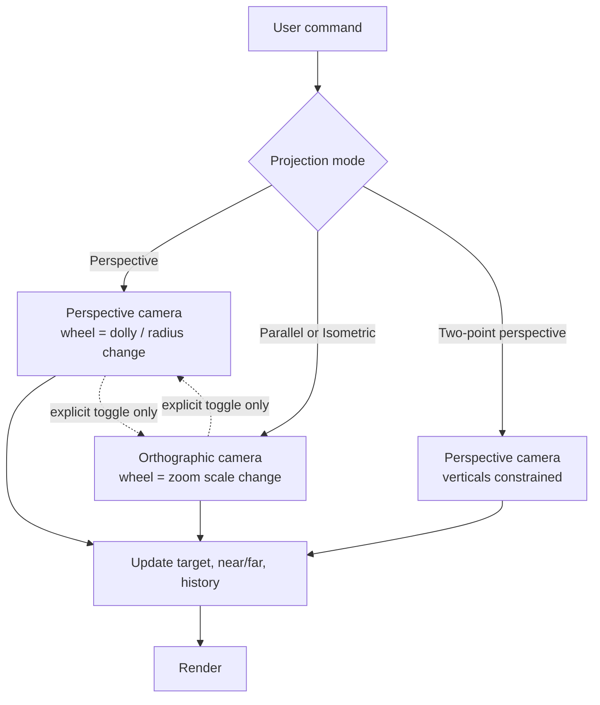
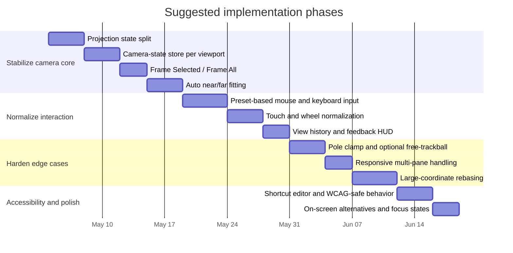

# Fundamentals of 3D View Controls for Web Site Development Interfaces

## Executive summary

The core design mistake behind weak 3D navigation is usually not visual styling; it is a broken camera model. SketchUp’s help system makes a clean distinction between camera projection states—Perspective, Parallel Projection, and Two-Point Perspective—and navigation actions—Orbit, Pan, and Zoom. That separation is the right foundation for a web dashboard as well. citeturn39view0turn7view1turn7view2

For a site-development or lab-planning dashboard, the safest default is a turntable or map-like camera with an explicit world up-vector, stable target pivot, explicit framing commands, and projection changes that occur only by user intent. The specific bug you called out—switching from isometric to perspective when zooming out—is not a cosmetic issue; it is a state-model failure. Fix it by representing isometric as **orthographic projection plus a preset orientation**, never as a perspective camera with a tiny field of view or as a zoom threshold. citeturn39view0turn7view1turn7view2turn7view4

This report uses SketchUp as the behavioral baseline, then maps the same fundamentals to web implementation patterns, especially three.js/WebGL. Primary references come from SketchUp documentation published by entity["company","Trimble Inc.","construction tech company"], graphics standards and guidance from the entity["organization","Khronos Group","graphics standards consortium"], and comparison docs published by entity["company","Autodesk","design software company"], entity["organization","Blender Foundation","nonprofit organization"], and entity["company","McNeel & Associates","rhino developer"]. citeturn39view0turn12view0turn20view7turn23search12turn20view5

No dashboard URL was present in the prompt I received, so the diagnosis and recommendations below are architecture-level rather than page-specific.

## Core camera model

Every 3D viewport is doing the same math regardless of product branding: model coordinates are transformed by a model matrix, then a view matrix, then a projection matrix, and finally divided by **w** into normalized device coordinates. In WebGL terms, data outside clip space is clipped, and the perspective divide is what causes distant objects to appear smaller. That geometry is not optional; it is the reason controls either feel stable or fall apart under edge cases. citeturn7view5

A perspective camera defines a frustum using **fov**, **aspect**, **near**, and **far**. In three.js, `PerspectiveCamera` uses a vertical field of view, requires `near > 0`, and treats `near` and `far` as clip planes. An orthographic camera instead defines a box using `left`, `right`, `top`, `bottom`, `near`, and `far`, and object size stays constant regardless of distance from the camera. In three.js, orthographic `near` may be `0`, while perspective `near` may not. citeturn7view1turn7view2

The two formulas that matter most in practice are these:

- **Perspective frustum size at the near plane**
  `height_near = 2 * near * tan(fovY / 2)`
  `width_near = aspect * height_near`
- **Clip-space conversion**
  `p_clip = P * V * M * p_world`
  `p_ndc = p_clip.xyz / p_clip.w`

That is why changing **FOV** changes lens feel, while changing **distance** changes the camera’s position relative to the target. They are not interchangeable operations. citeturn10view0turn7view5

SketchUp’s own documentation encodes the same distinction in product language. Its Camera menu exposes **Parallel Projection**, **Perspective**, and **Two-Point Perspective** as separate view states. It also explicitly describes Parallel Projection as orthographic, with parallel lines preserved and line lengths at scale, while Perspective introduces vanishing behavior and non-scale appearance. This is not trivial wording; it is the correct behavioral contract for a modeling UI. citeturn39view0

That leads to the most important design rule in your dashboard:

**Projection state must be independent from navigation state.**
Do not let wheel zoom, pinch, or zoom-extents implicitly change camera class. If a user is in parallel/isometric, wheel input should alter **orthographic scale** only. If a user is in perspective, wheel input should alter **camera-target distance** or a deliberate dolly operation. Only a dedicated command should switch projection. SketchUp’s product model and three.js camera classes both support exactly this separation. citeturn39view0turn7view1turn7view2

A practical state model for a web app looks like this:

For architectural and site work, default FOV should stay conservative. SketchUp treats FOV as a distinct command, and only in perspective mode. That is the right cue. In practice, a default around **35°–50°** is stable for modeling; **20°–70°** is a sensible normal operating range; anything above **75°–90°** should be reserved for walk/fly inspection because distortion rises sharply. Extreme FOV is not “more zoomed out”; it is a different lens. citeturn1view0turn7view1

## Control paradigms and input mapping

SketchUp’s default mouse mapping is unusually strong because it minimizes persistent mode switching. In SketchUp for Web, the default mouse shortcuts are direct: **Orbit = hold scroll wheel**, **Pan = hold scroll wheel + left mouse button**, **Zoom = scroll wheel**. SketchUp also lets trackpad users choose whether a two-finger swipe maps to Orbit, Pan, or Zoom, with the other two reachable via modifier keys. That is a pragmatic model: one input family, one primary action, explicit alternatives. citeturn25search0turn24search0turn24search2turn4view2

The deeper principle is that 3D camera control has only a few valid paradigms:

- **Turntable / world-up orbit**: keeps a stable “up” direction, prevents accidental roll, and is best for architecture, planning, and site layouts.
- **Trackball / free orbit**: allows rolling and pole traversal, which is better for free-form object inspection but easier to make disorienting.
- **Map-like navigation**: heavily pan-first, with constrained tilt and world-up behavior, ideal for masterplanning and civil/site workflows.
- **Walk / fly**: first-person navigation, useful for interior review or human-scale inspection, but not a substitute for editing navigation.

Three.js encodes these distinctions clearly. `OrbitControls` maintains the up direction. `TrackballControls` explicitly does **not**, which means it can cross the north and south poles without flipping to remain upright. `MapControls` is a preset of OrbitControls intended for bird’s-eye map use, with left-drag pan, right-drag rotate, and panning orthogonal to world up rather than screen space by default. For site-development dashboards, that is often the better starting point than raw OrbitControls. citeturn7view0turn7view3turn7view4turn36view3

That suggests a clean product strategy:

- **Default preset for site dashboards**: world-up turntable or map-like controls.
- **Optional preset for 3D-object inspection**: free trackball.
- **Optional compatibility presets**: SketchUp, Maya, Fusion, Blender industry-compatible.

This is not theoretical. Fusion 360 explicitly ships multiple “Pan, Zoom, Orbit shortcuts” presets so users can match Fusion, Alias, Inventor, SolidWorks, Tinkercad, or PowerMill conventions. If your users span architecture, design, and engineering, presets are cheap leverage. citeturn20view1

For keyboard and shortcut design, SketchUp gives a useful baseline: its documentation exposes **O** for Orbit, **H** for Pan, **Z** for Zoom, and **Shift+Z** for Zoom Extents, while the web version allows custom shortcuts and modifier-based remapping. At the same time, WCAG guidance warns against hard-coding single-character shortcuts that cannot be disabled or remapped. The correct strategy is therefore not “avoid shortcuts”; it is “scope them correctly and let users reconfigure them.” citeturn1view0turn25search0turn30search2

A sensible web recommendation is:

| Action | Recommended default | Why |
|---|---|---|
| Orbit / tumble | Hold MMB or `O` tool | Matches SketchUp mental model and many CAD apps |
| Pan / track | `H` tool or MMB+LMB / RMB depending preset | Clear hand metaphor |
| Zoom / dolly | Wheel / pinch / `Z` tool | Continuous, low-friction |
| Frame all | `Shift+Z` | SketchUp-compatible |
| Frame selected | `F` | Common across Maya, Rhino, Blender industry-compatible, and user expectation |
| Projection toggle | explicit toolbar control + shortcut | Must be deliberate |
| View undo / redo | `[` / `]` or `Alt+Left` / `Alt+Right` | Keep separate from model edit undo |

Touch needs different treatment. SketchUp Viewer on mobile uses **one finger to orbit**, **two fingers to pan**, and **pinch to zoom**. That is familiar, but WCAG requires that multipoint or drag-based interactions have non-gesture alternatives unless the gesture is essential. In practice, that means visible on-screen controls for pan/orbit/zoom/frame/projection and full keyboard alternatives for desktop. Gesture-only navigation is a compliance risk and a UX mistake on precision workflows. citeturn24search7turn30search0turn30search1turn30search9

Gamepad support is worth treating as optional, not primary. The standard gamepad mapping exposes four axes and up to 17 buttons, and the web platform provides `navigator.getGamepads()` and normalized mappings through the Gamepad API. That is enough to implement a useful scheme—left stick pan, right stick orbit, triggers dolly, shoulder buttons standard views—but it should remain a secondary preset, not the baseline interaction. citeturn28search0turn28search1turn28search2turn28search4

A robust input pipeline looks like this:

```mermaid
flowchart LR
    A[Pointer / wheel / keyboard / touch / gamepad] --> B[Normalize device deltas\nand modifiers]
    B --> C[Resolve focused viewport]
    C --> D[Map through active preset]
    D --> E[Classify intent\norbit / pan / dolly / frame / projection]
    E --> F[Update camera state\nprojection, target, orientation, scale]
    F --> G[Apply constraints\npolar clamp, world up, near/far]
    G --> H[Render in rAF]
    H --> I[Feedback\ncursor, compass, HUD, history]
```

## UX patterns for robust navigation

Most bad 3D UX is really bad **state management**. The failure pattern is predictable: a viewport treats camera mode, interaction mode, selection focus, and projection as loosely coupled booleans, then edge cases cause them to drift out of sync. The fix is to define a single authoritative camera state object per viewport. At minimum it should include:

- `projectionMode`
- `target`
- `position`
- `orientation` or spherical coordinates
- `zoom` for orthographic mode
- `fov` for perspective mode
- `navigationPreset`
- `historyStack`

Do not share one mutable camera state across multiple viewport panes. Three.js’ own camera manual shows the right pattern for split views: separate event regions, per-view aspect computation, and per-view projection updates. citeturn10view0turn11view0turn11view2

Mode design should be **quasi-modal**, not sticky, for low-level camera movement. In other words, holding input invokes orbit/pan/dolly, then immediately exits on release. True persistent modes should be reserved for intentional tools. SketchUp’s mouse mappings, Maya’s Alt-modified tumble/track/dolly, and Fusion’s preset mappings all follow this pattern because it reduces accidental mode errors. citeturn25search0turn20view7turn20view1

Visual affordances matter most when they disambiguate hidden state. The minimum useful set is:

- projection badge: Perspective / Parallel / Two-Point
- target indicator: orbit pivot or hit point
- world compass: axes and north/up
- active constraint label: e.g. “Axis locked”, “Elevation locked”
- camera history affordance: Back / Forward view
- focused viewport border in multi-pane layouts

SketchUp’s developer guidance also points extension authors toward consistent UI language and the Modus design system. The immediate lesson for a dashboard is not “use their CSS,” but “make camera state legible and coherent across components.” citeturn27search0turn27search1

Framing commands should be first-class. SketchUp documents **Zoom Extents** and remembers previous/next camera views. Maya exposes **Frame Selected** and view undo/redo. Rhino exposes **Zoom Selected**, **UndoView**, and **RedoView**. These are not convenience extras; they are recovery tools. Every real viewport needs at least:

- **Frame all**
- **Frame selected**
- **View previous**
- **View next / redo**
- **Reset upright**

If users can get lost faster than they can recover, the control system is wrong. citeturn39view0turn21view0turn21view2turn20view6

Pivot selection is another major differentiator between amateur and production-grade navigation. Orbiting about the viewport center is acceptable only as a fallback. The preferred priority is:

1. explicit orbit-center command
2. current selection center or fitted bounds center
3. hit-tested point under cursor
4. model extents center

three.js gives you the core pieces: `Raycaster.setFromCamera()` for hit testing and `controls.target` / `zoomToCursor` for control behavior. Fusion’s documented “orbit around point” interaction is especially worth copying because it matches how people inspect site details. citeturn11view4turn36view4turn20view2

Precision tools should borrow from SketchUp’s broader modeling philosophy even if your dashboard is not a full modeler. SketchUp’s documentation emphasizes localized unit parsing and formatting, unit-aware numeric input, and visible approximate values using a tilde instead of hiding precision issues. It also supports axis and inference locking via Shift and arrow keys. For a site-development dashboard, that translates into explicit bearings, elevations, offsets, snap increments, and axis locks rather than vague freehand movement. citeturn27search6turn27search8turn37search15turn37search13

Accessibility is where many navigation systems fail silently. WCAG requires single-pointer alternatives for multipoint gestures, alternatives to drag-only interactions, keyboard-operable functionality, and remappable or disable-able character key shortcuts. For your dashboard, that means:

- all camera functions available without pinch or drag precision
- keyboard-accessible framing and projection controls
- shortcut suppression inside text fields and measurement inputs
- visible focus and no keyboard trap inside the canvas
- remappable or disable-able single-character shortcuts

If this is not built in at the control architecture layer, it becomes expensive later. citeturn30search0turn30search1turn30search2turn30search8turn30search9

## Edge cases and failure modes

The table below prioritizes the failure modes that matter most for a web dashboard handling 3D site/lab controls.

| Issue | Cause and detection | Recommended fix | Web / shortcut / accessibility notes | Effort | Evidence |
|---|---|---|---|---|---|
| **Projection switches from isometric to perspective on zoom-out** | Cause: “isometric” is implemented as a perspective camera with tiny FOV, or projection mode is tied to zoom thresholds. Detection: enter isometric/parallel mode, zoom in/out repeatedly, and assert that the projection enum and camera class never change unless a projection toggle is invoked. Repro: compare parallel edges before and after extreme zoom-out. | Make projection an explicit state. Represent isometric as **orthographic camera + preset orientation**. In orthographic mode, wheel/pinch changes `zoom` only. In perspective mode, wheel/pinch changes radius or dolly only. Projection changes happen only through explicit command. | In three.js, use `OrthographicCamera.zoom` for parallel mode and `PerspectiveCamera` for perspective mode. Update projection matrices after every aspect/zoom/FOV change. Add a visible projection badge and a dedicated toggle. | **Low–Medium** | citeturn39view0turn7view1turn7view2turn10view0 |
| **Pole singularity, flips, or “gimbal lock” feeling near top/bottom** | Cause: Euler-angle accumulation near ±90° pitch and world-up enforcement at the poles. Detection: orbit continuously over the top and bottom, watch for sudden azimuth jumps, camera roll, or NaNs. Repro: drag upward until overhead view, then continue dragging sideways. | Store camera orientation internally as a quaternion. Expose azimuth/polar only as UI parameters. For turntable mode, clamp polar angle to `[ε, π-ε]`, where `ε ≈ 0.5°–1°`. Offer free trackball only as an alternate mode, not the default. | `OrbitControls` supports `minPolarAngle` and `maxPolarAngle`; `TrackballControls` intentionally allows pole traversal and does not preserve up. Provide a compass and a “reset upright” action. | **Medium** | citeturn36view0turn36view1turn7view3turn33view0turn33view1turn34search5 |
| **Extreme FOV distortion treated as zoom** | Cause: using FOV changes for ordinary zoom/dolly interactions, or allowing very wide FOV in editing mode. Detection: compare usability at 15°, 35°, 75°, and 110° FOV. Repro: if wheel changes FOV, lines and scale perception will warp as users zoom. | Keep FOV separate from zoom. Modeling/site default: `35°–50°`; normal editable range: roughly `20°–70°`; reserve higher values for first-person walk/fly. In orthographic mode, use scale/zoom, not lens changes. | SketchUp treats FOV as a distinct command and only in perspective mode. Mirror that separation. | **Low** | citeturn1view0turn7view1turn39view0 |
| **Near/far clipping, missing faces, z-fighting** | Cause: near plane too close to zero, far plane too large, or huge `far/near` ratio. Detection: stress test with small near and huge far; inspect coplanar overlays and long site extents. Repro: zoom close to a ground plane or overlay decals and look for flicker or disappearing faces. | Push `near` out as far as possible and pull `far` in as tight as possible. Auto-fit clip planes to the current target or scene bounds. For overlays, use `polygonOffset` or draw-order separation. Consider `logarithmicDepthBuffer` only after testing. | WebGL requires only a minimum 16-bit depth buffer, and depth precision degrades sharply as `zNear → 0`. Add a debug overlay that displays near/far ratio and selected target bounds. | **Medium** | citeturn12view0turn13view0turn10view0turn1view1 |
| **Precision loss at large world coordinates** | Cause: geolocated/site coordinates far from origin and GPU single-precision math causing jitter, shaky picking, and distorted small features. Detection: compare the same geometry near the origin and at large offsets; inspect cursor hits and sub-meter detail. Repro: open a georeferenced site with true-world coordinates and inspect fine geometry. | Use a floating-origin or local-origin workflow. Keep authoritative geospatial coordinates in data storage, but rebase the rendered working set near `(0,0,0)`. Use relative transforms for the active site/lab area. | SketchUp warns that geometry very far from the origin can cause clipping; three.js exposes high-precision model-view handling in TSL, which reflects the same precision concern. Add “Recenter working origin” for debugging and recovery. | **High** | citeturn1view1turn35search3turn27search6 |
| **Orbit pivot feels wrong or framing is unreliable** | Cause: orbit target is not updated from selection or cursor hit, and framing uses bad bounds math. Detection: select a tiny or off-axis object, frame it, then orbit and zoom; the object should stay central and stable. Repro: frame selected object near screen edge, then orbit. | Maintain a distinct `orbitTarget`. Update it from selection center, hit-tested point, or extents center. Add both **Frame Selected** and **Frame All** with padding. For perspective fit, compute distance from bounding box size and FOV. For orthographic fit, change `zoom` or frustum extents. | Use `Raycaster.setFromCamera()` for hit tests, `controls.target` for orbit center, and `zoomToCursor` when appropriate. Provide `F` and `Shift+Z`, plus visible buttons. | **Medium** | citeturn11view4turn36view4turn39view0turn20view2turn20view6 |
| **Input latency and gesture conflicts** | Cause: heavy wheel/touch handlers, wrong `passive` settings, browser gesture interception, oversized HiDPI drawing buffers. Detection: use browser performance tooling; delayed wheel response and pinch/page zoom conflicts will show immediately. Repro: pinch on trackpad/mobile and observe whether the page scrolls or zooms instead of the viewport. | Normalize all inputs, update camera only in `requestAnimationFrame`, keep handlers lightweight, use passive listeners when you do not need to cancel input, and set `touch-action` deliberately on the interaction layer. Cap HiDPI drawing-buffer size instead of scaling blindly. | `wheel` events are cancelable and can create delay; `touch-action` determines whether the browser steals pan/zoom; WebGL’s `desynchronized` context attribute can reduce latency but may introduce tearing. | **Medium** | citeturn31search1turn31search0turn29search0turn29search1turn29search3turn11view2turn12view0 |
| **Shortcut conflicts, modal errors, and multi-pane resize bugs** | Cause: global key handlers fire inside editable text fields; single-key shortcuts are not remappable; shared camera objects are reused across panes; aspect ratio is not updated on resize. Detection: type into a measurement field and press `F`, `Z`, or `H`; resize split panes; compare aspect and target drift between panes. Repro: open two 3D panes and resize one aggressively. | Scope shortcuts to the focused viewport. Suspend character shortcuts while inputs, search fields, or measurement boxes are active. Let users remap or disable single-key bindings. Give each pane its own camera state and update aspect/scissor rectangles per pane on resize. | SketchUp Web allows custom modifier-based shortcuts; WCAG requires character shortcuts to be disable-able or remappable. Three.js documents per-view scissor/aspect patterns and projection updates on resize. | **Low–Medium** | citeturn25search0turn30search2turn10view0turn11view0turn11view2 |

## Comparative controls and shortcuts

A direct comparison is useful because user expectation is often imported from another 3D app, not consciously learned from your product. The table below compares the highest-signal default behaviors.

| Application | Orbit / rotate | Pan / track | Zoom / dolly | Notes |
|---|---|---|---|---|
| **SketchUp** | Hold scroll wheel | Scroll wheel + left mouse button | Scroll wheel | Projection modes are explicit camera states; SketchUp also exposes standard top/front/right/iso views. |
| **Blender default** | MMB | Shift+MMB | Wheel or Ctrl+MMB | Strong for expert users; industry-compatible keymap changes this to more Maya-like behavior. |
| **Blender industry-compatible** | Alt+MMB | Alt+RMB | Alt+RMB / related preset behavior | Ships to reduce migration friction from other DCC tools. |
| **Maya** | Alt+LMB tumble | Alt+MMB track | Alt+RMB dolly | One of the most widely copied DCC navigation schemes. |
| **Rhino** | Right-drag in perspective | varies with modifiers / viewport mode | Wheel | Right-drag orbit is simple, but behavior changes by viewport type. |
| **AutoCAD** | Ctrl+Shift+wheel drag = free orbit | Hold wheel and drag | Wheel, double-click wheel = extents | CAD-centric and view-command heavy. |
| **Fusion 360** | Shift+MMB by default | MMB | Wheel | Can switch to multiple legacy shortcut presets in preferences. |

This comparison is synthesized from official docs and official shortcut references. citeturn25search0turn39view0turn23search12turn23search2turn23search10turn20view7turn20view5turn20view3turn20view1turn20view2

The bigger insight is not which mapping is “best.” It is that **architecture/site work is best served by world-up stability**, while **freeform object inspection benefits from trackball freedom**. SketchUp, OrbitControls, and MapControls all lean toward stability. Maya and Blender optimize for expert throughput. Fusion acknowledges the migration problem and solves it with presets. For your dashboard, the strongest product decision is probably:

- ship a **SketchUp / site** preset by default,
- offer **Maya / DCC** and **Fusion / CAD** presets,
- persist the preset per user,
- expose a shortcut editor that resolves conflicts and supports disable/remap behavior. citeturn20view1turn25search0turn30search2

A second comparison matters even more for recovery and precision:

| Application | Frame / extents behavior | View history | Shortcut flexibility |
|---|---|---|---|
| **SketchUp** | Zoom Extents (`Shift+Z`) | Camera Previous / Next | Web shortcuts are customizable; modifiers such as Shift/Alt/Option are supported |
| **Blender** | Frame Selected (`NumpadPeriod` or `F` in industry keymap) | Keymap-dependent | Multiple keymaps; industry-compatible mode exists |
| **Maya** | `F` Frame Selected, `A` Frame All | `[` undo view, `]` redo view | Extensive hotkey system |
| **Rhino** | Zoom Selected / Zoom Extents | UndoView / RedoView | Strong command-driven customization |
| **AutoCAD** | ZOOM Object / ZOOM Extents | View-command oriented | More command-centric than tool-centric |
| **Fusion 360** | Fit/orbit-around-point behaviors exist; presets matter most | not emphasized in cited sources | Multiple official navigation presets |

This is the core competitive gap SketchUp leaves open for a dashboard: it is excellent at extents and projection discipline, but many users coming from Maya, Rhino, or Blender expect **Frame Selected = F**. You should add it even if SketchUp is your primary reference. citeturn1view0turn39view0turn23search12turn23search2turn21view0turn21view2turn20view6turn20view4turn20view1

## Implementation roadmap

The most effective path is to fix the camera core first, then input normalization, then edge-case hardening. Anything else is backwards.

| Priority | Task | What to build | Effort |
|---|---|---|---|
| **Highest** | Separate projection from zoom semantics | Replace any faux-isometric logic with a real orthographic camera path. Make projection changes explicit only. | **Medium** |
| **Highest** | Introduce a canonical camera-state store per viewport | `projectionMode`, `target`, `position`, `orientation/quaternion`, `zoom/fov`, `history`, `preset`. | **Medium** |
| **Highest** | Add Frame Selected and Frame All | Fit by bounds with padding, update target, push camera history entry on completion. | **Low** |
| **Highest** | Auto-fit near/far planes | Recompute clip planes from target bounds on framing and on settled navigation. Add debug readout for ratio and current target. | **Medium** |
| **High** | Clamp turntable poles and support optional free-trackball | Stable default for site work, optional object-inspection mode for advanced users. | **Medium** |
| **High** | Normalize pointer / wheel / touch / keyboard input | rAF-based camera updates, explicit `touch-action`, passive listeners where possible, unified delta normalization across devices. | **Medium** |
| **High** | Build shortcut preset and conflict manager | Presets for SketchUp / Maya / Fusion-like behavior, focus-scoped key handling, remap/disable options. | **Medium** |
| **Medium** | Add view history separate from edit undo | Camera back/forward stack, not mixed into modeling undo. | **Low** |
| **Conditional but important** | Add floating-origin / rebasing for geolocated sites | Required if datasets live at large global coordinates and users inspect small details. | **High** |
| **Medium** | Add accessibility layer | On-screen navigation buttons, keyboard equivalents, drag alternatives, announced projection state, visible focus. | **Medium** |

A recommended sequencing looks like this:

If you are implementing on the web today, the default stack should be something like:

- true `PerspectiveCamera` and `OrthographicCamera`,
- `MapControls` or custom turntable controls for site mode,
- `Raycaster` for hit-tested pivots,
- per-pane aspect/scissor updates,
- explicit `touch-action`,
- measured handling of depth precision and world-origin rebasing. citeturn7view1turn7view2turn7view4turn11view4turn10view0turn29search0turn29search1turn13view0

On the SketchUp API side, the public developer center clearly emphasizes **Ruby API**, **Desktop SDK**, and `HtmlDialog`-based web UIs inside SketchUp. I did not find evidence in the official developer docs of a general-purpose public “SketchUp web SDK” for arbitrary standalone browser viewports. For an independent web dashboard, three.js/WebGL is the practical implementation basis; for extending SketchUp Desktop itself, use the official SketchUp APIs. citeturn26search1turn26search0

## Open questions and limitations

The biggest limitation is simple: the prompt referred to a dashboard URL, but no URL was actually present, so I could not perform a direct audit of its current event handling, camera state transitions, or browser-specific regressions.

A few product decisions remain open and should be resolved deliberately before implementation begins:

- whether the default navigation should be **MapControls-like** or pure turntable,
- whether a true **free-trackball** mode is worth shipping at all,
- whether `F` should frame **selection bounds** or **selection pivot** when the selection is sparse,
- and whether the dataset scale requires **floating-origin rebasing** immediately or only after larger geospatial models are introduced.

Those are product choices, not academic details. If you get them wrong, the control system will continue to feel unstable even after code cleanup.
