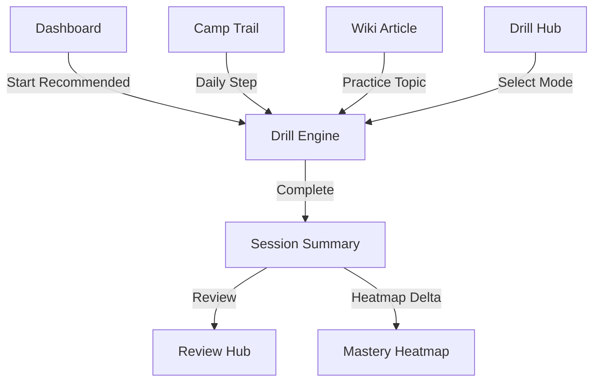
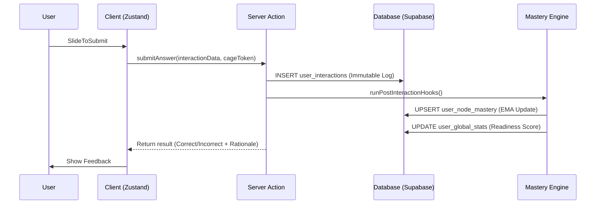

# Drills — Product Requirements Document & Technical Specification

**Last Updated:** 2026-04-08  
**Status:** ✅ Active / Source-of-Truth  
**Version:** 2.0 (Post-LEA Migration)

---

## PART 1 — PRODUCT VISION & LEARNING FRAMEWORK

### 1.1 Feature Overview
**Drills** are the high-frequency learning engine of SlateCamp. Unlike traditional "test banks" that focus on passive assessment, Drills are designed as **active learning interventions**. Every session follows the principle of **Retrieval Practice**: the act of recalling information from memory (even if a student struggles or fails) is what strengthens long-term retention.

- **Purpose:** To provide a low-stakes, high-impact environment for students to master the 72-topic LEA (Licensure Exam for Architects) curriculum.
- **Value Proposition:** SlateCamp Drills adapt to the student's current mastery level, prioritize "blindspots" (weak areas), and provide immediate, research-backed rationales that link directly to the Wiki and 3D Lab.
- **Integration:** Drills are the primary data source for the **Readiness Score** and the **Heatmap**. They function as the "action" layer of the Camp Trail, where students validate their reading and observation.

### 1.2 Terminology Map & Naming Consolidation
To ensure brand consistency and reduce student "test anxiety," the following naming conventions are strictly enforced across the UI:

| OLD Name | NEW Name (User-Facing) | DB/Internal Reference | Status |
| :--- | :--- | :--- | :--- |
| Quiz / Test | **Drill** | `questions` / `quiz_sessions` | Enforced |
| Quiz Session | **Drill Session** | `quiz_sessions` | Enforced |
| Quiz Mode | **Drill Mode** | `test_mode` (enum) | Enforced |
| Question | **Question** or **Item** | `questions` | Unchanged |
| Assessment | *Retired* | `assessment_logs` (legacy) | Retired |
| Testing Hub | **Testing Hub** | `/dashboard/drills` | Legacy Path Redirected |

**Mandate:** If a developer or designer sees the word "quiz" or "test" in user-facing copy, it is considered a bug. The only exception is the underlying database schema (e.g., `quiz_sessions`), which retains its names for stability until a full migration is executed.

### 1.3 Learning Science Foundation
SlateCamp's drill engine is built on six pillars of educational psychology:

1.  **Retrieval Practice (Roediger & Karpicke, 2006):** Drilling IS the learning mechanism. Recalling a building code section number is more effective than re-reading it 10 times.
2.  **Desirable Difficulties (Bjork, 1994):** We optimize for "productive struggle." If a student gets 100% too easily, the system increases difficulty to ensure germane cognitive load.
3.  **Spaced Repetition (FSRS / Ebbinghaus):** Drill results feed the scheduling algorithm. Correct items are pushed further into the future; incorrect items surface sooner.
4.  **Interleaving (Bjork & Bjork, 2011):** Instead of drilling 50 questions on "Fire Code," we interleave 10 from Fire Code, 10 from Plumbing, and 10 from History to improve "transfer" to the actual LEA exam.
5.  **Cognitive Load Theory (Sweller, 1988):** Our UI minimizes extraneous load (clutter, complex nav) to focus all energy on the question stem and distractors (germane load).
6.  **Metacognitive Calibration (Kruger & Dunning, 1999):** We force students to rate their confidence. This exposes the "fluency illusion" (knowing the answer vs. knowing why it's right).

### 1.4 Behavioral Psychology & Retention Design
- **Readiness Score Impact:** Every drill interaction updates the `user_global_stats.global_readiness_score`. It is the "XP" of SlateCamp, but grounded in psychometric validity.
- **Heatmap Mastery:** Completing a drill moves nodes through the lifecycle: `Grey (Unknown)` → `Red (Low Mastery)` → `Amber (Developing)` → `Green (Mastered)`.
- **Diminishing Returns:** The system flags sessions where accuracy drops due to fatigue (Stamina Analysis), suggesting a break when cognitive drift is detected.
- **Anti-Pattern Guardrails:** No confetti, no badges, no "level ups." Mastery is the only reward. We use **growth-framed feedback** rather than generic praise.

---

## PART 2 — DRILL MODE CATALOG

### 2.1 Camp Mode (`camp`)
**Purpose:** The default study experience. Focuses on curriculum coverage and "guided discovery."
- **Feedback:** Immediate (Correct/Incorrect + Rationale + Wiki Link).
- **Algorithm:** Adaptive (IRT-based). Prioritizes nodes in the current Camp Trail day.
- **Timer:** None. Focuses on accuracy and understanding.
- **Navigation:** Linear (No back-tracking to prevent "re-guessing").

### 2.2 Storm Mode (`storm`)
**Purpose:** Pressure conditioning for the LEA time constraints.
- **Feedback:** Deferred (Review all at end).
- **Algorithm:** Mix of high-frequency LEA topics.
- **Timer:** Bar-based. Per-question time limits enforced.
- **Navigation:** Free (Can skip and return within the session).

### 2.3 Blindspot Protocol (`focused` / `blindspot`)
**Purpose:** Targeted remediation of weak areas.
- **Feedback:** Immediate.
- **Algorithm:** 100% weighted toward Red/Amber nodes in the user's heatmap.
- **Unlock:** Automatically suggested when `Readiness Score` plateaus or a topic accuracy drops < 60%.

### 2.4 Endurance Cycle (`extended`)
**Purpose:** Stamina training for long-form exam fatigue.
- **Feedback:** Immediate or Section-based.
- **Question Count:** 100–150 items.
- **Features:** Forced breaks every 30 questions (Mental Refreshers).

### 2.5 Proof Simulation (`fullexam`)
**Purpose:** The ultimate readiness validation. A byte-for-byte replica of the LEA exam day.
- **Feedback:** None (24-hour delay before results).
- **Timer:** Total session timer (4 hours per area).
- **Environment:** Distraction-free mode, no external wiki links, no haptics.

### 2.6 Quick Fire (`subject_quick`)
**Purpose:** Micro-drills (5-10 items) for idle moments.
- **Feedback:** High-speed immediate.
- **Availability:** Mobile-first design, accessible from the dashboard "Speed Dial."
- **⚠️ STATUS:** *In-Development (Planned for Q3 2026).*

---

## PART 3 — QUESTION ENGINE (THE CONTENT LAYER)

### 3.1 Question Data Model
The `Question` object is the atomic unit of the engine:

```typescript
export interface Question {
  question_id: string;
  topic_id: string;          // Maps to taxonomy_tree
  subject_id: string;        // Maps to board_exam subjects
  text: string;              // The question stem
  options: Choice[];         // Array of 4-5 options
  correct_option_id: string;
  rationale: string | { 
    correct: string; 
    takeaway: string; 
    [key: string]: string 
  };
  difficulty: number;        // IRT b-parameter (0.0 to 1.0)
  discrimination: number;    // IRT a-parameter
  bloom_level: 'remember' | 'understand' | 'apply' | 'analyze';
  code_citation: string | null; // e.g. "PD 1096 §VII-1207"
  image_url: string | null;
}
```

### 3.2 Distractor Normalization Pipeline
**Problem:** Historically, correct answers in the bank were significantly longer than distractors, leading to "test-wise" guessing.
**Remediation:** Active pipeline using `scripts/normalize-distractors.ts`.
- **Status:** ✅ Active.
- **Process:** Batch processing (GPT-4o) expands short distractors using 4 techniques:
  - Specificity (Adding values/measurements)
  - Qualifying Clauses (Adding exceptions)
  - Rationale Appending (Adding "why")
  - Procedural Extension (Adding steps)
- **Constraint:** The correct answer is never modified (byte-for-byte preservation).

### 3.3 Item Selection Algorithm (60/30/10)
Standardized across all non-simulation modes:
- **60% Unseen Items:** Discovery of new curriculum nodes.
- **30% Remediation Items:** Items previously answered incorrectly or with low confidence.
- **10% Spaced Repetition (SRS):** Items previously mastered, surfaced at the optimal interval to prevent decay.

### 3.4 Area C — Design Problem Questions (ADSP)
Area C questions are structured as **Scenario Blocks**:
1. **Scenario Brief:** A project description (e.g., "A 3-Storey Residential project on a 500sqm Lot").
2. **Site Specs:** Lot dimensions, TLA, PSO requirements.
3. **Cascading Questions:** 15-25 items where the answer to Q2 (e.g., AMBF) often depends on the calculation in Q1 (e.g., PSO).
4. **Logic:** These are treated as a single `DesignScenario` object with an array of `questions`. In Drills, they are surfaced as a cohesive unit.

---

## PART 4 — UX/UI SPECIFICATION

### 4.1 Information Architecture & Navigation



### 4.2 Drill Session Interface
- **Slide-to-Submit:** The core interaction. Binds the student's cognitive choice to a high-intent physical gesture (Patented).
- **Confidence Rating:** A 3-point scale (Unsure | Neutral | Sure) presented alongside the submission.
- **Progressive Disclosure:** Rationales are hidden until submission (Camp Mode) or end-of-session (Storm Mode).
- **Mobile-First Targets:** All answer choices are minimum 48px height with 12px gutter to prevent accidental taps.

### 4.3 Component Hierarchy
```
DrillsPage (Server Component — fetch session metadata)
└── DrillsShell (Server Component — Layout wrapper)
    └── ActiveDrillSession (Client Component — 'use client', State Provider)
        ├── DrillHeader (Client Component — Progress + Timer + Flag)
        ├── QuestionBody (Client Component — Text + Media)
        ├── OptionsColumn (Client Component — MCQ Rows)
        │   └── OptionItem (Client Component — Tap to Select)
        ├── ConfidencePicker (Client Component — Cognitive Signal)
        ├── SlideToSubmit (Client Component — Patented High-Intent Gesture)
        └── FeedbackDrawer (Client Component — Rationale + Wiki Link)
```

### 4.4 Mobile-Specific Behavior
- **Touch Targets:** All interactive elements (Choices, Confidence Rating, Flag) maintain a minimum 48x48px hit area.
- **Haptic Feedback:**
  - `Correct`: Double-pulse light vibration.
  - `Incorrect`: Single long heavy pulse.
  - `Slide Success`: Short 'click' haptic upon reaching threshold.
- **Orientation:** Locked to Portrait for standard drills; Landscape allowed for Area C scenarios containing wide diagrams.
- **Gesture Conflict:** `SlideToSubmit` track implements `touch-action: none` to prevent accidental page scrolling during the submission gesture.

### 4.5 Accessibility
- **WCAG 2.1 Compliance:** 
  - All feedback colors (Green/Red) accompanied by icons (Check/Cross) for color-blind accessibility.
  - ARIA-Live regions for question status announcements.
- **Screen Readers:** Question stems and choices are semantic HTML (radiogroups) for proper screen reader navigation.
- **Reduced Motion:** If user OS preference is 'reduced motion', slide animations are replaced with instant visibility swaps.

---

## PART 5 — TECHNICAL ARCHITECTURE

### 5.1 Rendering Architecture
- **Route:** `/dashboard/drills/[sessionId]`
- **Engine:** Client-side state machine (Zustand) for instant transitions (<16ms).
- **Validation:** Server Actions handle final submission and mastery computation to prevent client-side spoofing.

### 5.2 Zustand Store: `useDrillStore`

```typescript
interface DrillStore {
  // Session State
  session: QuizSession | null;
  questions: QuestionForClient[];
  currentIndex: number;
  status: 'configuring' | 'active' | 'feedback' | 'finished';
  
  // User Inputs
  answers: Record<string, string>; // questionId -> optionId
  confidence: Record<string, number>;
  flagged: Set<string>;
  
  // Metrics
  timeLogs: Record<string, number>;
  
  // CAGE
  cageStatus: 'bound' | 'degraded' | 'unavailable';

  // Actions
  startSession: (config: StartSessionInput) => Promise<void>;
  selectOption: (id: string) => void;
  submitAnswer: () => Promise<void>;
  nextQuestion: () => void;
  previousQuestion: () => void;
}
```

### 5.3 CAGE — Cryptographic Answer-Gesture Binding
- **Function:** Binds the `selectedOptionId` to the `SlideToSubmit` gesture vector.
- **States:**
  1. `Bound`: Full cryptographic verification (Pro Tier).
  2. `Degraded`: Logic-based binding (Low-performance devices).
  3. `Unavailable`: Fallback to standard tap (Accessibility mode).

### 5.4 Data Flow: Answer → Mastery → Score



### 5.5 Supabase Schema

#### Table: `questions` (Item Bank)
| Column | Type | Constraints | Description |
| :--- | :--- | :--- | :--- |
| `question_id` | `uuid` | PK, Default `gen_random_uuid()` | Unique identifier |
| `topic_id` | `uuid` | FK -> `taxonomy_tree.node_id` | Curriculum mapping |
| `text` | `text` | NOT NULL | Question stem |
| `options` | `jsonb` | NOT NULL | Array of choice objects |
| `correct_option_id` | `uuid` | NOT NULL | ID of the correct choice |
| `difficulty` | `float` | NOT NULL, 0.0-1.0 | IRT b-parameter |
| `bloom_level` | `enum` | Default 'remember' | Cognitive level |

#### Table: `user_interactions` (Event Log)
| Column | Type | Constraints | Description |
| :--- | :--- | :--- | :--- |
| `interaction_id` | `uuid` | PK | Primary key |
| `user_id` | `uuid` | FK -> `profiles.id` | User identifier |
| `session_id` | `uuid` | FK -> `quiz_sessions.session_id` | Link to session |
| `question_id` | `uuid` | FK -> `questions.question_id` | Link to item |
| `is_correct` | `boolean` | NOT NULL | Result |
| `time_spent_ms` | `int` | NOT NULL | Stamina metric |
| `cage_token` | `text` | Nullable | Patent verification string |

#### Table: `user_node_mastery` (Real-time Mastery)
| Column | Type | Constraints | Description |
| :--- | :--- | :--- | :--- |
| `user_id` | `uuid` | PK, FK -> `profiles.id` | Owner |
| `topic_id` | `uuid` | PK, FK -> `taxonomy_tree.node_id` | Node |
| `current_mastery_weight` | `float` | 0.0-1.0 | EMA score |
| `total_attempts` | `int` | Default 0 | Volume metric |
| `last_encountered` | `timestamp` | NOT NULL | For decay calc |

#### RLS Policies
- `questions`: `SELECT` allowed for all authenticated users.
- `quiz_sessions`: `ALL` allowed only for `user_id = auth.uid()`.
- `user_interactions`: `INSERT` allowed for `user_id = auth.uid()`. `SELECT` for owner.
- `user_node_mastery`: `SELECT` for owner. `UPSERT` handled by service-role trigger.

### 5.6 Performance Engineering
- **Question Transition:** < 16ms (60fps) using Zustand for local state updates.
- **Session Load:** < 2s on Philippine 4G (Questions prefetched in batches of 20).
- **Mastery Computation:** Decoupled from answer submission using `next/after` or background triggers.
- **Wiki:** Bidirectional links. Drills reference articles; articles launch drills.
- **3D Lab:** "Check Understanding" questions in 3D modules use the same `questions` table and feed the same mastery weight.
- **Camp Trail:** Session completion updates the `TrailEnrollment` progress.

---

## PART 7 — ROADMAP & PHASING

### 7.1 Phase 1 — V2 Engine (Current)
- Unified `StandardQuizShell`.
- 60/30/10 Intelligent Routing.
- LEA Terminology Migration.
- Slide-to-Submit v2.

### 7.2 Phase 2 — Adaptive Depth (Q2 2026)
- Full FSRS (Free Spaced Repetition Scheduler) integration.
- Distractor Normalization v2 (Context-aware expansion).
- Area C Design Scenario dedicated UI.

### 7.3 Phase 3 — CAGE Full Rollout (Q4 2026)
- Patent-complete cryptographic verification.
- Quick Fire micro-mode.
- Shared "Study Pod" drill challenges.

---

*Verified against SlateCamp Codebase: 2026-04-08*
