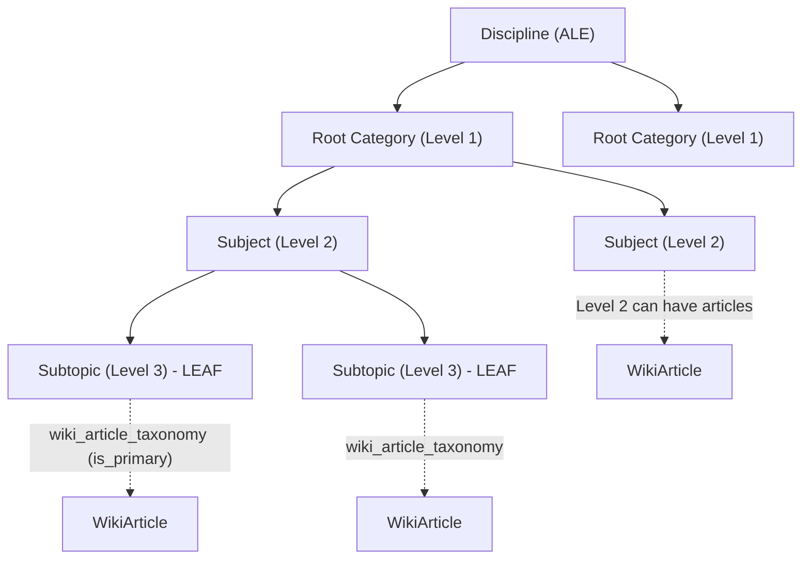
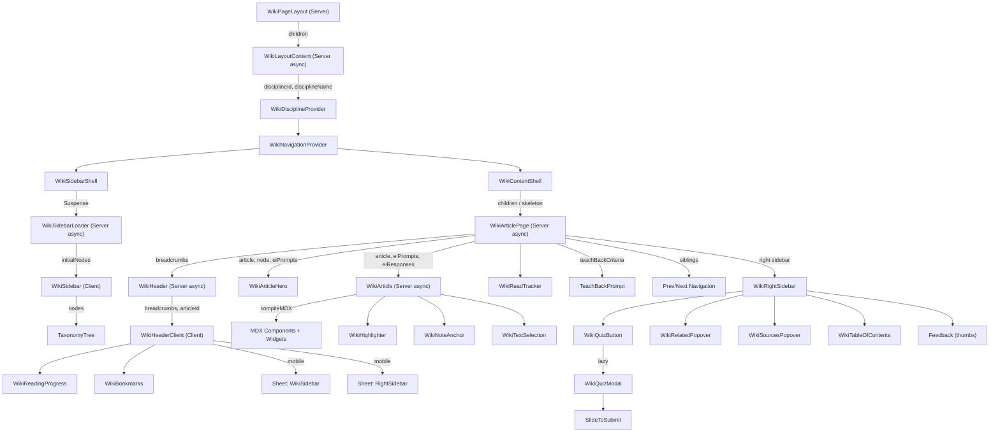
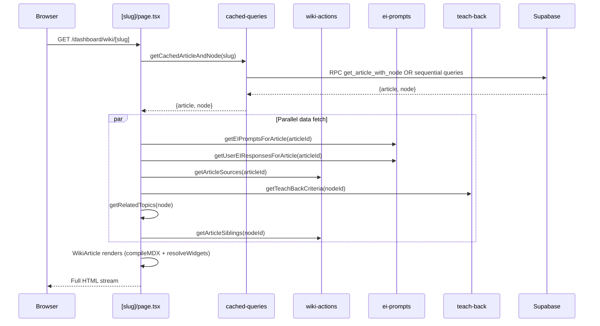

# Wiki Feature Specification

**Last Updated:** 2026-04-08
**Status:** Active — Codebase Source of Truth
**Version:** 2.0 (Comprehensive Codebase-Derived Specification)
**Audit Source:** `.ai/plans/wiki-feature-specification-plan-2026-04-08.md`

> This document is the authoritative specification for SlateCamp's Wiki knowledge base feature.
> Every claim is derived from and verified against the live codebase as of 2026-04-08.
> No fabricated paths, types, or interfaces. If something is unknown, it is marked with NEEDS VERIFICATION.

---

## 1. Overview & Principles

### Purpose

The SlateCamp Wiki is an MDX-powered knowledge base that serves as the authoritative content layer for the Architecture Licensure Exam (LEA). It provides 500+ articles organized by the LEA taxonomy, with interactive learning blocks, inline quizzes, elaborative interrogation prompts, and teach-back exercises embedded directly in the reading flow.

### Governing Principles

1. **Taxonomy-first organization** — Every article maps to the LEA curriculum via the `taxonomy_tree` + `wiki_article_taxonomy` junction. Navigation follows the 3-level taxonomy hierarchy (Root Category > Subject > Subtopic).
2. **Server-first rendering** — Article content is compiled server-side via `next-mdx-remote/rsc`. The article page (`[slug]/page.tsx`) is an async Server Component. Client components are used only where interactivity is required.
3. **On-demand widget loading** — Heavy interactive widgets (19 registered) are lazy-loaded based on string detection in article content. An article using 3 widgets loads 3 modules, not 19.
4. **Pedagogical integration** — Articles are not passive reading. They include elaborative interrogation (EI) prompts, reveal blocks, inline quizzes, and teach-back prompts that connect to the SRS and mastery systems.
5. **No gamification** — No badges, confetti, or streaks. Progress is tracked through mastery weights and reading depth.

### Terminology

| Term | Meaning |
|------|---------|
| LEA | Licensure Exam for Architects (formerly ALE) |
| Taxonomy node | An entry in `taxonomy_tree` — can be root category (level 1), subject (level 2), or subtopic (level 3) |
| Article | A wiki content record in `wiki_articles` with MDX content |
| Junction | The `wiki_article_taxonomy` table linking articles to taxonomy nodes |
| Block | A React component available as an MDX tag in article content (e.g., `<Callout>`, `<RevealBlock>`) |
| Widget | A heavy interactive component loaded on-demand via the widget registry (e.g., `<DoorConfigurator>`) |
| EI | Elaborative Interrogation — an inline recall prompt with MCQ or open-ended response |

---

## 2. Route & File Architecture

### App Routes

```
src/app/dashboard/wiki/
  layout.tsx              # Server — wraps WikiLayoutContent in Suspense
  loading.tsx             # Loading skeleton fallback
  page.tsx                # Client — landing page with hero icon + feature grid
  [slug]/
    loading.tsx           # Article loading skeleton
    page.tsx              # Server (async) — main article renderer
```

**Route pattern:** `/dashboard/wiki` (landing), `/dashboard/wiki/[slug]` (article)

### Admin Routes

```
src/app/admin/articles/
  page.tsx                # Article list
  new/page.tsx            # Create new article
  [id]/
    page.tsx              # Edit article

src/app/admin/knowledge/
  page.tsx                # Taxonomy tree view with articles
  loading.tsx
  new/page.tsx            # Create new knowledge article
  import/page.tsx         # Import articles
  analytics/page.tsx      # Content analytics
  questions/              # Question management (linked to articles)
  [id]/page.tsx           # Article detail
  _components/
    ArticleDetailClient.tsx
```

### Component Tree

```
src/components/wiki/
  index.ts                           # Barrel exports (40+ named exports)
  mdx-components-shared.ts           # MDX tag map (35+ tags for shared use)

  article/
    WikiArticle.tsx                   # Async Server — MDX compilation + widget resolution
    WikiArticleHeader.tsx             # Legacy article header
    WikiArticleHero.tsx               # Hero banner with subject/difficulty/read-time tags
    WikiItemRenderer.tsx              # Renders taxonomy_tree.wiki_items JSONB array

  blocks/ (27 files)
    Accordion.tsx                     # Generic accordion
    AlertBox.tsx                      # Type-mapped alert (requirement/warning/info/danger)
    AuthorityContent.tsx              # Legal authority citation
    Callout.tsx                       # Unified callout (12 variants)
    ComparisonTable.tsx               # Comparison-styled table wrapper
    ElaborativeInterrogation.tsx      # MCQ/open-ended inline quiz prompt
    ExamTip.tsx                       # Exam-specific tip callout
    FormulaBlock.tsx                  # Math formula display
    GenericBlock.tsx                  # Passthrough for unregistered MDX tags
    InlineQuiz.tsx                    # Inline quiz block
    KeyValues.tsx                     # Key-value pair display
    LawCallout.tsx                    # Law citation callout
    Mermaid.tsx                       # Mermaid diagram renderer
    PrequestionGate.tsx               # Pre-question gate before content
    ProcessFlow.tsx                   # Ordered process timeline
    RevealBlock.tsx                   # Drag-to-reveal blurred content (identity-sensitive)
    SubjectSnapshot.tsx               # Compact metadata bar
    TeachBackPrompt.tsx               # AI-evaluated teach-back prompt
    WikiAccordion.tsx                 # Wiki-specific accordion
    WikiCallout.tsx                   # Legacy callout (now aliases Callout)
    WikiCalloutBox.tsx                # Eyebrow callout (most-tested, lea-watch, version-alert)
    WikiChangedPill.tsx               # "Changed" indicator pill
    WikiExamTable.tsx                 # Exam-focused table
    WikiMistakeCard.tsx               # Common mistake card
    WikiMistakeList.tsx               # Mistake list container
    WikiPartHeader.tsx                # Part/section header
    WikiPre.tsx                       # Code block renderer
    WikiTabs.tsx                      # Tab container
    WrongAnswerBanner.tsx             # Banner when navigating from wrong quiz answer

  navigation/ (14 files)
    WikiBookmarks.tsx                 # Bookmark popover with add/remove/list
    WikiContentShell.tsx              # Center pane wrapper with loading skeleton
    WikiDisciplineContext.tsx          # React Context for current discipline
    WikiHeader.tsx                    # Server — fetches breadcrumbs, renders WikiHeaderClient
    WikiHeaderClient.tsx              # Client — breadcrumbs, mobile nav/actions drawers, progress
    WikiLayoutContent.tsx             # Server — orchestrates sidebar + content with providers
    WikiNavigationContext.tsx          # React Context + useTransition for navigation
    WikiReadingProgress.tsx           # Horizontal scroll progress bar
    WikiRightSidebar.tsx              # Right sidebar (quiz button, related, feedback, ToC)
    WikiSidebar.tsx                   # Client — taxonomy tree sidebar
    WikiSidebarLoader.tsx             # Server — async taxonomy data fetcher
    WikiSidebarShell.tsx              # Resizable sidebar wrapper with collapse toggle
    WikiSidebarSkeleton.tsx           # Sidebar loading skeleton
    WikiTableOfContents.tsx           # IntersectionObserver-based active heading ToC

  quiz/ (2 components + stories)
    WikiQuizButton.tsx                # Lazy-loads WikiQuizModal on click
    WikiQuizModal.tsx                 # Full quiz modal with SlideToSubmit, gated delay

  shared/ (8 components + utilities)
    parse-mdx-prop.ts                 # MDX prop string parser utility
    transform-mistake-string.ts       # Mistake string transformer
    wiki-icons.ts                     # Icon mapping utility
    WikiHighlighter.tsx               # Text highlight overlay
    WikiNoteAnchor.tsx                # Context anchor for notes
    WikiReadTracker.tsx               # Scroll depth + time tracking (side-effect component)
    WikiReference.tsx                 # Reference citation renderer
    WikiRelatedPopover.tsx            # Related topics popover
    WikiSourcesPopover.tsx            # Article sources popover
    WikiTextSelection.tsx             # Text selection actions overlay

  widgets/
    registry.ts                       # Widget registry (19 entries + detect/resolve)
    WidgetContainer.tsx               # Widget wrapper component
    Lab3DWidget.tsx                   # 3D Lab integration widget
    bp344/ (9 files)                  # BP 344 Accessibility Standards widgets
    dsgn013/ (14 files)               # DSGN-013 Furniture & Equipment widgets
```

---

## 3. Content Model (MDX)

### Storage

Content is stored as MDX in the `wiki_articles.content` column and compiled server-side using `next-mdx-remote/rsc` with `remark-gfm`.

### WikiArticle Type

**Source:** `src/types/app.ts` (lines 83-95)

```typescript
interface WikiArticle {
  article_id: string;
  slug: string;
  title: string;
  content: string;           // MDX content
  created_at: string;
  updated_at: string;
  lea_tests_you?: string | null;
  updated_note?: string | null;
  subject_label?: string | null;
  difficulty_label?: 'Foundational' | 'Intermediate' | 'Advanced' | null;
}
```

### MDX Rendering Pipeline

**Source:** `src/components/wiki/article/WikiArticle.tsx`

The rendering pipeline has 7 stages:

```
1. Raw content    → article.content from database
2. Newline fix    → content.replace(/\\n/g, '\n')
3. Legacy cleanup → Strip [EI]...[/EI] blocks and HTML comments
4. EI injection   → injectEIPrompts() inserts <EIPrompt> tags after matching headings
5. Sanitization   → sanitizeMDX() fixes backslash escaping and raw < chars
6. Widget resolve → resolveWidgets() scans for registered tags, lazy-loads needed widgets
7. MDX compile    → compileMDX() from next-mdx-remote/rsc with components map + scope
```

### MDX Compilation

```typescript
const { content: compiled } = await compileMDX({
  source: sanitizedContent,
  components,       // WIKI_COMPONENTS + dynamically resolved widgets
  options: {
    mdxOptions: { remarkPlugins: [remarkGfm] },
    scope            // { __mdx_prompts, __mdx_responses, __mdx_article_id }
  },
})
```

### Sanitization

**Source:** `src/lib/wiki-markdown.ts`

`sanitizeMDX()` handles three patterns:
1. Fixes literal `\"` inside JSX attributes (MDX does not support backslash escaping)
2. Removes backslashes used for line continuation inside JSX tags
3. Escapes raw `<` characters followed by numbers/equals (e.g., `a < b`)

### Component Map (WIKI_COMPONENTS)

**Source:** `src/components/wiki/article/WikiArticle.tsx` (lines 123-188)

The `WIKI_COMPONENTS` map contains 50+ entries organized into categories:

| Category | Components | Count |
|----------|-----------|-------|
| HTML overrides | h2, h3, table, thead, th, td, pre, code | 8 |
| Callout variants | Note, Warn/Warning, Tip, Example, Callout, AlertBox, CalloutBox, ExamTip, AuthorityContent | 9 |
| Wiki spec-v1 | WikiCalloutBox, WikiExamTable, WikiArticleHero, WikiPartHeader, WikiChangedPill, WikiMistakeCard, WikiMistakeList, MistakeCard, MistakeList, Mistakes | 10 |
| Interactive blocks | ElaborativeInterrogation, EIPrompt, EIBlock, InlineQuiz, RevealBlock | 5 |
| Content structure | KeyValues, FormulaBlock, Tabs, Tab, Accordion, AccordionItem, ComparisonTable, SubjectSnapshot, ProcessFlow | 9 |
| Reference/citation | LawCallout, WikiReference, Mermaid | 3 |
| Generic fallbacks | ConflictMatrix, EthicalFramework, RegulationFramework, WikiExactTable, InfoBox, Alert, QuestionBank, ComparisonChart, TechnicalBox, DataQualitySpec, DataTable, ComplisonChecklist, SensorTable, BEMSFunctionality, EnergyDashboard, PriceBreakdown | 16 |
| No-op stubs | SPP206RefServices, SPP207RefServices | 2 |

A shared subset of these components is also exported from `mdx-components-shared.ts` (35+ tags) for use in non-wiki MDX rendering contexts.

### Heading Auto-IDs

Both `WikiArticle.tsx` and `mdx-components-shared.ts` override `h2` and `h3` to auto-generate URL-safe anchor IDs from heading text:

```typescript
const toHeadingId = (children: ReactNode): string | undefined =>
  children?.toString()
    .toLowerCase()
    .replace(/[^a-z0-9\s-]/g, '')
    .trim()
    .replace(/\s+/g, '-')
```

### Table Styling

Tables are wrapped in a scrollable container with Flowbite-aligned wiki styling:
- Primary-tinted header row (`bg-primary-50`)
- DM Mono uppercase column headers (`text-[10px]`)
- Alternating row backgrounds (`even:bg-muted/30`)
- Hover highlight (`hover:bg-primary-50/50`)

### Error Handling

If MDX compilation fails, the component catches the error and renders the raw sanitized content in an amber pre block as a fallback:

```typescript
catch (err: any) {
  console.error('[MDX ERROR]', err.message)
  mdxContent = <pre className="p-4 bg-amber-50 text-amber-800 rounded-md overflow-auto">
    {sanitizedContent}
  </pre>
}
```

---

## 4. Taxonomy & LEA Curriculum Map

### Hierarchy

The wiki is organized via the `taxonomy_tree` table. The legacy `WikiCategory`/`WikiPage` types in `src/types/app.ts` are NOT used by the current wiki feature.

| Level | Meaning | Example |
|-------|---------|---------|
| 1 | LEA Root Category | "Design of Architecture" |
| 2 | Subject/Topic | "Subject Overview & Strategy" |
| 3 | Subtopic (leaf) | "Human Body Dimensions and Reach Ranges" |

### Key Columns (taxonomy_tree)

```
node_id, discipline_id, parent_id, level, name, subject_area, is_leaf,
slug, sort_order, lea_id, description, exam_frequency, bloom_level,
difficulty, prc_area, is_cross_ref_only, deprecated_at
```

### Article-Taxonomy Relationship

- **Junction table:** `wiki_article_taxonomy` with `is_primary` boolean flag
- One article can map to multiple nodes (cross-references)
- One node can have multiple articles (rare — most have one primary)
- Leaf nodes (level 3) are the primary article attachment points
- Level 2 nodes can also have articles (e.g., "Subject Overview & Strategy")

### Discipline Scoping

- The sidebar filters `taxonomy_tree` by `discipline_id`
- Discipline is resolved from `user_global_stats.current_discipline_id` in `WikiLayoutContent`
- The `disciplines` table holds available disciplines (e.g., ALE for Architecture)

### Breadcrumb Construction

**Source:** `src/lib/actions/wiki-actions.ts` — `getBreadcrumbTrail()`

Traverses parent_id chain in-memory using the cached taxonomy tree. Returns root-first order.

```typescript
interface BreadcrumbItem {
  name: string
  slug: string | null
  node_id: string
  level: number
}
```

### Taxonomy Tree Diagram



---

## 5. Component Architecture

### Article Reader Flow



### Component Inventory — Route Components

| Component | File | Type | Responsibility |
|-----------|------|------|----------------|
| WikiPageLayout | `src/app/dashboard/wiki/layout.tsx` | Server | Wraps WikiLayoutContent in Suspense |
| WikiPage | `src/app/dashboard/wiki/page.tsx` | Client | Landing page with hero icon and feature grid |
| WikiArticlePage | `src/app/dashboard/wiki/[slug]/page.tsx` | Server (async) | Fetches article + node + EI + sources + siblings, renders full article |

### Component Inventory — Layout & Navigation

| Component | File | Type | Responsibility |
|-----------|------|------|----------------|
| WikiLayoutContent | `navigation/WikiLayoutContent.tsx` | Server (async) | Fetches user + discipline, wraps in providers, renders sidebar + content |
| WikiDisciplineProvider | `navigation/WikiDisciplineContext.tsx` | Client | React Context for disciplineId + disciplineName |
| WikiNavigationProvider | `navigation/WikiNavigationContext.tsx` | Client | React Context with useTransition for navigation pending state |
| WikiSidebarShell | `navigation/WikiSidebarShell.tsx` | Client | Resizable sidebar wrapper (180-480px), collapse toggle, localStorage persistence |
| WikiSidebarLoader | `navigation/WikiSidebarLoader.tsx` | Server (async) | Fetches cached taxonomy tree, passes as initialNodes to WikiSidebar |
| WikiSidebar | `navigation/WikiSidebar.tsx` | Client | Renders TaxonomyTree with article links, handles navigation via useWikiNavigation |
| WikiSidebarSkeleton | `navigation/WikiSidebarSkeleton.tsx` | Client | Animated loading skeleton for sidebar |
| WikiContentShell | `navigation/WikiContentShell.tsx` | Client | Shows ArticleSkeleton during navigation transitions, renders children otherwise |
| WikiHeader | `navigation/WikiHeader.tsx` | Server (async) | Fetches breadcrumb trail, renders WikiHeaderClient |
| WikiHeaderClient | `navigation/WikiHeaderClient.tsx` | Client | Breadcrumbs, mobile nav drawer (Sheet), mobile actions drawer, reading progress bar |
| WikiReadingProgress | `navigation/WikiReadingProgress.tsx` | Client | 2px horizontal progress bar tracking scroll position |
| WikiBookmarks | `navigation/WikiBookmarks.tsx` | Client | Bookmark popover with save/unsave/list, uses server actions |
| WikiRightSidebar | `navigation/WikiRightSidebar.tsx` | Client | Quiz button, related topics, feedback thumbs, copy link, sources, ToC |
| WikiTableOfContents | `navigation/WikiTableOfContents.tsx` | Client | IntersectionObserver-based heading tracker with smooth scroll |

### Component Inventory — Article Rendering

| Component | File | Type | Responsibility |
|-----------|------|------|----------------|
| WikiArticle | `article/WikiArticle.tsx` | Server (async) | MDX compilation via next-mdx-remote/rsc, widget resolution, EI prompt injection |
| WikiArticleHero | `article/WikiArticleHero.tsx` | Server | Hero banner: subject tag, difficulty pill, read time, title, LEA orientation |
| WikiArticleHeader | `article/WikiArticleHeader.tsx` | Server | Legacy article header (replaced by WikiArticleHero) |
| WikiItemRenderer | `article/WikiItemRenderer.tsx` | Server | Renders taxonomy_tree.wiki_items JSONB arrays |

### Component Inventory — Quiz

| Component | File | Type | Responsibility |
|-----------|------|------|----------------|
| WikiQuizButton | `quiz/WikiQuizButton.tsx` | Client | Lazy-loads WikiQuizModal on click |
| WikiQuizModal | `quiz/WikiQuizModal.tsx` | Client | Full quiz flow: loading, question, feedback (gated 2s delay), results. Uses SlideToSubmit. Portal-rendered. |

### Component Inventory — Shared

| Component | File | Type | Responsibility |
|-----------|------|------|----------------|
| WikiHighlighter | `shared/WikiHighlighter.tsx` | Client | Text highlight overlay |
| WikiNoteAnchor | `shared/WikiNoteAnchor.tsx` | Client | Context anchor for notes creation |
| WikiReadTracker | `shared/WikiReadTracker.tsx` | Client | Side-effect: tracks scroll depth + time spent via wiki-reads actions |
| WikiTextSelection | `shared/WikiTextSelection.tsx` | Client | Text selection action menu |
| WikiReference | `shared/WikiReference.tsx` | Server | Reference citation renderer |
| WikiRelatedPopover | `shared/WikiRelatedPopover.tsx` | Client | Related topics popover |
| WikiSourcesPopover | `shared/WikiSourcesPopover.tsx` | Client | Article sources popover |

---

## 6. MDX Block System (27+ Blocks)

### Callout System (12 Variants)

**Source:** `src/components/wiki/blocks/Callout.tsx`

The unified `Callout` component drives all callout/alert rendering through a single variant-driven system:

| Variant | Label | Border Color | Icon | Layout |
|---------|-------|-------------|------|--------|
| `note` | Note | `--info` | Info | Standard (icon + label + body) |
| `warning` | Warning | `--warning` | Warning | Standard |
| `tip` | Tip | `--success` | Lightbulb | Standard |
| `example` | Example | `--primary` | BookOpen | Standard |
| `info` | Info | `--text-secondary` | Info | Standard |
| `danger` | Danger | `--destructive` | WarningDiamond | Standard |
| `requirement` | Requirement | `--primary` | BookOpen | Standard |
| `exam-tip` | Exam Tip | `--primary` | Target | Standard |
| `authority` | Legal Authority | `--text-secondary` | Scales | Standard (italic body) |
| `most-tested` | Most-tested | `--primary` | None | Eyebrow (mono label, no icon) |
| `lea-watch` | LEA Watch | `--color-signal-red` | None | Eyebrow |
| `version-alert` | Version alert | `--color-signal-gold` | None | Eyebrow |

**Props interface:**

```typescript
interface CalloutProps {
  variant?: CalloutVariant
  title?: string          // Override default label
  children: ReactNode
  className?: string
  dismissible?: boolean
  onDismiss?: () => void
  bordered?: boolean      // Left-border accent instead of full border
  action?: CalloutAction  // Optional action button
}
```

**Backward-compatible exports:** `Note`, `Warn`, `Tip`, `Example`, `CalloutBox`, `AlertBox`, `ExamTip`, `AuthorityContent` — all delegate to `Callout` with the appropriate variant.

### Interactive Blocks

| Block | File | Purpose | Props |
|-------|------|---------|-------|
| ElaborativeInterrogation | `blocks/ElaborativeInterrogation.tsx` | MCQ or open-ended inline recall prompt | `promptId, question, answer/revealText, options, articleId, existingResponse` |
| TeachBackPrompt | `blocks/TeachBackPrompt.tsx` | AI-evaluated free-response with revision flow | `topicId, topicName, entryPoint, trailDayId?` |
| RevealBlock | `blocks/RevealBlock.tsx` | Drag-to-reveal blurred content using @use-gesture/react | `children, prompt?, label?, blurRadius?, defaultRevealed?` |
| InlineQuiz | `blocks/InlineQuiz.tsx` | Inline quiz block | MDX-driven |
| PrequestionGate | `blocks/PrequestionGate.tsx` | Pre-question gate before content | MDX-driven |

### Content Structure Blocks

| Block | File | Purpose |
|-------|------|---------|
| KeyValues | `blocks/KeyValues.tsx` | Key-value pair display grid |
| FormulaBlock | `blocks/FormulaBlock.tsx` | Math formula display |
| ComparisonTable | `blocks/ComparisonTable.tsx` | Comparison-styled table wrapper |
| SubjectSnapshot | `blocks/SubjectSnapshot.tsx` | Compact metadata bar for subject overview |
| ProcessFlow | `blocks/ProcessFlow.tsx` | Ordered process timeline with vertical connector |
| WikiTabs / Tab | `blocks/WikiTabs.tsx` | Tabbed content container |
| WikiAccordion / AccordionItem | `blocks/WikiAccordion.tsx` | Accordion content container |
| Mermaid | `blocks/Mermaid.tsx` | Mermaid diagram renderer |
| WikiPre | `blocks/WikiPre.tsx` | Code block renderer |

### Exam & Reference Blocks

| Block | File | Purpose |
|-------|------|---------|
| WikiExamTable | `blocks/WikiExamTable.tsx` | Exam-focused table |
| WikiCalloutBox | `blocks/WikiCalloutBox.tsx` | Eyebrow callout (most-tested, lea-watch, version-alert) |
| LawCallout | `blocks/LawCallout.tsx` | Law citation callout, color-coded by legal code |
| AuthorityContent | `blocks/Callout.tsx` | Legal authority citation (alias of Callout variant) |
| ExamTip | `blocks/ExamTip.tsx` | Exam tip callout (alias of Callout variant) |
| WikiReference | `shared/WikiReference.tsx` | Reference citation renderer |

### Article Metadata Blocks

| Block | File | Purpose |
|-------|------|---------|
| WikiArticleHero | `article/WikiArticleHero.tsx` | Hero banner with subject/difficulty/read-time tags |
| WikiPartHeader | `blocks/WikiPartHeader.tsx` | Part/section header |
| WikiChangedPill | `blocks/WikiChangedPill.tsx` | "Changed" indicator pill |
| WrongAnswerBanner | `blocks/WrongAnswerBanner.tsx` | Banner when navigating from wrong quiz answer |
| WikiMistakeCard | `blocks/WikiMistakeCard.tsx` | Common mistake card |
| WikiMistakeList | `blocks/WikiMistakeList.tsx` | Mistake list container |

### Generic Fallback

**Source:** `src/components/wiki/blocks/GenericBlock.tsx`

`GenericBlock` is a passthrough component for unrecognized MDX tag names. It renders children with minimal styling. 15 aliases map to it for AI-hallucinated or legacy component names (e.g., `ConflictMatrix`, `EthicalFramework`, `InfoBox`, `DataTable`).

---

## 7. Widget System (19 Widgets)

### Registry

**Source:** `src/components/wiki/widgets/registry.ts`

The widget registry is the single source of truth for MDX-embeddable interactive widgets. Each entry maps an MDX tag name to a lazy loader (dynamic import).

### Detection & Resolution

```typescript
// Scan MDX content for registered widget tag names (string-based, no parsing)
export const detectWidgets = (content: string): string[] =>
  Object.keys(widgetRegistry).filter((name) => content.includes(`<${name}`))

// Load only needed widgets, returns component map for MDX
export const resolveWidgets = async (
  content: string,
): Promise<Record<string, ComponentType<any>>> => { ... }
```

### Registered Widgets (19)

| Widget Tag | Module Path | Domain |
|------------|------------|--------|
| AccessibilityChangesTable | `bp344/ComparisonTable` | BP 344: Accessibility Standards |
| DoorConfigurator | `bp344/DoorConfigurator` | BP 344 |
| CorridorVisualizer | `bp344/CorridorVisualizer` | BP 344 |
| CubicleChecker | `bp344/CubicleChecker` | BP 344 |
| GrabBarExplainer | `bp344/GrabBarExplainer` | BP 344 |
| RecallDrill | `bp344/RecallDrill` | BP 344 |
| BedroomPlanView | `dsgn013/BedroomPlanView` | DSGN-013: Furniture & Equipment |
| BedSizeComparator | `dsgn013/BedSizeComparator` | DSGN-013 |
| WorkstationCalculator | `dsgn013/WorkstationCalculator` | DSGN-013 |
| DimensionDrill | `dsgn013/DimensionDrill` | DSGN-013 |
| BodyDimensionExplorer | `dsgn013/BodyDimensionExplorer` | DSGN-013-01: Human Body Dimensions |
| ReachEnvelopeDiagram | `dsgn013/ReachEnvelopeDiagram` | DSGN-013-01 |
| BodyDimensionDrill | `dsgn013/BodyDimensionDrill` | DSGN-013-01 |
| DHRatioExplorer | `dsgn013/DHRatioExplorer` | DSGN-013-03: Spatial Quality |
| ProportionComparator | `dsgn013/ProportionComparator` | DSGN-013-03 |
| SpatialQualityDrill | `dsgn013/SpatialQualityDrill` | DSGN-013-03 |
| Lab3DWidget | `Lab3DWidget` | 3D Lab Integration |
| PHBuildingSetbacks | `interactive-illustrations/2D/SetbackIllustration` | Building Code |

### Widget Container

**Source:** `src/components/wiki/widgets/WidgetContainer.tsx`

All widgets should be wrapped in `WidgetContainer`, which provides:
- Consistent border, padding, radius (`rounded-md border border-border bg-card`)
- Mono uppercase eyebrow label (`text-[10px] font-mono tracking-widest`)
- Optional hover shadow when `interactive` is true
- `data-slot="widget-container"` attribute

### Adding a New Widget

1. Create the component file in the appropriate group folder
2. Add one line to `registry.ts` mapping the MDX tag name to the import
3. WikiArticle.tsx never needs editing — it picks up new widgets automatically

---

## 8. State Management

The wiki feature uses React Context providers (NOT Zustand stores) for shared state.

### WikiNavigationContext

**Source:** `src/components/wiki/navigation/WikiNavigationContext.tsx`

```typescript
interface WikiNavigationContextValue {
  isPending: boolean        // useTransition pending state
  navigate: (href: string) => void  // router.push wrapped in startTransition
}
```

**Hook:** `useWikiNavigation()`
**Provider:** `WikiNavigationProvider` — wraps `router.push` in `useTransition` for pending state tracking
**Consumers:** WikiSidebar (handleNavigate), WikiContentShell (shows skeleton when isPending)

### WikiDisciplineContext

**Source:** `src/components/wiki/navigation/WikiDisciplineContext.tsx`

```typescript
interface DisciplineData {
  disciplineId: string | null
  disciplineName: string
}
```

**Hook:** `useWikiDiscipline()`
**Provider:** `WikiDisciplineProvider` — read-only, values set from server on layout render
**Consumers:** WikiHeaderClient (mobile sidebar), WikiSidebar (taxonomy tree filter)

### Bookmark State (Component-Local)

**Source:** `src/components/wiki/navigation/WikiBookmarks.tsx`

Bookmarks are managed via a local `useWikiBookmarks` hook inside `WikiBookmarks.tsx`. It uses `useState` internally and syncs with the server via `addWikiBookmark`/`removeWikiBookmark`/`getWikiBookmarks` server actions.

---

## 9. Data Flow & Server Actions

### Server Action Inventory

#### wiki-actions.ts (Primary)

| Action | Method | Tables Touched | Trigger |
|--------|--------|----------------|---------|
| `searchWikiArticles` | RPC `search_wiki_articles_pure` + ilike fallback | `wiki_articles` | Search input |
| `getArticleSources` | SELECT | `wiki_article_sources` | Article page load |
| `getWikiArticleBySlug` | SELECT | `wiki_articles` | Direct slug lookup |
| `getWikiArticleByTaxonomySlug` | SELECT chain | `taxonomy_tree` > `wiki_article_taxonomy` > `wiki_articles` | Taxonomy navigation |
| `getTaxonomyTree` | SELECT + chunked article mapping | `taxonomy_tree`, `wiki_article_taxonomy`, `wiki_articles` | Sidebar load |
| `getActiveTaxonomyNode` | SELECT chain | `wiki_articles` > `wiki_article_taxonomy` > `taxonomy_tree` | Node resolution |
| `resolveArticleAndNode` | RPC `get_article_with_node` + fallback | `wiki_articles`, `wiki_article_taxonomy`, `taxonomy_tree` | Article page ([slug]) |
| `getBreadcrumbTrail` | Cached tree traversal | `taxonomy_tree` (via cache) | WikiHeader |
| `getArticleSiblings` | SELECT siblings | `taxonomy_tree` | Prev/Next navigation |

#### wiki.ts (Legacy/Duplicate)

| Action | Method | Tables Touched | Notes |
|--------|--------|----------------|-------|
| `getWikiTaxonomyTree` | SELECT | `taxonomy_tree` | Alternative tree fetch, filters by `lea_id IS NOT NULL` |
| `getWikiArticlesByNode` | SELECT via junction | `wiki_article_taxonomy` > `wiki_articles` | Uses `select("wiki_articles(*)")` |
| `getWikiArticleBySlug` | SELECT | `wiki_articles` | Duplicate of wiki-actions.ts version, uses `select("*")` |
| `searchWiki` | ilike search | `wiki_articles` | Simpler fallback search |
| `searchWikiPaginated` | ilike + count | `wiki_articles` | Paginated search |

#### wiki-bookmarks.ts

| Action | Method | Tables Touched |
|--------|--------|----------------|
| `getWikiBookmarks` | SELECT + join | `wiki_bookmarks` > `wiki_articles` |
| `addWikiBookmark` | UPSERT | `wiki_bookmarks` |
| `removeWikiBookmark` | DELETE | `wiki_bookmarks` |

#### wiki-interactions.ts

| Action | Method | Tables Touched |
|--------|--------|----------------|
| `submitArticleFeedback` | UPSERT | `wiki_article_feedback` |
| `getUserArticleFeedback` | SELECT | `wiki_article_feedback` |
| `addWikiHighlight` | INSERT | `wiki_highlights` |
| `getWikiHighlights` | SELECT | `wiki_highlights` |
| `removeWikiHighlight` | DELETE | `wiki_highlights` |

#### wiki-reads.ts

| Action | Method | Tables Touched |
|--------|--------|----------------|
| `recordArticleRead` | INSERT | `wiki_article_reads` |
| `updateReadProgress` | UPDATE | `wiki_article_reads` |

#### wiki-quiz.ts

| Action | Method | Tables Touched |
|--------|--------|----------------|
| `getWikiQuizQuestions` | SELECT + session create | `taxonomy_tree`, `user_interactions`, `questions`, `quiz_sessions` |
| `submitWikiQuizAnswer` | SELECT + UPSERT x2 | `questions`, `user_interactions`, `user_node_mastery` |
| `endWikiQuizSession` | SELECT + UPDATE | `user_interactions`, `quiz_sessions` |

#### admin/wiki.ts

| Action | Method | Auth Check |
|--------|--------|------------|
| `updateWikiArticle` | UPDATE + junction management | `canManageContent()` |
| `createWikiArticle` | INSERT + junction | `canManageContent()` |
| `deleteWikiArticle` | DELETE cascade | `canManageContent()` |

### Article Load Sequence



### Cached Query Functions

| Function | File | Caching |
|----------|------|---------|
| `getCachedArticleAndNode` | `cached-queries.ts` | `unstable_cache` |
| `getCachedTaxonomyTreeFull` | `cached-queries.ts` | Tag-based, 2h TTL |
| `getCachedTaxonomyTreeByDiscipline` | `cached-queries.ts` | Tag-based |
| `getCachedWikiArticles` | `cached-queries.ts` | `unstable_cache` |
| `memoizedResolveArticleAndNode` | `wiki-actions.ts` | React `cache()` (request-level) |
| `memoizedGetTaxonomyTree` | `wiki-actions.ts` | React `cache()` |
| `memoizedGetBreadcrumbTrail` | `wiki-actions.ts` | React `cache()` |

### Retry Logic

`wiki-actions.ts` includes a `withRetry()` helper for transient Supabase gateway errors (502/503/504). It retries up to 2 times with exponential backoff (500ms, 1000ms).

---

## 10. Database Schema

### wiki_articles

```sql
article_id       UUID PRIMARY KEY
slug             TEXT UNIQUE
title            TEXT NOT NULL
content          TEXT NOT NULL              -- MDX content
status           VARCHAR(20) DEFAULT 'draft'
                 -- Values: draft | pending_review | changes_requested | approved | published | archived
created_at       TIMESTAMPTZ DEFAULT now()
updated_at       TIMESTAMPTZ DEFAULT now()
reviewed_by      UUID REFERENCES auth.users(id)
reviewed_at      TIMESTAMPTZ
reviewer_comments TEXT
created_by       UUID REFERENCES auth.users(id)
updated_by       UUID REFERENCES auth.users(id)
lea_tests_you    TEXT                       -- Hero banner LEA statement
updated_note     TEXT                       -- Human-readable update note
subject_label    TEXT                       -- Override subject label
difficulty_label TEXT CHECK (IN ('Foundational','Intermediate','Advanced'))
fts              TSVECTOR GENERATED ALWAYS AS (to_tsvector('english', title || ' ' || content))
embedding        VECTOR(1536)              -- Semantic search (dormant — no active code path)
```

**RLS:** Enabled. Authenticated users can SELECT published articles. Admins can manage all.
**Indexes:** `idx_wiki_articles_status`, `idx_wiki_articles_reviewed_by`, GIN on `fts`

### wiki_article_taxonomy (Junction)

```sql
article_id   UUID REFERENCES wiki_articles(article_id) ON DELETE CASCADE
node_id      UUID REFERENCES taxonomy_tree(node_id)
is_primary   BOOLEAN DEFAULT false
sort_order   SMALLINT
```

**Indexes:** `idx_wiki_article_taxonomy_node_id`, composite indexes on `(node_id, is_primary)` and `(article_id, is_primary)`

### wiki_bookmarks

```sql
bookmark_id  UUID PRIMARY KEY DEFAULT gen_random_uuid()
user_id      UUID NOT NULL REFERENCES auth.users(id) ON DELETE CASCADE
article_id   UUID NOT NULL REFERENCES wiki_articles(article_id) ON DELETE CASCADE
created_at   TIMESTAMPTZ NOT NULL DEFAULT now()
UNIQUE (user_id, article_id)
```

**RLS:** Users can SELECT/INSERT/DELETE their own bookmarks only.
**Indexes:** `(user_id, created_at DESC)`, `(user_id, article_id)`

### wiki_article_reads

```sql
read_id        UUID PRIMARY KEY
user_id        UUID NOT NULL REFERENCES auth.users(id)
article_id     UUID NOT NULL REFERENCES wiki_articles(article_id)
read_at        TIMESTAMPTZ DEFAULT now()
read_pct       INTEGER DEFAULT 0          -- Scroll depth percentage (0-100)
time_spent_ms  INTEGER                    -- Time spent reading in milliseconds
trail_step_id  UUID REFERENCES trail_steps(step_id)  -- Optional Camp Trail link
```

**RLS:** User-scoped (code checks user_id on updates).

### wiki_article_feedback

```sql
id           UUID PRIMARY KEY DEFAULT uuid_generate_v4()
article_id   UUID NOT NULL REFERENCES wiki_articles ON DELETE CASCADE
user_id      UUID NOT NULL REFERENCES auth.users(id) ON DELETE CASCADE
is_helpful   BOOLEAN NOT NULL
created_at   TIMESTAMPTZ NOT NULL DEFAULT NOW()
updated_at   TIMESTAMPTZ NOT NULL DEFAULT NOW()
UNIQUE(article_id, user_id)
```

**RLS:** Users can SELECT/INSERT/UPDATE their own feedback.

### wiki_highlights

```sql
id             UUID PRIMARY KEY DEFAULT uuid_generate_v4()
article_id     UUID NOT NULL REFERENCES wiki_articles ON DELETE CASCADE
user_id        UUID NOT NULL REFERENCES auth.users(id) ON DELETE CASCADE
highlight_text TEXT NOT NULL
color          TEXT DEFAULT 'yellow'
created_at     TIMESTAMPTZ NOT NULL DEFAULT NOW()
updated_at     TIMESTAMPTZ NOT NULL DEFAULT NOW()
```

**RLS:** Users can SELECT/INSERT/UPDATE/DELETE their own highlights.

### wiki_article_sources

```sql
source_id    UUID PRIMARY KEY DEFAULT gen_random_uuid()
article_id   UUID NOT NULL REFERENCES wiki_articles(article_id) ON DELETE CASCADE
label        TEXT NOT NULL
description  TEXT
url          TEXT
source_type  TEXT NOT NULL DEFAULT 'reference_standard'
sort_order   SMALLINT NOT NULL DEFAULT 0
created_at   TIMESTAMPTZ NOT NULL DEFAULT now()
```

### RPC Functions

| Function | Purpose |
|----------|---------|
| `get_article_with_node(p_slug)` | Single-roundtrip article + node resolution |
| `search_wiki_articles_pure(query_text, match_count)` | Full-text search with ts_rank ranking |

---

## 11. Search Architecture

### Primary: Postgres Full-Text Search

- **RPC:** `search_wiki_articles_pure(query_text, match_count)`
- **Implementation:** `fts` generated tsvector column on `wiki_articles` (title + content)
- **Ranking:** Uses `ts_rank` for relevance ordering
- **Limit:** 10 results
- **Trigger:** `searchWikiArticles()` in `wiki-actions.ts`

### Fallback: ilike

Used when the RPC fails or is missing:
- Query: `title.ilike.%query%,content.ilike.%query%`
- Limited to 8 results with truncated content snippet (160 chars)

### Sidebar Search

The `TaxonomyTree` component (shared, not wiki-specific) has its own `showSearch` prop that filters taxonomy nodes client-side by name matching.

### Vector Search (Dormant)

- `wiki_articles.embedding VECTOR(1536)` column exists in the schema
- The `20260403_hybrid_search.sql` migration exists
- **No active code path uses vector search** — all search actions use the pure FTS RPC
- This is dead infrastructure awaiting future semantic search implementation

---

## 12. Reading Experience & UX Patterns

### Prose Configuration

**Source:** `src/app/globals.css` — `@utility prose-wiki`

The `prose-wiki` Tailwind utility configures article typography:
- Font: `font-sans` (Atkinson Hyperlegible), line-height via CSS custom properties
- Full dark mode support via inverted CSS custom property mappings
- Custom colors for body, headings, links, bold, counters, bullets, HR, quotes, code
- Applied as `prose prose-wiki dark:prose-invert` class on the article container

### Reading Progress

**Source:** `src/components/wiki/navigation/WikiReadingProgress.tsx`

A 2px horizontal progress bar at the top of the header. Tracks scroll position of the center pane (`wiki-center-pane`) and fills proportionally. Opacity transitions from 0 to 1 when scrolling begins.

### Table of Contents

**Source:** `src/components/wiki/navigation/WikiTableOfContents.tsx`

- Uses `IntersectionObserver` to track which heading is currently visible
- Root margin: `-10% 0% -70% 0%` (activates when heading is in the top 30% of viewport)
- Observer root is the scroll container (`wiki-center-pane`), not the viewport
- Click-to-scroll with smooth scrolling and highlight flash (3-second CSS animation)
- Suppresses observer during programmatic scroll (600ms timeout)
- Indentation: h2 at `pl-3`, h3 at `pl-5`
- Returns null if no headings exist

### Breadcrumbs

- Auto-generated from taxonomy trail via `getBreadcrumbTrail()`
- Shown in the sticky header bar (`WikiHeaderClient`)
- Root-first order: Root Category > Subject > Subtopic

### Prev/Next Navigation

- Shown in a sticky footer at the bottom of the article
- Fetched via `getArticleSiblings(nodeId)` — finds sibling taxonomy nodes with the same parent
- Hidden in `?minimal=true` mode and in print

### Mobile Navigation

- Left drawer (Sheet): WikiSidebar with taxonomy tree
- Right drawer (Sheet): WikiRightSidebar content (quiz, related, feedback, ToC)
- Both accessible from WikiHeaderClient

### Scroll Container

The center pane uses `id="wiki-center-pane"` as the scroll container. Multiple components reference this ID:
- `WikiReadingProgress` (scroll tracking)
- `WikiTableOfContents` (IntersectionObserver root)
- `WikiReadTracker` (depth tracking)

### Text Selection

**Source:** `src/components/wiki/shared/WikiTextSelection.tsx`

Provides an action menu overlay when the user selects text within an article. Enables highlighting and note creation.

---

## 13. Teaching & Interactive Flows

### Elaborative Interrogation (EI)

**Source:** `src/components/wiki/blocks/ElaborativeInterrogation.tsx`

Two modes of operation:

1. **DB-driven (EIPrompt):** Prompts stored in the `ei_prompts` table are injected into MDX content after matching headings by `injectEIPrompts()`. Each prompt has a `promptId`, `question`, `options`, and `insert_after_heading`. User responses are persisted to `ei_responses` via `submitEIResponse()`.

2. **Inline MDX (legacy):** Uses `question`/`answer` props directly in MDX content. No `promptId` or DB persistence.

**Flow:**
1. User sees a question below a heading
2. MCQ: User selects an option, answer is immediately submitted and revealed
3. Open-ended: User types response, then reveals the model answer
4. Previously answered prompts load with `existingResponse` from the database

**Analytics:** Tracks `ei_prompt_answered` events via `trackEvent()`.

### TeachBack Prompt

**Source:** `src/components/wiki/blocks/TeachBackPrompt.tsx`

An AI-evaluated free-response prompt that appears at the bottom of articles when `teachBackCriteria` exist for the taxonomy node.

**Phase flow:** `prompt` > `submitting` > `result` > `revising` > `done`

**Key behaviors:**
- Minimum 20 words soft gate before submission
- `submitTeachBack()` sends the response for AI evaluation
- Result includes evaluation with feedback
- User can revise and resubmit via `submitRevision()`
- Can be dismissed

### RevealBlock

**Source:** `src/components/wiki/blocks/RevealBlock.tsx`

A drag-to-reveal component that blurs content until the user swipes a handle across a track.

**Props:** `children, prompt?, label?, blurRadius?, defaultRevealed?`

**Key details:**
- Uses `@use-gesture/react` for gesture handling (NOT Framer Motion)
- Handle size: 28px desktop, 40px mobile
- Track height: 6px
- Keyboard accessible: arrow keys for incremental reveal, Home/End for full reset/reveal
- Quick toggle button alternative for accessibility
- **Identity-sensitive:** See `.ai/rules/identity_preservation_lock.md` — watch item during design system migration

### PrequestionGate

**Source:** `src/components/wiki/blocks/PrequestionGate.tsx`

A gate component that presents a question before revealing article content. Forces active recall before passive reading.

### InlineQuiz

**Source:** `src/components/wiki/blocks/InlineQuiz.tsx`

An inline quiz block embedded directly in article MDX content. Provides practice questions within the reading flow without launching the full quiz modal.

---

## 14. Bookmark & Progress Tracking

### Bookmarks

**Source:** `src/components/wiki/navigation/WikiBookmarks.tsx`, `src/lib/actions/wiki-bookmarks.ts`

- Database-backed bookmark system (replaced earlier localStorage approach)
- Popover UI accessible from the header bar
- `addWikiBookmark()` uses UPSERT with `onConflict: 'user_id,article_id'` for safety
- `removeWikiBookmark()` deletes by `user_id` + `article_id`
- `getWikiBookmarks()` fetches all bookmarks with article slug/title via join, ordered newest-first
- Bookmark list shows article titles as links with delete button
- Cache invalidation via `revalidateDashboardCacheTags(user.id)`

### Read Tracking

**Source:** `src/components/wiki/shared/WikiReadTracker.tsx`, `src/lib/actions/wiki-reads.ts`

`WikiReadTracker` is a pure side-effect component (renders null) that:

1. **On mount:** Records an article read via `recordArticleRead({ articleId, trailStepId })`
2. **During reading:** Tracks scroll depth (%) via `requestAnimationFrame`-throttled scroll handler on `wiki-center-pane`
3. **On visibility change/unmount:** Flushes progress via `updateReadProgress({ readId, readPct, timeSpentMs })`

**Data captured:**
- `read_pct`: Maximum scroll depth percentage (0-100), clamped
- `time_spent_ms`: Time elapsed since mount
- `trail_step_id`: Optional link to Camp Trail learning path

### Highlights

**Source:** `src/lib/actions/wiki-interactions.ts`

- `addWikiHighlight(articleId, text, color)` — inserts highlight record
- `getWikiHighlights(articleId)` — fetches user's highlights for article
- `removeWikiHighlight(highlightId)` — deletes by ID
- Default color: `'yellow'`
- Rendered by `WikiHighlighter` component as an overlay on article text

### Feedback

**Source:** `src/lib/actions/wiki-interactions.ts`

- `submitArticleFeedback(articleId, isHelpful)` — UPSERT thumbs up/down
- `getUserArticleFeedback(articleId)` — returns `'up' | 'down' | null`
- UI in `WikiRightSidebar` as thumbs up/down buttons

---

## 15. Article-to-Quiz Integration

### Quiz Flow

**Source:** `src/components/wiki/quiz/WikiQuizModal.tsx`, `src/lib/actions/wiki-quiz.ts`

1. **Trigger:** `WikiQuizButton` in right sidebar lazy-loads `WikiQuizModal` on click
2. **Question selection:** `getWikiQuizQuestions(nodeId, articleSlug?)`:
   - Resolves leaf topic IDs (expands non-leaf nodes to children)
   - Excludes questions answered correctly in the last 7 days
   - Fetches up to 30 candidates, filters, backfills if needed
   - Fisher-Yates shuffles, selects 5 questions
3. **Session creation:** Creates `quiz_sessions` record with `{ mode: 'article_review', source: 'wiki_review' }`
4. **Answer submission:** `submitWikiQuizAnswer()`:
   - Looks up correct answer from `questions` table
   - Inserts interaction to `user_interactions` with `source_type: 'wiki_review'`
   - Updates `user_node_mastery` with **lighter alpha (0.15)** vs standard quiz (0.30)
   - Returns `{ isCorrect, correctOptionId, rationale }`
5. **Feedback display:** 2-second gated delay (`GATED_DELAY_MS = 2000`) forces reading the rationale before advancing
6. **Session end:** `endWikiQuizSession()` marks session completed, returns `{ correct, total, percent }`

### Modal UX

- **Phases:** `loading` > `empty` | `question` > `feedback` > `results`
- **Answer confirmation:** Uses `SlideToSubmit` gesture component (identity-locked)
- **Focus management:** Traps focus, restores previous focus on close
- **Portal rendered:** Uses `createPortal` for proper stacking
- **Empty state:** "No review questions available" with close button

### Mastery Update

Wiki quiz uses a lighter mastery update formula than the main quiz:
```
newMastery = 0.15 * score + 0.85 * prevMastery  (wiki)
vs
newMastery = 0.30 * score + 0.70 * prevMastery  (standard quiz)
```

This prevents casual wiki review from drastically swinging mastery scores.

---

## 16. Admin & Authoring Surface

### Routes

- `/admin/articles` — Basic article CRUD (list, create, edit)
- `/admin/knowledge` — Full taxonomy tree view with articles mapped to nodes
- `/admin/knowledge/analytics` — Content analytics
- `/admin/knowledge/import` — Article import
- `/admin/knowledge/questions` — Question management linked to taxonomy nodes
- `/admin/knowledge/[id]` — Article detail with question coverage

### Operations

| Operation | Action | Auth Check |
|-----------|--------|------------|
| Create article | `createWikiArticle` | `canManageContent()` |
| Update article | `updateWikiArticle` | `canManageContent()` |
| Delete article | `deleteWikiArticle` | `canManageContent()` |
| View articles/tree | `getAdminTaxonomyTree` | `canReviewContent()` |

### Article Workflow Status

Articles follow a 6-state workflow:

```
draft > pending_review > changes_requested > approved > published > archived
```

Only `published` articles are shown to users (filtered by `status = 'published'` in all user-facing SELECT queries).

### Update Flow

`updateWikiArticle()` in `admin/wiki.ts`:
1. Validates input with Zod schema (`UpdateWikiArticleSchema`)
2. Updates `wiki_articles` record (title, content, slug, status, updated_by)
3. If `node_id` provided: deletes old junction mappings and inserts new `wiki_article_taxonomy` record with `is_primary: true`
4. Revalidates cache tags and paths

### Limitations

- No rich MDX editor — content is raw MDX text in a textarea
- No version history or diff tracking
- No preview mode (must publish to see rendered output)
- No bulk operations
- No content scheduling (publish at future date)

---

## 17. Hook & Utility Inventory

### Hooks

| Hook | Source File | Signature | Description |
|------|-----------|-----------|-------------|
| `useWikiNavigation` | `WikiNavigationContext.tsx` | `() => { isPending: boolean, navigate: (href: string) => void }` | Navigation with transition state |
| `useWikiDiscipline` | `WikiDisciplineContext.tsx` | `() => { disciplineId: string \| null, disciplineName: string }` | Current discipline context |
| `useWikiBookmarks` | `WikiBookmarks.tsx` (local) | `() => { bookmarks, addBookmark, removeBookmark, isBookmarked, loaded }` | Bookmark CRUD with optimistic updates |

### Utilities

| Utility | Source File | Signature | Description |
|---------|-----------|-----------|-------------|
| `extractHeadings` | `wiki-markdown.ts` | `(markdown: string) => TocHeading[]` | Extract h2/h3 headings for ToC |
| `estimateReadingTime` | `wiki-markdown.ts` | `(markdown: string) => number` | Estimate reading time (~200 wpm) |
| `sanitizeMDX` | `wiki-markdown.ts` | `(content: string) => string` | Clean problematic MDX patterns |
| `markdownToHtml` | `wiki-markdown.ts` | `async (md: string) => string` | Convert markdown to HTML (Tiptap) |
| `htmlToMarkdown` | `wiki-markdown.ts` | `(html: string) => string` | Convert HTML back to markdown (Turndown) |
| `detectWidgets` | `widgets/registry.ts` | `(content: string) => string[]` | Scan MDX for registered widget names |
| `resolveWidgets` | `widgets/registry.ts` | `async (content: string) => Record<string, ComponentType>` | Load only needed widget components |
| `parseMdxProp` | `shared/parse-mdx-prop.ts` | Generic MDX prop parser | Parse string MDX props to typed values |
| `transformMistakeString` | `shared/transform-mistake-string.ts` | String transformer | Transform mistake string format |
| `toHeadingId` | `mdx-components-shared.ts` | `(children: ReactNode) => string \| undefined` | Generate URL-safe anchor slug from heading text |

### Types

| Type | Source File | Description |
|------|-----------|-------------|
| `TocHeading` | `wiki-markdown.ts` | `{ id: string, text: string, level: 2 \| 3 }` |
| `WikiArticleSource` | `wiki-actions.ts` | `{ source_id, label, description, url, source_type, sort_order }` |
| `BreadcrumbItem` | `wiki-actions.ts` | `{ name, slug, node_id, level }` |
| `WikiBookmarkRow` | `wiki-bookmarks.ts` | `{ article_id, slug, title, created_at }` |
| `WidgetContainerProps` | `WidgetContainer.tsx` | `{ label, children, interactive?, className? }` |

---

## 18. Failure Handling

### Per-Component Failure States

| Component | Loading | Error | Empty | Offline |
|-----------|---------|-------|-------|---------|
| WikiSidebar | Pulse skeleton (`WikiSidebarSkeleton`) | Renders empty aside | "No Discipline" with settings link | -- MISSING -- |
| WikiContentShell | Full ArticleSkeleton (breadcrumb + paragraphs + callouts) | -- MISSING -- | N/A | -- MISSING -- |
| WikiArticlePage | via `loading.tsx` | `notFound()` on missing article | N/A | -- MISSING -- |
| WikiArticle (MDX) | N/A | Catches compile error, renders raw content in amber pre block | N/A | N/A |
| WikiQuizModal | Spinner + "Loading questions..." | Silently catches, shows empty state | "No review questions available" | -- MISSING -- |
| WikiBookmarks | Returns null until loaded | Silently returns empty array | "No bookmarks yet" with helper text | -- MISSING -- |
| WikiReadTracker | N/A (side-effect) | Logs to console, continues | N/A | -- MISSING -- |
| WikiRightSidebar | N/A | N/A (data passed from parent) | Conditional rendering per section | -- MISSING -- |
| WikiTableOfContents | N/A | N/A | Returns null if no headings | N/A |
| WikiReadingProgress | N/A | N/A | Shows at 0% opacity | N/A |

### Key Gaps

- **No error boundaries** in the wiki component tree
- **No offline handling** anywhere in the feature
- **MDX error fallback is minimal** — raw text dump with no structured error message
- **Server action errors** are caught and logged but produce silent failures for the user (bookmarks, highlights, feedback return `false` or empty arrays)

---

## 19. Accessibility

### Implemented

- **Focus management:** WikiQuizModal traps focus and restores previous focus on close
- **Keyboard navigation:** RevealBlock supports arrow keys, Home/End for reveal control
- **ARIA attributes:** `aria-label="Table of contents"` on ToC nav, `aria-current` on active ToC items, `aria-hidden` on reading progress bar, `role="note"` on callouts, `aria-label="Dismiss"` on dismiss buttons
- **Semantic HTML:** `<nav>`, `<main>`, `<aside>`, `<button>` used appropriately
- **Reduced motion:** No explicit `prefers-reduced-motion` checks found (-- GAP --)

### Gaps

- No `prefers-reduced-motion` media query handling for animations (RevealBlock drag, reading progress transitions)
- WikiTableOfContents uses `<button>` elements but no skip-to-content link
- WikiSidebarShell uses raw `<button>` instead of shadcn `<Button>` (design rule violation, not accessibility-blocking)
- No landmark roles on sidebar containers beyond `<aside>`

---

## 20. Known Open Decisions & Technical Debt

### Duplicate Action Files

`wiki.ts` and `wiki-actions.ts` both exist with overlapping functions:
- `getWikiArticleBySlug` appears in both files with different implementations
- `wiki.ts` is the older/simpler version; `wiki-actions.ts` is the newer version with RPC support and retry logic
- **Recommendation:** Consolidate into `wiki-actions.ts` and remove `wiki.ts`

### select('*') Violations

The following server actions violate the project rule against `select('*')`:
- `wiki-actions.ts`: `getWikiArticleBySlug()` uses `select("*")`
- `wiki-actions.ts`: `getActiveTaxonomyNode()` uses `select("*")` on `taxonomy_tree`
- `wiki.ts`: `getWikiArticleBySlug()` uses `select("*, wiki_article_taxonomy(...)")`
- `wiki-interactions.ts`: `getWikiHighlights()` uses `select('*')`

### Legacy Types (Dead Code)

`src/types/app.ts` contains `WikiCategory`, `WikiPage`, `WikiPageLink`, and `WikiSearchResult` interfaces that reference the old category-based wiki system. The current wiki uses `taxonomy_tree` + `wiki_articles` via junction. These types are not used by any active wiki component.

### Design Token Violations

- `WikiReadingProgress.tsx`: Uses `bg-camp-cobalt` hardcoded class instead of `bg-primary`
- `WikiSidebarShell.tsx`: Uses `ease-in-out` transition instead of `ease-out` only
- `WikiSidebarShell.tsx`: Uses raw `<button>` instead of shadcn `<Button>`
- `WikiBookmarks.tsx`: Uses raw `<button>` elements instead of shadcn components

### Schema Concerns

- `wiki_article_feedback` migration references `wiki_articles(id)` but the actual PK is `wiki_articles(article_id)` — potential FK mismatch (NEEDS VERIFICATION against live database)
- `wiki_article_reads` — no migration file found in `supabase/migrations/`. Likely created in base schema or seed file.
- `embedding VECTOR(1536)` column on `wiki_articles` is unused — dead infrastructure

### Widget Detection Risk

String-based widget detection (`content.includes('<WidgetName')`) could false-positive on widget names appearing in prose text. This is considered low risk given the specificity of widget names (e.g., `DoorConfigurator`, `CorridorVisualizer`).

### Missing Features

- No error boundaries in the wiki component tree
- No offline support
- No rich MDX editor in admin (raw textarea)
- No article version history
- No content preview mode
- No dedicated search results page

---

## 21. Feature History & Evolution

### Git Timeline

| Date | Hash | Description |
|------|------|-------------|
| 2026-03-24 | `e393de2` | Admin dashboard + wiki knowledge management |
| 2026-03-24 | `a6af9a3` | Admin content management + wiki taxonomy navigation |
| 2026-03-24 | `76fdf7d` | Taxonomy mapping + article editing |
| 2026-03-26 | `2952e5f` | Mermaid diagram support |
| 2026-03-27 | `cb2488d` | Hybrid search upgrade |
| 2026-03-28 | `eb63644` | Comprehensive wiki components + ALE question engine |
| 2026-03-29 | `82d64af` | Add WikiArticle components |
| 2026-03-31 | `ff4eef5` | Wiki sidebar data fetching + taxonomy tree support |
| 2026-04-02 | `3986dcd` | Overhaul study surfaces and quiz workflows |
| 2026-04-03 | `7b5c248` | Consolidate quiz, wiki, admin, and 3d lab modules |
| 2026-04-05 | `91636fc` | Quiz-v2 remediation and 3d-lab feature refactor |
| 2026-04-07 | `d45476f` | Wiki route optimization — RPC, cached sidebar, finite TTLs |
| 2026-04-07 | `97b8f70` | Phase 3 layout & navigation overhaul |
| 2026-04-07 | `6cab697` | Wiki W1 typography & table refinements |
| 2026-04-07 | `6ddefc0` | Wiki W2 callout refinements |
| 2026-04-07 | `c101d58` | Wiki W3 widget container + radius normalization |
| 2026-04-07 | `2f16f10` | Design system compliance — radius, bg-white, zinc cleanup |
| 2026-04-08 | `31ac84f` | Global ALE to LEA terminology migration |

### Evolution Phases

1. **v1 (March 2026):** Basic wiki with categories (`WikiCategory`/`WikiPage` types), category-based navigation, markdown content
2. **v2 (late March 2026):** Migration to taxonomy-tree based navigation, junction table `wiki_article_taxonomy`, article-node mapping, admin knowledge hub
3. **v3 (early April 2026):** Interactive blocks (EI, RevealBlock, InlineQuiz), widget registry, MDX component enrichment, quiz-v2 integration
4. **v4 (April 7-8 2026):** Design system migration (W1-W3 typography, callout, widget phases), performance optimization (RPC, caching, retry logic), ALE to LEA terminology migration

---

*End of specification. All paths, types, and interfaces verified against the live codebase as of 2026-04-08.*
