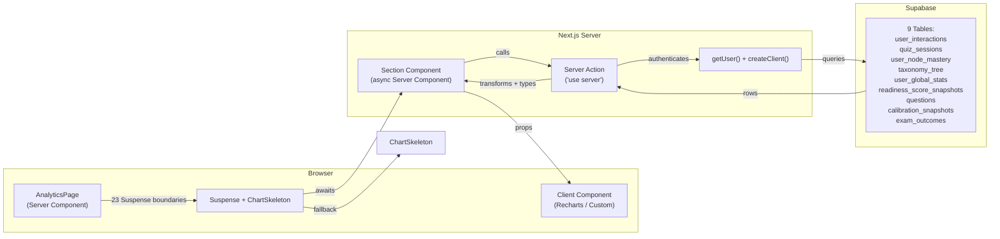

```mermaid
graph TD
  subgraph Page["AnalyticsPage (Server Component)"]
    R1["Row 1: 2-col md"]
    R2["Row 2: full"]
    R3["Row 3: full"]
    R4["Row 4: 2-col md"]
    R5["Row 5: 7/5 xl"]
    R6["Row 6: 2-col md"]
    R7["Row 7: 2-col md"]
    R8["Row 8: 2-col md"]
    R9["Row 9: 3-col md"]
    R10["Row 10: full"]
    R11["Row 11: 3-col md"]
    R12["Row 12: full"]
    R13["Row 13: full"]
  end

  R1 --> RS["Readiness"]
  R1 --> ECS["Exam Countdown"]
  R2 --> THS["Timeline Heatmap"]
  R3 --> SHS["Session History"]
  R4 --> PCS["Progress Card"]
  R4 --> STS["Simulation Trajectory"]
  R5 --> PQS["Pacing Quadrant 7col"]
  R5 --> SS["Stamina Curve 5col"]
  R6 --> SHMS["Stamina Heatmap"]
  R6 --> DMS["Difficulty Mastery"]
  R7 --> ABS["Accuracy by Subject"]
  R7 --> TSDS["Time Distribution"]
  R8 --> FCS["Forgetting Curves"]
  R8 --> SVS["Study Velocity"]
  R9 --> RadS["Radar"]
  R9 --> MS["Memory"]
  R9 --> PIS["Pacing Insights"]
  R10 --> PAS["Pacing Accuracy"]
  R11 --> CSS["Calibration Score"]
  R11 --> CCS["Confidence Calibration"]
  R11 --> SSCS["Study Streak"]
  R12 --> WTS["Weakest Topics"]
  R13 --> EOS["Exam Outcome"]
```

# Analytics Dashboard <!-- updated: 2026-04-08 -->

## 1. Overview <!-- updated: 2026-04-08 -->

The Analytics Dashboard provides ALE candidates with a comprehensive, data-driven view of their exam preparation progress. All visualizations are rendered as Server Components with independent Suspense boundaries, enabling progressive loading. Chart rendering uses Recharts for data-driven charts and custom CSS grids for heatmaps and calendars. Data is sourced from Supabase via server actions with `'use server'` directives.

**Key metrics:**
- **23** section components (server, async) composing the page
- **24** client components rendering visualizations
- **14** Recharts-based charts + **9** custom visualizations (heatmaps, cards, lists, calendars)
- **9** Supabase tables actively queried
- **10** data layer files (server actions)
- **3** orphaned data fetchers (built but not wired to UI)

**Route:** `/dashboard/analytics`
**Page config:** `export const dynamic = 'force-dynamic'` — server-rendered on every request
**Source:** `src/app/dashboard/analytics/`, `src/components/analytics/` (51 files), `src/lib/actions/analytics*`

---

## 2. Route Structure <!-- updated: 2026-04-08 -->

| Route Segment | File Path | Type | Server/Client | Purpose |
|---------------|-----------|------|---------------|---------|
| `/dashboard/analytics` | `src/app/dashboard/analytics/layout.tsx` | Layout | Server | Wraps children in `SharedPageLayout` |
| `/dashboard/analytics` | `src/app/dashboard/analytics/page.tsx` | Page | Server | Composes 23 analytics sections in Suspense boundaries |
| `/dashboard/analytics` | `src/app/dashboard/analytics/loading.tsx` | Loading | Server | Full-page skeleton with chart placeholder shapes |
| (docs) | `src/app/dashboard/analytics/AGENTS.md` | N/A | N/A | Agent instructions for this directory |

**Layout chain:** `RootLayout` → `DashboardLayout` → `AnalyticsPageLayout(SharedPageLayout)` → `AnalyticsPage`

**Notable absences:** No `error.tsx` (unhandled errors bubble to parent), no parallel routes, no intercepting routes.

---

## 3. Page Layout & Grid System <!-- updated: 2026-04-08 -->

The page is a vertical flex column (`flex flex-col gap-2`) containing 13 layout rows. Each row uses CSS Grid with responsive breakpoints.

**Source:** `src/app/dashboard/analytics/page.tsx:31-150`

### Grid Structure

| Row | Layout | Sections | Height |
|-----|--------|----------|--------|
| 1 | `grid-cols-1 md:grid-cols-2` | ReadinessSection + ExamCountdownSection | 220px |
| 2 | Full width | TimelineHeatmapSection | 140px |
| 3 | Full width | SessionHistorySection | 260px |
| 4 | `grid-cols-1 md:grid-cols-2` | ProgressCardSection + SimulationTrajectorySection | 280px |
| 5 | `grid-cols-1 xl:grid-cols-12` (7/5) | PacingQuadrantSection (7col) + StaminaSection (5col) | 360px |
| 6 | `grid-cols-1 md:grid-cols-2` | StaminaHeatmapSection + DifficultyMasterySection | 340px |
| 7 | `grid-cols-1 md:grid-cols-2` | AccuracyBySubjectSection + TimeSpentDistributionSection | 280px |
| 8 | `grid-cols-1 md:grid-cols-2` | ForgettingCurvesSection + StudyVelocitySection | 320px |
| 9 | `grid-cols-1 md:grid-cols-3` | RadarSection + MemorySection + PacingInsightsSection | 320px |
| 10 | Full width | PacingAccuracySection | 340px |
| 11 | `grid-cols-1 md:grid-cols-3` | CalibrationScoreSection + ConfidenceCalibrationSection + StudyStreakCalendarSection | 280px |
| 12 | Full width | WeakestTopicsSection | 320px |
| 13 | Full width | ExamOutcomeSection | 280px |

### Responsive Breakpoints

| Breakpoint | Behavior |
|-----------|----------|
| Default (mobile) | All sections stack to single column |
| `md` (768px) | 2-column and 3-column grids activate |
| `xl` (1280px) | Row 5 activates 7/5 column split |

All gaps are `gap-2` (8px). Charts use `ResponsiveContainer width="100%"` for fluid sizing.

### Suspense Pattern

Every section is wrapped in its own `<Suspense>` boundary with a `<ChartSkeleton>` fallback. Heights are matched to expected rendered heights to prevent layout shift.

```tsx
<Suspense fallback={<ChartSkeleton height="h-[220px]" />}>
  <ReadinessSection />
</Suspense>
```



---

## 4. Section Components <!-- updated: 2026-04-08 -->

Each section follows the pattern: **Server Component** (async, fetches data) → passes props to → **Client Component** (renders visualization). Some use `next/dynamic` for lazy loading, others import directly.

### 4.1 — ReadinessSection — Readiness Trajectory <!-- updated: 2026-04-08 -->

**Server Component:** `ReadinessSection` — `src/components/analytics/ReadinessSection.tsx`
**Client Component:** `ReadinessTrajectory` — `src/components/analytics/ReadinessTrajectory.tsx`
**Dynamic Import:** Yes
**Data Source:** `getReadinessTrajectory()` from `@/lib/actions/analytics` + direct Supabase queries (`user_global_stats`, `readiness_score_snapshots`)
**Supabase Tables:** `readiness_score_snapshots`, `user_global_stats`
**Chart Library:** Recharts
**Chart Type:** ComposedChart (Area + ReferenceLine at 75% passing threshold)
**Interactive:** Yes — tooltip hover
**Props Interface:**
```typescript
interface Props {
  data: ReadinessTrajectoryPoint[]
  currentScore: number
  previousScore: number | null
}
```
**Loading State:** `ChartSkeleton height="h-[220px]"`
**Empty State:** "Complete more quizzes to see your readiness trajectory here." (`ReadinessTrajectory.tsx:67-70`)
**Error State:** Missing — no error boundary
**Coaching Annotation:** No
**Mobile Behavior:** Stacks to full width, chart fills container
**Hardcoded Values:** `#1B3FC4`, `#D4DAE3`, `#2D9F6F`, `#4A5568` in Recharts config (lines 76-81). Target 75% hardcoded in display.

### 4.2 — ExamCountdownSection — Exam Countdown <!-- updated: 2026-04-08 -->

**Server Component:** `ExamCountdownSection` — `src/components/analytics/ExamCountdownSection.tsx`
**Client Component:** `ExamCountdown` — `src/components/analytics/ExamCountdown.tsx`
**Dynamic Import:** Yes
**Data Source:** `getExamCountdownData()` from `@/lib/actions/analytics/chart-data`
**Supabase Tables:** `user_global_stats`, `readiness_score_snapshots`, `user_node_mastery`, `taxonomy_tree`
**Chart Library:** Custom card
**Chart Type:** Metrics card with countdown, readiness trend, daily dose, pass probability
**Interactive:** No
**Props Interface:**
```typescript
interface Props { data: ExamCountdownData }
```
**Loading State:** `ChartSkeleton height="h-[220px]"`
**Empty State:** Handled by null checks in `ExamCountdownData` fields
**Error State:** Missing
**Mobile Behavior:** Stacks to full width
**Hardcoded Values:** None — uses design tokens

### 4.3 — TimelineHeatmapSection — Study Timeline Heatmap <!-- updated: 2026-04-08 -->

**Server Component:** `TimelineHeatmapSection` — `src/components/analytics/TimelineHeatmapSection.tsx`
**Client Component:** `TimelineHeatmap` — `src/components/analytics/TimelineHeatmap.tsx`
**Dynamic Import:** No (direct import)
**Data Source:** `getTimelineHeatmapData()` from `@/lib/actions/analytics`
**Supabase Tables:** `user_global_stats`, `user_interactions`, `taxonomy_tree`
**Chart Library:** Custom CSS grid
**Chart Type:** Subject x week heatmap grid (swim-lane, 12 weeks)
**Interactive:** Yes — time range filter (4w/8w/12w buttons), hover tooltips
**Props Interface:** Inline (not named)
**Loading State:** `ChartSkeleton height="h-[140px]"`
**Empty State:** Returns `{ rows: [], weekLabels: [] }` — renders empty grid
**Error State:** Missing
**Hooks:** `useState` (time range), `useMemo` (x4 — visible weeks, week set, filtered rows, sorted rows)
**Mobile Behavior:** Stacks to full width, grid cells shrink
**Hardcoded Values:** Subject colors from `getSubjectColor()` (which uses hex constants in `src/lib/constants/analytics.ts`)

### 4.4 — SessionHistorySection — Session Performance History <!-- updated: 2026-04-08 -->

**Server Component:** `SessionHistorySection` — `src/components/analytics/SessionHistorySection.tsx`
**Client Component:** `SessionHistory` — `src/components/analytics/SessionHistory.tsx`
**Dynamic Import:** No (direct import)
**Data Source:** `getSessionHistory()` from `@/lib/actions/analytics-data`
**Supabase Tables:** `quiz_sessions`, `user_interactions`
**Chart Library:** Recharts
**Chart Type:** Line chart — session accuracy over time with trend indicator
**Interactive:** Yes — tooltip hover
**Props Interface:**
```typescript
interface Props { data: SessionHistoryData }
```
**Loading State:** `ChartSkeleton height="h-[260px]"`
**Empty State:** Returns `{ points: [], trend: 'stable' }` — empty chart
**Error State:** Missing
**Mobile Behavior:** Stacks to full width
**Hardcoded Values:** None identified

### 4.5 — ProgressCardSection — Monthly Progress Card <!-- updated: 2026-04-08 -->

**Server Component:** `ProgressCardSection` — `src/components/analytics/ProgressCardSection.tsx`
**Client Component:** `ProgressCard` — `src/components/analytics/ProgressCard.tsx`
**Dynamic Import:** Yes
**Data Source:** `getMonthlyReport()` from `@/lib/actions/progress-report/actions` (uses `unstable_cache` with 1h revalidation)
**Supabase Tables:** `user_interactions`, `quiz_sessions`, `readiness_score_snapshots`, `user_node_mastery`, `taxonomy_tree`
**Chart Library:** Custom card
**Chart Type:** Monthly summary with metrics, weakest nodes, strongest improvement
**Interactive:** Yes — download (clipboard) and share (Web Share API) buttons
**Props Interface:**
```typescript
interface Props { report: ProgressReport }
```
**Loading State:** `ChartSkeleton height="h-[280px]"`
**Empty State:** Returns `null` when no user — section renders nothing
**Error State:** Missing
**Hooks:** `useCallback` (x2 — handleDownload, handleShare)
**Mobile Behavior:** Stacks to full width
**Hardcoded Values:** None identified

### 4.6 — SimulationTrajectorySection — Simulation Trajectory <!-- updated: 2026-04-08 -->

**Server Component:** `SimulationTrajectorySection` — `src/components/analytics/SimulationTrajectorySection.tsx`
**Client Component:** `SimulationTrajectory` — `src/components/analytics/SimulationTrajectory.tsx`
**Dynamic Import:** Yes
**Data Source:** `getSimulationTrajectory()` from `@/lib/actions/progress-report/actions` (uses `unstable_cache` with 1h revalidation)
**Supabase Tables:** `quiz_sessions` (storm/proof_sim modes, 50+ questions), `user_interactions`
**Chart Library:** Recharts
**Chart Type:** Line chart — simulation scores over time
**Interactive:** Yes — tooltip hover
**Props Interface:**
```typescript
interface Props { data: SimulationPoint[] }
```
**Loading State:** `ChartSkeleton height="h-[280px]"`
**Empty State:** Returns `[]` — empty chart
**Error State:** Missing
**Mobile Behavior:** Stacks to full width
**Hardcoded Values:** None identified

### 4.7 — PacingQuadrantSection — Pacing Quadrant <!-- updated: 2026-04-08 -->

**Server Component:** `PacingQuadrantSection` — `src/components/analytics/PacingQuadrantSection.tsx`
**Client Component:** `PacingQuadrant` — `src/components/analytics/PacingQuadrant.tsx`
**Dynamic Import:** Yes
**Data Source:** `getPacingQuadrantData()` from `@/lib/actions/analytics`
**Supabase Tables:** `user_interactions`, `user_global_stats`, `taxonomy_tree`
**Chart Library:** Recharts
**Chart Type:** ScatterChart with `QuadrantOverlay` — speed (X) vs accuracy (Y) per subject
**Interactive:** Yes — tooltip hover
**Children:** `QuadrantOverlay` (`src/components/analytics/QuadrantOverlay.tsx`)
**Props Interface:**
```typescript
interface Props { data: PacingQuadrantPoint[] }
```
**Loading State:** `ChartSkeleton height="h-[360px]"`
**Empty State:** Returns `[]` — empty chart
**Error State:** Missing
**Mobile Behavior:** Takes 7/12 cols at xl, full width below
**Hardcoded Values:** Quadrant overlay colors `#4A5568` as fallback

### 4.8 — StaminaSection — Stamina Curve <!-- updated: 2026-04-08 -->

**Server Component:** `StaminaSection` — `src/components/analytics/StaminaSection.tsx`
**Client Component:** `StaminaCurve` — `src/components/analytics/StaminaCurve.tsx`
**Dynamic Import:** Yes
**Data Source:** `getStaminaCurveData()` from `@/lib/actions/analytics`
**Supabase Tables:** `quiz_sessions`, `user_interactions`
**Chart Library:** Recharts
**Chart Type:** BarChart — accuracy by question position (groups of 5)
**Interactive:** Yes — tooltip hover
**Props Interface:**
```typescript
interface Props { data: StaminaBucket[] }
```
**Loading State:** `ChartSkeleton height="h-[360px]"`
**Empty State:** Returns `[]` — empty chart
**Error State:** Missing
**Mobile Behavior:** Takes 5/12 cols at xl, full width below
**Hardcoded Values:** None identified

### 4.9 — StaminaHeatmapSection — Stamina Heatmap <!-- updated: 2026-04-08 -->

**Server Component:** `StaminaHeatmapSection` — `src/components/analytics/StaminaHeatmapSection.tsx`
**Client Component:** `StaminaHeatmap` — `src/components/analytics/StaminaHeatmap.tsx`
**Dynamic Import:** Yes
**Data Source:** `getStaminaHeatmapData()` from `@/lib/actions/analytics/chart-data`
**Supabase Tables:** `quiz_sessions`, `user_interactions`
**Chart Library:** Custom CSS grid
**Chart Type:** Session x question result heatmap (correct/incorrect/skipped cells) with fatigue point detection
**Interactive:** No
**Props Interface:**
```typescript
interface Props { data: StaminaHeatmapData }
```
**Loading State:** `ChartSkeleton height="h-[340px]"`
**Empty State:** Returns `{ rows: [], maxQuestions: 0, fatiguePoint: null }` — empty grid
**Error State:** Missing
**Mobile Behavior:** Stacks to full width in 2-col grid
**Hardcoded Values:** None identified

### 4.10 — DifficultyMasterySection — Difficulty vs Mastery <!-- updated: 2026-04-08 -->

**Server Component:** `DifficultyMasterySection` — `src/components/analytics/DifficultyMasterySection.tsx`
**Client Component:** `DifficultyMasteryScatter` — `src/components/analytics/DifficultyMasteryScatter.tsx`
**Dynamic Import:** Yes
**Data Source:** `getDifficultyMasteryData()` from `@/lib/actions/analytics/chart-data`
**Supabase Tables:** `user_node_mastery`, `questions`, `taxonomy_tree`
**Chart Library:** Recharts
**Chart Type:** ScatterChart — question difficulty (X) vs topic mastery (Y)
**Interactive:** Yes — tooltip hover, point click to highlight topic (`useState`)
**Props Interface:**
```typescript
interface Props { data: DifficultyMasteryPoint[] }
```
**Loading State:** `ChartSkeleton height="h-[340px]"`
**Empty State:** Returns `[]` — empty chart
**Error State:** Missing
**Hooks:** `useState` (selected topic)
**Mobile Behavior:** Stacks to full width in 2-col grid
**Hardcoded Values:** None identified

### 4.11 — AccuracyBySubjectSection — Accuracy by Subject <!-- updated: 2026-04-08 -->

**Server Component:** `AccuracyBySubjectSection` — `src/components/analytics/AccuracyBySubjectSection.tsx`
**Client Component:** `AccuracyBySubject` — `src/components/analytics/AccuracyBySubject.tsx`
**Dynamic Import:** No (direct import)
**Data Source:** `getAccuracyBySubject()` from `@/lib/actions/analytics-data`
**Supabase Tables:** `user_interactions`, `user_global_stats`, `taxonomy_tree`
**Chart Library:** Recharts
**Chart Type:** Horizontal BarChart — accuracy per subject, sorted ascending
**Interactive:** Yes — tooltip hover
**Props Interface:**
```typescript
interface Props { data: AccuracyBySubjectItem[] }
```
**Loading State:** `ChartSkeleton height="h-[280px]"`
**Empty State:** Returns `[]` — empty chart
**Error State:** Missing
**Mobile Behavior:** Stacks to full width in 2-col grid
**Hardcoded Values:** None identified

### 4.12 — TimeSpentDistributionSection — Time Spent Distribution <!-- updated: 2026-04-08 -->

**Server Component:** `TimeSpentDistributionSection` — `src/components/analytics/TimeSpentDistributionSection.tsx`
**Client Component:** `TimeSpentDistribution` — `src/components/analytics/TimeSpentDistribution.tsx`
**Dynamic Import:** No (direct import)
**Data Source:** `getTimeSpentDistribution()` from `@/lib/actions/analytics-data`
**Supabase Tables:** `user_interactions`
**Chart Library:** Recharts
**Chart Type:** BarChart histogram — response time distribution in 5 buckets (0-10s, 10-20s, 20-30s, 30-60s, 60s+)
**Interactive:** Yes — tooltip hover
**Props Interface:**
```typescript
interface Props { data: TimeSpentDistributionData }
```
**Loading State:** `ChartSkeleton height="h-[280px]"`
**Empty State:** Returns `{ buckets: [], avgMs: 0 }` — empty chart
**Error State:** Missing
**Mobile Behavior:** Stacks to full width in 2-col grid
**Hardcoded Values:** Bucket definitions hardcoded in `analytics-data.ts:146-152`

### 4.13 — ForgettingCurvesSection — Forgetting Curves <!-- updated: 2026-04-08 -->

**Server Component:** `ForgettingCurvesSection` — `src/components/analytics/ForgettingCurvesSection.tsx`
**Client Component:** `ForgettingCurves` — `src/components/analytics/ForgettingCurves.tsx`
**Dynamic Import:** Yes
**Data Source:** `getForgettingCurveData()` from `@/lib/actions/analytics/chart-data`
**Supabase Tables:** `user_node_mastery`, `taxonomy_tree`
**Chart Library:** Recharts
**Chart Type:** LineChart — multi-topic exponential decay curves (top 3 fastest + 2 slowest decay)
**Interactive:** Yes — tooltip hover
**Props Interface:**
```typescript
interface Props { data: ForgettingCurveData }
```
**Loading State:** `ChartSkeleton height="h-[320px]"`
**Empty State:** Returns `{ topics: [], reviewThreshold: 70 }` — empty chart
**Error State:** Missing
**Mobile Behavior:** Stacks to full width in 2-col grid
**Hardcoded Values:** `REVIEW_THRESHOLD = 70` hardcoded in `chart-data.ts:123`. Color interpolation uses hardcoded hex: `#D64545`, `#D4951A`, `#2D9F6F` (`chart-data.ts:191-192`)

### 4.14 — StudyVelocitySection — Study Velocity <!-- updated: 2026-04-08 -->

**Server Component:** `StudyVelocitySection` — `src/components/analytics/StudyVelocitySection.tsx`
**Client Component:** `StudyVelocity` — `src/components/analytics/StudyVelocity.tsx`
**Dynamic Import:** Yes
**Data Source:** `getStudyVelocityData()` from `@/lib/actions/analytics/chart-data`
**Supabase Tables:** `user_node_mastery`, `user_global_stats`, `taxonomy_tree`
**Chart Library:** Recharts
**Chart Type:** BarChart — nodes mastered per week (12-week window) with projected completion date
**Interactive:** Yes — tooltip hover
**Props Interface:**
```typescript
interface Props { data: StudyVelocityData }
```
**Loading State:** `ChartSkeleton height="h-[320px]"`
**Empty State:** Returns `{ weeks: [], avgPerWeek: 0, totalNodes: 0, projectedCompletionDate: null }`
**Error State:** Missing
**Mobile Behavior:** Stacks to full width in 2-col grid
**Hardcoded Values:** Mastery threshold `0.7` hardcoded in `chart-data.ts:371`

### 4.15 — RadarSection — Subject Radar <!-- updated: 2026-04-08 -->

**Server Component:** `RadarSection` — `src/components/analytics/RadarSection.tsx`
**Client Component:** `SubjectRadarChart` — `src/components/dashboard/SubjectRadarChart.tsx` (shared with dashboard)
**Dynamic Import:** Yes (imports from `@/components/dashboard/`)
**Data Source:** `getSubjectMasteryData()` from `@/lib/actions/mastery`
**Supabase Tables:** `user_global_stats`, `taxonomy_tree`, `user_node_mastery`
**Chart Library:** Recharts
**Chart Type:** RadarChart — multi-subject mastery comparison
**Interactive:** Yes — tooltip hover
**Props Interface:** Uses `SubjectMastery[]` directly
**Loading State:** `ChartSkeleton height="h-[320px]"`
**Empty State:** Returns `[]` — empty chart
**Error State:** Missing (wrapped in try/catch in `mastery.ts:88`)
**Mobile Behavior:** Takes 1/3 width at md, full width below
**Hardcoded Values:** None identified

### 4.16 — MemorySection — Memory Health <!-- updated: 2026-04-08 -->

**Server Component:** `MemorySection` — `src/components/analytics/MemorySection.tsx`
**Client Component:** `MemoryHealthMap` — `src/components/analytics/MemoryHealthMap.tsx`
**Dynamic Import:** No (direct import)
**Data Source:** `getMemoryHealthData()` from `@/lib/actions/analytics`
**Supabase Tables:** `user_node_mastery`, `taxonomy_tree`
**Chart Library:** Custom list
**Chart Type:** Topic retention status list with status colors (strong/review/fading/critical)
**Interactive:** No
**Props Interface:**
```typescript
interface Props { data: MemoryHealthItem[] }
```
**Loading State:** `ChartSkeleton height="h-[320px]"`
**Empty State:** Returns `[]` — empty list
**Error State:** Missing
**Mobile Behavior:** Takes 1/3 width at md, full width below
**Hardcoded Values:** Retention decay formula: `100 * exp(-days/14)` hardcoded in `analytics.ts:436`

### 4.17 — PacingInsightsSection — Pacing Insights <!-- updated: 2026-04-08 -->

**Server Component:** `PacingInsightsSection` — `src/components/analytics/PacingInsightsSection.tsx`
**Client Component:** `PacingInsights` — `src/components/analytics/PacingInsights.tsx`
**Dynamic Import:** No (direct import)
**Data Source:** `getPacingInsights()` from `@/lib/actions/analytics`
**Supabase Tables:** `user_interactions`, `user_global_stats`, `taxonomy_tree`
**Chart Library:** Custom bars
**Chart Type:** Top 3 slowest subjects with pacing ratio bar indicators
**Interactive:** No
**Props Interface:**
```typescript
interface Props { data: PacingInsightItem[] }
```
**Loading State:** `ChartSkeleton height="h-[320px]"`
**Empty State:** Returns `[]` — empty display
**Error State:** Missing
**Mobile Behavior:** Takes 1/3 width at md, full width below
**Hardcoded Values:** `PACING_TARGET_MS` (120s) from constants

### 4.18 — PacingAccuracySection — Pacing vs Accuracy <!-- updated: 2026-04-08 -->

**Server Component:** `PacingAccuracySection` — `src/components/analytics/PacingAccuracySection.tsx`
**Client Component:** `PacingAccuracy` — `src/components/analytics/PacingAccuracy.tsx`
**Dynamic Import:** Yes
**Data Source:** `getPacingAccuracyData()` from `@/lib/actions/analytics/chart-data`
**Supabase Tables:** `quiz_sessions`, `user_interactions`
**Chart Library:** Recharts
**Chart Type:** ScatterChart — session avg seconds (X) vs accuracy (Y), colored by quiz mode
**Interactive:** Yes — tooltip hover
**Props Interface:**
```typescript
interface Props { data: PacingAccuracyPoint[] }
```
**Loading State:** `ChartSkeleton height="h-[340px]"`
**Empty State:** Returns `[]` — empty chart
**Error State:** Missing
**Mobile Behavior:** Full width
**Hardcoded Values:** `MODE_COLORS` map in `chart-data.ts:88-98` uses hardcoded hex values

### 4.19 — CalibrationScoreSection — Calibration Score (Brier) <!-- updated: 2026-04-08 -->

**Server Component:** `CalibrationScoreSection` — `src/components/analytics/CalibrationScoreSection.tsx`
**Client Component:** `CalibrationScoreCard` — `src/components/analytics/CalibrationScoreCard.tsx`
**Dynamic Import:** No (direct import)
**Data Source:** `getCalibrationCurveData()` from `@/lib/actions/analytics/get-calibration-data`
**Supabase Tables:** `calibration_snapshots`, `user_interactions`
**Chart Library:** Custom card
**Chart Type:** Brier score display with confidence breakdown (confident/guessing/partly accuracy), overconfidence/underconfidence indices
**Interactive:** No
**Props Interface:**
```typescript
interface Props { data: CalibrationData }
```
**Loading State:** `ChartSkeleton height="h-[280px]"`
**Empty State:** Returns `null` when no snapshots — section renders nothing
**Error State:** Missing
**Mobile Behavior:** Takes 1/3 width at md, full width below
**Hardcoded Values:** None identified

### 4.20 — ConfidenceCalibrationSection — Confidence Calibration <!-- updated: 2026-04-08 -->

**Server Component:** `ConfidenceCalibrationSection` — `src/components/analytics/ConfidenceCalibrationSection.tsx`
**Client Component:** `ConfidenceCalibration` — `src/components/analytics/ConfidenceCalibration.tsx`
**Dynamic Import:** No (direct import)
**Data Source:** `getConfidenceCalibration()` from `@/lib/actions/analytics-data`
**Supabase Tables:** `user_interactions` (confidence column)
**Chart Library:** Recharts
**Chart Type:** BarChart — accuracy per confidence level (Low/Medium/High)
**Interactive:** Yes — tooltip hover
**Props Interface:**
```typescript
interface Props { data: ConfidenceCalibrationItem[] }
```
**Loading State:** `ChartSkeleton height="h-[280px]"`
**Empty State:** Returns `[]` — empty chart
**Error State:** Missing
**Mobile Behavior:** Takes 1/3 width at md, full width below
**Hardcoded Values:** Confidence label map `{1:'Low', 2:'Medium', 3:'High'}` in `analytics-data.ts:243`

### 4.21 — StudyStreakCalendarSection — Study Streak Calendar <!-- updated: 2026-04-08 -->

**Server Component:** `StudyStreakCalendarSection` — `src/components/analytics/StudyStreakCalendarSection.tsx`
**Client Component:** `StudyStreakCalendar` — `src/components/analytics/StudyStreakCalendar.tsx`
**Dynamic Import:** No (direct import)
**Data Source:** `getStudyActivity()` from `@/lib/actions/analytics-data`
**Supabase Tables:** `user_interactions`
**Chart Library:** Custom CSS grid
**Chart Type:** Monthly calendar grid with activity intensity (0-4 levels, GitHub contribution style)
**Interactive:** No
**Props Interface:**
```typescript
interface Props { data: StudyActivityDay[] }
```
**Loading State:** `ChartSkeleton height="h-[280px]"`
**Empty State:** Returns current month with all zero counts
**Error State:** Missing
**Mobile Behavior:** Takes 1/3 width at md, full width below
**Hardcoded Values:** Intensity thresholds hardcoded in `analytics-data.ts:327-330`

### 4.22 — WeakestTopicsSection — Topics to Focus On <!-- updated: 2026-04-08 -->

**Server Component:** `WeakestTopicsSection` — `src/components/analytics/WeakestTopicsSection.tsx`
**Client Component:** `WeakestTopics` — `src/components/analytics/WeakestTopics.tsx`
**Dynamic Import:** No (direct import)
**Data Source:** `getWeakestTopics()` from `@/lib/actions/analytics-data`
**Supabase Tables:** `user_node_mastery`, `taxonomy_tree`
**Chart Library:** Custom list
**Chart Type:** Weakest topics list with mastery progress bars (top 10, min 3 attempts)
**Interactive:** No
**Props Interface:**
```typescript
interface Props { data: WeakestTopicItem[] }
```
**Loading State:** `ChartSkeleton height="h-[320px]"`
**Empty State:** Returns `[]` — empty list
**Error State:** Missing
**Mobile Behavior:** Full width
**Hardcoded Values:** Min attempts threshold `3` in `analytics-data.ts:267`, limit `10` in `analytics-data.ts:269`

### 4.23 — ExamOutcomeSection — Exam Outcome Self-Report <!-- updated: 2026-04-08 -->

**Server Component:** `ExamOutcomeSection` — `src/components/analytics/ExamOutcomeSection.tsx`
**Client Component:** `ExamOutcomeForm` — `src/components/analytics/ExamOutcomeForm.tsx`
**Dynamic Import:** Yes
**Data Source:** Direct Supabase query (`user_global_stats.target_exam_date`), writes via `reportExamOutcome()` from `@/lib/actions/progress-report/actions`
**Supabase Tables:** `user_global_stats` (read), `exam_outcomes` (write)
**Chart Library:** Custom form
**Chart Type:** Form with date input, pass/fail toggle, optional score input
**Interactive:** Yes — form submission with `useTransition`
**Props Interface:**
```typescript
interface Props { targetExamDate: string | null }
```
**Loading State:** `ChartSkeleton height="h-[280px]"`
**Empty State:** Conditionally hidden if exam date is in the future
**Error State:** Inline error message display
**Hooks:** `useState` (x5: isPending via useTransition, submitted, error, examDate, result, score)
**Mobile Behavior:** Full width
**Hardcoded Values:** None identified
**Design Violation:** Uses raw `<input>` and `<button>` instead of shadcn/ui `Input` and `Button` components

---

## 5. Data Layer Architecture <!-- updated: 2026-04-08 -->

### 5.1 Data Source Modules

| File | Path | Lines | Functions | Purpose |
|------|------|-------|-----------|---------|
| `analytics.ts` | `src/lib/actions/analytics.ts` | 630 | 9 exported (4 orphaned) | Core analytics: readiness, pacing, stamina, memory, heatmap |
| `analytics-data.ts` | `src/lib/actions/analytics-data.ts` | 337 | 6 exported | Accuracy, time distribution, sessions, confidence, weakest, streaks |
| `chart-data.ts` | `src/lib/actions/analytics/chart-data.ts` | 654 | 7 exported (1 aggregator) | Forgetting curves, stamina heatmap, difficulty, velocity, pacing accuracy, exam countdown |
| `get-calibration-data.ts` | `src/lib/actions/analytics/get-calibration-data.ts` | 97 | 1 exported | Calibration/Brier score with trend |
| `get-error-patterns.ts` | `src/lib/actions/analytics/get-error-patterns.ts` | 135 | 1 exported | Error pattern analysis — **ORPHANED** |
| `get-review-calendar.ts` | `src/lib/actions/analytics/get-review-calendar.ts` | 183 | 1 exported | SRS review calendar — **ORPHANED** |
| `get-memory-strength-data.ts` | `src/lib/actions/analytics/get-memory-strength-data.ts` | 119 | 1 exported | SS/RS memory quadrant — **ORPHANED** |
| `actions.ts` | `src/lib/actions/progress-report/actions.ts` | 175 | 3 exported | Monthly report, simulation trajectory, exam outcome reporter |
| `generate.ts` | `src/lib/actions/progress-report/generate.ts` | 202 | 1 exported | Progress report generator |
| `mastery.ts` | `src/lib/actions/mastery.ts` | 93 | 1 exported | Subject mastery for radar chart |

### 5.2 Server Actions Inventory

| Function | Module | Input | Return Type | Called By | Status |
|---------|--------|-------|-------------|----------|--------|
| `getReadinessTrajectory()` | `analytics.ts` | none | `ReadinessTrajectoryPoint[]` | ReadinessSection | Active |
| `getPacingQuadrantData()` | `analytics.ts` | none | `PacingQuadrantPoint[]` | PacingQuadrantSection | Active |
| `getStaminaCurveData()` | `analytics.ts` | none | `StaminaBucket[]` | StaminaSection | Active |
| `getPacingInsights()` | `analytics.ts` | none | `PacingInsightItem[]` | PacingInsightsSection | Active |
| `getMemoryHealthData()` | `analytics.ts` | none | `MemoryHealthItem[]` | MemorySection | Active |
| `getTimelineHeatmapData()` | `analytics.ts` | none | `TimelineHeatmapData` | TimelineHeatmapSection | Active |
| `getAnalyticsSummaryMetrics()` | `analytics.ts` | none | `AnalyticsSummaryMetrics` | — | **ORPHANED** |
| `getAnalyticsSummary()` | `analytics.ts` | none | object | — | **ORPHANED** |
| `getTaxonomyHeatmap()` | `analytics.ts` | `disciplineId` | `HeatmapCluster[]` | Dashboard (not analytics) | N/A |
| `getNodePerformance()` | `analytics.ts` | `topicId` | array | — | **ORPHANED** |
| `getAccuracyBySubject()` | `analytics-data.ts` | none | `AccuracyBySubjectItem[]` | AccuracyBySubjectSection | Active |
| `getTimeSpentDistribution()` | `analytics-data.ts` | none | `TimeSpentDistributionData` | TimeSpentDistributionSection | Active |
| `getSessionHistory()` | `analytics-data.ts` | none | `SessionHistoryData` | SessionHistorySection | Active |
| `getConfidenceCalibration()` | `analytics-data.ts` | none | `ConfidenceCalibrationItem[]` | ConfidenceCalibrationSection | Active |
| `getWeakestTopics()` | `analytics-data.ts` | none | `WeakestTopicItem[]` | WeakestTopicsSection | Active |
| `getStudyActivity()` | `analytics-data.ts` | none | `StudyActivityDay[]` | StudyStreakCalendarSection | Active |
| `getForgettingCurveData()` | `chart-data.ts` | none | `ForgettingCurveData` | ForgettingCurvesSection | Active |
| `getStaminaHeatmapData()` | `chart-data.ts` | none | `StaminaHeatmapData` | StaminaHeatmapSection | Active |
| `getDifficultyMasteryData()` | `chart-data.ts` | none | `DifficultyMasteryPoint[]` | DifficultyMasterySection | Active |
| `getStudyVelocityData()` | `chart-data.ts` | none | `StudyVelocityData` | StudyVelocitySection | Active |
| `getPacingAccuracyData()` | `chart-data.ts` | none | `PacingAccuracyPoint[]` | PacingAccuracySection | Active |
| `getExamCountdownData()` | `chart-data.ts` | none | `ExamCountdownData` | ExamCountdownSection | Active |
| `getAnalyticsDashboardData()` | `chart-data.ts` | none | `AnalyticsDashboardData` | — | **ORPHANED** (aggregator) |
| `getCalibrationCurveData()` | `get-calibration-data.ts` | `userId?` | `CalibrationData \| null` | CalibrationScoreSection | Active |
| `getSubjectMasteryData()` | `mastery.ts` | none | `SubjectMastery[]` | RadarSection | Active |
| `getMonthlyReport()` | `progress-report/actions.ts` | none | `ProgressReport \| null` | ProgressCardSection | Active |
| `getSimulationTrajectory()` | `progress-report/actions.ts` | none | `SimulationPoint[]` | SimulationTrajectorySection | Active |
| `reportExamOutcome()` | `progress-report/actions.ts` | `ExamOutcomeInput` | `{ success, error? }` | ExamOutcomeForm | Active (write) |
| `generateProgressReport()` | `progress-report/generate.ts` | `userId, start, end` | `ProgressReport` | getMonthlyReport() | Active (internal) |

### 5.3 Supabase Tables Referenced

| Table | Key Columns Used | Primary Purpose | Queried By |
|-------|-----------------|-----------------|-----------|
| `user_interactions` | `is_correct, time_spent_ms, topic_id, interaction_timestamp, session_id, confidence, error_type, question_id, question_order` | Per-question interaction records | 15+ functions — most queried table |
| `quiz_sessions` | `session_id, question_ids, started_at, completed_at, test_mode, status` | Session metadata and question ordering | 7 functions |
| `user_node_mastery` | `topic_id, current_mastery_weight, total_attempts, last_encountered, distinct_questions_seen, total_correct, updated_at, storage_strength, retrieval_strength` | Per-topic mastery state | 9 functions |
| `taxonomy_tree` | `node_id, parent_id, level, name, discipline_id, is_cross_ref_only, deprecated_at, lea_id` | Taxonomy hierarchy for subject grouping | 10+ functions |
| `user_global_stats` | `global_readiness_score, current_discipline_id, target_exam_date` | User-level aggregated state | 7 functions |
| `readiness_score_snapshots` | `score, computed_at` | Historical readiness scores | 4 functions |
| `questions` | `topic_id, difficulty` | Question difficulty for scatter plots | 1 function (getDifficultyMasteryData) |
| `calibration_snapshots` | `calibration_score, brier_score, sample_size, confident_accuracy, guessing_accuracy, overconfidence_index, underconfidence_index, created_at` | Calibration metrics | 1 function (getCalibrationCurveData) |
| `exam_outcomes` | INSERT: `user_id, exam_batch, result, self_reported_score, reported_at, peak_readiness_score, discipline_id, total_sessions_completed, total_questions_answered, verified` | Exam outcome self-reports (write-only) | 1 function (reportExamOutcome) |

### 5.4 Data Flow Diagram



### 5.5 Zustand Stores

**None.** The analytics feature uses zero Zustand stores. All state is either:
- Server-fetched (Server Components passing props)
- Local React state (`useState` in TimelineHeatmap, DifficultyMasteryScatter, ExamOutcomeForm)

---

## 6. Shared Utilities & Constants <!-- updated: 2026-04-08 -->

### Constants (`src/lib/constants/analytics.ts`)

| Constant | Value | Usage |
|---------|-------|-------|
| `PACING_TARGET_MS` | `120_000` (2 min) | LEA exam pacing standard |
| `PASSING_ACCURACY` | `75` (percent) | Readiness trajectory target line |
| `SUBJECT_COLORS` | 16 entries (LEA-* IDs + full names) | Subject color coding across charts |
| `SUBJECT_COLOR_FALLBACK` | `#71717a` | Fallback for unknown subjects |
| `getSubjectColor(subject)` | function | Looks up color from `SUBJECT_COLORS` |

### Utility Components

| Component | File | Props | Purpose |
|-----------|------|-------|---------|
| `ChartSkeleton` | `src/components/analytics/ChartSkeleton.tsx` | `{ height?: string }` (Tailwind class) | Skeleton loading card for chart placeholders |
| `ChartCoachingAnnotation` | `src/components/analytics/ChartCoachingAnnotation.tsx` | `{ text: string, variant?: 'insight' \| 'warning' \| 'success' }` | Coaching insight annotation below charts |
| `QuadrantOverlay` | `src/components/analytics/QuadrantOverlay.tsx` | `{ labels: QuadrantLabels, colors?, className? }` | 2x2 quadrant label overlay for scatter charts |

### Shared Components from Outside Analytics

| Component | Source | Used By |
|-----------|-------|---------|
| `SharedPageLayout` | `@/components/layouts/SharedPageLayout` | `layout.tsx` |
| `SubjectRadarChart` | `@/components/dashboard/SubjectRadarChart` | `RadarSection` |
| `RichInfoPopover` | `@/components/dashboard/RichInfoPopover` | `ReadinessTrajectory` |
| `SCIcon` | `@/components/graphics/icons/Icon` | `ReadinessTrajectory`, `ChartCoachingAnnotation` |
| `Card`, `CardContent`, `CardHeader`, `CardTitle` | `@/components/ui/card` | Most client components |
| `Skeleton` | `@/components/ui/skeleton` | `loading.tsx` |
| `getScoreColor` | `@/components/shared/score-display` | `ReadinessTrajectory` |

### External Dependencies

| Package | Purpose |
|---------|---------|
| `recharts` | All chart rendering (14 components) |
| `@phosphor-icons/react` | Icons (TrendUp, TrendDown, Minus, Target, Lightbulb) |
| `next/dynamic` | Lazy-loading client components (13 sections) |
| `next/cache` (`unstable_cache`) | Caching progress report and simulation data |

---

## 7. Component Tree Diagram <!-- updated: 2026-04-08 -->



```mermaid
graph TD
  subgraph Route["src/app/dashboard/analytics/"]
    Layout["AnalyticsPageLayout<br/><small>Server - layout.tsx</small>"]
    Page["AnalyticsPage<br/><small>Server - page.tsx</small>"]
  end

  Layout --> Page

  Page --> RS["ReadinessSection"]
  Page --> ECS["ExamCountdownSection"]
  Page --> THS["TimelineHeatmapSection"]
  Page --> SHS["SessionHistorySection"]
  Page --> PCS["ProgressCardSection"]
  Page --> STS["SimulationTrajectorySection"]
  Page --> PQS["PacingQuadrantSection"]
  Page --> SS["StaminaSection"]
  Page --> SHMS["StaminaHeatmapSection"]
  Page --> DMS["DifficultyMasterySection"]
  Page --> ABS["AccuracyBySubjectSection"]
  Page --> TSDS["TimeSpentDistributionSection"]
  Page --> FCS["ForgettingCurvesSection"]
  Page --> SVS["StudyVelocitySection"]
  Page --> RadS["RadarSection"]
  Page --> MS["MemorySection"]
  Page --> PIS["PacingInsightsSection"]
  Page --> PAS["PacingAccuracySection"]
  Page --> CSS["CalibrationScoreSection"]
  Page --> CCS["ConfidenceCalibrationSection"]
  Page --> SSCS["StudyStreakCalendarSection"]
  Page --> WTS["WeakestTopicsSection"]
  Page --> EOS["ExamOutcomeSection"]

  RS -->|dynamic| RT["ReadinessTrajectory<br/><small>Client, recharts</small>"]
  ECS -->|dynamic| EC["ExamCountdown<br/><small>Client</small>"]
  THS --> TH["TimelineHeatmap<br/><small>Client, CSS grid</small>"]
  SHS --> SH["SessionHistory<br/><small>Client, recharts</small>"]
  PCS -->|dynamic| PC["ProgressCard<br/><small>Client</small>"]
  STS -->|dynamic| ST["SimulationTrajectory<br/><small>Client, recharts</small>"]
  PQS -->|dynamic| PQ["PacingQuadrant<br/><small>Client, recharts</small>"]
  PQ --> QO["QuadrantOverlay<br/><small>Client</small>"]
  SS -->|dynamic| SC["StaminaCurve<br/><small>Client, recharts</small>"]
  SHMS -->|dynamic| SHM["StaminaHeatmap<br/><small>Client, CSS grid</small>"]
  DMS -->|dynamic| DMS2["DifficultyMasteryScatter<br/><small>Client, recharts</small>"]
  ABS --> AB["AccuracyBySubject<br/><small>Client, recharts</small>"]
  TSDS --> TSD["TimeSpentDistribution<br/><small>Client, recharts</small>"]
  FCS -->|dynamic| FC["ForgettingCurves<br/><small>Client, recharts</small>"]
  SVS -->|dynamic| SV["StudyVelocity<br/><small>Client, recharts</small>"]
  RadS -->|dynamic| SRC["SubjectRadarChart<br/><small>Client, recharts<br/>from dashboard/</small>"]
  MS --> MHM["MemoryHealthMap<br/><small>Client, list</small>"]
  PIS --> PI["PacingInsights<br/><small>Client, bars</small>"]
  PAS -->|dynamic| PA["PacingAccuracy<br/><small>Client, recharts</small>"]
  CSS --> CSC["CalibrationScoreCard<br/><small>Client, card</small>"]
  CCS --> CC["ConfidenceCalibration<br/><small>Client, recharts</small>"]
  SSCS --> SSC["StudyStreakCalendar<br/><small>Client, CSS grid</small>"]
  WTS --> WT["WeakestTopics<br/><small>Client, list</small>"]
  EOS -->|dynamic| EOF["ExamOutcomeForm<br/><small>Client, form</small>"]
```

**Source:** `src/app/dashboard/analytics/page.tsx` imports verified against `src/components/analytics/index.ts` barrel export.

---

## 8. Type Definitions <!-- updated: 2026-04-08 -->

### From `src/lib/actions/analytics.ts`

```typescript
export interface ReadinessTrajectoryPoint {
  date: string; score: number; target: number
}
export interface PacingQuadrantPoint {
  subject: string; avgTimeMs: number; accuracy: number; questionCount: number; color: string
}
export interface StaminaBucket {
  bucket: string; accuracy: number; sampleSize: number
}
export interface PacingInsightItem {
  subject: string; avgTimeMs: number; targetTimeMs: number; ratio: number; accuracy: number
}
export interface MemoryHealthItem {
  topic: string; topicId: string; lastEncountered: string; daysSince: number
  estimatedRetention: number; status: 'strong' | 'review' | 'fading' | 'critical'; totalAttempts: number
}
export interface AnalyticsSummaryMetrics {
  totalQuestions: number; avgAccuracy: number; avgPacingMs: number
  streak: number; daysUntilExam: number | null; totalSessions: number
}
export interface TimelineHeatmapData {
  rows: Array<{
    subject: string; color: string; totalQuestions: number
    cells: Array<{ weekStart: string; subject: string; count: number; accuracy: number | null }>
  }>
  weekLabels: string[]
}
```

### From `src/lib/actions/analytics-data.ts`

```typescript
export interface AccuracyBySubjectItem { subject: string; accuracy: number; total: number }
export interface TimeSpentBucket { label: string; count: number }
export interface TimeSpentDistributionData { buckets: TimeSpentBucket[]; avgMs: number }
export interface SessionHistoryPoint { date: string; accuracy: number; questionCount: number }
export interface SessionHistoryData {
  points: SessionHistoryPoint[]; trend: 'improving' | 'declining' | 'stable'
}
export interface ConfidenceCalibrationItem {
  level: string; confidence: number; accuracy: number; count: number
}
export interface WeakestTopicItem {
  topicId: string; topic: string; masteryPct: number; attempts: number; lastEncountered: string | null
}
export interface StudyActivityDay { date: string; count: number; intensity: 0 | 1 | 2 | 3 | 4 }
```

### From `src/lib/actions/analytics/chart-data.ts`

```typescript
export interface ForgettingCurvePoint { daysSince: number; recall: number }
export interface ForgettingCurveTopic {
  topicId: string; topicName: string; decayRate: number; optimalReviewDay: number
  curve: ForgettingCurvePoint[]; color: string
}
export interface ForgettingCurveData { topics: ForgettingCurveTopic[]; reviewThreshold: number }
export interface StaminaHeatmapCell { result: 'correct' | 'incorrect' | 'skipped' }
export interface StaminaHeatmapRow {
  sessionId: string; date: string; mode: string; cells: StaminaHeatmapCell[]
}
export interface StaminaHeatmapData {
  rows: StaminaHeatmapRow[]; maxQuestions: number; fatiguePoint: number | null
}
export interface DifficultyMasteryPoint {
  topicId: string; topicName: string; avgDifficulty: number; masteryPct: number; questionCount: number
}
export interface StudyVelocityWeek { weekLabel: string; weekStart: string; nodesMastered: number }
export interface StudyVelocityData {
  weeks: StudyVelocityWeek[]; avgPerWeek: number; totalNodes: number; projectedCompletionDate: string | null
}
export interface PacingAccuracyPoint {
  sessionId: string; avgSeconds: number; accuracy: number; mode: string; questionCount: number; color: string
}
export interface ExamCountdownData {
  daysUntilExam: number | null; targetExamDate: string | null; readinessScore: number
  readinessTrend: 'up' | 'down' | 'flat'; readinessDelta: number; redNodeCount: number
  unexploredCount: number; dailyDoseNeeded: number; projectedPassProbability: number | null
}
export interface AnalyticsDashboardData {
  forgettingCurves: ForgettingCurveData; staminaHeatmap: StaminaHeatmapData
  difficultyMastery: DifficultyMasteryPoint[]; studyVelocity: StudyVelocityData
  pacingAccuracy: PacingAccuracyPoint[]; examCountdown: ExamCountdownData
}
```

### From `src/lib/actions/analytics/get-calibration-data.ts`

```typescript
export interface CalibrationTrendPoint { date: string; score: number }
export interface CalibrationData {
  score: number; brierScore: number; confidentAccuracy: number; guessingAccuracy: number
  partlyAccuracy: number; overconfidence: number; underconfidence: number; sampleSize: number
  trend: CalibrationTrendPoint[]
}
```

### From `src/lib/actions/progress-report/actions.ts`

```typescript
export interface SimulationPoint { date: string; score: number; questionCount: number; mode: string }
export interface ExamOutcomeInput {
  examDate: string; result: 'pass' | 'fail'; selfReportedScore?: number | null; examBatch: string
}
```

### From `src/lib/actions/progress-report/generate.ts`

```typescript
export interface ProgressReport {
  period: { start: string; end: string }; questionsAnswered: number; sessionsCompleted: number
  studyMinutes: number; nodesImproved: number; readinessScoreChange: number
  weakestNodes: { topicId: string; topicName: string; mastery: number }[]
  strongestImprovement: { topicId: string; topicName: string; delta: number }[]
}
```

### From `src/lib/actions/mastery.ts`

```typescript
export interface SubjectMastery { subject: string; score: number; fullMark: number }
```

---

## 9. Available But Unused Data Sources <!-- updated: 2026-04-08 -->

These tables contain analytics-relevant data but are NOT currently queried by the analytics feature.

| Table | Rows | Columns | Potential Analytics Use |
|-------|------|---------|----------------------|
| `user_mastery_history` | 454 | `id (uuid)`, `user_id (uuid)`, `topic_id (uuid)`, `mastery_weight (numeric)`, `total_correct (int)`, `total_attempts (int)`, `session_id (uuid?)`, `snapshot_reason (text?)`, `created_at (timestamptz?)` | Historical mastery progression per topic — could power mastery trend sparklines per topic |
| `user_question_states` | 240 | `user_id (uuid)`, `question_id (uuid)`, `last_seen_at (timestamptz)`, `last_is_correct (bool)`, `total_attempts (int)`, `total_time_ms (int)`, `avg_time_ms (int)` | Per-question performance tracking — could show question-level difficulty patterns |
| `user_theta` | 0 | `id (uuid)`, `user_id (uuid)`, `discipline_id (uuid?)`, `theta (float8)`, `theta_se (float8)`, `responses_count (int)`, `created_at (timestamptz)`, `updated_at (timestamptz)` | IRT ability parameter (theta) tracking — could power IRT ability trajectory chart |
| `analytics_events` | 0 | `id (uuid)`, `user_id (uuid?)`, `event_name (text)`, `event_properties (jsonb?)`, `page_path (text?)`, `session_id (uuid?)`, `created_at (timestamptz?)`, `referrer (text?)` | Generic event tracking — could power funnel/engagement analytics |
| `camp_trails` | 22 | `trail_id (uuid)`, `discipline_id (uuid)`, `name (text)`, `slug (text)`, `description (text?)`, `trail_type (enum)`, `intensity (enum?)`, `duration_days (int)`, `total_steps (int)`, `is_published (bool)`, `subjects_covered (array?)`, `daily_time_estimate_minutes (int)` | Learning path definitions — could show trail completion analytics |
| `interaction_signal_traces` | 18 | Schema not inspected | CAGE verification signal traces — patent-backed behavioral signals |
| `session_predictions` | 0 | Schema not inspected | Predicted vs actual session performance |
| `blindspot_queues` | 0 | Schema not inspected | Current blindspot topic queue |
| `user_endurance_profiles` | 0 | Schema not inspected | Fatigue/endurance profile data |
| `user_computed_signals` | 0 | Schema not inspected | Derived behavioral signals |
| `behavioral_features` | 0 | Schema not inspected | ML-computed behavioral features |
| `cognitive_state_indicators` | 0 | Schema not inspected | Fatigue, engagement, flow state |
| `session_behavioral_summaries` | 0 | Schema not inspected | Per-session behavioral analysis |
| `user_behavioral_profiles` | 0 | Schema not inspected | Long-term behavioral patterns |
| `successive_relearning_cycles` | 0 | Schema not inspected | Relearning cycle progress |
| `confusion_pairs` | 0 | Schema not inspected | Topic confusion pair analysis |
| `daily_doses` | 0 | Schema not inspected | Daily recommended study doses |
| `user_srs_cards` | 43 | Schema not inspected | SRS review card states |
| `user_trail_progress` | 0 | Schema not inspected | Trail completion progress |
| `session_questions` | 0 | Schema not inspected | Session-question join table |

---

## 10. Orphaned / WIP Components <!-- updated: 2026-04-08 -->

### Orphaned Data Fetchers (built but not wired to UI)

| Function | File | Tables Queried | Likely Intended For |
|---------|------|---------------|-------------------|
| `getErrorPatterns()` | `src/lib/actions/analytics/get-error-patterns.ts` | `user_interactions` (error_type), `taxonomy_tree` | Error pattern analysis section — concept confusion + knowledge gap classification |
| `getReviewCalendarData()` | `src/lib/actions/analytics/get-review-calendar.ts` | `user_node_mastery` (predicted_recall, optimal_review_at), `taxonomy_tree` | 7-day SRS review calendar with urgency classification |
| `getMemoryStrengthOverview()` | `src/lib/actions/analytics/get-memory-strength-data.ts` | `user_node_mastery` (storage_strength, retrieval_strength), `taxonomy_tree` | SS/RS memory quadrant classification (mastered/rusty/needs_learning/surface_learning) |

### Orphaned Server Actions

| Function | File | Reason |
|---------|------|--------|
| `getAnalyticsSummaryMetrics()` | `analytics.ts:577` | Exported but not called by any section |
| `getAnalyticsSummary()` | `analytics.ts:195` | Exported but not called by any section |
| `getNodePerformance()` | `analytics.ts:159` | Exported but not called by analytics page |
| `getAnalyticsDashboardData()` | `chart-data.ts:628` | Aggregator wrapper — not used (sections fetch independently) |

### Orphaned Client Component

| Component | File | Reason |
|-----------|------|--------|
| `CalibrationCurve` | `src/components/analytics/CalibrationCurve.tsx` | Exported in barrel but no section renders it — possibly intended for CalibrationScoreSection (which uses CalibrationScoreCard instead) |

---

## 11. Known Gaps & Technical Debt <!-- updated: 2026-04-08 -->

### Error Handling
- No `error.tsx` in `src/app/dashboard/analytics/` — unhandled server errors bubble to parent layout
- No per-section error boundaries — if a Suspense-wrapped section throws, no graceful degradation
- Most server actions silently return empty arrays/null on failure — no distinction between "no data" and "error"

### Loading / Empty States
- Empty states are inconsistent: `ReadinessTrajectory` has one (line 67-70), most others render nothing or empty charts
- No unified "No data yet" component across sections
- `ExamOutcomeSection` conditionally hides when exam date is in the future — could confuse users

### Hardcoded Values
- `chart-data.ts:88-100`: `MODE_COLORS` uses hardcoded hex values — should reference design tokens
- `ReadinessTrajectory.tsx:76-81`: Hardcoded hex `#1B3FC4`, `#D4DAE3`, `#2D9F6F`, `#4A5568` in Recharts config
- `QuadrantOverlay.tsx:29-32`: Hardcoded fallback color `#4A5568`
- `analytics.ts:231`: `targetSecondsPerItem: 120` and `enduranceMinutes: 240` hardcoded instead of using constants
- `chart-data.ts:123`: `REVIEW_THRESHOLD = 70` hardcoded inside function
- `chart-data.ts:191-192`: Forgetting curve color interpolation uses hardcoded hex

### Performance
- **No pagination**: `getAccuracyBySubject()` fetches ALL `user_interactions` without limit
- **Repeated taxonomy tree fetches**: `fetchTaxonomyNodeMap()` called independently by multiple actions per page load
- **23 independent Supabase round trips**: By design for Suspense, but many query the same tables
- **`force-dynamic`**: No caching except `ProgressCardSection` and `SimulationTrajectorySection` (via `unstable_cache`)
- Duplicated `fetchTaxonomyNodeMap()` and `buildLevel1Resolver()` in both `analytics.ts` and `analytics-data.ts`

### Accessibility
- Charts lack screen reader alternatives (no `aria-label` on Recharts components)
- Color-only encoding in heatmaps (no pattern/shape alternatives for colorblind users)

### Design Violations
- `ExamOutcomeForm` uses raw `<input>` and `<button>` instead of shadcn/ui `Input` and `Button` (violates `.ai/rules/design.md`)

### Inconsistent Patterns
- 13/23 sections use `dynamic()` imports, 10/23 use direct imports — no clear rationale
- `ReadinessSection` makes direct Supabase queries alongside its data fetcher — others delegate entirely

---

## 12. CEO Analytics <!-- updated: 2026-04-08 -->

Business-level analytics in the CEO portal use a separate data layer and live under `/ceo`:

| View | Metrics |
|------|---------|
| Command Center | MRR, ARR, monthly revenue, cash on hand |
| Financials | Revenue vs. expenses, P&L by category |
| Behavioral Insights | DAU/WAU/MAU, cohort retention, churn risk |
| Team | Department costs, team size, resource allocation |

**Source:** `src/components/ceo/`, `src/lib/queries/ceo/`

### CEO Chart Colors

```typescript
const CEO_CHART_COLORS = {
  revenue: '#2D9F6F',     // Emerald
  expenses: '#D64545',    // Warm Red
  profit: '#1B3FC4',     // Camp Cobalt
  projection: '#E8853A', // Camp Orange
};
```

**Source:** `src/types/ceo.ts`

---

## 13. Changelog <!-- updated: 2026-04-08 -->

| Date | Change | Author |
|------|--------|--------|
| 2026-04-08 | Complete rewrite from codebase audit. 23 sections documented, data layer inventoried, 3 Mermaid diagrams, technical debt catalogued. Replaces outdated 7-component version. | AI (from audit plan) |
| 2026-04-06 | Initial analytics dashboard analysis — 7 visualization components, CEO analytics. | AI |

---

*This specification is the single source of truth for the analytics feature. Source: `.ai/plans/analytics-feature-audit-and-spec-plan-2026-04-08.md`*
