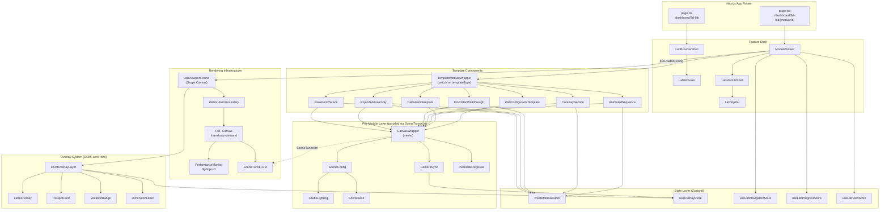
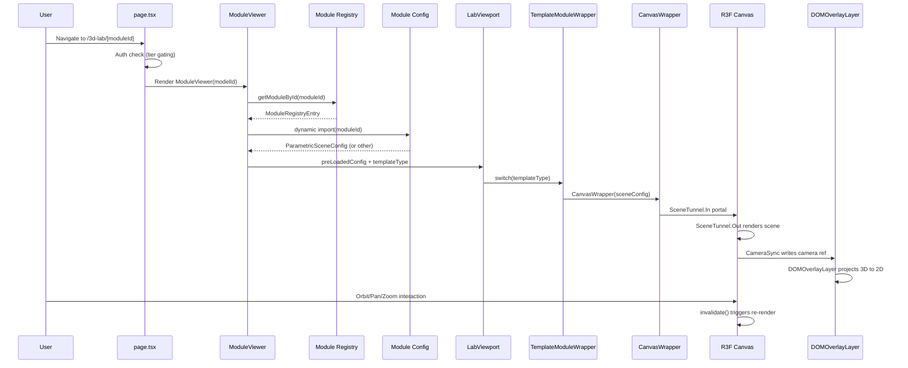
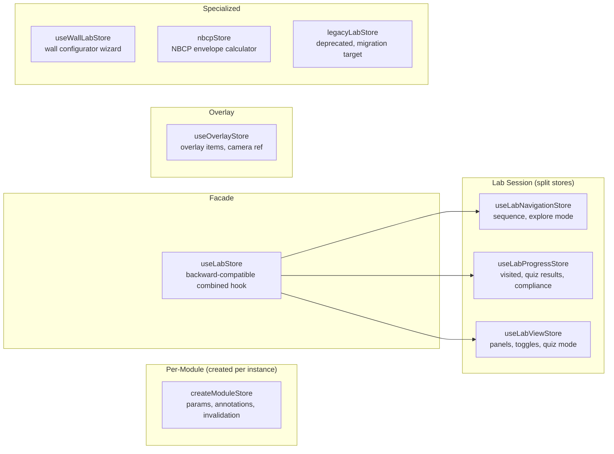
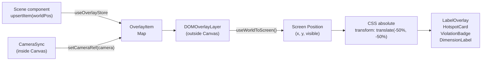

# 3D Lab: Product Requirements Document & Technical Specification

**Document Version:** 2.0
**Last Verified Against Codebase:** 2026-04-08
**Source of Truth:** `src/features/3d-lab/`, `src/components/r3f/`, `src/app/dashboard/3d-lab/`
**Architecture Phases Completed:** P1 through P9

---

## Table of Contents

1. [Executive Summary](#1-executive-summary)
2. [Product Vision & Goals](#2-product-vision--goals)
3. [Architecture Overview](#3-architecture-overview)
4. [Template System](#4-template-system)
5. [Module Inventory](#5-module-inventory)
6. [Rendering Pipeline](#6-rendering-pipeline)
7. [State Management](#7-state-management)
8. [Module Loading & Code Splitting](#8-module-loading--code-splitting)
9. [2D DOM Overlay System](#9-2d-dom-overlay-system)
10. [Performance Engineering](#10-performance-engineering)
11. [WebGL Safety](#11-webgl-safety)
12. [Regulatory Compliance Engine](#12-regulatory-compliance-engine)
13. [Pedagogical Integration](#13-pedagogical-integration)
14. [UX/UI Specification](#14-uxui-specification)
15. [Routes & Access Control](#15-routes--access-control)
16. [Telemetry & Analytics](#16-telemetry--analytics)
17. [Identity-Locked Components](#17-identity-locked-components)
18. [Behavioral Psychology Tactics](#18-behavioral-psychology-tactics)
19. [Appendix: Config Type Definitions](#19-appendix-config-type-definitions)

---

## 1. Executive Summary

The 3D Lab is SlateCamp's spatial visualization engine for Licensure Examination for Architects (LEA) preparation. It provides **209 interactive modules** across **16 LEA-aligned categories**, rendered through **7 template types** using React Three Fiber (R3F) and Three.js.

Students interact with parametric building models, explore cutaway sections of construction assemblies, walk through floor plans with egress paths, and manipulate structural systems -- all within a single-canvas WebGL environment that enforces Philippine regulatory compliance (PD 1096, BP 344, RA 9514, NSCP) in real time.

**Key differentiator:** Every dimension, threshold, and violation message is traceable to a specific code section. The 3D Lab does not teach "approximately correct" values -- it enforces code-mandated minimums and maximums through parametric constraints with legal citations.

### Technology Stack

| Layer | Technology | Version |
|-------|-----------|---------|
| Framework | Next.js App Router | 16.1.6 |
| UI Library | React | 19.2.4 |
| Type System | TypeScript (strict) | 5.9.3 |
| 3D Engine | Three.js | 0.183.2 |
| React 3D Binding | @react-three/fiber | 9.5.0 |
| 3D Utilities | @react-three/drei | Latest |
| State Management | Zustand | 5.0.12 |
| Styling | Tailwind CSS | 4.2.2 |
| Auth/Data | Supabase SSR | Latest |
| Package Manager | Bun | Latest |

---

## 2. Product Vision & Goals

### Target User

Philippine architecture licensure candidates preparing for the LEA board examination, which covers building codes, structural engineering, utilities, materials, construction methods, architectural history, urban planning, and professional practice.

### Learning Outcomes

1. **Spatial comprehension** -- Students develop 3D mental models of building systems they will encounter as practitioners
2. **Code compliance intuition** -- Real-time violation feedback builds instinctive awareness of regulatory thresholds
3. **Dimensional recall** -- Interactive sliders force engagement with actual code-mandated dimensions (not passive reading)
4. **Systems thinking** -- Exploded assemblies and cutaway sections reveal how components relate within larger systems
5. **Professional scenario readiness** -- Context scenarios frame each module in a real-world architectural practice situation

### Differentiation

| Competitor Approach | SlateCamp 3D Lab |
|-------------------|-----------------|
| Static diagrams in PDF reviewers | Interactive parametric models with real-time violation detection |
| Generic flashcard apps | Spatial learning with IRT-weighted mastery tracking |
| Video lectures | Self-paced exploration with guided and sandbox modes |
| Practice exams only | Contextual learning that connects theory to 3D visualization |

### Retention Strategy

- **Progressive disclosure** -- Guided mode reveals complexity gradually; sandbox mode unlocks full parameter control
- **Spaced repetition integration** -- Module visits feed into the SM-2 scheduling system for review timing
- **Mastery visualization** -- IRT 2PL probability scores show genuine learning progress, not vanity metrics
- **Challenge mode** -- "Find the violations" mode tests applied knowledge after guided learning

---

## 3. Architecture Overview

### Component Hierarchy



### Data Flow



---

## 4. Template System

The 3D Lab uses a template-driven architecture where each of the 7 template types defines a specific visualization pattern. All templates share the same rendering infrastructure (CanvasWrapper, SceneConfig, StudioLighting) but implement different scene logic.

### 4.1 Parametric Template (73 modules)

**Entry:** `src/features/3d-lab/templates/ParametricScene.tsx`
**Scene:** `src/features/3d-lab/templates/ParametricSceneRenderer.tsx`
**Store:** `createModuleStore(defaults)`

The workhorse template. Users manipulate parameters (sliders, toggles, dropdowns) and see geometry update in real time. Violation rules fire when parameters exceed code-mandated thresholds.

**Features:**
- Dynamic geometry generation from `GeometryInstruction[]` computed per frame
- Real-time violation detection via `ViolationRule.check(params)`
- Auto-detected multi-law compliance panel (when violations span multiple code prefixes)
- Configurable presets for quick parameter snapshots
- Context scenarios for professional framing
- Annotation overlays positioned dynamically based on current parameters

**Layout:** `LabPanelLayout` with left panel (GenericControlPanel, 240px) and optional right panel (ComplianceReportPanel, 280px).

### 4.2 Cutaway Template (50 modules)

**Entry:** `src/features/3d-lab/templates/CutawaySection.tsx`
**Scene:** `src/features/3d-lab/templates/CutawaySectionScene.tsx`
**Store:** `createModuleStore(defaults)`

Reveals internal structure by progressively cutting away layers of an assembly. Used for construction details, wall sections, pipe systems, and material assemblies.

**Features:**
- Layer-based cut progression along configurable axis (x, y, or z)
- Per-layer descriptions and code citations
- Material labels for each layer
- Depth-ordered rendering (innermost to outermost)

### 4.3 Exploded Assembly Template (37 modules)

**Entry:** `src/features/3d-lab/templates/ExplodedAssembly.tsx`
**Scene:** `src/features/3d-lab/templates/ExplodedAssemblyScene.tsx`
**Store:** `createModuleStore(defaults)`

Disassembles a multi-part construction assembly to reveal individual components and their relationships.

**Features:**
- Explode slider (0-1) with per-part `explodeOffset` vectors
- Optional group-based multi-level explosion
- Per-part descriptions and code citations
- Side-by-side comparison mode for comparing assemblies
- Annotations tied to part positions

### 4.4 Floor Plan Template (29 modules)

**Entry:** `src/features/3d-lab/templates/FloorPlanWalkthrough.tsx`
**Scene:** `src/features/3d-lab/templates/FloorPlanScene.tsx`
**Store:** `createModuleStore(defaults)`

Orthographic top-down view for egress analysis, room layouts, fire zone classification, and accessibility planning.

**Features:**
- Room definitions with bounds, color, and zone classification
- Path definitions with animated traveling markers for egress routes
- Fixture placement (doors, windows, stairs, exits, extinguishers, sprinklers)
- Plan dimensions in meters with configurable scale
- Violation overlays for travel distance and dead-end calculations

### 4.5 Animated Sequence Template (15 modules)

**Entry:** `src/features/3d-lab/templates/AnimatedSequence.tsx`
**Scene:** `src/features/3d-lab/templates/AnimatedSequenceScene.tsx`
**Store:** `createModuleStore(defaults)`

Step-by-step construction or process sequences with timed transitions between states.

**Features:**
- Sequential steps with per-step geometry, camera, and duration
- Auto-play with configurable interval (default 1500ms)
- Optional loop mode
- Per-step code citations
- Manual step navigation

### 4.6 Calculator Template (4 modules)

**Entry:** `src/features/3d-lab/templates/CalculatorTemplate.tsx`
**Scene:** Per-tool (FlooringScene, PaintScene, etc.)
**Store:** Per-tool stores

Specialized quantity takeoff and material estimation tools with visual feedback.

**Tool Types:** `flooring`, `paint`, `drywall`, `chb`

**Features:**
- Orthographic camera for accurate proportions
- Sponsor data integration (brand presets and logos)
- Material quantity calculations with visual representation

### 4.7 Wall Configurator Template (1 module)

**Entry:** `src/features/3d-lab/templates/WallConfiguratorTemplate.tsx`
**Scene:** `src/features/3d-lab/templates/WallConfiguratorRenderer.tsx`
**Store:** `useWallLabStore` (dedicated, 425+ lines)

5-step wizard for wall assembly configuration with Bill of Materials output.

**Wizard Steps:**
1. Core Type (CHB, drywall, plywood, cement-board, brick, solid-concrete, existing-wall)
2. Geometry (dimensions, openings)
3. Treatment (insulation, waterproofing)
4. Finish Type (paint, tile, etc.)
5. Color/Sponsor selection

**Features:**
- Core thickness options per type (e.g., CHB: 100mm/150mm/200mm)
- Layer-based composition with `getDefaultLayers()`
- Area summary bar showing coverage calculations
- BOM (Bill of Materials) panel with quantity outputs
- Sponsor palette for branded color selection

---

## 5. Module Inventory

### 5.1 Scale

| Metric | Count |
|--------|-------|
| Total module configs | **209** |
| Category count | **16** |
| Template types | **7** |
| Standalone/bespoke scenes | **4** |

### 5.2 Template Distribution

| Template Type | Count | Percentage |
|--------------|-------|-----------|
| Parametric | 73 | 34.9% |
| Cutaway | 50 | 23.9% |
| Exploded | 37 | 17.7% |
| Floor Plan | 29 | 13.9% |
| Animated | 15 | 7.2% |
| Calculator | 4 | 1.9% |
| Wall Configurator | 1 | 0.5% |

### 5.3 Category Breakdown (LEA-Aligned Taxonomy)

| # | Category Key | Label | Modules | Phase | LEA Subject |
|---|-------------|-------|---------|-------|-------------|
| 01 | `BUILDING_CODE` | PD 1096: National Building Code | 30 | 1 | Building Laws & Codes |
| 02 | `ACCESSIBILITY` | BP 344: Accessibility Law | 14 | 1 | Building Laws & Codes |
| 03 | `FIRE_CODE` | RA 9514: Fire Code & Life Safety | 22 | 1 | Building Laws & Codes |
| 04 | `STRUCTURAL` | NSCP: Structural Engineering | 17 | 1 | Structural Engineering |
| 05 | `PLUMBING` | NPCP: Plumbing Code | 14 | 1 | Building Utilities |
| 06 | `ELECTRICAL` | PEC: Electrical Code | 10 | 2 | Building Utilities |
| 07 | `MECHANICAL` | PMEC: Mechanical Code | 6 | 2 | Building Utilities |
| 08 | `VERTICAL` | Vertical Circulation & Transport | 4 | 2 | Building Utilities |
| 09 | `CONSTRUCTION` | Construction Methods & Sequences | 14 | 2 | Building Materials & Construction |
| 10 | `MATERIALS` | Building Materials | 14 | 2 | Building Materials & Construction |
| 11 | `ARCH_HISTORY` | History of Architecture | 22 | 1 | Architecture |
| 12 | `PH_HERITAGE` | Philippine Vernacular & Heritage | 10 | 1 | Architecture |
| 13 | `PLANNING` | Urban Planning, Zoning & Housing | 18 | 2 | Urban Planning & Housing |
| 14 | `PROF_PRACTICE` | Professional Practice & Specs | 4 | 3 | Professional Practice & Specs |
| 15 | `ESTIMATING` | Estimating & Quantity Surveying | 6 | 3 | Professional Practice & Specs |
| 16 | `SITE_DEV` | Site Development & Parking | 4 | 3 | Building Laws & Codes |

### 5.4 LEA Subject Groupings

| LEA Subject | Categories | Total Modules |
|------------|-----------|---------------|
| Building Laws & Codes | BUILDING_CODE, ACCESSIBILITY, FIRE_CODE, SITE_DEV | 70 |
| Structural Engineering | STRUCTURAL | 17 |
| Building Utilities | PLUMBING, ELECTRICAL, MECHANICAL, VERTICAL | 34 |
| Building Materials & Construction | CONSTRUCTION, MATERIALS | 28 |
| Architecture | ARCH_HISTORY, PH_HERITAGE | 32 |
| Urban Planning & Housing | PLANNING | 18 |
| Professional Practice & Specs | PROF_PRACTICE, ESTIMATING | 10 |

### 5.5 Launch Phases

| Phase | Label | Strategy |
|-------|-------|---------|
| 1 | High-Impact Launch | Core LEA subjects with highest exam weight |
| 2 | Technical Deep-Dive | Utilities, construction, and planning modules |
| 3 | Specialist Release | Professional practice and estimating |

### 5.6 Standalone / Bespoke Scenes

These scenes have custom implementations that do not use the template system:

| Scene | Module ID | Import Path | Notes |
|-------|----------|-------------|-------|
| NBCP Envelope | `nbcp-envelope` | `src/features/3d-lab/scenes/NBCPEnvelope/` | Building envelope visualization |
| FAR Playground | `far-calculator` | `src/features/3d-lab/scenes/FARPlayground/` | Floor Area Ratio calculator |
| Classical Orders | `classical-orders` | `src/features/3d-lab/scenes/ClassicalOrders/` | Architectural order comparison |
| DevControls (Site Dev) | `site-development-controls` | `src/features/3d-lab/DevControlsModule/` | Full bespoke dashboard with lot controls, zone selector, firewall markers, compliance scorecard |

The DevControls module is the most complex standalone scene, with its own sub-component tree including `DevControlsCanvas`, `DevControlsLayers`, dedicated dashboard panels (InputPanel, OutputPanel, ComplianceScorecard, FirewallPanel), and a dedicated selection store (`useSelectionStore`).

---

## 6. Rendering Pipeline

### 6.1 Single Canvas Architecture

The 3D Lab uses a **single persistent Canvas** hosted by `LabViewportFrame`. All module scenes portal their content into this Canvas via `SceneTunnel` (powered by `tunnel-rat`).

**Source:** `src/features/3d-lab/components/shell/LabViewportFrame.tsx`

```
LabViewportFrame (absolute inset-0)
  |-- WebGLErrorBoundary
  |     |-- Canvas (frameloop="demand", shadows, dpr=[1, adaptive])
  |     |     |-- PerformanceMonitor (flipflops=3)
  |     |     |-- Suspense
  |     |           |-- SceneTunnel.Out  <-- receives portaled scene content
  |     |
  |-- DOMOverlayLayer  <-- 2D overlays projected from 3D positions
  |-- children (pointer-events-none overlay UI)
```

**Why single Canvas:** Creating and destroying WebGL contexts is expensive and can trigger context loss on low-end devices. A single persistent Canvas avoids this overhead and enables smooth module transitions.

### 6.2 SceneTunnel Portal System

**Source:** `src/features/3d-lab/components/GlobalCanvasPortal.tsx`

```typescript
import tunnel from 'tunnel-rat'
export const SceneTunnel = tunnel()
```

- `SceneTunnel.In` is called inside `CanvasWrapper` (rendered per-module in the React tree)
- `SceneTunnel.Out` is called inside the persistent `Canvas` in `LabViewportFrame`
- This decouples the scene definition (where the module component lives) from the render target (where the Canvas lives)

### 6.3 CanvasWrapper

**Source:** `src/features/3d-lab/components/CanvasWrapper.tsx`

A `memo`-wrapped component that each template renders. It:
1. Creates a `SceneTunnel.In` portal
2. Renders `InvalidateRegistrar` (hooks up store-driven invalidation)
3. Renders `SceneConfig` (camera, controls, lighting, ground)
4. Renders `CameraSync` (bridges camera ref to overlay store)
5. Wraps children in `Suspense`
6. Shows `CanvasLoadingOverlay` until ready

### 6.4 SceneConfig

**Source:** `src/features/3d-lab/components/rendering/SceneConfig.tsx`

Per-module configuration of camera, controls, lighting, and scene environment. Rendered inside the Canvas via SceneTunnel.

| Property | Type | Default | Description |
|----------|------|---------|-------------|
| `cameraPosition` | `[x, y, z]` | `[6, 6, 6]` | Camera position in world space |
| `cameraFov` | `number` | `35` | Perspective camera field of view (degrees) |
| `orthographic` | `boolean` | `false` | Use orthographic camera (calculators, floor plans) |
| `cameraZoom` | `number` | `1` | Orthographic camera zoom factor |
| `minPolarAngle` | `number` | `0` | OrbitControls min polar angle (radians) |
| `maxPolarAngle` | `number` | `Math.PI / 1.75` | OrbitControls max polar angle (radians) |
| `minDistance` | `number` | `3` | OrbitControls min zoom distance |
| `maxDistance` | `number` | `Infinity` | OrbitControls max zoom distance |
| `showGround` | `boolean` | `true` | Show ground plane via SceneBase |
| `disableLighting` | `boolean` | `false` | Skip StudioLighting (for custom lighting) |
| `lightingPreset` | `LightingPreset` | `'studio'` | Lighting mood preset |
| `disableSceneBase` | `boolean` | `false` | Skip SceneBase (ground, fog, tone mapping) |
| `clearColor` | `string` | `undefined` | Override canvas clear color |
| `flat` | `boolean` | `false` | NoToneMapping mode for diagrams |

**Camera strategy:** Perspective cameras use imperative `CameraSetup` (avoids fighting with OrbitControls on re-renders). Orthographic cameras use drei's declarative `OrthographicCamera` with `makeDefault`.

### 6.5 StudioLighting

**Source:** `src/features/3d-lab/components/rendering/StudioLighting.tsx`

Four lighting presets that control ambient, key light, fill light, shadows, and color temperature:

| Preset | Ambient | Key | Fill | Shadows | Use Case |
|--------|---------|-----|------|---------|----------|
| `studio` | 0.35 | 1.2 (warm #FFF5E6) | 0.4 (cool #E6EFFF) | Yes (1024 map) | Default architectural viz |
| `clinical` | 0.7 | 1.0 (neutral) | 0.6 (neutral) | No | Detail inspection |
| `dramatic` | 0.1 | 2.0 (warm) | 0.1 (cool) | Yes (1024 map) | Presentation / hero shots |
| `flat` | 0.6 | 0.8 (neutral) | 0 (none) | No | Diagrams, calculator scenes |

### 6.6 Canvas Configuration

**Source:** `LabViewportFrame.tsx`

```
Canvas props:
  frameloop="demand"       -- Only re-render when invalidate() is called
  shadows                  -- Shadow mapping enabled
  dpr=[1, adaptive]        -- Adaptive DPR via PerformanceMonitor
  camera={{ position: [6, 6, 6], fov: 35 }}  -- Fallback defaults
  gl={{ antialias: true, alpha: false, stencil: false, depth: true }}
  style={{ pointerEvents: 'auto' }}
```

### 6.7 DRACO Decoder

**Source:** `LabViewportFrame.tsx`

```typescript
useGLTF.setDecoderPath('/draco/')
```

The DRACO WASM decoder is configured globally for all `useGLTF` calls. Decoder files must exist at `/public/draco/`.

---

## 7. State Management

The 3D Lab uses 9 Zustand stores organized by responsibility domain.

### 7.1 Store Architecture



### 7.2 createModuleStore (Per-Module)

**Source:** `src/features/3d-lab/stores/createModuleStore.ts`

Factory function that creates a fresh Zustand store per module instance with typed parameter state.

| Field | Type | Description |
|-------|------|-------------|
| `params` | `Record<string, number \| boolean \| string>` | Current parameter values |
| `activeAnnotation` | `string \| null` | Currently selected annotation ID |
| `invalidateFn` | `(() => void) \| null` | Canvas invalidation callback |
| `resetOnUnmount` | `boolean` | Whether to auto-reset on component unmount |

**Key behaviors:**
- `setParam()` and `setParams()` automatically call `invalidateFn()` to trigger Canvas re-render
- `setActiveAnnotation()` does NOT call `invalidateFn()` -- annotation selection is UI-only state
- `reset()` restores defaults and invalidates
- Works with `useModuleLifecycle()` hook for automatic cleanup on unmount

### 7.3 useLabNavigationStore

**Source:** `src/features/3d-lab/stores/useLabNavigationStore.ts`

Tracks module traversal state for guided mode.

| Field | Type | Default |
|-------|------|---------|
| `currentSequenceIndex` | `number` | `0` |
| `exploreMode` | `ExploreMode` | `'guided'` |
| `guidedSequenceComplete` | `boolean` | `false` |

### 7.4 useLabProgressStore

**Source:** `src/features/3d-lab/stores/useLabProgressStore.ts`

Tracks learning progress within a module session.

| Field | Type | Default |
|-------|------|---------|
| `visitedHotspotIds` | `Set<string>` | `new Set()` |
| `answeredQuestionIds` | `Set<string>` | `new Set()` |
| `correctQuestionIds` | `Set<string>` | `new Set()` |
| `parametricValues` | `Record<string, number>` | `{}` |
| `complianceState` | `ComplianceState` | `'compliant'` |
| `quizResults` | `QuizResult[]` | `[]` |

### 7.5 useLabViewStore

**Source:** `src/features/3d-lab/stores/useLabViewStore.ts`

Manages UI panel state and view toggles.

| Field | Type | Default |
|-------|------|---------|
| `activeHotspotId` | `string \| null` | `null` |
| `panelMode` | `PanelMode` | `'none'` |
| `questionAnswered` | `boolean` | `false` |
| `selectedOptionId` | `string \| null` | `null` |
| `crossSectionEnabled` | `boolean` | `false` |
| `explodedViewEnabled` | `boolean` | `false` |
| `quizModeActive` | `boolean` | `false` |

### 7.6 useLabStore (Facade)

**Source:** `src/features/3d-lab/stores/useLabStore.ts`

Backward-compatible combined hook that merges all three focused stores (Navigation, Progress, View) into the original `useLabStore` API surface. Provides selector-based usage and static `setState`/`getState` methods.

**Usage pattern:**
```typescript
// Preferred: selector-based
const parametricValues = useLabStore((s) => s.parametricValues)

// Static access (used by LabViewport cleanup)
useLabStore.getState().resetSession()
```

New code should import directly from the focused stores.

### 7.7 useOverlayStore

**Source:** `src/features/3d-lab/stores/useOverlayStore.ts`

Manages the 2D DOM overlay system. Stores overlay items as a `Map<string, OverlayItem>` and the current camera reference.

**Overlay types:** `label`, `hotspot`, `violation`, `dimension`, `area-tag`

Each `OverlayItem` contains:
- `id`: Unique identifier
- `worldPosition`: `THREE.Vector3` in 3D space
- `type`: Discriminated union tag
- `payload`: Type-specific data (LabelPayload, HotspotPayload, ViolationPayload, DimensionPayload)
- `visible`: Visibility flag
- `zIndex`: Optional stacking order

### 7.8 useWallLabStore

**Source:** `src/features/3d-lab/stores/useWallLabStore.ts`

Dedicated store for the Wall Configurator template (425+ lines). Manages a 5-step wizard flow with core type selection, geometry configuration, treatment options, finish types, and sponsor color selection.

### 7.9 nbcpStore & legacyLabStore

- **nbcpStore** (`src/features/3d-lab/stores/nbcpStore.ts`): Dedicated state for the NBCP Envelope standalone scene
- **legacyLabStore** (`src/features/3d-lab/stores/legacyLabStore.ts`): Deprecated store from pre-refactor era, migration target

### 7.10 Invalidation Pattern

The invalidation pattern ensures the `frameloop="demand"` Canvas only re-renders when state changes:

1. Template creates store via `createModuleStore(defaults)`
2. `InvalidateRegistrar` (inside CanvasWrapper) registers the R3F `invalidate()` function with the store
3. When `setParam()` or `setParams()` is called, the store calls `invalidateFn()` which triggers `invalidate()`
4. R3F renders exactly one frame
5. Annotation changes (`setActiveAnnotation()`) skip invalidation since they are DOM-only

---

## 8. Module Loading & Code Splitting

### 8.1 Registry System

**Source:** `src/features/3d-lab/config/registry/index.ts`

The registry is split into 16 category files (`cat-01.ts` through `cat-16.ts`), each exporting an array of `ModuleRegistryEntry` objects. The master index combines them into `ALL_MODULES`.

Helper functions:
- `getModuleById(id)` -- Lookup by module ID
- `getModulesByCategory(categoryKey)` -- Filter by category
- `getModulesByTemplate(templateType)` -- Filter by template type
- `getModulesByPhase(phase)` -- Filter by launch phase

### 8.2 Dynamic Module Config Loading

**Source:** `src/features/3d-lab/components/ModuleViewer.tsx`

Module configs are loaded via dynamic `import()` at runtime. The loading path is resolved from the module's category:

```
moduleId -> categoryId -> DIR_NAMES[catId] -> dynamic import
```

Directory mapping:
```
01 -> 01-building-code
02 -> 02-accessibility
03 -> 03-fire-code
...
16 -> 16-site-dev
```

**Loading sequence:**
1. `ModuleViewer` receives `modelId` prop
2. `getModuleById()` retrieves registry entry (includes `categoryId`, `templateType`)
3. `loadModuleConfig()` dynamically imports the config file
4. Config is passed as `preLoadedConfig` to `LabViewport`
5. `LabViewport` switches on `templateType` via `TemplateModuleWrapper`

### 8.3 Segmented Registry Loader

**Source:** `src/features/3d-lab/utils/registryLoader.ts`

An alternative loading path that uses `getRegistryByCategory()` with a per-category cache (`registryCache: Map`) to avoid importing all 209 module metadata entries at once.

### 8.4 Template Code Splitting

All template components are loaded via `next/dynamic` with `ssr: false`:

```typescript
const ParametricScene = dynamic(
  () => import('@/features/3d-lab/templates/ParametricScene'),
  { ssr: false, loading: () => <LoadingSpinner /> },
)
```

This ensures:
- Three.js and R3F code never enters the server bundle
- Each template is a separate chunk loaded on demand
- A loading spinner is shown during chunk download

### 8.5 Bespoke Scene Routing

The `LabViewport` component handles three routing layers:

1. **Legacy hardcoded scenes:** `far-calculator` -> `FARPlayground`, `classical-orders` -> `ClassicalOrders`
2. **Bespoke scenes:** `site-development-controls` -> `SiteControls` (rendered WITHOUT `LabViewportFrame` -- manages its own Canvas)
3. **Template-driven modules:** All other modules routed through `TemplateModuleWrapper`

### 8.6 Race Condition Protection

**Source:** `ModuleViewer.tsx`

When the user navigates between modules quickly, the dynamic import for the first module might resolve after the second module's import has started. Two guards prevent stale config from rendering:

1. **Effect cleanup flag:** `let cancelled = false` checked before `setConfig()`
2. **Ref-based guard:** `activeModuleIdRef.current` compared to `modelId` before applying config

---

## 9. 2D DOM Overlay System

### 9.1 Zero-Html Architecture

The 3D Lab uses **ZERO** drei `<Html>` components inside the Canvas. All labels, annotations, violations, and dimensions are rendered as DOM elements positioned via CSS, with their coordinates computed from 3D world-space positions.

**Why:** `<Html>` components inside R3F create React portals per instance, which:
- Fight with the Canvas's pointer event handling
- Cannot be styled with Tailwind utility classes
- Create z-index issues with the rest of the DOM
- Cause performance problems with many simultaneous labels

### 9.2 Projection Pipeline



### 9.3 World-to-Screen Projection

**Source:** `src/features/3d-lab/hooks/useWorldToScreen.ts`

```typescript
const projected = worldPosition.clone().project(cameraRef)

// z > 1 means behind camera
if (projected.z > 1) return { x: 0, y: 0, visible: false }

// NDC [-1, 1] -> pixel coordinates
const x = (projected.x * 0.5 + 0.5) * containerWidth
const y = (-projected.y * 0.5 + 0.5) * containerHeight

// Margin check (40px) -- hide items near edge to prevent clipping
```

### 9.4 Overlay Item Types

| Type | Component | Payload | Pointer Events |
|------|-----------|---------|---------------|
| `label` | `LabelOverlay` | `{ text, subtext?, codeRef? }` | none |
| `area-tag` | `LabelOverlay` | `{ text, subtext?, codeRef? }` | none |
| `hotspot` | `HotspotCard` | `{ title, body, codeRef?, isOpen }` | **auto** (clickable) |
| `violation` | `ViolationBadge` | `{ law, section, message, severity }` | none |
| `dimension` | `DimensionLabel` | `{ value, unit, label?, isViolating }` | none |

### 9.5 Camera Bridge

**Source:** `src/features/3d-lab/components/overlays/CameraSync.tsx`

A null-render component mounted inside the Canvas that writes the camera reference to `useOverlayStore` on mount and cleans up on unmount. This is the entire bridge between the 3D scene and the DOM overlay system.

### 9.6 Frame Synchronization

`DOMOverlayLayer` uses `requestAnimationFrame` to continuously re-project overlay positions:

```typescript
useEffect(() => {
  let rafId: number
  const loop = () => {
    forceUpdate((n) => n + 1)
    rafId = requestAnimationFrame(loop)
  }
  rafId = requestAnimationFrame(loop)
  return () => cancelAnimationFrame(rafId)
}, [])
```

This ensures overlays track camera movement smoothly even during orbit/pan gestures.

---

## 10. Performance Engineering

### 10.1 Demand Frameloop

**Source:** `LabViewportFrame.tsx`

```typescript
<Canvas frameloop="demand" ... >
```

The Canvas does NOT render continuously. It only renders when `invalidate()` is called. This saves GPU cycles and battery on idle scenes. Sources of invalidation:

- **Store changes:** `createModuleStore.setParam()` calls `invalidateFn()`
- **OrbitControls:** drei's OrbitControls calls `invalidate()` on user interaction
- **Animation hook:** `useAnimationComplete` calls `invalidate()` per animation frame, then stops when complete

### 10.2 Adaptive DPR (Device Pixel Ratio)

**Source:** `LabViewportFrame.tsx`

```typescript
const isMobile = window.matchMedia('(max-width: 768px)').matches
const maxDpr = isMobile ? 1.25 : 2
const [dpr, setDpr] = useState(isMobile ? 1.25 : 1.5)
```

- **PerformanceMonitor** (flipflops=3) adjusts DPR based on frame rate:
  - `onDecline`: `dpr - 0.5` (min 1)
  - `onIncline`: `dpr + 0.5` (max 2 desktop, 1.25 mobile)
- `flipflops={3}` prevents oscillation between incline/decline thresholds
- Mobile DPR capped at 1.25 to preserve frame rate on lower-powered devices

### 10.3 Animation Completion Detection

**Source:** `src/features/3d-lab/hooks/useAnimationComplete.ts`

Wraps `useFrame` with a completion predicate. When `isComplete()` returns true:
1. The animation callback stops firing
2. One final `invalidate()` is called to render the last frame
3. The GPU goes idle (no more `useFrame` calls)

This prevents stale animation callbacks from keeping the GPU busy after an animation has settled.

### 10.4 Touch Action

```typescript
<div style={{ touchAction: 'none' }}>
```

Applied to the `LabViewportFrame` container to prevent the browser from intercepting touch events during orbit/pinch gestures on mobile.

### 10.5 WebGL Configuration

```typescript
gl={{ antialias: true, alpha: false, stencil: false, depth: true }}
```

- `alpha: false` -- No transparent canvas background (saves compositing cost)
- `stencil: false` -- Stencil buffer disabled (not used)
- `antialias: true` -- Smooth edges on geometry
- `depth: true` -- Depth buffer for proper occlusion

### 10.6 Shadow Optimization

Shadow maps are 1024x1024 with bias of -0.0001. Only the `studio` and `dramatic` presets enable shadow casting; `clinical` and `flat` disable it for faster rendering.

---

## 11. WebGL Safety

### 11.1 WebGLErrorBoundary

**Source:** `src/components/r3f/WebGLErrorBoundary.tsx`

A **class component** (the ONE exception to the arrow-function-only codebase rule, required because React error boundaries must be class components) that provides dual-strategy WebGL protection:

**Strategy 1: React Error Boundary**
- `getDerivedStateFromError()` catches render-time errors inside the Canvas subtree
- `componentDidCatch()` logs error details (message, stack, component stack)

**Strategy 2: WebGL Context Loss Listener**
- `componentDidMount()` finds the `<canvas>` element and attaches `webglcontextlost` / `webglcontextrestored` event listeners
- `componentDidUpdate()` re-attaches if the canvas element changes (e.g., after hard remount)
- `componentWillUnmount()` detaches listeners

**Recovery:**
- Context loss: Shows "3D Context Lost" message with retry button
- Context restored: Automatically clears error state
- Render error: Shows error message with retry button
- Optional `fallback` prop for custom error UI

### 11.2 Asset Loading

**Source:** `src/features/3d-lab/components/rendering/AssetPreloader.tsx`

- Wraps scene children in `Suspense` to catch asset loading
- `AssetProgressOverlay` reads drei's global `useProgress` state
- Shows `LoadingProgress` component with progress percentage and "Loading Assets..." message
- Overlay is rendered outside the Canvas (DOM layer) so it stays visible during WebGL asset loading

### 11.3 Module Lifecycle Cleanup

**Source:** `src/features/3d-lab/hooks/useModuleLifecycle.ts`

Calls `store.reset()` on unmount when the store was created with `resetOnUnmount: true`. Ensures parameter state does not leak between module navigations.

---

## 12. Regulatory Compliance Engine

### 12.1 Zero-Hallucination Policy

Every dimension, threshold, and violation message in the 3D Lab must be traceable to a specific code section. The type system enforces this through `LegalCitation` and `ValueClassification`.

### 12.2 Value Classification

**Source:** `src/features/3d-lab/types/templates.ts`

```typescript
export type ValueClassification =
  | 'code-mandated'    // Direct from law (e.g., "min ceiling height 2.70m")
  | 'code-derived'     // Calculated from law (e.g., "exit width = occupant load * factor")
  | 'pedagogical'      // Teaching aid, not from law (e.g., scale reference)
  | 'ux-arbitrary'     // UI decision (e.g., slider range)
```

### 12.3 Legal Citation Type

```typescript
export interface LegalCitation {
  law: string              // e.g., 'PD 1096'
  section: string          // e.g., 'Rule VIII'
  article?: string         // e.g., 'Section 2.a'
  description: string      // Human-readable explanation
  value?: string           // The specific value cited
  classification: ValueClassification
  verified?: string        // Date of last verification
}
```

### 12.4 Violation Rule System

```typescript
export interface ViolationRule {
  id: string
  check: (params: Record<string, number | boolean | string>) => boolean
  field: string            // The parameter key this violation relates to
  message: string          // Human-readable violation message
  codeCitation?: string    // e.g., 'PD 1096 Rule VII ss2.a'
  severity: 'error' | 'warning' | 'info'
  position?: (params) => Vector3Tuple  // World-space position for indicator
}
```

Violations are evaluated reactively: every time a parameter changes, all `ViolationRule.check()` functions re-execute against the current parameter state.

### 12.5 Shared Regulatory Constants

| File | Law | Constants |
|------|-----|-----------|
| `config/constants/pd-1096.ts` | PD 1096 (Building Code) | Room sizes, ceiling heights, firewalls, stairs, light/ventilation |
| `config/constants/ra-9514.ts` | RA 9514 (Fire Code) | Travel distance, dead-ends, exits, occupant load, high-rise thresholds |
| `config/constants/bp-344.ts` | BP 344 (Accessibility) | Wheelchair dims, ramps, reach ranges, doors, elevator requirements |
| `config/constants/nscp.ts` | NSCP (Structural) | Seismic zones, soil profiles |

### 12.6 Multi-Law Compliance Detection

The `ParametricScene` template auto-detects modules that span multiple laws by examining violation ID prefixes:

```typescript
const hasCompliancePanel = useMemo(() => {
  if (!config.violations || config.violations.length === 0) return false
  const prefixes = new Set(config.violations.map((v) => v.id.split('-')[0]))
  prefixes.delete('conflict')
  return prefixes.size > 1
}, [config.violations])
```

When detected, a `ComplianceReportPanel` is rendered in the right panel showing grouped violations by law.

---

## 13. Pedagogical Integration

### 13.1 IRT 2PL Mastery Model

**Source:** `src/lib/srs/irt.ts`

Module interactions feed into the Item Response Theory 2-Parameter Logistic model:

```
P(theta) = 1 / (1 + exp(-a * (theta - b)))
```

Where `a` = discrimination (item quality), `b` = difficulty, and `theta` = student ability. Each module's `leaQuestionCount` and `leaQuestionType` fields connect the 3D visualization to the mastery tracking system.

### 13.2 SM-2 Spaced Repetition

**Source:** `src/lib/srs/sm2.ts`, `src/lib/srs/update.ts`

Module visits update the SM-2 scheduling system. When a student completes a quiz within a module, the response quality (0-5) updates the ease factor and review interval.

### 13.3 LEA Question Linking

Each module config can specify:

```typescript
leaQuestionCount?: number    // Estimated LEA questions per sitting
leaQuestionType?: string     // e.g., 'code compliance', 'dimensional recall'
supportedPhases?: Array<'guided' | 'faded' | 'sandbox' | 'challenge'>
hasChallengeMode?: boolean   // "Find the violations" mode
```

### 13.4 Learning Phases

| Phase | Description | Scaffolding Level |
|-------|-------------|------------------|
| `guided` | Step-by-step walkthrough with prompts | Full scaffolding |
| `faded` | Reduced prompts, student explores with hints | Partial scaffolding |
| `sandbox` | Full parameter control, no guidance | No scaffolding |
| `challenge` | Find violations mode -- test applied knowledge | Assessment |

### 13.5 Context Scenarios

Each module can include a `contextScenario` -- a 2-sentence professional scenario shown at module open that frames the learning in a real-world architectural practice situation.

Example: "You are designing a residential building in a naturally ventilated zone. The client wants to maximize floor-to-ceiling height while staying within PD 1096 requirements."

### 13.6 Progress Tracking

The `useLabProgressStore` tracks within a module session:
- Visited hotspot IDs (Set)
- Answered question IDs (Set)
- Correct question IDs (Set)
- Parametric values explored
- Compliance state transitions
- Quiz results array

### 13.7 Readiness Score Connection

**Source:** `src/lib/readiness-score.ts`

The 6-vector readiness score computation includes 3D Lab module completion as a factor in the mastery and coverage vectors. Modules marked as visited in `useLabProgressStore` contribute to the taxonomy coverage calculation.

---

## 14. UX/UI Specification

### 14.1 LabBrowser (Module Gallery)

**Source:** `src/features/3d-lab/components/LabBrowser.tsx`

Two operating modes:

**Simplified Dashboard Mode** (current):
When `DASHBOARD_VISIBLE_IDS` is populated, shows a flat grid of only the allowlisted modules. Currently visible: `site-development-controls`, `stairway-configurator`, `calculator-flooring`, `unified-wall-configurator`.

**Full Category Drill-Down Mode** (future):
When `DASHBOARD_VISIBLE_IDS` is empty:
- Level 1: `CategoryGrid` showing 16 LEA-aligned categories with module counts
- Level 2: `ModuleList` filtered by selected category
- URL-driven: `?category=STRUCTURAL` for bookmarkable state

### 14.2 ModuleViewer

**Source:** `src/features/3d-lab/components/ModuleViewer.tsx`

Orchestrates the complete module viewing experience:

1. Loads module config via dynamic import
2. Resets lab session state
3. Shows loading spinner during config fetch
4. Renders `LabModuleShell` with `LabTopBar`
5. Renders `LabViewportFrame` + `LabViewport` for template modules
6. Renders bespoke scenes without `LabViewportFrame` (they manage own Canvas)
7. Shows onboarding flow on first visit (`3dlab_onboarded` localStorage key)
8. Shows context card on first module visit (`module_{id}_seen` localStorage key)

### 14.3 LabModuleShell

Provides the consistent module chrome: top bar area + viewport content area. The top bar shows module title, code reference, progress counter, and back button.

### 14.4 LabPanelLayout

Used by template components. Provides a three-column layout:
- Left panel: Control panel (configurable width, default 240px)
- Center: 3D viewport (fills remaining space)
- Right panel: Optional compliance report (configurable width, default 280px)

Both side panels have collapse handles for maximizing viewport space.

### 14.5 GenericControlPanel

Renders parameter controls from the module config:
- **Sliders:** For numeric parameters with min/max/step/unit
- **Toggles:** For boolean parameters
- **Dropdowns:** For string parameters with option lists
- **Grouped sections:** Collapsible groups for organizing related parameters
- **Presets:** Quick-apply buttons for predefined parameter combinations
- **Context scenario:** Professional framing text at the top
- **Violation indicators:** Inline warnings next to violated parameters

### 14.6 ComplianceReportPanel

Shows a grouped violation report for multi-law modules:
- Violations grouped by law prefix
- Severity indicators (error/warning/info)
- Code citation for each violation
- Real-time updates as parameters change

### 14.7 Onboarding Flow

First-time visitor to the 3D Lab sees an `OnboardingFlow` component that introduces:
- Orbit controls (click + drag to rotate)
- Zoom controls (scroll to zoom)
- Pan controls (right-click + drag to pan)
- Parameter controls (sidebar sliders)
- Hotspot interactions (click to learn)

Completion sets `3dlab_onboarded` in localStorage.

### 14.8 Module Context Card

On first visit to a specific module, a `ModuleContextCard` overlay shows:
- Module title and code reference
- Learning objective / description
- Estimated time
- Context scenario (professional framing)

Dismissal sets `module_{id}_seen` in localStorage.

---

## 15. Routes & Access Control

### 15.1 Route Map

| Route | Type | Auth | Component |
|-------|------|------|-----------|
| `/dashboard/3d-lab` | Server Component | Required (pro tier) | `ThreeDLabPage` |
| `/dashboard/3d-lab/[moduleId]` | Server Component | Required (pro tier) | `LabModulePage` |
| `/test-3d` | Ungated | None | Development test route |

### 15.2 Tier Gating

**Source:** `src/app/dashboard/3d-lab/page.tsx`

Access requires one of:
- `flags.bypass3dGate` is true (admin override)
- `hasTierAccess("pro", profile.tier, profile.isAdmin, flags)` passes

Non-qualifying users see a locked state with:
- Lock icon
- Description of the 3D Lab
- "Available for Camp, Insurance, and Institutional subscribers" message
- "Upgrade to Camp" CTA button linking to billing settings

### 15.3 Module Route Guards

**Source:** `src/app/dashboard/3d-lab/[moduleId]/page.tsx`

1. Module existence check via `getModuleById(moduleId)` -- returns 404 if not found
2. Legacy redirect: `wall-configurator` -> `unified-wall-configurator`
3. Auth + tier check (same as gallery page)
4. Redirects to gallery if tier check fails

### 15.4 Dashboard Visibility

**Source:** `src/features/3d-lab/config/dashboard-visibility.ts`

```typescript
export const DASHBOARD_VISIBLE_IDS: ReadonlySet<string> = new Set([
  'site-development-controls',
  'stairway-configurator',
  'calculator-flooring',
  'unified-wall-configurator',
])
```

Controls which modules are shown on the public gallery. All other modules remain accessible via direct URL but are hidden from the category browser. To restore full category drill-down, clear this set.

---

## 16. Telemetry & Analytics

### 16.1 useLabTelemetry Hook

**Source:** `src/hooks/useLabTelemetry.ts`

Tracks behavioral signals that drive adaptive scaffolding decisions.

### 16.2 Tracked Signals

| Signal | Threshold | Event |
|--------|-----------|-------|
| Time to first hotspot | N/A (measured) | `labEvents.timeToFirstHotspot()` |
| Disorientation Level 1 | 90s without first hotspot click | `callbacks.onDisorientation1()` |
| Disorientation Level 2 | 180s without first hotspot click | `callbacks.onDisorientation2()` |
| Idle detection | 10s without any interaction | `labEvents.idleDetected()` |
| Hotspot linger | 45s on single hotspot | `callbacks.onLinger()` |
| Erratic orbit velocity | >90 deg/s angular velocity | `labEvents.orbitVelocity()` |
| Zoom cycling | 3+ zoom events in 5s window | `labEvents.zoomCycle()` |
| Expert signal | 3+ consecutive direct zooms | `callbacks.onExpertSignal()` |
| Module exit | On unmount | `labEvents.moduleExited()` with total time |

### 16.3 Configurable Thresholds

All thresholds are configurable via the `TelemetryConfig` interface for future A/B testing:

```typescript
interface TelemetryConfig {
  moduleSlug: string
  disorientation1Ms?: number   // Default: 90,000
  disorientation2Ms?: number   // Default: 180,000
  idleThresholdMs?: number     // Default: 10,000
  lingerThresholdMs?: number   // Default: 45,000
  erraticVelocityDeg?: number  // Default: 90
  zoomCycleCount?: number      // Default: 3
  zoomCycleWindowMs?: number   // Default: 5,000
}
```

### 16.4 Behavioral Categories

| Category | Signals | Interpretation |
|----------|---------|---------------|
| **Disorientation** | No hotspot click after 90s/180s, erratic orbit, zoom cycling | Student is lost -- trigger hint overlay or guided mode |
| **Idle** | No interaction for 10s | Student may be reading or confused -- check context |
| **Engagement** | Time to first hotspot, hotspot linger | Measuring exploration depth |
| **Expertise** | 3+ consecutive direct zooms | Student knows what they are looking for -- reduce scaffolding |

---

## 17. Identity-Locked Components

The following components are **sacrosanct** and MUST NOT be modified during any design system migration, refactoring, or feature development. They are documented in full in `.ai/rules/identity_preservation_lock.md`.

### 17.1 SlideToSubmit

**Source:** `src/components/quiz-v2/SlideToSubmit.tsx`

| Property | Value | Lock Status |
|----------|-------|-------------|
| Track border-radius | `rounded-md` (6px) | LOCKED |
| Handle border-radius | `rounded-sm` (4px) | LOCKED |
| Handle size | 44px x 44px | LOCKED |
| Track padding | 4px | LOCKED |
| Threshold | 80% (`THRESHOLD_PERCENT = 0.80`) | LOCKED |
| Active color | `#1B3FC4` (Camp Cobalt, hardcoded) | LOCKED |
| Muted color | `#8896A7` (Ink Tertiary, hardcoded) | LOCKED |
| Border color | `#D4DAE3` (Border Default, hardcoded) | LOCKED |
| Animation easing | `cubic-bezier(0.34, 1.56, 0.64, 1)` (spring overshoot) | LOCKED |
| Animation duration | 300ms (transform), 150ms (color), 200ms (opacity) | LOCKED |
| Gesture library | `@use-gesture/react` (NOT Framer Motion) | LOCKED |
| Haptic feedback | `hapticSelect()` from `@/lib/quiz/haptics` | LOCKED |

### 17.2 Usage Sites (7 files)

| File | Context |
|------|---------|
| `src/components/quiz-v2/OptionsColumn.tsx` | Standard quiz answer submission |
| `src/components/quiz-v2/GenerationInput.tsx` | AI-generated question submission |
| `src/components/quiz-v2/GestureCaptureZone.tsx` | Gesture signal integration |
| `src/components/testing/hub/HeroConfigurator.tsx` | "Slide to Start" quiz launcher |
| `src/components/wiki/quiz/WikiQuizModal.tsx` | In-article quiz modal |
| `src/app/dashboard/area-c/design-quiz/_components/QuestionCard.tsx` | Design quiz card |
| `src/components/quiz-v2/index.ts` | Barrel re-export |

### 17.3 Supporting Infrastructure (Also Protected)

| File | Reason |
|------|--------|
| `src/lib/quiz/haptics.ts` | Haptic feedback functions used by slider |
| `src/components/quiz-v2/GestureCaptureZone.tsx` | Gesture capture wrapper around slider |

### 17.4 Protection Protocol

- **Pre-phase:** Verify no migration diffs touch these files
- **Post-phase (mandatory gate):** Verify SlideToSubmit renders correctly -- handle drags, spring-back, Camp Cobalt fill, haptic feedback
- **If interference detected:** Revert global change, find scoped alternative
- **Any modification requires:** Explicit user approval, A/B testing consideration, haptic preservation

---

## 18. Behavioral Psychology Tactics

### 18.1 Spaced Repetition Integration

Module completion timestamps feed into the SM-2 algorithm. The system schedules module review visits based on:
- Time since last interaction
- Response quality on embedded quiz questions
- Current ease factor for the module's associated topics

This creates a natural revisit cadence without artificial streaks or gamification.

### 18.2 Contextual Learning

Every module opens with a professional context scenario that activates schema-based learning:

> "You are reviewing construction documents for a 5-story residential building. The mechanical engineer's HVAC layout shows supply ducts crossing the fire-rated corridor. Verify the fire damper requirements."

This framing:
- Activates professional identity (not "student" identity)
- Provides a concrete problem to solve (not abstract theory)
- Links to real-world practice (board exam tests application, not memorization)

### 18.3 Mastery Visualization

The IRT 2PL model provides genuine learning signal:
- `P(theta)` below 0.5 = still developing competence
- `P(theta)` between 0.5-0.8 = developing proficiency
- `P(theta)` above 0.8 = approaching mastery

These are not arbitrary thresholds -- they represent the actual probability of answering correctly on a fresh question at the current difficulty level.

### 18.4 Progressive Disclosure

Four learning phases control scaffolding density:

1. **Guided:** System highlights the next hotspot, explains each parameter, walks through violations step by step
2. **Faded:** Hints are available but not proactive; student explores with safety net
3. **Sandbox:** Full control, no guidance -- for confident exploration and experimentation
4. **Challenge:** "Find the violations" mode tests whether students can identify code issues without prompts

### 18.5 Disorientation Detection

The telemetry system detects when students are lost (90s without clicking a hotspot, erratic orbit velocity, zoom cycling) and can trigger:
- Guided mode re-engagement
- Hint overlays
- Simplified parameter views
- Context card re-display

### 18.6 Expert Signal Detection

When the system detects expert behavior (3+ consecutive direct zooms to specific elements), it can:
- Reduce scaffolding
- Offer challenge mode
- Skip onboarding on future modules
- Accelerate the SM-2 schedule for proven topics

---

## 19. Appendix: Config Type Definitions

All type definitions live in `src/features/3d-lab/types/templates.ts`.

### 19.1 ParametricSceneConfig

```typescript
interface ParametricSceneConfig {
  id: string
  title: string
  description: string
  subject: string
  parameters: ParameterDef[]
  geometry: (params: Record<string, number | boolean | string>) => GeometryInstruction[]
  violations?: ViolationRule[]
  annotations?: AnnotationDef[]
  presets?: Preset[]
  camera?: CameraConfig
  scale?: number
  contextScenario?: string
  leaQuestionCount?: number
  leaQuestionType?: string
  supportedPhases?: Array<'guided' | 'faded' | 'sandbox' | 'challenge'>
  hasChallengeMode?: boolean
  showHumanScale?: boolean
}
```

### 19.2 ExplodedAssemblyConfig

```typescript
interface ExplodedAssemblyConfig {
  id: string
  title: string
  description: string
  subject: string
  parts: AssemblyPart[]
  parameters?: ParameterDef[]
  comparisonMode?: boolean
  annotations?: AnnotationDef[]
  presets?: Preset[]
  camera?: CameraConfig
  scale?: number
  contextScenario?: string
  leaQuestionCount?: number
  leaQuestionType?: string
  supportedPhases?: Array<'guided' | 'faded' | 'sandbox' | 'challenge'>
  hasChallengeMode?: boolean
  showHumanScale?: boolean
}
```

### 19.3 FloorPlanConfig

```typescript
interface FloorPlanConfig {
  id: string
  title: string
  description: string
  subject: string
  rooms: RoomDef[]
  paths?: PathDef[]
  fixtures?: FixtureDef[]
  parameters?: ParameterDef[]
  violations?: ViolationRule[]
  annotations?: AnnotationDef[]
  presets?: Preset[]
  camera?: CameraConfig
  planSize?: [number, number]
  scale?: number
  contextScenario?: string
  leaQuestionCount?: number
  leaQuestionType?: string
  supportedPhases?: Array<'guided' | 'faded' | 'sandbox' | 'challenge'>
  hasChallengeMode?: boolean
}
```

### 19.4 CutawaySectionConfig

```typescript
interface CutawaySectionConfig {
  id: string
  title: string
  description: string
  subject: string
  layers: LayerDef[]
  cutAxis?: 'x' | 'y' | 'z'
  parameters?: ParameterDef[]
  annotations?: AnnotationDef[]
  presets?: Preset[]
  camera?: CameraConfig
  scale?: number
  contextScenario?: string
  leaQuestionCount?: number
  leaQuestionType?: string
  supportedPhases?: Array<'guided' | 'faded' | 'sandbox' | 'challenge'>
  hasChallengeMode?: boolean
}
```

### 19.5 AnimatedSequenceConfig

```typescript
interface AnimatedSequenceConfig {
  id: string
  title: string
  description: string
  subject: string
  steps: SequenceStep[]
  parameters?: ParameterDef[]
  annotations?: AnnotationDef[]
  presets?: Preset[]
  camera?: CameraConfig
  loop?: boolean
  autoPlaySpeed?: number
  scale?: number
  contextScenario?: string
  leaQuestionCount?: number
  leaQuestionType?: string
  supportedPhases?: Array<'guided' | 'faded' | 'sandbox' | 'challenge'>
  hasChallengeMode?: boolean
}
```

### 19.6 CalculatorConfig

```typescript
type CalculatorToolType = 'flooring' | 'paint' | 'drywall' | 'chb'

interface CalculatorConfig {
  id: string
  title: string
  description: string
  subject: string
  toolType: CalculatorToolType
  camera?: { position: Vector3Tuple; zoom?: number; near?: number; far?: number }
  scale?: number
  sponsorData?: { name: string; logoUrl?: string; presets?: Record<string, number | string> }
  contextScenario?: string
  leaQuestionCount?: number
  leaQuestionType?: string
}
```

### 19.7 ModuleConfig (Discriminated Union)

```typescript
type ModuleConfig =
  | ({ templateType: 'parametric' } & ParametricSceneConfig)
  | ({ templateType: 'exploded' } & ExplodedAssemblyConfig)
  | ({ templateType: 'floorplan' } & FloorPlanConfig)
  | ({ templateType: 'cutaway' } & CutawaySectionConfig)
  | ({ templateType: 'animated' } & AnimatedSequenceConfig)
  | ({ templateType: 'calculator' } & CalculatorConfig)
  | ({ templateType: 'wall-configurator' } & ParametricSceneConfig)
```

### 19.8 ModuleRegistryEntry

```typescript
type ModuleStatus = 'built' | 'ready' | 'planned'

interface ModuleRegistryEntry {
  id: string
  title: string
  templateType: TemplateType
  subject: string
  categoryId?: CategoryKey
  launchPhase?: LaunchPhase
  codeRef?: string
  priority?: number
  status: ModuleStatus
  description?: string
  thumbnail?: string
  contextScenario?: string
  leaQuestionCount?: number
  supportedPhases?: Array<'guided' | 'faded' | 'sandbox' | 'challenge'>
  assets?: { models?: string[]; textures?: string[] }
}
```

### 19.9 Supporting Types

```typescript
// Geometry primitives
type GeometryType = 'box' | 'cylinder' | 'plane' | 'line' | 'ring' | 'sphere' | 'cone'

// Parameter input types
interface ParameterDef {
  key: string
  label: string
  type: 'slider' | 'toggle' | 'dropdown'
  min?: number; max?: number; step?: number
  default: number | boolean | string
  unit?: string
  options?: Array<{ value: string; label: string }>
  group?: string
  decimals?: number
}

// Floor plan primitives
interface RoomDef { id: string; label: string; bounds: [x, z, w, d]; color: string; opacity?: number; zone?: string }
interface PathDef { id: string; label: string; points: [x, z][]; color: string; width?: number; animated?: boolean }
interface FixtureDef { id: string; label: string; type: 'door'|'window'|'stair'|'exit'|'extinguisher'|'sprinkler'|'custom'; position: [x, z]; rotation?: number; size?: [w, h]; color?: string; description?: string; codeCitation?: string }

// Exploded assembly primitives
interface AssemblyPart { id: string; label: string; geometry: GeometryInstruction; explodeOffset: Vector3Tuple; group?: string; description?: string; codeCitation?: string }

// Cutaway primitives
interface LayerDef { id: string; label: string; geometry: GeometryInstruction; depth: number; description?: string; codeCitation?: string; material?: string }

// Animated sequence primitives
interface SequenceStep { id: string; label: string; description: string; duration: number; geometry: GeometryInstruction[]; camera?: CameraConfig; codeCitation?: string }
```

---

*This document is the authoritative reference for the 3D Lab feature. All claims are verified against the codebase as of 2026-04-08. Update this document when architecture changes are made.*
