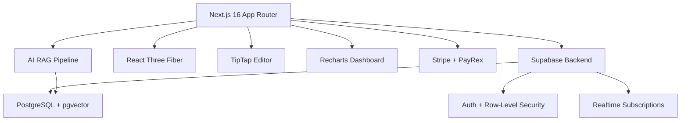
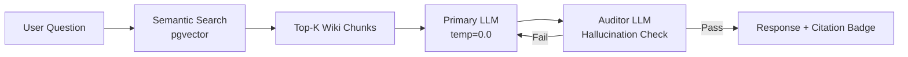
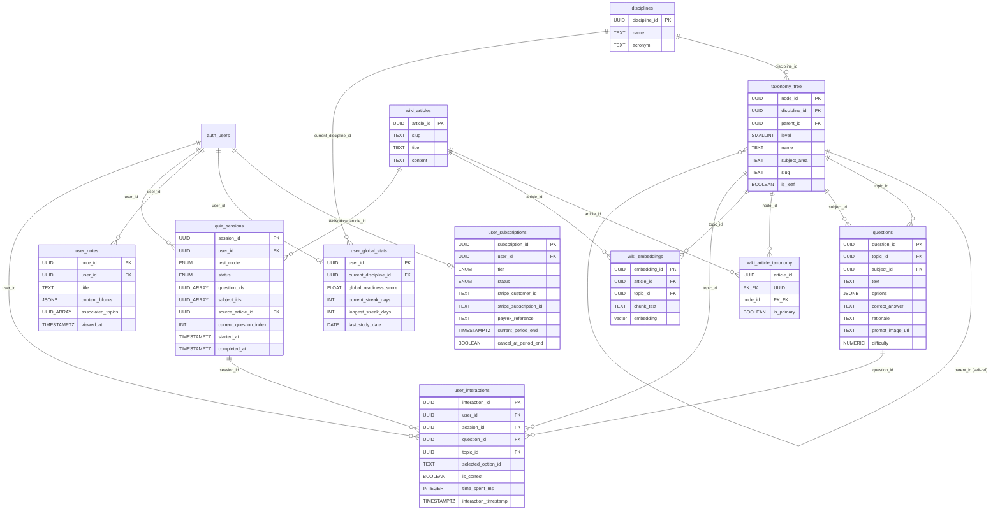

# 04 — Architecture

System architecture, database design, and infrastructure for **SlateCamp** (`slatecamp v0.1.0`).

---

## 🧠 System Overview



---

## 🗄️ Backend — Supabase

SlateCamp uses **Supabase** as the unified backend:

- **Auth:** `@supabase/ssr ^0.9.0` for server-side auth + `@supabase/supabase-js ^2.98.0` for client
- **Database:** PostgreSQL with Row-Level Security (RLS) for multi-tenant data isolation
- **Vector Store:** pgvector extension for AI tutor's closed-loop semantic search
- **Realtime:** Supabase Realtime for live quiz state sync and collaborative features
- **Storage:** Supabase Storage for 3D assets (.GLB), images, and user uploads

### Database — 72 Tables (full schema in `DATABASE_SCHEMA.sql`)

**IMPORTANT:** `profiles` PK is `id` (NOT `user_id`). All other user tables use `user_id`.

#### Core
| Table | Purpose |
|---|---|
| `profiles` | User profiles (PK: `id` → auth.users), reviewer_type, account_mode, ale_result |
| `disciplines` | Licensure Exam types (Architecture/ALE), passing thresholds |
| `taxonomy_tree` | Hierarchical subject taxonomy (subjects > topics > subtopics), bloom_level, difficulty, exam_frequency |

#### Quiz Engine
| Table | Purpose |
|---|---|
| `questions` | Question bank — IRT difficulty/discrimination, options JSONB, code_citation |
| `quiz_sessions` | Session records — config JSONB, question_ids, status |
| `user_interactions` | Per-answer telemetry — selected_option, is_correct, time_spent_ms, confidence |

#### Mastery & Scoring
| Table | Purpose |
|---|---|
| `user_node_mastery` | Per-node EMA mastery (PK: user_id + topic_id), theta, bloom flags |
| `user_global_stats` | Readiness score, streak, exam date, assessment status |
| `readiness_score_snapshots` | Score history with sub_scores JSONB |
| `blindspot_queues` | Auto-generated weak area review queues |
| `user_srs_cards` | Spaced repetition cards |
| `user_theta` | IRT theta estimates per node |

#### Content
| Table | Purpose |
|---|---|
| `wiki_articles` | Wiki content (MDX), status tracking |
| `wiki_article_taxonomy` | Article-to-taxonomy mapping |
| `wiki_ei_prompts` / `wiki_ei_responses` | Elaborative interrogation |
| `models_3d` / `spatial_hotspots` | 3D models + hotspot annotations |
| `notes` / `note_folders` | Rich notes (Tiptap JSONB) with contextual anchoring |

#### Trails
| Table | Purpose |
|---|---|
| `camp_trails` / `trail_days` / `trail_steps` | Guided study plan definitions |
| `user_trail_enrollments` / `user_trail_progress` | Enrollment + progress tracking |

#### Features
| Table | Purpose |
|---|---|
| `notifications` / `notification_preferences` | 12-type notification system with preferences |
| `design_problems` / `design_problem_sessions` | Design practice library |
| `study_pods` / `pod_members` | Study group accountability |
| `code_updates` | Building code changelog |
| `oath_taking_schedules` | Oath ceremony dates |
| `user_subscriptions` | Tier + payment tracking (Stripe/PayRex) |
| `analytics_events` | Event tracking |
| `user_computed_signals` | Pre-computed churn/velocity signals |
| `user_endurance_profiles` | Design Endurance Training tracking |

#### Metacognitive Calibration System (NEW — 6 tables)
| Table | Purpose |
|---|---|
| `session_predictions` | Pre/post-diction scores per session for calibration training |
| `calibration_snapshots` | Brier-score calibration snapshots (30-day rolling window) |
| `successive_relearning_cycles` | SR state machine: active → criterion_met → spacing → durable |
| `confusion_pairs` | Co-failure topic pairs detected via weekly analysis |
| `daily_doses` | Personalized daily study sessions with activity sequences |
| `exam_outcomes` | Self-reported exam results for outcome correlation |

#### Metacognitive Column Additions (existing tables)
| Table | New Columns | Purpose |
|---|---|---|
| `user_interactions` | `error_category`, `error_confidence`, `error_type` | Wrong answer taxonomy (6 categories) |
| `user_node_mastery` | `decay_rate`, `predicted_recall`, `optimal_review_at` | ACT-R personalized forgetting rates |
| `user_node_mastery` | `storage_strength`, `retrieval_strength`, `practice_count`, `practice_contexts` | Bjork memory strength model |
| `user_global_stats` | `simulation_count`, `last_simulation_score`, `best_simulation_score` | Exam simulation tracking |
| `questions` | `question_type`, `correct_value`, `value_tolerance`, `accepted_answers` | Generation questions (numeric, short_text, formula) |
| `spatial_hotspots` | `linked_question_id`, `quiz_trigger_distance`, `unlock_order` | 3D Lab quiz mode |
| `profiles` | `school_name`, `region` | Geographic analytics |

---

## 🧠 Metacognitive Calibration System

A research-backed second-generation learning engine that trains self-assessment accuracy alongside knowledge.

### Data Pipelines

**Post-Interaction Pipeline** (fires after every quiz answer via `submit-answer.ts`):
1. Record interaction → `user_interactions`
2. Classify error → `error_category` via `classifyError()` (6 categories: random_guess, knowledge_gap, misremembered_fact, computation_error, misread_question, concept_confusion)
3. Update decay rate → `user_node_mastery.decay_rate` via ACT-R model
4. Update memory strength → `storage_strength` + `retrieval_strength` via Bjork's Theory of Disuse
5. Process SR cycle → `successive_relearning_cycles` state machine (if applicable)

**Post-Session Pipeline** (fires after session ends via `end-session.ts` → `post-session-hooks.ts`):
1. Update calibration snapshot → `calibration_snapshots` (Brier score from last 30 days)
2. Generate feed-forward recommendations → `quiz_sessions.recommendations` JSONB
3. Update readiness score → existing pipeline

**Key Server Actions:**
- `src/lib/actions/quiz-v2/post-session-hooks.ts` — Orchestrator for post-session processing
- `src/lib/actions/mastery/post-interaction-hooks.ts` — Orchestrator for post-interaction processing
- `src/lib/actions/calibration-score-update.ts` — Brier-based calibration scoring
- `src/lib/actions/quiz-v2/generate-recommendations.ts` — Feed-forward recommendation engine
- `src/lib/actions/mastery/update-decay-rate.ts` — ACT-R decay rate updater
- `src/lib/actions/mastery/update-memory-strength.ts` — Storage/retrieval strength updater
- `src/lib/quiz/error-classifier.ts` — Wrong answer taxonomy classifier
- `src/lib/quiz/answer-matching.ts` — Generation question answer matching (Levenshtein + numeric tolerance)
- `src/lib/quiz/memory-strength.ts` — Bjork memory strength engine
- `src/lib/actions/daily-dose/generate.ts` — Adaptive daily dose generator (6 signal sources)

### New Quiz Capabilities
- **Prediction/Postdiction** — Pre-session score prediction + post-session postdiction before score reveal
- **Confidence Input** — 3-level confidence selector (Guessing/Partly sure/Confident) on every question
- **Generation Questions** — Numeric, short_text, formula question types with fuzzy answer matching
- **Interleaved Mixing** — 70/30 primary/sibling topic mixing, gated at 60% mastery (Hwang 2025)
- **Progressive Pressure** — 4-level ladder (Learning → Awareness → Pacing → Exam), unlocked by readiness score
- **Successive Relearning** — 3 consecutive correct → spaced retests at 1d/3d/7d/14d → "durable" status
- **Socratic AI** — 5-turn Socratic chat for wrong answers + AI-generated mnemonics

### New Analytics Charts (7)
- Calibration Curve, Forgetting Curves, Stamina Heatmap, Difficulty/Mastery Scatter, Study Velocity, Pacing/Accuracy, Exam Countdown

---

## 🧪 Testing & Quizzing Engine

### IRT 2-Parameter Logistic Model
The system uses Item Response Theory (IRT) to calculate user ability ($\theta$) and select optimal questions.
- **Probability of Correct Answer:** $P(\text{correct} | \theta, a, b) = \frac{1}{1 + e^{-a(\theta - b)}}$
- **$a$ (Discrimination):** How well the question distinguishes between high and low ability students.
- **$b$ (Difficulty):** The ability level at which a student has a 50% chance of getting the answer correct.

### EMA-Weighted Mastery
Topic-level mastery is calculated using an Exponential Moving Average (EMA) to prioritize recent performance over historical data.
- **Formula:** $M_{new} = (S \times \alpha) + (M_{old} \times (1 - \alpha))$
- **$\alpha$ (Smoothing Factor):** 0.2
- **$S$ (Score):** 1.0 for correct, 0.0 for incorrect.

---

## 🖥️ Frontend — Next.js 16

### Rendering Strategy

- **Wiki pages:** Static Site Generation (SSG) / Incremental Static Regeneration (ISR) — pre-rendered at build, served via CDN for sub-100ms loads
- **Quiz Engine:** Client-side with server-fetched payload — full quiz delivered as single JSON array upfront
- **Dashboard:** Server Components for initial data fetch + client-side Recharts for interactive visualizations
- **3D Lab:** Lazy-loaded via React Suspense — only loads when user navigates to Lab

### Full Project Directory

```
slate-camp/
├── src/
│   ├── app/                          # Next.js App Router
│   │   ├── (auth)/                   # Auth (login, register, onboarding, comp-exam)
│   │   ├── (protected)/ceo/          # CEO dashboard (financials, insights, team)
│   │   ├── about/ contact/ pricing/  # Marketing pages
│   │   ├── try/                      # Anonymous diagnostic quiz
│   │   ├── tools/                    # Public SEO tools (calculators)
│   │   ├── admin/                    # Content CMS (articles, questions, taxonomy, pipeline)
│   │   ├── developer/                # Dev hub (design system, console, DB viewer)
│   │   ├── dashboard/                # ── Main App ──
│   │   │   ├── wiki/[slug]/          # Knowledge Wiki
│   │   │   ├── testing/              # Testing & Review hub + mode setups
│   │   │   ├── 3d-lab/               # 3D Learning Lab
│   │   │   ├── analytics/            # Performance analytics
│   │   │   ├── camptrails/[slug]/    # Camp Trails
│   │   │   ├── flash/[category]/     # Flash Cards
│   │   │   ├── notes/                # Notes workspace
│   │   │   ├── notifications/        # Notifications page
│   │   │   ├── cram-card/            # Personal Cram Card
│   │   │   ├── area-c/              # Design practice (calculator, problems, quiz)
│   │   │   ├── pods/[podId]/         # Study Pods
│   │   │   ├── dae-mode/             # DAE Maintenance Mode
│   │   │   ├── professional/         # Professional Reference Mode
│   │   │   ├── studio/               # Studio Mode (students)
│   │   │   ├── code-updates/         # Code changelog
│   │   │   ├── results-day/          # Post-exam results flow
│   │   │   ├── assessment/           # Diagnostic quiz
│   │   │   ├── settings/             # Account settings
│   │   │   └── page.tsx              # Dashboard home
│   │   ├── quiz/[mode]/session/[id]/ # Quiz Engine v2 (setup, active, results, review)
│   │   └── api/                      # Cron, AI, payments, webhooks
│   │
│   ├── components/
│   │   ├── quiz-v2/                  # v2 Quiz Engine (QuizShell, Options, Feedback, Footer, setup/, results/, review/)
│   │   ├── dashboard/                # Dashboard (HeroCommandBar, Heatmap, BloomTracker, etc.)
│   │   ├── wiki/                     # Wiki (WikiArticle, WikiItemRenderer, widgets/)
│   │   ├── testing/                  # Testing hub (ReviewHub, SessionsTable, setup/, session/)
│   │   ├── notifications/            # Notification bell, list, preferences
│   │   ├── trails/                   # Camp Trails (library, steps, daily view)
│   │   ├── 3d/ + 3d-lab/            # R3F canvas + lab panels
│   │   ├── analytics/               # Charts (Pacing, Readiness, Stamina)
│   │   ├── notes/                   # Tiptap editor shell
│   │   ├── sidebar/                 # Rail+overlay sidebar
│   │   ├── admin/                   # CMS components
│   │   ├── ceo/                     # CEO dashboard charts
│   │   ├── ui/                      # shadcn/ui primitives
│   │   └── shared/                  # DashboardHeader, CampfireLoader
│   │
│   ├── lib/
│   │   ├── readiness-score.ts       # Anti-inflation scoring (6 vectors, PRC-weighted)
│   │   ├── srs/                     # irt.ts (IRT 2PL), sm2.ts (SM-2), retention.ts
│   │   ├── quiz/                    # mode-presets.ts, question-selection.ts, adaptive, offline/
│   │   ├── actions/                 # 60+ server actions ('use server')
│   │   │   ├── quiz-v2/             # start-session, submit-answer, end-session, get-review-data
│   │   │   └── dashboard-page.ts    # 16 parallel queries
│   │   ├── constants/               # routes, testing-modes, readiness, pricing
│   │   ├── supabase/                # server.ts, client.ts, admin.ts, middleware.ts
│   │   ├── context/                 # React contexts (session, tier, discipline)
│   │   ├── hooks/                   # Custom hooks
│   │   └── paywall/                 # Access control, daily cap, score reveal
│   │
│   ├── stores/                      # Zustand (quiz, lab, notifications, dev)
│   └── types/                       # supabase.ts (auto), app.ts, quiz-config.ts, dashboard.ts, etc.
│
├── supabase/migrations/             # 56 migration files
├── Design Questions/                # 12 design scenario JSONs
├── DATABASE_SCHEMA.sql              # 64 tables (auto-generated from Supabase)
├── CLAUDE.md                        # Project instructions
├── bun.lock                         # Bun lockfile (text format)
└── .claude/                         # Agents (17), docs (12), skills (40)
```

### Routing Architecture

The app uses a **multi-zone pattern:** public marketing, auth, dashboard (main app), quiz engine (top-level), admin CMS, CEO dashboard, and developer tools.

| **Zone** | **Routes** | **Purpose** |
|---|---|---|
| Public | `/`, `/about`, `/contact`, `/pricing`, `/try`, `/tools/*` | Marketing + anonymous diagnostic |
| Auth | `(auth)/login`, `register`, `onboarding`, `comp-exam` | Authentication + onboarding flows |
| Dashboard | `/dashboard/*` | Main authenticated app (20+ sub-routes) |
| Quiz v2 | `/quiz/[mode]/session/[id]/*` | Config-driven quiz (setup, active, results, review) |
| Admin | `/admin/*` | Content CMS, taxonomy, questions, pipeline |
| CEO | `/ceo/*` | Financial dashboard, insights, team |
| Developer | `/developer/*` | Component registry, design system, tools |
| API | `/api/*` | Cron jobs, AI endpoints, payment webhooks |

**Dashboard sub-routes (authenticated):**

| Route | Feature |
|---|---|
| `/dashboard` | Home — readiness score, heatmap, activity feed |
| `/dashboard/wiki/[slug]` | Knowledge Wiki |
| `/dashboard/testing` | Testing & Review hub (9 quiz modes) |
| `/dashboard/3d-lab` | 3D Learning Lab |
| `/dashboard/analytics` | Performance analytics |
| `/dashboard/camptrails/[slug]` | Camp Trails (guided study) |
| `/dashboard/flash/[category]` | Flash Cards |
| `/dashboard/notes` | Rich notes workspace |
| `/dashboard/notifications` | Notification center |
| `/dashboard/cram-card` | Personal Cram Card |
| `/dashboard/area-c/*` | Design practice (calculator, problems, quiz) |
| `/dashboard/pods/[podId]` | Study Pods |
| `/dashboard/settings` | Account settings |

The `dashboard/layout.tsx` acts as the **authenticated app shell** — sidebar navigation, auth gate, and shared loading state.

### Component Architecture

Components are organized by **feature domain**, not by type:

| **Directory** | **Key Components** |
|---|---|
| `quiz-v2/` | `QuizShell` (orchestrator), `OptionsColumn`, `FeedbackPanel`, `QuizFooter`, `SlideToSubmit`, `SwipeableOption`, `setup/SetupFlow`, `results/ResultsDashboard`, `review/ReviewCardList` |
| `dashboard/` | `HeroCommandBar`, `TaxonomyHeatmap`, `SubjectMasteryCard`, `BloomCognitiveTracker`, `ReviewCenterSyncCard`, `StreakRibbon`, `ImprovedActivityFeed`, `SubjectFloorAlert` |
| `wiki/` | `WikiArticle` (MDX), `WikiItemRenderer` (9 types), `WikiRightSidebar`, `WikiQuizButton/Modal`, `widgets/bp344/`, `widgets/dsgn013/` |
| `testing/` | `hub/ReviewHub`, `hub/SessionsTable`, `setup/EnduranceSetup`, `setup/StormSetup`, `session/SessionShell` |
| `notifications/` | `NotificationBell` (popover), `NotificationList`, `NotificationItem`, `NotificationPreferences` |
| `trails/` | `TrailLibrary`, `TrailStepCard`, `TrailDailyView`, `DayCompletionMoment` |
| `3d/ + 3d-lab/` | R3F `Workspace`, `InfoPanel`, `LabTopBar`, parametric controls |
| `analytics/` | `PacingQuadrant`, `ReadinessTrajectory`, `StaminaCurve`, `TimelineHeatmap`, `MemoryHealthMap` |
| `notes/` | `NotesShell`, `NotesNavigator`, `NotesList` (Tiptap editor) |
| `sidebar/` | `Sidebar` (rail+overlay pattern), `SidebarProvider`, `sidebar-constants` |
| `admin/` | `UnifiedContentEditor`, `TaxonomyEditor`, `QuestionEditor`, `SMEReviewQueue` |
| `ceo/` | Financial charts, `TeamTable`, `ExportButton` |
| `ui/` | shadcn/ui primitives (Button, Card, Dialog, Input, etc.) |
| `shared/` | `DashboardHeader`, `CampfireLoader`, `SharedPageLayout` |

### State Management

| Store | Purpose | Persistence |
|---|---|---|
| `useQuizStore` (Zustand) | Quiz session state, answers, timer, offline queue | localStorage |
| `useLabStore` (Zustand) | 3D Lab state, hotspots, parametric values | None |
| `useNotificationStore` (Zustand) | Real-time notifications via Supabase Realtime | None |
| `dev-store` (Zustand) | Developer impersonation, feature flag overrides | sessionStorage |
| React Context | Active session guard, tier, discipline, breadcrumbs, notes | None |
| Server state | Supabase via Server Components + Server Actions | Database |

### Quiz Engine — 9 Modes (Config-Driven)

All modes use a single `QuizShell` component. Behavior is driven by `QuizSessionConfig` JSONB stored in `quiz_sessions.config`. Mode presets in `src/lib/quiz/mode-presets.ts`.

| Mode | Questions | Timer | Feedback | Purpose |
|---|---|---|---|---|
| Camp | 20 | Hidden | Immediate | Guided daily study |
| Chill | 10 | Hidden | Immediate, skip-friendly | Low-pressure practice |
| Subject | 15 | Hidden | Immediate, adaptive | Single-subject deep dive |
| Focused | 15 | Hidden | Immediate | Weakest areas (data-driven) |
| Custom | User picks | Optional | User picks | Full control |
| Storm | 50 | 60min countdown | Deferred | Exam simulation |
| Full Exam | 200 | 4hr countdown | 24hr delayed | ALE simulation |
| Extended | 100 | Count-up | Immediate | Stamina training |
| Article Review | 5 | Hidden | Immediate | Wiki-integrated |

### Scoring Algorithms

- **Readiness Score** (`src/lib/readiness-score.ts`): 6 anti-inflation vectors (streak diminishing returns, difficulty ceiling, grey node penalty, Bloom's ceiling, question bank depth, recency decay). PRC-weighted: 30/30/40.
- **IRT 2PL** (`src/lib/srs/irt.ts`): Question selection at P=0.75 optimal challenge. Newton-Raphson theta update.
- **SM-2** (`src/lib/srs/sm2.ts`): Spaced repetition with quality-based interval scheduling.
- **Mastery EMA**: `S_t = 0.2 × x_t + 0.8 × S_{t-1}`

### Sidebar Navigation

| Group | Items |
|---|---|
| (standalone) | Dashboard |
| Learn | Wiki, Notes |
| Explore | 3D Lab |
| Practice | Testing & Review, Camp Trail, Flash Cards |
| Data | Analytics |
| (bottom) | Settings |

### Dev Tooling

- **Claude Code** (`.claude/`) — 17 agents, 40 skills, 12 docs
- **Package Manager:** Bun (`bun.lock` text format)
- **Schema Source of Truth:** `DATABASE_SCHEMA.sql` at project root (64 tables)
- **Deployment:** Vercel (auto-deploy on push to main)

---

## 📝 Coding Standards & Conventions

### Component Format

All React components **must** use arrow function syntax with default exports. This is the canonical format for every component in the codebase:

```tsx
import React from 'react'

const Card = () => {
  return (
    <div>Card</div>
  )
}

export default Card
```

**Rules:**

- ✅ **Arrow functions only** — no `function` declarations for components
- ✅ **Default export** at the bottom of the file — not inline
- ✅ **PascalCase** for component names (`QuizCard`, `WikiArticle`, not `quizCard`)
- ✅ **One component per file** — file name matches component name
- ❌ **No named exports** for page-level or feature-level components (use default)
- ❌ **No `React.FC` type annotation** — use explicit prop types instead:

```tsx
import React from 'react'

interface QuizCardProps {
  question: string
  options: string[]
  onSelect: (index: number) => void
}

const QuizCard = ({ question, options, onSelect }: QuizCardProps) => {
  return (
    <div className={cn('rounded-lg border p-6', 'bg-slate-900')}>
      <h3>{question}</h3>
      {options.map((opt, i) => (
        <button key={i} onClick={() => onSelect(i)}>{opt}</button>
      ))}
    </div>
  )
}

export default QuizCard
```

### Styling — Tailwind First

**Tailwind CSS is the only styling method.** No CSS modules, no styled-components, no inline `style` objects.

- ✅ Use **Tailwind utility classes** for all styling
- ✅ Use the **`cn()` utility** (from `lib/utils.ts`) for conditional and merged classes:

```tsx
import { cn } from '@/lib/utils'

const Button = ({ variant, className }: ButtonProps) => {
  return (
    <button
      className={cn(
        'rounded-md px-4 py-2 font-medium transition-colors',
        variant === 'primary' && 'bg-emerald-500 text-white hover:bg-emerald-600',
        variant === 'ghost' && 'bg-transparent text-slate-400 hover:text-white',
        className
      )}
    />
  )
}
```

- ✅ `cn()` wraps `clsx` + `tailwind-merge` — handles conditional classes and deduplicates conflicting Tailwind utilities
- ✅ Always pass `className` as an optional prop so consumers can extend styles
- ❌ **No raw CSS files** except `globals.css` for Tailwind directives and CSS custom properties
- ❌ **No `style={{}}` inline objects** — if dynamic values are needed, use CSS variables via Tailwind

---

## ⚙️ Engineering Principles

### DRY — Don't Repeat Yourself (But Don't Over-Abstract)

<aside>
⚠️

**The Rule of Three:** Don't abstract until you've written the same pattern **three times.** Premature abstraction is worse than duplication. When you do abstract, keep it simple and obvious.

</aside>

- **Extract shared UI** into `components/shared/` or `components/ui/` only after the third occurrence
- **Extract shared logic** into custom hooks in `lib/` only when two or more components share the same state/effect pattern
- **Extract shared types** into `types/` when used across 2+ feature domains
- **Never** create a `utils/helpers/misc.ts` junk drawer — keep utilities named and focused

### Keep It Simple

- **No over-engineering** — solve the current problem, not hypothetical future ones
- **No premature optimization** — measure first with React DevTools / Lighthouse, then optimize
- **No wrapper hell** — if a component wraps another component that wraps another, flatten it
- **Favor readability over cleverness** — explicit code that a new developer can understand in 30 seconds

### Best Practices

- **Destructure props** in the function signature, not inside the body
- **Co-locate** related files — a component's types, hooks, and tests live next to it
- **Avoid prop drilling** beyond 2 levels — use React Context or composition instead
- **Avoid `any`** — use proper TypeScript types. If truly unknown, use `unknown` and narrow
- **Name booleans** with `is`, `has`, `should` prefixes (`isLoading`, `hasError`, `shouldAutoSave`)
- **Name handlers** with `on` or `handle` prefixes (`onClick`, `handleSubmit`)
- **Use barrel exports (`index.ts`)** sparingly — only for `components/ui/` to simplify shadcn imports

---

## ⚡ Next.js & React Server Components

### Server Components First

Next.js 16 App Router defaults to **Server Components.** Respect this boundary:

- ✅ **Server Components (default)** — pages, layouts, data-fetching wrappers, static content
- ✅ **Client Components (`'use client'`)** — only when you need: interactivity (onClick, onChange), browser APIs (localStorage, window), hooks (useState, useEffect), or third-party client libraries (TipTap, R3F, Recharts, Framer Motion)
- ❌ **Never add `'use client'` to a page.tsx or layout.tsx** unless absolutely required — keep the boundary as low as possible in the component tree

### The Client Boundary Rule

Push `'use client'` **down** to the smallest interactive leaf component:

```tsx
// ❌ BAD — entire page is a client component
'use client'
const WikiPage = () => { /* ... */ }

// ✅ GOOD — page is a Server Component, only the interactive parts are client
// app/dashboard/wiki/page.tsx (Server Component)
import WikiArticle from '@/components/wiki/wiki-article'      // Server
import WikiHighlightToolbar from '@/components/wiki/highlight-toolbar'  // Client

const WikiPage = async () => {
  const article = await getArticle()  // Server-side data fetch
  return (
    <>
      <WikiArticle content={article} />
      <WikiHighlightToolbar />           {/* 'use client' inside */}
    </>
  )
}
```

### Data Fetching Rules

- **Fetch data in Server Components** — direct Supabase queries, no `useEffect` for initial data
- **Use `async/await`** in Server Components — no `useQuery` or `useSWR` for server-fetched data
- **Pass data down as props** from Server Components to Client Components
- **Use Server Actions** for mutations (form submissions, quiz state updates)
- **Client-side fetching** only for: real-time updates (Supabase Realtime), user-triggered actions, and polling

---

## 🏁 Frontend Performance

<aside>
💨

**Performance is not optional.** Filipino students access SlateCamp on budget Android phones over 3G/4G. Every millisecond counts. Every kilobyte counts.

</aside>

### Core Web Vitals Targets

| **Metric** | **Target** | **How** |
| --- | --- | --- |
| **LCP** (Largest Contentful Paint) | <1.5s | Server Components, SSG/ISR for Wiki, minimal client JS |
| **FID** (First Input Delay) | <50ms | Small client bundles, code splitting, no main-thread blocking |
| **CLS** (Cumulative Layout Shift) | <0.05 | Explicit dimensions on images/3D canvas, font `display: swap` |
| **TTI** (Time to Interactive) | <2s | Minimal client-side hydration, progressive enhancement |

### Performance Rules

**Bundle Size:**

- ✅ **Dynamic imports** (`next/dynamic`) for all heavy client components (TipTap, R3F, Recharts, KaTeX)
- ✅ **Tree-shake aggressively** — import specific functions, never entire libraries (`import { format } from 'date-fns'`, not `import * as dateFns`)
- ✅ **Analyze bundles** regularly with `@next/bundle-analyzer`
- ❌ **Never import Three.js or R3F outside of `/dashboard/3d-lab`** — lazy load via React Suspense

**Rendering:**

- ✅ **Server Components for all static content** — zero JS shipped for Wiki articles, layouts, static pages
- ✅ **Streaming with Suspense** — show loading skeletons instantly while data streams in
- ✅ **`loading.tsx`** in every route segment for instant visual feedback
- ✅ **ISR for Wiki pages** — pre-rendered at build, revalidated on-demand when SMEs update content

**Images & Assets:**

- ✅ **`next/image`** for all images — automatic optimization, lazy loading, responsive sizing
- ✅ **Draco-compressed `.GLB`** for all 3D models — smallest possible file size
- ✅ **Font subsetting** — only load the character ranges actually used

**Data:**

- ✅ **Quiz payload pre-fetched as single JSON** — no waterfall requests during exam
- ✅ **Optimistic UI** for all write operations — show success immediately, sync in background
- ✅ **Debounce** auto-save and search inputs (10s for quiz state, 300ms for Omnibar)
- ✅ **`React.memo`** only when profiling proves re-render cost — not as a default pattern

**What NOT to do:**

- ❌ **No global state libraries** (Redux, Zustand) unless profiling proves Context is a bottleneck
- ❌ **No `useEffect` for data fetching** in components that could be Server Components
- ❌ **No layout thrashing** — batch DOM reads/writes, use `transform` over `top/left` for animations
- ❌ **No unoptimized re-renders** — if a component re-renders on every keystroke, fix it

---

## 💳 Payment Architecture

Dual payment processing for international + Philippine local coverage:

| **Provider** | **Package** | **Use Case** |
| --- | --- | --- |
| Stripe | `stripe ^20.4.1`  • `@stripe/stripe-js ^8.9.0` | International cards, subscription management, webhook processing |
| PayRex | `payrex-node ^1.7.3` | GCash, Maya, Philippine bank transfers, local payment methods |

---

## 🤖 AI Pipeline Architecture



- **Embedding pipeline:** Wiki articles chunked → embedded → stored in Supabase pgvector
- **Retrieval:** Semantic search finds top-K relevant chunks for user query
- **Generation:** Primary LLM synthesizes answer from ONLY retrieved chunks (temperature 0.0)
- **Verification:** Auditor LLM validates no numbers/dates/codes were hallucinated
- **Fallback:** "I cannot find a definitive answer" → redirect to subject node

---

## 🔐 Security & Auth

- **Supabase Auth** with SSR integration (`@supabase/ssr`)
- **Row-Level Security (RLS)** on all user-specific tables
- **Content Sanitization:** `isomorphic-dompurify ^3.1.0` for all user-generated content
- **Input Validation:** `zod ^4.3.6` for all API inputs and form data
- **Subscription Gating:** Middleware checks tier access before serving premium routes

---

## 📦 Key Infrastructure Decisions

1. **Supabase over custom backend** — Integrated auth, DB, realtime, storage, and pgvector in one service. Reduces ops overhead for a small team.
2. **TipTap over Slate.js** — Production-ready, extensible, excellent React integration. Already supports all required block types.
3. **Dual payments (Stripe + PayRex)** — Stripe for international; PayRex for Philippine-specific methods (GCash, Maya) which are critical for the Filipino student market.
4. **pgvector over Pinecone** — Keeps vector store co-located with relational data in Supabase. Simpler architecture, fewer services to manage.
5. **Next.js 16 with Turbopack** — Fastest dev iteration; SSG/ISR for Wiki performance; Server Components for dashboard.

---

## 🔒 Proprietary IP Layer — Architecture of the Moat

> Full IP documentation, patent strategy, and AIPO filing roadmap: [SlateCamp USP & Patentable IP](https://www.notion.so/SlateCamp-USP-Patentable-IP-fe9118a0440e42c5b7ea8346c461e843?pvs=21)
> 

Every proprietary mechanic in SlateCamp has a direct technical implementation in the architecture. This section maps each protectable IP asset to its database columns, algorithms, and system behavior.

### 1. Readiness Score™ — Composite Predictive Algorithm

**Tables:** `user_interactions`, `user_node_mastery`, `user_global_stats`

The Readiness Score is a three-layer composite — not a simple percentage:

| **Layer** | **Algorithm** | **DB Column** | **IP Status** |
| --- | --- | --- | --- |
| **EMA Scoring** | Exponential Moving Average — weights recent performance heavier than historical. Decay rate is proprietary. | `user_node_mastery.mastery_weight` (EMA float, updates per interaction) | Trade Secret |
| **IRT Weighting** | Item Response Theory — correct answers on hard questions earn more mastery credit than easy ones. Difficulty is the b-parameter. | `questions.difficulty` (0.0–1.0 NUMERIC) | Trade Secret |
| **Lucky Guess Detector™** | Time-difficulty correlation — flags suspiciously fast correct answers on hard questions. Withholds full mastery credit and silently re-queues topic. | `user_interactions.time_spent_ms` × `questions.difficulty` → computed at application layer | **Patent — P0 Priority** |

**Composite formula (application layer):**

```
Readiness Score = weighted_avg(
  per_node EMA mastery_weight,
  adjusted by IRT difficulty delta,
  with Lucky Guess penalty coefficients applied pre-aggregation
)
```

The final score maps to `user_global_stats.global_readiness_score` (0.0–100.0).

---

> **Campfire Rebrand Note:** The following IP names have different student-facing labels in the UI:
> - Blindspot Protocol™ → "Focus Review" in student UI
> - Endurance Cycle™ → "Extended Practice" in student UI
> - Proof Simulation™ → "Full Exam Simulation" in student UI
> - "drill" → "practice" / "session" in student UI
> Internal docs retain the IP/trademark names for legal purposes.

### 2. Blindspot Protocol™ — Nightly Automated Weakness Targeting

**Tables:** `user_node_mastery`, `taxonomy_tree`, `quiz_sessions`

**Pipeline:**

1. **Nightly scan** — reads all `user_node_mastery` rows where `mastery_weight < 0.50` (🔴 Red) or `total_attempts = 0` (⬜ White)
2. **Queue generation** — selects 10–15 questions from the weakest 3 `topic_id` nodes, weighted toward conceptual items (`questions.difficulty > 0.6`)
3. **Session creation** — inserts a new `quiz_sessions` row with `test_mode = 'camp'` and pre-populated `question_ids[]` and `subject_ids[]`
4. **Post-completion reclassification** — after session completion, EMA mastery weights are recalculated. Nodes crossing the Amber threshold (`mastery_weight ≥ 0.60`) update immediately
5. **Spaced recurrence** — nodes that return to Red re-enter the queue. Recurrence interval governed by EMA decay rate

**IP status:** Patent (software method) + Trademark — **P0 Priority**

---

### 3. Endurance Cycle™ — Progressive Cognitive Stamina Training

**Tables:** `quiz_sessions`, `user_interactions`, `user_global_stats`

**Pipeline:**

1. **Baseline calibration** — first-week sessions analyzed for natural session length and accuracy decay curve (accuracy in 10-item blocks via `user_interactions` groupings)
2. **Weekly extension** — Endurance Session generated at 110–115% of current reliable performance window
3. **Accuracy-over-duration tracking** — post-session only; `time_spent_ms` per interaction block aggregated for the decay curve
4. **Plateau detection** — if endurance window stalls across 2+ weeks, system surfaces degrading taxonomy nodes back into Blindspot Protocol

**Key derived metric:** `accuracy_decay_curve` — computed from `user_interactions.is_correct` bucketed by `interaction_timestamp` sequence within a session.

**IP status:** Patent (software method) + Trademark — **P0 Priority**

---

### 4. Proof Simulation™ — Competence-Gated Readiness Validation

**Tables:** `quiz_sessions`, `user_interactions`, `user_node_mastery`, `user_global_stats`

**Unlock criteria (enforced at application layer):**

- `≥70%` of taxonomy leaf nodes at `mastery_weight ≥ 0.60` (Amber or above)
- Endurance window covers `≥80%` of exam-day item count

**Session behavior:**

- `quiz_sessions.test_mode = 'mock'` — no pause, no mid-session feedback
- Full exam item count + taxonomy distribution mirroring actual ALE format
- Results withheld from UI for **24 hours** post-submission (enforced at API layer)

**Recalibration:**

- Post-simulation `user_interactions` feed into a **pressure-tested Readiness Score component** — reconciles daily `mastery_weight` data against simulation performance
- `user_global_stats.global_readiness_score` updated with the pressure-weighted composite

**IP status:** Patent (software method) + Trademark — **P0 Priority**

---

### 5. Zero-Hallucination AI Tutor — Double-Pass Auditor LLM

**Tables:** `wiki_articles`, `wiki_embeddings`, `wiki_article_taxonomy`

Already documented in the AI Pipeline Architecture section above. The **patentable element** is the two-LLM verification pipeline:

```
User Query
  → pgvector semantic search (wiki_embeddings)
  → Top-K chunks retrieved
  → Primary LLM (temp=0.0) synthesizes answer from chunks only
  → Auditor LLM validates: no hallucinated numbers, dates, building codes, or legal citations
      → PASS: response + mandatory Citation Badge delivered
      → FAIL: retry loop (max 2 iterations) → graceful fallback if unresolved
```

**The "I Don't Know" Protocol** — hard constraint in system prompt: if answer not found in vector DB, AI redirects to subject node. Never fabricates.

**IP status:** Patent (software method) + Trade Secret — **P0 Priority**

---

### 6. Parametric 3D Sandbox — "Learning by Breaking"

**Route:** `/dashboard/3d-lab` | **Components:** `components/3d/`

**Tech:** React Three Fiber + Three.js + Drei + `@shadergradient/react`

**Patentable elements:**

- **Procedural geometry from code** — building models generated mathematically from `BoxGeometry`/`ExtrudeGeometry` using zoning parameters as inputs. No static 3D files. The math IS the model.
- **Code-violation red feedback** — when slider parameters exceed Philippine building code limits, geometry turns red + inline legal citation surfaces from the Wiki
- **Contextual hotspots** — glowing structural elements link directly to the exact `wiki_articles` entry covering the relevant code
- **In-canvas spatial quizzing** — quiz answers graded by physical 3D geometry adjustment, not MCQ

**IP status:** Design Patent + Trade Secret — **P1 Priority**

---

### 7. Master Syllabus Taxonomy — The Structural Backbone

**Table:** `taxonomy_tree` + `wiki_article_taxonomy`

The raw PRC syllabus is public. SlateCamp's taxonomy is not:

- Hierarchical (Subject → Module → Topic → `topic_id`) with difficulty weights and prerequisite chains
- Machine-readable with `slug`-based URL addressing
- Enforced **"No Orphan Pages" rule** — CMS blocks publishing any Wiki article, quiz question, or 3D model without a `topic_id` assignment
- Multi-discipline via `disciplines` table — adding a new exam is a data-entry exercise, not a code change

**IP status:** Copyright (compiled work) + Trade Secret — **P1 Priority**

---

### IP Protection Summary

| **IP Asset** | **Primary DB Surface** | **Protection** | **Filing Priority** |
| --- | --- | --- | --- |
| Readiness Score™ (EMA + IRT) | `user_node_mastery.mastery_weight`, `questions.difficulty` | Patent + Trade Secret | 🔴 P0 |
| Lucky Guess Detector™ | `user_interactions.time_spent_ms` × `questions.difficulty` | Patent | 🔴 P0 |
| Double-Pass Auditor LLM | `wiki_embeddings` pipeline | Patent + Trade Secret | 🔴 P0 |
| Blindspot Protocol™ | `user_node_mastery`, `quiz_sessions` | Patent + Trademark | 🔴 P0 |
| Endurance Cycle™ | `user_interactions` (accuracy decay) | Patent + Trademark | 🔴 P0 |
| Proof Simulation™ | `quiz_sessions` (mode=mock), `user_global_stats` | Patent + Trademark | 🔴 P0 |
| Parametric 3D Sandbox | `components/3d/` (R3F procedural geometry) | Design Patent + Trade Secret | 🟡 P1 |
| Master Syllabus Taxonomy | `taxonomy_tree`, `wiki_article_taxonomy` | Copyright + Trade Secret | 🟡 P1 |

---

Unified Educational OS — PostgreSQL Schema v1.0 MASTER (Supabase)

**Status:** v1.0 MASTER · **Engine:** PostgreSQL 15+ (Supabase) · **Requires:** `pgvector` extension

> The complete, production-ready schema for SlateCamp. Core Engine (Disciplines → Taxonomy → Content → Quizzing → Analytics) plus Extensions (Notes Workspace, Feedback System, Subscriptions). Integrates horizontal scaling, EMA scoring, IRT weighting, Zero-Data-Loss persistence, and pgvector RAG.
> 

---

## 🗣️ The Schema in Plain English

<aside>
💡

Think of this schema as a massive, highly secure digital university. We just added the master blueprint that allows you to expand the campus infinitely — plus the business office and the student notebook.

</aside>

### 1. The Cashier's Office (`user_subscriptions`)

Before a student walks into any building, they pass through the cashier. This table knows whether they're on the Free tier (limited access), the Camp monthly plan, the Insurance 6-month bundle, or an Institutional license. It connects to Stripe and PayRex so payments are handled by webhooks — the app never touches credit card data directly.

### 2. The Campus Directory (`disciplines`)

The front doors to different buildings on a university campus. Architecture, Law, Nursing — each discipline is a completely isolated vertical. This single table is what allows your startup to scale to 50 different professions without ever having to write a new app or build a new database.

### 3. The Filing Cabinets (`taxonomy_tree`)

Inside your specific building, there is a massive set of filing cabinets. Before we store a single question, we build the folders. Everything is strictly filed up to 6 levels deep (to handle complex professions like Law and Medicine). The `is_leaf` flag tells the UI exactly where the content lives. Each node now has a unique `slug` for clean, human-readable URLs.

### 4. The Library & The AI Brain (`questions`, `wiki_articles`, `wiki_article_taxonomy`, `wiki_embeddings`)

- **Questions:** Stores the test items with a difficulty rating, rationale, and now supports **landscape prompt images** (`prompt_image_url`) and a `correct_answer` field for legacy support.
- **Wiki Articles:** Now identified by a unique `slug` instead of a direct `topic_id` FK — making them URL-addressable and decoupled from taxonomy.
- **Wiki ↔ Taxonomy Junction:** The new `wiki_article_taxonomy` table enables **many-to-many** relationships between articles and taxonomy nodes, with an `is_primary` flag to identify the canonical mapping.
- **Embeddings:** Vectorized chunks of Wiki articles for the Zero-Hallucination RAG pipeline.

### 5. The Student Notebook (`user_notes`)

Students can capture notes from anywhere in the app — Wiki, Quiz, or 3D Lab — without leaving their screen. Each note is a block-based document (TipTap JSON) linked back to the taxonomy topics it came from. The system even tracks whether a student *revisits* their notes, so it can nudge them if they're capturing but never reviewing.

### 6. The Report Card (`user_global_stats`)

A one-row-per-user cache that eliminates expensive cross-table aggregations on every dashboard load. Tracks which discipline the user is actively studying, their overall readiness score, and streak gamification metrics.

### 7. The Magical Desk (`quiz_sessions`)

When a student starts a mock exam, the system assigns them a "Session." It remembers exactly which questions were handed out, the current position, the test mode (`camp`, `storm`, `chill`, or `mock`), and now tracks `subject_ids` for custom session filters plus a `source_article_id` for wiki-triggered quizzes. If the student's laptop dies or Wi-Fi drops, the desk holds their exact place.

### 8. The Security Camera (`user_interactions`)

Records every single click — what option they chose, whether they got it right, and how many milliseconds they spent. Now includes a **unique constraint** per user/session/question to enable upsert logic (update-on-conflict instead of duplicate rows).

### 9. The Bouncers (Row-Level Security & Grants)

Strict database security with a cleaner architecture: content tables are readable by **authenticated users only** (not public/anon), the `service_role` bypasses RLS for backend operations, and ownership policies use `FOR ALL` for cleaner CRUD on user-owned tables.

---

## 🏗️ Schema Overview

| **#** | **Table** | **Role** | **Scale Profile** |
| --- | --- | --- | --- |
| 1 | `user_subscriptions` | Paywall & Business Engine (Stripe/PayRex webhooks, tier gating) | One row per user |
| 2 | `disciplines` | Horizontal Scaling Layer: one row per licensure exam vertical | Tens of rows (one per exam type) |
| 3 | `taxonomy_tree` | Master Syllabus — up to 6 levels, `is_leaf` terminal nodes, unique `slug` for URLs | Hundreds of rows per discipline |
| 4A | `questions` | SME-Authored Question Bank with IRT difficulty, prompt images, and `correct_answer` | Thousands (grows with content) |
| 4B | `wiki_articles` | Authoritative knowledge base — now slug-based, decoupled from taxonomy via junction | Thousands (grows with content) |
| 4C | `wiki_article_taxonomy` | **NEW** — Many-to-many junction mapping articles to taxonomy nodes with `is_primary` | Thousands (multiple mappings per article) |
| 4D | `wiki_embeddings` | pgvector chunks for the Zero-Hallucination RAG pipeline | Tens of thousands (multiple chunks per article) |
| 5 | `user_notes` | Personal Workspace (TipTap JSON blocks, taxonomy-linked, revisit tracking) | Tens of thousands (grows with users) |
| 6 | `user_global_stats` | O(1) cache for Dashboard hero metrics with `current_discipline_id` | One row per user |
| 7 | `quiz_sessions` | State Manager with `question_ids[]`, `subject_ids[]`, `source_article_id`, 4 test modes | Tens of thousands (grows with users) |
| 8 | `user_interactions` | Atomic Telemetry Log with upsert-friendly unique constraint per user/session/question | **Millions of rows** (hot path, write-heavy) |

---

## 📄 Complete SQL Script

```sql
-- ============================================================
-- SLATECAMP: UNIFIED EDUCATIONAL OS SCHEMA (v1.0 MASTER)
-- Production-Ready PostgreSQL Schema for Supabase
-- ============================================================
-- Core Engine: Disciplines → Taxonomy → Content → Quizzing → Analytics
-- Extensions:  Notes Workspace, Feedback System, Subscriptions
-- Integrates:  Horizontal Scaling, EMA scoring, IRT weighting,
--              Zero-Data-Loss persistence, and pgvector RAG.
-- ============================================================

-- ────────────────────────────────────────────────────────────
-- 0. PREREQUISITES: EXTENSIONS, ENUMS & UTILITY FUNCTIONS
-- ────────────────────────────────────────────────────────────

-- Enable pgvector for the AI Contextual Tutor (Zero-Hallucination RAG)
CREATE EXTENSION IF NOT EXISTS vector;

-- Quizzing Enums
CREATE TYPE test_mode AS ENUM ('camp', 'storm', 'chill', 'mock');
CREATE TYPE session_status AS ENUM ('in_progress', 'completed', 'abandoned');

-- Subscription Enums
CREATE TYPE subscription_tier AS ENUM ('free', 'camp', 'insurance', 'institutional');
CREATE TYPE subscription_status AS ENUM ('active', 'canceled', 'past_due', 'trialing');

-- Feedback Enums
CREATE TYPE feedback_channel AS ENUM ('widget', 'post_quiz', 'hallucination_flag', 'wiki_flag', '3d_perf_report', 'nps', 'churn_exit', 'feature_pulse', 'discord', 'ambassador', 'partner', 'app_store');
CREATE TYPE feedback_feature_area AS ENUM ('wiki', 'quiz', 'notes', '3d_lab', 'ai_tutor', 'analytics', 'progression', 'auth', 'payments', 'onboarding', 'performance', 'content');
CREATE TYPE feedback_priority AS ENUM ('P0', 'P1', 'P2', 'P3');
CREATE TYPE feedback_status AS ENUM ('new', 'triaged', 'in_progress', 'resolved', 'wont_fix', 'duplicate');

-- SME Review Enums
CREATE TYPE sme_review_type AS ENUM ('hallucination', 'content_error', 'outdated_code', 'taxonomy_gap', 'question_quality', 'scheduled_audit');
CREATE TYPE sme_review_status AS ENUM ('pending', 'assigned', 'in_review', 'approved', 'rejected');

-- Auto-update trigger function for updated_at columns
CREATE OR REPLACE FUNCTION update_updated_at_column()
RETURNS TRIGGER AS $$
BEGIN
    NEW.updated_at = NOW();
    RETURN NEW;
END;
$$ LANGUAGE plpgsql;

-- ────────────────────────────────────────────────────────────
-- 1. SUBSCRIPTIONS (The Paywall & Business Engine)
-- ────────────────────────────────────────────────────────────
CREATE TABLE user_subscriptions (
    subscription_id        UUID PRIMARY KEY DEFAULT gen_random_uuid(),
    user_id                UUID NOT NULL REFERENCES auth.users(id) ON DELETE CASCADE,
    tier                   subscription_tier NOT NULL DEFAULT 'free',
    status                 subscription_status NOT NULL DEFAULT 'active',
    stripe_customer_id     TEXT,
    stripe_subscription_id TEXT,
    payrex_reference       TEXT,
    current_period_end     TIMESTAMPTZ,
    cancel_at_period_end   BOOLEAN NOT NULL DEFAULT false,
    created_at             TIMESTAMPTZ NOT NULL DEFAULT NOW(),
    updated_at             TIMESTAMPTZ NOT NULL DEFAULT NOW(),
    CONSTRAINT uq_user_subscription UNIQUE (user_id)
);

COMMENT ON TABLE user_subscriptions IS
    'Tracks user access tiers. Updated via Stripe/PayRex webhooks (Server Actions).';

CREATE INDEX idx_subs_user ON user_subscriptions(user_id);
CREATE INDEX idx_subs_stripe ON user_subscriptions(stripe_customer_id);

CREATE TRIGGER trg_user_subscriptions_updated_at
    BEFORE UPDATE ON user_subscriptions
    FOR EACH ROW EXECUTE FUNCTION update_updated_at_column();

-- ────────────────────────────────────────────────────────────
-- 2. DISCIPLINES (The Horizontal Scaling Layer)
-- ────────────────────────────────────────────────────────────
CREATE TABLE disciplines (
    discipline_id UUID PRIMARY KEY DEFAULT gen_random_uuid(),
    name          TEXT NOT NULL UNIQUE, -- e.g., 'Architecture Licensure Exam'
    acronym       TEXT NOT NULL,        -- e.g., 'ALE', 'PNLE', 'CPALE'
    created_at    TIMESTAMPTZ NOT NULL DEFAULT NOW(),
    updated_at    TIMESTAMPTZ NOT NULL DEFAULT NOW()
);

COMMENT ON TABLE disciplines IS
    'Top-level vertical. Allows SlateCamp to host Law, Med, and Architecture on the exact same codebase.';

CREATE TRIGGER trg_disciplines_updated_at
    BEFORE UPDATE ON disciplines
    FOR EACH ROW EXECUTE FUNCTION update_updated_at_column();

-- ────────────────────────────────────────────────────────────
-- 3. TAXONOMY_TREE (The Master Syllabus)
-- ────────────────────────────────────────────────────────────
CREATE TABLE taxonomy_tree (
    node_id       UUID PRIMARY KEY DEFAULT gen_random_uuid(),
    discipline_id UUID NOT NULL REFERENCES disciplines(discipline_id) ON DELETE CASCADE,
    parent_id     UUID REFERENCES taxonomy_tree(node_id) ON DELETE SET NULL,
    level         SMALLINT NOT NULL CHECK (level >= 1 AND level <= 6),
    name          TEXT NOT NULL,
    subject_area  TEXT NOT NULL,
    slug          TEXT UNIQUE,
    is_leaf       BOOLEAN NOT NULL DEFAULT false,
    created_at    TIMESTAMPTZ NOT NULL DEFAULT NOW(),
    updated_at    TIMESTAMPTZ NOT NULL DEFAULT NOW()
);

COMMENT ON TABLE taxonomy_tree IS
    'Master syllabus taxonomy. Supports up to 6 levels. is_leaf defines terminal nodes.';

CREATE INDEX idx_taxonomy_discipline ON taxonomy_tree(discipline_id);
CREATE INDEX idx_taxonomy_parent ON taxonomy_tree(parent_id);
CREATE INDEX idx_taxonomy_subject ON taxonomy_tree(subject_area);

CREATE TRIGGER trg_taxonomy_tree_updated_at
    BEFORE UPDATE ON taxonomy_tree
    FOR EACH ROW EXECUTE FUNCTION update_updated_at_column();

-- ────────────────────────────────────────────────────────────
-- 4. CONTENT LAYER: QUESTIONS & WIKI
-- ────────────────────────────────────────────────────────────

-- 4A. QUESTIONS (SME-Authored Quizzing Bank)
CREATE TABLE questions (
    question_id      UUID PRIMARY KEY DEFAULT gen_random_uuid(),
    topic_id         UUID NOT NULL REFERENCES taxonomy_tree(node_id) ON DELETE RESTRICT,
    subject_id       UUID NOT NULL REFERENCES taxonomy_tree(node_id) ON DELETE RESTRICT,
    text             TEXT NOT NULL,
    options          JSONB NOT NULL DEFAULT '[]'::jsonb, -- e.g. [{"id": "a", "text": "...", "is_correct": true}]
    correct_answer   TEXT,                               -- Optional: ID of the correct option for legacy support
    rationale        TEXT,
    prompt_image_url TEXT,                               -- Layout requirements: 1920x1080 landscape
    difficulty       NUMERIC(3,2) NOT NULL DEFAULT 0.50
                     CHECK (difficulty >= 0.0 AND difficulty <= 1.0),
    created_at       TIMESTAMPTZ NOT NULL DEFAULT NOW(),
    updated_at       TIMESTAMPTZ NOT NULL DEFAULT NOW()
);

COMMENT ON TABLE questions IS
    'SME-authored question bank. Supports landscape prompt images and integrated rationales.';

CREATE INDEX idx_questions_topic ON questions(topic_id);
CREATE INDEX idx_questions_subject ON questions(subject_id);
CREATE INDEX idx_questions_difficulty ON questions(difficulty);

CREATE TRIGGER trg_questions_updated_at
    BEFORE UPDATE ON questions
    FOR EACH ROW EXECUTE FUNCTION update_updated_at_column();

-- 4B. WIKI_ARTICLES (SME-Authored Knowledge Base)
CREATE TABLE wiki_articles (
    article_id    UUID PRIMARY KEY DEFAULT gen_random_uuid(),
    slug          TEXT NOT NULL UNIQUE,
    title         TEXT NOT NULL,
    content       TEXT NOT NULL,
    created_at    TIMESTAMPTZ NOT NULL DEFAULT NOW(),
    updated_at    TIMESTAMPTZ NOT NULL DEFAULT NOW()
);

COMMENT ON TABLE wiki_articles IS
    'The definitive source of truth. Authoritative content that feeds the UI and the AI.';

CREATE INDEX idx_wiki_slug ON wiki_articles(slug);

CREATE TRIGGER trg_wiki_articles_updated_at
    BEFORE UPDATE ON wiki_articles
    FOR EACH ROW EXECUTE FUNCTION update_updated_at_column();

-- 4C. WIKI_ARTICLE_TAXONOMY (Many-to-Many Mapping)
CREATE TABLE wiki_article_taxonomy (
    article_id UUID NOT NULL REFERENCES wiki_articles(article_id) ON DELETE CASCADE,
    node_id    UUID NOT NULL REFERENCES taxonomy_tree(node_id) ON DELETE CASCADE,
    is_primary BOOLEAN NOT NULL DEFAULT false,
    PRIMARY KEY (article_id, node_id)
);

COMMENT ON TABLE wiki_article_taxonomy IS
    'Maps Wiki articles to taxonomy nodes. Supports many-to-many relationships.';

CREATE INDEX idx_wiki_tax_article ON wiki_article_taxonomy(article_id);
CREATE INDEX idx_wiki_tax_node ON wiki_article_taxonomy(node_id);

-- 4D. WIKI_EMBEDDINGS (AI Contextual Tutor RAG Store)
CREATE TABLE wiki_embeddings (
    embedding_id  UUID PRIMARY KEY DEFAULT gen_random_uuid(),
    article_id    UUID NOT NULL REFERENCES wiki_articles(article_id) ON DELETE CASCADE,
    topic_id      UUID NOT NULL REFERENCES taxonomy_tree(node_id) ON DELETE RESTRICT,
    chunk_text    TEXT NOT NULL,
    embedding     vector(1536) NOT NULL
);

COMMENT ON TABLE wiki_embeddings IS
    'Vectorized chunks of Wiki articles for the Zero-Hallucination AI retrieval pipeline.';

CREATE INDEX idx_wiki_embeddings_vector
    ON wiki_embeddings USING ivfflat (embedding vector_cosine_ops);

-- ────────────────────────────────────────────────────────────
-- 5. NOTES & WORKSPACE (The Synthesis Ledger)
-- ────────────────────────────────────────────────────────────
CREATE TABLE user_notes (
    note_id             UUID PRIMARY KEY DEFAULT gen_random_uuid(),
    user_id             UUID NOT NULL REFERENCES auth.users(id) ON DELETE CASCADE,
    title               TEXT,
    content_blocks      JSONB NOT NULL DEFAULT '[]'::jsonb,
    associated_topics   UUID[] NOT NULL DEFAULT '{}',
    viewed_at           TIMESTAMPTZ, -- For "capture but no revisit" metrics
    created_at          TIMESTAMPTZ NOT NULL DEFAULT NOW(),
    updated_at          TIMESTAMPTZ NOT NULL DEFAULT NOW()
);

COMMENT ON TABLE user_notes IS
    'Personal workspace blocks. content_blocks stores TipTap JSON. associated_topics maps to taxonomy.';

CREATE INDEX idx_user_notes_user ON user_notes(user_id);
CREATE INDEX idx_user_notes_viewed ON user_notes(viewed_at);

CREATE TRIGGER trg_user_notes_updated_at
    BEFORE UPDATE ON user_notes
    FOR EACH ROW EXECUTE FUNCTION update_updated_at_column();

-- ────────────────────────────────────────────────────────────
-- 6. USER_GLOBAL_STATS (Dashboard Hero Metrics)
-- ────────────────────────────────────────────────────────────
CREATE TABLE user_global_stats (
    user_id                 UUID PRIMARY KEY REFERENCES auth.users(id) ON DELETE CASCADE,
    current_discipline_id   UUID REFERENCES disciplines(discipline_id) ON DELETE SET NULL,
    global_readiness_score  DOUBLE PRECISION NOT NULL DEFAULT 0.0
                            CHECK (global_readiness_score >= 0.0 AND global_readiness_score <= 100.0),
    current_streak_days     INTEGER NOT NULL DEFAULT 0 CHECK (current_streak_days >= 0),
    longest_streak_days     INTEGER NOT NULL DEFAULT 0 CHECK (longest_streak_days >= 0),
    last_study_date         DATE,
    updated_at              TIMESTAMPTZ NOT NULL DEFAULT NOW()
);

COMMENT ON TABLE user_global_stats IS
    'O(1) lookup table for the Dashboard hero numbers. Tracks which discipline the user is currently studying.';

CREATE TRIGGER trg_user_global_stats_updated_at
    BEFORE UPDATE ON user_global_stats
    FOR EACH ROW EXECUTE FUNCTION update_updated_at_column();

-- ────────────────────────────────────────────────────────────
-- 7. QUIZ_SESSIONS (The State Manager & Zero-Data-Loss)
-- ────────────────────────────────────────────────────────────
CREATE TABLE quiz_sessions (
    session_id             UUID PRIMARY KEY DEFAULT gen_random_uuid(),
    user_id                UUID NOT NULL REFERENCES auth.users(id) ON DELETE CASCADE,
    test_mode              test_mode NOT NULL DEFAULT 'camp',
    status                 session_status NOT NULL DEFAULT 'in_progress',
    question_ids           UUID[] NOT NULL DEFAULT '{}',
    subject_ids            UUID[] NOT NULL DEFAULT '{}', -- Tracks custom session filter
    source_article_id      UUID REFERENCES public.wiki_articles(article_id) ON DELETE SET NULL,
    current_question_index INTEGER NOT NULL DEFAULT 0,
    started_at             TIMESTAMPTZ NOT NULL DEFAULT NOW(),
    completed_at           TIMESTAMPTZ,
    created_at             TIMESTAMPTZ NOT NULL DEFAULT NOW(),
    updated_at             TIMESTAMPTZ NOT NULL DEFAULT NOW()
);

COMMENT ON TABLE quiz_sessions IS
    'Session state manager. question_ids and current_question_index guarantee exact resume state.';

CREATE INDEX idx_sessions_user ON quiz_sessions(user_id);
CREATE INDEX idx_sessions_status ON quiz_sessions(status) WHERE status = 'in_progress';

CREATE TRIGGER trg_quiz_sessions_updated_at
    BEFORE UPDATE ON quiz_sessions
    FOR EACH ROW EXECUTE FUNCTION update_updated_at_column();

-- ────────────────────────────────────────────────────────────
-- 8. USER_INTERACTIONS (The Atomic Telemetry Log)
-- ────────────────────────────────────────────────────────────
CREATE TABLE user_interactions (
    interaction_id       UUID PRIMARY KEY DEFAULT gen_random_uuid(),
    user_id              UUID NOT NULL REFERENCES auth.users(id) ON DELETE CASCADE,
    session_id           UUID NOT NULL REFERENCES quiz_sessions(session_id) ON DELETE CASCADE,
    question_id          UUID NOT NULL REFERENCES questions(question_id) ON DELETE RESTRICT,
    topic_id             UUID REFERENCES taxonomy_tree(node_id) ON DELETE SET NULL,
    selected_option_id   TEXT,              -- NULL allowed for timeout/skipped items
    is_correct           BOOLEAN NOT NULL,
    time_spent_ms        INTEGER DEFAULT 0 CHECK (time_spent_ms >= 0),
    interaction_timestamp TIMESTAMPTZ NOT NULL DEFAULT NOW(),
    created_at           TIMESTAMPTZ NOT NULL DEFAULT NOW(),
    updated_at           TIMESTAMPTZ NOT NULL DEFAULT NOW(),

    CONSTRAINT uq_user_session_question UNIQUE (user_id, session_id, question_id)
);

COMMENT ON TABLE user_interactions IS
    'Atomic telemetry log. time_spent_ms tracks performance. uq constraint enables upsert logic.';

CREATE INDEX idx_interactions_user_topic ON user_interactions(user_id, topic_id);
CREATE INDEX idx_interactions_user_session ON user_interactions(user_id, session_id);
CREATE INDEX idx_interactions_question ON user_interactions(question_id);
CREATE INDEX idx_interactions_timestamp ON user_interactions(interaction_timestamp DESC);

CREATE TRIGGER trg_user_interactions_updated_at
    BEFORE UPDATE ON user_interactions
    FOR EACH ROW EXECUTE FUNCTION update_updated_at_column();

-- ────────────────────────────────────────────────────────────
-- 9. ROW-LEVEL SECURITY (RLS) POLICIES
-- ────────────────────────────────────────────────────────────

-- Enable RLS everywhere
ALTER TABLE user_subscriptions ENABLE ROW LEVEL SECURITY;
ALTER TABLE disciplines ENABLE ROW LEVEL SECURITY;
ALTER TABLE taxonomy_tree ENABLE ROW LEVEL SECURITY;
ALTER TABLE questions ENABLE ROW LEVEL SECURITY;
ALTER TABLE wiki_articles ENABLE ROW LEVEL SECURITY;
ALTER TABLE wiki_article_taxonomy ENABLE ROW LEVEL SECURITY;
ALTER TABLE wiki_embeddings ENABLE ROW LEVEL SECURITY;
ALTER TABLE user_notes ENABLE ROW LEVEL SECURITY;
ALTER TABLE user_global_stats ENABLE ROW LEVEL SECURITY;
ALTER TABLE quiz_sessions ENABLE ROW LEVEL SECURITY;
ALTER TABLE user_interactions ENABLE ROW LEVEL SECURITY;

-- 9A. Content & Structs (Authenticated Read)
CREATE POLICY "authenticated_read_disciplines" ON disciplines
    FOR SELECT TO authenticated USING (true);
CREATE POLICY "authenticated_read_taxonomy" ON taxonomy_tree
    FOR SELECT TO authenticated USING (true);
CREATE POLICY "authenticated_read_questions" ON questions
    FOR SELECT TO authenticated USING (true);
CREATE POLICY "authenticated_read_wiki" ON wiki_articles
    FOR SELECT TO authenticated USING (true);
CREATE POLICY "authenticated_read_wiki_taxonomy" ON wiki_article_taxonomy
    FOR SELECT TO authenticated USING (true);

-- 9B. Grants (Bypass RLS for Service Role)
GRANT ALL ON ALL TABLES IN SCHEMA public TO service_role;
GRANT SELECT ON public.disciplines TO authenticated;
GRANT SELECT ON public.taxonomy_tree TO authenticated;
GRANT SELECT ON public.wiki_articles TO authenticated;
GRANT SELECT ON public.wiki_article_taxonomy TO authenticated;
GRANT SELECT ON public.questions TO authenticated;
GRANT ALL ON public.user_subscriptions TO authenticated;
GRANT ALL ON public.user_global_stats TO authenticated;
GRANT ALL ON public.quiz_sessions TO authenticated;
GRANT ALL ON public.user_interactions TO authenticated;

-- 9C. Ownership Policies (User Access)
CREATE POLICY "manage_own_subs" ON user_subscriptions
    FOR SELECT TO authenticated USING (auth.uid() = user_id);
CREATE POLICY "manage_own_stats" ON user_global_stats
    FOR ALL TO authenticated
    USING (auth.uid() = user_id) WITH CHECK (auth.uid() = user_id);
CREATE POLICY "manage_own_sessions" ON quiz_sessions
    FOR ALL TO authenticated
    USING (auth.uid() = user_id) WITH CHECK (auth.uid() = user_id);
CREATE POLICY "manage_own_interactions" ON user_interactions
    FOR ALL TO authenticated
    USING (auth.uid() = user_id) WITH CHECK (auth.uid() = user_id);

-- ============================================================
-- THE SLATECAMP MASTER SCHEMA IS COMPLETE.
-- ============================================================
```

---

## 🔬 Data Science Annotations

### Subscriptions & Tier Gating

The `user_subscriptions` table is the **business engine**. The `tier` enum maps directly to the pricing page: `free` → limited access, `camp` → full quizzing + analytics, `insurance` → everything including AI Tutor and Storm Mode, `institutional` → B2B university licenses. Stripe/PayRex webhooks update this table via `service_role` — users can only read their own row.

### Horizontal Scaling — The `disciplines` Table

The `disciplines` table decouples the entire schema from any single exam type. Every taxonomy node traces back through `taxonomy_tree.discipline_id` to a specific discipline. Adding a new exam (Nursing, Law, CPA) is a **data-entry exercise**, not a code change.

### Slug-Based Addressing

Both `taxonomy_tree` and `wiki_articles` now carry unique `slug` columns. This enables clean, human-readable URLs (e.g., `/wiki/fire-egress-codes`) and decouples routing from internal UUIDs. The wiki slug is `NOT NULL UNIQUE`; the taxonomy slug is `UNIQUE` but nullable (optional for non-leaf nodes).

### Many-to-Many Wiki ↔ Taxonomy

The old direct `topic_id` FK on `wiki_articles` has been replaced by the `wiki_article_taxonomy` junction table. This means:

- A single article can map to **multiple** taxonomy nodes (e.g., a fire safety article relevant to both Architecture and Nursing)
- The `is_primary` flag identifies the canonical node for breadcrumbs and SEO
- Deleting a taxonomy node cascades cleanly without orphaning articles

### Four Test Modes

The `test_mode` enum has expanded from 2 to 4 modes:

- **`camp`** — standard practice with immediate feedback
- **`storm`** — timed, no-feedback mock Licensure Exam (The Pressure Gap)
- **`chill`** — relaxed, untimed review mode
- **`mock`** — full-length simulated exam

### Session Context — `subject_ids` and `source_article_id`

`quiz_sessions` now tracks:

- **`subject_ids`** — which taxonomy subjects the user filtered to when generating the session, enabling "play it again" and analytics by filter
- **`source_article_id`** — if the quiz was triggered from a wiki article, this FK links back to it for the "Test Yourself" feature

### Upsert-Friendly Interactions

The `user_interactions` table now carries a `CONSTRAINT uq_user_session_question UNIQUE (user_id, session_id, question_id)`. This enables **upsert logic** (`INSERT ... ON CONFLICT DO UPDATE`) — when a student revisits a question within the same session, the row updates in place rather than creating duplicates. The `is_flagged` and `is_lucky_guess` columns have been removed in favor of computing these signals at the application layer.

### IRT (Item Response Theory) — Difficulty Weighting

The `difficulty` column on `questions` (0.0–1.0) is the IRT **b-parameter**. Harder questions contribute more to the Readiness Score. The new `prompt_image_url` supports questions with visual prompts (floor plans, diagrams, photos) at 1920×1080 landscape resolution.

### Notes & Smart Resurfacing

The `user_notes` table stores TipTap JSON blocks with `associated_topics` linking back to taxonomy. The `viewed_at` timestamp powers **Smart Resurfacing** — notes with `viewed_at = NULL` (captured but never revisited) trigger nudge notifications.

### Zero-Hallucination RAG — The Wiki + Embeddings Pipeline

The `wiki_articles` → `wiki_embeddings` pipeline powers the AI Contextual Tutor via a closed-loop vector corpus — no internet, no pre-training data. Every AI response carries a citation badge traceable through `embedding → article → topic`.

### RLS Architecture — Authenticated, Not Public

The RLS model has been tightened: content tables use `TO authenticated` policies instead of blanket `USING (true)` — meaning **anonymous/unauthenticated requests are denied by default**. Explicit `GRANT` statements give the `service_role` full bypass for backend operations (webhooks, Edge Functions). User-owned tables use consolidated `FOR ALL` policies instead of separate SELECT/INSERT/UPDATE policies.

---

## 📐 Entity Relationship Diagram


