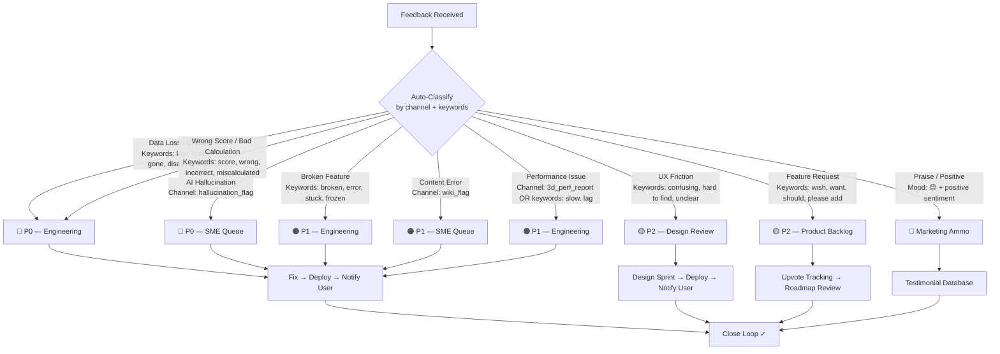

# 08 — Feedback

The comprehensive feedback collection, beta testing, user research, and product iteration handbook for **SlateCamp**. Every feedback loop — from implicit behavioral telemetry to institutional partner reviews — is mapped back to SlateCamp's taxonomy, Supabase schema, and sprint cadence.

<aside>
🏕️

**Core Principle:** SlateCamp is building for a market that is **desperate, vocal, and extremely social.** Filipino students share everything — study tips, review center gossip, and complaints — across Facebook groups, Discord servers, and university group chats. Our feedback loops must plug directly into these existing behaviors and convert raw signals into structured product intelligence.

</aside>

---

## 🎯 Feedback Philosophy

### Why Feedback Is Infrastructure

SlateCamp's product promise is **mathematical certainty** — the Readiness Score (EMA-weighted, IRT-adjusted), the Taxonomy Heatmap, the Lucky Guess Detector, and the AI Tutor's Double-Pass Verification pipeline all depend on precision. A single bug in `calculateReadinessScore()`, a hallucinated building code from the RAG pipeline, or a lost quiz session (violating the Zero-Data-Loss Mandate) doesn't just degrade UX — it **destroys trust** in a platform that asked users to bet their professional future on it.

Feedback is not a feature. It is the immune system.

### Five Principles

| **#** | **Principle** | **What It Means in Practice** |
| --- | --- | --- |
| 1 | **Every signal maps to a node** | Unstructured feedback is noise. Every submission gets tagged with a `feature_area`, a `taxonomy_node_id` (when applicable), and a `user_segment`. If it can't be mapped, it's triaged to product strategy for manual classification. |
| 2 | **Close the loop — always** | Every user who submits feedback gets a response. Bug fixed? Feature shipped? Content corrected? They hear about it via in-app notification. This turns reporters into advocates — critical in a market where word-of-mouth drives acquisition. |
| 3 | **Quantitative first, qualitative to explain** | Behavioral data from `user_interactions` and `user_node_mastery` tells us *what* is broken. Feedback tells us *why*. Always start with the data, then use qualitative signals to decode intent. |
| 4 | **The user is the expert on their problem, not the solution** | A request for "more quiz modes" might really mean "Storm Mode is too intimidating for beginners." A request for "dark mode by default" might mean "I study at 2 AM and the light mode is blinding." Listen to pain, not prescriptions. |
| 5 | **Silence is a signal** | Users who stop using a feature without complaining are more dangerous than users who complain loudly. Track *absence* as aggressively as presence. A user who viewed the 3D Lab once and never returned is screaming feedback through their behavior. |

---

## 👤 Persona-Driven Feedback Strategy

Feedback is not one-size-fits-all. The three personas from Discovery each have different pain thresholds, communication preferences, and feedback behaviors. Every feedback channel and trigger is designed with a primary persona in mind.

| **Persona** | **Primary Pain** | **Feedback Behavior** | **Best Channels** | **What Their Silence Means** |
| --- | --- | --- | --- | --- |
| **A: The Anxious Reviewee** (22–28, ALE prep) | "I don't know if I'm actually ready" | Will report data-loss and scoring bugs immediately (their career depends on it). Won't report UX friction — will just silently churn. Posts in Facebook groups before contacting support. | In-app widget, Post-Quiz Micro-Survey, Discord, Churn Exit Survey | Stopped checking Readiness Score = lost trust in the metric. Stopped quizzing = found an alternative or gave up. |
| **B: The Undergraduate** (18–22, student) | "I can't visualize how building codes translate to actual structures" | Most likely to submit 3D Lab feedback. Engages heavily in Discord. Will share screenshots and screen recordings unprompted. Less price-sensitive to churn — they have time. | Discord, 3D Lab Performance Report, Feature-Specific Pulse, Campus Ambassador Reports | Stopped using 3D Lab = WebGL performance issue on their device OR content doesn't map to their current coursework. |
| **C: The University Dean** (B2B) | "70% of our batch is bleeding red and I can't intervene" | Will never use in-app feedback. Communicates through formal channels (email, scheduled calls). Cares about aggregate data, not individual UX. Wants reports, not conversations. | Monthly partner reviews, Institutional Dashboard feedback, B2B account manager (future), structured survey | Stopped logging into Institutional Dashboard = the data isn't actionable OR they found a competing analytics tool. |

---

## 🧪 Beta Testing Strategy

### Phase 1: Closed Alpha — "The First Cohort"

| **Parameter** | **Detail** |
| --- | --- |
| Size | 20–30 users |
| Profile | Mix of current ALE reviewees (Persona A) and 4th/5th-year architecture undergrads (Persona B) from UST, UP, Mapua |
| Duration | 4 weeks |
| Incentive | Free Insurance tier for 6 months + "Founding Cohort" label in profile settings (subtle, non-gamified — no badges, streaks, or leaderboards per Design System rules) |
| Feedback channels | Private Discord channel + weekly 15-min video calls + in-app feedback widget |

**Focus Areas:**

- [ ]  **Quiz Engine reliability** — auto-save survives crash (Zero-Data-Loss Mandate), state persistence across sessions, offline payload delivery, concurrent save conflict resolution
- [ ]  **Wiki reading experience** — line lengths (65–75 char max per 05-Design), light/dark mode, Zen Mode toggle, Peek-View references, Highlight-to-Action toolkit
- [ ]  **Onboarding flow** — forced 10-item diagnostic quiz → first Readiness Score in ≤ 60 seconds → heatmap comprehension (do users understand red/yellow/green/grey?)
- [ ]  **Scoring credibility** — do users feel the Readiness Score reflects their actual competence? Does the EMA weighting feel fair (recent performance vs. historical)?
- [ ]  **Performance** — page load times vs. targets (LCP < 1.5s, TTI < 2s), 3D Lab frame rate (60 FPS target on standard laptop), quiz payload fetch (< 500ms for 200 items)

**Success Criteria:**

| **Metric** | **Target** | **Measurement** |
| --- | --- | --- |
| Data-loss incidents | **Zero** across all quiz sessions | Monitor `user_interactions` table for orphaned sessions |
| Quiz engagement | 80%+ of alpha users complete ≥ 5 quiz sessions | Query `user_interactions` grouped by `user_id` and `session_id` |
| NPS | ≥ 40 | Day 28 NPS survey |
| P0 bug resolution | 100% resolved within 48 hours | `feedback_submissions` WHERE `priority` = 'P0' |
| Core Web Vitals | LCP < 1.5s, FID < 50ms, CLS < 0.05 | Lighthouse CI on every alpha build |

### Phase 2: Open Beta — "Campus Infiltration"

| **Parameter** | **Detail** |
| --- | --- |
| Size | 200–500 users |
| Profile | Campus Ambassador recruits from target universities + early organic signups from SEO syllabus pages and TikTok "Trojan Horse" videos |
| Duration | 8 weeks (aligned with a review season window — maximize urgency) |
| Incentive | Free Camp tier during beta + referral credit (extend free tier for each referral — no gamified badges) |
| Feedback channels | In-app feedback widget + Discord server + bi-weekly survey + Campus Ambassador structured reports |

**Focus Areas:**

- [ ]  **Full feature loop** — Wiki → Quiz → Notes capture → AI Tutor → Dashboard (end-to-end journey across all Big Six features)
- [ ]  **Device diversity** — 3D Lab on low-end Android phones (budget devices are the norm for Filipino students), mid-range laptops, iPads
- [ ]  **Payment flow** — Stripe (international) + PayRex (GCash, Maya, bank transfer) end-to-end completion rates
- [ ]  **Progression mechanics** — do Blindspot Protocol (targeted weak-node quizzes) and Endurance Cycle (accuracy-over-time tracking) drive daily return?
- [ ]  **AI Tutor accuracy** — hallucination rate, citation correctness (Source Badges must link to correct `topic_id`), Socratic mode quality during active quizzes
- [ ]  **Cross-device sync** — notes, quiz state, and settings persist across desktop and mobile browsers
- [ ]  **Spaced Repetition feel** — do users notice weak topics being over-indexed? Does it feel helpful or punishing?

**Success Criteria:**

| **Metric** | **Target** | **Measurement** |
| --- | --- | --- |
| Free-to-paid conversion | ≥ 5% | Stripe + PayRex subscription events / total signups |
| DAU/MAU ratio | ≥ 30% | Daily Readiness Score check as proxy for daily active use |
| AI hallucination rate | < 1% of AI interactions | `sme_review_queue` WHERE `type` = 'hallucination' / total AI queries |
| NPS | ≥ 50 | Day 14 and Day 56 NPS surveys |
| Payment completion | ≥ 85% | Checkout initiated vs. subscription activated (no drop-off from technical friction) |
| 3D Lab engagement | ≥ 40% of users try 3D Lab at least once | `user_interactions` WHERE `feature_area` = '3d-lab' |

### Phase 3: Soft Launch — "The Beachhead"

| **Parameter** | **Detail** |
| --- | --- |
| Size | 1,000–5,000 users |
| Profile | Organic signups from TikTok/Reels campaigns (split-screen: blurry PDF vs. interactive 3D Lab), SEO syllabus content (long-tail keywords like "PD 1096 Floor Area Ratio formula"), Campus Ambassador word-of-mouth |
| Duration | Ongoing (transition to general availability) |
| Feedback channels | All channels active + university partner dashboards + in-app feedback widget |

**Focus Areas:**

- [ ]  **Conversion funnel optimization** — Free → Camp (₱499–799/mo) → Insurance (₱3,999 / 6 months) tier progression. Parent-targeted messaging for Insurance tier ("A fraction of review center fees")
- [ ]  **Retention curves** — 7-day, 30-day, 90-day retention segmented by persona and tier
- [ ]  **Infrastructure scaling** — Supabase performance under load, CDN cache-hit rates for SSG Wiki pages (target: < 100ms), WebGL memory on 3D Lab under concurrent sessions
- [ ]  **Content coverage** — identify taxonomy nodes with zero Wiki articles or zero quiz items (orphan nodes in `taxonomy_tree` not referenced by `wiki_articles` or `questions`)
- [ ]  **B2B pilot readiness** — Institutional Dashboard usability testing with actual department heads (Persona C)

**Success Criteria:**

| **Metric** | **Target** | **Measurement** |
| --- | --- | --- |
| 7-day retention | ≥ 60% | Users who return on day 7 / users who signed up on day 0 |
| 30-day retention | ≥ 40% | Same methodology, 30-day window |
| Free-to-paid conversion | ≥ 8% | Stripe + PayRex events / signups (improved from beta via funnel optimization) |
| P0 bugs in production | Zero for 2 consecutive weeks | `feedback_submissions` WHERE `priority` = 'P0' AND `environment` = 'production' |
| University pilot | ≥ 1 signed agreement | B2B sales pipeline |
| Taxonomy coverage | ≥ 90% of nodes have both Wiki + Quiz content | `taxonomy_tree` LEFT JOIN `wiki_articles`  • `questions` — flag NULL nodes |

---

## 📥 Feedback Collection System

### In-Product Feedback Channels

| **Channel** | **Trigger** | **Data Captured** | **Primary Persona** | **Routes To** |
| --- | --- | --- | --- | --- |
| **Floating Feedback Widget** | Always available (bottom-right corner, follows 05-Design elevation: `--shadow-md` at rest, `--shadow-lg` on hover) | Auto-screenshot, current route + feature area, free-text description, mood rating (😤😐😊), device info | A, B | Triage queue → Engineering or Design |
| **Post-Quiz Micro-Survey** | After every 5th quiz submission (Camp or Storm Mode) | Difficulty rating (1–5), rationale helpfulness (👍/👎), "Was anything confusing?" free-text, quiz `session_id` for correlation | A | Product analytics + Content team |
| **AI Tutor "Report Hallucination"** | Flag button on any AI response (per PRD 5: "Report Hallucination" freezes interaction) | Frozen AI interaction log (query + response + cited sources + `topic_id`), user comment describing the issue | A, B | `sme_review_queue` — P0 priority |
| **Wiki Content Flag** | Flag icon on any Wiki article paragraph | `article_id`, `topic_id`, flagged paragraph text, issue type enum: `outdated`, `incorrect`, `unclear`, `incomplete` | A | `sme_review_queue` — P1 priority |
| **3D Lab Auto-Performance Report** | Auto-triggered when FPS drops below 30 for > 5 seconds (monitored via Three.js stats) | Device info (GPU, RAM, browser, viewport), scene complexity (poly count, active lights), FPS log (10-second window), user action that caused drop | B | Engineering (3D team) — auto-filed, no user action required |
| **NPS Survey** | Day 7, Day 30, Day 90 after signup | NPS score (0–10) + open-ended "What's the #1 thing we could improve?", current tier, `user_node_mastery` snapshot | A, B | Product strategy |
| **Churn Exit Survey** | Subscription cancellation OR 14+ days inactive (detected by missing `user_interactions` rows) | Reason picker enum: `too_expensive`, `finished_studying`, `found_alternative`, `too_complex`, `content_gaps`, `technical_issues`, `other`  • free-text | A | Product strategy + Retention analysis |
| **Feature-Specific Pulse** | After first use of: 3D Lab, AI Tutor, Proof Simulation, Storm Mode, Cloze Deletion, Split-Pane Review | "How was your first experience with [Feature]?" — 1–5 star + 1-sentence comment, `feature_area` tag | A, B | Feature owner (routed by `feature_area` tag) |

### External Feedback Channels

| **Channel** | **Type** | **Frequency** | **Primary Persona** | **Data Captured** |
| --- | --- | --- | --- | --- |
| **Discord Community** | Ongoing | Always | A, B | `#feature-ideas` (upvoted requests), `#bug-reports` (with reproduction steps template), `#study-hall` (organic usage patterns), `#wins` (social proof — Readiness Score screenshots) |
| **Campus Ambassador Reports** | Structured | Weekly | B (observed) | In-person demo observations, common questions during studio sessions, competitor mentions (which review centers are students also using?), peer reactions to 3D Lab and Readiness Score |
| **University Partner Reviews** | B2B | Monthly | C | Cohort-level usage data (anonymized), dean satisfaction score, integration requests (LMS, SIS), curriculum alignment gaps, board passing rate correlation |
| **Facebook Group Monitoring** | Passive | Ongoing | A | Organic mentions of SlateCamp in ALE review groups (thousands of members), competitor comparisons, sentiment analysis, common complaints about existing review methods (validates our problem statement) |
| **In-App Feedback Widget** | In-product | Ongoing | A, B | Structured submissions tied to feature_area and taxonomy_node_id; common complaint themes, feature request volume |
| **Topnotcher SME Feedback** | Expert review | Monthly | N/A (internal) | Content accuracy audit results per `subject_area`, question quality ratings per difficulty level, taxonomy gap analysis (missing nodes), building code update alerts (NBC, PD 1096 amendments) |

### Offline Feedback Queue

Filipino students often study in areas with intermittent connectivity (commutes, provincial areas, university dead zones). The feedback widget must work offline — aligned with the same offline-first philosophy that drives the quiz engine's single-JSON-payload architecture.

**Implementation:**

- Feedback submissions saved to `localStorage` when offline (same pattern as quiz auto-save)
- Queue syncs to Supabase when connection resumes (optimistic UI — user sees "Feedback submitted ✓" immediately)
- Offline queue stores: screenshot (base64), route, free-text, mood rating, device info, timestamp
- Maximum queue depth: 10 items (prevents localStorage bloat on constrained devices)
- Sync uses exponential backoff on retry (1s → 2s → 4s → max 30s)

---

## 🗄️ Feedback Database Schema

All feedback data lives in Supabase alongside the core product tables defined in 04-Architecture. RLS policies ensure users can only read their own submissions.

### `feedback_submissions`

The primary table for all user-submitted feedback.

| **Column** | **Type** | **Description** |  |  |
| --- | --- | --- | --- | --- |
| `feedback_id` | UUID (PK) | Unique identifier |  |  |
| `user_id` | UUID (FK → auth.users) | Submitting user |  |  |
| `channel` | ENUM | `widget`, `post_quiz`, `hallucination_flag`, `wiki_flag`, `3d_perf_report`, `nps`, `churn_exit`, `feature_pulse`, `discord`, `ambassador`, `partner`, `app_store` |  |  |
| `feature_area` | ENUM | `wiki`, `quiz`, `notes`, `3d_lab`, `ai_tutor`, `analytics`, `progression`, `auth`, `payments`, `onboarding`, `performance`, `content` |  |  |
| `taxonomy_node_id` | UUID (FK → taxonomy_tree) NULL | Specific syllabus node if applicable |  |  |
| `priority` | ENUM | `P0`, `P1`, `P2`, `P3` (auto-classified, can be overridden) |  |  |
| `status` | ENUM | `new`, `triaged`, `in_progress`, `resolved`, `wont_fix`, `duplicate` |  |  |
| `mood_rating` | SMALLINT NULL | 1 (frustrated) to 3 (happy) — from widget mood picker |  |  |
| `body_text` | TEXT | User's description (sanitized via DOMPurify) |  |  |
| `screenshot_url` | TEXT NULL | Supabase Storage URL for auto-captured screenshot |  |  |
| `metadata` | JSONB | Route, device info, browser, viewport, current tier, session context |  |  |
| `source_interaction_id` | UUID (FK → user_interactions) NULL | Link to specific quiz interaction if feedback is quiz-related |  |  |
| `source_article_id` | UUID (FK → wiki_articles) NULL | Link to specific Wiki article if feedback is content-related |  |  |
| `resolved_at` | TIMESTAMPTZ NULL | When the feedback was resolved |  |  |
| `resolved_by` | UUID (FK → auth.users) NULL | Team member who resolved |  |  |
| `resolution_note` | TEXT NULL | Internal note on resolution |  |  |
| `user_notified` | BOOLEAN DEFAULT false | Whether loop-closure notification was sent |  |  |
| `created_at` | TIMESTAMPTZ DEFAULT now() | Submission timestamp |  |  |

### `sme_review_queue`

Dedicated queue for content accuracy issues that require Subject Matter Expert review.

| **Column** | **Type** | **Description** |
| --- | --- | --- |
| `review_id` | UUID (PK) | Unique identifier |
| `feedback_id` | UUID (FK → feedback_submissions) NULL | Originating user feedback (NULL for scheduled audits) |
| `type` | ENUM | `hallucination`, `content_error`, `outdated_code`, `taxonomy_gap`, `question_quality`, `scheduled_audit` |
| `article_id` | UUID (FK → wiki_articles) NULL | Affected Wiki article |
| `question_id` | UUID (FK → questions) NULL | Affected quiz question |
| `topic_id` | UUID (FK → taxonomy_tree) | Affected taxonomy node |
| `priority` | ENUM | `P0` (hallucination), `P1` (content error), `P2` (quality), `P3` (enhancement) |
| `status` | ENUM | `pending`, `assigned`, `in_review`, `approved`, `rejected` |
| `assigned_sme_id` | UUID (FK → auth.users) NULL | SME handling the review |
| `ai_interaction_log` | JSONB NULL | Frozen AI query + response + cited sources (for hallucination reports) |
| `sme_verdict` | TEXT NULL | SME's assessment and correction |
| `created_at` | TIMESTAMPTZ DEFAULT now() | When the review was created |
| `resolved_at` | TIMESTAMPTZ NULL | When the review was completed |

### `feedback_votes`

Upvoting system for feature requests (Discord + in-app).

| **Column** | **Type** | **Description** |
| --- | --- | --- |
| `vote_id` | UUID (PK) | Unique identifier |
| `feedback_id` | UUID (FK → feedback_submissions) | The feature request being upvoted |
| `user_id` | UUID (FK → auth.users) | Voter |
| `created_at` | TIMESTAMPTZ DEFAULT now() | Vote timestamp |

**Unique constraint:** `(feedback_id, user_id)` — one vote per user per feedback item.

### RLS Policies

```sql
-- Users can insert their own feedback
CREATE POLICY "Users can submit feedback"
  ON feedback_submissions FOR INSERT
  WITH CHECK (auth.uid() = user_id);

-- Users can read their own feedback
CREATE POLICY "Users can view own feedback"
  ON feedback_submissions FOR SELECT
  USING (auth.uid() = user_id);

-- Team members (role = 'admin') can read all feedback
CREATE POLICY "Admins can view all feedback"
  ON feedback_submissions FOR SELECT
  USING (auth.jwt() ->> 'role' = 'admin');

-- Users can vote
CREATE POLICY "Users can vote on feedback"
  ON feedback_votes FOR INSERT
  WITH CHECK (auth.uid() = user_id);
```

---

## 🛤️ Feedback API Routes

Feedback routes live in the Next.js App Router alongside other API routes defined in 04-Architecture.

```jsx
src/app/api/
├── feedback/
│   ├── route.ts              # POST: submit feedback (all channels)
│   ├── [id]/
│   │   └── route.ts          # GET: fetch single feedback (own only)
│   │                           PATCH: update status (admin only)
│   ├── votes/
│   │   └── route.ts          # POST: upvote a feature request
│   ├── nps/
│   │   └── route.ts          # POST: submit NPS score
│   └── churn/
│       └── route.ts          # POST: submit churn exit survey
├── sme-review/
│   ├── route.ts              # GET: list pending reviews (SME only)
│   │                           POST: create review (from flag)
│   └── [id]/
│       └── route.ts          # PATCH: submit SME verdict
```

**Validation:** Every route validates input with Zod schemas before database write — consistent with 06-Development's "validate all inputs" rule.

**Rate Limiting:** Feedback submission endpoints rate-limited to 10 submissions per user per hour (prevents spam while allowing legitimate burst reporting during frustrating sessions).

---

## 🔄 Feedback → Product Pipeline

### Triage Flow



### Priority Classification

| **Priority** | **Definition** | **Response SLA** | **Resolution SLA** | **Examples from SlateCamp Context** |
| --- | --- | --- | --- | --- |
| 🔴 **P0** | Data loss, scoring errors, security breach, payment failure, AI hallucination | < 2 hours | < 24 hours | Quiz state lost on crash (violates Zero-Data-Loss Mandate). EMA `calculateReadinessScore()` returns NaN. AI cites fabricated PD 1096 section. Stripe webhook fails silently. |
| 🟠 **P1** | Feature broken for subset of users, content error, significant UX blocker, performance degradation | < 8 hours | < 48 hours | 3D Lab crashes on Intel UHD GPUs. Wiki article cites old NBC reference (pre-amendment). PayRex GCash callback fails for Maya users. LCP > 3s on mobile. |
| 🟡 **P2** | UX friction, minor visual bug, high-upvote feature request | < 24 hours | < 1 sprint | Heatmap tooltip cut off on mobile viewport. "Flag for Review" icon too small (touch target < 44px — accessibility violation). Users want bulk-select in Syllabus Selector tree. |
| 🟢 **P3** | Nice-to-have, cosmetic, edge case with workaround | < 48 hours | Next sprint if prioritized | Typo in rationale text. Card hover animation janky on Firefox. Feature request with < 3 upvotes. |

### Categorization Taxonomy

Every piece of feedback gets tagged on three dimensions:

**1. Feature Area** (which system):

| **Tag** | **Scope** | **Maps to PRD** |
| --- | --- | --- |
| `wiki` | Wiki reader, Zen Mode, Peek-View references, Omnibar search, content accuracy | PRD 1 |
| `quiz` | Camp Mode, Storm Mode, Syllabus Selector, rationales, Teleport Links, auto-save, spaced repetition | PRD 2 |
| `notes` | TipTap editor, 1-Click Capture, cloze deletion, split-pane, cross-device sync, Source Badges | PRD 3 |
| `3d-lab` | Parametric Sandbox, Guided Tours, X-Ray/Cutaway, hotspots, WebGL/R3F performance | PRD 4 |
| `ai-tutor` | RAG pipeline, citation badges, Socratic mode, "I Don't Know" protocol, hallucination reports | PRD 5 |
| `analytics` | Taxonomy Heatmap, Readiness Score, Pacing Gauge, Node Inspector, EMA/IRT calculations | PRD 6 |
| `progression` | Blindspot Protocol, Endurance Cycle, Proof Simulation, spaced repetition scheduler | Cross-feature |
| `auth` | Login, signup, onboarding flow, session management, SSR auth | Infrastructure |
| `payments` | Stripe checkout, PayRex (GCash/Maya), tier gating, subscription management | Infrastructure |
| `onboarding` | Forced diagnostic quiz, first Readiness Score, heatmap explanation, tier selection | Cross-feature |
| `performance` | Page load times, bundle size, 3D frame rate, network latency | Non-functional |
| `content` | Wiki article quality, question bank coverage, taxonomy completeness | Content ops |

**2. Taxonomy Node** (when applicable): Links to specific `node_id` in `taxonomy_tree` — enables per-subject feedback heatmaps.

**3. User Segment**: `reviewee` (Persona A), `undergraduate` (Persona B), `institutional` (Persona C), `free_tier`, `camp_tier`, `insurance_tier`.

---

## 📊 Behavioral Signals — Implicit Feedback

The most valuable feedback is the feedback users never explicitly give. These behavioral patterns are extracted from existing telemetry tables (`user_interactions`, `user_node_mastery`) and require **zero additional user effort**.

| **Signal** | **Detection Query** | **What It Means** | **Automated Action** |
| --- | --- | --- | --- |
| **Quiz Drop-Off Mid-Session** | `user_interactions` WHERE `session_id` has < 50% of expected items AND no submission event | User abandoned quiz. Possible causes: too difficult, too long, confusing interface, performance issue, or life interruption. | If pattern repeats 3x → trigger Churn Exit Survey. If correlated with specific `topic_id` → flag topic difficulty. |
| **Wiki Bounce (< 30s)** | Page view events WHERE `time_on_page` < 30s AND no Highlight-to-Action interaction | Content didn't match expectation. Possible: wrong article surfaced by search, too dense, or missing prerequisite knowledge. | If bounce rate > 40% for an article → flag for content team review. Cross-reference with Omnibar search queries that led there. |
| **Notes Capture But No Revisit** | `user_notes` WHERE `created_at` > 7 days ago AND zero subsequent `viewed_at` events | User captured notes as a "just in case" reflex but doesn't use them for review. Notes workflow may be too disconnected from quiz/study loop. | Trigger Smart Resurfacing: surface relevant notes when user struggles on related quiz topics. |
| **Readiness Score Check Without Quizzing** | Dashboard page views WHERE user has zero `user_interactions` in same session | User is anxiously checking score without doing the work. Score anxiety without productive action. | Show contextual prompt: "Your score updates after quizzing. Start a 10-item session?" — link to Camp Mode with weak-node preset. |
| **3D Lab Single-Visit Drop** | `user_interactions` WHERE `feature_area` = '3d-lab' AND user has exactly 1 session total | 3D Lab didn't click. Possible: performance issue (especially on budget Android), unclear value proposition, or no relevant model for current study focus. | If correlated with `3d_perf_report` → engineering issue. If no perf report → trigger Feature-Specific Pulse survey. |
| **Proof Simulation Avoidance** | Users with `current_mastery_weight` > 0.8 on multiple nodes WHO have never attempted Proof Simulation | High-confidence users avoiding the "pressure test." Fear of seeing score drop under exam conditions. | Contextual nudge: "You're scoring 85%+ on 12 topics. See how you perform under real exam pressure." — link to Proof Simulation. |
| **Storm Mode Instant Quit** | `user_interactions` WHERE `test_mode` = 'storm' AND `time_spent_ms` < 60000 AND session abandoned | Storm Mode's strict no-feedback, timed format is intimidating. User panicked and quit within 1 minute. | After 2nd instant quit → suggest Camp Mode first: "Build confidence with instant feedback before tackling Storm Mode." |
| **Endurance Decay Detection** | Per-session accuracy in blocks of 10 items. Flag when accuracy drops > 15% from starting block. | User's performance degrades significantly as quiz progresses. Cognitive fatigue or time pressure. | Post-session insight: "Your accuracy dropped 18% after item 40. Consider shorter sessions or taking a 5-minute break at the halfway mark." |
| **Spaced Repetition Rejection** | Users who consistently skip or rapidly answer (< 3s) questions on weak topics served by spaced repetition | User finds repetition annoying rather than helpful. The "over-indexing" of weak topics feels punishing, not productive. | Reduce repetition frequency for that user. Log as product signal — may indicate algorithm needs tuning. |
| **Paywall Bounce** | Users who hit paywall (20 daily questions limit) → view pricing page → leave without converting | Price friction. The ₱499–799/mo Camp tier may feel too expensive relative to perceived value at that moment. | A/B test: show value proof first ("You've improved 12% this week. Unlock unlimited quizzes to keep your momentum.") before pricing page. |

---

## 🗣️ User Research Program

Ongoing qualitative research activities that complement in-product data. These are **not** one-time events — they run continuously on a cadence.

### Research Activities

| **Activity** | **Cadence** | **Participants** | **Method** | **Output** |
| --- | --- | --- | --- | --- |
| **1:1 User Interviews** | Bi-weekly (2–3 per cycle) | Mix of Persona A and B, across tiers | 30-min video call, semi-structured, recorded with consent | Interview transcript + insight tags + action items filed to product backlog |
| **Usability Testing** | Before each major feature release | 5 users per test (sufficient to find ~85% of usability issues) | Task-based testing with think-aloud protocol on staging environment | Usability report with severity ratings + video clips of friction points |
| **Card Sorting** | During taxonomy revisions | 10–15 architecture students | Open card sort for new subject areas, closed sort for validating existing taxonomy hierarchy | Taxonomy structure recommendations + confusion matrix |
| **Diary Studies** | During beta phases | 8–10 reviewees over 2-week study cycles | Daily 2-minute voice/text journal entries: "What did you study today? What frustrated you?" | Longitudinal usage patterns, emotional journey map, study habit insights |
| **Competitive Teardowns** | Quarterly | Internal team | Structured evaluation of physical review centers, emerging digital competitors, adjacent EdTech products | Competitor feature matrix + gap analysis + opportunity identification |

### Interview Question Bank

Organized by feature area — use as a starting menu, not a rigid script.

- **Wiki & Content**
    - Walk me through how you currently study a topic you're weak in. What materials do you reach for first?
    - When you're reading a Wiki article and find something you want to remember, what do you do?
    - Have you ever found information in SlateCamp that contradicted what you learned in school? What did you do?
    - How do you feel about the article length? Too long, too short, or about right?
    - Do you use Zen Mode? If not, why? If yes, when do you toggle it on?
    - When you see a Peek-View reference, do you click it? Does it interrupt your reading flow?
- **Quiz Engine**
    - Tell me about the last time you took a quiz on SlateCamp. What mode did you use? Why that mode?
    - After getting a wrong answer, do you read the full rationale? Do you click the Teleport Link to the Wiki?
    - Has there been a time when you felt the quiz was unfair — too hard, too easy, or testing something irrelevant?
    - Do you use the Flag for Review feature? What does "flagging" mean to you?
    - Have you ever lost quiz progress? How did that make you feel?
    - Storm Mode has no feedback during the test. Is that stressful or does it feel more like the real exam?
- **3D Lab**
    - Have you used the 3D Lab? What was your first impression?
    - Can you describe a building code concept that's hard to visualize? Did the 3D Lab help?
    - Did you ever adjust the parametric sliders beyond legal limits? What did you learn from the red geometry?
    - How was the performance on your device? Any lag, freezing, or visual glitches?
    - Do the hotspot tooltips make sense? Do they link you to the right Wiki content?
- **Readiness Score & Analytics**
    - How often do you check your Readiness Score? What triggers you to check it?
    - Do you trust the score? Does it feel like an accurate reflection of your readiness?
    - When you see a red node on the heatmap, what do you do next?
    - Have you used the "Fix It" button to generate a targeted quiz? Was it effective?
    - Is the Pacing Gauge useful? Do you understand what it's telling you about your exam strategy?
- **AI Tutor**
    - Have you used the AI Tutor? What kind of questions do you ask it?
    - Do you check the Source Badges on AI responses? Do you click through to the Wiki source?
    - Have you ever suspected the AI gave you wrong information? What did you do?
    - During quizzes, the AI gives hints instead of direct answers. Is that helpful or frustrating?
    - How does the AI compare to asking a friend, a professor, or searching Google?
- **Pricing & Value**
    - How did you decide which tier to choose (or stay free)?
    - At what point did you feel SlateCamp was worth paying for?
    - How does SlateCamp's price compare to your review center fees?
    - If you're on the free tier, what feature would most likely make you upgrade?
    - Did you pay yourself or did a parent/family member pay? (Relevant for "Insurance" tier parent-targeted messaging)

---

## 🏗️ Feature-Specific Feedback Integration

How each major feature uses feedback signals to drive improvement — ensuring no feature operates in a feedback vacuum.

| **Feature** | **Primary Feedback Signals** | **Key Behavioral Metrics** | **Iteration Trigger** |
| --- | --- | --- | --- |
| **Wiki** (PRD 1) | Wiki Content Flags, bounce rate, Omnibar search → no-result rate, Zen Mode toggle rate | Time-on-page per article, Highlight-to-Capture conversion rate, Peek-View click-through rate | If article bounce > 40% OR flag count > 3 for same `topic_id` → SME review + rewrite |
| **Quiz** (PRD 2) | Post-Quiz Micro-Survey, mid-session drop-offs, auto-save recovery events, rationale 👍/👎 | Completion rate by mode, avg time per item, flag-for-review usage, Teleport Link click-through | If rationale 👎 > 20% for a question → rewrite rationale. If drop-off > 30% for a topic → review difficulty calibration. |
| **Notes** (PRD 3) | Capture-but-no-revisit signal, cloze deletion creation rate, split-pane usage | Notes created per user per week, revisit rate (views after 24h), Source Badge click-through | If revisit rate < 20% → Smart Resurfacing algorithm needs tuning. If capture rate drops after onboarding → investigate UX friction in capture flow. |
| **3D Lab** (PRD 4) | Auto-Performance Reports, Feature-Specific Pulse (first session), single-visit drop signal | Session duration, parameter adjustments per session, hotspot engagement, frame rate distribution | If FPS < 30 reports > 5% of sessions → optimize geometry OR implement LOD. If single-visit drop > 60% → redesign Lab entry point. |
| **AI Tutor** (PRD 5) | Hallucination reports, "I Don't Know" trigger rate, Socratic mode satisfaction, Source Badge click-through | Queries per user per session, citation accuracy rate, Auditor LLM reject rate, response latency | If hallucination rate > 0.5% → retune embedding pipeline + expand Auditor LLM test cases. If "I Don't Know" > 15% → content coverage gap. |
| **Analytics** (PRD 6) | Readiness Score trust (NPS cross-reference), "Fix It" button usage, heatmap comprehension (onboarding) | Dashboard visits per day, node drill-down rate, "Fix It" quiz completion rate, score-check-without-quiz signal | If "Fix It" completion < 50% → quiz is too long or targets too many nodes. If score-check-without-quiz > 40% of visits → add contextual prompt. |
| **Progression** | Blindspot Protocol completion rate, Endurance Cycle decay patterns, Proof Simulation avoidance | Days between Blindspot sessions, node reclassification rate (Red → Amber → Green), Proof Simulation attempt rate vs. eligibility | If Blindspot completion < 60% → queue is too long (reduce from 20 to 10 items). If Proof avoidance > 50% among eligible users → reframe as confidence builder. |
| **Payments** | Paywall bounce rate, Churn Exit Survey, payment method failure rate | Free-to-paid conversion by trigger point, tier upgrade/downgrade rate, PayRex vs. Stripe split | If paywall bounce > 80% → test value proof before pricing. If PayRex failure > 5% → escalate to PayRex support. |

---

## 🏫 B2B Institutional Feedback Loop

Persona C (University Dean) requires a completely different feedback approach — formal, data-driven, and aligned with academic calendar cycles.

### Institutional Dashboard Feedback

The B2B Institutional Dashboard (from 02-Frameworks) serves deans and department heads. Their feedback is captured through:

- **Monthly Structured Reviews** — 30-minute video call with account manager covering: cohort usage metrics, board passing rate correlation, curriculum alignment gaps, integration requests
- **Quarterly Satisfaction Survey** — formal 10-question survey covering: data quality, dashboard usability, student adoption, support responsiveness, ROI perception
- **Feature Request Pipeline** — institutional requests tracked separately with higher priority weighting (each B2B customer represents 50–200 students)

### B2B Feedback Schema

Institutional feedback is tagged with `user_segment` = `'institutional'` and includes additional metadata:

- `institution_id` — FK to institutions table
- `cohort_size` — number of students affected
- `academic_term` — which semester/term the feedback relates to
- `integration_type` — LMS, SIS, or standalone

### Key B2B Metrics

| **Metric** | **Target** | **Why It Matters** |  |
| --- | --- | --- | --- |
| Dean satisfaction score | ≥ 8/10 | Renewal and expansion depend on dean advocacy |  |
| Student adoption rate (within institution) | ≥ 60% of enrolled cohort | Low adoption means the tool isn't integrated into the academic workflow |  |
| Feature request resolution rate | ≥ 70% within 2 sprints | B2B customers expect faster turnaround than B2C |  |
| Support ticket volume per institution | Decreasing over time | Indicates improving self-service and UX |  |

---

## 📣 Loop Closure — Notification Templates

Every resolved feedback item triggers a user notification. Templates are brief, specific, and include a direct link to the fix.

| **Scenario** | **Template** |
| --- | --- |
| **Bug Acknowledged** | "Thanks for reporting this. We've confirmed the issue with [feature] and it's being fixed now. We'll notify you when it ships." |
| **Bug Fixed** | "The [specific issue] you reported has been fixed. It's live now — try it out and let us know if it's working as expected." |
| **Content Error Fixed** | "Good catch — the [article/question] you flagged has been reviewed and corrected by our SME team. Updated content is live." |
| **AI Hallucination Confirmed** | "You were right — the AI response you flagged contained inaccurate information. It's been corrected and added to our verification test suite to prevent recurrence." |
| **Feature Request Received** | "Thanks for the idea! We've added [feature request] to our backlog. Other users can upvote it too — the most-requested features get prioritized." |
| **Feature Shipped** | "Remember when you asked for [feature]? It's here. Check it out: [link]." |

**Notification delivery:** In-app notification banner (follows 05-Design elevation system: `--shadow-md`, `--radius-md`, Camp Cobalt `#1B3FC4` accent border). No email notifications unless user opts in — respect the inbox.

---

## 🛡️ SME Content Review Pipeline

Content accuracy is existential for SlateCamp. The SME review pipeline ensures every flagged article, hallucinated response, and outdated building code gets expert attention.

### Trigger → Priority → SLA

| **Trigger** | **Auto-Priority** | **SLA** | **Resolution** |
| --- | --- | --- | --- |
| AI "Report Hallucination" flag | P0 | Review within 4 hours, resolve within 24 hours | Freeze AI response, verify against source Wiki, correct or confirm, add to Auditor LLM test suite (07-Tests Layer 2) |
| Wiki Content Flag (incorrect) | P1 | Review within 24 hours, resolve within 48 hours | SME verifies against current building codes (NBC, PD 1096), corrects Wiki article, re-embeds in pgvector |
| Wiki Content Flag (outdated) | P1 | Review within 48 hours, resolve within 1 week | Cross-reference with latest PRC/DPWH amendments, update article, flag related quiz questions for review |
| Wiki Content Flag (unclear) | P2 | Review within 1 week | Rewrite for clarity (target: 65–75 char line length, plain language), add diagrams or 3D Lab references where applicable |
| Quiz question quality issue | P2 | Review within 1 week | Evaluate difficulty rating accuracy, rewrite misleading options, improve rationale quality |
| Scheduled quarterly audit | P3 | Complete within 2 weeks of start | Full `subject_area` sweep: verify all articles against current codes, flag stale content, identify taxonomy gaps |

### Quarterly Content Audit Process

1. Generate coverage report: `taxonomy_tree` LEFT JOIN `wiki_articles` + `questions` — identify nodes with zero or thin content
2. SME reviews each `subject_area` for accuracy against latest building codes, PRC regulations, and exam format changes
3. Flag articles that reference superseded codes (e.g., old NBC provisions replaced by amendments)
4. Review question difficulty distribution per subject — ensure balanced spread across difficulty levels
5. Update `wiki_embeddings` for any corrected articles (re-run embedding pipeline)
6. File results in `sme_review_queue` with `type` = `'scheduled_audit'` for tracking

---

## 🔄 Feedback-Driven Sprint Cadence

Feedback drives development rhythm — not the other way around.

### Weekly Cycle

| **Day** | **Activity** | **Input** | **Output** |
| --- | --- | --- | --- |
| **Monday** | Triage Review | All new `feedback_submissions` from past week, behavioral signal alerts | Updated priority classifications, new items added to sprint backlog |
| **Wednesday** | Mid-Sprint Check | In-progress feedback items, SME review queue status | Unblocked items, escalated P0s if any |
| **Friday** | Loop Closure Batch | All resolved items from the week | User notifications sent, testimonials captured, metrics updated |

### Sprint (2-Week) Cycle

- **Sprint Planning (Day 1):** Top 3 feedback-driven items enter sprint alongside roadmap features. At least 1 slot reserved for P1/P2 feedback.
- **Sprint Review (Day 10):** Demo fixes shipped from feedback. Share "before/after" for UX friction fixes. Share NPS trend.
- **Sprint Retro (Day 10):** Review feedback pipeline health: average triage time, resolution time, loop closure rate, unresolved P0 count.

### Monthly Reporting

- **Feedback Volume Report:** Total submissions by channel, feature area, priority. Trend over 3 months.
- **Resolution Metrics:** Average time-to-triage, time-to-resolve, loop closure rate, reopen rate.
- **Behavioral Signal Dashboard:** Top 5 implicit feedback patterns by frequency. Feature-specific engagement trends.
- **NPS Trend:** Rolling 30-day NPS with segmentation by persona and tier.
- **SME Review Health:** Queue depth, average resolution time, quarterly audit completion percentage.

---

## 🇵🇭 Filipino Cultural Context for Feedback Design

Understanding the cultural dynamics of the Filipino student market is critical for designing feedback channels that actually get used.

### Key Cultural Patterns

- **Hiya (social shame):** Filipino students may avoid direct negative feedback because it feels confrontational. The feedback widget's mood picker (😤😐😊) provides an emotional buffer. Anonymous submission is available for the floating widget.
- **Pakikisama (group harmony):** Students are more likely to share feedback in group settings (Discord, Facebook groups) than 1:1. Campus Ambassador reports capture this group-sourced insight.
- **Barkada (friend group) dynamics:** Study groups share everything — including SlateCamp screenshots, complaints, and workarounds. The Discord community must feel like a barkada, not a corporate support forum.
- **Parent involvement:** For the Insurance tier (₱3,999 / 6 months), parents are often the buyers. Churn exit surveys should ask whether the decision-maker was the student or parent. Parent satisfaction is a separate feedback vector.
- **Pasalubong (gift-giving) culture:** Referral rewards (extend free tier for friends) align with the cultural norm of sharing good finds with your circle. Frame as "give your barkada free access" not "earn rewards."
- **Social media as default channel:** Filipino students will post complaints on Facebook or Twitter before using in-app support. Facebook Group Monitoring is not optional — it's the primary early warning system for viral negative sentiment.

---

## 📈 Internal Feedback Dashboard

The product team needs a centralized view of all feedback health metrics. Built with **Recharts** (consistent with 06-Development's analytics stack).

### Dashboard Sections

| **Section** | **Chart Type** | **Data Source** |
| --- | --- | --- |
| **Feedback Volume Over Time** | Stacked area chart (by `feature_area`) | `feedback_submissions` grouped by `created_at` week + `feature_area` |
| **Priority Distribution** | Donut chart (P0/P1/P2/P3 split) | `feedback_submissions` grouped by `priority` |
| **Resolution Time Trend** | Line chart (avg days to resolve, by priority) | `resolved_at`  • `created_at` from `feedback_submissions` |
| **Loop Closure Rate** | Single number (percentage) | `feedback_submissions` WHERE `user_notified` = true / total resolved |
| **NPS Trend** | Line chart with promoter/passive/detractor bands | NPS survey submissions over time |
| **Behavioral Signal Alerts** | Table with sparklines | Computed from `user_interactions` and `user_node_mastery` daily aggregates |
| **SME Queue Health** | Bar chart (pending/in-review/resolved by week) | `sme_review_queue` grouped by `status` and `created_at` week |
| **Feature Area Heatmap** | Treemap (sized by volume, colored by avg priority) | `feedback_submissions` grouped by `feature_area` |

---

## 🧪 Feedback → Test Pipeline Integration

When feedback reveals a bug or gap, it should feed directly into 07-Tests to prevent regression. This creates a virtuous cycle: feedback → fix → test → deploy → notify user.

### Process

1. **P0/P1 bug reported via feedback** → Engineering fixes the issue
2. **Before the fix PR is merged**, a regression test must be written that reproduces the original bug scenario
3. The test is tagged with the originating `feedback_id` in a code comment:

```tsx
// Regression: feedback_id=abc123 — quiz auto-save failed on iOS Safari
// when user switched tabs during Storm Mode
it('preserves quiz state when tab loses focus in Storm Mode', async () => {
  // ... test implementation
})
```

1. **Hallucination reports** create new test cases in the AI RAG integration test suite (07-Tests Layer 2):

```tsx
// Regression: sme_review_id=xyz789 — AI fabricated NBC Section 1207.3
it('rejects fabricated building code references', async () => {
  const response = await queryAITutor('What does NBC Section 1207.3 say?')
  expect(response.type).toBe('fallback') // "I don't have that information"
})
```

1. **Content corrections** trigger re-embedding of the affected Wiki article — the embedding pipeline integration test verifies the updated vector is searchable

---

## 🔒 Feedback Widget Accessibility

The floating feedback widget must meet WCAG 2.1 AA standards (consistent with 07-Tests accessibility requirements).

- **Keyboard accessible:** Widget opens with `Ctrl+Shift+F` shortcut. All form fields reachable via Tab. Submit via Enter.
- **Screen reader support:** Widget button has `aria-label="Submit feedback"`. Form fields have associated `<label>` elements.
- **Focus trap:** When widget is open, focus cycles within the widget (same pattern as Cmd+K Omnibar modal).
- **Color contrast:** Mood rating emojis supplemented with text labels ("Frustrated", "Neutral", "Happy") for screen readers and color-blind users.
- **Touch targets:** All interactive elements ≥ 44px (per WCAG 2.1 touch target guidelines).
- **Motion:** Widget slide-in animation ≤ 150ms (per 05-Design Campfire Standard).

---

## ✅ Per-Release Feedback Health Checklist

Before every production release, verify feedback infrastructure is healthy:

- [ ]  Floating feedback widget renders on all authenticated routes (`/dashboard/*`)
- [ ]  Feedback submissions persist to `feedback_submissions` table (verify with test submission)
- [ ]  Offline feedback queue syncs correctly after reconnection
- [ ]  Post-Quiz Micro-Survey triggers after 5th quiz submission (not before)
- [ ]  AI "Report Hallucination" flag freezes interaction and creates `sme_review_queue` entry
- [ ]  Wiki Content Flag captures correct `article_id` and `topic_id`
- [ ]  NPS survey triggers on correct day thresholds (Day 7, 30, 90)
- [ ]  Churn Exit Survey triggers on subscription cancellation AND 14-day inactivity
- [ ]  Loop closure notifications render correctly (check in-app notification styling)
- [ ]  Internal feedback dashboard loads with current data (no stale cache)
- [ ]  SME review queue is accessible to SME-role users only (RLS policy verified)
- [ ]  All feedback API routes validate input with Zod schemas
- [ ]  Rate limiting active on `/api/feedback` (10/user/hour)