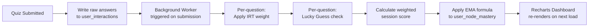

# 09 — Analytics

The product analytics engine, scoring methodology, mastery visualization, and measurement infrastructure for **SlateCamp** (`slatecamp v0.1.0`). This is not a dashboard. It is the mathematical proof that you are ready.

<aside>
🎯

**The Premise:** Every review center in the Philippines sells preparation. None of them sell *proof.* A student walks into the ALE having spent ₱40,000 on lectures, memorized stacks of photocopied PDFs, and completed hundreds of practice problems — and still cannot answer the only question that matters: *"Am I going to pass?"* SlateCamp's analytics engine exists to answer that question with mathematical precision. We do not guess. We measure, weight, decay, and project. The Readiness Score is not a motivational tool. It is a diagnostic instrument.

</aside>

---

## The Core Thesis

Most study platforms track *activity* — quizzes taken, articles read, hours logged. Activity metrics are vanity metrics. A student who completes 500 practice questions but gets 45% correct on Structural Design is not "active." That student is failing in slow motion and doesn't know it.

SlateCamp tracks **competence.** Every interaction — every answered question, every flagged item, every second of hesitation — feeds a scoring engine that maintains a real-time, per-topic mastery profile against the complete board exam syllabus. The output is a single, defensible number: the **Readiness Score.**

The Readiness Score does three things no competitor does:

- **It decays.** Mastery earned three months ago is worth less than mastery proven yesterday. The score reflects who you are *today*, not who you were at your peak.
- **It penalizes luck.** A correct answer on a hard question answered in 4 seconds does not receive the same credit as the same answer given in 90 seconds with deliberation. Speed without struggle is noise.
- **It weights difficulty.** Getting a complex Item Response Theory–calibrated question right contributes more to your score than getting a recall-level question right. The score rewards depth, not volume.

The result: a student whose Readiness Score reads 82 across all taxonomy nodes is not *hoping* to pass. That student has the data to *know.*

---

## The Readiness Score — Mathematical Foundation

The Readiness Score is a composite metric calculated per taxonomy node and aggregated to the subject and global level. It is built on three interlocking statistical mechanisms. Each one exists to solve a specific failure mode in traditional assessment.

### Mechanism 1: Exponential Moving Average (EMA)

**Problem it solves:** Static averages lie. A student who scored 30% in Week 1 and 90% in Week 12 has a "60% average" — a number that describes neither their past incompetence nor their current mastery. It is useless.

**How it works:**

The EMA applies a **decay factor (α)** that exponentially weights recent performance over historical performance. The formula:

$S_t = \alpha \cdot x_t + (1 - \alpha) \cdot S_{t-1}$

Where:

- $S_t$ = current Readiness Score for a given taxonomy node
- $x_t$ = raw score from the most recent quiz session on that node
- $S_{t-1}$ = previous Readiness Score
- $\alpha$ = smoothing factor (calibrated between 0.2–0.4 during beta)

**What this means for the student:**

- A strong recent performance on a topic you previously struggled with will **rapidly** pull your score upward — rewarding genuine improvement
- A topic you mastered months ago but haven't revisited will **gradually drift** toward amber, then red — surfacing atrophy before the exam does
- The score cannot be "gamed" by cramming once. Sustained, repeated competence is the only path to green

**Edge cases handled:**

- **Cold start:** A node with zero quiz history returns a score of 0, displayed as ⬜ (Unexplored) on the heatmap
- **Single data point:** One quiz session returns the raw score directly — no smoothing applied until there are at least two data points
- **Boundary clamping:** The score is hard-clamped to the 0–100 range. Malformed inputs (negative scores, values above 100) are normalized before calculation

### Mechanism 2: Item Response Theory (IRT) Weighting

**Problem it solves:** Not all correct answers are equal. A student who correctly identifies a simple building code citation (recall) should not receive the same mastery credit as a student who correctly calculates Floor Area Ratio across a multi-use zoning problem (application). Flat scoring conflates memorization with understanding.

**How it works:**

Each question in the SlateCamp question bank carries a **difficulty parameter** (calibrated 0.0–1.0 by SMEs and refined by aggregate response data):

- Correctly answering a **high-difficulty** question (≥ 0.7) contributes disproportionately more to the Readiness Score than a low-difficulty question
- Incorrectly answering a **low-difficulty** question (≤ 0.3) penalizes the score more than missing a hard one — because it signals a fundamental gap, not a stretch-goal miss

The IRT weight modifies the raw score ($x_t$) before it enters the EMA calculation:

$x_t = \frac{\sum_{i=1}^{n} w_i \cdot c_i}{\sum_{i=1}^{n} w_i} \times 100$

Where:

- $w_i$ = difficulty weight of question $i$
- $c_i$ = 1 if correct, 0 if incorrect
- $n$ = total questions in the session

**What this means for the student:**

- Repeating easy questions to inflate your score does not work. The math sees through it.
- Tackling harder questions — even if you get some wrong — builds a more credible mastery profile
- The Readiness Score reflects *depth of understanding*, not breadth of activity

### Mechanism 3: Lucky Guess Detection

**Problem it solves:** Multiple-choice exams have a 25% baseline guess rate. A student who answers a difficulty-0.8 question correctly in 4 seconds almost certainly guessed. Granting full mastery credit for a lucky guess corrupts the integrity of the score.

**How it works:**

The Lucky Guess Detector applies a **confidence discount** based on two inputs:

- **Time spent** on the question ($t_i$) relative to the median time for that question's difficulty band
- **Difficulty level** ($d_i$) of the question

**Flagging criteria:**

| **Condition** | **Action** |
| --- | --- |
| Correct + difficulty ≥ 0.7 + time < 25th percentile for that difficulty band | Flag as suspected lucky guess. Apply 50% credit weight to that response. |
| Correct + difficulty < 0.3 + time < 25th percentile | No flag. Fast answers on easy questions are expected, not suspicious. |
| Correct + difficulty ≥ 0.5 + time within normal range | Full credit. Deliberate correct answers on hard questions are the gold standard. |

**What this means for the student:**

- The system does not punish speed on easy material — that is a sign of fluency
- The system *does* withhold full credit when a hard question is answered suspiciously fast — because that credit would misrepresent actual mastery
- Over time, the Lucky Guess Detector builds a secondary confidence layer: a student whose Readiness Score is 85 *without* any flagged guesses has a more reliable profile than one at 85 with 15% flagged responses

---

## The Taxonomy Heatmap — Visual Mastery at a Glance

The Readiness Score is the number. The Taxonomy Heatmap is the map.

Every node in the Master Syllabus Taxonomy — from top-level subjects (Structural Design, Building Technology, History of Architecture) down to individual topics (Reinforced Concrete: Beam Design, PD 1096: Floor Area Ratio) — is displayed as a color-coded block. The hierarchy is nested: click a subject to expand its modules; click a module to expand its topics.

### Color Classification

| **State** | **Score Range** | **Color** | **Design Token** | **Meaning** |
| --- | --- | --- | --- | --- |
| Mastered | ≥ 85% | 🟢 Green | `--emerald` (#2D9F6F) | Reliably competent. Revisit only if score decays below threshold. |
| Familiar | 60–84% | 🟡 Amber | `--amber` (#D4951A) | Developing but not dependable. Targeted review recommended. |
| Critical | < 60% | 🔴 Red | `--warm-red` (#D64545) | Active vulnerability. These nodes will cost you points on exam day. |
| Unexplored | 0 attempts | ⬜ Grey | `--ink-tertiary` (#8896A7) | No data. Unknown risk. These are the silent threats. |

Color is never decorative. Every hue maps to a semantic state defined in the Design System (05-Design). Heatmap nodes also carry text labels and patterns — color is never the sole indicator of meaning (WCAG 2.1 AA compliance).

### Node Inspector

Click any node on the heatmap to open the **Node Inspector** — a side panel containing:

- **Historical accuracy graph** — time-series line chart (Recharts) showing score trajectory over weeks
- **Attempt count** — total questions attempted on this node
- **Average time per item** — compared against the board exam's expected pace
- **Last encountered date** — how recently this node was tested (staleness indicator)
- **"Fix It" button** — one-click auto-generates a targeted quiz pulling exclusively from this node's question bank

The Node Inspector answers the question a student asks when they see a red block: *"How bad is it, and what do I do about it?"*

---

## Intervention Mechanics — What the Data Does

A heatmap that shows red nodes but offers no path forward is a diagnostic without a prescription. SlateCamp's analytics engine does not merely identify weakness. It systematically eliminates it.

> **Campfire Rebrand Note:** The following IP names have different student-facing labels in the UI:
> - Blindspot Protocol™ → "Focus Review" in student UI
> - Endurance Cycle™ → "Extended Practice" in student UI
> - Proof Simulation™ → "Full Exam Simulation" in student UI
> - "drill" → "practice" / "session" in student UI
> Internal docs retain the IP/trademark names for legal purposes.

### The Blindspot Protocol

When a user's heatmap contains 3+ red nodes, the dashboard surfaces a **Blindspot Queue** — a prioritized list of the weakest taxonomy nodes, ordered by a compound score of:

- Recency of last attempt (stale nodes rank higher)
- Severity of deficit (lower mastery weight ranks higher)
- Exam frequency (topics that appear more often on historical board exams rank higher)

The Blindspot Queue is not a suggestion. It is the mathematically optimal study order for maximum score improvement per hour invested.

**Parameters:**

- Queue length: 10 items per session (calibrated to prevent cognitive overload — if 08-Feedback signals show < 60% completion, reduce to 5)
- Node reclassification: After completing a Blindspot session, at least one node should move from Red → Amber on the heatmap. If reclassification rate drops below 40%, the question pool difficulty is re-evaluated.

### The Endurance Cycle

Board exams are not 10-question quizzes. The ALE is a 6-hour endurance test across multiple subjects. Performance degradation over time — answering accurately at item 20 but guessing wildly at item 180 — is a failure mode that short quizzes never expose.

The Endurance Cycle tracks **accuracy decay over session length:**

- Quiz sessions are segmented into blocks of 10 items
- Accuracy is plotted per block, producing a **fatigue curve**
- If accuracy drops > 15% from the first block to any subsequent block, the system identifies the **decay point** — the item number where the student's performance begins to collapse

**What the student sees:**

- A post-session insight card: *"Your accuracy dropped 18% after item 40. Your current endurance ceiling is approximately 40 items before fatigue degrades performance."*
- A recommended session length based on their personal decay curve
- A pacing gauge showing average time per item compared against the board exam's expected pace (total exam time ÷ total items)

**What this changes:**

Students stop measuring readiness by *what they know* and start measuring it by *how long they can sustain what they know under pressure.* This is the difference between a practice quiz and an exam.

### Proof Simulation

The Readiness Score measures competence under normal conditions. The Proof Simulation measures competence under **exam conditions** — time pressure, no feedback, sequential lockout, and full-length session duration.

**How it works:**

- Unlocked when a student's **Readiness Score ≥ 65%** (minimum viable mastery). If below 65%, the button is grayed out with: *"Unlock Full Exam Simulation when your Readiness Score reaches 65%. Currently: [X]%."*
- Simulates a full-length board exam section: 100+ items, strict countdown, no rationale access, no "Flag for Review" rescue
- After submission, the system generates a **Proof Score** — the Readiness Score recalculated using only Proof Simulation data
- The delta between the student's normal Readiness Score and their Proof Score reveals the **pressure gap** — the difference between what they know and what they can perform under stress

**Interpretation:**

| **Delta** | **Interpretation** | **Recommendation** |
| --- | --- | --- |
| ≤ 5 points | Stable under pressure. Exam-ready. | Maintain cadence. Focus on remaining amber nodes. |
| 6–15 points | Moderate pressure sensitivity. Competence exists but execution degrades under constraint. | Increase Storm Mode frequency. Practice under time pressure specifically. |
| > 15 points | Significant pressure gap. The student knows the material but cannot perform it under exam conditions. | Endurance training: longer sessions, strict timing, no pausing. Address test anxiety directly. |

The Proof Simulation is the final gate. A student who passes it has not just studied the syllabus — that student has *stress-tested* their knowledge under conditions that mirror the actual examination.

---

## Pacing Intelligence

The board exam does not grade on accuracy alone. A student who answers 120 items correctly but leaves 80 blank scores lower than a student who answers all 200 items at 65% accuracy. Pacing is a survival skill.

### The Pacing Gauge

Displayed on the Analytics Dashboard, the Pacing Gauge calculates:

$\text{Projected Completion} = \frac{\text{Total Exam Time (minutes)}}{\text{User's Average Time per Item (minutes)}}$

If Projected Completion < Total Items, the system displays a **pacing deficit warning:**

> *"At your current pace of 3m 15s per item, you would complete 74 of 200 items in the allotted time. That leaves 126 items unanswered."*
> 

The warning is not delivered as encouragement. It is delivered as arithmetic. The student can then:

- Practice with Storm Mode's strict countdown to build pace under pressure
- Review their per-topic time distribution to identify which subjects slow them down disproportionately
- Use the Endurance Cycle to find their fatigue-driven pace collapse point

### Per-Topic Time Distribution

Not all topics consume equal time. Structural Design calculations take longer than History of Architecture recall items. The Pacing Intelligence system breaks down average time per item by taxonomy node, allowing the student to:

- Identify which subjects are dragging their overall pace down
- Allocate extra drilling time to slow-but-important topics
- Develop a conscious test-day strategy: fast-first vs. hard-first vs. sequential

---

## Institutional Analytics — The B2B Layer

The Readiness Score is a B2C product. The **Cohort Dashboard** is how that same data becomes a B2B product.

University deans and department heads (Persona C from 01-Discovery) do not care about individual student heatmaps. They care about two things:

1. What percentage of my graduating batch will pass the board exam?
2. Which subject areas are dragging the cohort down — and can I intervene before the exam?

### Cohort Dashboard Features

- **Aggregate Heatmap** — same taxonomy visualization, but showing class-wide mastery distribution instead of individual scores. Nodes colored by percentage of cohort at each mastery level.
- **Cohort Readiness Distribution** — histogram showing how many students fall in each Readiness Score band (0–40, 40–60, 60–80, 80–100). The leftward tail is the at-risk population.
- **Subject-Level Cohort Weakness** — ranked list of taxonomy subjects by lowest average mastery. The dean sees: *"67% of your cohort is below 60% on Structural Design — Reinforced Concrete."*
- **Early Warning System** — students whose Readiness Score trajectory is flat or declining over 4+ weeks are flagged as at-risk. The dean can intervene with targeted support before the exam cycle.
- **Board Passing Rate Projection** — a statistical estimate of the cohort's expected passing rate, based on historical correlation between Readiness Scores and actual board results (calibrated after first exam cycle with real outcome data).

### Data Isolation

Institutional data is anonymized for individual privacy. Deans see aggregate distributions, not individual names. Students must opt into institutional tracking. Row-Level Security (RLS) policies in Supabase enforce strict access boundaries — a dean cannot query individual `user_node_mastery` rows, only pre-aggregated views.

---

## Data Architecture

### Core Tables

All analytics data lives in Supabase PostgreSQL, co-located with the product's core tables defined in 04-Architecture.

| **Table** | **Purpose** | **Key Columns** | **Write Frequency** |
| --- | --- | --- | --- |
| `user_interactions` | Atomic telemetry log — every quiz answer, every click, every timestamp | `interaction_id`, `user_id`, `session_id`, `question_id`, `topic_id`, `selected_option_id`, `is_correct`, `time_spent_ms`, `timestamp`, `test_mode` | Every quiz answer (high volume) |
| `user_node_mastery` | Aggregated Readiness Scores per user per taxonomy node | `user_id`, `topic_id`, `total_attempts`, `total_correct`, `current_mastery_weight` (EMA float), `avg_time_ms`, `last_encountered` | On quiz submission (batch recalculation) |
| `taxonomy_tree` | The Master Syllabus hierarchy — every subject, module, and topic | `node_id`, `parent_id`, `level` (1–3), `name`, `subject_area` | Rarely (content team updates) |

### Calculation Pipeline

**Timing:** The full recalculation pipeline completes within the auto-save round trip target of < 200ms (per 07-Tests performance benchmarks). The student sees their updated Readiness Score and heatmap on the next dashboard visit — no manual refresh required.

**Offline resilience:** If the student completes a quiz offline (full payload delivered as single JSON upfront), the submission queues locally and the pipeline executes on reconnection. Zero data loss.

### Visualization Stack

All dashboard components are rendered with **Recharts** (`recharts ^3.8.0`), consistent with the project's established dependency map (06-Development):

- **Taxonomy Heatmap** — nested treemap with color-coded blocks, click-to-expand hierarchy
- **Readiness Score time-series** — line chart with EMA smoothing visually rendered (the student can see the decay and growth of their score over weeks)
- **Pacing Gauge** — radial gauge comparing current pace against exam pace
- **Endurance Curve** — per-session accuracy plotted by block (line chart with decay trendline)
- **Proof Simulation delta** — bar chart comparing normal Readiness Score vs. Proof Score, per taxonomy node

---

## Business Intelligence — KPIs

### North Star Metric

<aside>
📐

**Weekly Active Learners (WAL):** Users who completed at least one quiz session OR spent 15+ minutes in the Wiki in the past 7 days. This measures genuine learning engagement, not passive logins or idle sessions.

</aside>

### Revenue & Growth

| **Metric** | **Definition** | **Target** | **Data Source** |
| --- | --- | --- | --- |
| **Free-to-Paid Conversion** | % of free users who upgrade to Camp (₱499–799/mo) or Insurance (₱4,999/yr) | Phase 2: ≥ 8%, Phase 3: ≥ 15% | Stripe + PayRex subscription events |
| **DAU/MAU Ratio** | Daily stickiness — proportion of monthly users who return daily | ≥ 30% | Supabase auth sessions with quiz or Wiki activity |
| **MRR** | Monthly Recurring Revenue from Camp + Insurance tiers | Monotonically increasing | Stripe dashboard + PayRex reports |
| **Churn Rate** | % of paid subscribers who cancel per month | < 5% | Stripe `customer.subscription.deleted` events |
| **CAC** | Customer Acquisition Cost — total marketing spend / new paid users | < ₱500 | Ad platform spend + conversion attribution |
| **LTV** | Lifetime Value — average total revenue per user | > 10× CAC | Cohort revenue analysis over 12-month windows |
| **PayRex/Stripe Split** | % of payments via local methods (GCash, Maya) vs. international card | Track (no target — market intelligence) | Payment gateway logs |

### Educational Efficacy

These metrics prove the platform works — that it teaches, not just tests. They are the defensible evidence that justifies the product's existence to investors, university partners, and regulatory bodies.

| **Metric** | **Definition** | **Target** | **Why It Matters** |
| --- | --- | --- | --- |
| **Node Reclassification Rate** | % of users who move a node from Red → Amber or Amber → Green within 30 days | ≥ 40% | Proves the intervention mechanics (Blindspot Protocol, spaced repetition) drive actual mastery improvement, not just activity |
| **Readiness Score Trajectory** | Average score increase from Week 1 to Week 12 of active use | +25 points | The core value proposition visualized as a growth curve. This chart goes in the pitch deck. |
| **Proof Simulation Pass Rate** | % of students who score ≥ 75% on Proof Simulation (approximating board passing threshold) | ≥ 70% of Insurance-tier users | The closest proxy to actual board exam passing rate before real outcome data is available |
| **Endurance Ceiling Growth** | Average item count before accuracy decay exceeds 15%, tracked over time | Increasing by ≥ 10 items per month | Proves the platform builds exam stamina, not just knowledge |
| **Pacing Convergence** | % of users whose average time per item converges toward board exam pace over 8 weeks | ≥ 60% | Students are not just getting smarter — they are getting faster |
| **AI Tutor Hallucination Rate** | % of AI responses flagged as inaccurate by users or Auditor LLM | < 0.5% | Trust metric for the RAG pipeline. Above 1% erodes confidence in the entire platform. |
| **Taxonomy Coverage** | % of syllabus nodes with both Wiki content and quiz questions | ≥ 90% | Content completeness. Gaps in coverage are gaps in the student's preparation. |
| **Board Exam Correlation** (post-launch) | Pearson correlation between Readiness Score and actual board exam percentile | ≥ 0.7 | The ultimate validation. If the Readiness Score predicts outcomes, the product thesis is proven. |

### Retention

| **Window** | **Target** | **What It Tells Us** |  |
| --- | --- | --- | --- |
| Day 1 retention | ≥ 80% | Onboarding is compelling. The forced diagnostic quiz + first Readiness Score creates immediate urgency. |  |
| Day 7 retention | ≥ 60% | The daily study loop has taken hold. Students are checking their heatmap habitually. |  |
| Day 30 retention | ≥ 40% | Long-term engagement. The platform has become the student's primary study tool. |  |
| Day 90 retention | ≥ 25% | Full review cycle retained. These users are approaching exam day with SlateCamp as their operating system. |  |

---

## Feature-Level Telemetry

Per-feature metrics that feed into product decisions and 08-Feedback's triage pipeline.

### Quiz Engine

- **Sessions completed per user per week** — engagement depth, not vanity "quizzes started"
- **Camp vs. Storm mode distribution** — ratio shifts over time as students build confidence
- **Auto-save recovery rate** — % of interrupted sessions successfully resumed (target: 100%)
- **Rationale engagement** — % of wrong answers where the student reads the full rationale
- **Teleport Link click-through** — % of rationale views that navigate to the source Wiki article (measures learning loop closure)

### Wiki

- **Average time-on-page** by article (target: > 3 minutes for substantive articles)
- **Scroll depth** — % of article consumed (target: > 70%)
- **Highlight-to-Capture rate** — % of sessions where the user captures content to Notes
- **Zen Mode toggle frequency** — indicates long-form reading sessions
- **Omnibar search-to-result rate** — % of searches that yield a clicked result (measures content discoverability)

### 3D Lab

- **Session duration** — average minutes per Lab visit
- **Parametric interactions** — slider adjustments per session (engagement with the learning mechanic)
- **Code violation trigger rate** — % of sessions where the student exceeds legal limits (indicates experimentation)
- **Guided Tour completion** — % of users who finish a full cinematic tour
- **Frame rate distribution** — % of sessions maintaining ≥ 30 FPS (below this triggers auto-performance report per 08-Feedback)

### Notes

- **Capture sources** — Wiki vs. Quiz rationale vs. 3D Lab snapshot (which features drive note creation)
- **Revisit rate** — % of notes accessed after 24 hours (measures utility vs. "just in case" hoarding)
- **Cloze Deletion creation rate** — indicates active recall engagement
- **Source Badge click-through** — % of captured notes where the user navigates back to origin

### AI Tutor

- **Queries per session** — engagement frequency
- **"I Don't Know" trigger rate** — % of queries where the AI cannot find an answer (measures content coverage gaps)
- **Source Badge verification rate** — % of AI responses where the user clicks through to verify the citation
- **Hallucination flag rate** — % of responses flagged by users (routes to `sme_review_queue`)
- **Auditor LLM reject rate** — % of primary LLM responses caught by the secondary verification pass

---

## Reporting Cadence

| **Frequency** | **Audience** | **Content** | **Format** |
| --- | --- | --- | --- |
| **Daily** | Engineering | DAU, quiz completions, error rates, auto-save recovery rate, P0 bug count | Automated dashboard (Recharts internal view) |
| **Weekly** | Product team | WAL, conversion funnel, feature adoption rates, feedback triage summary, NPS snapshot | Monday standup + shared Notion page |
| **Monthly** | Founder | MRR, churn, educational efficacy metrics, Node Reclassification Rate, Proof Simulation pass rate, SME review queue health | Structured review with trend analysis |
| **Quarterly** | Board / Investors | LTV/CAC, cohort retention curves, Readiness Score trajectory, Board Exam Correlation (when available), horizontal expansion readiness | Investor update with visualizations |

---

## The Endgame

The analytics engine is not a feature. It is the product.

Every other component of SlateCamp — the Wiki, the Quiz Engine, the 3D Lab, the AI Tutor, the Notes workspace — exists to generate the data that the analytics engine consumes. They are the inputs. The Readiness Score is the output.

When a student opens the Analytics Dashboard, they should see three things:

1. **Where they stand** — a clear, honest, mathematically rigorous assessment of their current mastery across the complete syllabus
2. **What to do next** — a prioritized action plan generated from their weakest nodes, calibrated to their available study time
3. **Whether they are ready** — a single number, earned through sustained effort, that tells them if it is time to walk into the exam room

That number is not a guess. It is not a percentage pulled from a simple quiz average. It is a composite metric built on exponential decay, difficulty weighting, and probabilistic fraud detection — the same class of statistical machinery used in psychometric testing, financial risk modeling, and clinical diagnostics.

We do not sell hope. We sell measurement. And measurement, when it is rigorous enough, becomes certainty.